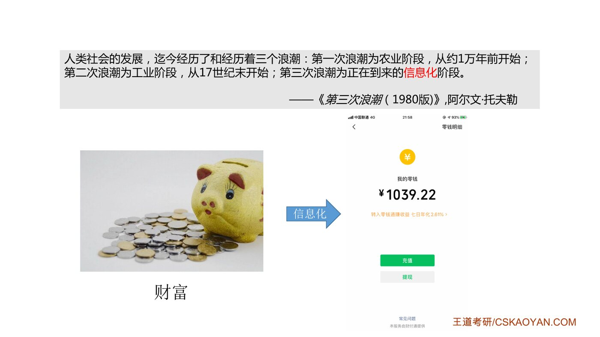
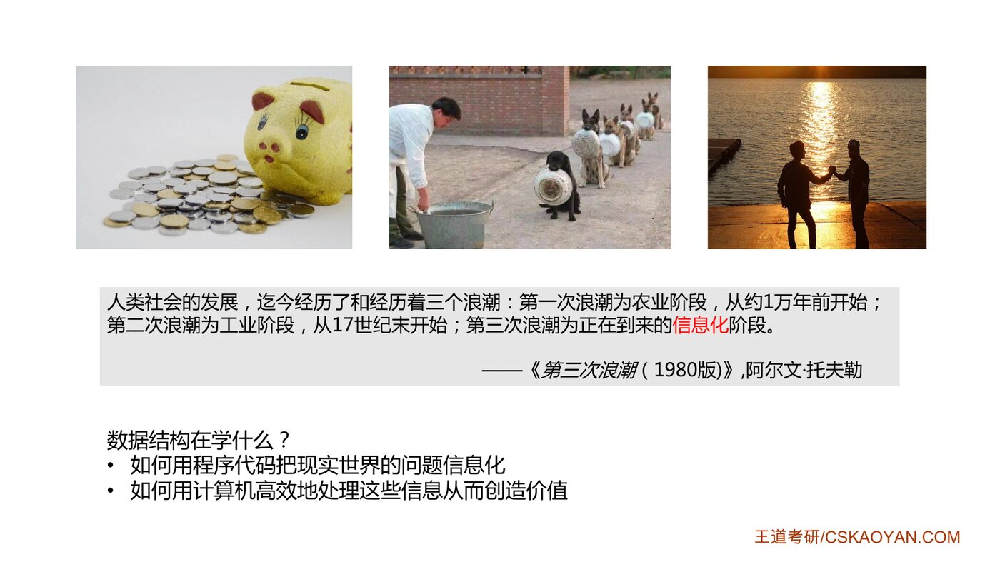
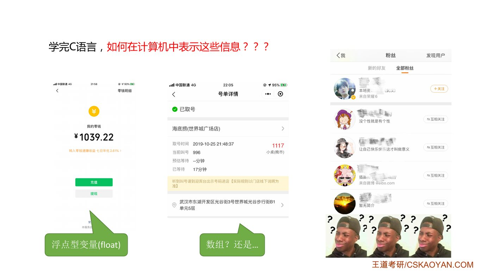
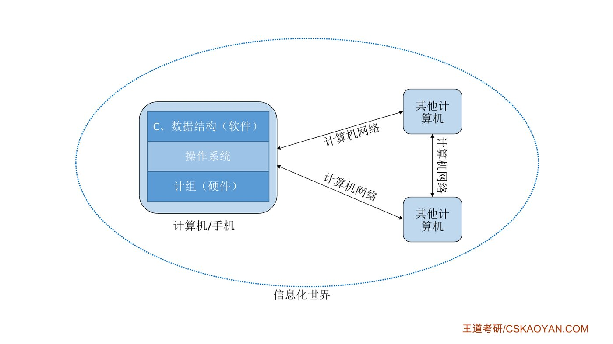

# 一、一句话回答：数据结构在学什么

::: cue
数据结构这门课要解决哪两个问题？
:::

老师开门见山，先抛出结论（老师特意说明，这是他自己的理解）：

::: {.def title="数据结构在学什么"}
1. 如何用程序代码把[现实世界的问题信息化]{.red}；
2. 如何用计算机[高效地处理这些信息]{.red}，从而创造价值。
:::

# 二、三个"信息化"的例子

::: cue
"第三次浪潮"指什么？
:::

1980 年，未来学家阿尔文·托夫勒在《第三次浪潮》中把人类社会的发展分为三个阶段：

::: {.tbl widths="1,1.4,2.6"}
| 浪潮 | 阶段 | 大致时间 |
|---|---|---|
| 第一次 | 农业阶段 | 约 1 万年前开始 |
| 第二次 | 工业阶段 | 17 世纪末开始，至今约 300 多年 |
| 第三次 | [信息化阶段]{.red} | 正在到来（就是我们现在） |
:::

{.slide width=0.6}

::: cue
三个例子分别把什么信息化了？带来了什么好处？
:::

::: teacher
"虽然现在我的财富已经达到了六位数，但是拿在手上再也没有这种沉甸甸的充实感……123456，六位数没记错哈。"老师用这个自嘲说明：钱从硬币纸币变成了手机里一串数字。
:::

::: {.tbl widths="0.8,1.6,1.6,1.8"}
| 例子 | 信息化之前 | 信息化之后 | 好处 |
|---|---|---|---|
| **财富** | 硬币、纸币放进存钱罐，沉甸甸 | 手机里一串"轻飘飘"的数字 | 存取、转账都不用搬实物 |
| **排队** | 每个人必须到场，站成一排等 | 微信上取个号，等叫号即可 | 顾客省时间，商家省等位区的空间 |
| **友谊** | 只能线下认识，物理上要相邻 | 微博互相关注就是好友 | 关系可以跨越空间建立 |
:::

{.slide width=0.6}

# 三、学完 C 语言，够用吗？

::: cue
为什么光会 C 语言还不够？
:::

老师接着追问：用学过的 C 语言，怎么在计算机里表示这三种信息？

{.slide width=0.6}

::: {.tbl widths="0.8,1.6,2.6"}
| 信息 | C 语言能想到的办法 | 问题在哪 |
|---|---|---|
| 财富（一个数） | 一个 `float` 型变量 | 没问题，很简单 |
| 排队（一串人） | 一个数组，记录每桌是大桌还是小桌 | 能做，但学完数据结构会知道[还有更好的办法]{.u}（第 3 章队列） |
| 好友关系（一张网） | ？？？ | [毫无思路]{.red}：A 关注了 B、C，B 又关注了 D……这种"多对多"的关系 C 语言基础语法表达不出来（第 6 章图） |
:::

变量只能存一个值，数组只能存一排值，但现实信息更重要的是[值与值之间的关系]{.u}，这正是 1.1 节三要素要展开的内容。

# 四、四门专业课的关系：理解信息化世界

::: cue
408 的四门课分别研究计算机的哪一层？
:::

{.slide width=0.5}

老师用一张图把 408 的四门课串起来，自底向上看一台计算机或手机：


::: tbl
| 课程 | 研究对象 | 一个生活中的问题 |
|---|---|---|
| 计算机组成原理 | 硬件（CPU、内存、主板） | 手机里的芯片是怎么"算"的？ |
| 操作系统 | 硬件之上的系统软件 | 手机同时开十个 App，谁先用 CPU？ |
| 数据结构（+ C 语言） | 应用软件的"骨架" | 微信怎么存几亿人的好友关系？ |
| 计算机网络 | 机器之间的通信 | 你发的微信怎么到了对方手机里？ |
:::

::: teacher
即便有的同学不考其中某些科目，在有时间的情况下，还是强烈建议把这四门课都学一下。只有学过这四门课，才能真正理解这个信息化世界的本质，这也是计算机专业的学生和只会写代码的人的区别。
:::

# 五、第 1 章全貌（来自王道书章首）

::: book
**考纲内容**：（一）数据结构的基本概念；（二）算法的基本概念，算法的时间复杂度和空间复杂度。

**复习提示**：本章帮助读者整体认识数据结构，[重点在于掌握算法时间复杂度和空间复杂度的分析方法]{.red}。统考真题中，无论是算法设计题还是选择题，通常都会要求分析算法的时间复杂度（有时也包括空间复杂度）。
:::

::: cue
第 1 章的知识框架是什么？哪部分是重点？
:::

```{.mermaid scale=0.7}
flowchart LR
  R(("绪论")) --> DS["数据结构<br/>（三要素）"]
  R --> AL["算法"]
  DS --> L["逻辑结构"]
  DS --> P["存储结构（物理结构）"]
  DS --> O["数据的运算"]
  L --> L1["线性结构：线性表、栈、队列"]
  L --> L2["非线性结构：树、图、集合"]
  AL --> A1["算法定义"]
  AL --> A2["五个特性：有穷性、确定性、<br/>可行性、输入、输出"]
  AL --> A3["效率的度量"]
  A3 --> T["时间复杂度 ★"]
  A3 --> S["空间复杂度"]
  style R fill:#4472C4,color:#fff,stroke:#2F5597
  style T fill:#FBE5D6,stroke:#C00000
```

::: exam
第 1 章真正"拿分"的地方在 1.2 节的**时间复杂度分析**：几乎每年都考，选择题直接考，算法设计大题也要求写出时间、空间复杂度。1.0 和 1.1 以理解为主，形成框架即可。
:::

::: teacher
"唯一可以确定的是，明天会使我们所有人大吃一惊。"（阿尔文·托夫勒）学会自己种粮食，人类才在各地定居下来，各种文明才开始萌芽；后来出现了枪炮和机械，导致一些非现代文明的灭亡（老师举的例子是清朝的灭亡）；而高度信息化的世界会带来什么，谁也说不准。外卖、打车软件，几年前谁都不敢想象。
:::

::: summary
**数据结构 = 研究怎么"存"现实世界的信息，以及怎么"算"得又快又省。**

我们正处在托夫勒说的"第三次浪潮"信息化阶段，财富、排队、友谊都被信息化了，信息化能省时间、省空间、创造价值。光会 C 语言，只能存"一个值"或"一排值"，表达不出复杂的**关系**（比如好友网），这正是数据结构要补上的。408 四门课分别对应硬件（计组）、系统（OS）、应用（数据结构）和互联（计网），合起来才是完整的信息化世界。第 1 章的考试重点是时间、空间复杂度分析。

**自测**：① 用自己的话说出数据结构要解决的两个问题。② 为什么"微博互相关注"用 C 语言基础语法"毫无思路"？
:::
