# 这一节在全书里的位置

::: cue
绪论考不考？为什么还要认真学？
:::

老师开头就交代了：绪论这一章[不是 408 大纲重点考查的大题来源]{.u}，但它给后面所有章节搭了一个**思维框架**。学完这一节，你就知道以后每遇到一种新的数据结构（线性表、栈、树、图……），应该从哪几个角度去学它。

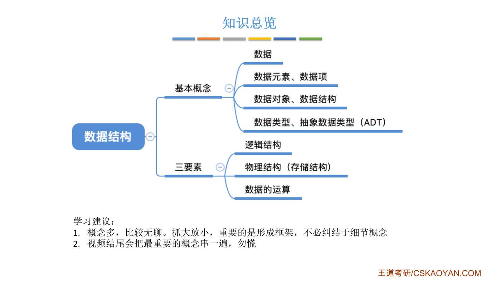{.slide width=0.65}

::: teacher
概念多，比较无聊。**抓大放小**，重要的是形成框架，不必纠结于细节概念。视频结尾会把最重要的概念串一遍，勿慌。
:::

本节的主线可以浓缩成一句话，后面所有内容都是在展开它：

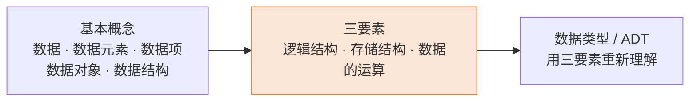

# 一、基本概念：从"数据"一路拆到"数据项"

## 1. 数据

::: cue
数据是什么？对计算机来说数据长什么样？
:::

::: def
**数据**是[信息的载体]{.red}，是描述客观事物属性的数、字符及所有[能输入到计算机中并被计算机程序识别和处理的符号的集合]{.red}。数据是计算机程序加工的**原料**。
:::

- 站在计算机的角度：它能识别、能处理的只有**二进制 0 和 1**。
- 现实世界的任何信息（数字、文字、图片、声音），只要定好一套**转换规则**，都能变成 0/1 存进计算机。课件里用"太极生两仪，两仪生四象，四象生八卦"类比：两个符号不断组合，就能表示出无穷多的东西。

## 2. 数据元素与数据项

::: cue
数据元素和数据项，谁是"基本单位"，谁是"最小单位"？
:::

::: def
**数据元素**是数据的[基本单位]{.red}，通常作为一个**整体**进行考虑和处理。一个数据元素可由若干**数据项**组成，数据项是构成数据元素的[不可分割的最小单位]{.red}。
:::

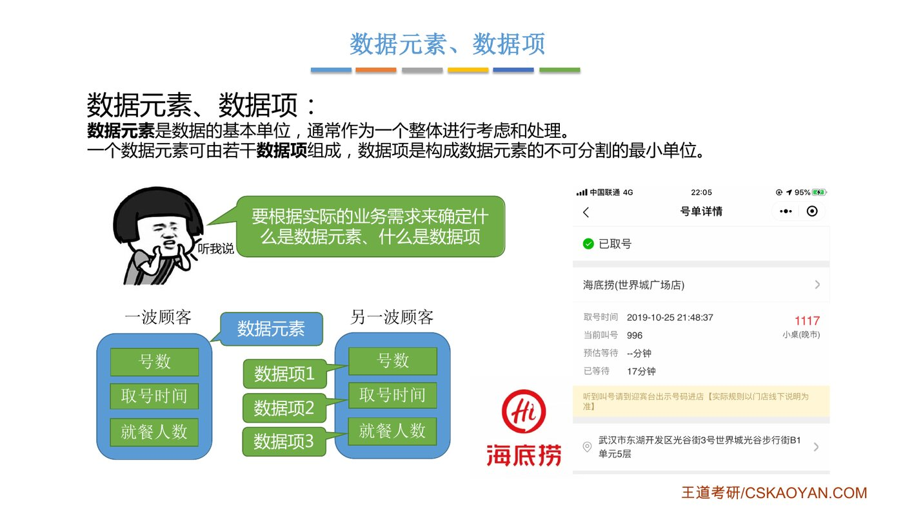{.slide width=0.8}

老师举了两个例子：

::: {.tbl widths="1.1,1.3,2.2"}
| 业务场景 | 一个**数据元素** | 它包含的**数据项** |
|---|---|---|
| 海底捞排号系统 | 一波顾客（一次取号） | 号数、取号时间、就餐人数 |
| 微博账号系统 | 一个账号 | 昵称、性别、生日……（生日还可拆成年、月、日） |
:::

- **组合项**：像"生日"这种由多个数据项（年、月、日）合起来表示一个整体信息的，叫组合项。

::: pitfall
"基本单位"和"最小单位"别混：[数据元素 = 基本单位]{.u}（处理时当作一个整体），[数据项 = 最小单位]{.u}（不可再分）。
:::

## 3. 数据结构与数据对象

::: cue
"结构"二字到底指什么？
:::

老师先从"结构"这个词讲起：小学学汉字时，"沙"是左右结构、"粥"是左中右结构、"曼"是上中下结构。所谓**结构，就是各个组成部分之间的关系**。把这个意思搬到数据上：

::: def
**数据结构**是[相互之间存在一种或多种特定关系]{.red}的数据元素的集合。

**数据对象**是具有[相同性质]{.red}的数据元素的集合，是数据的一个子集。
:::

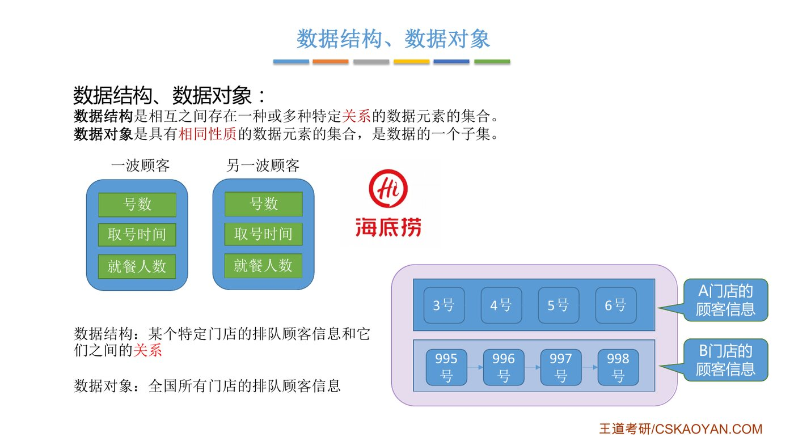{.slide width=0.8}

::: cue
数据结构和数据对象的区别？
:::

::: {.tbl widths="1,2,2"}
| | 数据结构 | 数据对象 |
|---|---|---|
| 强调什么 | 元素之间[**有关系**]{.red} | 元素[**性质相同**]{.blue}即可，不管有没有关系 |
| 海底捞例子 | **某一家**门店的排队顾客信息，以及它们之间的先后关系（3 号在 4 号前……） | **全国所有门店**的排队顾客信息 |
| 为什么 | 同一家店的顾客有排队先后 | A 店 3 号和 B 店 995 号之间没有先后关系，但它们都是"排队顾客信息" |
:::

::: book
王道书的例子更"数学"：整数数据对象可以表示为集合 $N=\{0,\pm1,\pm2,\cdots\}$。这是一个只讲"性质相同（都是整数）"、不讲元素间关系的集合，正好对应"数据对象"。书上还强调：在任何问题中，数据元素都不是孤立存在的，它们之间存在某种关系，[这种关系称为结构（Structure）]{.u}。
:::

把几个概念的包含关系画出来，层次就清楚了：

```{.mermaid scale=0.6}
flowchart TB
  D["数据<br/>（一切能被计算机处理的符号）"] -->|"挑出性质相同的"| O["数据对象<br/>（如：全国所有门店的排队信息）"]
  O -->|"由许多个组成"| E["数据元素<br/>（如：一波顾客）"]
  E -->|"由若干个组成"| I["数据项<br/>（如：号数、取号时间）"]
  E -.->|"元素之间有关系 → 构成"| S["数据结构<br/>（如：A 店的排队队列）"]
  style S fill:#FBE5D6,stroke:#ED7D31
```

::: exam
**数据结构这门课着重关注的是数据元素之间的关系，以及对这些数据元素的操作，而不关心具体的数据项内容。**（课件"知识回顾"原话）
:::

# 二、数据结构的三要素

::: cue
讨论任何一种数据结构，要关注哪三个方面？
:::

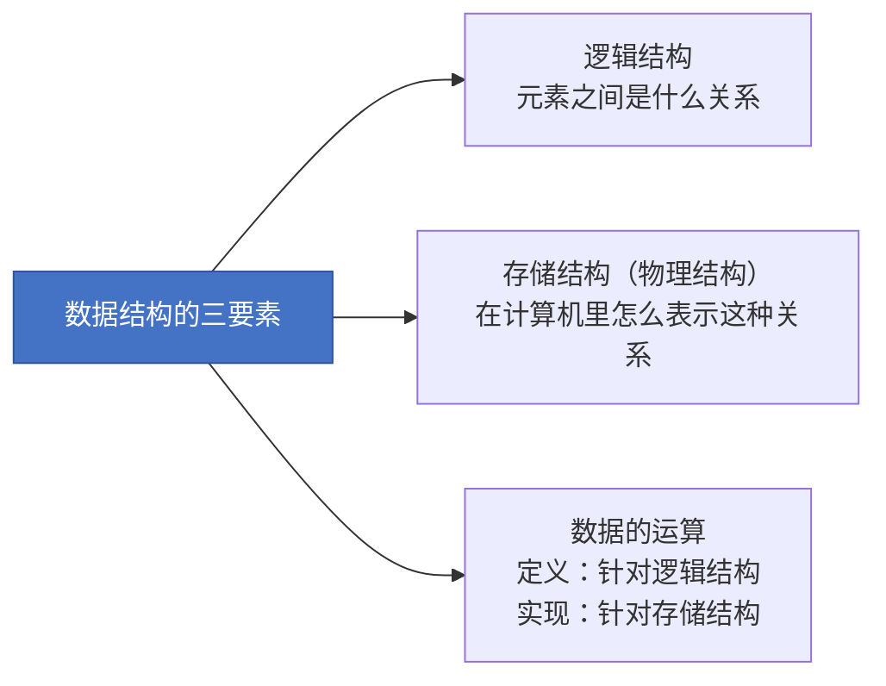

## 1. 逻辑结构：元素之间"逻辑上"是什么关系

::: cue
四种逻辑结构分别是几对几？
:::

逻辑结构是指数据元素之间的逻辑关系，是从逻辑角度对数据的描述。它[与数据在计算机中怎么存无关]{.u}，独立于计算机。

::: {.tbl widths="1,1,2.4,1.4"}
| 逻辑结构 | 关系 | 老师的例子 | 本课程哪里讲 |
|---|---|---|---|
| **集合** | 同属一个集合，[别无其他关系]{.red} | 烤盘上的各种食物；"中国最有钱的 400 个人"（只关心谁在名单里，不关心排名） | 基本不讨论（408 大纲已删除集合） |
| **线性结构** | [一对一]{.red} | 烤串；海底捞排队；富豪排行榜 | 第 2、3 章（线性表、栈、队列） |
| **树形结构** | [一对多]{.red} | 思维导图；电脑里的文件夹与文件 | 第 5 章 树与二叉树 |
| **图状（网状）结构** | [多对多]{.red} | 微信好友关系；城市之间的道路 | 第 6 章 图 |
:::

::: fix
课件和字幕说"树形结构在第四章、图在第五章、散列在第六章"，那是旧版教材的章号。按你现在这套课件和 2027 王道书的目录：**第 4 章是串，第 5 章是树与二叉树，第 6 章是图，散列表在第 7 章查找里**。
:::

{.slide width=0.65}

::: cue
"前驱""后继"怎么理解？
:::

**线性结构里的前驱与后继**：把元素编号 1、2、3、4、5 排成一排。

- 除了**第一个**元素，其余每个元素都有[唯一的前驱]{.u}（紧挨着在它前面的那个）。
- 除了**最后一个**元素，其余每个元素都有[唯一的后继]{.u}（紧挨着在它后面的那个）。

::: book
王道书把逻辑结构分成两大类，这个分法在选择题里很常见：

- **线性结构**：一般线性表；受限线性表（栈和队列、串）；线性表推广（数组）。
- **非线性结构**：集合、树形结构（一般树、二叉树）、图状结构（有向图、无向图）。

注意 [集合被归为非线性结构]{.red}。
:::

## 2. 存储结构（物理结构）：在计算机里怎么"表示出"这种关系

::: fix
**名词统一**：老师先说"物理结构"，紧接着说"很多地方更愿意把它称为存储结构"；课件两种都写，王道书用"存储结构（也称物理结构）"。[两个词完全是一回事]{.u}，本笔记下文统一叫"存储结构"。
:::

::: cue
存储结构要解决的核心问题是什么？
:::

存储结构要解决的是：把元素存进内存的同时，把它们之间的逻辑关系也表示出来。王道书：存储结构包括[数据元素的表示和关系的表示]{.u}。

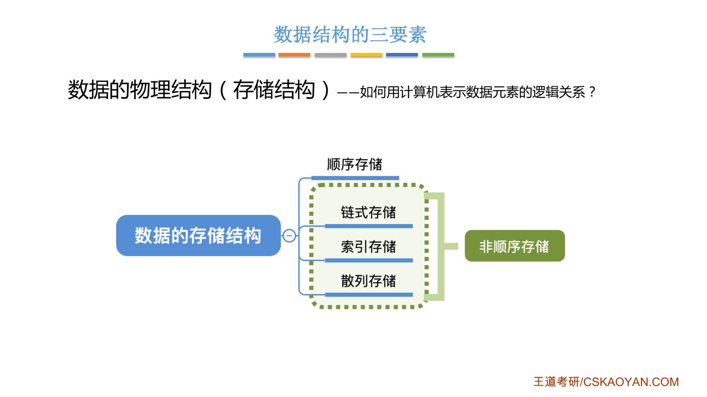{.slide width=0.62}

为了简单，绪论里只拿最简单的**线性结构**（a、b、d、e、f 排成一排）来演示四种存法：

### 顺序存储

::: cue
顺序存储靠什么表示"谁在谁后面"？
:::

把[逻辑上相邻的元素存储在物理位置上也相邻的存储单元中]{.red}，元素之间的关系由存储单元的**邻接关系**来体现。

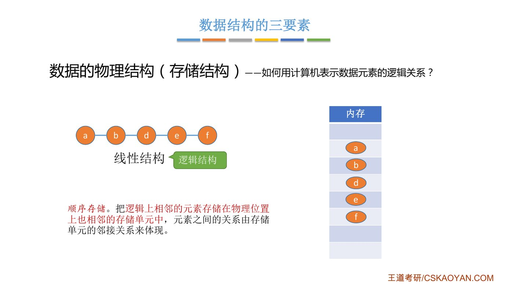{.slide width=0.6}

- 关系是"隐含"的：b 紧挨着 a 存，所以 b 就是 a 的后继，不用额外记录。
- 代价：必须给它们分配[一整片连续的存储空间]{.u}。

### 链式存储

::: cue
链式存储靠什么表示关系？要先补什么知识？
:::

逻辑上相邻的元素在物理位置上[可以不相邻]{.red}，借助指示元素存储地址的**指针**来表示元素之间的逻辑关系。

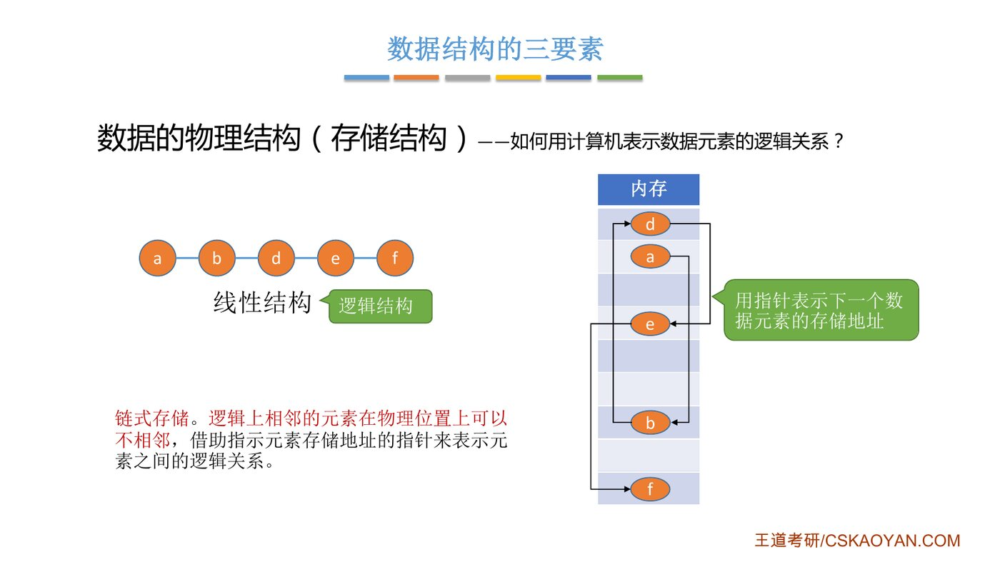{.slide width=0.6}

- 每个元素旁边多存一个"下一个元素在哪"的地址（指针），顺着指针就能把 a→b→d→e→f 串起来。
- 老师特别提醒：[对 C 语言指针不熟的同学，学数据结构之前一定要先把指针补一补]{.orange}，从第 2 章单链表开始会大量用到。

### 索引存储

::: cue
索引存储多了什么？关键字是什么？
:::

在存储元素信息的同时，还建立附加的**索引表**。索引表中的每项称为索引项，一般形式是 [（关键字，地址）]{.red}。

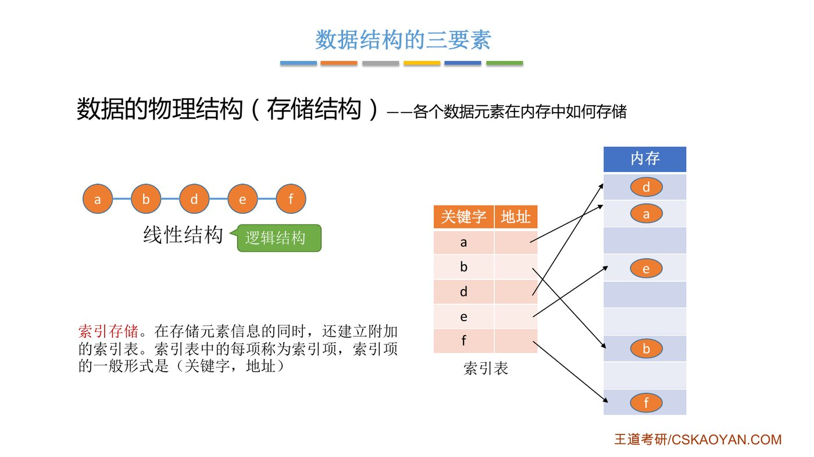{.slide width=0.6}

**关键字**：能区分不同数据元素的数据项（如海底捞的排队号）。索引表本身要额外占空间。

### 散列存储

根据元素的**关键字直接计算**出该元素的存储地址，又称哈希（Hash）存储。

老师这里不展开散列存储，第 7 章散列表再讲。现在只需记住：[用散列函数把关键字直接算成地址]{.u}。

::: cue
四种存储方式怎么分类？各自优缺点？
:::

后三种（链式、索引、散列）统称 [非顺序存储（离散存储）]{.blue}。

::: book
王道书给出了四种存储方式的优缺点，课上没细讲，但选择题常考，这里补全：

::: {.tbl widths="0.9,2,2"}
| 存储方式 | 优点 | 缺点 |
|---|---|---|
| 顺序存储 | 可以实现**随机存取**；每个元素占用最少的存储空间 | 需要连续空间，可能产生较多**外部碎片** |
| 链式存储 | 不会出现碎片，能充分利用所有存储单元 | 指针额外占空间；只能**顺序存取** |
| 索引存储 | 检索速度快 | 索引表额外占空间；增删数据要修改索引表，花额外时间 |
| 散列存储 | 检索、插入、删除都很快 | 散列函数设计不好会产生**冲突**，解决冲突要额外的时间和空间 |
:::
:::

::: deep
**随机存取**：第 $i$ 个元素的地址 = 起始地址 + $(i-1)\times$ 元素大小，一步算出，顺序存储能做到；链式存储只能顺着指针从头找，叫**顺序存取**。第 2 章会反复用到。
:::

### 绪论阶段只需理解的三点

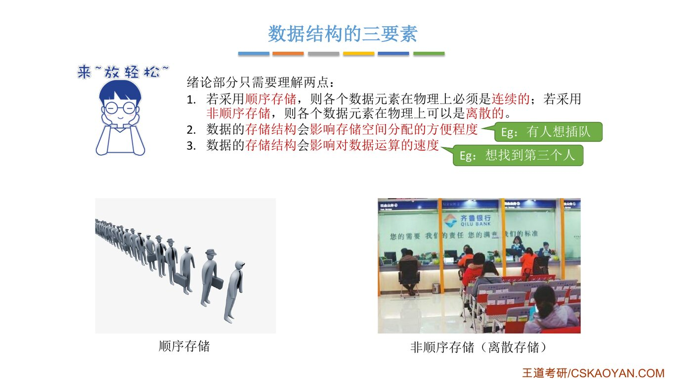{.slide width=0.65}

::: cue
存储结构会影响哪两件事？各举一个例子。
:::

1. **顺序存储**：各元素在物理上[必须连续]{.red}；**非顺序存储**：各元素在物理上[可以离散]{.red}。（传统排队每个人必须挨着站；银行取号后哪儿有空座坐哪儿。）
2. 存储结构会影响 [存储空间分配的方便程度]{.u}。
3. 存储结构会影响 [对数据运算的速度]{.u}。

把两个例子展开讲透：

::: {.tbl widths="1.2,2,2"}
| 场景 | 顺序存储（传统排队） | 非顺序存储（银行取号） |
|---|---|---|
| **有人想插队**（插入新元素） | 插入位置后面的人要[全部往后挪一位]{.red}，挪动的数据多，分配空间不方便 | 来个 VIP，给他一个更小的号，随便找个空座即可；链式存储只要[改两个指针]{.green} |
| **想找排第 3 的人**（按位置查找） | 一眼就能看到，直接定位 | 要先找第 1 个，再顺着找第 2、第 3 个，[没那么快]{.red} |
:::

## 3. 数据的运算

::: cue
运算的"定义"和"实现"分别针对什么？
:::

::: def
施加在数据上的运算包括运算的**定义**和**实现**。[运算的定义是针对逻辑结构的]{.red}，指出运算的**功能**；[运算的实现是针对存储结构的]{.red}，指出运算的**具体操作步骤**。
:::

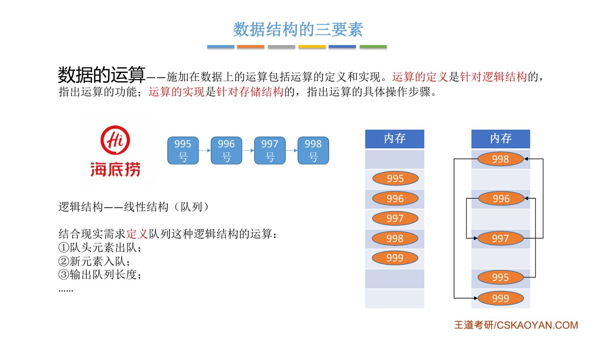{.slide width=0.65}

**第一步：结合现实需求，针对逻辑结构"定义"运算。** 排队是线性结构（队列），服务员和顾客需要：

1. 队头元素出队（服务员叫号）；
2. 新元素入队（新来一桌取号，排到队尾）；
3. 输出队列长度（告诉顾客前面还有几桌）……

这些运算只说"要做什么"，[不管数据怎么存]{.u}，对任何线性结构都通用。旧版课里老师还举了富豪排行榜：查第 $i$ 名是谁、在第 $i$ 个位置插入一个新上榜的人、删除跌出榜单的人。

**第二步：选定存储结构后，才能"实现"运算。** 同样是"999 号入队"：

- 顺序存储：必须把 999 号放在 998 号**紧挨着的下一个位置**。
- 链式存储：999 号放在内存里任意空闲位置都行，只要让 998 的指针指向 999。

::: teacher
（旧版课）定义一辆车是"四个轮子、一个方向盘、一个发动机"；实现时可以装三缸发动机，也可以装六缸。定义只说功能，实现才落到具体零件。
:::

::: book
王道书把这层关系说成一句话：[算法的设计取决于所采用的逻辑结构，而算法的实现则依赖于所选择的存储结构]{.u}。逻辑结构和存储结构密不可分：逻辑结构独立于存储结构，但存储结构不能脱离逻辑结构而存在（它就是逻辑结构在计算机上的映射）。
:::

# 三、数据类型与抽象数据类型（ADT）

## 1. 数据类型

::: cue
数据类型的两个组成部分？原子类型和结构类型的区别？
:::

::: def
**数据类型**是一个[值的集合]{.red}和定义在此集合上的[一组操作]{.red}的总称。

1. **原子类型**：其值不可再分的数据类型。
2. **结构类型**：其值可以再分解为若干成分（分量）的数据类型。
:::

::: {.tbl widths="1,1.7,1.7"}
| 类型 | 值的集合（能取哪些值） | 一组操作（能做什么） |
|---|---|---|
| `bool`（原子） | `true`、`false` | 与、或、非…… |
| `int`（原子） | $-2147483648\sim 2147483647$（4 字节补码时） | 加、减、乘、除、取模…… |
| `struct Customer`（结构） | 由业务决定，如 `num` 取 1~9999，`people` 取 1~12 | 由业务决定，如"拼桌" |
:::

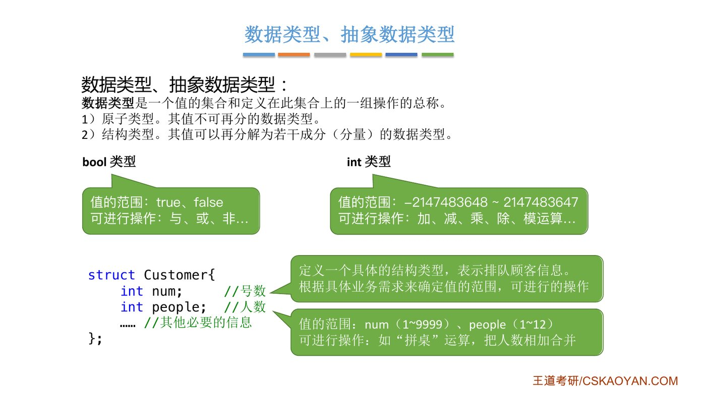{.slide width=0.65}

```c
struct Customer {
    int num;     // 号数
    int people;  // 人数
    // ……其他必要的信息
};
```

- 号数范围、人数范围都是**根据业务需求**定的：店里不可能同时排超过 9999 桌，一桌最多 12 人。
- "拼桌"运算：把两波顾客合成一桌，背后就是把两个 `people` 相加。

::: book
旧版课里老师还举了"坐标"结构体（`x` 横坐标、`y` 纵坐标），点出一个细节：结构类型里的分量之间也有逻辑关系，**`x` 和 `y` 的含义不能互换**，换了这个点就变了。它的操作可以是"两个坐标相加""求到原点的距离"，在 C 语言里每个操作写成一个函数。
:::

## 2. 抽象数据类型 ADT

::: cue
ADT 定义了三要素中的哪几个？为什么叫"抽象"？
:::

::: def
**抽象数据类型**（Abstract Data Type，ADT）是抽象数据组织及与之相关的操作。

ADT 用数学化的语言定义数据的[逻辑结构]{.red}、定义[运算]{.red}，[与具体的实现无关]{.red}。
:::

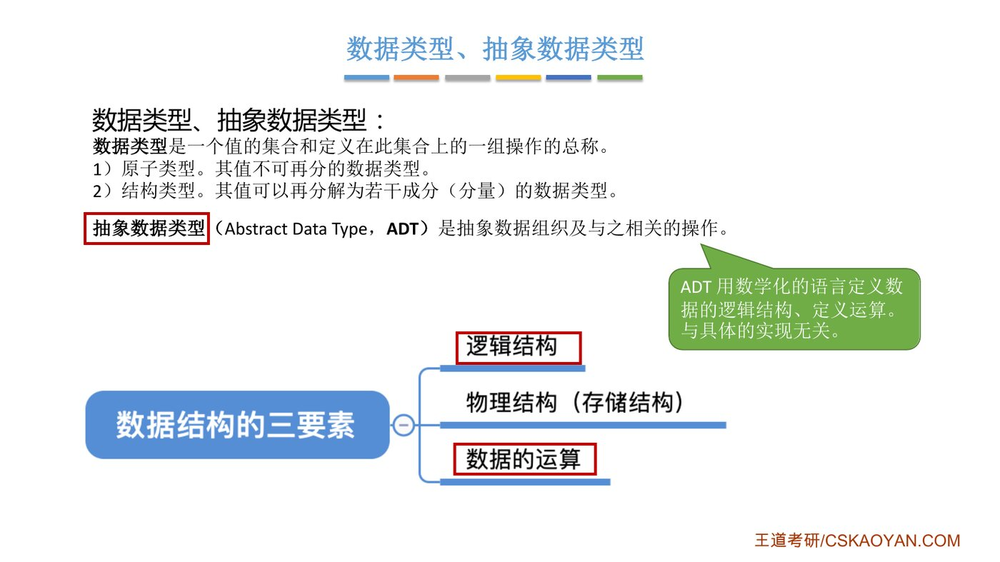{.slide width=0.65}

::: deep
**"抽象"抽掉的是存储结构和实现细节**：使用者只关心逻辑关系和能做哪些操作（就像用 `int` 不关心补码怎么存），实现者才决定顺序还是链式、代码怎么写。即"接口 vs 实现"。
:::

::: book
王道书对 ADT 的表述：一个数学模型以及定义在该模型上的一组操作。它通常是对数据的某种抽象，规定了数据的**取值范围、结构形式以及可执行的操作集合**。书中把 ADT 和原子类型、结构类型并列，作为数据类型的第三种。
:::

# 四、知识回顾与重要考点

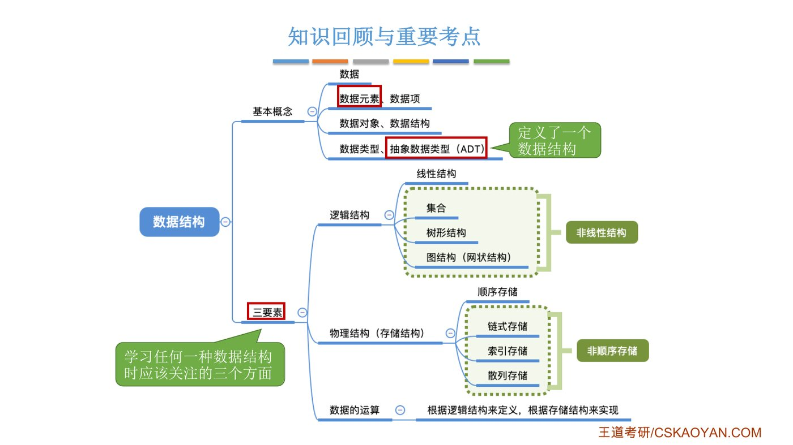{.slide width=0.8}

这一节几乎全是概念，复习时最怕"每个都眼熟、一问就说不清"。下面把本节出现的概念按出场顺序排成一张速查表，每个概念配一句话和老师用过的例子，遮住中间一列就能自测：

::: cue
遮住"一句话"一列，看着例子能说出每个概念吗？
:::

::: {.tbl widths="1.1,2.3,1.6"}
| 概念 | 一句话 | 老师的例子 |
|---|---|---|
| 数据 | 能输入计算机并被程序处理的符号的集合 | 一切最终变成 0 和 1 的东西 |
| 数据元素 | 数据的**基本单位**，作为整体处理 | 一波排队顾客、一个微博账号 |
| 数据项 | 构成数据元素的**最小单位** | 号数、取号时间、昵称 |
| 组合项 | 多个数据项合起来表示一个整体信息 | 生日 = 年 + 月 + 日 |
| 数据对象 | **性质相同**的数据元素的集合 | 全国所有门店的排队信息 |
| 数据结构 | **有关系**的数据元素的集合 | A 门店的排队队列 |
| 逻辑结构 | 元素之间逻辑上的关系，与怎么存无关 | 集合、线性、树、图 |
| 存储结构 | 逻辑关系在计算机里的表示 | 顺序、链式、索引、散列 |
| 数据的运算 | 定义看逻辑结构，实现看存储结构 | 叫号出队、取号入队 |
| 关键字 | 能区分不同数据元素的数据项 | 海底捞的排队号 |
| 数据类型 | 值的集合 + 一组操作 | `bool`、`int`、`struct Customer` |
| ADT | 只定义逻辑结构和运算，不管存储 | 使用者眼里的"说明书" |
:::

::: cue
用两句话说出"定义一个数据结构"和"实现一个数据结构"的区别。
:::

::: exam
1. 层次关系：**数据 → 数据对象 → 数据元素 → 数据项**（前一个由后一个组成）；数据元素是基本单位，数据项是最小单位。
2. **定义一个 ADT，就是定义了数据的逻辑结构和数据的运算，也就是定义了一个数据结构。**
3. **确定一种存储结构，就意味着在计算机中表示出数据的逻辑结构。存储结构不同，运算的具体实现也不同。确定了存储结构，才能实现数据结构。**
4. 学习任何一种数据结构，都从三个方面入手：逻辑结构、存储结构、数据的运算。
:::

::: pitfall
- 逻辑结构**独立于**存储结构（它只是我们脑子里的关系）；存储结构**不能脱离**逻辑结构（它是逻辑结构在计算机里的映射）。
- 一个完整的数据结构要把三要素都确定下来：逻辑结构 + 存储结构 + 数据的运算。只说了"线性结构"，还不知道它在计算机里怎么存、能做什么操作。
- 存储数据时，不仅要存各数据元素的值，还要存[元素之间的关系]{.red}。
- "数据元素"和"数据项"：一个是基本单位（整体处理），一个是最小单位（不可再分），别记反。
:::

::: summary
**这一节就讲了一件事：学一种数据结构，要看哪几个方面。**

数据由数据元素组成，数据元素由数据项组成，怎么划分看业务。数据结构关心的不是数据项的内容，而是**数据元素之间的关系**。围绕"关系"有三个问题：逻辑上是什么关系（集合、线性、树、图），在计算机里怎么存才能把关系表示出来（顺序、链式、索引、散列），以及要对它做哪些操作（定义看逻辑结构，实现看存储结构）。ADT 只写"逻辑结构 + 运算"，是一个数据结构的"说明书"；选好存储结构、写出代码，才算把它真正实现。

**自测**：① 为什么说存储结构会影响运算速度？用"插队"和"找第 3 个人"各说一遍。② "有序表"和"顺序表"哪个是逻辑结构？
:::
