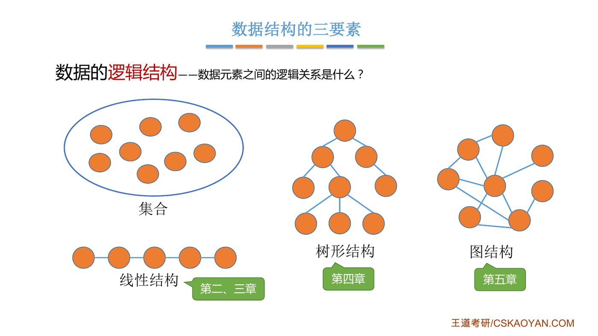

# 这组题在考什么

::: cue
这 7 道题围绕哪个核心概念？
:::

7 道题几乎都在考同一件事：[数据结构的三要素]{.red}，也就是逻辑结构、存储结构（物理结构）、数据的运算，以及三者之间谁依赖谁。正课 1.1 笔记第二节的这张图，做题时一直放在脑子里就够了：

```{.mermaid scale=0.6}
flowchart LR
  T["数据结构的三要素"] --> L["逻辑结构<br/>元素之间是什么关系<br/>独立于计算机"]
  T --> P["存储结构（物理结构）<br/>关系在计算机里怎么表示<br/>依赖逻辑结构"]
  T --> R["数据的运算<br/>定义：针对逻辑结构<br/>实现：针对存储结构"]
  style T fill:#4472C4,color:#fff,stroke:#2F5597
```

| 题号 | 考点 | 答案 |
|---|---|---|
| 选择 01 | 三要素有哪些 | C |
| 选择 02 | 线性 / 非线性结构的划分 | A |
| 选择 03 | 一个名字是逻辑结构还是存储结构 | C |
| 选择 04 | 逻辑结构与存储结构的依赖关系 | A |
| 选择 05 | 存储数据时要存什么 | C |
| 综合 01 | 逻辑、物理结构都相同，是不是同一种数据结构 | 不一定 |
| 综合 02 | 同一逻辑结构、不同存储方式，运算效率不同 | 举例 |

::: fix
**这节的视频不用看。** 习题讲解视频只讲了选择题 1–5，内容是几个生活类比（容器、学号名单和宿舍），没有正课和书上之外的新知识点，也没有需要截图保存的图。两道综合题视频没讲，下面按书上解析整理，并补了两处说得不严谨的地方。
:::

# 一、单项选择题

::: cue
三要素是哪三个？缺一个行不行？
:::

::: {.q title="01"}
一个完整的数据结构通常应包含以下哪些要素（　）？

| A. 数据元素及其存储方式
| B. 数据的逻辑结构和物理结构
| C. 数据的逻辑结构、存储结构以及在其上定义的基本操作
| D. 数据对象和数据元素之间的关系
:::

[**答案：C**]{.red}

::: video
老师把数据结构比作**装数据的容器**：瓶子、盒子这种"形状"是逻辑结构；纸盒还是铁盒、用什么材料做出来是存储结构；倒水、装水是基本操作。存储结构也叫物理结构。
:::

::: jiexi
一个完整的数据结构由三部分组成：逻辑结构（如线性、树形等）、存储结构（物理表示）以及在其上定义的基本操作（如插入、删除等）。只有选项 C 同时包含这三个核心要素。
:::

::: add
B 是最常见的错选，它漏掉了运算。三要素里"数据的运算"和"基本操作"是同一个东西，课件叫运算，题目叫基本操作。综合题 01 会专门考"只看逻辑和物理结构够不够"。
:::

::: cue
线性结构的判定标准？集合算线性还是非线性？
:::

::: {.q title="02"}
下列四种数据结构中，（　）是非线性数据结构。

| A. 树　　　　B. 字符串　　　　C. 队列　　　　D. 栈
:::

[**答案：A**]{.red}

::: video
线性结构：除第一个和最后一个元素外，每个元素都[有且仅有一个前驱和一个后继]{.u}，是一对一的关系，比如字符串 "hello"。不满足这一条的都是非线性结构，比如集合、树、图。树是一对多：一个领导下面带好几个人。
:::

::: jiexi
树和图是典型的非线性数据结构，其他选项都属于线性数据结构。
:::

::: recall
正课里王道书的分类，选择题最爱考这一张：

- **线性结构**：一般线性表；受限线性表（[栈、队列、串]{.u}）；线性表推广（数组）。
- **非线性结构**：[集合]{.red}、树形结构、图状结构。

栈和队列只是"操作受限"，元素之间仍是一对一，所以还是线性的；串是元素为字符的线性表。
:::

{.slide width=0.55}

::: cue
怎么一眼判断一个名字是逻辑结构还是存储结构？
:::

::: {.q title="03"}
下列选项中，属于逻辑结构的是（　）。

| A. 顺序表　　　　B. 哈希表　　　　C. 有序表　　　　D. 单链表
:::

[**答案：C**]{.red}

::: video
老师用一个班 30 个人举例：按学号 1～30 排成的名单是逻辑结构（而且是有序的线性表，即有序表）；这 30 人实际住在哪间宿舍、坐在教室哪个位置，是物理结构。顺序表、单链表第 2 章学，哈希表在查找那章学，都属于存储结构。
:::

::: jiexi
顺序表、哈希表和单链表是三种不同的数据结构，既描述逻辑结构，又描述存储结构和数据运算。而有序表是指关键字有序的线性表，仅描述元素之间的逻辑关系，它既可链式存储，又可顺序存储，所以属于逻辑结构。
:::

::: add
**判别方法：看名字里有没有"怎么存"的信息。**

| 名字里带存储方式 → 存储结构 | 名字只说关系 → 逻辑结构 |
|---|---|
| 顺序表、单链表、双链表、循环链表、静态链表、哈希表（散列表）、顺序栈、链栈、循环队列 | 线性表、有序表、栈、队列、串、树、二叉树、图 |

以后遇到"××是一种什么结构"的题，先看它能不能既用数组存、又用指针存。能，就说明它没规定怎么存，是逻辑结构。比如有序表可以用顺序表存，也可以用链表存，所以是逻辑结构。
:::

::: cue
谁独立于谁？一种逻辑结构能对应几种存储结构？
:::

::: {.q title="04"}
下列关于数据结构的说法中，正确的是（　）。

| A. 数据的逻辑结构独立于其存储结构
| B. 数据的存储结构独立于其逻辑结构
| C. 数据的逻辑结构唯一决定其存储结构
| D. 数据结构仅由其逻辑结构和存储结构决定
:::

[**答案：A**]{.red}

::: video
还是用班级举例：先有按学号排的名单（逻辑结构），之后排宿舍、排座位都照着这份名单来（存储结构）。所以名单不受宿舍怎么排的影响，A 对；宿舍是照着名单排的，B 错。同一份名单既能排宿舍、又能排座位，存法不止一种，C 错。D 漏了运算，比如可以安排同学上课吃饭，但不能打骂，运算也是有限制的。
:::

::: jiexi
数据的逻辑结构是从面向实际问题的角度出发的，只采用抽象表达方式，独立于存储结构，数据的存储方式有多种不同的选择；而数据的存储结构是逻辑结构在计算机上的映射，它不能独立于逻辑结构而存在。数据结构包括三个要素，缺一不可。
:::

::: add
四个选项正好对应三要素之间的三条关系，记住这三条就能秒选：

1. 逻辑结构独立于存储结构；存储结构[依赖]{.red}逻辑结构。（A 对，B 错）
2. 一种逻辑结构可以有[多种]{.red}存储结构，比如线性表可以存成顺序表，也可以存成链表。（C 错）
3. 数据结构要三要素都齐。（D 错，同第 01 题）
:::

::: cue
存数据时除了值还要存什么？"存关系"具体怎么存？
:::

::: {.q title="05"}
在存储数据时，通常不仅要存储各数据元素的值，还要存储（　）。

| A. 数据的操作方法　　　　B. 数据元素的类型
| C. 数据元素之间的关系　　D. 数据的存取方法
:::

[**答案：C**]{.red}

::: video
一个班 30 人可以用一张线性表（数组）存；公司里的上下级关系就得用树来存。关系不同，存法就不同，这正是数据结构这门课的核心。很多人会选 B，觉得 `int a = 0` 存了类型。但类型在定义里就规定好了，就像数据库的表定义已经写明了每个字段的类型，存每条数据时不用再存一遍。
:::

::: jiexi
在存储数据时，不仅要存储数据元素的值，而且要存储数据元素之间的关系。
:::

::: add
视频对 A、D 只说了句"同样的道理"，这里补全：

- **A 操作方法**是算法，也就是程序代码，属于"运算的实现"，不和每个数据一起存。
- **D 存取方法**（随机存取 / 顺序存取）是选定存储结构之后[自然产生的性质]{.u}，不是额外存进去的东西。顺序存储能随机存取，链式存储只能顺序存取。

另外，"存储关系"不一定是多存一份数据。回顾正课的四种存储结构：**顺序存储**靠物理位置相邻来表示逻辑上相邻，关系藏在位置里；**链式存储**才是额外存指针，显式地把关系记下来。两种都算存了关系，只是方式不同。
:::

# 二、综合应用题

::: cue
逻辑结构、物理结构都一样，还会是两种不同的数据结构吗？
:::

::: {.q title="综合 01"}
对于两种不同的数据结构，逻辑结构或物理结构一定不相同吗？
:::

[**答案：不一定。**]{.red} 两种数据结构的逻辑结构和物理结构可以完全相同，区别在于[运算]{.u}不同。

::: jiexi
应该注意到，数据的运算也是数据结构的一个重要方面。对于两种不同的数据结构，它们的逻辑结构和物理结构完全有可能相同。比如二叉树和二叉排序树，二叉排序树可以采用二叉树的逻辑表示和存储方式，前者通常用于表示层次关系，而后者通常用于排序和查找。虽然它们的运算都有建立树、插入结点、删除结点和查找结点等功能，但对于二叉树和二叉排序树，这些运算的定义是不同的，以查找结点为例，二叉树的平均时间复杂度为 $O(n)$，而二叉排序树的平均时间复杂度为 $O(\log_2 n)$。
:::

::: fix
书上说二叉排序树查找"平均 $O(\log_2 n)$"，前提是树比较平衡。如果按有序序列依次插入，二叉排序树会退化成一条链，查找变成 $O(n)$。这在第 7 章查找里会细讲，这里先知道 $O(\log_2 n)$ 不是无条件成立的。
:::

::: add
书上的例子要到第 5、7 章才学，可以先用第 3 章就会学到的**栈和队列**理解：两者的逻辑结构都是线性结构，都可以用数组顺序存储，但栈只能在一端进出（后进先出），队列一端进、另一端出（先进先出）。逻辑结构和存储结构都一样，只因为运算的规定不同，就是两种数据结构。这也正是第 01 题 B 选项错的原因。
:::

::: cue
同一逻辑结构换一种存法，哪些运算变快、哪些变慢？
:::

::: {.q title="综合 02"}
举例说明对相同的逻辑结构，同一种运算在不同存储方式下实现时，其运算效率不同。
:::

::: jiexi
线性表既可以用顺序存储方式实现，又可以用链式存储方式实现。在顺序存储方式下，在线性表中插入和删除元素，平均要移动近一半的元素，时间复杂度为 $O(n)$；而在链式存储方式下，插入和删除的时间复杂度都是 $O(1)$。
:::

::: fix
链表插入、删除是 $O(1)$，前提是[已经拿到了要操作位置的前驱结点指针]{.u}，此时只改指针。如果题目说的是"在第 $i$ 个位置插入"，链表得先从头往后找到第 $i-1$ 个结点，这一步是 $O(n)$，整体还是 $O(n)$。链表省掉的是**移动元素**，而不是查找位置。第 2 章算单链表插入删除时会反复用到这一点。
:::

::: recall
正课里老师用排队举过一组对照（课件"存储结构的影响"那页），它同时给出了一个反例，作答时两个方向都写上更完整：

| 运算 | 顺序存储（传统排队） | 链式存储（银行取号） |
|---|---|---|
| 插入、删除 | 后面的元素要整体挪动，$O(n)$ | 只改指针，$O(1)$（已知位置时） |
| 按位置找第 $i$ 个 | 地址直接算出来，[随机存取]{.red}，$O(1)$ | 只能从头顺着指针找，$O(n)$ |
:::

::: summary
**这 7 题考的都是三要素。** 逻辑结构独立于计算机，存储结构依赖逻辑结构，而且一种逻辑结构可以有多种存法；数据结构要三要素都齐，逻辑和物理结构都相同的两种数据结构，可以只因运算不同而不同（栈和队列、二叉树和二叉排序树）。判断一个名字是逻辑还是存储结构，看它有没有规定"怎么存"：有序表、栈、队列是逻辑结构，顺序表、链表、哈希表是存储结构。存数据要存值和关系，顺序存储靠位置表示关系，链式存储靠指针。

**自测**：① 循环队列是逻辑结构还是存储结构？② 链表插入为什么说是 $O(1)$，什么情况下不是？③ 字符串、栈、集合，哪个是非线性结构？
:::
