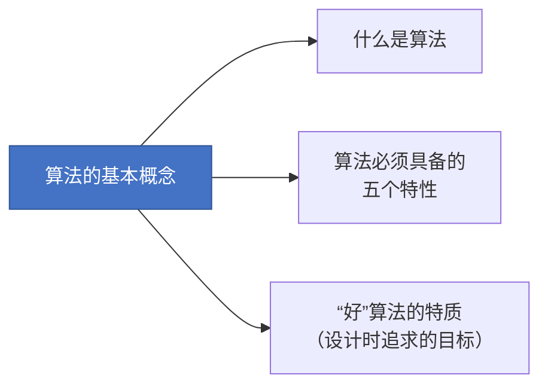
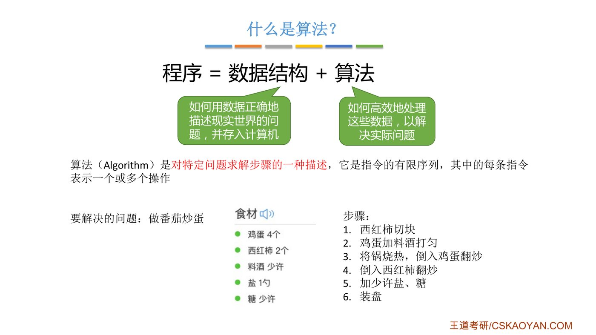
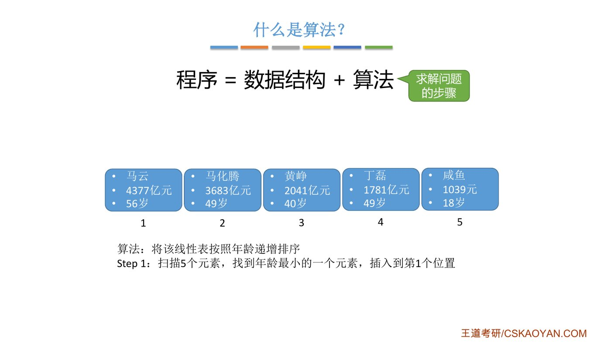
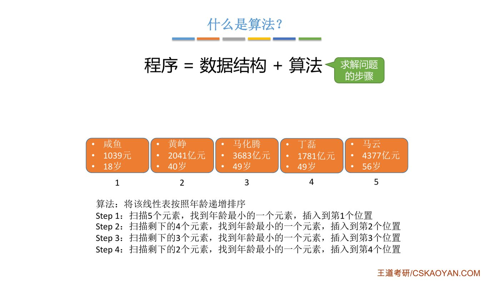
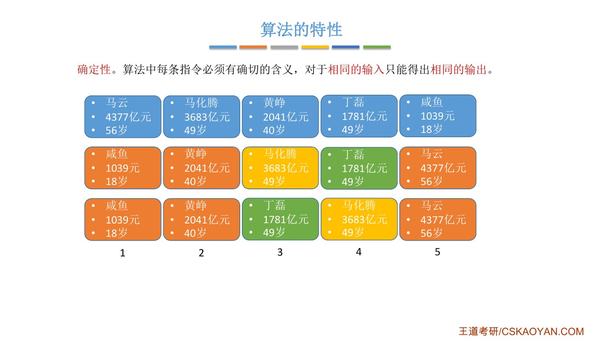
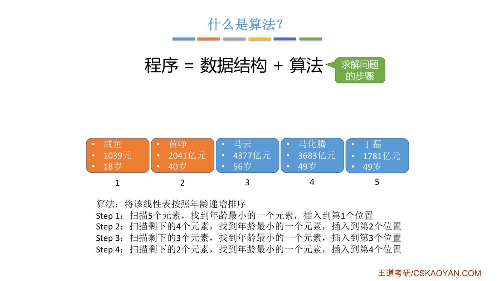
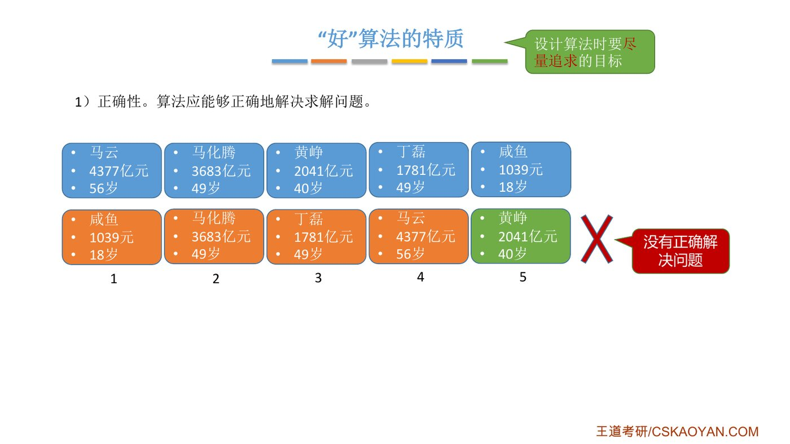
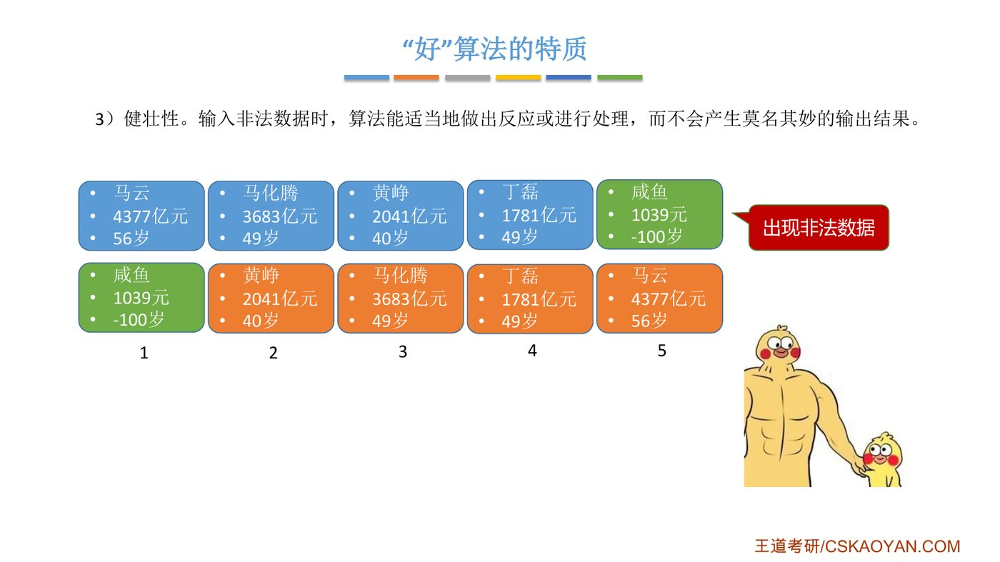
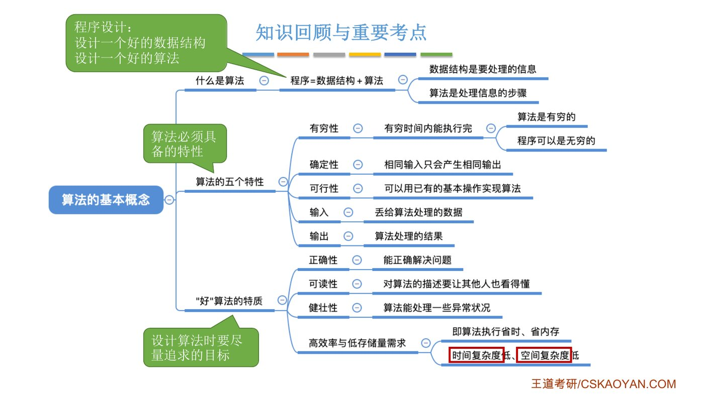
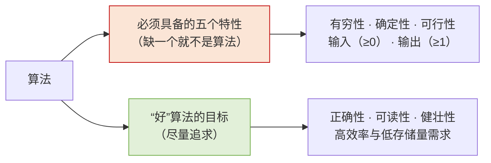

# 本节要回答的三个问题

::: cue
本节三个知识点？
:::

# 一、什么是算法

## 1. 程序 = 数据结构 + 算法

::: cue
数据结构和算法各管什么？
:::

老师引用了计算机界的一句名言（出自 Pascal 语言之父 Niklaus Wirth）：

::: {.def title="程序 = 数据结构 + 算法"}
- **数据结构**：如何用数据[正确地描述现实世界的问题]{.red}，并存入计算机；
- **算法**：如何[高效地处理这些数据]{.red}，以解决实际问题。
:::

::: def
**算法**（Algorithm）是对特定问题[求解步骤]{.red}的一种描述，它是指令的[有限序列]{.red}，其中的每条指令表示一个或多个操作。
:::

老师坦白说"这个定义还看不懂对吧？没关系"，然后用做菜来解释：

{.slide width=0.65}

::: {.tbl widths="1,1.6,1.6"}
| | 做番茄炒蛋 | 计算机程序 |
|---|---|---|
| 原料 | 鸡蛋 4 个、西红柿 2 个、料酒、盐、糖 | **数据结构**：给计算机提供要加工的"食材" |
| 步骤 | ① 西红柿切块 ② 鸡蛋加料酒打匀 ③ 锅烧热，倒入鸡蛋翻炒 ④ 倒入西红柿翻炒 ⑤ 加盐、糖 ⑥ 装盘 | **算法**：描述计算机如何一步步处理这些食材 |
| 结果 | 一盘番茄炒蛋 | 问题被正确解决 |
:::

## 2. 一个具体的算法：按年龄递增排序

::: cue
老师用什么例子演示"算法就是求解步骤"？
:::

现在有一个线性表，存了 5 个人的财富信息，要求[将该线性表按照年龄递增排序]{.red}：

{.slide width=0.65}

老师给出的步骤是：

- **Step 1**：扫描 5 个元素，找到年龄最小的一个元素，插入到第 1 个位置；（咸鱼，18 岁）
- **Step 2**：扫描剩下的 4 个元素，找到年龄最小的一个元素，插入到第 2 个位置；（黄峥，40 岁）
- **Step 3**：扫描剩下的 3 个元素，找到年龄最小的一个元素，插入到第 3 个位置；
- **Step 4**：扫描剩下的 2 个元素，找到年龄最小的一个元素，插入到第 4 个位置。

{.slide width=0.65}

$n$ 个元素只需 $n-1$ 趟（最后剩下的自然最大）。这个"每趟挑最小放前面"的思路就是第 8 章**简单选择排序**的雏形。

::: cue
算法可以用哪些方式描述？
:::

算法可以用**自然语言**（如上面的 Step 1~4）、**伪代码**或**真正的程序代码**（C、Java……）描述。要让计算机执行，最终得写成代码。

# 二、算法必须具备的五个特性

下面五个特性[缺一个就不能称为算法]{.red}，和后面"好算法的目标"不是一回事。

## 1. 有穷性

::: cue
算法和程序的区别？死循环是算法吗？
:::

::: def
**有穷性**：一个算法必须总在执行[有穷步之后结束]{.red}，且每一步都可在[有穷时间内完成]{.red}。
:::

::: {.tbl widths="1,1,2.4"}
| | 能否无穷运行 | 例子 |
|---|---|---|
| **算法** | [必须有穷]{.red} | 用有限步骤解决某个特定的问题 |
| **程序** | [可以无穷]{.blue} | 微信：只要不关，它就一直运行下去，所以微信是程序，**不是**算法 |
:::

- 死循环不是算法，因为它不满足有穷性。

## 2. 确定性

::: cue
"相同输入只能得出相同输出"怎么理解？老师给的排序步骤为什么不满足确定性？
:::

::: def
**确定性**：算法中每条指令必须有[确切的含义]{.red}，对于[相同的输入只能得出相同的输出]{.red}。
:::

{.slide width=0.65}

5 个人里**马化腾和丁磊都是 49 岁**。按年龄递增排序，下面两种结果看起来都"对"：

- 结果一：……马化腾、丁磊……
- 结果二：……丁磊、马化腾……

如果同一份输入，这次跑出结果一、下次跑出结果二，那它就**不具备确定性**，不能称为算法。

::: deep
**老师埋的伏笔**：前面 Step 3 说"找年龄最小的一个"，可剩下的马化腾、丁磊都是 49 岁，这句有歧义，所以那份步骤[严格说不满足确定性]{.red}。补一条规则"年龄相同时，原来在前的仍排在前"即可。这条规则在第 8 章叫排序的**稳定性**。
:::

{.slide width=0.7}

## 3. 可行性

::: cue
可行性的大白话？
:::

::: def
**可行性**：算法中描述的操作都可以通过[已经实现的基本运算执行有限次]{.red}来实现。
:::

老师的大白话：给出的方案必须能用计算机代码实现。

## 4. 输入

::: cue
算法可以没有输入吗？输入来自哪里？
:::

::: def
**输入**：一个算法有[零个或多个输入]{.red}，这些输入取自于某个特定的对象的集合。
:::

- **可以没有输入**：比如打印 "Hello World" 的程序，不需要任何输入。
- "特定的对象的集合"就是 1.1 节讲的**数据对象**：本例中的输入数据，都来自"个人财富信息"这个数据对象。

## 5. 输出

::: def
**输出**：一个算法有[一个或多个输出]{.red}，这些输出是与输入有着某种特定关系的量。
:::

- **不可能没有输出**：算法总要给出一个结果。Hello World 虽然没干什么有意义的事，但它也打印了一行字。

老师的联想：算法类似函数 $y=f(x)$，$x$ 是输入，$f$ 是算法，$y$ 是输出。

::: pitfall
**输入 0 个可以，输出 0 个不行。**"算法可以没有输出"这句话是错的。
:::

::: {.tbl widths="1,3"}
| 特性 | 一句话记忆 |
|---|---|
| 有穷性 | 有限步、有限时间内必须结束（程序可以无穷，算法不行） |
| 确定性 | 每步无歧义，相同输入 → 相同输出 |
| 可行性 | 能用已有的基本运算执行有限次实现 |
| 输入 | **≥ 0** 个，来自某个数据对象 |
| 输出 | **≥ 1** 个，与输入有特定关系 |
:::

# 三、“好”算法的特质

[不满足五个特性 → 不是算法]{.u}；[不满足下面的目标 → 是算法，但不是好算法]{.u}。

## 1. 正确性

::: cue
"没有正确解决问题"的算法还算算法吗？
:::

::: def
**正确性**：算法应能够正确地解决求解问题。
:::

{.slide width=0.7}

如果排序后黄峥（40 岁）排在了最后，说明没有正确解决问题。[但它依然可以称为一个算法]{.u}，只是不是好算法。

## 2. 可读性

::: cue
可读性对考研答题有什么启示？
:::

::: def
**可读性**：算法应具有良好的可读性，以帮助人们理解。
:::

- 代码可读性差，队友看不懂，团队协作出问题；过一段时间自己回头看也看不懂。
- 成熟稳重的程序员会在关键地方**写注释**。

::: teacher
以后写代码题的时候，也要给改卷老师写一写注释，不要用纯代码来描述你的逻辑。你写了注释，改卷老师肯定也会更喜欢。
:::

## 3. 健壮性

::: cue
健壮性的例子？
:::

::: def
**健壮性**：输入[非法数据]{.red}时，算法能适当地做出反应或进行处理，而不会产生莫名其妙的输出结果。
:::

{.slide width=0.7}

- 年龄 $-100$ 岁显然非法。健壮的算法会检查出来并给出报错提示；不健壮的算法"将错就错"，照样把它排进去。

## 4. 高效率与低存储量需求

::: cue
"高效率""低存储量需求"分别对应哪个术语？
:::

::: {.tbl widths="1.3,1.6,1.6"}
| 目标 | 大白话 | 对应术语（1.2.2、1.2.3 节） |
|---|---|---|
| 高效率 | 执行时**花的时间少** | [时间复杂度低]{.red} |
| 低存储量需求 | 执行过程中**不费内存** | [空间复杂度低]{.red} |
:::

::: book
王道书补充：效率是指算法的执行时间，存储量需求是指执行过程中所需的最大存储空间，[二者都与问题规模密切相关]{.u}。"问题规模"这个词是下一节的核心，请留意。
:::

# 四、知识回顾：“必须有”和“最好有”

{.slide width=0.8}

::: cue
"五个特性"和"好算法的目标"分别有哪些？如何区分？
:::

::: exam
1. **程序 = 数据结构 + 算法**。设计一个好程序 = 设计一个合适的数据结构 + 设计一个高效的算法。
2. 算法的**五个特性**：有穷性、确定性、可行性、输入、输出。
3. **好算法的目标**：正确性、可读性、健壮性、高效率与低存储量需求。
:::

::: pitfall
- [正确性、可读性、健壮性]{.u}**不属于**算法的五个特性，它们是设计目标。两组词混在一起出现时，先问自己："缺了它还算不算算法？"缺了就不算的是特性，缺了只是"不好"的是目标。
- 算法必须有穷，程序可以无穷。
- 算法可以没有输入，但至少有一个输出。
:::

::: summary
**算法就是解决某个特定问题的、写得清清楚楚的有限步骤。**

数据结构负责把信息存好（食材），算法负责把信息处理好（菜谱），程序 = 数据结构 + 算法。一个东西要称得上算法，必须满足五个特性：会结束（有穷）、无歧义（确定）、做得到（可行）、可以没有输入、但一定有输出。在这个及格线之上，好算法还要追求正确、易读、健壮、又快又省内存。最后这一条"快"和"省"，就是接下来两节要量化的时间复杂度和空间复杂度。

**自测**：① 为什么说老师最初给出的排序步骤"不能算作算法"？怎么改？② 微信是算法吗？
:::
