# 本节定位：第 1 章真正的考点

::: cue
时间复杂度在考试里有多重要？
:::

::: exam
王道书考点追踪：**分析算法的时间复杂度**几乎年年考（2011—2014、2017、2019、2022、2025 年选择题；算法设计大题也几乎每年要求写时间复杂度）。这是整个第 1 章分量最重的一节。
:::

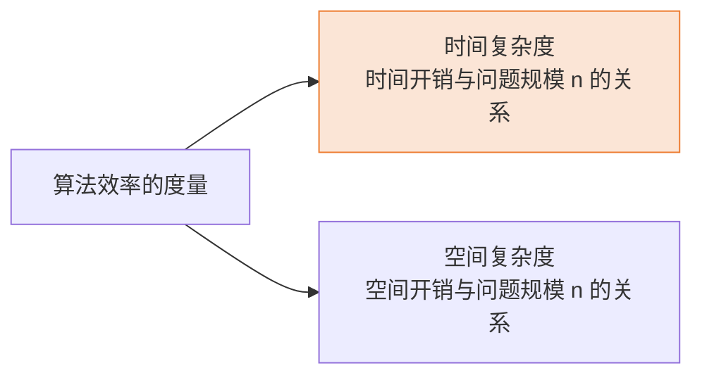

# 一、怎么评估一个算法的时间开销？

## 1. 先跑一遍再计时？（事后统计）

::: cue
"事后统计"有哪四个问题？
:::

最直觉的想法：把算法写成代码，让机器跑一下，看运行了多久。老师指出这样做有四个问题：

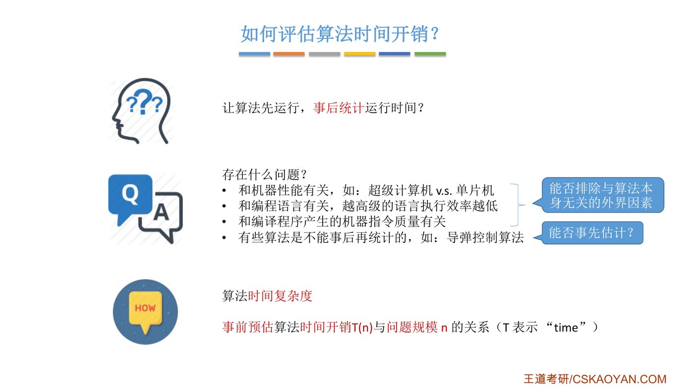{.slide width=0.65}

::: {.tbl widths="2.2,2"}
| 问题 | 说明 |
|---|---|
| ① 和**机器性能**有关 | 超级计算机 vs 单片机，同一个算法跑出来的时间天差地别 |
| ② 和**编程语言**有关 | 越高级的语言执行效率越低，同一算法用 C 写一般比用 Java 写快 |
| ③ 和**编译程序产生的机器指令质量**有关 | 编译器优化得好不好也会影响时间（看不懂没关系） |
| ④ 有些算法**不能事后再统计** | 比如导弹控制算法：等导弹打错地方再统计时间，已经没有意义了 |
:::

①②③ 说明要排除与算法无关的外界因素，④ 说明要事先估计，于是有了时间复杂度：[事前预估时间开销 $T(n)$ 与问题规模 $n$ 的关系]{.red}。

## 2. 问题规模 $n$ 是什么

::: cue
为什么时间开销要写成 $n$ 的函数？
:::

问题规模越大，运行时间理应越长，所以时间开销 $T$ 应表示成问题规模 $n$ 的函数，分析时间复杂度的关键就是[用 $n$ 表示出 $T$]{.u}。

# 二、用算法表白：“爱你 n 遍”

::: cue
算法 1 中每一行分别执行了几次？为什么 while 的判断是 3001 次？
:::

老师从电影《复仇者联盟 4》里钢铁侠和女儿的对话（"爱你三千遍"）出发，写了一个"逐步递增型爱你"：

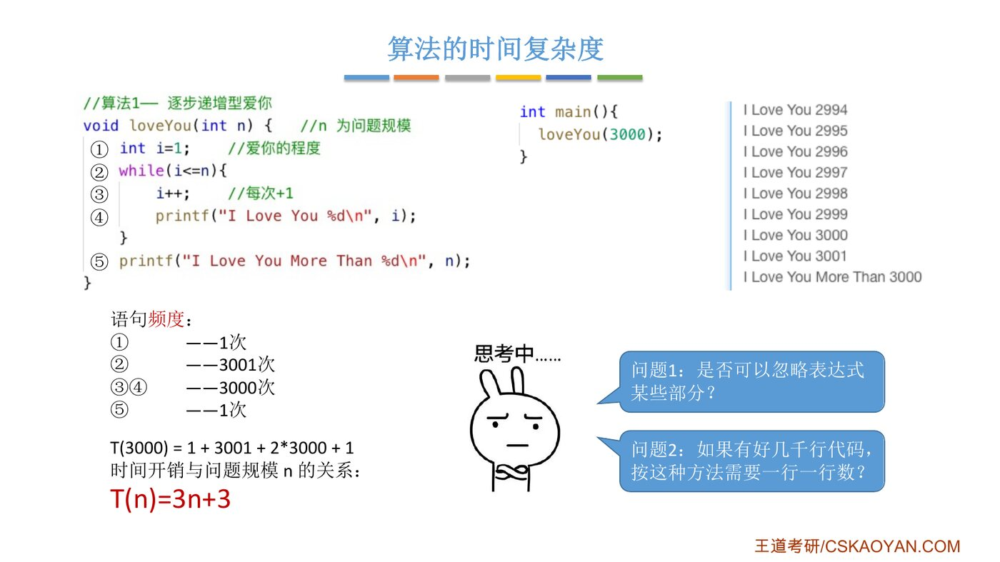{.slide width=0.8}

```c
//算法1— 逐步递增型爱你
void loveYou(int n) {         //n 为问题规模
    int i=1;                  // ① 爱你的程度
    while(i<=n){              // ②
        i++;                  // ③ 每次+1
        printf("I Love You %d\n", i);    // ④
    }
    printf("I Love You More Than %d\n", n);  // ⑤
}

int main(){
    loveYou(3000);
}
```

**先做一个简化**：假设执行任意一行代码所花的时间都相同（实际不同，但考虑太多因素就没法评价了）。那么只要数出每行执行了几次就行。

::: fix
**名词统一**：课件写"语句频度"，老师口头说"执行次数"，王道书写"频度"，三者是[同一个意思：某条语句被执行的次数]{.u}。本笔记下文统一说"执行次数"。
:::

::: {.tbl widths="0.6,1.4,3"}
| 语句 | 执行次数（n = 3000） | 为什么 |
|---|---|---|
| ① | 1 次 | 只在开头执行一次 |
| ② | [3001 次]{.red} | 循环体执行 3000 次，每次执行前都要判断一次；第 3000 次循环后 `i` 变成 3001，还要**再判断一次**发现 `3001<=3000` 不成立，才跳出循环。所以判断比循环体多 1 次 |
| ③④ | 各 3000 次 | 循环体执行了 3000 次 |
| ⑤ | 1 次 | 循环结束后执行一次 |
:::

$$T(3000) = 1 + 3001 + 2\times 3000 + 1$$

把 3000 换成 $n$，得到时间开销与问题规模的关系：

$$T(n) = 1 + (n+1) + 2n + 1 = 3n + 3$$

::: pitfall
"`while` 的条件判断比循环体多执行一次"这个细节，问"某条语句执行了几次"时会用到。`for(i=1; i<=n; i++)` 也一样：`i<=n` 判断 $n+1$ 次，循环体执行 $n$ 次。
:::

由此引出两个问题：**问题 1** 表达式能否简化？**问题 2** 几千行代码也要逐行数吗？

# 三、问题 1：表达式能不能简化？——大 O 表示法

## 1. 只保留最高阶，再去掉系数

::: cue
为什么可以只看最高阶项？为什么系数也能忽略？
:::

假设有三个算法：

$$T_1(n)=3n+3,\qquad T_2(n)=n^2+3n+1000,\qquad T_3(n)=n^3+n^2+9999999$$

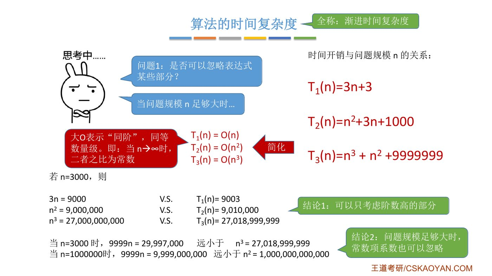{.slide width=0.8}

取 $n=3000$，比较"只保留最高阶项"和"精确值"：

::: {.tbl widths="1,1.6,1.6"}
| | 只保留最高阶项 | 精确值 |
|---|---|---|
| $T_1$ | $3n = 9000$ | $9003$ |
| $T_2$ | $n^2 = 9{,}000{,}000$ | $9{,}010{,}000$ |
| $T_3$ | $n^3 = 27{,}000{,}000{,}000$ | $27{,}018{,}999{,}999$ |
:::

差别都很小。**结论 1**：[可以只考虑阶数高的部分]{.red}。

::: teacher
你有 3000 块，舍友有 9000 块，谁也不比谁富多少，是同一个数量级；有人有 900 万，那才不是一个数量级。
:::

再看一组对比：

- 当 $n=3000$ 时，$9999n = 29{,}997{,}000$，[远小于]{.u} $n^3 = 27{,}018{,}999{,}999$；
- 当 $n=1000000$ 时，$9999n = 9{,}999{,}000{,}000$，[远小于]{.u} $n^2 = 1{,}000{,}000{,}000{,}000$。

**结论 2**：[问题规模足够大时，常数项系数也可以忽略]{.red}。哪怕系数是 9999，只要 $n$ 够大，低阶终究打不过高阶。

## 2. 大 O 记法

::: cue
大 O 的数学含义？
:::

::: {.def title="大 O 表示“同阶”"}
$T(n)=O(f(n))$ 表示 $T(n)$ 与 $f(n)$ 同阶、同等数量级。即当 $n\to\infty$ 时，二者之比为常数：

$$\lim_{n\to\infty}\frac{T(n)}{f(n)} = k\quad(k\ \text{为常数})$$
:::

于是：$T_1(n)=O(n)$，$T_2(n)=O(n^2)$，$T_3(n)=O(n^3)$。

**操作口诀**：[只保留最高阶项 → 系数变为 1 → 外面套上 $O(\ )$]{.u}。

::: book
王道书给出的是更严格的定义：若存在正常数 $C$ 和 $n_0$，使得对所有 $n\ge n_0$，都有 $0\le T(n)\le C f(n)$，则记 $T(n)=O(f(n))$。它表示 **当 $n$ 足够大时，$T(n)$ 的增长速度不超过 $f(n)$ 的常数倍**。

书上还说：时间复杂度通常由算法中**基本运算（最深层循环内的关键操作）**的执行次数决定，该执行次数的数量级即为整个算法的时间复杂度。
:::

::: deep
课上说"同阶"，书上的定义只要求"增长不超过 $f(n)$ 的常数倍"，所以严格说 $3n+3=O(n^2)$ 也成立。但做题一律写**最紧的上界**：$3n+3$ 写 $O(n)$。
:::

## 3. 加法规则与乘法规则

::: cue
加法规则、乘法规则分别是什么？各在什么代码结构里用？
:::

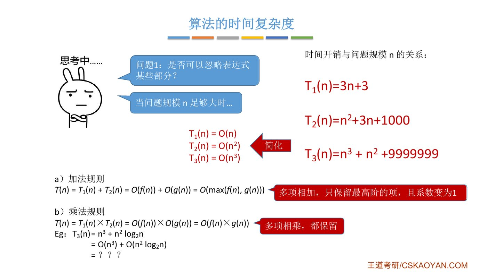{.slide width=0.8}

::: def
**a）加法规则**：$T(n)=T_1(n)+T_2(n)=O(f(n))+O(g(n))=O(\max(f(n),g(n)))$
[多项相加，只保留最高阶的项，且系数变为 1]{.red}。

**b）乘法规则**：$T(n)=T_1(n)\times T_2(n)=O(f(n))\times O(g(n))=O(f(n)\times g(n))$
[多项相乘，都保留]{.red}。
:::

::: book
王道书把两个规则和代码结构对应起来，这样就知道"什么时候用哪个"：

- **加法规则**：两段代码**顺序执行**，总复杂度取两者中的高阶项。
- **乘法规则**：一段代码**嵌套在另一段内部**，总复杂度为两者之积。

例：设语句块 `a{}`、`b{}`、`c{}` 的时间复杂度分别为 $O(1)$、$O(n)$、$O(n^2)$：

```c
a{ b{} c{} }     // b、c 并列在 a 里：O(n) + O(n^2) = O(n^2)，加法规则
a{ b{ c{} } }    // c 嵌套在 b 里：O(n) × O(n^2) = O(n^3)，乘法规则
```
:::

## 4. 谁的阶更高？——“常对幂指阶”

::: cue
常见数量级从小到大怎么排？口诀？
:::

用加法规则时必须判断"谁的阶更高"。课件例子：

$$T_3(n)=n^3+n^2\log_2 n = O(n^3)+O(n^2\log_2 n) = \ ???$$

把 $n^3$ 写成 $n^2\cdot n$，两项都有 $n^2$，于是只需比较 $n$ 和 $\log_2 n$ 谁增长得快：

$$\lim_{n\to\infty}\frac{\log_2 n}{n}\ \overset{\text{洛必达}}{=}\ \lim_{n\to\infty}\frac{1}{n\ln 2}=0$$

极限为 0，说明 $n\to\infty$ 时 **$n$ 比 $\log_2 n$ 变大的速度快很多**，所以 $T_3(n)=O(n^3)$。

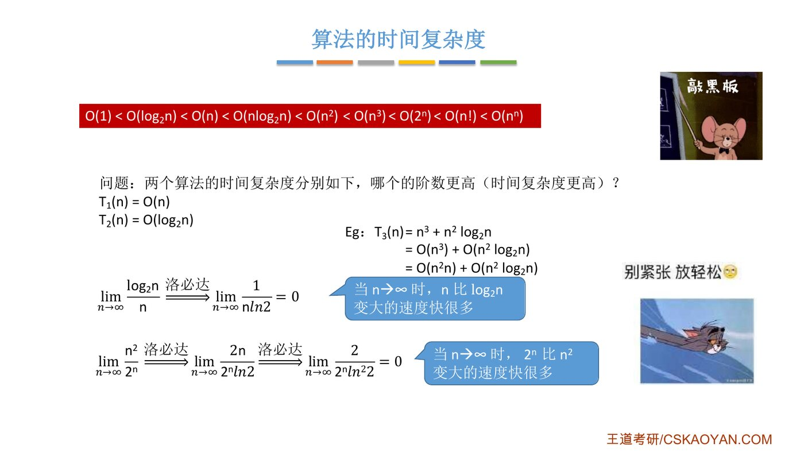{.slide width=0.8}

同理可证 $2^n$ 比 $n^2$ 增长得快：

$$\lim_{n\to\infty}\frac{n^2}{2^n}\ \overset{\text{洛必达}}{=}\ \lim_{n\to\infty}\frac{2n}{2^n\ln 2}\ \overset{\text{洛必达}}{=}\ \lim_{n\to\infty}\frac{2}{2^n\ln^2 2}=0$$

::: {.def title="常见数量级（必须背熟）"}
$$O(1)<O(\log_2 n)<O(n)<O(n\log_2 n)<O(n^2)<O(n^3)<O(2^n)<O(n!)<O(n^n)$$

口诀：[**常对幂指阶**]{.red}（常数 < 对数 < 幂函数 < 指数 < 阶乘），老师称之为"巴拉拉能量——常对幂指阶"。
:::

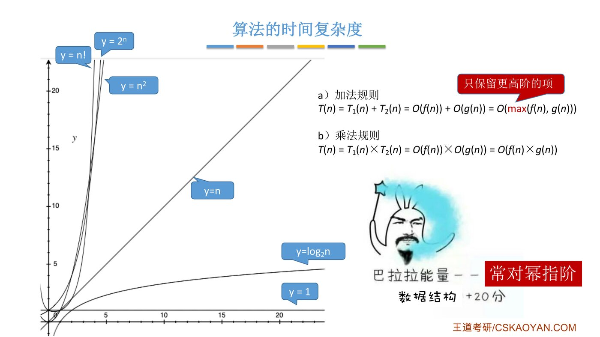{.slide width=0.62}

::: pitfall
- 不要求会用极限证明，**记住顺序**就够用。
- $n\log_2 n$ 夹在 $n$ 和 $n^2$ 之间，是排序算法里最常见的"好"复杂度（第 8 章）。
- 对数的底数在大 O 里不重要（$\log_2 n$ 和 $\log_3 n$ 只差常数倍），但课件和真题习惯写 $\log_2 n$。
:::

# 四、问题 2：几千行代码也要一行行数吗？

## 结论 1：顺序执行的代码只影响常数项

::: cue
顺序执行的代码要不要数？
:::

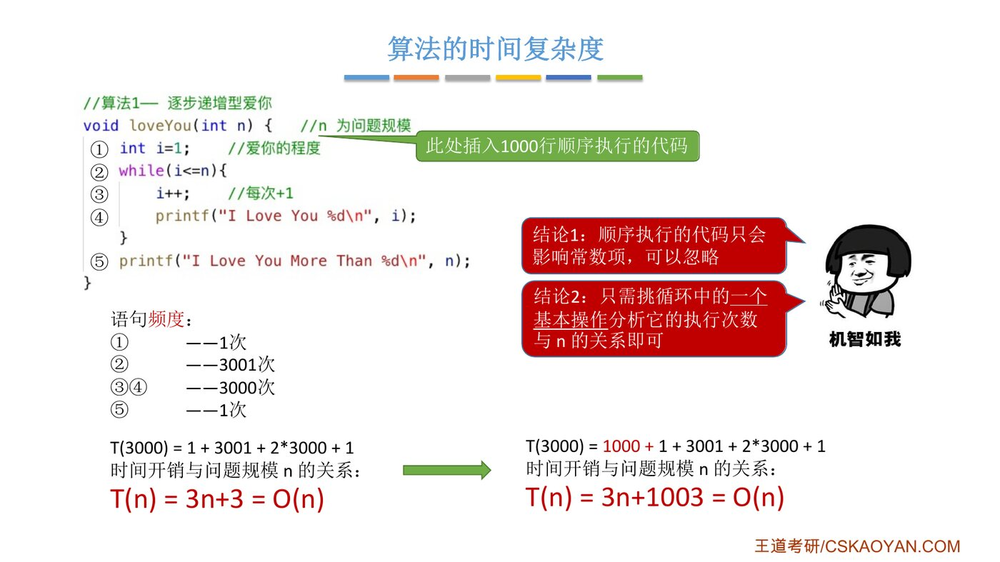{.slide width=0.8}

在算法 1 前面插入 1000 行**顺序执行**（不带循环）的代码：

$$T(3000)=1000+1+3001+2\times3000+1,\qquad T(n)=3n+1003=O(n)$$

常数从 3 变成 1003，但数量级仍是 $O(n)$。[顺序执行的代码只会影响常数项，可以忽略]{.red}。

## 结论 2：只需挑循环中的一个基本操作

::: cue
循环里的三条语句都要数吗？
:::

之前分析循环时，把 ②③④ 都数进去了，得到 $3n$。但最后系数总要变成 1，所以[只需挑循环中的一个基本操作，分析它的执行次数与 $n$ 的关系即可]{.red}。比如只看语句 ④，执行 $n$ 次，$T(n)=O(n)$。

## 结论 3：多层嵌套循环只看最深层

::: cue
嵌套循环怎么分析？
:::

```c
//算法2— 嵌套循环型爱你
void loveYou(int n) {          //n 为问题规模
    int i=1;                   //爱你的程度
    while(i<=n){               // 外层循环执行 n 次
        i++;                   //每次+1
        printf("I Love You %d\n", i);
        for (int j=1; j<=n; j++){        // 嵌套两层循环
            printf("I am Iron Man\n");   // 内层循环共执行 n^2 次
        }
    }
    printf("I Love You More Than %d\n", n);
}
```

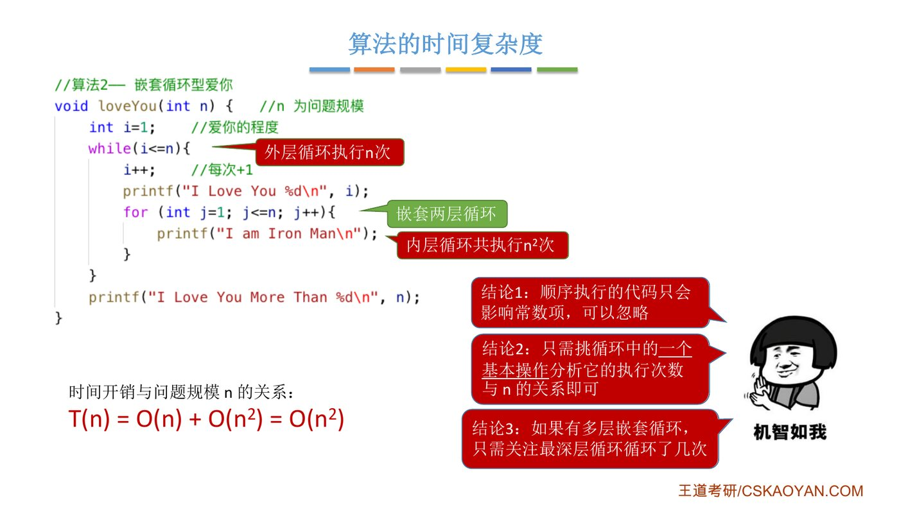{.slide width=0.8}

外层每执行 1 次，内层就执行 $n$ 次；外层执行 $n$ 次，内层一共执行 $n\times n=n^2$ 次：

$$T(n) = O(n) + O(n^2) = O(n^2)$$

[如果有多层嵌套循环，只需关注最深层循环循环了几次]{.red}。

::: deep
**三步法**（课件知识回顾）：① 找最深层循环里的一个基本操作；② 求它的执行次数 $x=f(n)$；③ $O(x)$ 即 $T(n)$。最深层执行次数最多，所以加法规则下只留它。
:::

# 五、两个小练习

## 小练习 1：指数递增型爱你

::: cue
循环变量每次翻倍时，循环执行几次？
:::

```c
//算法3— 指数递增型爱你
void loveYou(int n) {      //n 为问题规模
    int i=1;               //爱你的程度
    while(i<=n){
        i=i*2;             //每次翻倍
        printf("I Love You %d\n", i);
    }
    printf("I Love You More Than %d\n", n);
}
```

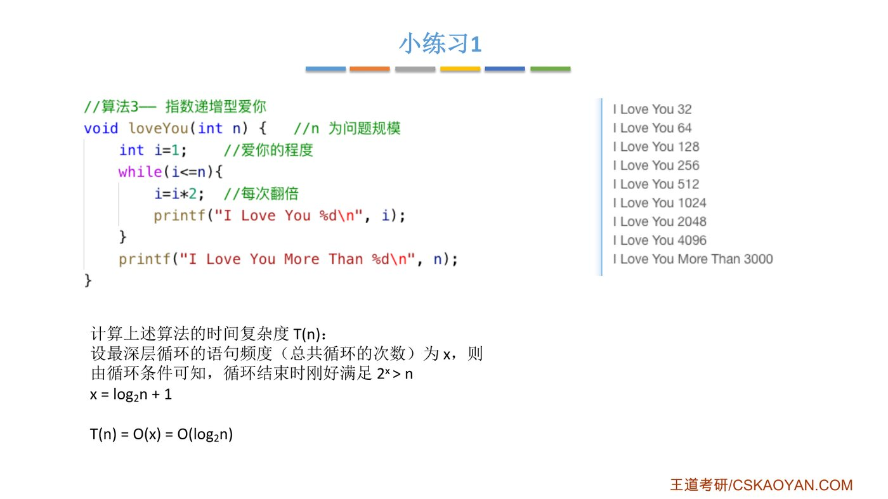{.slide width=0.8}

设最深层循环的执行次数（总共循环的次数）为 $x$。追踪 `i` 的变化：

::: {.tbl widths="1.6,1,1,1,1,1.4"}
| 循环次数 | 第 1 次后 | 第 2 次后 | 第 3 次后 | …… | 第 $x$ 次后 |
|---|---|---|---|---|---|
| `i` 的值 | $2$ | $4$ | $8$ | …… | $2^x$ |
:::

由循环条件可知，循环结束时刚好满足 $2^x>n$，解得 $x=\log_2 n+1$，所以

$$T(n)=O(x)=O(\log_2 n)$$

::: deep
课件的 $x=\log_2 n+1$ 是近似，精确值 $x=\lfloor\log_2 n\rfloor+1$（$n=3000$ 时循环 12 次，最后打印 4096）。不影响数量级 $O(\log_2 n)$。
:::

## 小练习 2：搜索数字型爱你

::: cue
为什么同一个算法会有不同的时间复杂度？最好、最坏、平均怎么算？
:::

```c
//算法4— 搜索数字型爱你
void loveYou(int flag[], int n) {    //n 为问题规模
    printf("I Am Iron Man\n");
    for(int i=0; i<n; i++){          //从第一个元素开始查找
        if(flag[i]==n){              //找到元素n
            printf("I Love You %d\n", n);
            break;                   //找到后立即跳出循环
        }
    }
}

//flag 数组中乱序存放了 1~n 这些数
int flag[n]={1...n};
loveYou(flag, n);
```

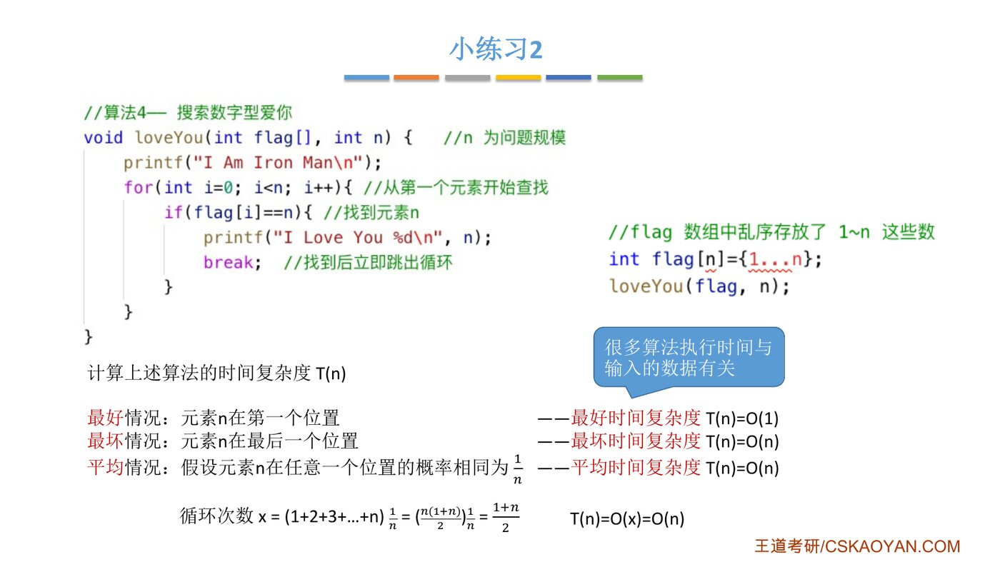{.slide width=0.8}

这个算法的循环次数**取决于元素 $n$ 在数组的哪个位置**，也就是取决于输入数据：

::: {.tbl widths="1,2.3,1.4"}
| 情况 | 分析 | 结果 |
|---|---|---|
| 最好情况 | 元素 $n$ 在第一个位置，循环 1 次 | [最好时间复杂度]{.green} $T(n)=O(1)$ |
| 最坏情况 | 元素 $n$ 在最后一个位置，循环 $n$ 次 | [最坏时间复杂度]{.red} $T(n)=O(n)$ |
| 平均情况 | 假设元素 $n$ 在任意一个位置的概率相同，为 $\frac{1}{n}$ | [平均时间复杂度]{.blue} $T(n)=O(n)$ |
:::

平均情况的计算（数学期望）：元素 $n$ 在第 $k$ 个位置时要循环 $k$ 次，概率都是 $\frac1n$，所以

$$x = (1+2+3+\cdots+n)\cdot\frac{1}{n} = \frac{n(1+n)}{2}\cdot\frac{1}{n} = \frac{1+n}{2},\qquad T(n)=O(x)=O(n)$$

## 三种时间复杂度

::: cue
三种时间复杂度的定义？一般考虑哪种？
:::

::: def
- **最坏时间复杂度**：最坏情况下算法的时间复杂度；
- **平均时间复杂度**：所有输入示例[等概率出现]{.red}的情况下，算法的期望运行时间；
- **最好时间复杂度**：最好情况下算法的时间复杂度。
:::

::: teacher
很多算法的执行时间与输入的数据有关。一般只考虑**最坏**和**平均**时间复杂度。最好时间复杂度参考意义不大，因为评价一个算法时，主要是想看它在不好的情况下会不会出现运行时间过长的问题。
:::

::: book
王道书的说法：通常以**最坏时间复杂度**作为算法效率的评价标准，因为它提供了运行时间的**确定性上界**。

书上也举了一个查找的例子，只是方向反过来（从后往前找）。为了和课件对上，这里换成课件的命名：在数组 `flag[0..n-1]` 中**从最后一个元素往前**找值为 `n` 的元素（书上原文用的是数组 `A` 和要找的值 `k`，意思完全一样）。若 `flag[n-1]` 就是 `n`，基本操作 `i--` 一次都不用执行（最好）；若数组里根本没有 `n`，要执行 $n$ 次（最坏）。
:::

# 六、王道书“归纳总结”：两类常见题型的分析方法

王道书章末"归纳总结"把时间复杂度题归为两类，课上没细讲，补在这里。

## 类型 1：循环主体中的变量参与循环条件的判断

::: cue
循环变量参与判断时，怎么列式求解？
:::

**方法**：设基本运算的执行次数为 $t$，建立 $t$ 与 $n$ 之间的关系式，解出 $t=f(n)$。若 $f(n)$ 的最高次幂为 $k$，则时间复杂度为 $O(n^k)$（对数、根号同理）。

```c
// 例 1
int i=1;
while(i<=n)
    i=i*2;

// 例 2
int y=5;
while((y+1)*(y+1)<n)
    y=y+1;
```

- **例 1**：设 `i=i*2` 执行 $t$ 次，则 $2^t\le n$，解得 $t\le\log_2 n$，故 $T(n)=O(\log_2 n)$。（和小练习 1 一样）
- **例 2**：设 `y=y+1` 执行 $t$ 次，则 $t=y-5$，且 $(t+5+1)(t+5+1)<n$，解得 $t<\sqrt{n}-6$，故 $T(n)=O(\sqrt{n})$。

## 类型 2：循环主体中的变量与循环条件无关

::: cue
递归程序的时间复杂度怎么求？
:::

此类问题可用**数学归纳法**或**直接累计循环执行次数**。多层循环从内向外逐层计算，忽略单步语句、条件判断语句，只关注主体语句的执行次数。

- **递归程序**：通常建立递推关系式求解。例如每次调用做常数次操作、再递归调用规模为 $n-1$ 的自己：

$$T(n)=1+T(n-1)=1+1+T(n-2)=\cdots=(n-1)+T(1),\qquad T(n)=O(n)$$

- **非递归程序**：直接累加次数即可。

# 七、小故事：为什么只关心 $n$ 足够大的情况

::: cue
为什么时间复杂度只关注 $n$ 很大的情况？
:::

::: teacher
很多算法的性能问题，只有在问题规模足够大的时候才会暴露出来。我工作时写过一个玩家匹配对战的算法，用了两层嵌套循环，时间复杂度 $O(n^2)$。自己测试只用了两三百个玩家，逻辑没问题。部署到线上后，同时在线用户有几十万，算法一跑，几十万玩家都受到了影响。后来师傅帮我优化成了 $O(n)$。
:::

::: {.tbl widths="1.5,1.6,1.6"}
| 规模 | $O(n^2)$ 的基本操作次数 | $O(n)$ 的基本操作次数 |
|---|---|---|
| 本地测试 $n\approx 100$ | $10^4$（一万） | $10^2$ |
| 线上 $n=10^5$（十万） | $10^{10}$（一百亿） | $10^5$（十万） |
:::

::: fix
字幕里老师说优化后"时间开销也就是 1 万这么多"，按 $n=10^5$、$O(n)$ 算应为 $10^5$（十万），口误不影响结论：$10^5$ 比 $10^{10}$ 小了整整 $10^5$ 倍。
:::

# 八、知识回顾：拿到一段代码怎么求 $T(n)$

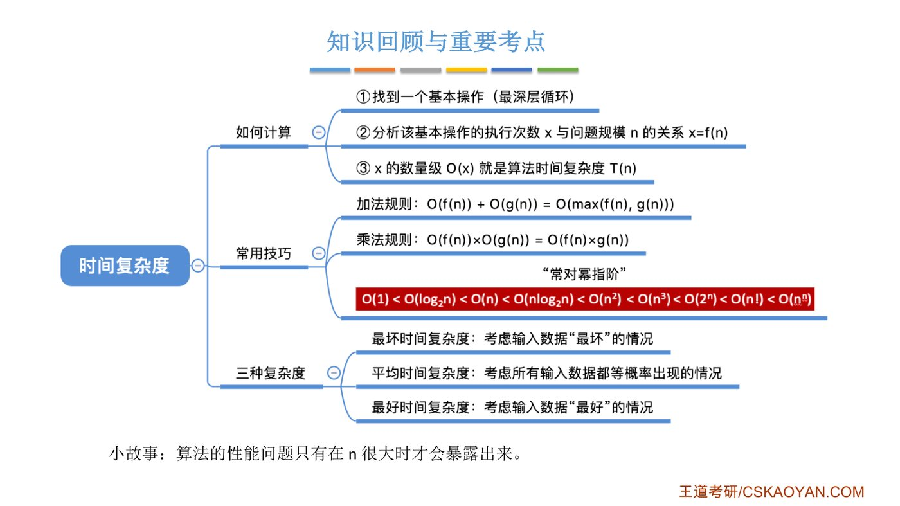{.slide width=0.8}

::: cue
求时间复杂度的三步是什么？两条规则？口诀？
:::

这一节的内容是一套"方法"，所以回顾也按做题时的思考顺序排：先判断代码长什么样，再套对应的做法。课件上的结论都放在了对应的那一行里。

::: {.tbl widths="1.3,2.4,1.3"}
| 看到的代码 | 怎么做 | 结果 |
|---|---|---|
| 全是顺序语句，没有循环 | 顺序执行的代码只影响常数项（结论 1） | $O(1)$ |
| 一层循环，变量每次 +1 | 挑循环里的一条基本操作，数它的执行次数（结论 2） | $O(n)$ |
| 循环变量每次 ×2 | 设执行 $x$ 次，由 $2^x>n$ 解出 $x$（小练习 1） | $O(\log_2 n)$ |
| 条件里是 $y^2<n$ 之类 | 设执行 $t$ 次，代入条件解出 $t$（书上类型 1） | 如 $O(\sqrt n)$ |
| 多层嵌套循环 | 只看最深层，各层次数相乘（结论 3、乘法规则） | 如 $O(n^2)$ |
| 几段代码并列 | 各自求完再相加，按"常对幂指阶"只留最高阶（加法规则） | 最高阶那项 |
| 递归 | 列递推式，如 $T(n)=1+T(n-1)$（书上类型 2） | 如 $O(n)$ |
| 执行次数依赖输入数据 | 分最好、最坏、平均；一般只看最坏和平均（小练习 2） | 分情况写 |
:::

::: exam
1. **如何计算**：① 找一个基本操作（最深层循环）；② 分析其执行次数 $x$ 与 $n$ 的关系 $x=f(n)$；③ $x$ 的数量级 $O(x)$ 就是 $T(n)$。
2. **加法规则**：$O(f(n))+O(g(n))=O(\max(f(n),g(n)))$；**乘法规则**：$O(f(n))\times O(g(n))=O(f(n)\times g(n))$。
3. **常对幂指阶**：$O(1)<O(\log_2 n)<O(n)<O(n\log_2 n)<O(n^2)<O(n^3)<O(2^n)<O(n!)<O(n^n)$。
4. **三种复杂度**：最坏（输入数据"最坏"）、平均（所有输入等概率出现）、最好（输入数据"最好"）；一般考虑最坏和平均。
:::

::: pitfall
- 时间复杂度 $O(n^2)$ 表示"执行时间与 $n^2$ **成正比**（同数量级）"，不是"执行时间等于 $n^2$"，也不是"问题规模是 $n^2$"。
- 比较复杂度时看**最高阶**，不看系数：$10000\log_2 n$ 的复杂度仍然比 $n$ 低，哪怕系数大到一万。
- 算法的实际运行时间还受**输入数据初始状态**影响，所以才有最好、最坏、平均之分。
:::

::: summary
**时间复杂度 = 基本操作执行次数随问题规模 $n$ 增长的数量级。**

事后计时受机器、语言、编译器影响，还可能来不及测，所以改为事前预估 $T(n)$ 与 $n$ 的关系。$n$ 足够大时，低阶项和系数都不重要，于是用大 O 只保留最高阶项。代码再长也不用逐行数：顺序语句只影响常数，嵌套循环只看最深层，挑一个基本操作数出它的执行次数 $x=f(n)$，$O(x)$ 就是答案。判断谁的阶高背"常对幂指阶"；循环变量翻倍是 $O(\log_2 n)$；执行时间依赖输入的算法要分最好、最坏、平均，平均情况用期望计算。

**自测**：① `for(i=1;i<=n;i++)` 中 `i<=n` 执行几次？② `i=1; while(i<=n) i=i*3;` 的时间复杂度？③ 为什么最深层循环的执行次数一定最多？
:::
