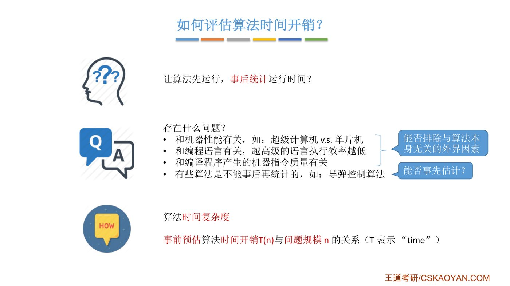
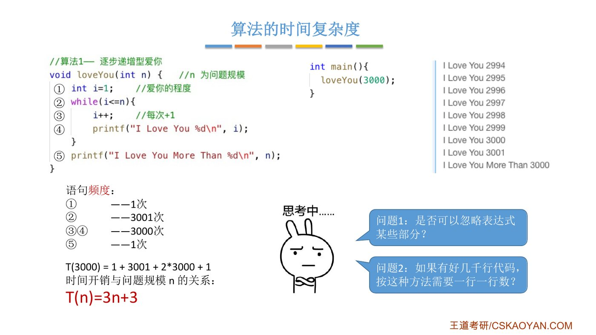
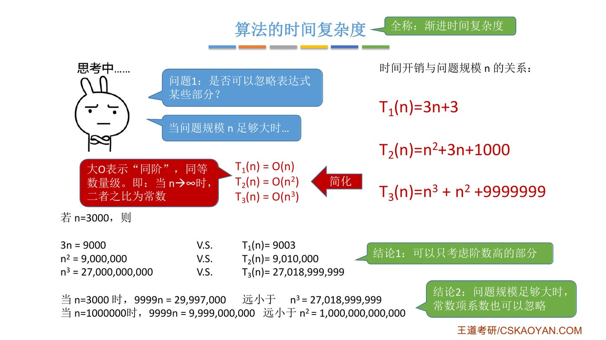
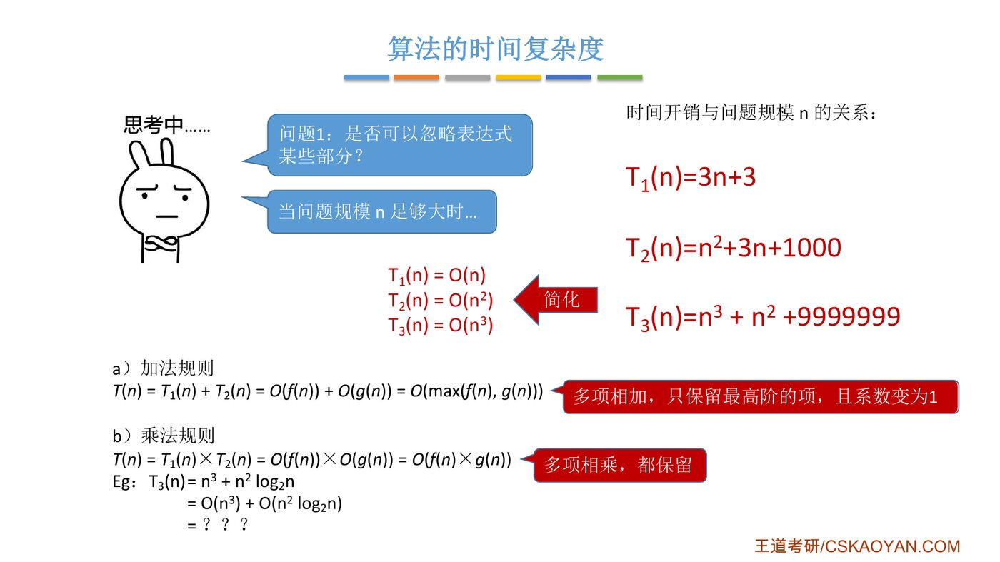
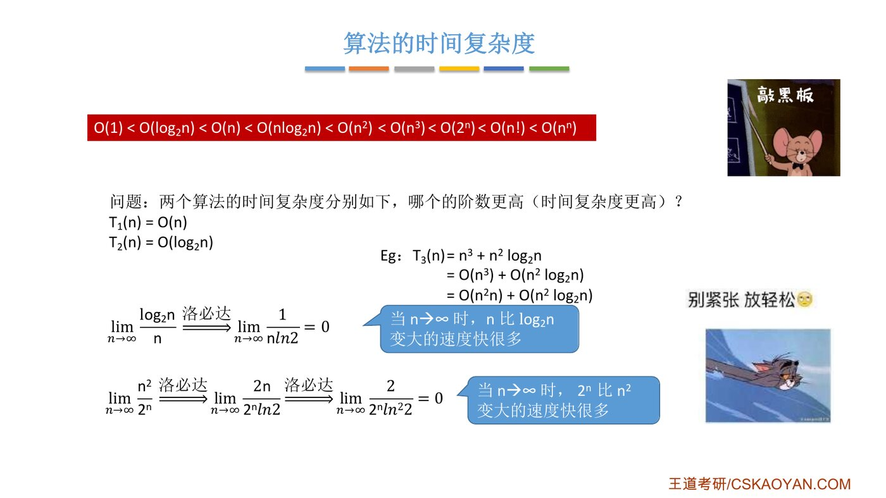
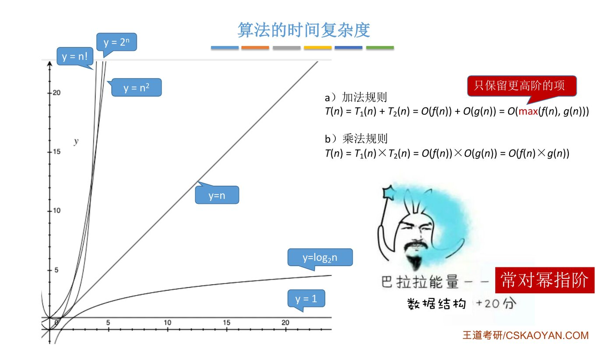
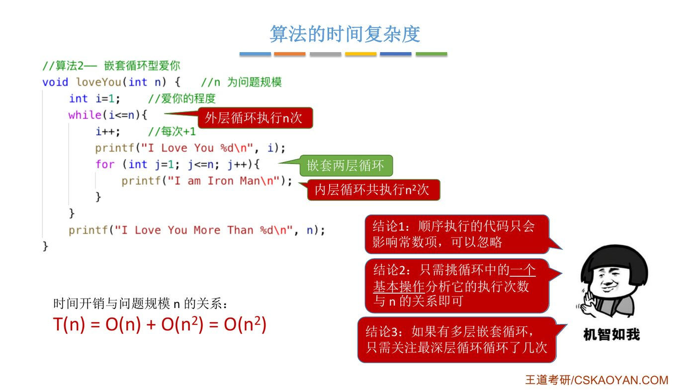
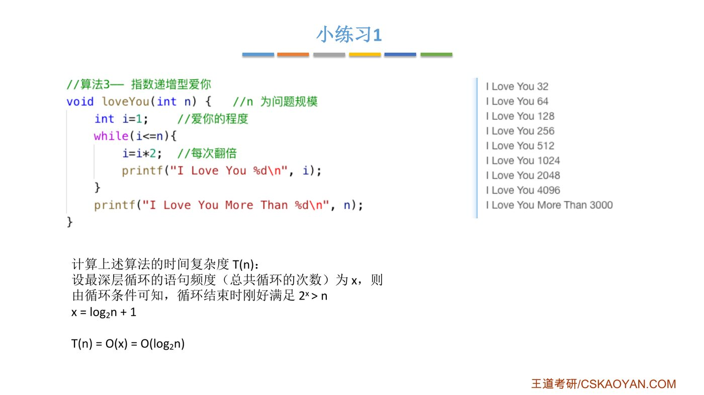
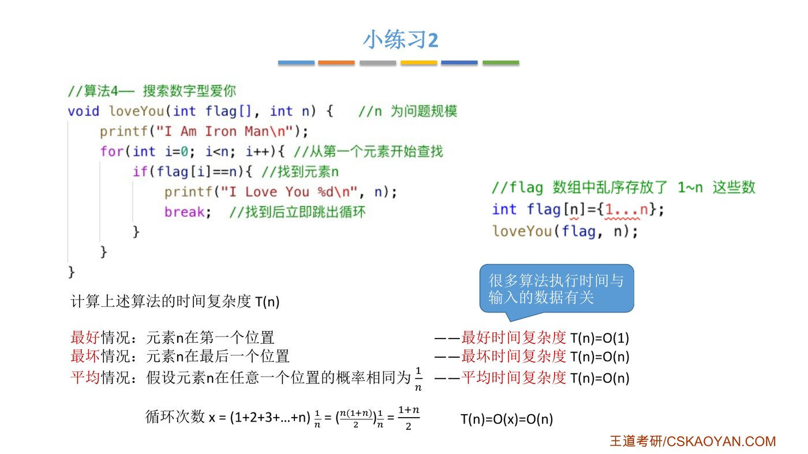
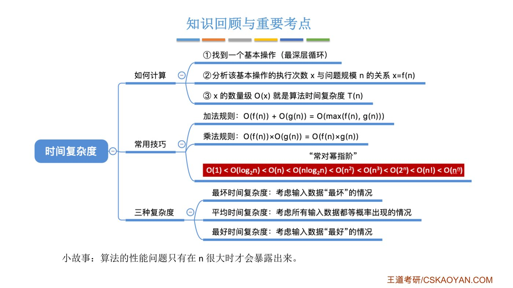

# 这份笔记怎么读

::: cue
全节分几层？每层回答什么问题？
:::

这是和旧版 1.2.2 并行的**统一版**，旧版一字未动，供你对比。

五份资料（课件、正课视频、王道书知识点、书上解析、习题讲解视频）讲时间复杂度时，定义写法、叫法、方法各不相同。这份笔记不按"哪位老师讲了什么"排，而是按知识本身的依赖关系排成一套体系，后一层只用前一层已经建立的东西：

::: {.tbl widths="0.9,2.2,2.2"}
| 层 | 回答的问题 | 内容 |
|---|---|---|
| 第一层 | 时间复杂度到底是什么 | 5 个原子概念：问题规模、执行次数、$T(n)$、同阶、时间复杂度 |
| 第二层 | 有了定义，能推出哪些可以直接用的结论 | 4 条定理：去低阶去系数（加法规则）、乘法规则、常对幂指阶、只数基本操作 |
| 第三层 | 拿到一段代码，怎么求 | **唯一的通用方法**：定基本操作 → 把次数写成求和 → 取数量级 |
| 第四层 | 输入不同时次数也不同怎么办 | 最好、最坏、平均 |
| 第五层 | 考试怎么写 | 408 的书写约定 |
| 第六层 | 各家说法放哪 | 课件、王道书、习题讲解的每种说法都是上面某一步的特例 |
:::

::: book
这套体系和国际通用教材一致，例如《算法导论》（Cormen 等，MIT 出版社）第 2–3 章：先定计数模型、数出执行次数，再用渐近记号取增长率。该书用 $\Theta$ 表示"同阶"、用 $O$ 表示"上界"；408 和王道书只用 $O$ 一个符号，第五层会说清楚它在考试里指哪个。
:::

# 第一层：原子概念

## 0. 为什么不直接计时

::: cue
为什么不跑一遍计时？
:::

{.slide width=0.65}

正课视频给了四个原因：跑出来的时间和**机器性能**、**编程语言**、**编译器生成的指令质量**有关，而且有的算法（如导弹控制）**不能等跑完再评价**。前三条说明要排除和算法无关的因素，第四条说明要在运行前估计。于是需要一个只由算法本身决定、能事先算出来的量。下面 5 个概念就是这个量的构造过程。

## 1. 问题规模 $n$

::: {.def title="问题规模"}
问题规模 $n$ 是描述输入大小的那个参数，例如数组的元素个数、要处理的数的大小。
:::

## 2. 执行次数（频度）

::: cue
计数模型是什么？为什么时间可以换成次数？
:::

::: {.def title="计数模型与执行次数"}
**计数模型**：假设任意一条语句执行一次所用的时间都是常数。

**执行次数**：某条语句在一次运行中被执行的次数。
:::

在计数模型下，运行时间 $=\sum(\text{每条语句的执行次数}\times\text{它的单次耗时})$，单次耗时都是常数，所以研究时间就变成研究执行次数。这一步正是正课视频里"假设每行代码执行时间都相同"的简化。

::: fix
**名词统一**：课件写"语句频度"，王道书写"频度"，正课视频和习题讲解视频说"执行次数"，三者同义。本笔记统一说**执行次数**。
:::

## 3. 总执行次数 $T(n)$

::: {.def title="T(n)"}
$T(n)$ = 算法中**所有语句的执行次数之和**，它是 $n$ 的函数。
:::

正课视频的例子"爱你 n 遍"：

{.slide width=0.8}

```c
//算法1— 逐步递增型爱你
void loveYou(int n) {         //n 为问题规模
    int i=1;                  // ① 爱你的程度
    while(i<=n){              // ②
        i++;                  // ③ 每次+1
        printf("I Love You %d\n", i);    // ④
    }
    printf("I Love You More Than %d\n", n);  // ⑤
}
```

::: {.tbl widths="0.6,1.0,3.2"}
| 语句 | 执行次数 | 为什么 |
|---|---|---|
| ① | 1 | 开头执行一次 |
| ② | $n+1$ | 每次进入循环前判断一次，共 $n$ 次；第 $n$ 次循环后 `i` 变成 $n+1$，还要再判断一次才发现不成立 |
| ③④ | 各 $n$ | 循环体执行 $n$ 次 |
| ⑤ | 1 | 循环结束后执行一次 |
:::

$$T(n)=1+(n+1)+2n+1=3n+3$$

::: pitfall
循环条件比循环体多判断一次。`for(i=1;i<=n;i++)` 同理：`i<=n` 判断 $n+1$ 次，循环体 $n$ 次。题目问"某条语句执行几次"时要用到这一点。
:::

## 4. 同阶与上界

::: cue
"同阶"的定义？"上界"的定义？两者什么关系？
:::

$T(n)$ 的精确式子往往很长，而 $n$ 很大时真正起作用的只是它"长多快"。下面的定义把"长得一样快"说精确。

::: {.def title="同阶（数量级相同）"}
若存在正常数 $c_1,c_2$ 和 $n_0$，使得对所有 $n\ge n_0$ 都有
$$c_1 f(n)\le T(n)\le c_2 f(n),$$
就说 $T(n)$ 与 $f(n)$ **同阶**。
:::

::: {.def title="上界"}
若存在正常数 $C$ 和 $n_0$，使得对所有 $n\ge n_0$ 都有 $0\le T(n)\le C f(n)$，就说 $f(n)$ 是 $T(n)$ 的（渐近）**上界**。王道书就是用这个式子定义 $T(n)=O(f(n))$ 的。
:::

两者的关系：**同阶 = 上界 + 下界**。同阶一定是上界；反过来不一定，比如 $3n+3\le 6n^2$（$n\ge1$），$n^2$ 是 $3n+3$ 的上界，但两者不同阶。

::: {.thm title="判定法：比值的极限"}
若 $\displaystyle\lim_{n\to\infty}\frac{T(n)}{f(n)}=k$，且 $0<k<\infty$，则 $T(n)$ 与 $f(n)$ 同阶。

**证明**：按极限定义，对 $\varepsilon=k/2$，存在 $n_0$，使 $n\ge n_0$ 时 $\frac{k}{2}<\frac{T(n)}{f(n)}<\frac{3k}{2}$。取 $c_1=\frac k2$、$c_2=\frac{3k}2$ 即满足同阶的定义。$\square$
:::

这就是正课视频里大 O 的"数学含义"：老师说 $T(n)=O(f(n))$ 意味着比值的极限"等于某个常数 $k$"。按老师"保留最高阶项"的用法，这个 $k$ 是非零常数，所以老师讲的是**同阶**，而这条判定法说明了它为什么成立。

## 5. 时间复杂度

::: {.def title="时间复杂度"}
算法的**时间复杂度**是 $T(n)$ 的数量级：取一个与 $T(n)$ **同阶**的最简函数 $f(n)$，记作 $T(n)=O(f(n))$。
:::

例：$T(n)=3n+3$ 与 $n$ 同阶（比值极限为 3），所以爱你 n 遍的时间复杂度是 $O(n)$。

::: fix
**符号统一**：$O$ 的本义是上界（王道书定义），但"时间复杂度"要的是最紧的那个上界，也就是同阶的 $f$。408 题目和王道书写 $O(f(n))$ 时都是这个意思。本笔记从这里起，凡写时间复杂度 $O(f(n))$，都指 $f$ 与 $T(n)$ 同阶。
:::

# 第二层：由定义推出的定理

这一层的 4 条结论都只用第一层的定义证明，后面求复杂度时直接拿来用。

## 定理 1：只留最高阶项，去掉系数（加法规则）

::: cue
为什么低阶项和系数都可以扔？加法规则怎么证？
:::

{.slide width=0.8}

::: {.thm title="定理 1（加法规则）"}
设 $f(n),g(n)\ge0$。则 $f(n)+g(n)$ 与 $\max(f(n),g(n))$ 同阶，即
$$O(f(n))+O(g(n))=O(\max(f(n),g(n))).$$
推论：有限项相加，只留增长最快的一项；它前面的正系数也可以去掉。

**证明**：$\max(f,g)\le f+g\le 2\max(f,g)$，取 $c_1=1$、$c_2=2$。系数 $a>0$ 时，$a\cdot h(n)$ 与 $h(n)$ 同阶（$c_1=c_2=a$）。$\square$
:::

例：$T_2(n)=n^2+3n+1000$，$n^2$ 增长最快，所以 $T_2(n)=O(n^2)$；$T_3(n)=n^3+n^2+9999999=O(n^3)$。

::: teacher
你有 3000 块，舍友有 9000 块，谁也不比谁富多少，是同一个数量级；有人有 900 万，那才不是一个数量级。哪怕系数是 9999，只要 $n$ 够大，$9999n$ 终究远小于 $n^2$。
:::

::: add
带负号的低阶项也一样：$T(n)=n^2-8000n$，$\frac{T(n)}{n^2}=1-\frac{8000}{n}\to1$，由判定法与 $n^2$ 同阶。只要最高阶项的系数是正的，低阶项无论正负都可以扔。
:::

## 定理 2：乘法规则

::: {.thm title="定理 2（乘法规则）"}
若 $T_1$ 与 $f$ 同阶、$T_2$ 与 $g$ 同阶，则 $T_1\cdot T_2$ 与 $f\cdot g$ 同阶，即 $O(f(n))\times O(g(n))=O(f(n)g(n))$。

**证明**：把 $c_1f\le T_1\le c_2f$ 与 $d_1g\le T_2\le d_2g$ 两式相乘（各项非负），得 $c_1d_1fg\le T_1T_2\le c_2d_2fg$。$\square$
:::

{.slide width=0.8}

::: book
王道书把两条规则对应到代码结构：两段代码**顺序执行**用加法规则；一段代码**嵌套**在另一段里，用乘法规则。例：语句块 `a{}`、`b{}`、`c{}` 分别是 $O(1)$、$O(n)$、$O(n^2)$，则 `a{ b{} c{} }` 为 $O(n^2)$，`a{ b{ c{} } }` 为 $O(n^3)$。
:::

::: pitfall
乘法规则要求**内层的次数不随外层变量变化**（每一轮内层都是同一个 $T_2$）。内层次数随外层变化时（如 `j<i`），每一轮的次数不同，不能直接相乘，要用第三层的求和。
:::

## 定理 3：常对幂指阶

::: cue
常见数量级的顺序？对数的底重要吗？
:::

用加法规则必须会比较"谁增长得快"。说 $g$ 比 $f$ 增长得快，指 $\lim\limits_{n\to\infty}\frac{f(n)}{g(n)}=0$。

::: {.thm title="定理 3（常见数量级的顺序）"}
$$O(1)<O(\log_2 n)<O(n)<O(n\log_2 n)<O(n^2)<O(n^3)<O(2^n)<O(n!)<O(n^n)$$
口诀：**常对幂指阶**（常数 < 对数 < 幂函数 < 指数 < 阶乘）。
:::

{.slide width=0.8}

课件用洛必达法则证明了其中两个：
$$\lim_{n\to\infty}\frac{\log_2 n}{n}=\lim_{n\to\infty}\frac{1}{n\ln 2}=0,\qquad \lim_{n\to\infty}\frac{n^2}{2^n}=\lim_{n\to\infty}\frac{2n}{2^n\ln2}=\lim_{n\to\infty}\frac{2}{2^n\ln^2 2}=0.$$
所以 $n^3+n^2\log_2 n$ 中 $n^3=n^2\cdot n$ 增长更快，结果是 $O(n^3)$。正课视频说只要求记住顺序，不要求自己证明。

{.slide width=0.62}

::: add
**对数的底不影响数量级**：$\log_a n=\dfrac{\log_2 n}{\log_2 a}$，两者只差常数倍 $\frac{1}{\log_2 a}$，按定理 1 同阶。所以写 $O(\log n)$ 和 $O(\log_2 n)$ 是一回事。
:::

::: teacher
为什么只关心 $n$ 很大的情况：老师工作时写过一个玩家匹配算法，两层嵌套循环，$O(n^2)$。自测只用两三百个玩家，没问题；上线后同时在线几十万人，算法一跑全服受影响。后来优化成 $O(n)$。$n=10^5$ 时，$n^2=10^{10}$，$n=10^5$，差了十万倍。
:::

## 定理 4：只数一条基本操作就够

::: cue
为什么只数一条语句？哪条？
:::

$T(n)$ 要求把所有语句的次数加起来，但实际上只要数一条：

::: {.thm title="定理 4（基本操作）"}
设算法有 $m$ 条语句（$m$ 是与 $n$ 无关的常数），其中执行次数最多的一条执行了 $x(n)$ 次，则 $T(n)$ 与 $x(n)$ 同阶。这条语句叫**基本操作**。

**证明**：每条语句的次数都 $\le x$，所以 $T\le m\cdot x$；$T$ 中包含 $x$ 这一项，所以 $T\ge x$。于是 $x\le T\le m\,x$，取 $c_1=1$、$c_2=m$。$\square$
:::

**哪条语句执行次数最多？** 对循环来说就是最内层循环体里的语句。理由：外层的语句每轮只执行常数次，而只要每次进入内层循环时循环体至少执行一次，内层循环体的次数就不少于外层的轮数；内层的循环条件比循环体每轮多判断一次，最多是循环体次数的 2 倍，按定理 1 同阶。所以：

::: {.thm title="推论（课件的三个结论）"}
1. **顺序执行的代码只影响常数项**：它们的次数是常数，不影响 $x$。
2. **循环中只需挑一个基本操作**：同一层的几条语句次数相同，挑哪条都一样。
3. **多层嵌套循环只看最深层**：最深层循环体的次数最多。
:::

{.slide width=0.8}

正课视频的例子：在算法 1 前加 1000 行顺序代码，$T(n)=3n+1003$，仍是 $O(n)$（结论 1）；在循环里只数 `printf`，得 $n$ 次（结论 2）；算法 2 在 while 里再套一层 `for(j=1;j<=n;j++)`，最深层执行 $n\cdot n=n^2$ 次，$T(n)=O(n^2)$（结论 3）。

::: pitfall
结论 3 的前提是"每次进入内层都至少执行一次循环体"。考研题都满足；若内层可能一次都不执行，就要直接找执行次数最多的那条语句（定理 4 本身）。
:::

# 第三层：唯一的通用方法

::: cue
求时间复杂度的三步？第 2 步有哪三种情形？
:::

第一、二层推出：时间复杂度 = 基本操作次数 $x(n)$ 的数量级。于是求复杂度只有一套方法：

::: {.def title="通用方法（三步）"}
1. **定基本操作**：最深层循环体里的一条语句；递归算法则把"一次函数调用"当作一次（第 3 种情形会说明理由）。
2. **把执行次数写成求和**，按代码结构分三种情形（见下）。
3. **取数量级**：用定理 1、3 只留最高阶项、去系数。不必算出精确值，只要夹出同阶的上界和下界就够了。
:::

## 第 2 步 · 情形 ①：单层循环 = 数循环变量取了几个值

::: {.thm title="引理（终止计数）"}
循环变量依次取值 $v_0,v_1,v_2,\dots$，循环条件对前面一段取值成立、从某个值起不成立。若条件对 $v_0,\dots,v_c$ 成立，对 $v_{c+1}$ 不成立，则循环体执行 $c+1$ 次。

也就是用两句话定出 $c$：**最后一次进得去**（$v_c$ 满足条件），**下一次进不去**（$v_{c+1}$ 不满足）。
:::

**例（正课小练习 1）**：`i=1; while(i<=n){ i=i*2; … }`。

{.slide width=0.65}

- 取值：$v_k=2^k$（$k=0,1,2,\dots$）。
- 最后一次进得去：$2^c\le n$；下一次进不去：$2^{c+1}>n$。
- 两式取对数：$c\le\log_2 n<c+1$，所以 $c=\lfloor\log_2 n\rfloor$。
- 执行次数 $x=c+1=\lfloor\log_2 n\rfloor+1$，与 $\log_2 n$ 同阶，$T(n)=O(\log_2 n)$。

::: fix
课件写的是"循环结束时刚好满足 $2^x>n$，$x=\log_2 n+1$"，是忽略取整的近似；精确值是 $\lfloor\log_2 n\rfloor+1$（$n=3000$ 时循环 12 次）。数量级相同。
:::

由同一个引理直接得到两条常用结论（各一行证明）：

::: {.tbl widths="1.7,1.1,2.6"}
| 循环形式 | 次数的数量级 | 证明 |
|---|---|---|
| 变量 +1，条件 $v^k\le n$ | $n^{1/k}$ | 最后进得去 $c^k\le n$，下次进不去 $(c+1)^k>n$，得 $c=\lfloor n^{1/k}\rfloor$ |
| 变量 ×2，条件 $v\le n$ | $\log_2 n$ | 上面的例子；初值或边界改成常数倍（如 $v<n/2$）只让 $c$ 差一个常数 |
:::

## 第 2 步 · 情形 ②：多层循环 = 对外层每个取值，把内层次数加起来

::: {.thm title="嵌套计数"}
外层变量依次取值 $i_0,i_1,\dots,i_c$（用情形 ① 定出），外层取值为 $i$ 时内层执行 $g(i)$ 次，则最深层执行次数
$$x=g(i_0)+g(i_1)+\cdots+g(i_c).$$
:::

- **$g$ 不随 $i$ 变化**（每轮内层都一样）：$x=(c+1)\cdot g$，这就是乘法规则（定理 2）。例：算法 2 外层 $n$ 轮、每轮内层 $n$ 次，$x=n^2$。
- **$g$ 随 $i$ 变化**（如 `j<i`）：不能直接乘，要按下面的三种和式求和。

## 第 2 步 · 情形 ③：递归 = 数一共调用了几次

**为什么一次调用算一次**：如果一次调用本身（不算它再去调用的子调用）只做常数次操作，那么总次数 = 常数 × 调用总次数，按定理 1 与调用总次数同阶。

调用总次数的数法和情形 ② 一样：按递归参数分层，每层有几次调用，加起来。王道书写成递推式，例如每次调用做常数次操作、再调用一次规模为 $n-1$ 的自己：
$$T(n)=1+T(n-1)=2+T(n-2)=\cdots=(n-1)+T(1),$$
共 $n$ 次调用，$T(n)=O(n)$。递推式每展开一步就是数了一层，和"分层相加"是同一件事。

::: fix
正课视频只提了一句"递归型算法也要用 $n$ 表示出基本操作的执行次数"，没有展开；递归的数法在课后习题（11、13 题）里才用到，习题笔记统一版会接着这里讲。
:::

## 第 3 步要用到的三种和式

::: cue
三种和式各自和谁同阶？
:::

第 2 步写出的和式，考研范围内只有三种：

::: {.thm title="三种和式"}
1. **常数相加**：$\underbrace{a+a+\cdots+a}_{m\text{ 项}}=am$，与 $m$ 同阶。
2. **等差**：$1+2+\cdots+m=\dfrac{m(m+1)}{2}$，与 $m^2$ 同阶（因为 $\frac{m^2}{2}\le\frac{m(m+1)}2\le m^2$）。
3. **等比**：$1+2+4+\cdots+2^t=2^{t+1}-1$，与**最后一项** $2^t$ 同阶（因为 $2^t\le 2^{t+1}-1<2\cdot2^t$）。
:::

```{=latex}
\begin{center}
\begin{tikzpicture}[x=4mm,y=4mm]
\draw[dashed,wdgray] (0,0) rectangle (5,5);
\foreach \i in {1,...,5}{\foreach \j in {1,...,\i}{\draw[fill=wdblue!25,draw=wdblue] (\i-1,\j-1) rectangle (\i,\j);}}
\node[font=\scriptsize,align=center] at (2.5,-1.6) {等差：$1+2+\cdots+m$（图中 $m=5$）\\ 涂色部分 $\ge$ 正方形的一半 $m^2/2$\\ 且 $\le$ 整个正方形 $m^2$};
\begin{scope}[xshift=55mm]
\foreach \h/\k in {0.5/0,1/1,2/2,4/3}{\draw[fill=wdorange!30,draw=wdorange] (\k*1.5,0) rectangle (\k*1.5+1,\h);}
\node[font=\scriptsize] at (0.5,-0.5) {1}; \node[font=\scriptsize] at (2,-0.5) {2};
\node[font=\scriptsize] at (3.5,-0.5) {4}; \node[font=\scriptsize] at (5,-0.5) {8};
\draw[wdred,thick] (0,-1) -- (4,-1); \draw[wdred,thick] (0,-0.8) -- (0,-1.2); \draw[wdred,thick] (4,-0.8) -- (4,-1.2);
\node[font=\scriptsize,text=wdred] at (2,-1.7) {$1+2+4=7<8$};
\node[font=\scriptsize,align=center] at (3,-3.6) {等比：前面所有项之和 $<$ 最后一项\\ 所以总和 $<2\times$ 最后一项};
\end{scope}
\end{tikzpicture}
\end{center}
```

::: pitfall
等比和式是最容易看错的地方：外层变量每次 ×2、内层跑"外层变量那么多次"时，次数是 $1+2+4+\cdots$，与最后一项（约 $n$）同阶，结果是 $O(n)$，**不是** $O(n\log_2 n)$。把外层 $\log_2 n$ 轮乘以内层"最多 $n$ 次"只得到上界，不是同阶。
:::

# 第四层：同一个 $n$，输入不同时次数也不同

::: cue
最好、最坏、平均的定义？默认哪个？
:::

到这里都默认 $T(n)$ 只由 $n$ 决定。有些算法的次数还取决于输入数据本身，这时同一个 $n$ 对应多个 $T$。

**例（正课小练习 2）**：数组 `flag[n]` 乱序存放 1～n，从头找值为 `n` 的元素，找到就 `break`。

{.slide width=0.6}

::: {.def title="三种时间复杂度"}
- **最坏时间复杂度**：规模为 $n$ 的所有输入中，次数的**最大值**的数量级。
- **平均时间复杂度**：所有输入**等概率出现**时，次数的**期望**的数量级。
- **最好时间复杂度**：所有输入中，次数的**最小值**的数量级。
:::

::: {.tbl widths="1,2.6,1.2"}
| 情况 | 小练习 2 | 结果 |
|---|---|---|
| 最好 | `n` 在第 1 个位置，循环 1 次 | $O(1)$ |
| 最坏 | `n` 在最后一个位置，循环 $n$ 次 | $O(n)$ |
| 平均 | 在第 $k$ 个位置的概率都是 $\frac1n$，要循环 $k$ 次：$\frac1n(1+2+\cdots+n)=\frac{n+1}{2}$ | $O(n)$ |
:::

::: book
王道书的例子方向相反（从后往前找 `k`，基本运算是 `i--`）：`A[n-1]` 就是 `k` 时执行 0 次（最好），`k` 不存在时执行 $n$ 次（最坏）。书上说："通常以**最坏**时间复杂度作为算法效率的评价标准，因为它提供了运行时间的确定性上界。"
:::

::: teacher
很多算法的执行时间与输入的数据有关，一般只考虑最坏和平均时间复杂度；最好时间复杂度参考意义不大，因为评价算法主要看它在不好的情况下会不会太慢。
:::

两者不矛盾：正课视频说的是**要算哪几种**（最坏和平均），王道书说的是**拿哪种当标准**（最坏）。题目没说明是哪种情况时，按最坏算（第五层）。

# 第五层：408 的书写约定

::: cue
考试里 $O$、log、"执行次数"、if 分支各怎么处理？
:::

::: exam
1. **$O(f(n))$ 指同阶的最简函数**（第一层第 5 节），选项里只会有一个同阶的。
2. **$\log n$ 默认是 $\log_2 n$**，底数本来也不影响数量级（定理 3 后的补充）。
3. **题目没说情况时按最坏**（第四层）。
4. **问"执行次数"要算精确值**；问"时间复杂度"才只取数量级。
5. **if / else 取次数最多的分支**：这正是最坏情况的定义（对所有输入取最大值）。
:::

# 第六层：各家说法放回这套体系

::: cue
课件、王道书、习题讲解里的说法各对应哪一层哪一步？
:::

下表把你会在五份资料里看到的说法，都对到上面的某一层。**它们都是这套体系的特例或换一种写法**，没有一条需要单独记。

::: {.tbl widths="1.0,2.2,2.0"}
| 资料 | 原来的说法 | 在本体系里 |
|---|---|---|
| 课件 | $T(n)=O(f(n))$ 意味着 $\lim\frac{T(n)}{f(n)}=k$ | 同阶的**判定法**（第一层 §4） |
| 课件 | 只保留最高阶项，系数变为 1 | **定理 1** |
| 课件 | 三个结论：顺序代码只影响常数 / 挑一个基本操作 / 只看最深层 | **定理 4 的推论** |
| 课件 | 知识回顾三步：找基本操作 → $x=f(n)$ → $O(x)$ | **通用方法**的三步（第三层） |
| 课件 | 一般只考虑最坏和平均 | **第四层**：要算哪几种 |
| 王道书 | $0\le T(n)\le Cf(n)$ 定义 $O$ | **上界**的定义；考试取最紧的上界，即同阶 |
| 王道书 | $T(n)$ 是所有语句频度之和，数量级由基本运算决定 | $T(n)$ 的定义 + **定理 4** |
| 王道书 | 通常以最坏为评价标准 | **第四层**：拿哪种当标准 |
| 王道书 | 加法规则对应顺序执行，乘法规则对应嵌套 | **定理 1、2**；乘法规则只在内层次数不随外层变化时可用 |
| 王道书归纳总结 | 类型 1"循环变量参与循环条件"：设次数 $t$，解 $t=f(n)$ | 第 2 步**情形 ①**（终止计数） |
| 王道书归纳总结 | 类型 2"与循环条件无关"：由内向外累加；递归建递推式 | 第 2 步**情形 ②、③** |
| 习题讲解（后面用到） | 表格法、拆循环、并列单层循环、两步法、"类型一 / 类型二" | 都是第 2、3 步的书写格式或捷径，课后习题笔记统一版逐题对照 |
:::

::: fix
**同名不同义**：王道书归纳总结的"类型 1 / 类型 2"按"循环变量是否出现在循环条件里"分，习题讲解视频里的"类型一 / 类型二"按"每层是否都是 +1"分，两套分法无关。本体系不用任何"类型"，只按代码结构分三种情形。
:::

# 知识回顾

{.slide width=0.8}

::: cue
自己从头推一遍：5 个概念 → 4 条定理 → 三步方法。
:::

::: summary
**一句话**：时间复杂度 = 基本操作执行次数 $x(n)$ 的数量级。

**第一层（定义）**：计数模型下，时间换成执行次数；$T(n)$ 是所有语句次数之和；与 $T(n)$ 同阶的最简函数 $f(n)$ 就是时间复杂度，记 $O(f(n))$。同阶 = 上界 + 下界；比值极限为非零常数可判定同阶。

**第二层（定理）**：① 只留最高阶项、去系数（加法规则）；② 同阶相乘仍同阶（乘法规则，内层次数不随外层变时用）；③ 常对幂指阶，对数底无关；④ $T(n)$ 与执行次数最多的那条语句同阶，循环里就是最深层循环体。

**第三层（方法）**：定基本操作 → 写成求和（单层：最后一次进得去、下一次进不去；多层：对外层每个取值加内层次数；递归：分层数调用次数）→ 用三种和式（常数、等差 $\sim m^2$、等比 $\sim$ 最后一项）取数量级。

**第四、五层**：次数依赖输入时分最好、最坏、平均，默认最坏；问次数算精确，问复杂度取阶，分支取最大。

**自测**：① `for(i=1;i<=n;i++)` 中 `i<=n` 执行几次？② `i=1; while(i<=n) i=i*3;` 的复杂度？用终止计数写出两个不等式。③ 为什么"外层 ×2、内层跑 $i$ 次"是 $O(n)$ 而不是 $O(n\log_2 n)$？
:::
