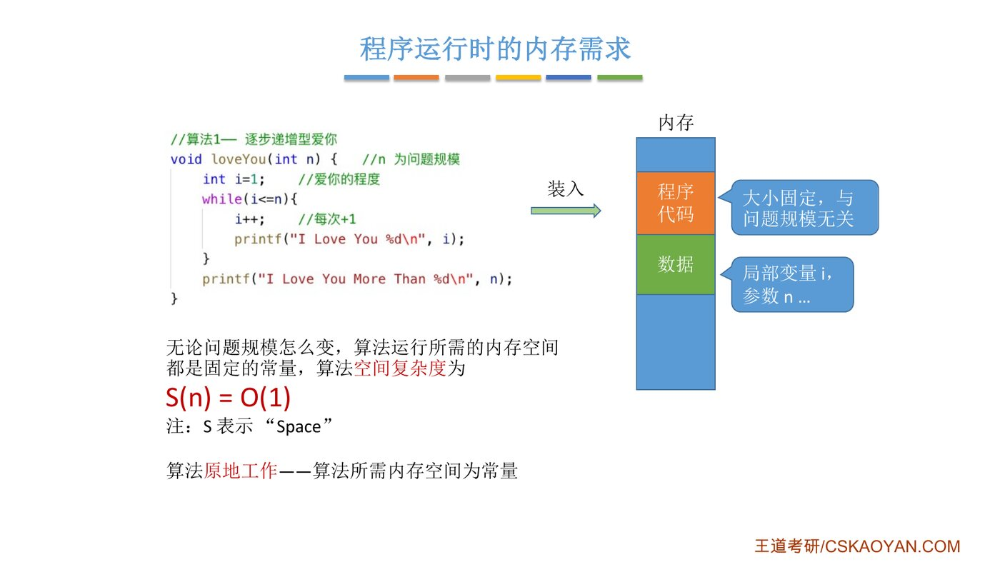
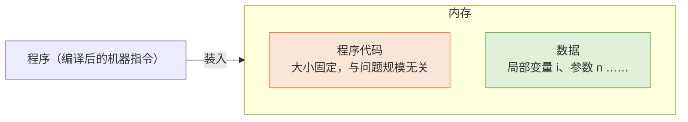
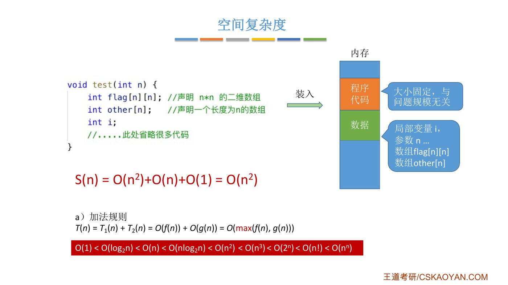
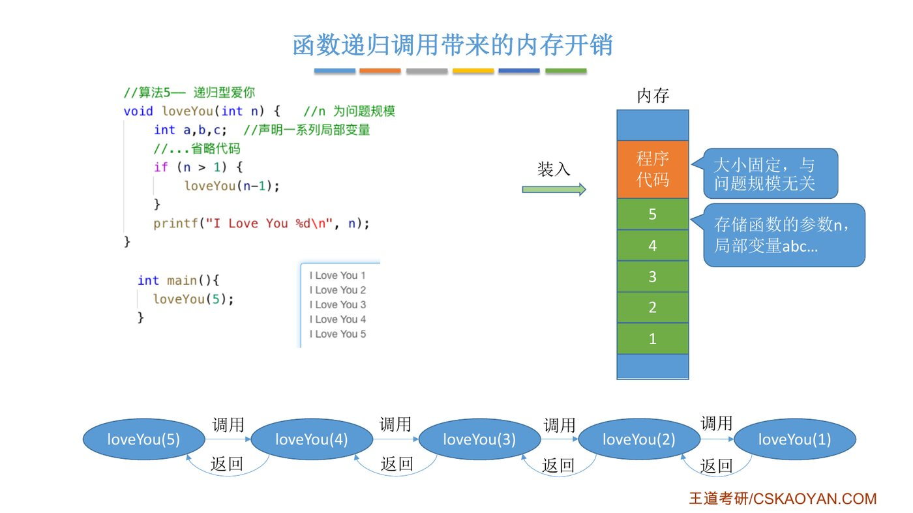
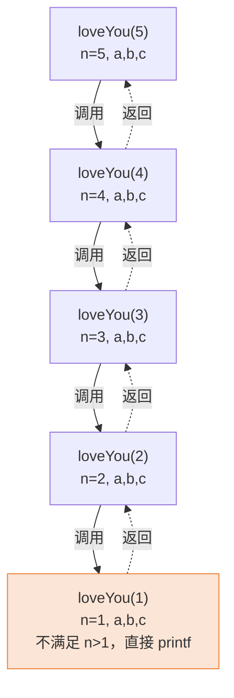
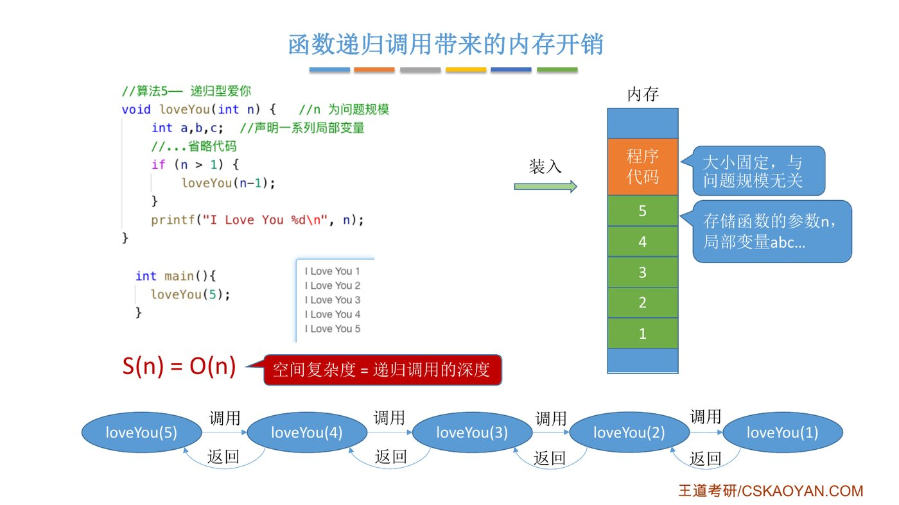
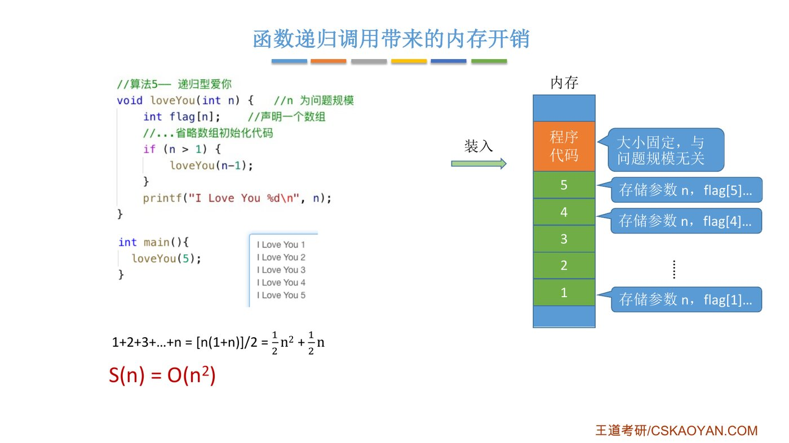
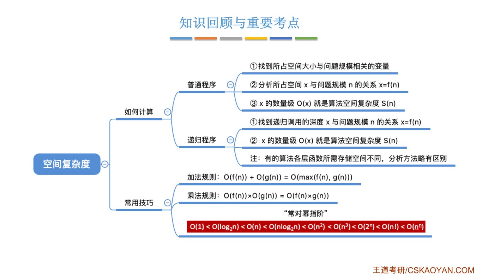

# 从时间到空间

::: cue
时间复杂度和空间复杂度分别衡量什么？
:::

::: {.tbl widths="1,2.4,1"}
| | 衡量的是 | 记号 |
|---|---|---|
| 时间复杂度 | 时间开销与问题规模 $n$ 之间的关系 | $T(n)$，T = Time |
| 空间复杂度 | [空间开销（内存开销）与问题规模 $n$ 之间的关系]{.red} | $S(n)$，S = Space |
:::

思路和时间复杂度完全相同，[大 O、加法规则、常对幂指阶全部通用]{.u}。新内容只有两点：哪些内存要算，以及递归调用的开销。

# 一、程序运行时需要哪些内存？

::: cue
程序代码占的空间要不要算进空间复杂度？
:::

老师照顾跨考同学，先讲程序运行时内存里放了什么：

{.slide width=0.8}



1. **程序代码**：程序运行前要先把（编译后的）指令装入内存。程序写完了，它占多大就定了，[和问题规模无关]{.u}。
2. **数据**：运行时，函数的参数、局部变量等也要占内存。比如算法 1 `loveYou(int n)` 里的 `n` 和 `i`，两个 `int` 至少 8 个字节。

以算法 1 为例：

```c
//算法1— 逐步递增型爱你
void loveYou(int n) {     //n 为问题规模
    int i=1;              //爱你的程度
    while(i<=n){
        i++;              //每次+1
        printf("I Love You %d\n", i);
    }
    printf("I Love You More Than %d\n", n);
}
```

老师随手假设了一组数：程序代码占 100 个字节，`n` 和 `i` 各占 4 个字节，那么运行时一共需要 $100+8=108$ 个字节。不管 $n$ 是 3000 还是 300 万，都只要这 108 个字节，是一个固定的常量（真实情况还会多存一些别的信息，但道理一样）：

::: def
无论问题规模怎么变，算法运行所需的内存空间都是固定的常量，算法空间复杂度为 $S(n)=O(1)$。

[算法原地工作]{.red}：算法所需内存空间为常量。
:::

::: exam
"原地工作"这个术语可能在选择题中考查：**原地工作 = 空间复杂度为 $O(1)$**，不是"不需要任何空间"，而是"需要的辅助空间是常量，和 $n$ 无关"。
:::

# 二、普通程序：只看和 $n$ 有关的变量

## 1. 一维数组：$O(n)$

::: cue
`int flag[n]` 为什么让空间复杂度变成 $O(n)$？
:::

```c
void test(int n) {
    int flag[n];    //声明一个长度为n的数组
    int i;
    //……此处省略很多代码
}
```

![课件：一维数组 flag[n]](assets/1.2.3-p04.jpg){.slide width=0.65}

假设一个 `int` 变量占 4B，则所需内存空间 $=4+4n+4=4n+8$（参数 `n` + 数组 `flag` + 变量 `i`），所以 $S(n)=O(n)$。

**结论：[只需关注存储空间大小与问题规模相关的变量]{.red}**，固定大小的变量只贡献常数，也不必关心 `int` 占几个字节。

## 2. 二维数组：$O(n^2)$

```c
void test(int n) {
    int flag[n][n];    //声明 n*n 的二维数组
    int i;
    //……此处省略很多代码
}
```

唯一和 $n$ 相关的是 `flag`，它占 $4\times n^2$ 字节，所以 $S(n)=O(n^2)$。

## 3. 多个数组：加法规则

::: cue
同时有 `flag[n][n]` 和 `other[n]` 时怎么算？
:::

```c
void test(int n) {
    int flag[n][n];    //声明 n*n 的二维数组
    int other[n];      //声明一个长度为n的数组
    int i;
    //……此处省略很多代码
}
```

{.slide width=0.65}

$$S(n)=O(n^2)+O(n)+O(1)=O(n^2)$$

和时间复杂度一样，用[加法规则]{.u}，只保留阶数最高的那个大 O。

# 三、递归程序：函数调用也会吃内存

## 1. 递归调用的过程

::: cue
递归调用时，每一层的变量存在哪里？为什么不会互相覆盖？
:::

```c
//算法5— 递归型爱你
void loveYou(int n) {     //n 为问题规模
    int a,b,c;            //声明一系列局部变量
    //...省略代码
    if (n > 1) {
        loveYou(n-1);
    }
    printf("I Love You %d\n", n);
}

int main(){
    loveYou(5);
}
```

输出：`I Love You 1`、`I Love You 2`、……、`I Love You 5`。

{.slide width=0.65}

调用过程（老师逐层演示）：



1. `main` 调用 `loveYou(5)`，内存里开辟一片区域，存这一层的参数 `n=5` 和局部变量 `a,b,c`。
2. 因为 `5>1`，调用 `loveYou(4)`，**再开辟一片新区域**存 `n=4` 和新的 `a,b,c`。
3. 依此类推，直到 `loveYou(1)`：`1>1` 不成立，跳过 `if`，打印 "I Love You 1"。
4. `loveYou(1)` 结束返回，它那片内存就可以释放；回到 `loveYou(2)` 继续执行 `printf`，打印 "I Love You 2"……

::: deep
每次调用都单独开一块空间存本层的参数、局部变量和返回地址，所以各层的 `n` 互不干扰。这套机制叫**函数调用栈**（第 3 章"栈在递归中的应用"）。`printf` 在递归调用之后，所以最深的 `loveYou(1)` 先打印，输出 1→5。
:::

## 2. 空间复杂度 = 递归调用的深度

::: cue
算法 5 的空间复杂度？一般规律？
:::

每一层调用存 `n,a,b,c` 四个 `int`，约 16 字节（再加返回地址等，总之是一个常数 $k$ 字节）。$n=5$ 时递归了 5 层，层数和问题规模 $n$ 相等，所以总共需要 $k\cdot n$ 字节：

$$S(n)=O(n)$$

::: def
[空间复杂度 = 递归调用的深度]{.red}（当每一层所需空间为常量时）。
:::

{.slide width=0.8}

::: exam
考研中大部分递归程序的空间复杂度分析都和这个例子类似：每层所需空间是常量，**只需找到递归调用深度 $x$ 与问题规模 $n$ 的关系，$x$ 的数量级就是空间复杂度**。
:::

## 3. 特殊情况：每层空间不一样

::: cue
每层递归都定义一个长度为 n 的数组，空间复杂度是多少？
:::

::: fix
**命名说明**：课件里这段代码的注释和上一段一样，也叫"算法5— 递归型爱你"，但两段代码不同：这一段在每层多声明了一个数组 `flag[n]`。为了不混，本笔记把它叫作 **算法 5′**（"每层带数组的递归型爱你"）。
:::

```c
//算法5′— 每层带数组的递归型爱你（课件注释仍写"算法5"）
void loveYou(int n) {     //n 为问题规模
    int flag[n];          //声明一个数组
    //...省略初始化数组的代码
    if (n > 1) {
        loveYou(n-1);
    }
    printf("I Love You %d\n", n);
}

int main(){
    loveYou(5);
}
```

{.slide width=0.8}


这次每一层定义的数组长度等于本层的参数 $n$：第 1 层（`loveYou(5)`）数组长 5，第 2 层长 4，……，最深一层长 1。各层数组的总长度：

$$1+2+3+\cdots+n=\frac{n(1+n)}{2}=\frac12 n^2+\frac12 n,\qquad S(n)=O(n^2)$$

::: pitfall
这种情况"空间复杂度 = 递归深度"就不成立了，要把各层的空间**加起来**。不过老师说考研中不太会遇到这么复杂的情况，绝大多数题目和前一个例子一样。
:::

# 四、王道书的视角：只算“辅助空间”

::: cue
输入数据占的空间算不算进空间复杂度？
:::

::: book
王道书对空间复杂度的表述：空间复杂度 $S(n)$ 表示算法在运行过程中所需的**额外存储空间**，是问题规模 $n$ 的函数，记为 $S(n)=O(g(n))$。

程序执行时所需的空间包括三部分：

::: {.tbl widths="1.6,2.4,1"}
| 部分 | 说明 | 计入 $S(n)$？ |
|---|---|---|
| 指令、常数和变量 | 与 $n$ 无关，固定开销 | 否（顶多是常数） |
| 输入数据 | 取决于问题本身，与算法无关 | [**不计入**]{.red} |
| 辅助空间 | 递归调用栈、临时数组、指针等 | [**计入**]{.red} |
:::

所以分析空间复杂度时，只关注算法[额外使用的辅助空间]{.u}。例如，若算法创建了若干与输入规模 $n$ 同阶的辅助数组，则其空间复杂度为 $O(n)$。若算法仅使用常量级的额外空间，则称为**原地工作**，空间复杂度为 $O(1)$。
:::

::: deep
**课件和书的说法其实一致，只是侧重不同。** 课件的例子里 `flag[n]` 是**函数内部新声明**的数组，属于辅助空间，所以算进去；而像算法 4 `loveYou(int flag[], int n)` 那样，`flag` 是作为**输入**传进来的，它本来就存在，不是这个算法额外申请的，就不算。以后分析排序算法时，"原地排序"指的就是除了输入数组本身，只用了常数个辅助变量。
:::

# 五、知识回顾：时间和空间并排看

::: cue
普通程序、递归程序分别怎么求空间复杂度？
:::

空间复杂度和上一节的时间复杂度是"同一套方法换了个对象"，所以回顾时把两节并排放，哪里相同、哪里不同一眼就能看出来：

::: {.tbl widths="1.1,2,2"}
| | 时间复杂度 $T(n)$ | 空间复杂度 $S(n)$ |
|---|---|---|
| 衡量什么 | 时间开销与 $n$ 的关系 | 内存开销与 $n$ 的关系 |
| 数的是什么 | 基本操作的**执行次数** | 和 $n$ 有关的变量占的**空间** |
| 可以忽略的 | 顺序执行的语句（只影响常数项） | 程序代码、大小固定的变量（只贡献常数） |
| 普通程序怎么算 | ① 找最深层循环的一条基本操作 ② 求执行次数 $x=f(n)$ ③ $O(x)$ | ① 找大小与 $n$ 相关的变量 ② 求所占空间 $x=f(n)$ ③ $O(x)$ |
| 递归程序怎么算 | 列递推式求总次数 | 每层空间为常量时：[$S(n)$ = 递归调用的深度]{.red}；每层不同时逐层累加 |
| 通用的工具 | 大 O、加法规则、乘法规则、常对幂指阶 | 完全相同 |
| 特殊术语 | 最好、最坏、平均时间复杂度 | [原地工作]{.red}：$S(n)=O(1)$ |
| 考研频率 | 几乎每年都考 | 相对低很多，递归的要会算 |
:::

{.slide width=0.7}

::: exam
1. 空间复杂度衡量**内存开销与问题规模 $n$ 的关系**，用大 O 表示，只关心数量级。
2. **普通程序**：只看大小与 $n$ 相关的变量（数组等）。
3. **递归程序**：空间复杂度 = 递归调用的深度（每层空间为常量时）。
4. 加法规则、乘法规则、"常对幂指阶"与时间复杂度通用。
5. **原地工作**：所需辅助空间为常量，$S(n)=O(1)$。
:::

::: pitfall
- 空间复杂度 $O(1)$ 是"所需辅助空间大小与问题规模 $n$ 无关"，不是"不需要任何空间"。
- 递归程序即使没有定义任何数组，空间复杂度也可能是 $O(n)$，因为每层调用都要占栈空间。
- 考研中考查时间复杂度的频率比空间复杂度高很多，但递归程序的空间复杂度要会算。
:::

::: summary
**空间复杂度 = 算法额外占用的内存随问题规模 $n$ 增长的数量级。**

程序代码和固定大小的变量与 $n$ 无关，只贡献常数；真正决定空间复杂度的，是大小随 $n$ 变化的变量（如 `flag[n]` 是 $O(n)$，`flag[n][n]` 是 $O(n^2)$，多个就用加法规则取最高阶）。递归函数每调用一层都要在函数调用栈上开一块空间，所以每层空间为常量时，空间复杂度就等于递归深度；每层大小不同时要逐层加起来。辅助空间是常量的算法叫"原地工作"，$S(n)=O(1)$。

**自测**：① 递归函数 `f(n){ if(n>1) f(n-1); }` 的空间复杂度？② 为什么分析空间复杂度时不用管 `int` 占几个字节？
:::
