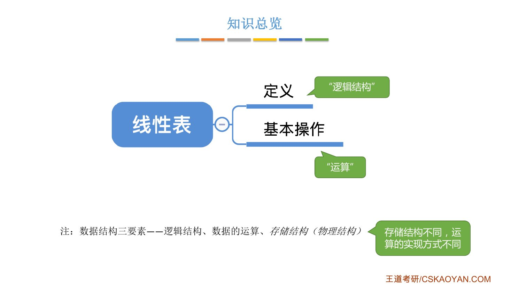
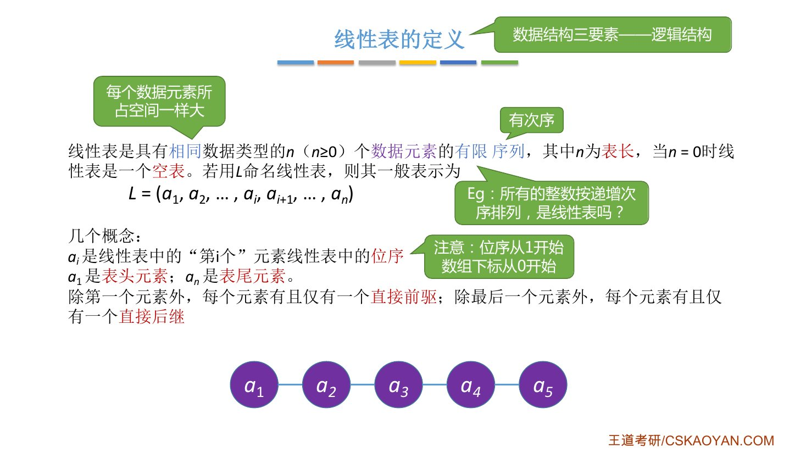
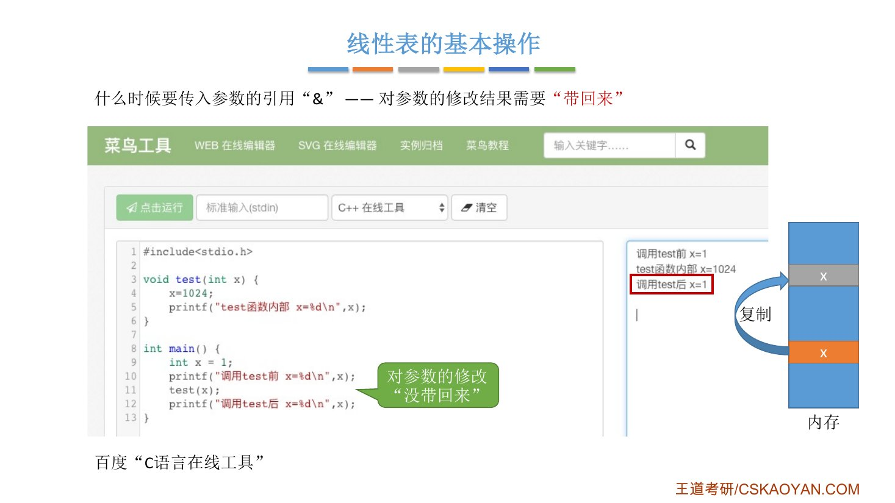
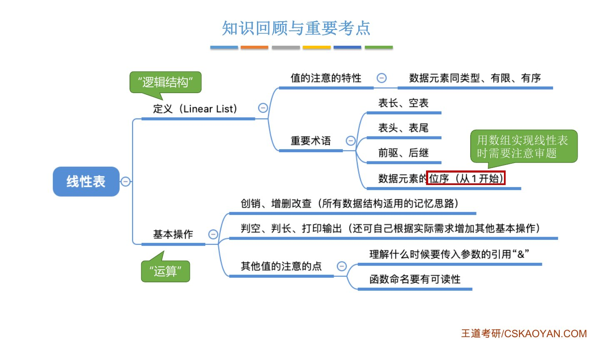

# 这一节在讲什么

::: cue
学一个新的数据结构，从哪几方面入手？这一节管哪几方面？
:::

第 1 章说过，学任何一种数据结构都看**三要素**：逻辑结构、存储结构（物理结构）、数据的运算。线性表是全书第一个具体的数据结构，这一节只管其中两个：

- **定义** → 线性表的[逻辑结构]{.u}长什么样；
- **基本操作** → 要对它实现哪些[运算]{.u}。

存储结构留到后面：2.2 用顺序存储实现（顺序表），2.3 用链式存储实现（链表）。[存储结构不同，运算的具体实现也不同]{.red}，到时候会用代码对比。

{.slide width=0.6}

# 一、线性表的定义（逻辑结构）

::: cue
线性表的定义里有哪三个关键词？
:::

大白话：线性表就是数据元素之间是**一条线**的关系，一个接一个串在一起，有前有后。严格定义如下：

::: def
**线性表**是具有[相同数据类型]{.red}的 $n\,(n\ge 0)$ 个数据元素的[有限]{.red}[序列]{.red}。$n$ 为**表长**，$n=0$ 时为**空表**。用 $L$ 命名线性表时，一般表示为
$$L=(a_1,a_2,\cdots,a_i,a_{i+1},\cdots,a_n)$$
:::

{.slide width=0.65}

定义里的三个关键词，每个都有用处：

::: {.tbl widths="1,2.4,2"}
| 关键词 | 含义 | 为什么要它 |
|---|---|---|
| **相同数据类型** | 所有元素同一类型，可以是 `int`，也可以是自己定义的 `struct` | [每个元素占的空间一样大]{.u}，计算机才能快速算出第 $i$ 个元素在哪 |
| **序列** | 元素之间有先后次序 | 这就是"线性"的来源 |
| **有限** | 元素个数有限 | 反例：所有整数按递增排列，同类型、有次序，但个数无限，[不是线性表]{.red} |
:::

::: book
王道书第 13–14 页把特点列成五条，除了上面三条，还有两条：

- **表中元素都是数据元素**，每个元素在线性表中被视为一个**不可分割的单位**（一个元素可以含多个数据项，但在表里整体看待）。
- **抽象性**：只讨论元素之间的逻辑关系，不管元素具体表示什么内容。
:::

## 几个术语

::: cue
位序从几开始？和数组下标什么关系？
:::

- **位序**：$a_i$ 是表中"第 $i$ 个"元素，$i$ 叫它的位序。[位序从 1 开始，数组下标从 0 开始]{.red}。
- **表头元素** $a_1$，**表尾元素** $a_n$。
- **直接前驱 / 直接后继**：除第一个元素外，每个元素[有且仅有]{.u}一个直接前驱；除最后一个元素外，每个元素[有且仅有]{.u}一个直接后继。书上说明"直接前驱"和"前驱"、"直接后继"和"后继"通常视为同义词。

::: pitfall
以后用数组实现线性表时，位序为 $i$ 的元素存在**下标 $i-1$** 处。题目说"第 $i$ 个"还是"下标为 $i$"，[一定要审题]{.u}，这是老师在本节专门强调的唯一一个坑。
:::

**为什么叫"表"**：英文是 Linear List。linear 来自 line（线），list 是"列表、清单"（如 to-do list）。如果每个元素含多个数据项（学号、姓名、性别……），整个线性表从形式上看就是一张表格，所以叫线性**表**。

::: pitfall
王道书注意：[线性表是一种逻辑结构]{.red}，表示元素之间一对一的相邻关系；**顺序表和链表**指的是**存储结构**。两者属于不同层面的概念，不要混淆。
:::

# 二、线性表的基本操作（运算）

::: cue
线性表要实现哪些基本操作？怎么记？
:::

函数名参考严蔚敏版《数据结构》，王道书用的也是同一套名字：

::: {.tbl widths="1.6,2.9,0.8"}
| 基本操作 | 作用 | 归类 |
|---|---|---|
| `InitList(&L)` | 初始化：构造一个空的线性表 $L$，[分配内存空间]{.u} | 创（从无到有） |
| `DestroyList(&L)` | 销毁：销毁线性表，[释放]{.u} $L$ 占用的内存空间 | 销（从有到无） |
| `ListInsert(&L,i,e)` | 插入：在表 $L$ 的第 $i$ 个位置插入元素 $e$ | 增 |
| `ListDelete(&L,i,&e)` | 删除：删除表 $L$ 第 $i$ 个位置的元素，[用 $e$ 返回被删元素的值]{.u} | 删 |
| `LocateElem(L,e)` | 按值查找：在表 $L$ 中查找值为 $e$ 的元素（书上：并返回其位置） | 查 |
| `GetElem(L,i)` | 按位查找：获取表 $L$ 中第 $i$ 个位置的元素的值 | 查 |
| `Length(L)` | 求表长：返回 $L$ 中数据元素的个数 | 其他常用 |
| `PrintList(L)` | 输出：按前后顺序输出 $L$ 的所有元素值 | 其他常用 |
| `Empty(L)` | 判空：$L$ 为空表返回 `true`，否则返回 `false` | 其他常用 |
:::

老师在这里给了五点提示：

1. **记忆和分析思路：创销、增删改查。** 学任何数据结构都可以这样想。表里没有单独的"改"，因为改之前也得先找到它，"改"的第一步就是"查"；"查"的本质是**定位**。下面三个"其他常用操作"是为了编程方便，核心是上面六个。
2. **这里没写参数类型，是故意的。** C 语言定义函数要写 `<返回值类型> 函数名(<参数类型> 参数, …)`，但描述基本操作时只关心"做什么"，元素 $e$ 是 `int` 还是某个 `struct`，到写代码实现时再定，这叫接口的**抽象性**。
3. **可以按需增加操作。** 比如觉得"修改某个元素"很常用，就自己加一个。
4. **名字可以改，但要有可读性。** 不必死守严蔚敏版命名，但叫 `DestroyList` 一看就懂，叫 `a` 就没人知道是干嘛的。答题时用这套推荐命名，阅卷老师最喜欢。
5. **什么时候传引用 `&`：对参数的修改结果需要"带回来"。** 下面单独讲。

::: teacher
**为什么要把基本操作封装成函数？** ① 团队合作编程，你定义的数据结构要让队友方便地用；② 常用操作写一次、到处调用，避免重复，降低出错风险。老师借此提醒：比起学会 How，更重要的是想明白 Why。
:::

# 三、什么时候要传引用 `&`

::: cue
参数什么时候要加 `&`？不加会怎样？
:::

老师用两段几乎一样的程序对比，区别只在 `test` 的参数前有没有 `&`：

```c
void test(int x) {     // 版本一：不加 &
    x = 1024;
    printf("test函数内部 x=%d\n", x);
}

void test(int &x) {    // 版本二：加 &（只改了这一个符号）
    x = 1024;
    printf("test函数内部 x=%d\n", x);
}
```

两个版本的 `main` 一样：

```c
int main() {
    int x = 1;
    printf("调用test前 x=%d\n", x);
    test(x);
    printf("调用test后 x=%d\n", x);
}
```

逐步看内存里发生了什么：

::: {.tbl widths="1.6,1.6,1.6"}
| 执行到 | 不加 `&` | 加 `&` |
|---|---|---|
| `int x = 1;` | `main` 的 x = 1 | `main` 的 x = 1 |
| 进入 `test(x)` | 内存里**复制**出另一份 x = 1，`test` 操作的是这份副本 | `test` 的 x 就是 `main` 的那个 x，**同一份数据** |
| `x = 1024;` | 副本变成 1024，`main` 的 x 仍是 1 | `main` 的 x 变成 1024 |
| 回到 `main` 打印 | **1**（修改没带回来） | **1024**（修改带回来了） |
:::

{.slide width=0.6}

::: pitfall
引用 `&` 是 **C++** 的语法，C 语言不支持。老师提醒：在线运行这段代码要选 **C++** 在线工具。王道书第 14 页也注明：在 C 语言中，可通过**指针**实现同样的效果。
:::

指针写法对照一下（考试算法题允许用 C 或 C++，两种都要认得）：

```c
void test(int *x) {   // 参数是 x 的地址
    *x = 1024;         // 通过地址改 main 里的那个 x
}
// 调用时传地址：test(&x);
```

回到基本操作，老师让大家自己琢磨"为什么有的加 `&`、有的不加"。按"要不要把修改带回来"一对就清楚了：

::: {.tbl widths="1.6,0.6,3"}
| 操作 | 参数 | 为什么 |
|---|---|---|
| `InitList(&L)`、`DestroyList(&L)` | `&L` | 要分配 / 释放 $L$ 的空间，$L$ 本身变了，要带回 |
| `ListInsert(&L,i,e)` | `&L` | 插入改变了 $L$ 的内容和表长，要带回；$e$ 只是读进来用，不加 |
| `ListDelete(&L,i,&e)` | `&L`、`&e` | $L$ 被改了要带回；被删元素的值要通过 $e$ **带回**给调用者 |
| `LocateElem(L,e)`、`GetElem(L,i)` | 都不加 | 只查不改，结果通过返回值给出 |
| `Length(L)`、`PrintList(L)`、`Empty(L)` | 都不加 | 只读 $L$，不修改 |
:::

老师说这一点"一定要理解，才能写出没有错误的代码"。

# 四、知识回顾

{.slide width=0.65}

::: summary
**线性表 = 相同类型、有限、有序的一串数据元素**，是一种逻辑结构（一对一的线性关系），和顺序表、链表这些存储结构不是一个层面。术语里最要紧的是**位序从 1 开始**，而数组下标从 0 开始，第 $i$ 个元素在下标 $i-1$。

基本操作按**创销、增删改查**来记：`InitList`、`DestroyList`、`ListInsert`、`ListDelete`、`LocateElem`、`GetElem`，外加 `Length`、`PrintList`、`Empty`。参数要不要加 `&`，看**对参数的修改要不要带回来**：改了 $L$ 的都加，只读的不加，`ListDelete` 的 $e$ 因为要带回被删的值也加。`&` 是 C++ 语法，C 里用指针达到同样效果。

**自测**：① "所有整数按递增排列"是线性表吗？为什么？② 线性表 $(a_1,\cdots,a_n)$ 用数组 `data[]` 存，$a_5$ 在哪个下标？③ 为什么 `ListDelete` 的 $e$ 要加 `&`，而 `ListInsert` 的 $e$ 不用？
:::
