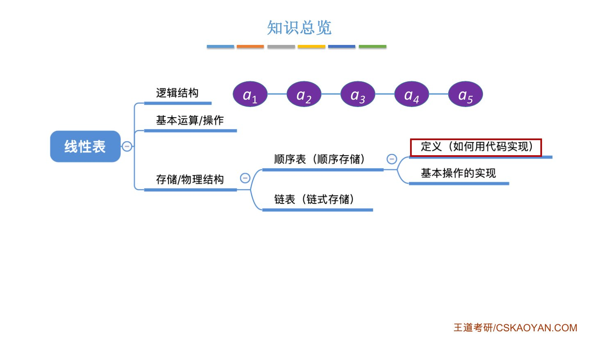
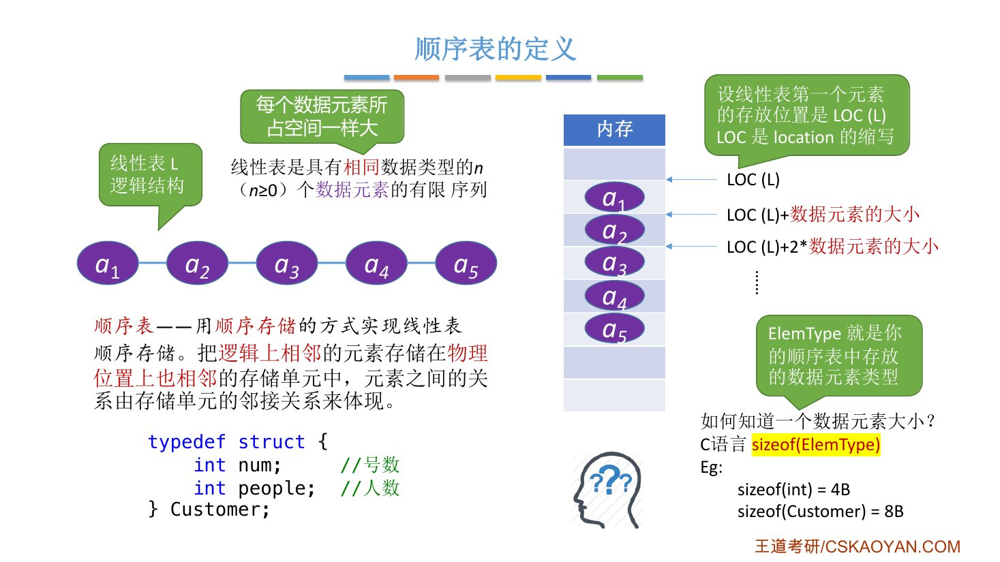
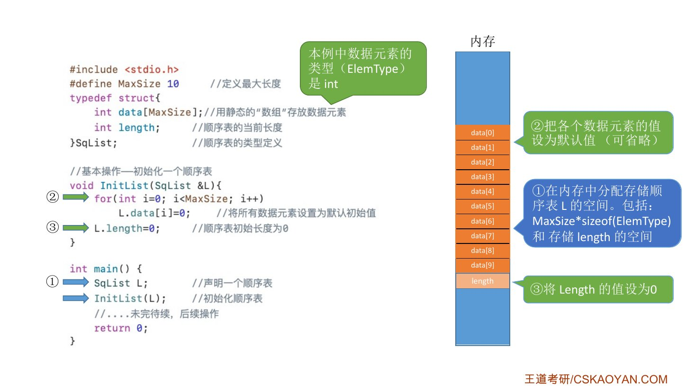
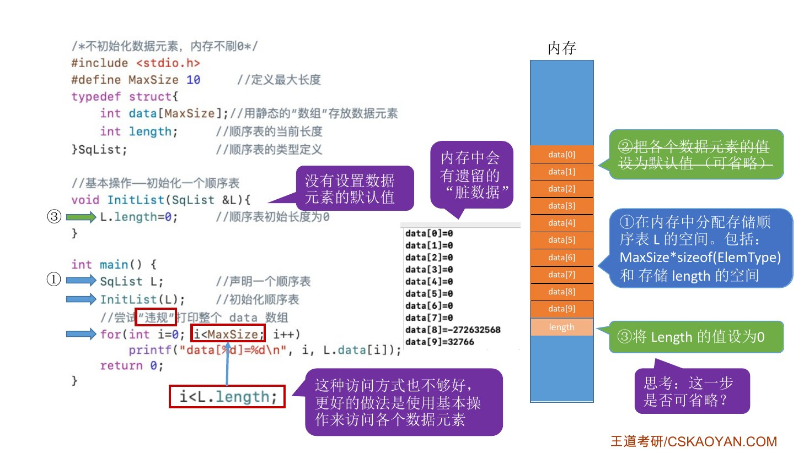
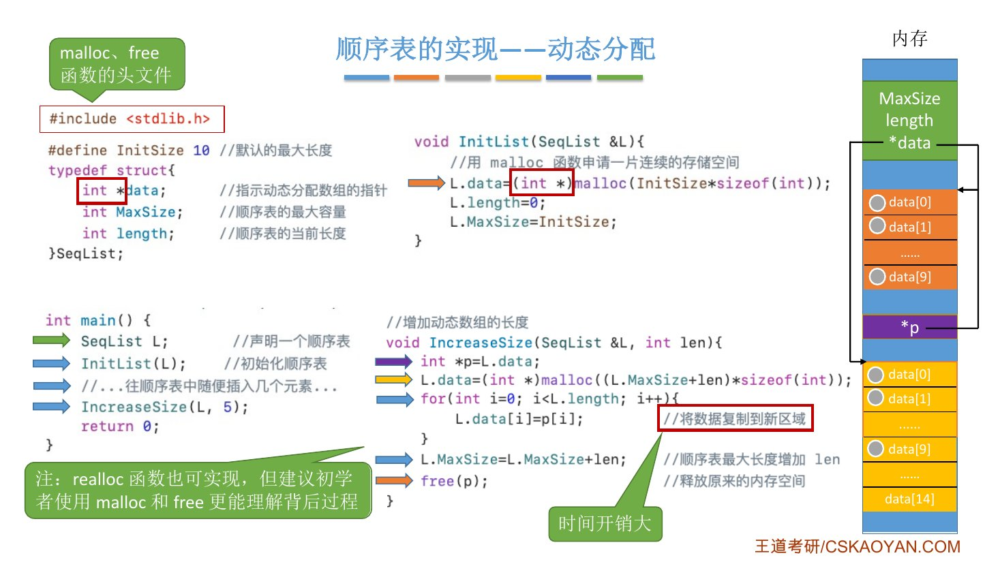
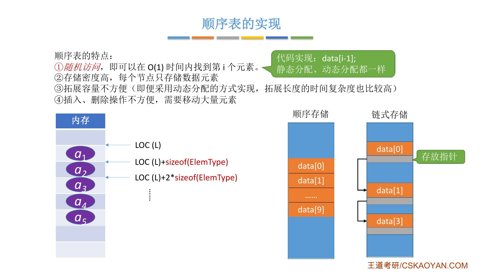
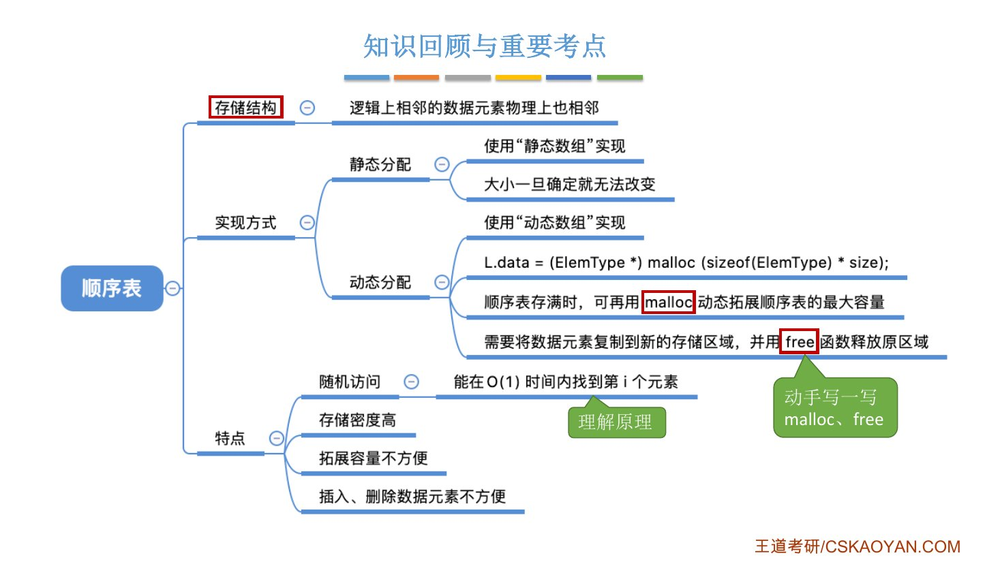

# 这一节在讲什么

::: cue
2.1 讲了线性表的逻辑结构和运算，2.2 开始讲什么？
:::

2.1 只说了线性表"逻辑上"是一串有先后的元素。从这节起回答：**在计算机里怎么存**。有两种存法，各成一种实现：

- 顺序存储 → **顺序表**（2.2，本节先讲它的定义和代码实现）；
- 链式存储 → **链表**（2.3）。

下一节 2.2.2 再在顺序表上实现 2.1 定义的那些基本操作。

{.slide width=0.6}

::: book
王道书本章考点追踪：顺序表的应用是**算法题**的常客（2010、2011、2018、2020、2025 年）。这一节的结构体定义就是以后写算法题的起点，要能默写。
:::

# 一、顺序表的定义

::: cue
什么是顺序表？顺序存储的关键是什么？
:::

::: def
**顺序表**：用[顺序存储]{.red}的方式实现的线性表。

**顺序存储**：把[逻辑上相邻]{.u}的元素存储在[物理位置上也相邻]{.u}的存储单元中，元素之间的关系由存储单元的邻接关系来体现。
:::

王道书的说法：用一组**地址连续**的存储单元依次存储线性表中的数据元素，所以顺序表的特点是[表中元素的逻辑顺序与其物理存储顺序完全一致]{.red}。

{.slide width=0.65}

## 第 $i$ 个元素的地址怎么算

::: cue
已知首地址，第 $i$ 个元素的地址是多少？
:::

线性表要求元素[类型相同]{.u}（2.1 的定义），所以每个元素占的空间一样大；顺序表又是连续存放，于是地址可以直接算出来。设起始地址为 $LOC(L)$（LOC 是 location 的缩写）：

$$LOC(a_i)=LOC(L)+(i-1)\times \texttt{sizeof(ElemType)}$$

::: {.tbl widths="0.8,1,2.6"}
| 位序 $i$ | 数组下标 | 存储地址 |
|---|---|---|
| 1 | 0 | $LOC(L)$ |
| 2 | 1 | $LOC(L)+\texttt{sizeof(ElemType)}$ |
| $i$ | $i-1$ | $LOC(L)+(i-1)\times\texttt{sizeof(ElemType)}$ |
| $n$ | $n-1$ | $LOC(L)+(n-1)\times\texttt{sizeof(ElemType)}$ |
:::

- **`ElemType`**：Element Type 的缩写，就是顺序表里存的元素类型，代码里换成 `int` 或自己定义的 `struct` 即可。
- **元素大小用 `sizeof` 求**：`sizeof(int)` 通常是 4B；下面这个 `Customer` 有两个 `int`，`sizeof(Customer)` = 8B。不用自己算，交给 `sizeof`。

```c
typedef struct {
    int num;      // 号数
    int people;   // 人数
} Customer;
```

::: pitfall
公式里是 $(i-1)$ 不是 $i$：位序从 1 开始，第 1 个元素就在首地址处，偏移量为 0。书上图 2.1 和注意框都在强调[位序与下标之间的转换]{.u}。
:::

# 二、实现方式一：静态分配

::: cue
静态分配的顺序表怎么定义？`MaxSize` 和 `length` 各管什么？
:::

用大家最熟悉的**静态数组**存元素，数组长度一旦确定就不能变：

```c
#define MaxSize 10              // 定义最大长度
typedef struct {
    ElemType data[MaxSize];     // 用静态的"数组"存放数据元素
    int length;                 // 顺序表的当前长度
} SqList;                       // 顺序表的类型定义（静态分配方式）
```

- `MaxSize`：最多能存几个元素（容量）；`length`：现在实际存了几个（表长）。
- `SqList`：Sq 是 sequence（顺序）的缩写。

## 初始化时内存里发生了什么

老师用 `ElemType = int` 的完整代码，按执行顺序标了 ①②③：

```c
#include <stdio.h>
#define MaxSize 10
typedef struct {
    int data[MaxSize];
    int length;
} SqList;

void InitList(SqList &L) {
    for (int i = 0; i < MaxSize; i++)
        L.data[i] = 0;          // ② 所有元素设默认值 0（可省略）
    L.length = 0;               // ③ 初始长度为 0（不能省）
}

int main() {
    SqList L;                   // ① 声明顺序表
    InitList(L);
    return 0;
}
```

::: {.tbl widths="1.3,3.2"}
| 步骤 | 内存里的变化 |
|---|---|
| ① `SqList L;` | 分配 `MaxSize*sizeof(ElemType)` = 10×4 = 40B 的连续空间给 `data`，另分配 4B 给 `length` |
| ② `for` 循环 | 把 `data[0]`～`data[9]` 都写成 0 |
| ③ `L.length=0;` | 表长置 0，此时是空表 |
:::

{.slide width=0.65}

## 哪一步能省，哪一步不能省

::: cue
初始化时，给 data 设默认值能不能省？length=0 呢？
:::

老师把 ② 去掉，然后"违规"地把整个 `data` 数组打印出来，结果前 8 个是 0，最后两个是 `-272632568`、`32766` 这种怪数：

{.slide width=0.65}

- **怪数从哪来**：内存里有之前遗留的[脏数据]{.red}。系统分给你这块空间，但不会帮你清空。
- **② 可以省**：正规的访问只到 `length` 为止（`i < L.length`），刚初始化时 `length=0`，一个元素都不会去读，脏数据碰不到。按 `MaxSize` 遍历本身就是违规的。更好的做法是通过基本操作（如 `GetElem`）访问元素。
- **③ 不能省**：`length` 自己也躺在可能有脏数据的内存里。有同学会说"C 语言 `int` 默认是 0"，老师说那是某些编译器帮你做的，换个编译器就不一定，所以必须手动置 0。

王道书给的静态分配初始化，正好就只有 `L.length=0;` 这一句。

## 静态分配的局限

::: cue
静态数组存满了怎么办？一开始开很大行不行？
:::

- **存满了**：老师原话"可以放弃治疗"。静态数组长度声明后就不能改，存储空间是静态的。
- **一开始开很大**：比如开 100 万但只用 10 个，浪费内存。
- 书上的说法：静态分配时空间一旦占满，再插入新元素会导致**溢出**，进而可能引发程序异常。

所以要让容量可变，就得用动态分配。

# 三、实现方式二：动态分配

::: cue
动态分配的顺序表多了哪个成员？data 变成了什么？
:::

```c
#define InitSize 10             // 顺序表的初始长度
typedef struct {
    ElemType *data;             // 指示动态分配数组的指针
    int MaxSize;                // 顺序表的最大容量
    int length;                 // 顺序表的当前长度
} SeqList;                      // 顺序表的类型定义（动态分配方式）
```

和静态版比，两处变化：`data` 从数组变成了**指针**；容量会变，所以 `MaxSize` 从宏常量变成了结构体里的**变量**。

::: fix
**名字统一**：课件里静态版叫 `SqList`、动态版叫 `SeqList`，王道书也是这样分的；书里 `InitSize` 取 100、`MaxSize` 取 50，课件都取 10，数值无所谓。后面的笔记沿用这两个类型名。
:::

## malloc 和 free

::: cue
malloc 返回什么？为什么要强制类型转换？参数是什么意思？
:::

C 语言用 `malloc` 申请、`free` 释放一整片连续的内存空间，二者在头文件 `<stdlib.h>` 里：

```c
L.data = (ElemType *) malloc(sizeof(ElemType) * InitSize);
```

::: {.tbl widths="1.6,3"}
| 部分 | 含义 |
|---|---|
| `malloc(...)` 的参数 | 要申请多大的连续空间：一个元素的大小 × 初始个数 |
| `malloc` 的返回值 | 这片空间**起始地址**的指针 |
| `(ElemType *)` | 把返回的指针[强制转换]{.red}成指向你的元素类型的指针（`int` 表就写 `(int *)`），再赋给 `L.data` |
:::

- C++ 可以用 `new`、`delete` 做同样的事，课程照顾跨考同学，主要用 `malloc`/`free`。王道书给的 C++ 写法是：

  ```c
  L.data = new ElemType[InitSize];
  ```
- 强制转换为什么不能写错，2.2.2 顺序表的查找一节会讲透：按下标取元素时一次取几个字节，就是由指针类型决定的。

## 扩容 IncreaseSize：一步一步看

::: cue
动态顺序表满了怎么扩容？为什么要先存一个指针 p？
:::

```c
#include <stdlib.h>
void InitList(SeqList &L) {
    L.data = (int *) malloc(InitSize * sizeof(int));  // 申请 10 个 int 的连续空间
    L.length = 0;
    L.MaxSize = InitSize;
}

void IncreaseSize(SeqList &L, int len) {  // 增加动态数组的长度
    int *p = L.data;                       // ① p 记住旧空间
    L.data = (int *) malloc((L.MaxSize + len) * sizeof(int));  // ② 申请更大的新空间
    for (int i = 0; i < L.length; i++)
        L.data[i] = p[i];                  // ③ 把旧数据复制到新区域
    L.MaxSize = L.MaxSize + len;           // ④ 最大容量增加 len
    free(p);                               // ⑤ 释放旧空间
}

int main() {
    SeqList L;
    InitList(L);
    // ...往顺序表中插满 10 个元素...
    IncreaseSize(L, 5);
    return 0;
}
```

以表已存满（`length=10`、`MaxSize=10`）后调用 `IncreaseSize(L, 5)` 为例：

::: {.tbl widths="0.5,1.6,1.4,0.8,0.7"}
| 步 | 执行 | `L.data` 指向 | `p` 指向 | `MaxSize` |
|---|---|---|---|---|
| 前 | 表已满 | 旧空间（10 格，全满） | — | 10 |
| ① | `p = L.data` | 旧空间 | 旧空间 | 10 |
| ② | `malloc` 15 格 | **新空间**（15 格，还是空的） | 旧空间 | 10 |
| ③ | `for` 复制 10 次 | 新空间，前 10 格有数据 | 旧空间 | 10 |
| ④ | `MaxSize += 5` | 新空间 | 旧空间 | 15 |
| ⑤ | `free(p)` | 新空间 | 旧空间已还给系统 | 15 |
:::

{.slide width=0.7}

- **为什么要先用 `p` 记住旧地址**：② 执行后 `L.data` 就指向新空间了，如果没有 `p`，旧空间的地址就丢了，第 ③ 步没法复制，第 ⑤ 步也没法释放（这片内存就再也回收不了）。
- **`p` 本身**：是函数里的局部变量，函数结束时系统自动回收它占的那几个字节；`free(p)` 释放的是 `p` 指向的那 10 格旧空间。
- **代价**：③ 要把 $n$ 个元素逐个复制，[时间开销大]{.red}，是 $O(n)$。
- `realloc` 也能做这件事，但老师说它调用时有意想不到的坑，建议初学者用 `malloc` + `free`，也更能看清背后的过程。

::: pitfall
王道书注意：[动态分配不是链式存储]{.red}，它同样属于顺序存储结构，物理结构没有变化，依然支持随机存取，只是存储空间的大小可以在运行时动态调整。
:::

# 四、顺序表的特点

::: cue
顺序表有哪些优缺点？各自的原因是什么？
:::

不管静态还是动态分配，顺序表都有下面这些特点（课件列四条，王道书归成两优两缺）：

::: {.tbl widths="1.3,2.8,0.6"}
| 特点 | 原因 | 书上 |
|---|---|---|
| ① [随机存取]{.red}：$O(1)$ 时间找到第 $i$ 个元素，代码就是 `data[i-1]` | 元素连续存放、大小相同，首地址加偏移量直接算出地址 | 优点 |
| ② **存储密度高**：每个结点只存数据元素本身 | 链式存储还要额外存指针 | 优点 |
| ③ 拓展容量不方便 | 静态分配不能扩；动态分配要整体复制，时间复杂度高 | 缺点（书：要求分配连续的存储空间，不够灵活） |
| ④ 插入、删除不方便，要移动大量元素 | 要保持"物理相邻"，中间插一个、删一个，后面都得挪 | 缺点 |
:::

::: fix
**名字统一**：课件和老师说"随机访问"，王道书两种都用（定义处说"随机存取"，优点处说"随机访问"）。考题里常见的是**随机存取**，本笔记统一用它，两者是一个意思。
:::

- **存储密度** = 结点中数据元素本身占的空间 ÷ 结点占的总空间。顺序表的结点只存数据，存储密度为 1；链表的结点还要存指针，小于 1。
- 第 ④ 条下一节会用代码和时间复杂度具体体会。

{.slide width=0.65}

# 五、知识回顾

{.slide width=0.65}

::: summary
**顺序表 = 用顺序存储实现的线性表**：逻辑上相邻的元素物理上也相邻，所以第 $i$ 个元素的地址是 $LOC(L)+(i-1)\times\texttt{sizeof(ElemType)}$，[随机存取]{.red}，$O(1)$。

实现有两种。**静态分配**用定长数组 `data[MaxSize]` 加 `length`，初始化时 `length=0` 必须做（防脏数据），给元素设默认值可以省；满了就没办法。**动态分配**用指针 `data` 加 `MaxSize`、`length`，`malloc` 申请、`free` 释放，返回的指针要强转成元素类型指针；扩容时先用 `p` 记住旧空间，申请更大的新空间、复制、改 `MaxSize`、释放旧空间，复制带来 $O(n)$ 的开销。动态分配仍是顺序存储，不是链式存储。

优点：随机存取、存储密度高；缺点：扩容不方便、插入删除要移动大量元素。

**自测**：① 每个元素占 4B，首地址 2000，第 5 个元素的地址是多少？② `InitList` 里哪一步不能省？为什么？③ `IncreaseSize` 里如果不先写 `int *p = L.data;` 会出什么问题？④ 动态分配的顺序表是链式存储吗？
:::
