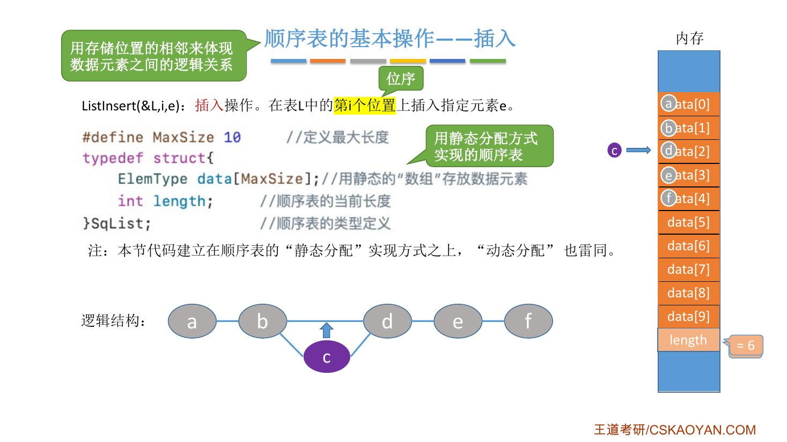
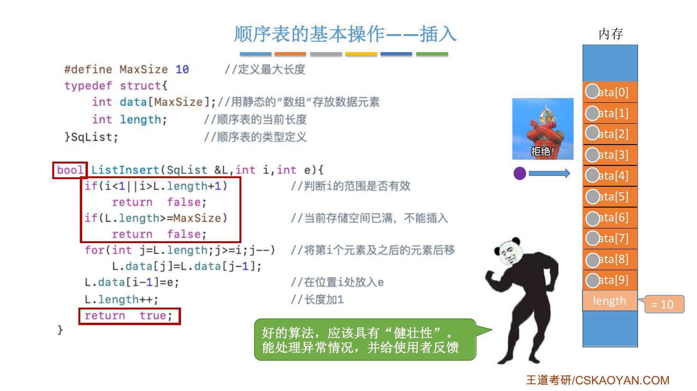
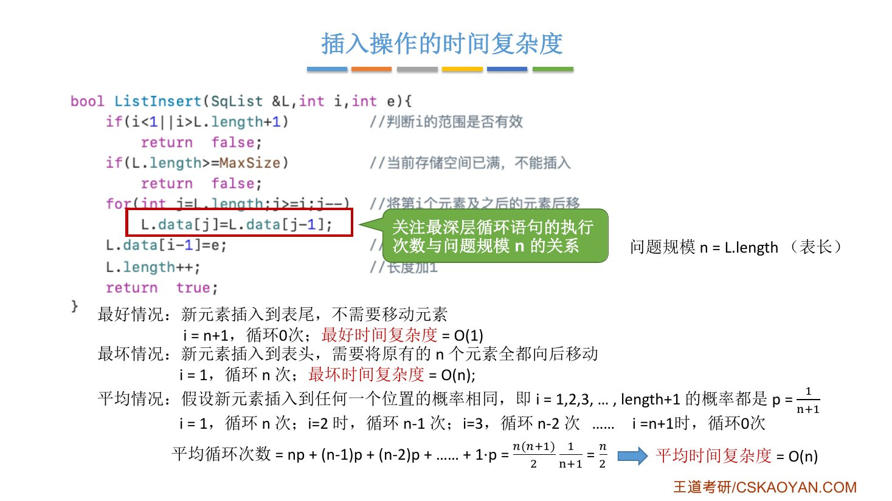
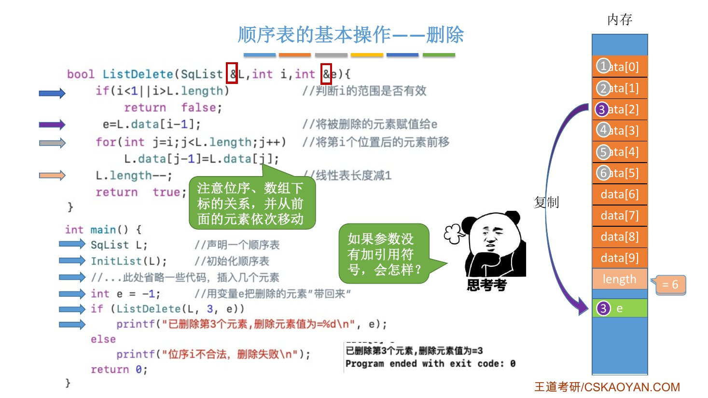
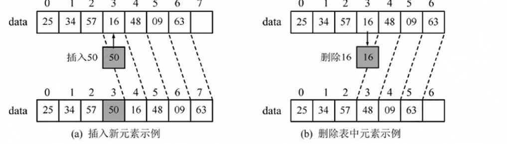
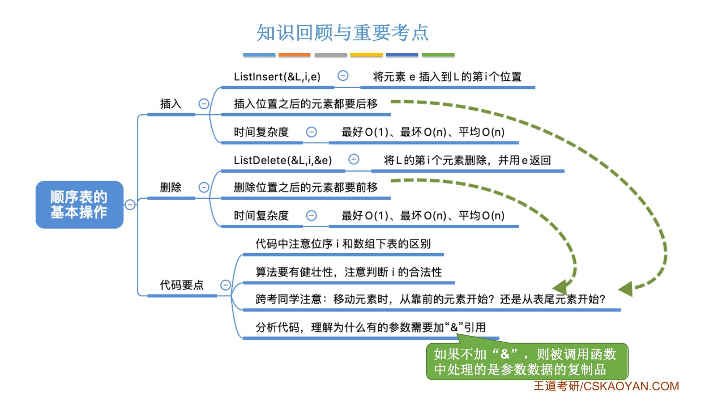

# 这一节在讲什么

::: cue
2.2.1 把顺序表定义好了，这一节做什么？
:::

上一节会定义顺序表、会初始化了，刚建好的表是空表。这一节在顺序表上实现 2.1 里的两个基本操作，并分析时间复杂度：

- **插入** `ListInsert(&L,i,e)`
- **删除** `ListDelete(&L,i,&e)`

本节代码都基于[静态分配]{.u}的顺序表（`SqList`），动态分配的写法也一样。元素类型用 `int`。

::: book
王道书 §2.2.2 考点追踪：**顺序表上操作的时间复杂度分析（2023）**。

书上这一小节先讲初始化（静态分配只需 `L.length=0;`，动态分配 `malloc` 后再设 `length=0`、`MaxSize=InitSize`，和 2.2.1 正课讲的一致），再讲插入、删除、按值查找。书上还有一条注意：各种操作的实现中通常可以忽略边界条件判断、变量定义、内存分配失败等细节，[不要求代码具有实际可执行性]{.u}，重点体现算法的核心思想与逻辑步骤。
:::

# 一、插入

::: cue
在第 $i$ 个位置插入，哪些元素要动？往哪边动？
:::

`ListInsert(&L,i,e)`：在表 $L$ 的[第 $i$ 个位置]{.red}（位序，从 1 开始）插入元素 $e$。

顺序表要用**存储位置相邻**来体现逻辑上的相邻。在第 $i$ 个位置插入，就得先把第 $i$ 个及之后的元素[都往后移一位]{.u}，腾出位置，再把 $e$ 放进去。

{.slide width=0.65}

## 先写一个最简单的版本

```c
#define MaxSize 10
typedef struct {
    int data[MaxSize];
    int length;
} SqList;

void ListInsert(SqList &L, int i, int e) {
    for (int j = L.length; j >= i; j--)   // 第 i 个及之后的元素后移
        L.data[j] = L.data[j-1];
    L.data[i-1] = e;                       // 在位置 i 处放入 e
    L.length++;                            // 长度加 1
}

int main() {
    SqList L;
    InitList(L);
    // ...此处省略一些代码，插入几个元素...
    ListInsert(L, 3, 3);
    return 0;
}
```

老师的例子：表里已有 1、2、4、5、6（`length=5`），调用 `ListInsert(L, 3, 3)`，在第 3 个位置插入 3。一步一步看 `for` 循环：

::: {.tbl widths="0.5,1.4,1.6,2"}
| 轮 | `j` | 执行 | 数组 `data[0..5]` |
|---|---|---|---|
| 前 | — | — | 1　2　4　5　6　_ |
| 1 | 5 | `data[5] = data[4]` | 1　2　4　5　6　**6** |
| 2 | 4 | `data[4] = data[3]` | 1　2　4　5　**5**　6 |
| 3 | 3 | `data[3] = data[2]` | 1　2　4　**4**　5　6 |
| 停 | 2 | `j >= i` 即 `2 >= 3` 不成立，退出 | |
| 后 | — | `data[2] = 3`，`length` 变 6 | 1　2　**3**　4　5　6 |
:::

::: pitfall
参数 $i$ 是**位序**（从 1 开始），落到数组里是**下标 $i-1$**。所以最后一句是 `L.data[i-1] = e`，不是 `L.data[i]`。老师：自己做题写代码时一定要注意。
:::

## 让代码"健壮"：判断合法性，返回 bool

::: cue
传进来的 $i$ 不合法、或表已经满了，怎么办？
:::

上面的版本有问题。比如队友调用 `ListInsert(L, 9, 3)`：表里只有 5 个元素，循环一次都不执行，3 被放进 `data[8]`，中间 `data[5]`～`data[7]` 空着。顺序表的元素必须[一个挨一个]{.u}存放，这就错了。

所以要加两个判断：

- **$i$ 的合法范围是 $[1,\ \texttt{length}+1]$**：可以插在已有元素之间，也可以插在表尾后面那一格（第 length+1 个位置），再往后就不行了。
- **表满了不能插**：`length >= MaxSize` 时拒绝。

不能插的时候，调用者至少得知道"这次失败了"，所以函数返回 `bool`：失败返回 `false`，成功返回 `true`。

```c
bool ListInsert(SqList &L, int i, int e) {
    if (i < 1 || i > L.length + 1)     // 判断 i 的范围是否有效
        return false;
    if (L.length >= MaxSize)           // 当前存储空间已满，不能插入
        return false;
    for (int j = L.length; j >= i; j--)  // 将第 i 个元素及之后的元素后移
        L.data[j] = L.data[j-1];
    L.data[i-1] = e;                   // 在位置 i 处放入 e
    L.length++;                        // 长度加 1
    return true;
}
```

{.slide width=0.65}

::: teacher
老师借这个例子强调：代码除了逻辑正确，还要[健壮]{.red}（能处理异常情况），并且[让别人用起来方便]{.u}（给使用者反馈）。这种意识从刚开始学就要有，以后的算法、甚至以后实习工作都一样。
:::

::: book
王道书注意：**为什么判断插入位置用 `length+1`，而 `for` 循环里用 `length`？** 因为合法的插入位置包括第 $n+1$ 位（表尾之后），但移动元素时最多从第 $n$ 位开始后移（表里只有 $n$ 个元素）。
:::

## 插入的时间复杂度

::: cue
插入的最好、最坏、平均情况各是什么？平均移动多少次？
:::

按 1.2.2 的方法，看**最深层循环**的执行次数和问题规模 $n$ 的关系。这里 $n$ = 表长 `L.length`，最深层的语句是 `L.data[j] = L.data[j-1];`，每执行一次就移动一个元素。

- **最好**：插在表尾（$i=n+1$），不用移动元素，循环 0 次，[$O(1)$]{.red}。
- **最坏**：插在表头（$i=1$），原有 $n$ 个元素全部后移，循环 $n$ 次，[$O(n)$]{.red}。
- **平均**：假设插到每个位置的概率相同。合法位置 $i=1,2,\cdots,n+1$ 共 $n+1$ 个，每个的概率 $p=\dfrac{1}{n+1}$。

{.slide width=0.65}

::: {.tbl widths="1,1,1,1,1"}
| $i$ | 1 | 2 | $\cdots$ | $n+1$ |
|---|---|---|---|---|
| 循环次数 | $n$ | $n-1$ | $\cdots$ | 0 |
:::

$$\text{平均循环次数}=np+(n-1)p+\cdots+1\cdot p+0\cdot p=\frac{n(n+1)}{2}\cdot\frac{1}{n+1}=\frac{n}{2}$$

所以平均时间复杂度 $O\!\left(\dfrac n2\right)=$ [$O(n)$]{.red}。

::: book
王道书写法：设在第 $i$ 个位置插入的概率 $p_i=\dfrac{1}{n+1}$，第 $i$ 个位置要移动 $n-i+1$ 个元素，

$$\sum_{i=1}^{n+1}p_i(n-i+1)=\frac{1}{n+1}\cdot\frac{n(n+1)}{2}=\frac n2$$

和老师的结果一样，只是把"循环次数"写成了 $n-i+1$。
:::

# 二、删除

::: cue
删除第 $i$ 个元素，哪些元素要动？被删的值怎么"带回去"？
:::

`ListDelete(&L,i,&e)`：删除表 $L$ 中第 $i$ 个位置的元素，[用 $e$ 返回被删元素的值]{.u}。做法：先把被删的值存到 $e$，再把它[后面的元素都往前移一位]{.u}，最后 `length` 减 1。

```c
bool ListDelete(SqList &L, int i, int &e) {
    if (i < 1 || i > L.length)         // 判断 i 的范围是否有效
        return false;
    e = L.data[i-1];                   // 将被删除的元素赋值给 e
    for (int j = i; j < L.length; j++) // 将第 i 个位置后的元素前移
        L.data[j-1] = L.data[j];
    L.length--;                        // 线性表长度减 1
    return true;
}

int main() {
    SqList L;
    InitList(L);
    // ...此处省略一些代码，插入几个元素...
    int e = -1;                        // 用变量 e 把删除的元素"带回来"
    if (ListDelete(L, 3, e))
        printf("已删除第3个元素，删除元素值为=%d\n", e);
    else
        printf("位序i不合法，删除失败\n");
    return 0;
}
```

注意删除的合法范围是 $[1,\ \texttt{length}]$：只能删[已经存在]{.u}的元素，和插入的 $[1,\ \texttt{length}+1]$ 差 1。

老师的例子：表里 1～6 六个元素，`int e = -1;` 先在内存里开一小块放 `e`，值是 −1；调用 `ListDelete(L, 3, e)` 删第 3 个：

::: {.tbl widths="0.5,1.3,1.8,2.2"}
| 轮 | `j` | 执行 | 数组 `data[0..5]`，`e` |
|---|---|---|---|
| 前 | — | $i=3$ 合法；`e = data[2]` | 1　2　3　4　5　6，**e=3** |
| 1 | 3 | `data[2] = data[3]` | 1　2　**4**　4　5　6 |
| 2 | 4 | `data[3] = data[4]` | 1　2　4　**5**　5　6 |
| 3 | 5 | `data[4] = data[5]` | 1　2　4　5　**6**　6 |
| 停 | 6 | `j < length` 即 `6 < 6` 不成立，退出 | |
| 后 | — | `length` 变 5，返回 `true` | 1　2　4　5　6（`data[5]` 那个 6 已不在表内） |
:::

`if` 收到 `true`，打印"已删除第3个元素，删除元素值为=3"。

{.slide width=0.65}

## 为什么 `e` 和 `L` 都要加 `&`

::: cue
`ListDelete` 的 `e` 如果不加 `&`，`main` 里打印出来是多少？
:::

和 2.1 讲的道理一样（2.1 笔记"三、什么时候要传引用 `&`"）：

- **`&e`**：加了 `&`，函数里的 `e` 和 `main` 里的 `e` 是[同一份数据]{.u}，`e = L.data[i-1]` 改的就是 `main` 的 `e`。不加的话，函数里处理的是 `main` 里 `e` 的**复制品**，被删的值赋给了复制品，`main` 里的 `e` 还是 **−1**。
- **`&L`**：同理，不加 `&` 的话，删除的一系列操作都做在 `L` 的复制品上，回到 `main` 后表的数据和长度都没变。

## 插入和删除，移动顺序相反

::: pitfall
老师专门提醒跨考同学：

- **插入**（往后移）：[先移后面的]{.red}，`j` 从 `length` 往下减。如果先移前面的，前面的值会把后面还没移走的值覆盖掉。
- **删除**（往前移）：[先移前面的]{.red}，`j` 从 `i` 往上加。

自己没把握时，就像上面两张表一样在纸上一轮一轮推一遍。
:::

## 删除的时间复杂度

::: cue
删除的平均移动次数为什么是 $\dfrac{n-1}{2}$，不是 $\dfrac n2$？
:::

$n$ 仍是表长，最深层语句是 `L.data[j-1] = L.data[j];`。

- **最好**：删表尾元素（$i=n$），不用移动，[$O(1)$]{.red}。
- **最坏**：删表头元素（$i=1$），后面 $n-1$ 个元素全部前移，循环 $n-1$ 次，[$O(n)$]{.red}。
- **平均**：假设删每个元素的概率相同。合法位置 $i=1,\cdots,n$ 共 $n$ 个，$p=\dfrac1n$。

::: {.tbl widths="1,1,1,1,1"}
| $i$ | 1 | 2 | $\cdots$ | $n$ |
|---|---|---|---|---|
| 循环次数 | $n-1$ | $n-2$ | $\cdots$ | 0 |
:::

$$\text{平均循环次数}=(n-1)p+(n-2)p+\cdots+1\cdot p+0\cdot p=\frac{n(n-1)}{2}\cdot\frac1n=\frac{n-1}{2}$$

平均时间复杂度 [$O(n)$]{.red}。

和插入对比：插入有 $n+1$ 个位置、最多移 $n$ 个；删除只有 $n$ 个位置、最多移 $n-1$ 个（被删的那个不用移）。所以插入平均 $\dfrac n2$，删除平均 $\dfrac{n-1}{2}$。

::: book
王道书写法：$p_i=\dfrac1n$，删第 $i$ 个要移动 $n-i$ 个元素，$\displaystyle\sum_{i=1}^{n}p_i(n-i)=\frac1n\cdot\frac{n(n-1)}{2}=\frac{n-1}{2}$。

书上的结论：顺序表插入和删除的时间[主要耗费在移动元素上]{.red}，移动元素的个数取决于插入、删除的位置。
:::

{.slide width=0.75}

# 三、知识回顾

::: {.tbl widths="1,1.3,1.3"}
| | 插入 `ListInsert(&L,i,e)` | 删除 `ListDelete(&L,i,&e)` |
|---|---|---|
| $i$ 的合法范围 | $1\le i\le \texttt{length}+1$ | $1\le i\le \texttt{length}$ |
| 还要判断 | 表满（`length >= MaxSize`） | — |
| 元素怎么动 | 第 $i$ 个及之后后移，**从后往前**移 | 第 $i$ 个之后前移，**从前往后**移 |
| `length` | `++` | `--` |
| 最好 / 最坏 | 表尾 $O(1)$ / 表头 $O(n)$ | 表尾 $O(1)$ / 表头 $O(n)$ |
| 平均移动次数 | $\dfrac n2$ | $\dfrac{n-1}{2}$ |
| 平均时间复杂度 | $O(n)$ | $O(n)$ |
:::

::: summary
顺序表要求逻辑相邻 = 物理相邻，所以**插入**要把后面的元素依次后移，**删除**要把后面的元素依次前移，时间主要花在移动元素上，平均都是 $O(n)$，插入平均移 $\dfrac n2$ 个，删除平均移 $\dfrac{n-1}{2}$ 个。

写代码的四个要点：① 别忘了改 `length`；② 题目说的是**位序**还是**数组下标**一定要审清，位序 $i$ 对应下标 $i-1$；③ 代码要**健壮**，先判断 $i$ 是否合法（插入还要判满），用 `bool` 返回成败；④ 理解为什么 `L` 和删除的 `e` 要加 `&`。没怎么写过代码的同学，在纸上把插入、删除各默写一遍。

**自测**：① 表长为 5，`ListInsert(L,7,x)` 会怎样？`ListInsert(L,6,x)` 呢？② 插入时 `for` 循环如果写成从前往后移，会出什么错？③ 表长为 $n$，删除操作平均要移动几个元素？④ `ListDelete` 的 `e` 去掉 `&`，`main` 里打印出的 `e` 是多少？
:::

{.slide width=0.6}

