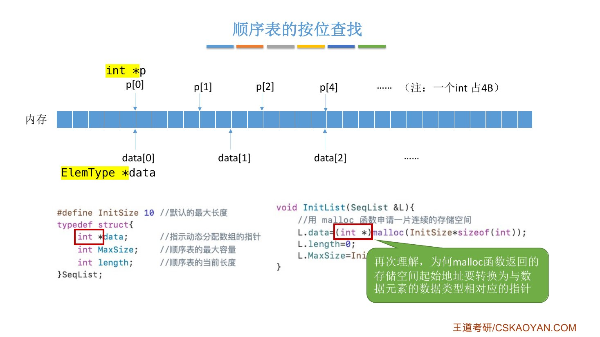
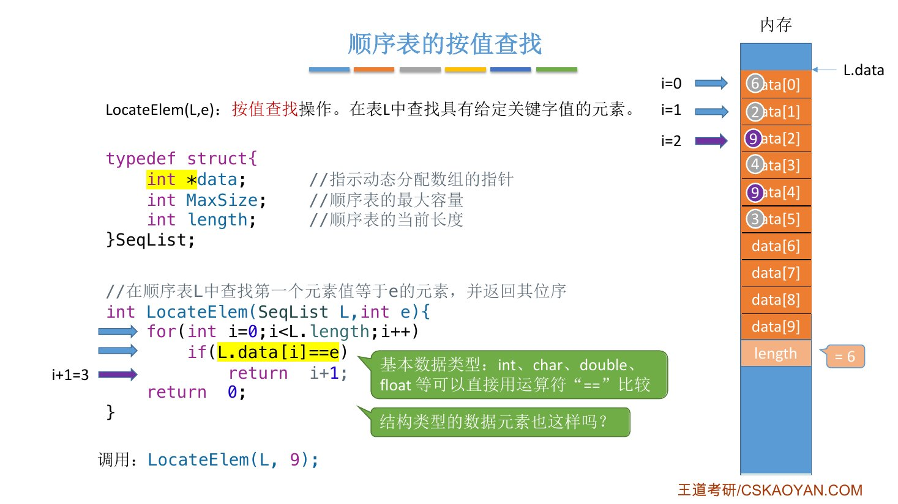
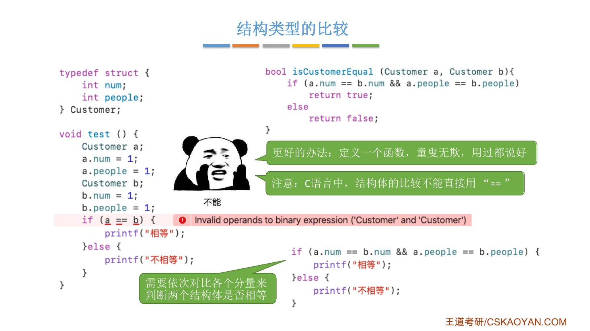
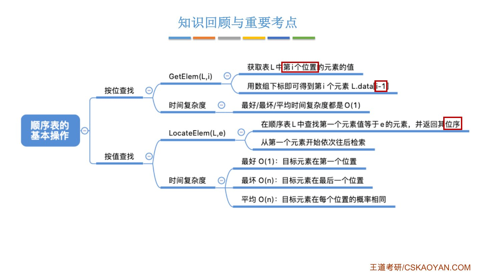

# 这一节在讲什么

::: cue
顺序表的查找分哪两种？
:::

2.1 的基本操作里，"查"有两个，这一节在顺序表上实现它们，并分析时间复杂度：

- **按位查找** `GetElem(L,i)`：取第 $i$ 个元素的值；
- **按值查找** `LocateElem(L,e)`：找值等于 $e$ 的元素在哪。

两个都只读不改，所以 `L` 都[不加 `&`]{.u}（2.1 笔记"三"的道理）。

::: fix
**名字对照**：课件叫"按位查找"，王道书叫"[按序号查找]{.u}"，是同一个操作。
:::

# 一、按位查找

::: cue
`GetElem` 一句话怎么写？静态、动态分配写法一样吗？
:::

`GetElem(L,i)`：获取表 $L$ 中第 $i$ 个位置的元素的值。

```c
ElemType GetElem(SqList L, int i) {     // 静态分配
    return L.data[i-1];
}

ElemType GetElem(SeqList L, int i) {    // 动态分配，写法完全一样
    return L.data[i-1];
}
```

- 返回值类型和元素类型相同，所以写 `ElemType`。
- 还是那个坑：第 $i$ 个元素在下标 [$i-1$]{.red}。
- 想更健壮的话，可以先判断 $i$ 是否在 $[1,\ \texttt{length}]$ 内，老师说很简单，没展开。

## 指针为什么也能用下标

::: cue
动态分配时 `data` 是指针，`L.data[i-1]` 为什么还能用？一次取几个字节由什么决定？
:::

动态分配时 `data` 是一个**指针**，指向 `malloc` 申请的那片连续空间的起始地址。但它同样可以用 `data[i]` 这种[数组下标的方式]{.u}访问元素，老师说这可能是跨考同学不知道的点。

计算机在背后做的事：**根据指针所指向的类型的大小，算出每个下标对应哪几个字节**。

老师的例子：`data` 指向地址 2000，图中一格代表 1 字节，假设一个 `ElemType` 占 6B（`sizeof(ElemType)==6`）。再定义一个 `int *p` 也指向 2000，`int` 占 4B：

::: {.tbl widths="1,1.5,1,1.5"}
| `ElemType *data` | 取的字节 | `int *p` | 取的字节 |
|---|---|---|---|
| `data[0]` | 2000～2005（6B） | `p[0]` | 2000～2003（4B） |
| `data[1]` | 2006～2011 | `p[1]` | 2004～2007 |
| `data[2]` | 2012～2017 | `p[2]` | 2008～2011 |
:::

同一个地址，指针类型不同，每次取的字节数就不同。

![课件：ElemType 占 6B 时，data[i] 对应的内存](assets/2.2.2_2-p04.jpg){.slide width=0.65}

::: pitfall
这就解释了 2.2.1 里强调的：`malloc` 返回的指针要[强制转换成和元素类型相同的指针]{.red}，比如 `int` 表写 `(int *)`。指针指向同一个地址，但类型定义错了，按下标访问元素时取的字节数就错了，取出来的数据也就错了。
:::

{.slide width=0.65}

## 时间复杂度：O(1)

只有一句 `return`，没有循环也没有递归，时间复杂度 [$O(1)$]{.red}。

这就是 2.2.1 说的[随机存取]{.red}：元素在内存里**连续存放**，且**类型相同、每个占的空间一样大**，所以只要知道起始地址和每个元素的大小，就能立即算出第 $i$ 个元素在哪。王道书："直接通过数组下标访问即可，时间复杂度为 $O(1)$。"

# 二、按值查找

::: cue
`LocateElem` 返回的是下标还是位序？找不到返回什么？
:::

`LocateElem(L,e)`：在表 $L$ 中查找第一个值等于 $e$ 的元素，并返回其[位序]{.u}。从第一个元素开始，依次往后比较：

```c
// 在顺序表 L 中查找第一个元素值等于 e 的元素，并返回其位序
int LocateElem(SeqList L, ElemType e) {
    for (int i = 0; i < L.length; i++)
        if (L.data[i] == e)
            return i + 1;    // 数组下标为 i 的元素值等于 e，返回其位序 i+1
    return 0;                // 退出循环，说明查找失败
}
```

- `i` 是**数组下标**，要返回的是**位序**，所以 `return i + 1`。
- 位序从 1 开始，`0` 不可能是合法位序，所以[返回 0 表示查找失败]{.u}。

老师的例子：表里依次是 6、2、9、4、9、3（`length=6`），调用 `LocateElem(L, 9)`：

::: {.tbl widths="0.6,1,1.2,2"}
| `i` | `L.data[i]` | `== 9`？ | 结果 |
|---|---|---|---|
| 0 | 6 | 否 | `i++` |
| 1 | 2 | 否 | `i++` |
| 2 | 9 | 是 | `return 3` |
:::

`data[4]` 也是 9，但找到**第一个**就返回了，后面不再看。

{.slide width=0.65}

## 结构体不能直接用 `==`

::: cue
如果元素是 `struct`，`L.data[i] == e` 还能用吗？考试里怎么办？
:::

`int`、`char`、`double`、`float` 这些[基本数据类型]{.u}可以直接用 `==` 比较。但**结构类型不行**：老师定义了 2.2.1 里的 `Customer`，让 `a`、`b` 两个变量的字段全设成 1，再写 `if (a == b)`，IDE 直接报错，[连编译都过不了]{.red}。

正确做法：逐个比较各个分量，都相等才算相等。更好的办法是写成一个函数，用起来方便：

```c
typedef struct {
    int num;
    int people;
} Customer;

bool isCustomerEqual(Customer a, Customer b) {
    if (a.num == b.num && a.people == b.people)
        return true;
    else
        return false;
}
```

C++ 可以重载 `==` 运算符，照顾跨考同学没展开。

{.slide width=0.65}

::: teacher
老师的考试建议：如果报考学校考的科目叫**数据结构**，判断两个元素是否相等时，[不管是基本类型还是结构类型都可以直接写 `==`]{.u}，这门课考的是对数据结构和算法的理解，不会过分严格要求语法。如果考的是**C 语言程序设计**，阅卷可能会在意语法是否严格，最好看看该校历年真题的要求。
:::

## 按值查找的时间复杂度

::: cue
按值查找平均要比较几次？为什么是 $\dfrac{n+1}{2}$？
:::

$n$ 是表长，最深层语句是 `if (L.data[i] == e)`，看它执行几次。

- **最好**：目标元素在表头，循环 1 次，[$O(1)$]{.red}。
- **最坏**：目标元素在表尾（王道书补一句：或者不存在），要比较 $n$ 次，[$O(n)$]{.red}。
- **平均**：假设目标元素出现在每个位置的概率相同，都是 $\dfrac1n$。在第 $i$ 位就要循环 $i$ 次：

$$\text{平均循环次数}=1\cdot\frac1n+2\cdot\frac1n+\cdots+n\cdot\frac1n=\frac{n(n+1)}{2}\cdot\frac1n=\frac{n+1}{2}$$

平均时间复杂度 [$O(n)$]{.red}。

和插入删除的区别：那两个数的是"移动几次"，最好情况是 0 次；这里数的是"比较几次"，最好也要比 1 次，所以平均是 $\dfrac{n+1}{2}$ 而不是 $\dfrac{n-1}{2}$。

::: teacher
如果顺序表里的元素是**有序**的（从小到大或从大到小），有更高效的查找算法，第 7 章"查找"再学。元素无序时，只能从第一个开始依次往后找，平均 $O(n)$。
:::

# 三、知识回顾

{.slide width=0.6}

2.2.2 两节课学的四个基本操作放在一起：

::: {.tbl widths="1.5,0.9,0.9,1.1,0.9"}
| 操作 | 最好 | 最坏 | 平均次数 | 平均 |
|---|---|---|---|---|
| 插入 `ListInsert` | $O(1)$ | $O(n)$ | 移动 $\dfrac n2$ | $O(n)$ |
| 删除 `ListDelete` | $O(1)$ | $O(n)$ | 移动 $\dfrac{n-1}{2}$ | $O(n)$ |
| 按位查找 `GetElem` | $O(1)$ | $O(1)$ | — | $O(1)$ |
| 按值查找 `LocateElem` | $O(1)$ | $O(n)$ | 比较 $\dfrac{n+1}{2}$ | $O(n)$ |
:::

::: summary
**按位查找**一句 `return L.data[i-1];`，静态、动态分配都这么写（指针也能用下标，每次取几个字节由指针指向的类型决定，所以 `malloc` 的返回值要强转成对应类型）；$O(1)$，这就是顺序表的**随机存取**。

**按值查找**从头依次比较，找到第一个相等的返回**位序 $i+1$**，找不到返回 0；最好 $O(1)$、最坏 $O(n)$、平均比较 $\dfrac{n+1}{2}$ 次，$O(n)$。基本类型可以直接 `==`，结构体在 C 里不行，要逐个比较分量（考数据结构时可以直接写 `==`）。

**自测**：① 动态分配的 `data` 是 `ElemType *`，`sizeof(ElemType)==8`，首地址 1000，`data[3]` 从哪个地址开始？② `LocateElem` 为什么返回 `i+1`？返回 0 是什么意思？③ 表长为 $n$，按值查找平均比较几次？④ 两个 `Customer` 变量在 C 语言里能直接用 `==` 比较吗？
:::
