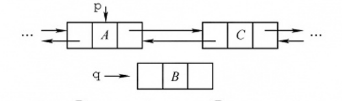
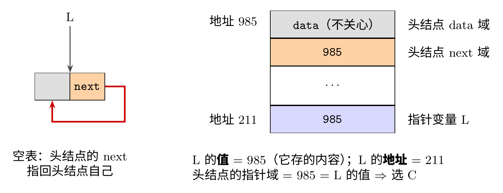
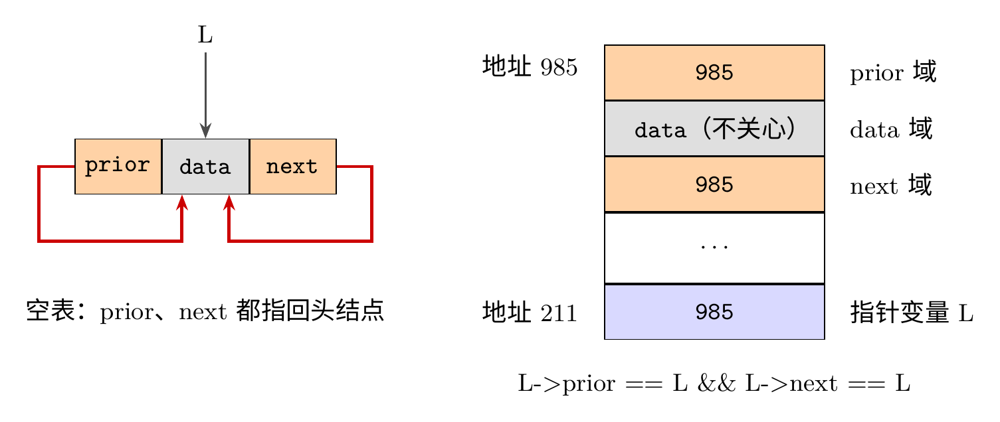
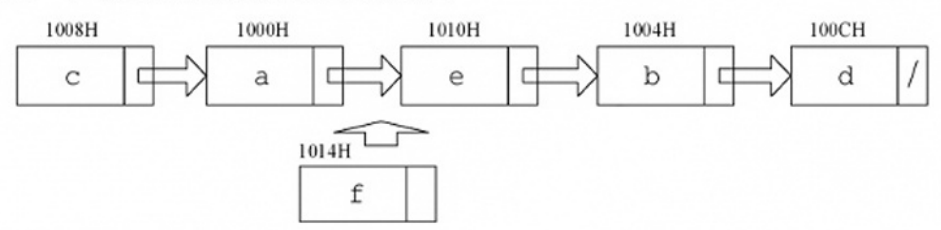
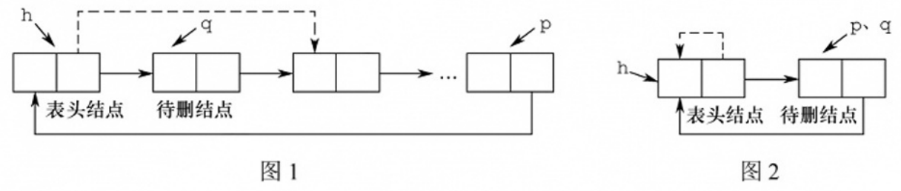
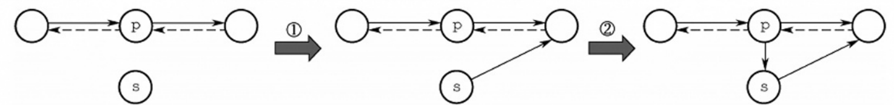
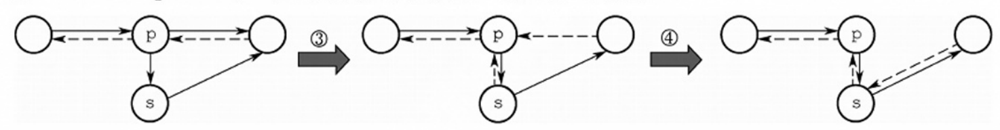
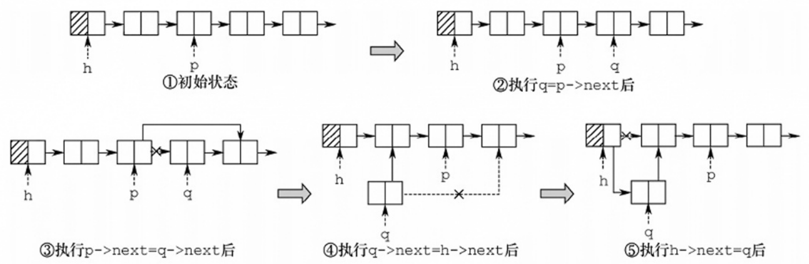

# 这组题在考什么

::: cue
36 道题归结起来考哪几类？
:::

36 道选择题可以分成三类：

- **比较、选择存储结构**（顺序 vs 链式、单 vs 双、循环 vs 非循环、有没有头结点 / 尾指针）：本质是问"要找的那个结点能不能 $O(1)$ 找到"；
- **模拟指针语句**（插入、删除、移动结点）：画图，一句一句执行，看有没有断链、有没有指向自己；
- **判空、长度、复杂度**这类概念题。

::: {.tbl widths="0.6,2.6,0.6"}
| 题号 | 考点 | 答案 |
|---|---|---|
| 01 | 顺序存储与链式存储的说法 | B |
| 02 | 快速插删 + 反映逻辑关系 | B |
| 03 | 结点内存储单元的地址 | A |
| 04 | 线性表存储的五个说法 | D |
| 05 | 哪个操作单链表比顺序表效率高 | A |
| 06 | 在前驱 `q` 和 `p` 之间插入 `s` | C |
| 07 | 由数组建有序单链表的最低复杂度 | D |
| 08 | 长度 $n$ 的表接在长度 $m$ 的表后 | C |
| 09 | 头结点的作用 | C |
| 10 | 有尾指针的单链表，哪个操作与表长有关 | B |
| 11 | 带 / 不带头结点的单链表判空 | B、A |
| 12 | 删 $a_{50}$ 要移动几个元素 | D |
| 13 | 头插法建表的元素次序 | B |
| 14 | 线性表的四个说法 | C |
| 15 | 双链表在 `p` 之前插入 `q` | D |
| 16 | 双链表删除 `p` | A |
| 17 | 双链表插入的语句顺序 | A |
| 18 | 双链表插入要改几个指针域 | C |
| 19 | 有序单链表插入并保持有序 | B |
| 20 | 双链表比单链表好在哪 | D |
| 21 | 带头结点的循环单链表判空 | C |
| 22 | 带头结点的循环双链表判空 | D |
| 23 | 常在末尾插入和删除，选哪种链表 | A |
| 24 | 首尾插删四种运算，选哪种链表 | C |
| 25 | 两个循环单链表 $O(1)$ 头尾相接 | B |
| 26 | 删首元结点要 $O(n)$ 的结构 | A |
| 27 | `head->next->next==head` 时的表长 | D |
| 28 | 循环与非循环双链表删首尾 | D |
| 29 | 常在表尾插入、删第一个，选哪种链表 | D |
| 30 | 要连续空间、插删不移动元素 | B |
| 31 | 静态链表的四个说法 | B |
| 32 | 【2016 统考】循环双链表删除 `p` | D |
| 33 | 【2016 统考】按存储表插入结点 `f` | D |
| 34 | 【2021 统考】循环单链表删第一个元素 | D |
| 35 | 【2023 统考】双链表后插的后两句 | C |
| 36 | 【2024 统考】四句话的作用 | D |
:::

::: fix
**习题讲解视频大部分不用看**，和书上解析、正课一致，有价值的说法下面都记了。值得看的几段：

- **P14 的 21、22**：老师画内存图（头结点地址 985、指针 `L` 地址 211）讲"`L` 的值"和"`L` 的地址"，板书截图放在 21 题下；
- **P10 的 05**：顺序表 $O(n)$ 删除所有值为 $x$ 的元素的双指针算法，是新知识（代码截图放在 05 题下）；
- **P16 的 34、P17 的 36**：两位老师都讲了模拟指针语句的方法，尤其 36 的"四步法"，几分钟就看完。

其余题的讲解就是画图逐个模拟选项，看书上解析即可。
:::

# 一、顺序存储与链式存储的比较（01–05）

::: cue
能说"顺序存储优于链式存储"吗？两者各能做顺序存取吗？
:::

::: {.q title="01"}
下列关于线性表说法中，正确的是（　）。

| I. 顺序存储结构优于链式存储结构
| II. 链式存储结构比顺序存储结构能更方便地表示各种逻辑结构
| III. 若频繁使用插入和删除结点操作，则顺序存储结构更优于链式存储结构
| IV. 顺序存储结构和链式存储结构都可以进行顺序存取
| A. I、II、III　　　　　B. II、IV　　　　　C. II、III　　　　　D. III、IV
:::

[**答案：B**]{.red}

::: video
- I 错：两种结构适用场合不同，不能笼统说谁优于谁。老师的比方："他学习好，你可能比他长得帅。"
- II 对：链式结构的指针域可以设 1 个、2 个、3 个，很灵活，所以树、图这类结构适合用链式表示。
- III 错：频繁插删应该用链式。
- IV 对：顺序存取就是从 $a_1$ 到 $a_n$ 一个一个访问（一个 `for` 循环），两种结构都能做；只有顺序存储还能随机存取。
:::

::: jiexi
两种存储结构有不同的适用场合，不能简单地说谁好谁坏，I 错误。链式存储用指针表示逻辑结构，而指针的设置是任意的，故能更方便地表示各种逻辑结构，II 正确。在顺序存储中，插入和删除结点需要移动大量元素，效率较低，III 的描述刚好相反。顺序存储结构既能随机存取又能顺序存取，而链式结构只能进行顺序存取，IV 正确。
:::

::: recall
正课 2.3.6"二、Round 2：存储结构"和王道书第 38 页"存取（读/写）方式"：顺序表支持随机存取，也支持顺序存取；链表仅支持顺序存取。
:::

::: cue
既要快速插删，又要反映逻辑关系，为什么排除散列？
:::

::: {.q title="02"}
对于一个线性表，既要求能够进行较快速地插入和删除，又要求存储结构能反映数据之间的逻辑关系，则应该用（　）。

| A. 顺序存储方式　　　　　　B. 链式存储方式
| C. 散列存储方式　　　　　　D. 以上均可以
:::

[**答案：B**]{.red}

::: video
"快速"指 $O(1)$：链式存储找到位置后插删只改指针，$O(1)$；顺序存储要移动元素，排除 A。散列存储（第 7 章"查找"会学）只按关键字算地址，反映不了元素之间的前驱、后继关系，排除 C。
:::

::: jiexi
要求较快速地插入和删除，排除 A、D。散列存储通过散列函数映射到物理空间，不能反映数据之间的逻辑关系，排除 C。链式存储能快速插入和删除（只需修改指针），又能反映逻辑关系（通过指针）。
:::

::: cue
"一个结点内部"的地址和"结点与结点之间"的地址，哪个必须连续？
:::

::: {.q title="03"}
链式存储设计时，结点内的存储单元地址（　）。

| A. 一定连续　　　　　　　　B. 一定不连续
| C. 不一定连续　　　　　　　D. 部分连续，部分不连续
:::

[**答案：A**]{.red}

::: video
注意题目说的是**结点内**：一个结点的 `data`、`next`（双链表还有 `prior`）是一个结构体，一次 `malloc` 出来，地址必然连续；**结点与结点之间**才不一定连续。
:::

::: jiexi
链式存储设计时，各个不同结点的存储空间可以不连续，但结点内的存储单元地址必须连续。
:::

::: pitfall
看到"链式存储""地址"就选"不一定连续"会错。先看清问的是结点**内**还是结点**间**。
:::

::: cue
顺序存储只能存线性结构吗？什么情况下单链表删表尾要 $O(n)$？
:::

::: {.q title="04"}
下列关于线性表的说法中，正确的是（　）。

| I. 顺序存储方式只能用于存储线性结构
| II. 在一个设有头指针和尾指针的单链表中，删除表尾元素的时间复杂度与表长无关
| III. 带头结点的循环单链表中不存在空指针
| IV. 在一个长度为 $n$ 的有序单链表中插入一个新结点并仍保持有序的时间复杂度为 $O(n)$
| V. 若用单链表来表示队列，则应该选用带尾指针的循环链表
| A. I、II　　　　B. I、III、IV、V　　　　C. IV、V　　　　D. III、IV、V
:::

[**答案：D**]{.red}

::: video
- I 错：二叉树可以顺序存储，图可以用二维数组（邻接矩阵）存。
- II 错：删掉表尾后，要把新表尾（原来的倒数第二个）的 `next` 置空、尾指针指过去，而单链表找倒数第二个只能从头遍历。
- III 对：老师分别画了空表（头结点指向自己）和非空表（表尾指向头结点），都没有 `NULL`。
- IV 对：以 1、3、5、7 为例，新结点有 $n+1$ 个可能的插入位置，要从头比较着找，平均 $O(n)$（第 19 题有详细推导）。
- V 对：队列在队尾进、队头出。设尾指针 `p`，入队新结点 `q` 是四步 `r=p->next; p->next=q; q->next=r; p=q;`，出队就是删 `p->next`，都是 $O(1)$。
:::

::: jiexi
顺序存储方式同样适用于图和树的存储，如满二叉树的顺序存储，I 错误。若只设头指针和尾指针，删除表尾元素后要找到其前驱，并将其后继置为 `NULL`，需要从头开始遍历，时间与表长有关，II 错误。循环单链表中最后一个结点的指针不是 `NULL`，而是指向头结点，整个链表形成一个环，III 正确。有序单链表只能从头依次查找插入位置，时间为 $O(n)$，IV 正确。队列需要在表头删除、表尾插入，用带尾指针的循环链表，删除和插入的时间都是 $O(1)$，V 正确。
:::

::: add
视频里的入队四句和正课 2.3.4 王道书框里的"仅设尾指针 `r` 时在表尾插入 `*s`"是一回事：`s->next=r->next; r->next=s; r=s;`（三句，少用一个临时变量 `r`）。
:::

::: cue
"删除所有值为 $x$ 的元素"，顺序表真的要 $O(n^2)$ 吗？
:::

::: {.q title="05"}
设线性表中有 $2n$ 个元素，（　）在单链表上实现要比在顺序表上实现效率更高。

| A. 删除所有值为 $x$ 的元素
| B. 在最后一个元素的后面插入一个新元素
| C. 顺序输出前 $k$ 个元素
| D. 交换第 $i$ 个元素和第 $2n-i-1$ 个元素的值（$i=0,\dots,n-1$）
:::

[**答案：A**]{.red}

::: video
- B：顺序表 `A[2n]=x` 一句 $O(1)$；单链表（没说有尾指针）要遍历到表尾。顺序表更快。
- C：两者都从头走 $k$ 步，没区别。
- D：顺序表用一个临时变量交换，$O(1)$；单链表要遍历找到这两个元素。顺序表更快。
- A：很多同学以为顺序表每删一个都要整体前移，要 $O(n^2)$。其实有 $O(n)$ 的双指针算法：`i` 扫描每个元素，`j` 记录保留下来的元素该放的位置，不等于 $x$ 的才往前搬，最后把表长改成 `j`（代码见下面第二张截图）。

所以两者都是 $O(n)$，但单链表删除只改指针、不搬元素，常数更小，效率还是更高。
:::

![习题讲解视频板书：B 顺序表 `A[2n]=new` 一句；D 用 `temp` 交换 `A[i]`、`A[2n-i-1]`；单链表都要从 `p` 开始遍历](assets/2.3ex-05a.jpg){.slide width=0.75}

{.slide width=0.75}

::: jiexi
对于 A，在单链表和顺序表上实现的时间复杂度都为 $O(n)$，但后者要移动很多元素，因此在单链表上实现效率更高。对于 B 和 D，顺序表的效率更高。C 无区别。
:::

::: recall
"复杂度相同不代表效率相同"：正课 2.3.6"增、删"讲过，顺序表的开销在移动元素，链表的开销在查找；2.2 课后习题 08 也是这个点。
:::

# 二、单链表的操作（06–13、19）

::: cue
已知前驱 `q` 和后继 `p`，插入 `s` 的两句能不能交换顺序？
:::

::: {.q title="06"}
在一个单链表中，已知 `q` 所指结点是 `p` 所指结点的前驱结点，若在 `q` 和 `p` 之间插入结点 `s`，则执行（　）。

| A. `s->next=p->next; p->next=s;`
| B. `p->next=s->next; s->next=p;`
| C. `q->next=s; s->next=p;`
| D. `p->next=s; s->next=q;`
:::

[**答案：C**]{.red}

::: video
插入后 `q` 是 `s` 的前驱、`p` 是 `s` 的后继，所以 `q->next=s; s->next=p;`。这两句交换顺序也可以，因为三个结点都有各自的指针指着，先改哪个都不会把谁弄丢。
:::

::: jiexi
`s` 插入后，`q` 成为 `s` 的前驱，而 `p` 成为 `s` 的后继，选项 C 满足此条件。书上的注意框：有人认为 C 中两句要交换顺序才对；因为 `s` 的前后结点都有指针指示，所以 C 的顺序不会断链，"不要生搬硬套"。
:::

::: add
**补充正课 2.3.2_1"①② 两句不能颠倒"**：那里只知道 `p`，`p` 原来的后继只能通过 `p->next` 找到，所以必须先 `s->next=p->next` 再改 `p->next`。本题后继另有指针 `p` 指着，就没有这个限制。判断语句顺序能不能换，看的是"改掉某个指针以后，还有没有别的路能找到原来那个结点"。
:::

::: cue
由无序数组建有序单链表，最快是多少？
:::

::: {.q title="07"}
给定有 $n$ 个元素的一维数组，建立一个有序单链表的最低时间复杂度是（　）。

| A. $O(1)$　　　　B. $O(n)$　　　　C. $O(n^2)$　　　　D. $O(n\log_2 n)$
:::

[**答案：D**]{.red}

::: video
三种方案：① 先把数组排好序（$O(n\log n)$），再建链表（$O(n)$）；② 先建链表，再对链表排序（$O(n)+O(n\log n)$）；③ 边建边插，每个元素都找位置插进有序链表，相当于直接插入排序，$O(n^2)$。"最低"指用最好的算法，不是指碰巧数组已经有序这种情况。
:::

::: jiexi
若先建立链表，然后依次插入建立有序表，则每插入一个元素就需遍历链表寻找插入位置，即直接插入排序，时间复杂度为 $O(n^2)$。若先将数组排好序，然后建立链表，建立链表的时间复杂度为 $O(n)$，数组排序的最好时间复杂度为 $O(n\log_2 n)$，总时间复杂度为 $O(n\log_2 n)$。
:::

::: add
排序算法的复杂度（为什么最好是 $O(n\log_2 n)$）在第 8 章，这里先记结论。
:::

::: cue
把长度 $n$ 的表接到长度 $m$ 的表后面，时间花在哪？
:::

::: {.q title="08"}
将长度为 $n$ 的单链表链接在长度为 $m$ 的单链表后面，其算法的时间复杂度为（　）。

| A. $O(1)$　　　　B. $O(n)$　　　　C. $O(m)$　　　　D. $O(n+m)$
:::

[**答案：C**]{.red}

::: jiexi
先遍历长度为 $m$ 的单链表，找到它的尾结点，然后将其 `next` 域指向另一个单链表的首结点，时间复杂度为 $O(m)$。
:::

::: video
和书上一样：时间全花在找前一个表的表尾上，接上只要改一个指针。
:::

::: cue
加头结点到底是为了什么？
:::

::: {.q title="09"}
单链表中，增加一个头结点的目的是（　）。

| A. 使单链表至少有一个结点　　　B. 标识表结点中首结点的位置
| C. 方便运算的实现　　　　　　　D. 说明单链表是线性表的链式存储
:::

[**答案：C**]{.red}

::: video
头结点让两件事统一：① 第一个位置和其他位置统一；② 空表和非空表统一。例：带头结点时在头结点后插入 `q`，`q->next=p->next; p->next=q;`（`p` 指头结点）不管表空不空都一样写；不带头结点时，往空表插第一个元素要单独写 `if`，改头指针本身（`*head=newnode`）。
:::

::: jiexi
单链表设置头结点的目的是方便运算的实现，主要好处体现在：第一，有头结点后，插入和删除数据元素的算法就统一了，不再需要判断是否在第一个元素之前插入或删除第一个元素；第二，不论链表是否为空，链表头指针不变。
:::

::: recall
正课 2.3.1"两种实现怎么选"：王道书把这叫引入头结点的两个优点，**操作一致性**和**空表与非空表处理统一**。A 是干扰项：头结点让表"看起来"至少有一个结点，但那不是目的。
:::

::: cue
有头指针也有尾指针，为什么删最后一个元素还和表长有关？
:::

::: {.q title="10"}
在一个长度为 $n$ 的带头结点的单链表 `h` 上，设有尾指针 `r`，则执行（　）操作与链表的表长有关。

| A. 删除单链表中的第一个元素
| B. 删除单链表中的最后一个元素
| C. 在单链表第一个元素前插入一个新元素
| D. 在单链表最后一个元素后插入一个新元素
:::

[**答案：B**]{.red}

::: video
老师强调：题目只说"设有尾指针"，头指针也是默认有的，没有头指针就找不到这个链表。逐个写出来：

- A：`q=h->next; h->next=h->next->next; free(q);`，$O(1)$；
- B：删掉后要让 `r` 指向倒数第二个、并把它的 `next` 置空，只能从头遍历找，$O(n)$；
- C：`q->next=h->next; h->next=q;`，$O(1)$；
- D：`r->next=q; r=q;`（`q->next` 置 `NULL`），$O(1)$。
:::

::: jiexi
删除单链表的最后一个结点需置其前驱结点的指针域为 `NULL`，需要从头开始依次遍历找到该前驱结点，需要 $O(n)$ 的时间，与表长有关。其他操作均与表长无关。
:::

::: cue
"`head==NULL`" 和 "`head->next==NULL`" 分别是哪种单链表的判空？
:::

::: {.q title="11"}
对于一个头指针为 `head` 的带头结点的单链表，判定该表为空表的条件是（　）；对于不带头结点的单链表，判定空表的条件为（　）。

| A. `head==NULL`　　　　　　　B. `head->next==NULL`
| C. `head->next==head`　　　　D. `head!=NULL`
:::

[**答案：B；A**]{.red}

::: video
老师画了内存图：`head` 本身是一个指针变量，里面存的是头结点的地址（比如 985）。带头结点时，空表是头结点的 `next` 域为空，`head` 里还是 985，不为空；不带头结点时 `head` 直接指向第一个数据结点，空表就是 `head` 本身为 `NULL`。C 是带头结点的**循环**单链表的判空（第 21 题）。
:::

::: jiexi
在带头结点的单链表中，头指针 `head` 指向头结点，头结点的 `next` 域指向第一个元素结点，`head->next==NULL` 表示该单链表为空。在不带头结点的单链表中，`head` 直接指向第一个元素结点，`head==NULL` 表示该单链表为空。
:::

::: recall
正课 2.3.1：带头结点判空看 `L->next == NULL`，不是看 `L`（`L` 一直指着头结点）；不带头结点判空看 `L == NULL`。
:::

::: cue
删 $a_{50}$ 要移动几个？存储方式没说时怎么答？
:::

::: {.q title="12"}
在线性表 $a_0,a_1,\dots,a_{100}$ 中，删除元素 $a_{50}$ 需要移动（　）个元素。

| A. 0　　　　B. 50　　　　C. 51　　　　D. 0 或 50
:::

[**答案：D**]{.red}

::: video
题目没说存储方式，两种都要考虑。顺序存储：$a_{51}\sim a_{100}$ 都要前移，$100-51+1=50$ 个；链式存储：只改 $a_{49}$ 的 `next`，结点不用动，0 个。
:::

::: jiexi
线性表的存储方式未明确，若采用链式存储，则无须移动元素；若采用顺序存储，则需要移动 50 个元素。
:::

::: recall
正课 2.2.2_1：顺序表删第 $i$ 个（位序）要移动 $n-i$ 个。这里 $n=101$，$a_{50}$ 是第 51 个，$101-51=50$。
:::

::: cue
头插法建出来的链表，次序和输入是什么关系？
:::

::: {.q title="13"}
通过含有 $n\,(n>1)$ 个元素的数组 `a`，采用头插法建立单链表 `L`，则 `L` 中的元素次序（　）。

| A. 与数组 `a` 的元素次序相同　　　B. 与数组 `a` 的元素次序相反
| C. 与数组 `a` 的元素次序无关　　　D. 以上都错误
:::

[**答案：B**]{.red}

::: video
例：数组 4、1、3、1、0、2、5，头插后是 5、2、0、1、3、1、4（"520 1314"）。记住"头插法可以逆置链表"，算法题里经常用。
:::

::: jiexi
头插法建表的元素次序与原次序相反。
:::

::: recall
正课 2.3.2_3"重要应用：链表的逆置"。
:::

::: cue
在有序单链表里插入一个结点，平均要比较几次？
:::

::: {.q title="19"}
在长度为 $n$ 的有序单链表中插入一个新结点，并仍然保持有序的时间复杂度是（　）。

| A. $O(1)$　　　　B. $O(n)$　　　　C. $O(n^2)$　　　　D. $O(n\log_2 n)$
:::

[**答案：B**]{.red}

::: video
老师用 1、3、5、7、9、11 六个结点举例，新结点有 7 个可能的位置，一般地 $n$ 个结点有 $n+1$ 个位置。以"和表中元素比较的次数"作为基本语句的执行次数：插在第 1 个位置比 1 次，第 2 个位置比 2 次……插在倒数第二个位置比 $n$ 次；插在最后也只比 $n$ 次（和 11 比完发现更大就确定了）。等概率时平均比较次数：

$$\frac{(1+2+\cdots+n)+n}{n+1}=\frac{\frac{n(n+1)}{2}+n}{n+1}=\frac{n}{2}+\frac{n}{n+1}$$

第二项小于 1，起决定作用的是 $\frac{n}{2}$，所以是 $O(n)$。
:::

::: jiexi
假设单链表递增有序（递减的情况同理），在插入数据为 $x$ 的结点之前，先要在单链表中找到第一个大于 $x$ 的结点的直接前驱 `p`，在 `p` 之后插入该结点。查找的时间复杂度为 $O(n)$，插入的时间复杂度为 $O(1)$，总时间复杂度为 $O(n)$。
:::

::: fix
字幕里这一步听到的是"$\frac{n}{2}$ 加上 $2n+1$ 分之 $n$""这一部分小于 $\frac{1}{2}$"，按上面的式子算，第二项应为 $\frac{n}{n+1}$（小于 1）。可能是口误或字幕识别错，不影响 $O(n)$ 的结论。
:::

# 三、双链表（14–18、20）

::: cue
"取第 $i$ 个元素的时间与 $i$ 有关"对不对？
:::

::: {.q title="14"}
下面关于线性表的一些说法中，正确的是（　）。

| A. 对一个设有头指针和尾指针的单链表执行删除最后一个元素的操作与链表长度无关
| B. 线性表中每个元素都有一个直接前驱和一个直接后继
| C. 为了方便插入和删除数据，可以使用双链表存放数据
| D. 取线性表第 $i$ 个元素的时间与 $i$ 的大小有关
:::

[**答案：C**]{.red}

::: video
- A：同第 10 题，要找倒数第二个，与表长有关。如果换成双链表，`q=r->prior` 一步就找到了。
- B：第一个元素没有直接前驱，最后一个没有直接后继。
- C：对。
- D：没说存储方式，顺序表随机存取，取第 $i$ 个与 $i$ 无关。
:::

::: jiexi
双链表能很方便地访问前驱和后继，故删除和插入数据较为方便。A 显然错误。B 表中第一个元素和最后一个元素不满足题设要求。D 未考虑顺序存储的情况。
:::

::: cue
双链表前插：怎么快速判断哪组语句对？
:::

::: {.q title="15"}
在双链表中向 `p` 所指的结点之前插入一个结点 `q` 的操作为（　）。

| A. `p->prior=q; q->next=p; p->prior->next=q; q->prior=p->prior;`
| B. `q->prior=p->prior; p->prior->next=q; q->next=p; p->prior=q->next;`
| C. `q->next=p; p->next=q; q->prior->next=q; q->next=p;`
| D. `p->prior->next=q; q->next=p; q->prior=p->prior; p->prior=q;`
:::

[**答案：D**]{.red}

::: video
老师的建议：这种题正确写法不唯一，不要自己写一个去对答案，**把 A～D 逐个代进去模拟**。

- A：第一句先把 `p->prior` 改成了 `q`，第三句 `p->prior->next=q` 就成了 `q->next=q`，原前驱也找不到了；
- B：第四句 `p->prior=q->next`，而 `q->next` 刚设成 `p`，结果 `p->prior` 指向 `p` 自己；
- C：第二句 `p->next=q` 把 `p` 的后继改错了；
- D：前驱的 `next` 指向 `q`，`q->next` 指向 `p`，`q->prior` 指向原前驱，最后才改 `p->prior`，正确。
:::

::: jiexi
为了在 `p` 之前插入结点 `q`，可以将 `p` 的前一个结点的 `next` 域指向 `q`，将 `q` 的 `next` 域指向 `p`，将 `q` 的 `prior` 域指向 `p` 的前一个结点，将 `p` 的 `prior` 域指向 `q`。仅 D 满足条件。
:::

::: add
D 的关键是 `p->prior=q` 放在最后：在那之前，原前驱一直可以通过 `p->prior` 找到。和第 6 题同一个道理：改掉一个指针之前，先确认它指的结点还有别的路可走。
:::

::: cue
删除双链表结点 `p`，要改哪两个指针？
:::

::: {.q title="16"}
在双链表存储结构中，删除 `p` 所指的结点时必须修改指针（　）。

| A. `p->prior->next=p->next; p->next->prior=p->prior;`
| B. `p->prior=p->prior->prior; p->prior->next=p;`
| C. `p->next->prior=p; p->next=p->next->next;`
| D. `p->next=p->prior->prior; p->prior=p->next->next;`
:::

[**答案：A**]{.red}

::: video
画图：要改的就两根指针，前驱的 `next` 改指 `p` 的后继，后继的 `prior` 改指 `p` 的前驱，就是 A。
:::

::: jiexi
与上一题的分析基本类似，只不过这里是删除一个结点，注意将 `p` 的前驱、后继结点的指针域分别修改即可。
:::

::: add
B 其实删的是 `p` 的**前驱**（`p->prior` 跳过前驱指向前驱的前驱，再让它的 `next` 指回 `p`）；C 删的是 `p` 的**后继**的一半（第一句是空操作）。读错题目问"删谁"就会选错。
:::

::: recall
正课 2.3.3"三、删除"：课本删 `p` 的后继 `q` 是 `p->next=q->next; q->next->prior=p;`。本题换个角度，删 `p` 自己，用的是 `p->prior` 和 `p->next`；同样，`p` 是最后一个结点时 `p->next->prior` 会空指针出错（第 32 题换成循环双链表就没有这个问题）。
:::

::: cue
四句插入语句，哪两句的先后有约束？
:::

::: {.q title="17"}
在如下图所示的双链表中，已知指针 `p` 指向结点 A，若要在结点 A 和 C 之间插入指针 `q` 所指的结点 B，则依次执行的语句序列可以是（　）。

① `q->next=p->next;`　② `q->prior=p;`　③ `p->next=q;`　④ `p->next->prior=q;`

| A. ①②④③　　　　B. ④③②①　　　　C. ③④①②　　　　D. ①③④②
:::

{.slide width=0.45}

[**答案：A**]{.red}

::: video
画图逐个模拟：A 的 ①②④③ 依次连好 `B->C`、`B->A`、`C->B`，最后才把 `A->next` 改成 B，正确。D：执行 ③ 后 `p->next` 已经是 B，④ 就成了 B 的 `prior` 指向自己；B：先 ④③ 没问题，但 ① 时 `p->next` 已经是 B，`q->next` 指向自己；C：③④ 同样让 B 的 `prior` 指向自己。
:::

::: jiexi
为了在 A 和 C 之间插入 B，需要将 B 的 `next` 指向 C、`prior` 指向 A，将 C 的 `prior` 和 A 的 `next` 指向 B。由于 C 只能由 `p->next` 间接指示，所以 ① 必须在 ③ 之前（否则会造成断链），④ 也必须在 ③ 之前（若先执行 ③，则 ④ 相当于将 `q->prior` 指向自身）。
:::

::: recall
正课 2.3.3 课本后插四句的顺序是"`s->next`、后继的 `prior`、`s->prior`、`p->next`"，也就是本题的 ①④②③；王道书第 36 页说"① 必须在 ④（这里的 ③）之前"。本题的结论更完整：**凡是要经过 `p->next` 找 C 的语句，都要在改 `p->next` 之前**。
:::

::: cue
双链表插入一个结点要改几个指针域？
:::

::: {.q title="18"}
在双链表的两个结点之间插入一个新结点，需要修改（　）个指针域。

| A. 1　　　　B. 3　　　　C. 4　　　　D. 2
:::

[**答案：C**]{.red}

::: jiexi
在双链表中插入新结点时，需要修改新结点的两个指针域（前驱和后继），同时还需要修改新结点前驱的后继指针域和新结点后继的前驱指针域，共 4 个。
:::

::: video
同书上，画图数出 4 根。单链表插入只要改 2 根。
:::

::: cue
双链表比单链表"插入删除更方便"，为什么不选？
:::

::: {.q title="20"}
与单链表相比，双链表的优点之一是（　）。

| A. 插入、删除操作更方便　　　　B. 可以进行随机访问
| C. 可以省略表头指针或表尾指针　D. 访问前后相邻结点更灵活
:::

[**答案：D**]{.red}

::: video
- B：随机访问是顺序表的特性，单、双链表找中间某个元素都要遍历；
- C：没有头指针或尾指针就找不到链表里的元素，不能省；
- D：单链表只能访问后继，双链表前驱后继都能访问，没有争议；
- A：从"有尾指针时删表尾"看，双链表确实方便（`r->prior` 一步找到前驱）；但从"在两个结点之间插入"看，单链表只改 2 个指针，双链表要改 4 个（第 18 题），又是单链表方便。说法有争议，所以选**最正确**的 D。老师说这是工科和理科的区别，后面操作系统这类题更多，知道每个选项的理解角度就够了，不需要死磕。
:::

::: jiexi
在双链表中可以快速访问任何一个结点的前后相邻结点，而在单链表中只能快速访问任何一个结点的后继结点。双链表在插入、删除结点时要修改更多的指针，因此并不比单链表方便，A 错误。
:::

# 四、循环链表（21–29）

::: cue
"头结点的指针域与 `L` 的值相等"和"与 `L` 的地址相等"，差在哪？
:::

::: {.q title="21"}
对于一个带头结点的循环单链表 `L`，判断该表为空表的条件是（　）。

| A. 头结点的指针域为空　　　　　　B. `L` 的值为 `NULL`
| C. 头结点的指针域与 `L` 的值相等　D. 头结点的指针域与 `L` 的地址相等
:::

[**答案：C**]{.red}

::: video
代码很简单：`L->next == L`。难的是把它翻译成选项里的话，老师画了内存图：头结点和指针变量 `L` 在内存里各占一块。设头结点起始地址 985，`L` 自己的地址 211（见下表）。`L->next == L` 就是"头结点的指针域（985）和 `L` 的值（985）相等"，选 C。A：指针域存的是 985，不空；B：`L` 的值是 985，不空；D：`L` 的地址是 211，不等于 985。
:::

\Needspace{8\baselineskip}

::: {.tbl widths="1.2,1,1.6"}
| 内存中的东西 | 它的地址 | 里面存的内容 |
|---|---|---|
| 指针变量 `L` | 211 | 985（头结点的地址，即"`L` 的值"） |
| 头结点的 `data` 域 | 985 | 不关心 |
| 头结点的 `next` 域 | — | 985（空表时指向头结点自己） |
:::

{.slide width=0.7}

{.slide width=0.8}

::: jiexi
带头结点的循环单链表 `L` 为空表时，满足 `L->next==L`，即头结点的指针域与 `L` 的值相等，而不是头结点的指针域与 `L` 的地址相等。注意，带头结点的循环单链表中不存在空指针。
:::

::: recall
正课 2.3.4 的表格：循环单链表初始化 `L->next = L`，判空 `L->next == L`。
:::

::: cue
带头结点的循环双链表，空表时两个指针指向哪？
:::

::: {.q title="22"}
对于一个带头结点的循环双链表 `L`，判断该表为空表的条件是（　）。

| A. `L->prior==L&&L->next==NULL`　　　B. `L->prior==NULL&&L->next==NULL`
| C. `L->prior==NULL&&L->next==L`　　　D. `L->prior==L&&L->next==L`
:::

[**答案：D**]{.red}

::: video
画出只有头结点的图，前驱、后继都指向自己。老师也画了内存图：头结点分 `prior`、`data`、`next` 三部分，空表时 `prior` 和 `next` 里存的都是 985（头结点自己的地址），`L` 里也是 985。
:::

{.slide width=0.8}

::: jiexi
循环双链表 `L` 判空的条件是头结点（头指针）的 `prior` 和 `next` 域都指向它自身。
:::

::: recall
正课 2.3.4"二、循环双链表"：初始化 `L->prior = L; L->next = L;`，"双手抱住了空虚的自己"。正课写的判空只看 `L->next == L` 就够了，本题选项把两个条件都写出来。
:::

::: cue
常在末尾插入和删除：哪种链表找"表尾"和"表尾的前驱"都快？
:::

::: {.q title="23"}
一个链表最常用的操作是在末尾插入结点和删除结点，则选用（　）最节省时间。

| A. 带头结点的循环双链表　　　　B. 循环单链表
| C. 带尾指针的循环单链表　　　　D. 单链表
:::

[**答案：A**]{.red}

::: video
关键是能不能快速找到两个结点：末尾插入要找到**尾结点**，末尾删除要找到**尾结点的前驱**。

- A：头结点的 `prior` 就是尾结点，尾结点的 `prior` 就是它的前驱，都是 $O(1)$；
- D：两个都要遍历；
- B：多了一根表尾指回头的指针，但找尾结点和它的前驱还是要遍历；
- C：尾指针让末尾插入 $O(1)$，但删除要找尾的前驱，尾指针帮不上，还是要从头遍历。
:::

::: jiexi
在链表的末尾插入和删除一个结点时，需要修改其相邻结点的指针域。而寻找尾结点及尾结点的前驱结点时，只有带头结点的循环双链表所需要的时间最少。
:::

::: cue
首尾插删四种运算都要 $O(1)$，哪种结构能做到？
:::

::: {.q title="24"}
设对 $n\,(n>1)$ 个元素的线性表的运算只有 4 种：删除第一个元素；删除最后一个元素；在第一个元素之前插入新元素；在最后一个元素之后插入新元素，则最好使用（　）。

| A. 只有尾结点指针没有头结点指针的循环单链表
| B. 只有尾结点指针没有头结点指针的非循环双链表
| C. 只有头结点指针没有尾结点指针的循环双链表
| D. 既有表头指针又有表尾指针的循环单链表
:::

[**答案：C**]{.red}

::: video
逐个画出来分析四个操作：

- A：删第一个 $O(1)$（尾结点就是第一个的前驱）；删最后一个要找倒数第二个，只能遍历，$O(n)$。
- B：非循环，只有尾指针，找第一个元素要顺着 `prior` 一路往前，删第一个就是 $O(n)$。
- C：头指针→第一个、第二个；头指针的 `prior`→最后一个，再 `prior`→倒数第二个，四个都 $O(1)$。
- D：删最后一个要找它的前驱，单链表尾指针往回走不了，$O(n)$。

老师的总结：循环链表比非循环方便（首尾连起来了），双链表比单链表方便（多了前驱指针），所以**循环双链表**是最方便的，只要一个头指针就能 $O(1)$ 找到第一、第二、倒数第一、倒数第二个结点。
:::

::: jiexi
对于 A，删除尾结点 `*p` 时，需要找到 `*p` 的前一个结点，时间复杂度为 $O(n)$。对于 B，删除首结点 `*p` 时，需要找到 `*p` 结点，这里没有直接给出头结点指针，而通过尾结点的 `prior` 指针找到 `*p` 结点的时间复杂度为 $O(n)$。对于 D，删除尾结点 `*p` 时，需要找到 `*p` 的前一个结点，时间复杂度为 $O(n)$。对于 C，执行这 4 种运算的时间复杂度均为 $O(1)$。
:::

::: cue
两个循环单链表要 $O(1)$ 头尾相接，每个表的指针该指哪？
:::

::: {.q title="25"}
设有两个长度为 $n$ 的循环单链表，若要求两个循环单链表的头尾相接的时间复杂度为 $O(1)$，则对应两个循环单链表各设置一个指针，分别指向（　）。

| A. 各自的头结点　　　　　　　　B. 各自的尾结点
| C. 各自的首结点　　　　　　　　D. 一个表的头结点，另一个表的尾结点
:::

[**答案：B**]{.red}

::: video
头尾相接：L1 的尾结点改指 L2 的头，L2 的尾结点改指 L1 的头，两个表合成一个环。要用到四个结点（两个头、两个尾），但只给两个指针。利用循环单链表的性质，指向尾结点就够了：头就是 `r->next`，$O(1)$ 找到。
:::

::: jiexi
要求用 $O(1)$ 的时间将两个循环单链表头尾相接，并未指明哪个链表接在另一个链表之后，所以对两个链表都要在 $O(1)$ 的时间找到头结点和尾结点。因此，两个指针应都指向尾结点。
:::

::: recall
正课 2.3.4"让 L 指向表尾"：指向表尾时，找头部、尾部都是 $O(1)$。第 23～29 题几乎都是这一个思路。
:::

::: cue
删首元结点要找谁？什么结构下这一步要 $O(n)$？
:::

::: {.q title="26"}
设有一个长度为 $n$ 的循环单链表，若从表中删除首元结点的时间复杂度达到 $O(n)$，则此时采用的循环单链表的结构可能是（　）。

| A. 只有表头指针，没有头结点　　　B. 只有表尾指针，没有头结点
| C. 只有表尾指针，带头结点　　　　D. 只有表头指针，带头结点
:::

[**答案：A**]{.red}

::: video
删首元结点就是改它前驱的 `next`。

- A：没有头结点，首元结点的前驱是**尾结点**，只有表头指针，要遍历到尾，$O(n)$；
- B：表尾指针 `H` 就是前驱，`H->next = H->next->next`，$O(1)$；
- C：带头结点时前驱是头结点，尾指针的 `next` 就是头结点，$O(1)$；
- D：头指针直接指着头结点，$O(1)$。
:::

::: jiexi
在循环单链表中，删除首元结点后，要保持链表的循环性，因此需要找到首元结点的前驱。当链表带头结点时，其前驱就是头结点，因此不论是表头指针还是表尾指针，删除首元结点的时间都为 $O(1)$。当链表不带头结点时，其前驱是尾结点，因此，若有表尾指针，就可在 $O(1)$ 的时间找到尾结点；若只有表头指针，则需要遍历整个链表找到尾结点，时间为 $O(n)$。
:::

::: cue
`head->next->next==head` 成立时，表长可能是几？
:::

::: {.q title="27"}
某线性表用带头结点的循环单链表存储，头指针为 `head`，当 `head->next->next==head` 成立时，线性表的长度可能是（　）。

| A. 0　　　　B. 1　　　　C. 2　　　　D. 可能为 0 或 1
:::

[**答案：D**]{.red}

::: video
逐个画：长度 2 时 `head->next->next` 是第二个结点，不是 `head`；长度 1 时 `head->next` 是唯一的结点，它的 `next` 指回 `head`，成立；长度 0 时 `head->next` 还是 `head`，再 `next` 还是 `head`，也成立。
:::

::: jiexi
对一个空循环单链表，有 `head->next==head`，推理 `head->next->next==head->next==head`。对含有一个元素的循环单链表，头结点的 `next` 域指向这个唯一的元素结点，该元素结点的 `next` 域指向头结点，因此也有 `head->next->next==head`。
:::

::: pitfall
只想到长度 1、漏掉空表会错选 B。空表这种边界情况，算判断条件时要代进去试一下。
:::

::: cue
非循环双链表和循环双链表，删首结点、删尾结点分别多少？
:::

::: {.q title="28"}
有两个长度都为 $n$ 的双链表，若以 `h1` 为头指针的双链表是非循环的，以 `h2` 为头指针的双链表是循环的，则下列叙述中正确的是（　）。

| A. 对于双链表 `h1`，删除首结点的时间复杂度是 $O(n)$
| B. 对于双链表 `h2`，删除首结点的时间复杂度是 $O(n)$
| C. 对于双链表 `h1`，删除尾结点的时间复杂度是 $O(1)$
| D. 对于双链表 `h2`，删除尾结点的时间复杂度是 $O(1)$
:::

[**答案：D**]{.red}

::: video
题目没说有没有头结点，老师按不带头结点分析（带不带都不影响结论）。

- A：`r=h1; h1=h1->next; free(r);`（再把新首结点的 `prior` 置空），$O(1)$；
- C：非循环，找尾结点要遍历，即使是双链表也是 $O(n)$；
- B：循环双链表，首结点的 `prior` 就是尾结点，`next` 就是第二个，$O(1)$；
- D：首结点的 `prior` 找到尾结点，尾结点的 `prior` 找到倒数第二个，$O(1)$。

老师强调：循环双链表无论在首部还是尾部插入、删除，都是 $O(1)$，和表长无关。
:::

::: jiexi
对于两种双链表，删除首结点的时间复杂度都是 $O(1)$。对于非循环双链表，删除尾结点的时间复杂度是 $O(n)$；对于循环双链表，删除尾结点的时间复杂度是 $O(1)$。
:::

::: cue
"在表尾插入 + 删第一个"：只有尾指针的循环单链表为什么够用？
:::

::: {.q title="29"}
一个链表最常用的操作是在最后一个元素后插入一个元素和删除第一个元素，则选用（　）最节省时间。

| A. 不带头结点的循环单链表　　　　B. 双链表
| C. 单链表　　　　　　　　　　　　D. 不带头结点且有尾指针的循环单链表
:::

[**答案：D**]{.red}

::: video
- A：只有指向第一个结点的指针，表尾插入要遍历到尾，$O(n)$；
- B：不是循环的，找最后一个结点仍要遍历；
- C：比 A 条件更弱，同样要遍历；
- D：设尾指针 `R`、头指针 `L`。表尾插入 `q`：`R->next=q; q->next=L; R=q;`；删第一个：它的前驱就是 `R`，让 `R` 的 `next` 指向第二个结点，释放第一个，都是 $O(1)$。
:::

::: jiexi
对于 A，在最后一个元素之后插入元素的情况与普通单链表相同，时间复杂度为 $O(n)$；而删除第一个元素时，为保持循环单链表的性质（尾结点指向第一个结点），要先遍历整个链表找到尾结点，再做删除操作，时间复杂度为 $O(n)$。对于 B，双链表的情况与单链表的相同，一个是 $O(n)$，一个是 $O(1)$。对于 C，在最后一个元素之后插入一个元素，要遍历整个链表才能找到插入位置，时间复杂度为 $O(n)$；删除第一个元素的时间复杂度为 $O(1)$。对于 D，与 A 的分析对比，有尾结点的指针，省去了遍历链表的过程，因此时间复杂度均为 $O(1)$。
:::

::: add
D 只给了尾指针时，第一个结点就是 `R->next`，不用另设 `L`。两个操作写成：

```c
// 在表尾插入 q
q->next = R->next;  R->next = q;  R = q;
// 删除第一个结点
p = R->next;  R->next = p->next;  free(p);
```

删除时要注意**只剩一个结点**的情况：`p` 就是 `R` 自己，删完表空了，`R` 要置 `NULL`。这和第 34 题（2021 统考）"`if(p==q) p=h;`"是同一个特殊情况。

**补充正课 2.3.4"让 L 指向表尾"**：那里说"代价是在表尾插入、删除元素时需要修改 `L` 的指向（老师没有展开）"。上面的 `R = q` 就是表尾插入时改尾指针；删除时，只有删到表尾结点（只剩一个元素）才需要改。
:::

# 五、静态链表（30–31）

::: cue
"要分配较大的连续空间、插删又不用移动元素"，是哪种结构？
:::

::: {.q title="30"}
需要分配较大空间，插入和删除不需要移动元素的线性表，其存储结构为（　）。

| A. 单链表　　　　B. 静态链表　　　　C. 顺序表　　　　D. 双链表
:::

[**答案：B**]{.red}

::: video
老师指出题干少了两个字，应为"需要分配较大的**连续**空间"。连续空间排除 A、D（链式存储不要求连续）；插删不移动元素排除 C；只剩静态链表。

老师用 W、D、C、S、K 复习了静态链表：0 号单元的游标是 2，表示第一个元素在下标 2；W 的游标是 5，下一个元素 D 在下标 5……表尾元素的游标是 $-1$。在 D 和 C 之间插入 H：把 H 放进任一空单元（如下标 4），H 的游标设为 C 的下标 3，D 的游标从 3 改成 4，不需要移动元素。
:::

::: jiexi
静态链表采用数组表示，因此需要预先分配较大的连续空间，静态链表同时还具有一般链表的特点，即插入和删除不需要移动元素。
:::

::: recall
正课 2.3.5"插入位序为 i 的结点"：找空结点存数据 → 找前驱 → 改新结点的 `next` → 改前驱的 `next`，步骤和视频一样。
:::

::: cue
静态链表"兼具顺序表和单链表的优点"吗？
:::

::: {.q title="31"}
下列关于静态链表的说法中，正确的是（　）。

| I. 静态链表兼具顺序表和单链表的优点，因此存取表中第 $i$ 个元素的时间与 $i$ 无关
| II. 静态链表能容纳的最大元素个数在表定义时就确定了，以后不能增加
| III. 静态链表与动态链表在元素的插入、删除上类似，不需要移动元素
| IV. 相比动态链表，静态链表可能浪费较多的存储空间
| A. I、II、III　　　　B. II、III、IV　　　　C. I、III、IV　　　　D. I、II、IV
:::

[**答案：B**]{.red}

::: video
- I 错：静态链表是为不支持指针的语言发明的，不是"兼具两者优点"；存取第 $i$ 个要从 0 号单元顺着游标一个个找，越靠后越慢，和 $i$ 有关。
- II 对：本质是结构体数组，数组大小定义时就定了。
- III 对：例如删除 D，只要把 W 的游标从 5 改成 3，D 在逻辑上就被删了。
- IV 对：数组里不是每个单元都存了元素（下标 4、6、7 空着），而且这片连续空间已经分给这个表，删掉的单元也不能给别的链表用。
:::

::: jiexi
静态链表的存储空间虽然是顺序分配的，但元素的存储不是顺序的，查找时仍然需要按链依次进行，而插入、删除都不需要移动元素。静态链表的存储空间是一次性申请的，能容纳的最大元素个数在定义时就已确定。并非每个空间都存储了元素，因此会造成存储空间的浪费。
:::

::: add
**补充正课 2.3.5**：

- 视频说删除 D"只改 W 的游标就完成了"，这是逻辑上的删除。正课还讲了一步：把被删结点的 `next` 设为 $-2$ 等特殊值，标记它空闲，之后插入时才能被找到、重新使用。
- 正课的缺点只列了"不能随机存取、容量固定"，IV 是书上补充的第三个缺点：**可能浪费存储空间**。
:::

# 六、统考真题（32–36）

::: cue
循环双链表删除 `p`：两句代码各改了谁的哪个指针？
:::

::: {.q title="32"}
【2016 统考真题】已知一个带有表头结点的双向循环链表 `L`，结点结构为 `prev | data | next`，其中 `prev` 和 `next` 分别是指向其直接前驱和直接后继结点的指针。现要删除指针 `p` 所指的结点，正确的语句序列是（　）。

| A. `p->next->prev=p->prev; p->prev->next=p->prev; free(p);`
| B. `p->next->prev=p->next; p->prev->next=p->next; free(p);`
| C. `p->next->prev=p->next; p->prev->next=p->prev; free(p);`
| D. `p->next->prev=p->prev; p->prev->next=p->next; free(p);`
:::

[**答案：D**]{.red}

::: video
画图逐个模拟。A 第二句让前驱的 `next` 指向前驱自己；B、C 第一句让后继的 `prev` 指向后继自己；只有 D 两句都对：后继的 `prev` 指向 `p` 的前驱，前驱的 `next` 指向 `p` 的后继，最后 `free(p)` 不会断链。
:::

::: jiexi
选项 A 的第二句代码，相当于将 `p` 前驱结点的后继指针指向其自身，错误；选项 B 和 C 的第一句代码，相当于将 `p` 后继结点的前驱指针指向其自身，错误。只有选项 D 正确。
:::

::: add
口诀式记法：**"谁的 `prev` 就等于 `p->prev`，谁的 `next` 就等于 `p->next`"**，左右两边的指针名对上，就不会写成指向自己。和第 16 题 A 是同一组语句，只是两句顺序换了；因为是循环双链表，`p` 是表尾时 `p->next` 是头结点，不会空指针（正课 2.3.4）。
:::

::: cue
按"地址 / 元素 / 链接地址"表，怎么画出单链表？
:::

::: {.q title="33"}
【2016 统考真题】已知表头元素为 c 的单链表在内存中的存储状态如下表所示。现将 f 存放于 1014H 处并插入单链表，若 f 在逻辑上位于 a 和 e 之间，则 a、e、f 的"链接地址"依次是（　）。

| A. 1010H、1014H、1004H　　　　B. 1010H、1004H、1014H
| C. 1014H、1010H、1004H　　　　D. 1014H、1004H、1010H
:::

\Needspace{10\baselineskip}

::: {.tbl widths="1,1,1"}
| 地址 | 元素 | 链接地址 |
|---|---|---|
| 1000H | a | 1010H |
| 1004H | b | 100CH |
| 1008H | c | 1000H |
| 100CH | d | NULL |
| 1010H | e | 1004H |
| 1014H | | |
:::

[**答案：D**]{.red}

::: video
H 表示十六进制（计算机组成原理会学），这里把它当成一个数就行。"链接地址"就是 `next` 指针里存的地址。从表头 c 开始顺着链接地址画：c(1008H) → a(1000H) → e(1010H) → b(1004H) → d(100CH) → NULL。把 f 插在 a、e 之间：a 指向 f（1014H），f 指向 e（1010H），e 还是指向 b（1004H），不用改。
:::

{.slide width=0.65}

::: jiexi
根据存储状态，单链表的结构如上图所示。其中"链接地址"是指结点 `next` 所指的内存地址。当结点 f 插入后，a 指向 f，f 指向 e，e 指向 b。显然 a、e 和 f 的"链接地址"分别是 f、b 和 e 的内存地址，即 1014H、1004H 和 1010H。
:::

::: pitfall
选项按 **a、e、f** 的顺序问，不是按链上的顺序 a、f、e。e 的链接地址没变（1004H），容易顺手写成 f 的地址。
:::

::: cue
B 和 D 都能删掉第一个元素，差别在哪种情况？
:::

::: {.q title="34"}
【2021 统考真题】已知头指针 `h` 指向一个带头结点的非空单循环链表，结点结构为 `data | next`，其中 `next` 是指向直接后继结点的指针，`p` 是尾指针，`q` 是临时指针。现要删除该链表的第一个元素，正确的语句序列是（　）。

| A. `h->next=h->next->next; q=h->next; free(q);`
| B. `q=h->next; h->next=h->next->next; free(q);`
| C. `q=h->next; h->next=q->next; if(p!=q) p=h; free(q);`
| D. `q=h->next; h->next=q->next; if(p==q) p=h; free(q);`
:::

[**答案：D**]{.red}

::: video
- A：第一句就把头结点的 `next` 改走了，第一个结点再也找不到，后面 `free` 的是第二个结点；
- B：先用 `q` 记住第一个结点再跳过、释放，多个元素时没问题；
- C：多个元素时 `p != q` 成立，把尾指针 `p` 改成了 `h`，错；
- D：多个元素时和 B 一样。

B、D 怎么选？题目说"**非空**"，要分两种情况：表里只有一个元素时，它既是第一个也是尾结点，`p == q`。删掉它后表空了，`p` 应该指向头结点；B 没处理，`p` 指向了被 `free` 的结点。D 用 `if(p==q) p=h;` 处理了这个特殊情况。

老师的建议：选择题不管多有把握，都要把四个选项看完；发现 B、D 好像都对时，就要想到有特殊情况。
:::

{.slide width=0.75}

::: jiexi
如图 1 所示，要删除带头结点的非空循环单链表中的第一个元素，就要先用临时指针 `q` 指向待删结点，`q=h->next`；然后将 `q` 从链表中断开，`h->next=q->next`（这一步也可写成 `h->next=h->next->next`）；此时要考虑一种特殊情况，若待删结点是链表的尾结点，即循环单链表中只有一个元素（`p` 和 `q` 指向同一个结点），如图 2 所示，则在删除后要将尾指针指向头结点，即 `if(p==q) p=h`；最后释放 `q` 结点即可，答案选择选项 D。
:::

::: recall
正课 2.3.4 王道书框里的考点追踪"循环单链表中删除首元素的操作（2021）"说的就是这题。另见第 29 题的补充：有尾指针时，删到最后一个结点就要改尾指针。
:::

::: cue
已执行 `s->next=p->next; p->next=s;`，还剩哪两个 `prev` 要改？
:::

::: {.q title="35"}
【2023 统考真题】已知一个非空双链表 `L`，结点结构为 `prev | data | next`，其中 `prev` 和 `next` 分别是指向其直接前驱和直接后继结点的指针。若在 `p` 所指结点（非尾结点）之后插入 `s` 所指结点，已执行 "`s->next=p->next; p->next=s;`" 后，还需要执行（　）。

| A. `s->next->prev=p; s->prev=p;`
| B. `p->next->prev=s; s->prev=p;`
| C. `s->prev=s->next->prev; s->next->prev=s;`
| D. `p->next->prev=s->prev; s->next->prev=p;`
:::

[**答案：C**]{.red}

::: video
这一段换了一位老师讲，方法是画图后一条一条模拟（实线表示 `next`，虚线表示 `prev`）。设 1、2、3 号结点，`p` 指 2 号，`s` 指 X 号。前两句执行完：X 的 `next` 指向 3 号，2 号的 `next` 指向 X。还差两件事：**X 的 `prev` 指向 2 号，3 号的 `prev` 指向 X**。

- A：`s->next->prev=p` 是让 3 号的 `prev` 指向 2 号，本来就是，无事发生；再让 X 的 `prev` 指向 2 号。3 号的 `prev` 没改，少一步；
- B：`p->next` 已经是 X，第一句让 X 的 `prev` 指向自己，第二句又改成指向 2 号。最后 3 号的 `prev` 还是没改；
- C：3 号的 `prev` 此时还是 2 号，所以 `s->prev=s->next->prev` 让 X 的 `prev` 指向 2 号；再让 3 号的 `prev` 指向 X。正确；
- D：第一句让 X 的 `prev` 等于它自己的 `prev`（空），无事发生；第二句让 3 号的 `prev` 指向 2 号，也无事发生。

老师强调：正确的语句序列不唯一，会模拟、会判断对错即可。
:::

{.slide width=0.8}

{.slide width=0.8}

::: jiexi
链表的插入操作要保证不会造成断链，画图再依次判断选项。对于选项 A，`s->next->prev=p`，错误。对于选项 B，`p->next->prev=s`，让 `s` 的 `prev` 指向 `s`，错误。对于选项 D，两句代码均错误。对于选项 C，执行语句"③ `s->prev=s->next->prev;` ④ `s->next->prev=s;`"后的结构如上图所示，满足插入的要求。
:::

::: fix
- 书上说 B 错在"让 `s` 的 `prev` 指向 `s`"，不完整：B 的第二句 `s->prev=p` 又把它改对了，B 最终错在**3 号结点的 `prev` 没有改**，和 A 的错误一样。
- 习题讲解视频分析 B 时说"第三步将 X 号结点的 next 域指向它自己"，应为 **`prev` 域**（`p->next->prev`）。
:::

::: add
**补充正课 2.3.3"修改指针要注意顺序"**：正课和王道书第 36 页说后插时"① `s->next=p->next` 必须在 ④ `p->next=s` 之前"，本题的 ①② 正是这个顺序。本题说明了另一点：先改了 `p->next`，原后继（3 号）仍然能通过 `s->next` 找到，所以剩下的两句写成 `s->next->prev` 也可以，写法不唯一。
:::

::: cue
这四句话合起来做了什么？和学过的哪个操作很像？
:::

::: {.q title="36"}
【2024 统考真题】已知带头结点的非空单链表 `L` 的头指针为 `h`，结点结构为 `data | next`，其中 `next` 是指向直接后继结点的指针。现有指针 `p` 和 `q`，若 `p` 指向 `L` 中非首且非尾的任意一个结点，则执行语句序列 "`q=p->next; p->next=q->next; q->next=h->next; h->next=q;`" 的结果是（　）。

| A. 在 `p` 所指结点后插入 `q` 所指结点　　B. 在 `q` 所指结点后插入 `p` 所指结点
| C. 将 `p` 所指结点移至 `L` 的头结点之后　D. 将 `q` 所指结点移动到 `L` 的头结点之后
:::

[**答案：D**]{.red}

::: video
王道一休老师讲的**四步法**，适用于所有"一段语句对链表有什么影响"的题：

1. **审题**：链表的定义（这里是带头结点的非空单链表），给了哪些指针（`h`、`p`、`q`）；
2. **画初始状态图**，标出指针：`p` 指向非首非尾的结点 X，前后都有结点；注意首结点不包括头结点；
3. **一条一条模拟**：`q` 指向 X 的后继 Y；X 的 `next` 跳过 Y 指向 Z；Y 的 `next` 指向首结点；头结点的 `next` 指向 Y。结果是 Y 被移到头结点之后，也就是对 Y 做了一次**头插**；
4. **考虑特殊情况**：比如有尾指针 `r` 时删除最后一个结点，`r` 要改指新的表尾。本题 `p` 非首非尾，没有特殊情况。

易错点：一是没考虑特殊情况；二是模拟时画错，建议每执行一条就检查一下，"步步为营"。
:::

{.slide width=0.75}

{.slide width=0.8}

{.slide width=0.85}

::: jiexi
假设单链表 `L` 的初始状态如图 ① 所示。执行 `q=p->next` 后的状态如图 ② 所示，`q` 指向 `p` 的后继结点。执行 `p->next=q->next` 后的状态如图 ③ 所示，结点 `p` 的 `next` 指向 `q` 的后继结点。执行 `q->next=h->next` 后的状态如图 ④ 所示，结点 `q` 的 `next` 指向 `h` 的后继结点。执行 `h->next=q` 后的状态如图 ⑤ 所示，`q` 所指结点移至 `L` 的头结点之后，选项 D 正确。
:::

::: recall
正课 2.3.2_3"重要应用：链表的逆置"里我写的原地逆置循环体就是这几句：先记住要取下的结点、把它从原位置断开，再 `x->next=L->next; L->next=x;` 头插回头结点之后。本题就是把 `p` 的后继"取下来头插"一次。
:::

\newpage

# 七、总结

::: summary
**存储结构选择题，就问一件事：要用到的那个结点，能不能 $O(1)$ 找到。**

- 插入要找**插入位置的前驱**；删除要找**被删结点的前驱**（删表尾 = 找倒数第二个）；
- 单链表只能往后走，有尾指针也找不到尾的前驱（10、14、23、24 D）；
- 循环单链表指向**尾结点**最划算，头就是 `r->next`（25、26、29）；
- 循环双链表一个头指针就能 $O(1)$ 找到首、次首、尾、尾的前驱，首尾插删全是 $O(1)$（23、24、28）；
- 带头结点时首元结点的前驱是头结点；不带头结点的循环单链表，首元结点的前驱是尾结点（26）。

**指针语句题：画图，一句一句模拟。** 先看哪个指针改了之后某个结点就只能通过它找到（如 `p->next`），用它的语句要放在改它之前（06、15、17、35）；模拟时留意"指向自己"和"无事发生"两种错（15、17、32、35）；最后考虑特殊情况：只有一个元素、删到表尾、空表（27、34）。正确的语句序列往往不唯一。

**判空**：带头结点单链表 `L->next==NULL`；不带头结点 `L==NULL`；循环单链表 `L->next==L`（"头结点的指针域与 `L` 的值相等"，不是与 `L` 的地址相等）；循环双链表 `prior`、`next` 都指向 `L`（11、21、22）。

**其他**：结点内地址必须连续（03）；顺序表删除所有 $x$ 也能 $O(n)$，但链表更快（05）；由数组建有序链表最低 $O(n\log_2 n)$（07）；有序单链表插入 $O(n)$（19）；头插法得逆序（13、36）；静态链表要连续空间、插删不移动、容量固定、可能浪费空间、不能随机存取（30、31）。

**自测**：① 只有表头指针、不带头结点的循环单链表，删首元结点为什么是 $O(n)$？② 循环单链表只设尾指针 `r`，写出表尾插入 `s` 的三句。③ 2021 统考题中 `if(p==q) p=h;` 处理的是什么情况？④ 双链表在 `p` 后插入 `s`，已执行 `s->next=p->next; p->next=s;`，剩下两句怎么写？⑤ "头结点的指针域与 `L` 的地址相等"为什么不是判空条件？
:::
