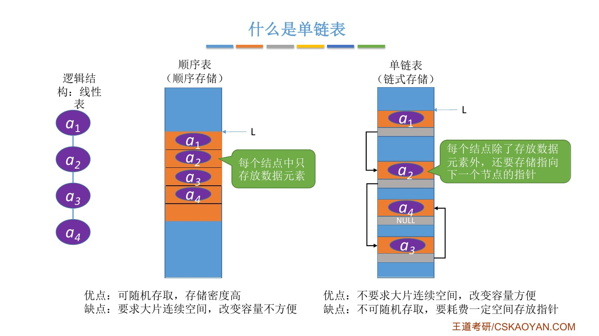
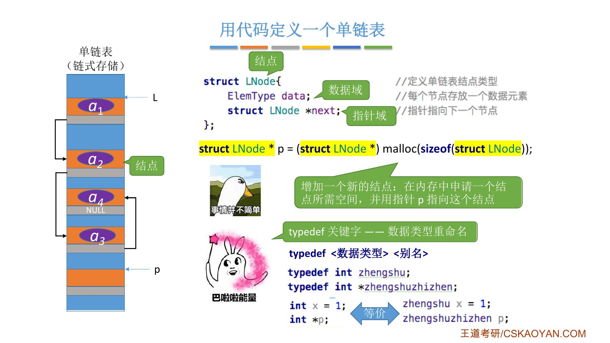
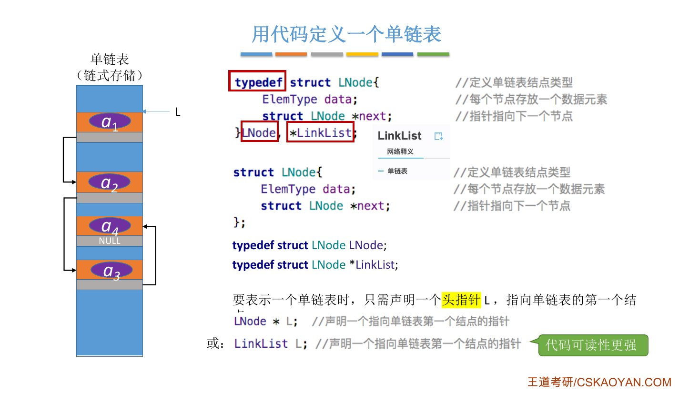
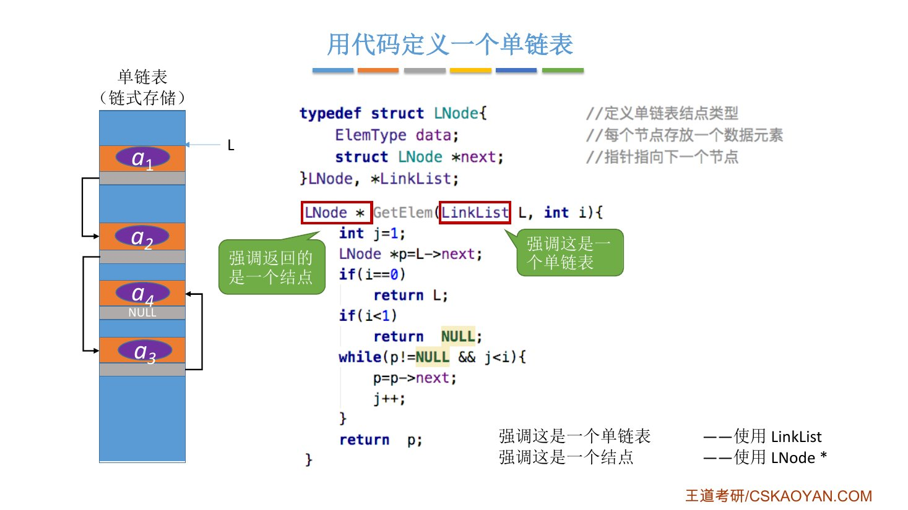
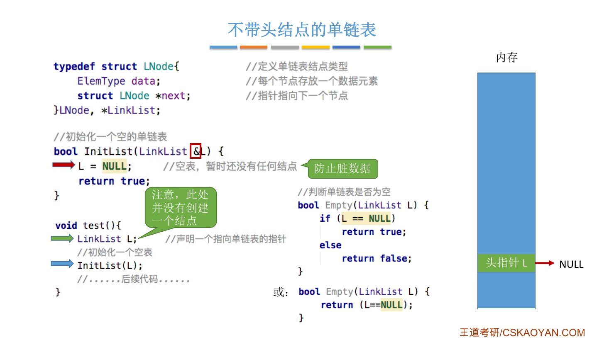
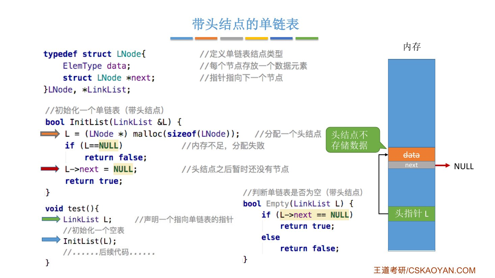
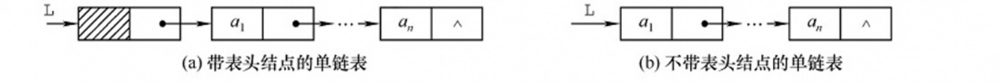

# 这一节在讲什么

::: cue
顺序表之后学什么？链表分哪几种？
:::

2.2 用**顺序存储**实现了线性表（顺序表）。从这节起换一种存储结构：用**链式存储**实现线性表，统称**链表**。链表又分四种：

- **单链表**（2.3.1～2.3.2，本节先讲怎么定义）
- 双链表（2.3.3）、循环链表（2.3.4）、静态链表（2.3.5）

本节三件事：什么是单链表、怎么用代码定义、带头结点和不带头结点两种实现。

::: book
王道书本节考点追踪：**单链表的应用**（2009、2012、2013、2015、2016、2019）。和顺序表一样，单链表是算法题的常客，这节的结构体定义要能默写。

书上 §2.3 开头的对比：顺序表能随机存取，但插入删除要移动大量元素，效率较低；链式存储不要求地址连续，靠指针建立元素之间的逻辑关系，插入删除只改指针、不用移动元素，代价是[失去了随机存取能力]{.u}，只能从头开始顺序访问。
:::

::: fix
**名字统一**：字幕里是"节点"，课件和王道书写"**结点**"，本笔记统一用"结点"。
:::

# 一、什么是单链表

::: cue
单链表的一个结点里存什么？为什么叫"单"链表？
:::

单链表的每个**结点**存两样东西：

- **数据元素**本身；
- 一个**指向下一个结点的指针**。

每个结点只有[一个]{.u}指向后继的指针，所以叫**单**链表。

{.slide width=0.65}

和顺序表对比（课件）：

::: {.tbl widths="1,2.2,2.2"}
| | 顺序表（顺序存储） | 单链表（链式存储） |
|---|---|---|
| 存法 | 每个结点只放数据元素，元素在物理上**连续**存放 | 每个结点放数据元素 + 指向下一个结点的指针，结点在物理上可以**离散**存放 |
| 优点 | 可随机存取，存储密度高 | 不要求大片连续空间，改变容量方便 |
| 缺点 | 要求大片连续空间，改变容量不方便 | **不可随机存取**，要耗费一定空间存放指针 |
:::

- **改变容量方便**：要加新结点，在内存里随便抠一小块地方放它就行，不用像 2.2.1 的 `IncreaseSize` 那样整块重新申请再复制。
- **不可随机存取**：要找第 $i$ 个结点，只能从第一个结点开始，顺着指针一个一个往后找。

::: book
王道书的说法：线性表的链式存储又称**单链表**，它通过一组[任意的存储单元]{.u}（不要求地址连续）来存储线性表中的数据元素；每个结点除存放元素自身的信息外，还要存放一个指向其后继的指针。单链表是一种[非随机存取]{.red}的存储结构，不能直接找到表中某个特定结点，查找时要从表头开始依次遍历。
:::

# 二、用代码定义一个单链表

::: cue
结点的结构体怎么写？哪个叫数据域，哪个叫指针域？
:::

一个结点 = 一片放数据元素的空间 + 一片放指针的空间，用 `struct` 表示：

```c
struct LNode {              // 定义单链表结点类型
    ElemType data;          // 每个结点存放一个数据元素（数据域）
    struct LNode *next;     // 指针指向下一个结点（指针域）
};
```

- `data`：**数据域**，存数据元素；
- `next`：**指针域**，存下一个结点的地址。

要往单链表里加一个新结点，就用 `malloc` 申请一个结点大小的空间，用指针 `p` 指向它，之后再写代码把 `p` 插进链表：

```c
struct LNode *p = (struct LNode *) malloc(sizeof(struct LNode));
```

{.slide width=0.65}

## typedef：给数据类型起别名

::: cue
`typedef` 怎么用？为什么要用它？
:::

上面每次都要写 `struct LNode`，带着 `struct` 关键字很啰嗦。C 语言的 `typedef` 可以给数据类型[起一个别名]{.u}：

```c
typedef <数据类型> <别名>;
```

老师的例子（汉语拼音"超亲切"）：

```c
typedef int zhengshu;           // 给 int 起别名 zhengshu
typedef int *zhengshuzhizhen;   // 给 int * 起别名 zhengshuzhizhen

int x = 1;          // 两两等价
zhengshu x = 1;
int *p;
zhengshuzhizhen p;
```

同理，给 `struct LNode` 起别名 `LNode`，以后就不用带 `struct`：

```c
typedef struct LNode LNode;
LNode *p = (LNode *) malloc(sizeof(LNode));
```

## 王道书的写法：一句定义加两个别名

::: cue
`}LNode, *LinkList;` 这一行等价于哪几句？
:::

课本把定义和起别名写在了一起：

```c
typedef struct LNode {      // 定义单链表结点类型
    ElemType data;          // 每个结点存放一个数据元素
    struct LNode *next;     // 指针指向下一个结点
} LNode, *LinkList;
```

它等价于先定义 `struct LNode`，再写两句 `typedef`：

```c
struct LNode {
    ElemType data;
    struct LNode *next;
};
typedef struct LNode LNode;       // LNode = struct LNode
typedef struct LNode *LinkList;   // LinkList = 指向 struct LNode 的指针
```

所以 [`LinkList` 和 `LNode *` 是同一个类型]{.red}。

{.slide width=0.65}

::: pitfall
结构体里面的 `next` 必须写成 `struct LNode *next;`，不能写 `LNode *next;`：编译器读到这一行时，`typedef` 还没生效，`LNode` 这个别名还不存在。（这是 C 语法本身决定的，课件和书上都这么写。）
:::

## 头指针：用一个指针代表整个链表

::: cue
表示一个单链表需要什么？`LNode *L` 和 `LinkList L` 有什么区别？
:::

各个结点靠 `next` 一个连一个，所以只要找到第一个结点，就找到了整个链表。表示一个单链表只需要声明一个[头指针]{.u} `L`，指向单链表的第一个结点：

```c
LNode *L;       // 声明一个指向单链表第一个结点的指针
LinkList L;     // 同上，效果完全一样，但代码可读性更强
```

**两种写法等价，只是强调的东西不同**：

- 用 `LinkList`：强调这是**一个单链表**；
- 用 `LNode *`：强调这是**一个结点**。

老师用后面要学的按位查找举例（函数体 2.3.2_2 再讲）：

```c
LNode *GetElem(LinkList L, int i) {   // 返回值强调"返回的是一个结点"
    ...                               // 参数 L 强调"这是一个单链表"
}
```

参数 `L` 本来也可以写成 `LNode *L`，但这里要把它看成一个单链表，所以用 `LinkList`；返回的是第 $i$ 个结点，所以返回值类型写 `LNode *`。王道书的头插法建立单链表也是这样两种混用（`LinkList` 表示链表，`LNode *s` 表示新结点）。

{.slide width=0.65}

::: teacher
老师提醒：课本很多示例代码两种写法都会出现，这里没理解的话看代码会很懵。以后的树等数据结构也会用类似的重命名方式，开始学的时候就把这些细节理解透，之后吸收会越来越快。
:::

::: book
王道书注意：设 `p` 为指向链表结点的结构体指针，则 `*p` 表示该结点本身。可以用 `p->data` 或 `(*p).data` 访问数据域，两者完全等价。成员运算符 `.` 左侧是**结构体变量**，指向运算符 `->` 左侧是**结构体指针**。例如 `p->next->data` 等价于 `(*(*p).next).data`，表示当前结点的后继结点的数据。
:::

# 三、两种实现：带头结点和不带头结点

::: cue
带头结点和不带头结点的单链表，初始化和判空各怎么写？
:::

## 不带头结点

```c
// 初始化一个空的单链表
bool InitList(LinkList &L) {
    L = NULL;           // 空表，暂时还没有任何结点（防止脏数据）
    return true;
}

// 判断单链表是否为空
bool Empty(LinkList L) {
    if (L == NULL)
        return true;
    else
        return false;
}

void test() {
    LinkList L;         // 声明一个指向单链表的指针（注意此处并没有创建一个结点）
    InitList(L);        // 初始化一个空表
    // ......后续代码......
}
```

- `LinkList L;` 执行后，内存里只开辟了一小块放**头指针** `L` 的空间，[并没有创建任何结点]{.u}。
- `L = NULL` 表示当前是空表，也是为了防止这块内存里遗留的**脏数据**（和 2.2.1 静态分配初始化 `length=0` 一个道理）。
- `L` 要加 `&`：不加的话，函数里改的是头指针 `L` 的复制品（2.1 笔记"三"）。
- **判空**：看 [`L == NULL`]{.red}。

判空还可以写得更简洁，因为 `L == NULL` 的运算结果本身就是 `true` 或 `false`：

```c
bool Empty(LinkList L) {
    return (L == NULL);
}
```

{.slide width=0.65}

## 带头结点

```c
// 初始化一个单链表（带头结点）
bool InitList(LinkList &L) {
    L = (LNode *) malloc(sizeof(LNode));   // 分配一个头结点
    if (L == NULL)                         // 内存不足，分配失败
        return false;
    L->next = NULL;                        // 头结点之后暂时还没有结点
    return true;
}

// 判断单链表是否为空（带头结点）
bool Empty(LinkList L) {
    if (L->next == NULL)
        return true;
    else
        return false;
}
```

执行完 `InitList(L)` 后的内存：

::: {.tbl widths="1.3,2.6"}
| 谁 | 内容 |
|---|---|
| 头指针 `L` | 指向 `malloc` 分配的那个结点（头结点） |
| 头结点的 `data` | [不存数据]{.u} |
| 头结点的 `next` | `NULL`（后面还没有存数据的结点） |
:::

- **头结点不存数据**，加它只是为了之后实现某些基本操作时更方便。
- **判空**：看 [`L->next == NULL`]{.red}，不是看 `L`（`L` 一直指着头结点，不会是 `NULL`）。

{.slide width=0.65}

::: book
王道书 §2.3.2 的带头结点初始化没有判断 `malloc` 是否失败：

```c
bool InitList(LinkList &L) {             // 带头结点的单链表初始化
    L = (LNode *) malloc(sizeof(LNode)); // 创建头结点
    L->next = NULL;                      // 头结点之后暂无数据结点
    return true;
}
```

不带头结点的写法和课件一样（`L = NULL; return true;`）。这和 2.2.2_1 记的书上那条注意一致：书上的实现可以忽略内存分配失败等细节。课件多写的 `if (L == NULL) return false;` 更健壮。
:::

## 两种实现怎么选

::: cue
为什么一般都用带头结点的？
:::

{.slide width=0.8}

::: {.tbl widths="1,2,2"}
| | 不带头结点 | 带头结点 |
|---|---|---|
| 头指针 `L` 指向 | 第一个**数据结点** | **头结点**（不存数据） |
| 第一个数据结点 | `L` 指向的结点 | `L->next` 指向的结点 |
| 空表 | `L == NULL` | `L->next == NULL` |
| 写代码 | 麻烦 | 方便，[大多数情况用这种]{.red} |
:::

老师：不带头结点时，对第一个数据结点和后续数据结点的处理要用不同的代码逻辑，对空表和非空表的处理也要用不同的逻辑，写代码更麻烦。具体麻烦在哪，下一节 2.3.2_1 用代码亲自感受。

::: book
王道书把这两点叫引入头结点的两个优点：

1. **操作一致性**：第一个数据结点的位置存在头结点的指针域中，所以在链表首部插入、删除等操作，和在其他位置的操作逻辑一致，无须特殊处理。
2. **空表与非空表处理统一**：无论链表是否为空，头指针始终是一个非空指针（指向头结点），空表只表现为头结点的 `next` 为 `NULL`，避免了对空表的单独判断。

**头指针与头结点的关系**：头指针始终指向链表的第一个结点（不论带不带头结点）；头结点只是带头结点的链表的第一个结点，数据域通常不存实际数据（书上补充：也可以用来记录表长等信息）。

书上还说：如无特殊说明，§2.3.2 的算法均默认链表**带头结点**。
:::

# 四、知识回顾

::: summary
**单链表 = 用链式存储实现的线性表**：每个结点存一个数据元素（数据域 `data`）和一个指向下一个结点的指针（指针域 `next`），元素之间的先后关系靠指针表示。优点：不要求大片连续空间、改变容量方便；缺点：[不能随机存取]{.red}，还要花空间存指针。

定义：`typedef struct LNode { ElemType data; struct LNode *next; } LNode, *LinkList;`。`LinkList` 等价于 `LNode *`，前者强调"这是一个链表"，后者强调"这是一个结点"，在合适的地方用合适的名字，可读性更高。

两种实现：**不带头结点**，`L` 直接指向第一个数据结点，初始化 `L = NULL`，判空 `L == NULL`；**带头结点**，`L` 指向一个不存数据的头结点，初始化时 `malloc` 头结点并令 `L->next = NULL`，判空 `L->next == NULL`。带头结点写代码更方便，一般都用它。

**自测**：① `LinkList L;` 执行后，内存里有没有结点？② 结构体里的 `next` 为什么写 `struct LNode *next` 而不写 `LNode *next`？③ 带头结点的单链表，判空写 `L == NULL` 对不对？④ `p->next->data` 用 `*` 和 `.` 怎么写？
:::

