# 这一节在讲什么

::: cue
单链表的插入、删除各有哪几种？
:::

在 2.3.1 定义好的单链表上实现插入和删除。一共六个操作：

::: {.tbl widths="0.8,1.6,2.4"}
| | 操作 | 给你什么 |
|---|---|---|
| 插入 | 按位序插入（带头 / 不带头结点） | 位序 $i$ 和元素 $e$ |
| | 指定结点的**后插** | 结点指针 `p` 和元素 $e$，插在 `p` 之后 |
| | 指定结点的**前插** | 结点指针 `p` 和元素 $e$，插在 `p` 之前 |
| 删除 | 按位序删除（带头结点） | 位序 $i$，用 $e$ 带回被删的值 |
| | 指定结点的删除 | 结点指针 `p` |
:::

老师说明：前面已经用内存图把 `malloc`、`free` 背后的过程讲透了，从这节起图示会**简化**：只画结点和指针，不再画结点在内存里怎么分布。

::: book
王道书考点追踪：**单链表插入操作的过程（2016、2024）**。另外书上 §2.3.2 的算法如无特殊说明都默认**带头结点**（2.3.1 笔记已记）。
:::

# 一、按位序插入（带头结点）

::: cue
在第 $i$ 个位置插入，要先找到哪个结点？头结点算第几个？
:::

`ListInsert(&L,i,e)`：在表 `L` 的第 $i$ 个位置插入元素 $e$。

思路：[找到第 $i-1$ 个结点]{.red}，把新结点插到它后面。因为要改的是第 $i-1$ 个结点的 `next` 指针。

那 $i=1$ 时，第 0 个结点是谁？带头结点的好处在这里体现：**头结点可以看成"第 0 个"结点**，同一套逻辑也适用。

```c
// 在第 i 个位置插入元素 e（带头结点）
bool ListInsert(LinkList &L, int i, ElemType e) {
    if (i < 1)
        return false;
    LNode *p;        // 指针 p 指向当前扫描到的结点
    int j = 0;       // 当前 p 指向的是第几个结点
    p = L;           // L 指向头结点，头结点是第 0 个结点（不存数据）
    while (p != NULL && j < i - 1) {   // 循环找到第 i-1 个结点
        p = p->next;
        j++;
    }
    if (p == NULL)   // i 值不合法
        return false;
    LNode *s = (LNode *) malloc(sizeof(LNode));
    s->data = e;
    s->next = p->next;   // ①
    p->next = s;         // ② 将结点 s 连到 p 之后
    return true;         // 插入成功
}
```

- `j` 记的是 [`p` 当前指向第几个结点]{.u}；整个 `while` 只有一个目的：让 `p` 停在第 $i-1$ 个结点上。
- 虽然"杜撰"了一个第 0 个结点，但真正存数据的结点从 1 开始编号，所以 $i<1$ 不合法。
- 老师：看代码除了看懂每一句，还要有**全局思维**：前半段 = 找第 $i-1$ 个结点，后半段 = 在它后面插新结点，逻辑就很清晰。

## 一步一步看

老师的例子：表里有 $a_1\sim a_4$ 四个结点，分别插入 $i=1,3,5,6$：

::: {.tbl widths="0.7,0.8,2.4,1.3,1.2"}
| $i$ | $i-1$ | `while` 每轮结束后 `(j, p 指向)` | 停下原因 | 结果 |
|---|---|---|---|---|
| 1 | 0 | 不进循环：`(0, 头结点)` | `j<0` 不成立 | 插在头结点后，成为第 1 个，[$O(1)$，最好]{.u} |
| 3 | 2 | `(1, a₁)` → `(2, a₂)` | `j<2` 不成立 | 插在 $a_2$ 后，成为第 3 个 |
| 5 | 4 | `(1,a₁)` → `(2,a₂)` → `(3,a₃)` → `(4,a₄)` | `j<4` 不成立 | 插在表尾，循环最多，[$O(n)$，最坏]{.u} |
| 6 | 5 | …→ `(4,a₄)` → `(5, NULL)` | `p!=NULL` 不成立 | `p==NULL`，第 5 个结点不存在，返回 `false` |
:::

$i=6$ 时表长只有 4，最多只能插到第 5 个位置。连第 $i-1$ 个结点都找不到，当然插不进第 $i$ 个，所以 $i$ 太大时会因为 `p` 走到 `NULL` 跳出循环，返回 `false`。

平均时间复杂度 [$O(n)$]{.red}（老师没展开）。

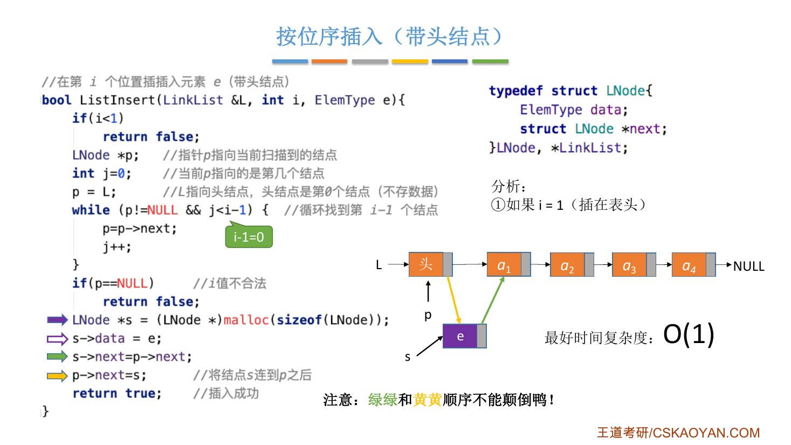{.slide width=0.65}

## ①② 两句不能颠倒

::: pitfall
`s->next = p->next;`（①）和 `p->next = s;`（②）[顺序不能颠倒]{.red}。

如果先执行 ②，`p->next` 已经变成 `s`，再执行 ① 就成了 `s->next = s`，**`s` 指向它自己**。原来 `p` 后面的那串结点再也找不到了，老师："后面这些小朋友就都走丢了，这个链已经断了。"

王道书的说法：若先执行 `p->next=s`，则原后继地址丢失，导致 `s->next=p->next` 实际变为 `s->next=s`，形成自环。
:::

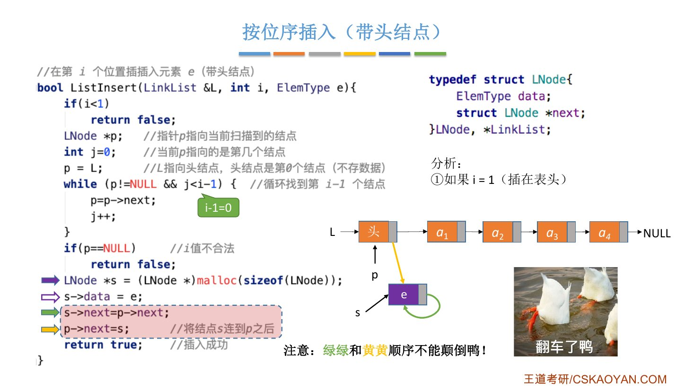{.slide width=0.6}

# 二、按位序插入（不带头结点）

::: cue
不带头结点时，插第 1 个为什么要特殊处理？
:::

思路一样：找到第 $i-1$ 个结点，插到它后面。但不带头结点就[不存在"第 0 个"结点]{.u}，$i=1$ 时必须单独处理：新结点成为第一个结点，要**修改头指针 `L`**。

```c
bool ListInsert(LinkList &L, int i, ElemType e) {
    if (i < 1)
        return false;
    if (i == 1) {    // 插入第 1 个结点的操作与其他结点操作不同
        LNode *s = (LNode *) malloc(sizeof(LNode));
        s->data = e;
        s->next = L;
        L = s;       // 头指针指向新结点
        return true;
    }
    LNode *p;        // 指针 p 指向当前扫描到的结点
    int j = 1;       // 当前 p 指向的是第几个结点
    p = L;           // p 指向第 1 个结点（注意：不是头结点）
    while (p != NULL && j < i - 1) {   // 循环找到第 i-1 个结点
        p = p->next;
        j++;
    }
    if (p == NULL)   // i 值不合法
        return false;
    LNode *s = (LNode *) malloc(sizeof(LNode));
    s->data = e;
    s->next = p->next;
    p->next = s;
    return true;     // 插入成功
}
```

- $i>1$ 的部分和带头结点完全一样，唯一区别：[`j = 1`]{.u}，因为 `p = L` 指向的已经是第 1 个数据结点。
- 不带头结点时，插入或删除**第一个结点**都要改头指针 `L`；带头结点时 `L` 永远指向头结点，不用改。这就是 2.3.1 说的"不带头结点写代码更麻烦"。

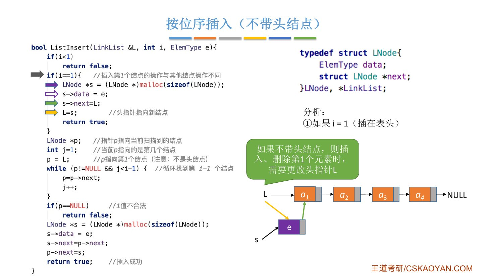{.slide width=0.65}

::: teacher
结论：不带头结点写代码更不方便，推荐用带头结点。**之后除非特别声明，默认带头结点**。但考试中带头、不带头都有可能考，做题时一定要审题。
:::

# 三、指定结点的后插操作

::: cue
给定结点 `p`，在它后面插 $e$，为什么是 $O(1)$？
:::

单链表只能往后找：给定结点 `p`，它后面的结点都能顺着 `next` 找到，**前面的结点却无从知道**。在 `p` 之后插入正好只用到后面，很容易：

```c
// 后插操作：在 p 结点之后插入元素 e
bool InsertNextNode(LNode *p, ElemType e) {
    if (p == NULL)
        return false;
    LNode *s = (LNode *) malloc(sizeof(LNode));
    if (s == NULL)       // 内存分配失败
        return false;
    s->data = e;         // 用结点 s 保存数据元素 e
    s->next = p->next;
    p->next = s;         // 将结点 s 连到 p 之后
    return true;
}
```

- 没有循环，时间复杂度 [$O(1)$]{.red}。
- `if (s == NULL)`：`malloc` 有可能失败（比如内存满了），这个细节之前没说过。考试手写代码不写也没关系，但要知道有这种可能。

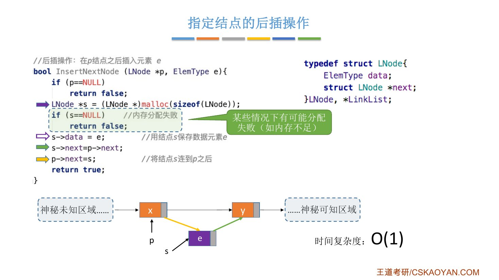{.slide width=0.65}

## 封装的好处

::: cue
按位序插入怎么用后插操作改写？
:::

按位序插入的后半段，正是"在第 $i-1$ 个结点之后插入 $e$"，也就是后插操作。所以可以改写成：

```c
bool ListInsert(LinkList &L, int i, ElemType e) {
    if (i < 1)
        return false;
    LNode *p;
    int j = 0;
    p = L;
    while (p != NULL && j < i - 1) {   // 指针 p 指向第 i-1 个结点
        p = p->next;
        j++;
    }
    return InsertNextNode(p, e);       // p 后插入新元素 e
}
```

`p == NULL` 的判断也交给了 `InsertNextNode`。把小功能**模块化**，代码逻辑更清晰。老师：封装出来的函数也可以叫"基本操作"，对书本的概念理解不要教条化。前半段"找第 $i-1$ 个结点"也可以封装，下一节 2.3.2_2 讲。

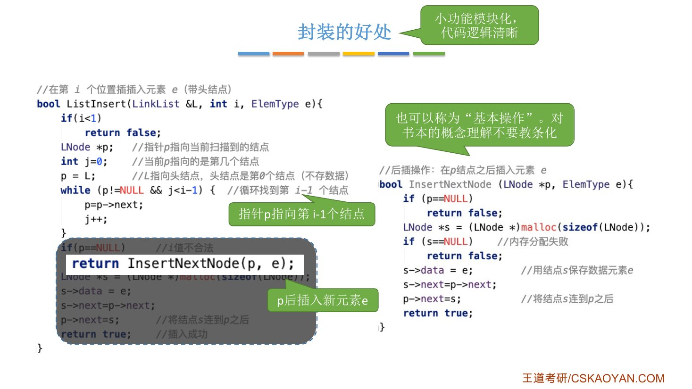{.slide width=0.65}

# 四、指定结点的前插操作

::: cue
找不到 `p` 的前驱，怎么在 `p` 之前插入？
:::

在 `p` 之前插入，要改的是 `p` 的**前驱**的 `next`，可单链表找不到前驱（老师：前面那片区域"被打了马赛克"）。两种办法：

**方法 1：传入头指针**。有了头指针，整条链都能看到，从头遍历找到 `p` 的前驱 `q`，再对 `q` 后插：

```c
bool InsertPriorNode(LinkList L, LNode *p, ElemType e)
```

要循环查找，时间复杂度 [$O(n)$]{.red}。而且有时候根本不给你头指针，这个办法就用不了。

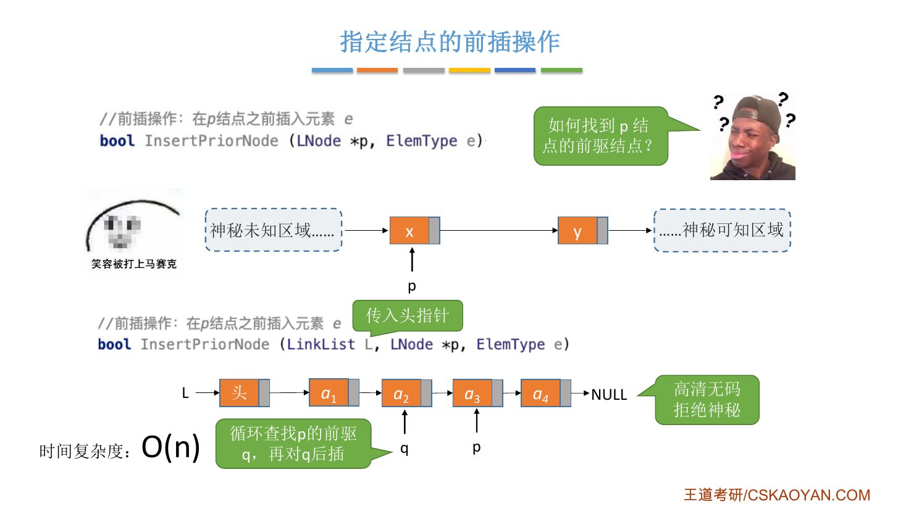{.slide width=0.6}

**方法 2："偷天换日"**。结点挪不动，但结点里的**数据可以挪**：先把新结点 `s` 后插到 `p` 之后，再把 `p` 原来的数据搬到 `s` 里，把 $e$ 放进 `p`。

```c
// 前插操作：在 p 结点之前插入元素 e
bool InsertPriorNode(LNode *p, ElemType e) {
    if (p == NULL)
        return false;
    LNode *s = (LNode *) malloc(sizeof(LNode));
    if (s == NULL)       // 内存分配失败
        return false;
    s->next = p->next;
    p->next = s;         // 新结点 s 连到 p 之后
    s->data = p->data;   // 将 p 中元素复制到 s 中
    p->data = e;         // p 中元素覆盖为 e
    return true;
}
```

设 `p` 里原来是 $x$，后继是 $y$：

::: {.tbl widths="0.5,1.6,2.6"}
| 步 | 执行 | 链表（从 `p` 开始） |
|---|---|---|
| 前 | — | `p[x]` → `y` |
| 1 | `s->next = p->next; p->next = s;` | `p[x]` → `s[?]` → `y` |
| 2 | `s->data = p->data;` | `p[x]` → `s[x]` → `y` |
| 3 | `p->data = e;` | `p[e]` → `s[x]` → `y` |
:::

结点 `p` 的位置没变，但从逻辑上看，$e$ 已经排在了 $x$ 前面。时间复杂度 [$O(1)$]{.red}（老师："这个偷天换日的操作还是挺骚的"）。

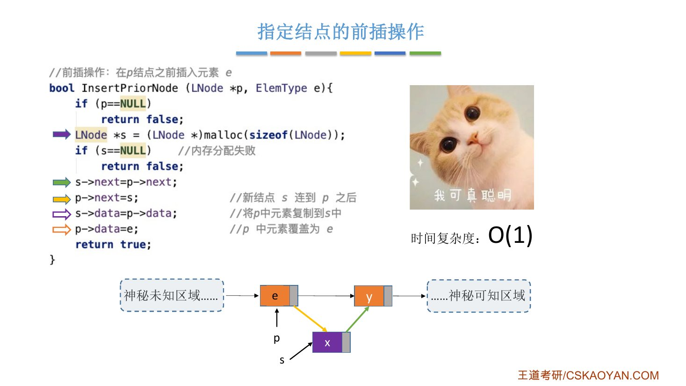{.slide width=0.6}

::: book
王道书给的版本直接传入要插入的结点 `s`，处理方法一样：先把 `s` 连到 `p` 之后，再**交换** `p` 和 `s` 的数据域。

```c
// 前插操作：在 p 结点之前插入结点 s
bool InsertPriorNode(LNode *p, LNode *s) {
    if (p == NULL || s == NULL)
        return false;
    s->next = p->next;
    p->next = s;              // s 连到 p 之后（修改指针域，不能颠倒）
    ElemType temp = p->data;  // 交换数据域部分
    p->data = s->data;
    s->data = temp;
    return true;
}
```

书上的说法：任何前插操作都可以转化为后插操作，从头查找前驱是 $O(n)$；交换数据域的技巧"适用于数据可复制的情况"，逻辑上等效于前插，$O(1)$。
:::

# 五、按位序删除（带头结点）

::: cue
删除第 $i$ 个结点，要找谁？比插入多判断了什么？
:::

`ListDelete(&L,i,&e)`：删除表 `L` 中第 $i$ 个位置的元素，并用 $e$ 返回被删元素的值。

思路：同样[找到第 $i-1$ 个结点]{.red}，把它的 `next` 指向第 $i+1$ 个结点，再用 `free` 释放第 $i$ 个结点。头结点仍看作第 0 个。（删除只讨论带头结点的情况。）

```c
bool ListDelete(LinkList &L, int i, ElemType &e) {
    if (i < 1)
        return false;
    LNode *p;        // 指针 p 指向当前扫描到的结点
    int j = 0;       // 当前 p 指向的是第几个结点
    p = L;           // L 指向头结点，头结点是第 0 个结点（不存数据）
    while (p != NULL && j < i - 1) {   // 循环找到第 i-1 个结点
        p = p->next;
        j++;
    }
    if (p == NULL)            // i 值不合法
        return false;
    if (p->next == NULL)      // 第 i-1 个结点之后已无其他结点
        return false;
    LNode *q = p->next;       // 令 q 指向被删除结点
    e = q->data;              // 用 e 返回元素的值
    p->next = q->next;        // 将 *q 结点从链中"断开"
    free(q);                  // 释放结点的存储空间
    return true;              // 删除成功
}
```

- 比插入多一个判断 `p->next == NULL`：第 $i-1$ 个结点存在，但它后面没有第 $i$ 个了，比如表长 4 时删第 5 个。
- `e` 加 `&`：要把被删的值带回给调用者（和 2.2.2_1 顺序表删除一样）。

老师的例子：表 $a_1\sim a_4$，删 $i=4$。找第 3 个结点的过程和插入一样，`p` 停在 $a_3$；`q = p->next` 指向 $a_4$；`e = q->data` 带回 $a_4$；`p->next = q->next` 即 `NULL`；`free(q)`。

时间复杂度：要循环找第 $i-1$ 个结点，最坏、平均 [$O(n)$]{.red}；删第 1 个不用循环，最好 [$O(1)$]{.red}。

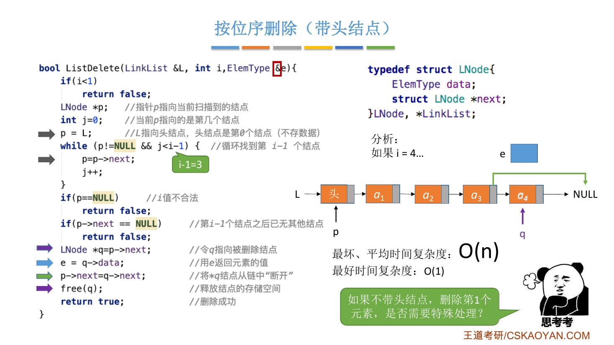{.slide width=0.65}

::: book
王道书的写法把判断合在了循环条件里：

```c
bool ListDelete(LinkList &L, int i, ElemType &e) {
    LNode *p = L;                   // 指针 p 指向当前扫描到的结点
    int j = 0;                      // 记录当前结点的位序，头结点是第 0 个结点
    while (p->next != NULL && j < i - 1) {   // 循环找到第 i-1 个结点
        p = p->next;
        j++;
    }
    if (p->next == NULL || j > i - 1)        // i 值不合法
        return false;
    LNode *q = p->next;             // 令 q 指向被删除结点
    e = q->data;                    // 用 e 返回元素的值
    p->next = q->next;              // 将 *q 结点从链中"断开"
    free(q);                        // 释放结点的存储空间
    return true;
}
```

和课件对一下，两份代码效果相同：

- 课件循环条件是 `p != NULL`，书上是 `p->next != NULL`：书上的 `p` 最远停在最后一个结点，不会走到 `NULL`。
- 课件开头的 `if (i < 1)`，书上用 `j > i - 1` 代替：$i<1$ 时循环一次也不执行，`j = 0 > i - 1`，返回 `false`。
- 课件的 `p == NULL`、`p->next == NULL` 两个判断，书上合成一句 `p->next == NULL`：$i$ 太大时 `p` 停在最后一个结点，`p->next` 为 `NULL`。

书上还说：删除和插入一样，主要耗时在查找上，$O(n)$。
:::

::: add
**我的补充：王道书的 `ListInsert` 没有写 `if (i < 1)`**（书上代码从 `LNode *p=L; int j=0;` 开始，其余和课件相同）。按这份代码，传入 $i\le 0$ 时循环一次不执行，`p` 停在头结点，`p != NULL`，于是把 $e$ **插成了第 1 个**，而不是返回 `false`。课件的写法更健壮，自己写代码时把 `if (i < 1) return false;` 带上。
:::

## 不带头结点时删除第 1 个

::: cue
老师留的思考：不带头结点删第 1 个，要不要特殊处理？
:::

要。和插入一样，删除第 1 个结点后头指针要指向新的第一个结点。王道书的回答：当链表不带头结点时，需判断被删结点是否为首结点，若是则要特殊处理，[将头指针 `L` 指向新的首结点]{.u}；带头结点时，删除首结点和删除其他结点的操作是相同的。

按这个思路自己写出特殊处理的部分（我的补充，课件没有给）：

```c
if (i == 1) {               // 不带头结点，删除第 1 个结点
    if (L == NULL)          // 空表，没有可删的
        return false;
    LNode *q = L;
    e = q->data;
    L = q->next;            // 头指针指向新的首结点
    free(q);
    return true;
}
// i > 1：令 j = 1，p = L，其余和带头结点相同
```

# 六、指定结点的删除

::: cue
只给结点 `p`，怎么 $O(1)$ 删除它？什么时候这招失效？
:::

`DeleteNode(LNode *p)`：删除结点 `p`。按常规思路要改 `p` 的前驱的 `next`，又遇到找不到前驱的问题。办法和前插一样两种：

- **方法 1**：传入头指针，循环寻找 `p` 的前驱，$O(n)$；
- **方法 2**：偷天换日，把**后继结点的数据**搬进 `p`，然后删掉后继结点。

```c
// 删除指定结点 p
bool DeleteNode(LNode *p) {
    if (p == NULL)
        return false;
    LNode *q = p->next;         // 令 q 指向 *p 的后继结点
    p->data = p->next->data;    // 和后继结点交换数据域
    p->next = q->next;          // 将 *q 结点从链中"断开"
    free(q);                    // 释放后继结点的存储空间
    return true;
}
```

设 `p` 里是 $x$，后继 `q` 里是 $y$，再往后是 $z$：

::: {.tbl widths="0.5,1.8,2.4"}
| 步 | 执行 | 链表 |
|---|---|---|
| 前 | — | `p[x]` → `q[y]` → `z` |
| 1 | `q = p->next; p->data = p->next->data;` | `p[y]` → `q[y]` → `z` |
| 2 | `p->next = q->next;` | `p[y]` → `z`（`q` 已断开） |
| 3 | `free(q);` | `p[y]` → `z` |
:::

$x$ 不见了，逻辑上等于删掉了 `p`，时间复杂度 [$O(1)$]{.red}。`q->next` 可能是一个实际结点，也可能是 `NULL`，都没关系。（注释写"交换数据域"，实际只是把后继的数据**复制**进 `p`，后继反正要被删掉。）

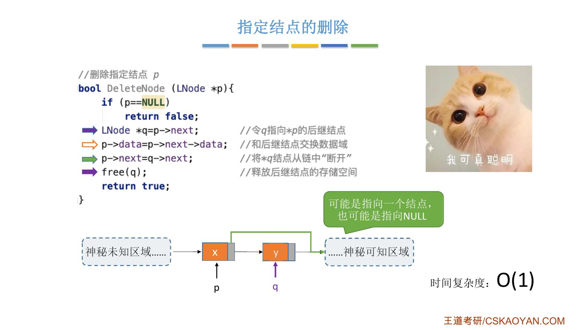{.slide width=0.6}

::: pitfall
**`p` 是最后一个结点时，这段代码有 bug。** 此时 `q = p->next` 是 `NULL`，执行 `p->data = p->next->data` 时去取 `NULL` 的 `data`，出现**空指针错误**。王道书上给的也是这段代码。

这种情况只能用方法 1：从表头开始依次寻找 `p` 的前驱，$O(n)$。老师说考试中迫不得已这么写，估计最多扣 1 分甚至不扣分。

王道书：该方法的局限性在于不能用于删除尾结点（因其无后继）。
:::

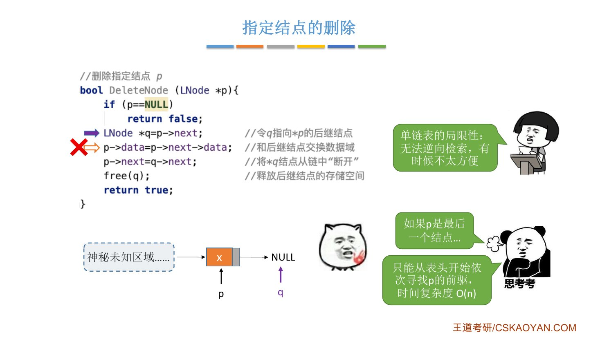{.slide width=0.6}

这里能体会到单链表的局限：[只能单向往后检索，不能逆向检索]{.u}，有时很不方便。如果结点里还有一个往前的指针，就能双向检索，这就是 2.3.3 的**双链表**。

# 七、知识回顾

::: {.tbl widths="1.6,1.3,2.6"}
| 操作 | 时间复杂度 | 关键 |
|---|---|---|
| 按位序插入 | 最好 $O(1)$，平均、最坏 $O(n)$ | 找第 $i-1$ 个结点再后插；不带头结点时 $i=1$ 要改 `L` |
| 后插 `InsertNextNode` | $O(1)$ | `s->next = p->next;` 在前，`p->next = s;` 在后 |
| 前插 `InsertPriorNode` | 传头指针 $O(n)$ / 偷天换日 $O(1)$ | 后插 + 交换数据 |
| 按位序删除 | 最好 $O(1)$，平均、最坏 $O(n)$ | 找第 $i-1$ 个结点，多判断 `p->next == NULL` |
| 删除指定结点 `DeleteNode` | 偷天换日 $O(1)$ | 复制后继数据再删后继；[`p` 是尾结点时不能用]{.red} |
:::

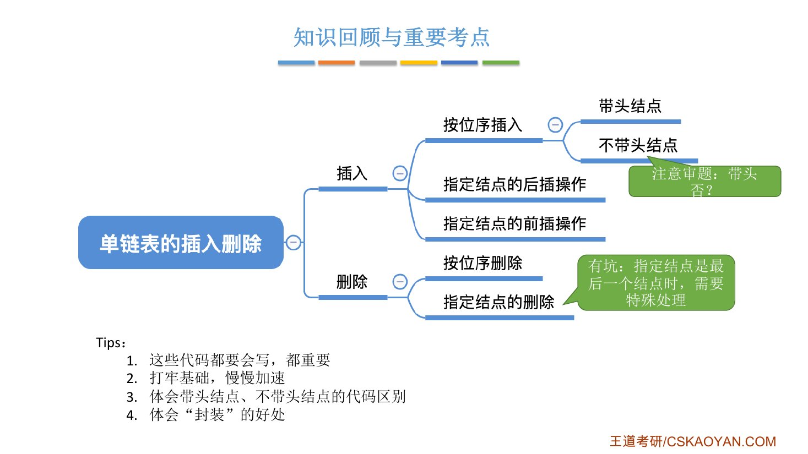{.slide width=0.6}

::: summary
单链表的插入、删除都绕不开一件事：[要改前驱的 `next`]{.red}。按位序操作就先循环找到第 $i-1$ 个结点（带头结点时头结点算第 0 个，所以 $i=1$ 不用特殊处理；不带头结点时 $i=1$ 要改头指针），主要耗时在查找，$O(n)$。插入时 `s->next = p->next;` 和 `p->next = s;` 不能颠倒，否则自环断链。

给定结点时，后插直接做，$O(1)$；前插和删除找不到前驱，要么传头指针从头找（$O(n)$），要么"偷天换日"交换 / 复制数据域（$O(1)$），但删除的偷天换日不能用于尾结点。

老师的四点提示：这些代码都要会写；打牢基础，慢慢加速；体会带头、不带头结点的代码区别；体会封装的好处。

**自测**：① 带头结点按位序插入，`j` 的初值为什么是 0？不带头结点为什么是 1？② 插入时先写 `p->next = s;` 会怎样？③ 怎样 $O(1)$ 在结点 `p` 之前插入 $e$？④ `DeleteNode` 的偷天换日什么时候不能用？⑤ 王道书的 `ListInsert` 传入 $i=0$ 会发生什么？
:::
