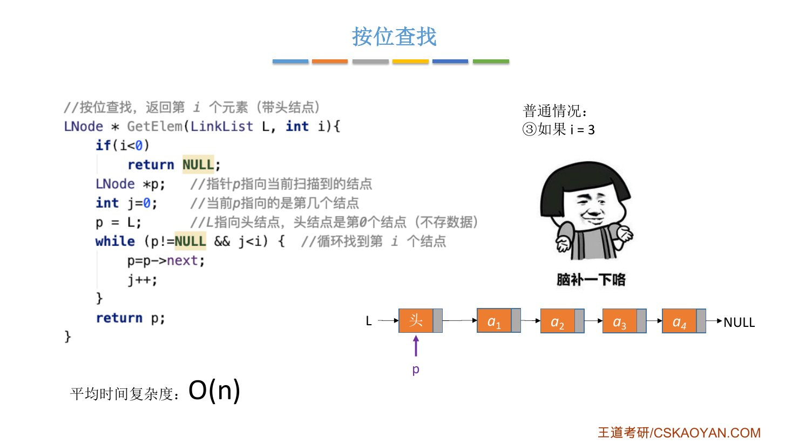
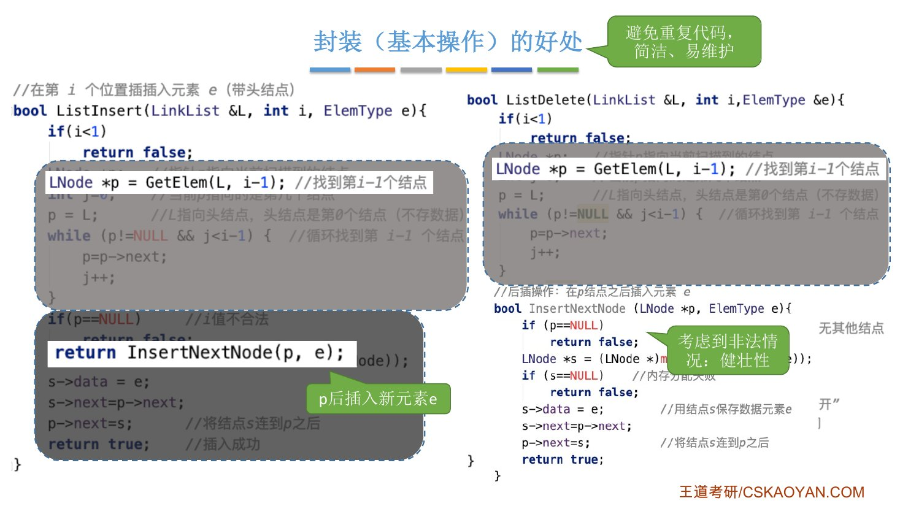
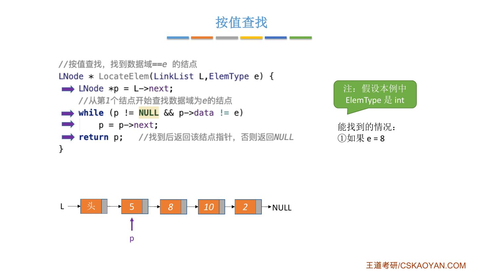
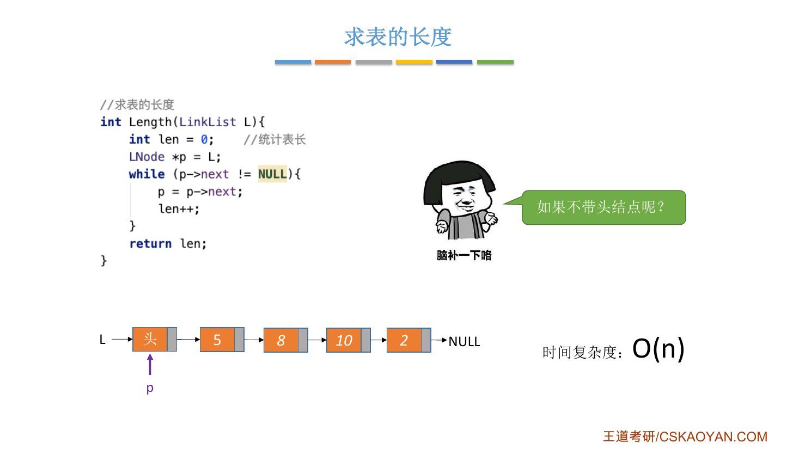
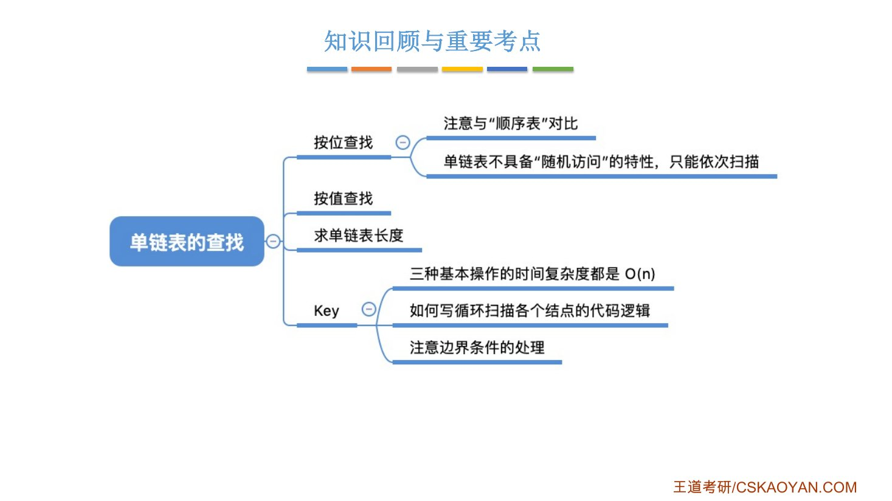

# 这一节在讲什么

::: cue
单链表的查找有哪几个操作？讨论的是带头还是不带头结点？
:::

- **按位查找** `GetElem(L,i)`：获取表 `L` 中第 $i$ 个位置的结点；
- **按值查找** `LocateElem(L,e)`：在表 `L` 中查找具有给定关键字值的结点；
- 顺带讲 **求表长** `Length(L)`。

本节代码[只讨论带头结点]{.u}的情况。不带头结点怎么写、有什么区别，老师留给大家主动思考（下面给了我的答案）。

# 一、按位查找

::: cue
`GetElem` 和上一节"找第 $i-1$ 个结点"的循环有什么关系？
:::

上一节的按位插入、按位删除里，已经写过"找第 $i-1$ 个结点"的循环。要找第 $i$ 个，把 `j < i-1` 改成 `j < i` 就行：

```c
// 按位查找，返回第 i 个元素（带头结点）
LNode *GetElem(LinkList L, int i) {
    if (i < 0)
        return NULL;
    LNode *p;        // 指针 p 指向当前扫描到的结点
    int j = 0;       // 当前 p 指向的是第几个结点
    p = L;           // L 指向头结点，头结点是第 0 个结点（不存数据）
    while (p != NULL && j < i) {   // 循环找到第 i 个结点
        p = p->next;
        j++;
    }
    return p;
}
```

- 头结点看作第 0 个，所以合法的 $i$ 从 0 开始，$i<0$ 才返回 `NULL`。
- 返回值类型写 `LNode *`：强调返回的是**一个结点**（2.3.1 讲的命名习惯）。

## 一步一步看

表里有 $a_1\sim a_4$ 四个数据结点：

::: {.tbl widths="0.6,2.6,1.4,1.4"}
| $i$ | `while` 每轮结束后 `(j, p 指向)` | 停下原因 | 返回 |
|---|---|---|---|
| 0 | 不进循环：`(0, 头结点)` | `j<0` 不成立 | **头结点**（边界情况） |
| 3 | `(1,a₁)` → `(2,a₂)` → `(3,a₃)` | `j<3` 不成立 | $a_3$（普通情况） |
| 8 | `(1,a₁)` → … → `(4,a₄)` → `(5, NULL)` | `p!=NULL` 不成立 | `NULL`（$i$ 超过表长） |
:::

$i$ 不合法时返回的是 `NULL`。所以调用者只要判断返回值是不是 `NULL`，就知道这次按位查找是否成功。老师：这些[边界情况]{.u}写程序时必须考虑到，要让算法有健壮性。

平均时间复杂度 [$O(n)$]{.red}。"平均"指 $i$ 取合法范围内任何一个数的概率都相同，分析方法和顺序表一样（2.2.2_1、2.2.2_2），不再展开。

{.slide width=0.65}

## 王道书的写法

::: book
课件里标着"王道书版本"的写法和上面略有不同：`j` 初值为 1，`p` 一开始就指向第 1 个**数据结点**（`p = L->next`），再单独判断 $i=0$ 时返回头结点，$i<1$ 时返回 `NULL`，之后的循环逻辑一样。

```c
LNode *GetElem(LinkList L, int i) {   // 课件上的"王道书版本"
    int j = 1;
    LNode *p = L->next;
    if (i == 0)
        return L;
    if (i < 1)
        return NULL;
    while (p != NULL && j < i) {
        p = p->next;
        j++;
    }
    return p;
}
```
:::

::: fix
**补充（以手上这本 2027 版王道书为准）**：书第 32 页 §2.3.2 第 3 点"按序号查找结点"的代码已经**不是**课件上那个版本了，而是和老师自己的写法基本相同（`p = L; j = 0;`，头结点为第 0 个），只是[没有 `if (i < 0) return NULL;`]{.u}：

```c
LNode *GetElem(LinkList L, int i) {
    LNode *p = L;            // 指针 p 指向当前扫描结点
    int j = 0;               // j 记录当前位序，头结点为第 0 个结点
    while (p != NULL && j < i) {   // 循环找到第 i 个结点
        p = p->next;
        j++;
    }
    return p;                // 返回第 i 个结点的指针或 NULL
}
```

书上的说法：从第一个数据结点开始沿 `next` 逐个查找，返回第 $i$ 个结点的指针；若 $i$ 超出表长，则返回 `NULL`。按序号查找 $O(n)$。

我的补充：按这份代码，传入 $i<0$ 时循环不执行，返回的是**头结点**而不是 `NULL`。和上一节书上的 `ListInsert` 一样，书上省略了 $i$ 下界的检查。名字上，书叫"按序号查找"，课件叫"按位查找"（2.2.2_2 已对照过）。
:::

## 封装：插入、删除直接调用 GetElem

::: cue
有了 `GetElem`，按位插入可以写成哪两步？为什么后插里的 `p == NULL` 判断很重要？
:::

按位插入和按位删除都要找第 $i-1$ 个结点，现在直接调用 `GetElem(L, i-1)`：

```c
bool ListInsert(LinkList &L, int i, ElemType e) {
    if (i < 1)
        return false;
    LNode *p = GetElem(L, i - 1);    // 找到第 i-1 个结点
    return InsertNextNode(p, e);     // p 后插入新元素 e
}
```

`ListDelete` 同理，用 `LNode *p = GetElem(L, i - 1);` 代替那段循环，其余不变。

封装（基本操作）的好处：**避免重复代码，简洁、易维护**。老师解释"易维护"：如果插入、删除里各写一份查找循环，哪天发现这段逻辑有 bug，两处都要改；封装成 `GetElem` 后，只改一处，所有调用的地方都跟着对了。这些思想考试不考，但以后一定用得到。

**上一节后插 `InsertNextNode` 里的 `if (p == NULL) return false;` 在这里派上了用场**：有人可能觉得"谁会故意传一个空指针进来"，但 $i$ 不合法时 `GetElem` 返回的就是 `NULL`，传给 `InsertNextNode` 的 `p` 真的可能是 `NULL`。此时后插返回 `false`，`ListInsert` 直接把这个 `false` 返回，表示按位插入失败。老师：[边界情况是程序最容易出 bug 的地方]{.u}，不要嫌这些判断麻烦。

{.slide width=0.65}

# 二、按值查找

::: cue
按值查找从哪个结点开始比？找不到返回什么？
:::

`LocateElem(L,e)`：找数据域等于 $e$ 的结点。从第 1 个数据结点开始，依次往后比：

```c
// 按值查找，找到数据域 == e 的结点
LNode *LocateElem(LinkList L, ElemType e) {
    LNode *p = L->next;
    // 从第 1 个结点开始查找数据域为 e 的结点
    while (p != NULL && p->data != e)
        p = p->next;
    return p;        // 找到后返回该结点指针，否则返回 NULL
}
```

老师的例子（设 `ElemType` 为 `int`）：表里依次是 5、8、10、2。

::: {.tbl widths="0.7,2.8,2.2"}
| $e$ | `p` 依次指向 | 结果 |
|---|---|---|
| 8 | 5（`5 != 8`，后移）→ 8（`8 != 8` 不成立，退出） | 返回值为 8 的结点 |
| 6 | 5 → 8 → 10 → 2 → `NULL`（`p != NULL` 不成立，退出） | 返回 `NULL`，表中没有 6 |
:::

- `p` 从 `L->next` 开始，因为头结点不存数据，不用比。
- 如果 `ElemType` 是 `struct`，不能直接用 `!=`，要逐个比较分量（2.2.2_2 讲过）。
- 只能从第一个结点开始依次扫描，时间复杂度 [$O(n)$]{.red}。

{.slide width=0.65}

::: book
王道书第 32–33 页的按值查找代码和课件一致：从第一个数据结点开始，依次比较各结点的数据域，若等于给定值 $e$ 则返回该结点指针，否则返回 `NULL`。按值查找 $O(n)$。
:::

# 三、求表长

::: cue
求表长的循环条件为什么是 `p->next != NULL`？
:::

核心还是让 `p` 从头到尾依次扫描，用一个变量累加：

```c
// 求表的长度
int Length(LinkList L) {
    int len = 0;     // 统计表长
    LNode *p = L;
    while (p->next != NULL) {
        p = p->next;
        len++;
    }
    return len;
}
```

- `p` 从头结点出发，每往后走一步 `len` 加 1，走到最后一个结点（`p->next == NULL`）停下，`len` 正好等于数据结点个数。
- 时间复杂度 [$O(n)$]{.red}。

{.slide width=0.6}

::: book
王道书：求表长是统计单链表中**数据结点的个数（不包括头结点）**，代码和课件相同。书上还提醒：由于表长不包括头结点，带头结点和不带头结点的实现细节略有不同。
:::

## 不带头结点怎么写

::: cue
老师留的思考：不带头结点时，求表长、按位查找有什么不同？
:::

我的答案（课件和书都没给代码）：不带头结点时 `L` 直接指向第 1 个数据结点，可能为 `NULL`（空表），所以循环要从 `L` 本身开始数，条件改成 `p != NULL`：

```c
int Length(LinkList L) {     // 不带头结点
    int len = 0;
    LNode *p = L;
    while (p != NULL) {      // 每数到一个数据结点就加 1
        len++;
        p = p->next;
    }
    return len;
}
```

按位查找同理：没有"第 0 个"结点，令 `p = L; j = 1;`，$i<1$ 时返回 `NULL`，其余循环不变（和 2.3.2_1 不带头结点按位插入的 `j = 1` 是一个道理）。

\newpage

# 四、知识回顾

::: {.tbl widths="1.5,1.5,2.6"}
| 操作 | 从哪开始 | 循环条件 / 返回 |
|---|---|---|
| 按位查找 `GetElem` | `p = L, j = 0` | `p != NULL && j < i`；返回第 $i$ 个结点或 `NULL` |
| 按值查找 `LocateElem` | `p = L->next` | `p != NULL && p->data != e`；返回结点或 `NULL` |
| 求表长 `Length` | `p = L, len = 0` | `p->next != NULL`；返回 `len` |
:::

{.slide width=0.6}

::: summary
单链表**不具备随机访问的特性**，按位查找、按值查找、求表长都只能从头依次往后扫描，三个基本操作的时间复杂度都是 [$O(n)$]{.red}（指平均和最坏情况）。对比顺序表：按位查找 $O(1)$，按值查找 $O(n)$。

三个要点（课件 Key）：① 三种基本操作都是 $O(n)$；② 会写让 `p` 从头到尾扫描各个结点的循环；③ 注意边界条件的处理（$i=0$ 返回头结点，$i$ 太大或找不到返回 `NULL`）。

`GetElem(L, i-1)` + `InsertNextNode(p, e)` 就是按位插入：封装让代码简洁、易维护，后插里的 `p == NULL` 判断保证 $i$ 不合法时也能正确返回 `false`。

**自测**：① 带头结点的 `GetElem(L, 0)` 返回什么？`GetElem(L, 100)` 呢（表长 4）？② `LocateElem` 为什么从 `L->next` 开始？③ 用 `GetElem` 和 `InsertNextNode` 写出按位插入。④ 不带头结点的求表长，循环条件是什么？
:::
