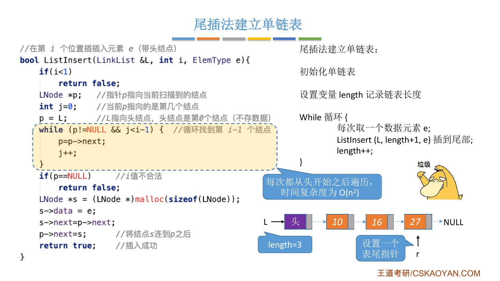
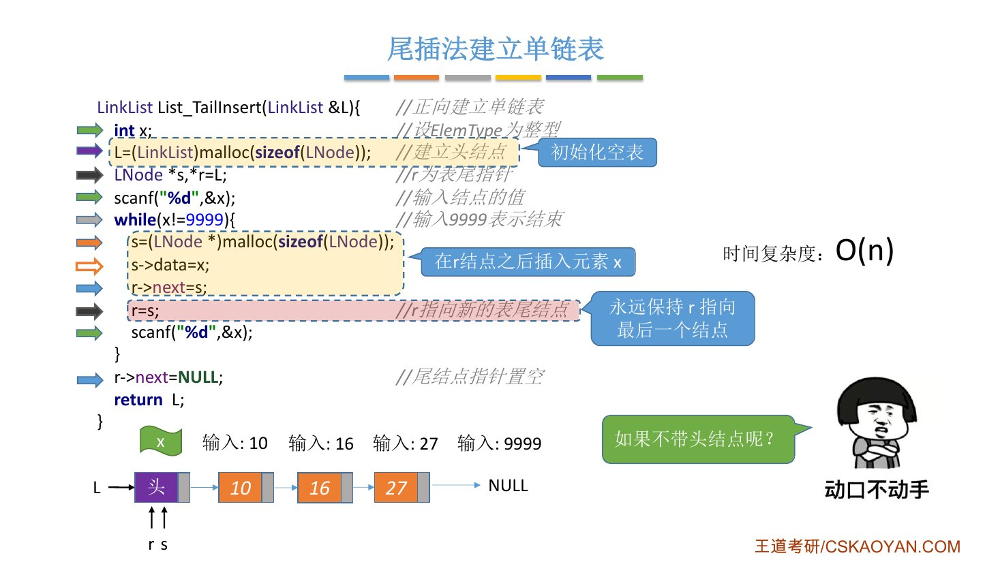
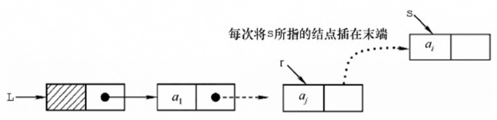
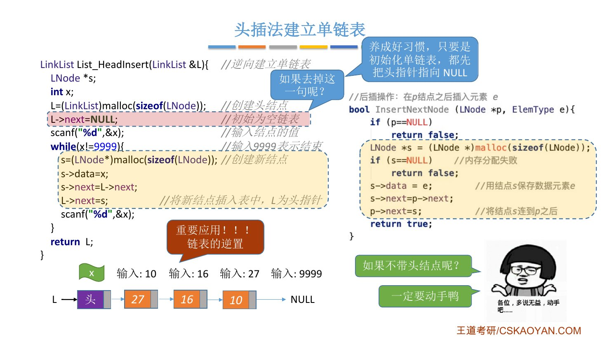
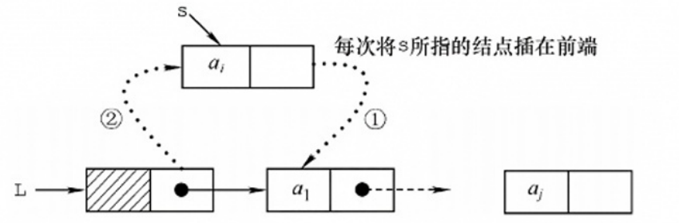
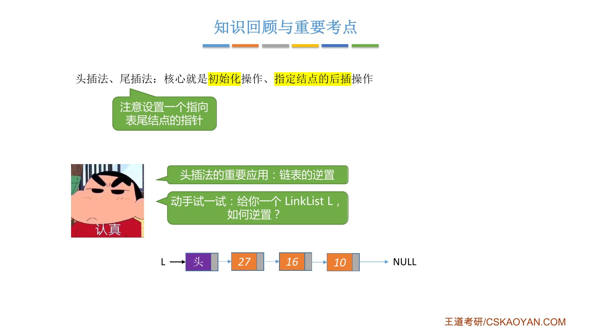

# 这一节在讲什么

::: cue
给你很多个数据元素，怎么把它们存进一个单链表？分哪两步？
:::

给你很多个数据元素（`ElemType`），要把它们存到一个单链表里：

- **Step 1**：初始化一个单链表（从无到有）；
- **Step 2**：每次取一个数据元素，插到**表尾**或**表头**。

插到表尾就是**尾插法**，插到表头就是**头插法**。本节讨论[带头结点]{.u}的情况；不带头结点怎么写，老师留作思考（下面给了我的答案）。

# 一、尾插法

::: cue
直接循环调用 `ListInsert(L, length+1, e)` 有什么问题？怎么改进？
:::

## 先想到的办法：反复调用按位插入

用一个变量 `length` 记录当前表长，每取一个元素 `e` 就调用 `ListInsert(L, length+1, e)` 插到表尾，再 `length++`。

问题：`ListInsert` 每次都要[从头开始往后遍历]{.u}，找到第 `length` 个结点。插第 1 个元素时循环 0 次，插第 2 个循环 1 次……插第 $n$ 个循环 $n-1$ 次：

$$0+1+2+\cdots+(n-1)=\frac{n(n-1)}{2}\quad\Rightarrow\quad O(n^2)$$

时间复杂度太高（课件上的鸭子直接说"垃圾"）。

{.slide width=0.65}

## 改进：设一个表尾指针 r

没必要每次都从头找。设一个指针 [`r` 永远指向表尾的最后一个数据结点]{.u}：插入新元素时，只需对 `r` 所指结点做一次**后插操作**（2.3.2_1 的 `InsertNextNode`），然后让 `r` 后移，指向新的表尾。

课本代码（课件和王道书第 35 页一致，`ElemType` 设为 `int`）：

```c
LinkList List_TailInsert(LinkList &L) {          // 正向建立单链表
    int x;                                        // 设 ElemType 为整型
    L = (LinkList)malloc(sizeof(LNode));          // 建立头结点（初始化空表）
    LNode *s, *r = L;                             // r 为表尾指针
    scanf("%d", &x);                              // 输入结点的值
    while (x != 9999) {                           // 输入 9999 表示结束
        s = (LNode *)malloc(sizeof(LNode));
        s->data = x;                              // 这三句：在 r 结点之后插入元素 x
        r->next = s;
        r = s;                                    // r 指向新的表尾结点
        scanf("%d", &x);
    }
    r->next = NULL;                               // 尾结点指针置空
    return L;
}
```

- `scanf` 让用户从键盘输入一个整数，作为这次要插入的元素。
- `9999` 只是随便挑的一个特殊值，输入它表示建表结束，换成别的数也行。
- 拆开看：前面两句就是**初始化空表**，循环里就是**对 `r` 的后插操作**（和自己写的 `InsertNextNode` 有一丢丢区别，但思想一样）。唯一要注意的是 `r` 要永远指向最后一个结点。

## 一步一步看

依次输入 10、16、27、9999：

::: {.tbl widths="1,2.6,2.4"}
| 输入 `x` | 做了什么 | 循环结束后的链表 |
|---|---|---|
| （循环前） | 建头结点，`r` 指向头结点 | `L→头` |
| 10 | 新结点存 10，`r->next=s`，`r=s` | `L→头→10`，`r` 指 10 |
| 16 | 同上 | `L→头→10→16`，`r` 指 16 |
| 27 | 同上 | `L→头→10→16→27`，`r` 指 27 |
| 9999 | 不满足 `x!=9999`，跳出循环，`r->next=NULL` | `L→头→10→16→27→NULL` |
:::

元素在链表中的顺序和输入顺序**相同**，所以书上叫"正向建立"。插入 $n$ 个结点循环 $n$ 次，时间复杂度 [$O(n)$]{.red}。

{.slide width=0.65}

::: teacher
老师提了一句：课本这里初始化头结点时，**没有**写 `L->next = NULL`，因为头结点的 `next` 后面会被修改。

我的补充：如果第一个就输入 9999，循环不执行，此时 `r` 还指向头结点，最后的 `r->next = NULL` 正好把头结点的 `next` 置空，得到空表，所以这里不写也不会出错。不过老师建议还是写上（见下面头插法）。
:::

::: book
王道书第 35 页：若希望输入顺序与链表中的元素顺序一致，可采用尾插法。为此需要维护一个尾指针 `r`，使其始终指向当前的尾结点。插入时，令 `r->next` 指向新结点 `*s`，再将 `r` 更新为 `s`。因为附设了一个尾指针，故无须遍历查找尾部，总时间复杂度仍为 $O(n)$。
:::

{.slide width=0.7}

## 不带头结点怎么写

::: cue
不带头结点时，尾插法哪里要特殊处理？
:::

我的答案（课件和书都没给代码）：没有头结点，插入**第一个**结点时没有"前一个结点"可以后插，要让头指针 `L` 直接指向它；之后的结点照常接在 `r` 后面。

```c
LinkList List_TailInsert(LinkList &L) {   // 不带头结点
    int x;
    LNode *s, *r = NULL;
    L = NULL;                              // 空表
    scanf("%d", &x);
    while (x != 9999) {
        s = (LNode *)malloc(sizeof(LNode));
        s->data = x;
        if (L == NULL)                     // 第一个结点：头指针直接指向它
            L = s;
        else
            r->next = s;
        r = s;
        scanf("%d", &x);
    }
    if (r != NULL)                         // 空表时 r 为 NULL，不能访问 r->next
        r->next = NULL;
    return L;
}
```

# 二、头插法

::: cue
头插法每次对哪个结点做后插？为什么初始化时 `L->next = NULL` 不能省？
:::

每取得一个新元素，就插到表头（头结点之后、第一个数据结点之前）。本质还是**后插操作**，只不过每次后插的指定结点都是[头结点]{.u}。所以：初始化单链表，然后循环里每取一个元素 `e` 就调用一次 `InsertNextNode(L, e)`。

\newpage

课本代码（课件和王道书第 35 页一致）：

```c
LinkList List_HeadInsert(LinkList &L) {          // 逆向建立单链表
    LNode *s;
    int x;
    L = (LinkList)malloc(sizeof(LNode));          // 创建头结点
    L->next = NULL;                               // 初始为空链表
    scanf("%d", &x);                              // 输入结点的值
    while (x != 9999) {                           // 输入 9999 表示结束
        s = (LNode *)malloc(sizeof(LNode));       // 创建新结点
        s->data = x;
        s->next = L->next;                        // ① 新结点指向原来的第一个结点
        L->next = s;                              // ② 头结点指向新结点
        scanf("%d", &x);
    }
    return L;
}
```

循环里的 `s->next = L->next; L->next = s;` 就是把 `InsertNextNode(p, e)` 里的 `p` 换成 `L`，两段代码本质上没有区别。①② 的顺序也和后插一样不能反（2.3.2_1 讲过）。

依次输入 10、16、27、9999：

::: {.tbl widths="1,3"}
| 输入 `x` | 循环结束后的链表 |
|---|---|
| （循环前） | `L→头→NULL` |
| 10 | `L→头→10→NULL` |
| 16 | `L→头→16→10→NULL` |
| 27 | `L→头→27→16→10→NULL` |
| 9999 | 跳出循环，返回 `L` |
:::

得到 27、16、10，正好是输入顺序的[逆序]{.red}，所以书上叫"逆向建立"。每插入一个结点 $O(1)$，总时间复杂度 [$O(n)$]{.red}。

{.slide width=0.65}

::: book
王道书第 34–35 页（书上**先讲头插法、再讲尾插法**，和课件顺序相反）：从一个空表开始，生成新结点 `*s`，将读取的数据存入其数据域；然后令 `s->next` 指向头结点当前 `next` 所指的结点，再将头结点的 `next` 指向 `*s`。新结点始终成为第一个数据结点，最终链表中的元素顺序与输入顺序相反。
:::

{.slide width=0.6}

## 去掉 `L->next = NULL` 会怎样

老师让大家暂停思考：如果像尾插法那样不写这一句呢？

- `malloc` 申请的空间里可能有以前留下的**脏数据**，不初始化的话，头结点的 `next` 可能指向内存中某个"神秘的区域"。
- 第一个新结点执行 `s->next = L->next`，就指向了这个未知的地方；之后的结点都插在它前面，所以[最后一个结点的 `next` 指向未知区域]{.red}，而不是 `NULL`，链表的结尾就乱了。
- 尾插法不会这样，因为最后有 `r->next = NULL`；头插法没有这一步，所以必须初始化。

::: pitfall
老师的建议：[只要是初始化单链表，都先把头指针（头结点的 `next`）指向 `NULL`]{.u}。尾插法里也最好加上，加上总不会错，忘写了可能出现预料不到的问题。这个好习惯平时做题时就要刻意培养。
:::

## 重要应用：链表的逆置

::: cue
怎么用头插法把一个已有的单链表 `L` 逆置？
:::

头插法得到的是输入的逆序，这个性质十分重要，很多课后题都会用到**链表的逆置**，老师强调这个考点经常考察。思路是核心逻辑不变，只是取数据元素的方式变了：

- 不再用 `scanf` 取元素，而是用一个指针**循环扫描**旧链表 `L`，依次取出各个元素，再用头插法插入到**另一个新链表**中，新链表就是 `L` 的逆置；
- 也可以每次从 `L` 上**取下一个结点**，重新头插回 `L` 的头结点之后，这样不需要建新链表，实现[原地逆置]{.u}。

\newpage

老师留了"动手试一试：给你一个 `LinkList L`，如何逆置？"。我的答案（原地逆置，带头结点，建议先自己写再对照）：

```c
LinkList Reverse(LinkList L) {
    LNode *p = L->next, *q;   // p 扫描旧链表
    L->next = NULL;           // 头结点先断开，变成空表
    while (p != NULL) {
        q = p->next;          // 先记住 p 的后继，否则头插后就找不到了
        p->next = L->next;    // 把 p 头插到头结点之后
        L->next = p;
        p = q;
    }
    return L;
}
```

## 不带头结点怎么写

老师建议跨考、基础不好的同学一定要动手写一写。我的答案：没有头结点可以后插，新结点直接插到 `L` 前面，**每插入一个结点都要修改头指针 `L`**：

```c
    L = NULL;                 // 初始化为空表
    // ……循环里：
    s->next = L;              // 新结点指向原来的第一个结点
    L = s;                    // 头指针指向新结点
```

::: book
王道书第 35 页"思考：若单链表不带头结点，则上述代码中哪些地方需要修改？"脚注答案：主要修改之处是，因为在头部插入新结点，每次插入新结点后，都需要将它的地址赋值给头指针 `L`。
:::


# 三、知识回顾

::: {.tbl widths="1,2,1.4,1"}
| 方法 | 核心操作 | 结果顺序 | 时间 |
|---|---|---|---|
| 尾插法 | 对表尾指针 `r` 后插，再 `r = s`；最后 `r->next = NULL` | 与输入相同（正向） | $O(n)$ |
| 头插法 | 对头结点后插；初始化时 `L->next = NULL` | 与输入相反（逆向） | $O(n)$ |
:::

{.slide width=0.6}

::: summary
头插法、尾插法的核心就是两个基本操作：[初始化]{.u}和[指定结点的后插]{.u}。尾插法要设一个指向表尾结点的指针 `r`，否则每次从头找表尾会变成 $O(n^2)$。头插法得到逆序，重要应用是**链表的逆置**。

老师借这一节说明了基本操作为什么重要：考试几乎不会直接考某个基本操作怎么写，但掌握了它们的实现精髓，思想就能迁移到更复杂的算法上。

**自测**：① 循环调用 `ListInsert(L, length+1, e)` 建表为什么是 $O(n^2)$？② 尾插法里 `r` 指向哪个结点？循环结束后为什么要 `r->next = NULL`？③ 头插法去掉 `L->next = NULL` 会出什么问题？④ 依次输入 1、2、3，头插法和尾插法分别得到什么顺序？⑤ 写出带头结点单链表的原地逆置。
:::
