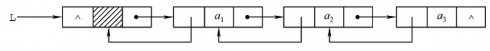
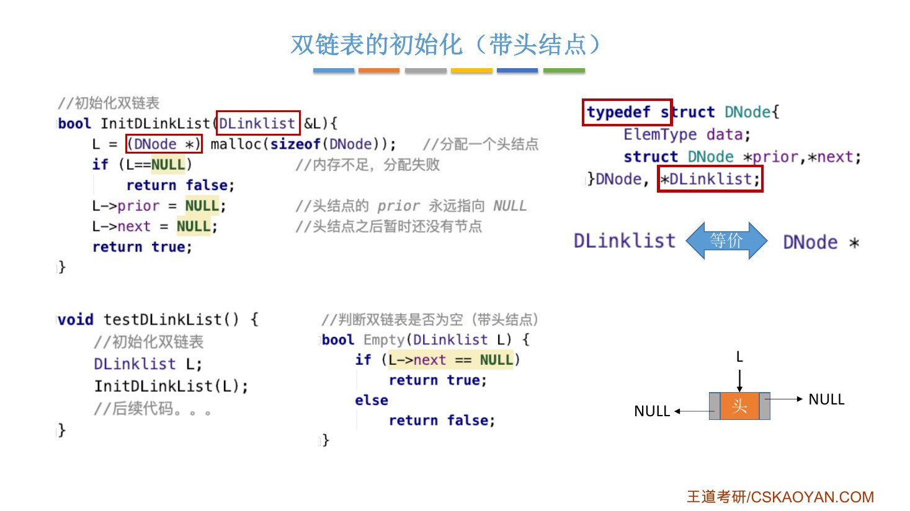
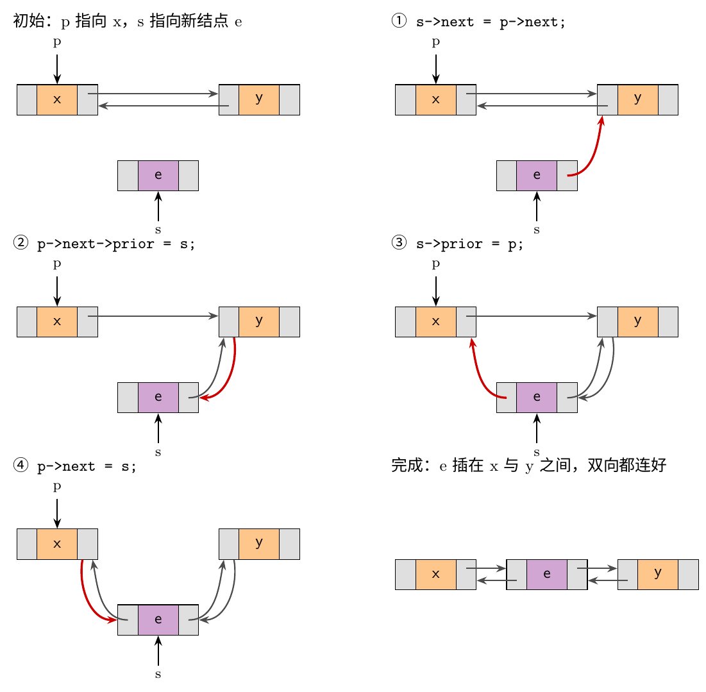
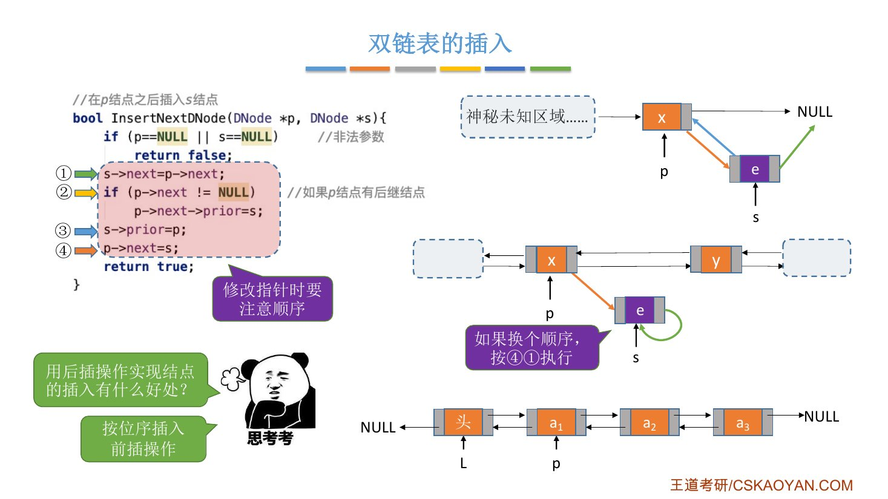
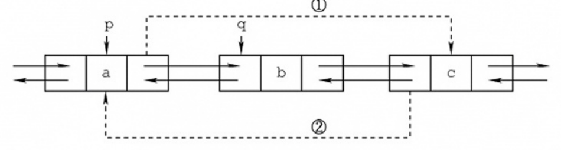
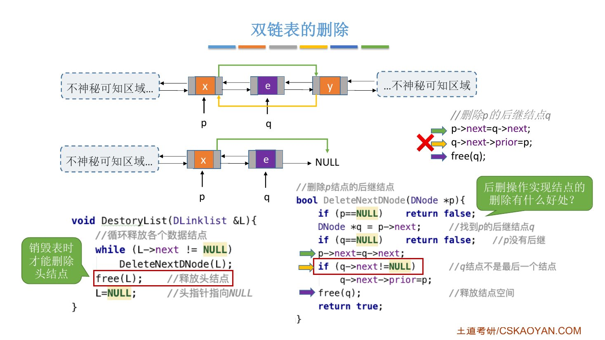
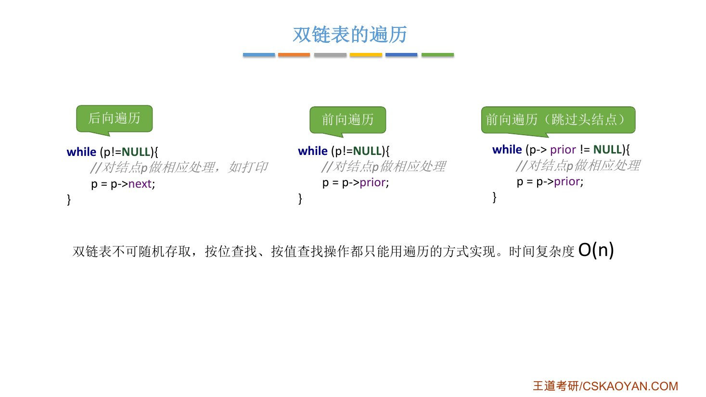
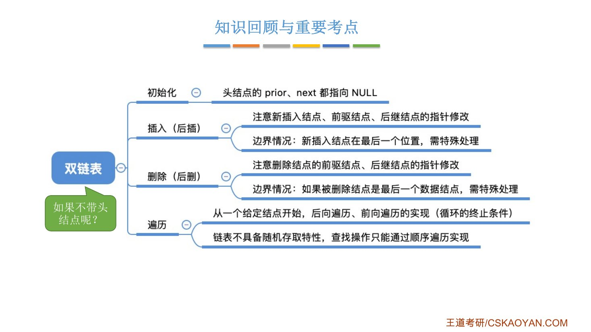

# 这一节在讲什么

::: cue
单链表有什么不方便？双链表在结点上多了什么？
:::

单链表的每个结点只有指向**后继**的指针，给定结点 `p`，[想找它的前驱很麻烦]{.u}，只能从头开始找。双链表在单链表的基础上再加一个指针域 `prior`，指向结点的**前驱**（prior 是"先前的"的意思）。

- 单链表：无法逆向检索，有时候不太方便；
- 双链表：可进可退，但多了一个指针，[存储密度更低一些]{.u}。

```c
typedef struct DNode {              // 定义双链表结点类型
    ElemType data;                  // 数据域
    struct DNode *prior, *next;     // 前驱和后继指针
} DNode, *DLinklist;
```

结点类型叫 `DNode`，D 指 double。`DLinklist` 等价于 `DNode *`：和单链表一样，用 `DLinklist` 强调这是一个链表，用 `DNode *` 强调这是一个结点（2.3.1 讲过）。

本节讲带头结点的双链表：初始化、插入、删除、遍历。

{.slide width=0.75}

# 一、初始化

::: cue
双链表初始化时，头结点的哪两个指针要设为 `NULL`？怎么判空？
:::

```c
bool InitDLinkList(DLinklist &L) {
    L = (DNode *)malloc(sizeof(DNode));   // 分配一个头结点
    if (L == NULL)                        // 内存不足，分配失败
        return false;
    L->prior = NULL;                      // 头结点的 prior 永远指向 NULL
    L->next = NULL;                       // 头结点之后暂时还没有结点
    return true;
}

bool Empty(DLinklist L) {                 // 判断双链表是否为空（带头结点）
    if (L->next == NULL)
        return true;
    else
        return false;
}
```

- 头结点之前不会再有其他结点，所以头结点的 `prior` [永远指向 `NULL`]{.u}。
- 判空和单链表一样：看头结点的 `next` 是否为 `NULL`。

{.slide width=0.6}

\newpage

# 二、插入

::: cue
在 `p` 之后插入 `s` 要改哪四个指针？`p` 是最后一个结点时会出什么问题？
:::

## 课本的四句

在 `p` 结点之后插入 `s` 结点（后插），课本给的代码：

```c
s->next = p->next;          // ① s 的 next 指向 p 的后继
p->next->prior = s;         // ② p 原后继的 prior 指向 s
s->prior = p;               // ③ s 的 prior 指向 p
p->next = s;                // ④ p 的 next 指向 s
```

下图一步一步画出了这四句（红色为这一步新改的指针）：

{.slide width=0.8}

\newpage

## 更严谨的写法：p 是最后一个结点

如果 `p` 刚好是双链表的**最后一个结点**，`p->next` 是 `NULL`，第②句 `p->next->prior` 就会出现[空指针错误]{.red}。老师加了一个 `if` 处理 `p` 没有后继的情况：

```c
// 在 p 结点之后插入 s 结点
bool InsertNextDNode(DNode *p, DNode *s) {
    if (p == NULL || s == NULL)       // 非法参数
        return false;
    s->next = p->next;                // ①
    if (p->next != NULL)              // ② 如果 p 结点有后继结点
        p->next->prior = s;
    s->prior = p;                     // ③
    p->next = s;                      // ④
    return true;
}
```

`p` 是最后一个结点时：① 让 `s->next` 和 `p->next` 一样指向 `NULL`；② 的 `if` 不满足，跳过（没有后继，自然不用改后继的 `prior`）；③④ 照常执行。

## 修改指针要注意顺序

::: pitfall
如果不小心把 ④ 写在 ① 前面：先 `p->next = s`，再执行 `s->next = p->next`，此时 `p->next` 已经是 `s`，结果 [`s->next` 指向了 `s` 自己]{.red}，`p` 原来的后继也找不到了。所以修改指针时语句顺序要合理，跨考的同学特别注意。
:::

{.slide width=0.65}

## 其他插入都能转成后插

课件问"用后插操作实现结点的插入有什么好处？"。老师的回答：搞定后插，其他插入都很容易实现。

- **按位序插入**：从头结点开始找到第 $i-1$ 个结点，对它执行后插；
- **前插操作**：双链表能很方便地找到给定结点的前驱 `p->prior`，对前驱执行后插即可。

::: book
王道书第 36 页：双链表的按值查找、按位查找和单链表相同，都要从头结点开始顺序查找。由于增加了指向前驱的指针，插入和删除时要同时维护前驱与后继两个方向的链接，关键在于[修改指针时不能造成断链]{.u}。得益于对前驱结点的直接访问，在[已知目标结点]{.u}的前提下，双链表插入和删除的时间复杂度可降至 $O(1)$。

插入的四步和课件相同（书上也是 ①②③④ 的顺序，配有图 2.10）。书上的说明：这几句的执行顺序**并不是任意的**，步骤①必须在步骤④之前，否则 `p->next` 被覆盖后，无法访问原后继结点，导致指针丢失、插入失败；其余步骤可在保证逻辑正确的前提下适当调整（例如③可在①前执行）。书上没有处理 `p` 是最后一个结点的情况。

书上留的问题：若要在结点 `*p` **之前**插入 `*s`，如何处理？我的答案：就是上面的前插，对 `p->prior` 执行后插，即 `InsertNextDNode(p->prior, s)`；带头结点时第 1 个数据结点的前驱是头结点，所以 `p->prior` 不会是 `NULL`。
:::

# 三、删除

::: cue
删除 `p` 的后继 `q` 时，`q` 是最后一个结点会出什么问题？怎么销毁整个双链表？
:::

删除 `p` 结点的后继结点 `q`，课本代码：

```c
p->next = q->next;          // ① p 的 next 指向 q 的后继
q->next->prior = p;         // ② q 的后继的 prior 指向 p
free(q);                    // 释放结点空间
```

{.slide width=0.7}

\newpage

和插入一样，如果 `q` 是**最后一个结点**，`q->next` 是 `NULL`，第②句同样会出现空指针错误。加上条件判断提升健壮性：

```c
// 删除 p 结点的后继结点
bool DeleteNextDNode(DNode *p) {
    if (p == NULL)
        return false;
    DNode *q = p->next;           // 找到 p 的后继结点 q
    if (q == NULL)                // p 没有后继
        return false;
    p->next = q->next;
    if (q->next != NULL)          // q 结点不是最后一个结点
        q->next->prior = p;
    free(q);                      // 释放结点空间
    return true;
}
```

## 销毁双链表

有了删除操作，销毁就很简单：循环删除头结点的后继，依次释放各个数据结点，直到表空；最后再释放头结点，头指针指向 `NULL`。

```c
void DestoryList(DLinklist &L) {
    while (L->next != NULL)       // 循环释放各个数据结点
        DeleteNextDNode(L);
    free(L);                      // 释放头结点
    L = NULL;                     // 头指针指向 NULL
}
```

[只有销毁表时才能删除头结点]{.u}（课件标注）。

{.slide width=0.65}

::: book
王道书第 37 页：删除操作的代码和图 2.11 与课件那三句相同，同样没有处理 `q` 是最后一个结点的情况。书上的考点追踪：双链表中插入操作的实现（2023）、删除操作的实现（2016）。

书上留的问题：若要删除结点 `*q` 的**前驱**结点 `*p`，如何写？我的答案：令 `p = q->prior`，删除 `p` 就是删除 `p->prior` 的后继，即 `DeleteNextDNode(p->prior)`（或直接改指针：`p->prior->next = q; q->prior = p->prior; free(p);`）。

书上还提到：建立双链表也可以用类似单链表的头插法或尾插法，但每插入一个新结点，都要同时正确设置 `next` 和 `prior` 两个指针，以维持双向链接的完整性。
:::

# 四、遍历

::: cue
后向遍历、前向遍历的循环怎么写？只想处理数据结点、跳过头结点，循环条件怎么改？
:::

给定结点 `p`，每次循环让 `p` 指向下一个（或上一个）结点，在循环内部对 `p` 做相应处理（比如打印数值）：

```c
while (p != NULL) {           // 后向遍历
    // 对结点 p 做相应处理，如打印
    p = p->next;
}

while (p != NULL) {           // 前向遍历
    // 对结点 p 做相应处理
    p = p->prior;
}

while (p->prior != NULL) {    // 前向遍历（跳过头结点）
    // 对结点 p 做相应处理
    p = p->prior;
}
```

第三种：`p->prior == NULL` 说明 `p` 已经指向头结点，循环条件不满足，就[不会处理头结点]{.u}。

会遍历，按位查找、按值查找的核心代码也就有了：按位查找在循环里累加一个计数器，记录当前是第几个；按值查找在循环里比较当前结点的值。

双链表[不可随机存取]{.red}，按位查找、按值查找都只能用遍历的方式实现，时间复杂度 [$O(n)$]{.red}。

{.slide width=0.5}

# 五、知识回顾

{.slide width=0.5}

::: add
课件知识回顾里问"如果不带头结点呢？"，老师没有展开。我的思考：不带头结点时 `L` 直接指向第一个数据结点，第一个数据结点的 `prior` 为 `NULL`；在表头插入、删除第一个结点时要修改头指针 `L`，和单链表不带头结点时一样需要单独处理（2.3.2_1）。
:::

::: summary
双链表的操作和单链表本质上没有太大区别，只是多了一个前向指针 `prior`，写代码时注意**这些指针怎么改、不要出错**。

- **初始化**：头结点的 `prior`、`next` 都指向 `NULL`；
- **插入（后插）**：注意新插入结点、前驱结点、后继结点的指针修改；[边界情况：新插入结点在最后一个位置]{.u}，需特殊处理（`if (p->next != NULL)`）；
- **删除（后删）**：注意删除结点的前驱、后继结点的指针修改；[边界情况：被删除结点是最后一个数据结点]{.u}，需特殊处理（`if (q->next != NULL)`）。严格来说，书上给的插入、删除代码在这两种情况下有一点点 bug；
- **遍历**：从一个给定结点开始，后向遍历、前向遍历的实现（注意循环的终止条件）；链表不具备随机存取特性，查找只能通过顺序遍历实现，$O(n)$。

**自测**：① 写出带头结点双链表的初始化。② 在 `p` 之后插入 `s` 的四句是什么？哪两句的先后顺序不能反？③ `p` 是最后一个结点时，课本的四句哪一句出错？怎么改？④ 怎么用后插实现前插？⑤ 前向遍历时怎样跳过头结点？
:::
