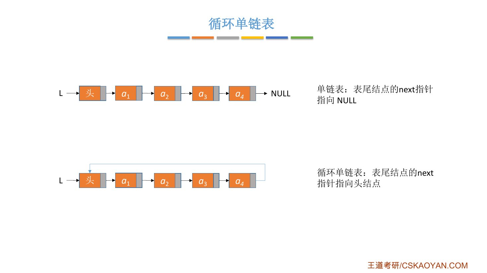
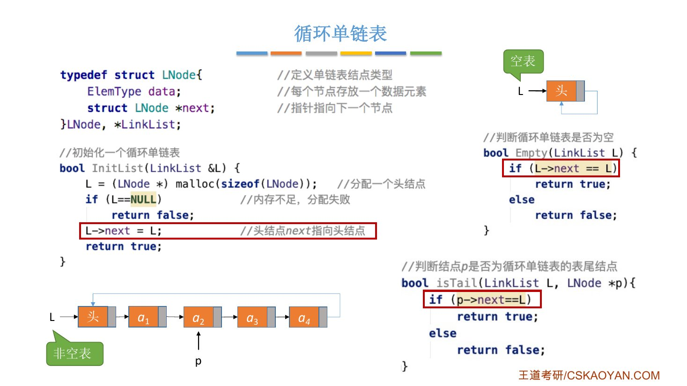
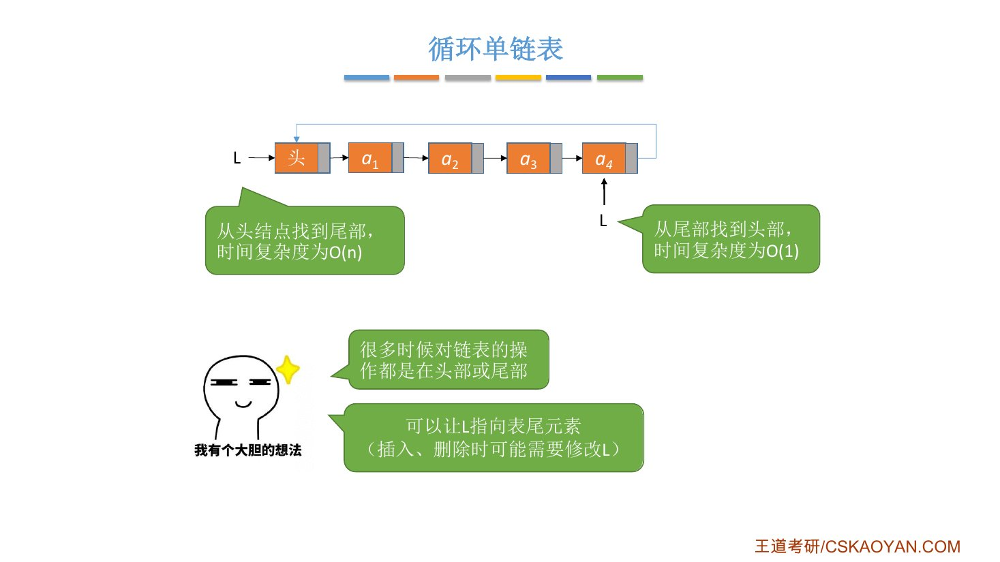
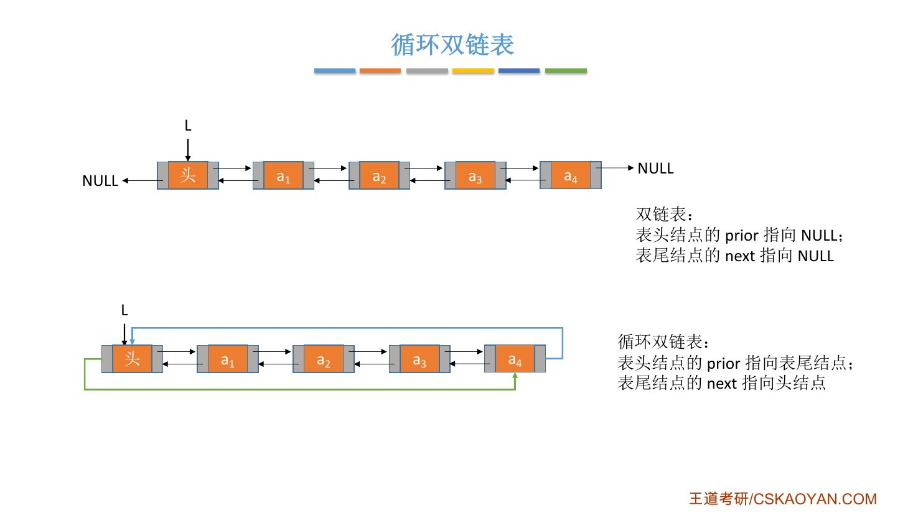
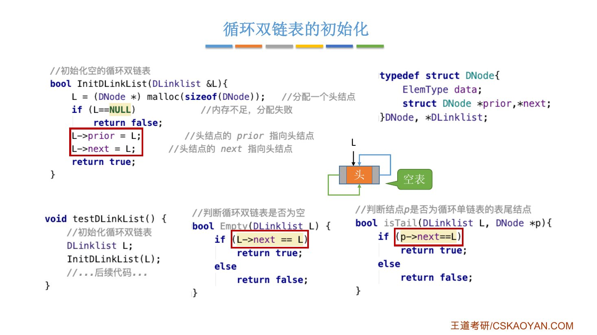
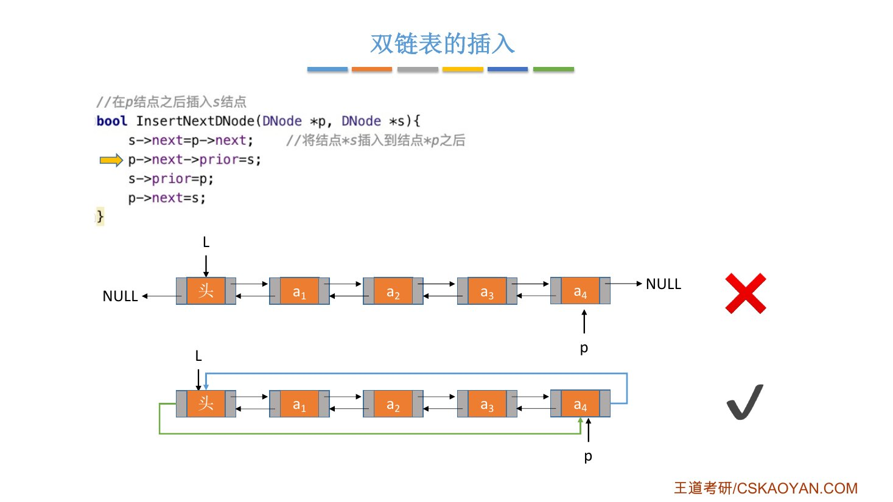
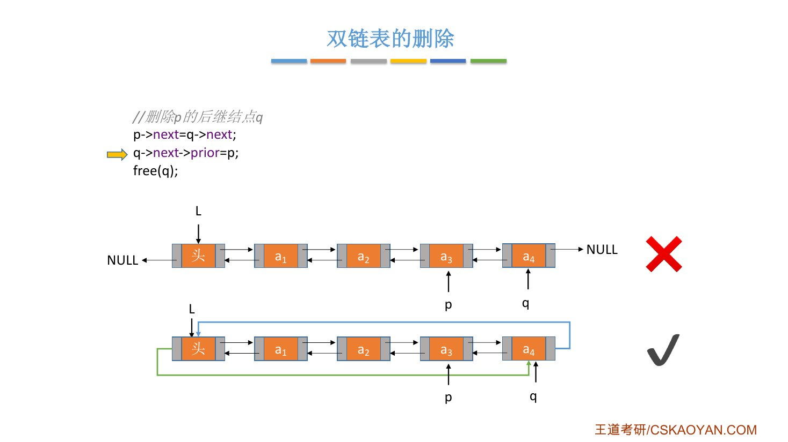
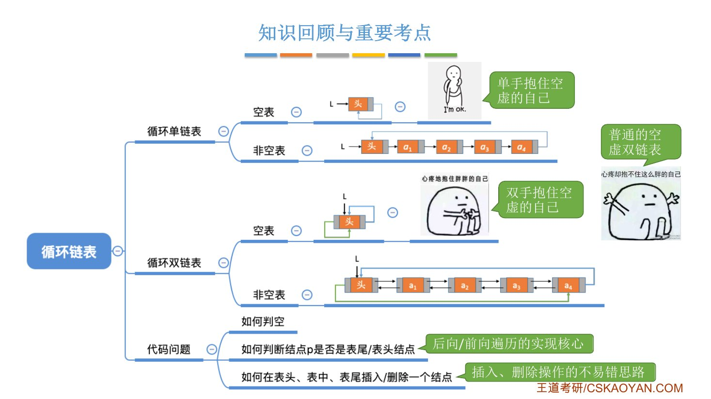

# 这一节在讲什么

::: cue
循环链表是在什么基础上改进的？分哪两种？
:::

在单链表、双链表的基础上加一个小小的改进，就得到对应的**循环单链表**和**循环双链表**。老师说这一节内容十分简单，看一个图就明白了。

# 一、循环单链表

::: cue
循环单链表的表尾结点指向哪里？初始化、判空、判表尾分别怎么写？
:::

- 单链表：表尾结点的 `next` 指针指向 `NULL`；
- 循环单链表：表尾结点的 `next` 指针[指向头结点]{.u}。

{.slide width=0.6}

结点定义和单链表完全一样。区别在初始化、判空、判表尾：

::: {.tbl widths="1.2,2,2"}
| | 单链表（带头结点） | 循环单链表 |
|---|---|---|
| 初始化 | `L->next = NULL` | `L->next = L` |
| 判空 | `L->next == NULL` | `L->next == L` |
| `p` 是表尾 | `p->next == NULL` | `p->next == L` |
:::

代码如下：

```c
// 初始化一个循环单链表
bool InitList(LinkList &L) {
    L = (LNode *)malloc(sizeof(LNode));   // 分配一个头结点
    if (L == NULL)                        // 内存不足，分配失败
        return false;
    L->next = L;                          // 头结点 next 指向头结点
    return true;
}
```

```c
// 判断循环单链表是否为空
bool Empty(LinkList L) {
    if (L->next == L)
        return true;
    else
        return false;
}

// 判断结点 p 是否为循环单链表的表尾结点
bool isTail(LinkList L, LNode *p) {
    if (p->next == L)
        return true;
    else
        return false;
}
```

- 初始化：头结点的 `next` 指向**头结点自己**；判空：看头结点的 `next` 是否指向自己。
- 表不为空时，最后一个结点的 `next` 指向头结点；所以判断 `p` 是不是表尾，看 `p` 的下一个结点是不是头结点。
- 因此写代码遍历循环单链表时，判断扫描指针 `p` 是否到达表尾的条件，和普通单链表不一样。

{.slide width=0.65}

## 从任意结点出发能找到所有结点

- 单链表：给一个结点 `p`，只能找到 `p` 后续的各个结点，前面的结点不可知（除非也拿到头指针）；
- 循环单链表：从一个结点出发，[可以找到其他任何一个结点]{.u}。

用处举例：删除结点 `p` 要修改它前驱的 `next`。普通单链表只知道 `p` 的话找不到前驱；循环单链表可以顺着链往后找，一直找到 `p` 的前驱，再修改它的 `next`。

## 让 L 指向表尾

很多时候对链表的操作都在**表头或表尾**（比如头插法、尾插法建表）。

- 普通单链表只知道头结点时，找到表尾要从头扫描到尾，$O(n)$；
- 循环单链表可以让 `L` [不指向头结点，而指向表尾结点]{.u}：从表尾往后走一步就是头结点，找头部 $O(1)$；表尾本身就是 `L`，找尾部也是 $O(1)$。

所以如果应用场景里经常要对表头或表尾操作，可以让循环单链表的 `L` 指向表尾元素。代价：在表尾插入、删除元素时，需要修改 `L` 的指向（老师没有展开）。

{.slide width=0.6}

::: book
王道书第 37 页（循环单链表）：表中最后一个结点的 `next` 域不再是 `NULL`，而是指向头结点，整个链表形成一个环，因此链表中**不存在 `next` 为 `NULL` 的结点**。判空条件不是头指针 `L` 是否为空，而是头结点的 `next` 是否指向自身（`L->next == L`）。

插入、删除与普通单链表基本相同，关键差异在表尾操作时要保持循环特性。但正因为循环单链表是一个环，[在任何位置上的插入和删除操作都是等价的]{.u}，无须判断是否到达表尾。

为了提高效率，循环单链表有时不设头指针，**仅设尾指针 `r`**：在表头或表尾插入元素都是 $O(1)$；若用头指针，表尾插入要遍历整个链表，$O(n)$。在表尾插入新结点 `*s` 的步骤：

```c
s->next = r->next;    // 新结点的后继指向头结点，维持环状结构
r->next = s;          // 原表尾指向新结点
r = s;                // 更新 r 为新结点
```

书上的考点追踪：循环单链表中删除首元素的操作（2021）。
:::

# 二、循环双链表

::: cue
循环双链表中哪两个指针形成闭环？空表时头结点的两个指针指向哪里？
:::

- 双链表：表头结点的 `prior` 指向 `NULL`，表尾结点的 `next` 指向 `NULL`；
- 循环双链表：[表头结点的 `prior` 指向表尾结点，表尾结点的 `next` 指向头结点]{.u}。

所有 `next` 指针形成一个闭环，所有 `prior` 指针形成另一个方向的闭环。

{.slide width=0.6}

```c
// 初始化空的循环双链表
bool InitDLinkList(DLinklist &L) {
    L = (DNode *)malloc(sizeof(DNode));   // 分配一个头结点
    if (L == NULL)                        // 内存不足，分配失败
        return false;
    L->prior = L;                         // 头结点的 prior 指向头结点
    L->next = L;                          // 头结点的 next 指向头结点
    return true;
}
```

```c
// 判断循环双链表是否为空
bool Empty(DLinklist L) {
    if (L->next == L)
        return true;
    else
        return false;
}

// 判断结点 p 是否为循环双链表的表尾结点
bool isTail(DLinklist L, DNode *p) {
    if (p->next == L)
        return true;
    else
        return false;
}
```

- 初始化：头结点的 `prior`、`next` [都指向头结点自己]{.u}（普通双链表都指向 `NULL`）。
- 判表尾：看 `p->next` 是否指向头结点。空表时头结点的 `next` 也指向自己，头结点既是第一个也是最后一个结点，这个逻辑依然正确。

::: fix
课件上 `isTail(DLinklist L, DNode *p)` 的注释写的是"判断结点 p 是否为**循环单链表**的表尾结点"，应为循环**双**链表（参数是 `DLinklist`）。
:::

{.slide width=0.6}

## 课本的插入、删除代码在循环双链表上没有 bug

2.3.3 说过，课本的双链表后插四句、删除三句，在 `p`（或 `q`）是表尾结点时会出现空指针错误。换成循环双链表，这两段代码就是对的：

```c
// 在 p 结点之后插入 s 结点
s->next = p->next;          // 将结点 *s 插入到结点 *p 之后
p->next->prior = s;
s->prior = p;
p->next = s;
```

- **插入**：即便 `p` 是表尾结点，它的 `next` 也非空，指向头结点；第二句就是让头结点的 `prior` 指向新结点 `s`，没有问题。老师说这小段代码大家可以自己捋一捋。

```c
// 删除 p 的后继结点 q
p->next = q->next;
q->next->prior = p;
free(q);
```

- **删除**：即便 `q` 是最后一个结点，第一句让 `p->next` 指向 `q->next`，也就是头结点；第二句让头结点的 `prior` 指向 `p`；第三句释放 `q`。逻辑没有问题。

{.slide width=0.55}

{.slide width=0.55}

::: book
王道书第 37–38 页（循环双链表）：不同之处在于每个结点不仅有指向下一个结点的 `next` 域，还有指向前一个结点的 `prior` 域，头结点的 `prior` 需要指向表尾结点，从而形成完整的环形结构。设尾结点为 `*p`，则 `p->next` 应指向头结点 `L`，同时 `L->prior` 应指向 `*p`。当循环双链表为空表时，其头结点的 `prior` 和 `next` 都指向自身（`L->prior == L` 且 `L->next == L`）。
:::

# 三、知识回顾

::: cue
写任何一种链表的代码，都要关注哪几个问题？
:::

老师的比喻：循环单链表为空时，像"单手抱住了空虚的自己"；循环双链表为空时，头结点前后两个指针都指向自己，像"双手抱住了空虚的自己"；普通双链表为空时，两个指针都指向 `NULL`。

{.slide width=0.6}

到这里学完了所有用指针实现的链表。不管是单链表、双链表还是循环链表，写代码时都要关注这几个方面：

1. **如何判空**：知道空表的状态，也就知道怎么初始化；
2. **如何判断结点 `p` 是表尾 / 表头结点**：知道了这个条件，就知道[前向、后向遍历]{.u}怎么写。链表都不具备随机访问的特性，找某个结点的核心都是一个 `while` 循环，循环无非停在表头或表尾；
3. **如何在表头、表中、表尾插入 / 删除一个结点**：分别考虑这三种情况要不要特殊处理，基本就能覆盖比较容易出错的[边界条件]{.u}。

::: summary
**循环单链表**：表尾结点的 `next` 指向头结点。初始化 `L->next = L`，判空 `L->next == L`，判表尾 `p->next == L`。从任意结点出发可以找到其他任何结点；让 `L` 指向表尾时，找头部、尾部都是 $O(1)$（但表尾插入删除要修改 `L`）。

**循环双链表**：表尾的 `next` 指向头结点，头结点的 `prior` 指向表尾，两个方向各成一个闭环。初始化 `L->prior = L; L->next = L;`，判空 `L->next == L`，判表尾 `p->next == L`。课本的双链表插入、删除代码在循环双链表上不会出现空指针错误。

**自测**：① 循环单链表怎么初始化、判空？② 为什么循环单链表常让 `L` 指向表尾？③ 循环双链表空表时，头结点的 `prior`、`next` 指向哪里？④ 为什么课本的后插四句在循环双链表上不需要 `if (p->next != NULL)`？⑤ 写链表代码要关注哪三类问题？
:::
