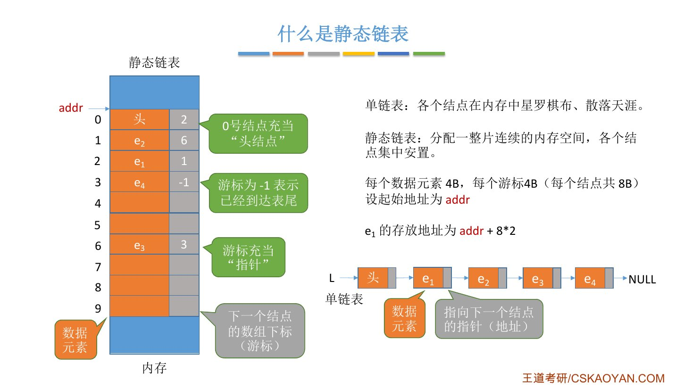
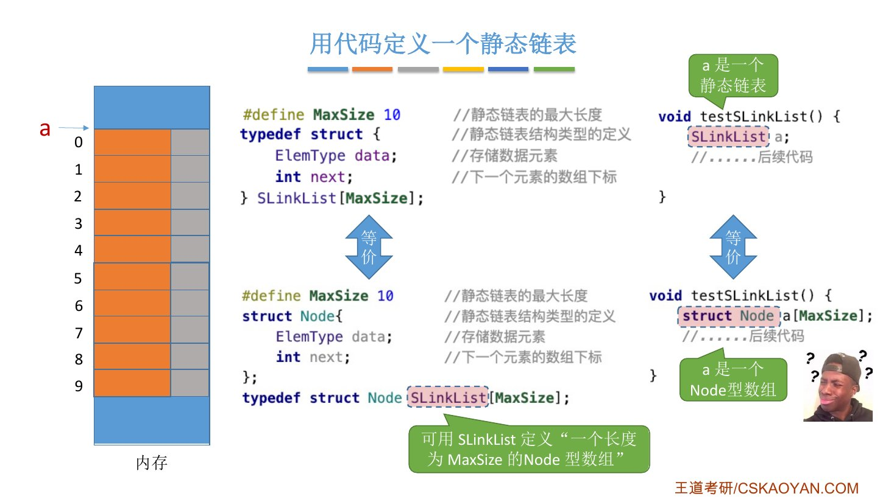
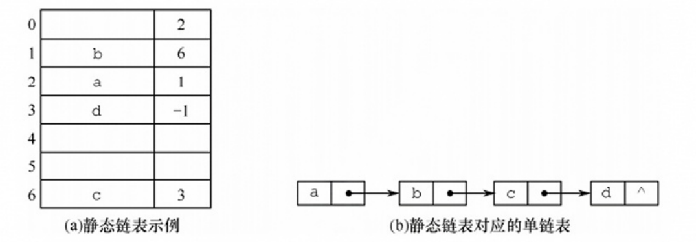
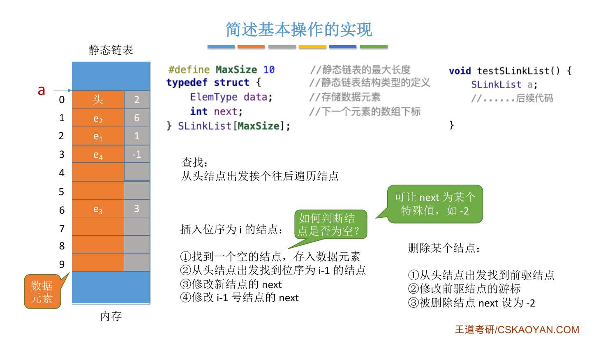
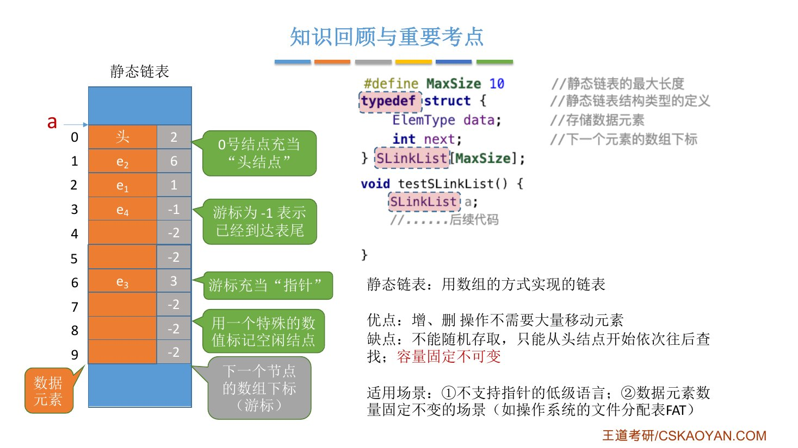

# 这一节在讲什么

::: cue
这一节讲静态链表的哪三件事？
:::

三件事：什么是静态链表；怎么用代码定义一个静态链表；简述基本操作怎么实现。老师说这个考点考得不多，也很少考代码实现，主要想借它补充一些 C 语言的知识，[至少要能看懂书上给的代码]{.u}。

# 一、什么是静态链表

::: cue
静态链表的"指针"是什么？表尾怎么表示？第 $i$ 号结点的地址怎么算？
:::

- **单链表**：各个结点离散地分布在内存的各个角落（课件："星罗棋布、散落天涯"），每个结点存数据元素和指向下一个结点的指针（下一个结点的内存地址）。
- **静态链表**：分配[一整片连续的内存空间]{.u}，各个结点集中安置在这片空间中的某些位置。每个结点存数据元素和**下一个结点的数组下标**。

看课件的例子（数组下标 0～9）：

- [0 号结点充当"头结点"]{.u}，不存实际的数据元素；它的游标是 2，所以第一个数据结点（位序为 1）存在下标 2 处（$e_1$），$e_1$ 的游标是 1，下一个就是下标 1 处的 $e_2$，依此类推：$e_1 \to e_2 \to e_3 \to e_4$，存放的下标依次为 2、1、6、3。
- 数组下标也叫**游标**，作用和单链表的指针差不多：指针指明具体的内存地址，游标只指明下一个元素的数组下标。
- 单链表表尾的 `next` 指向 `NULL`；静态链表中[游标为 $-1$ 表示已经到达表尾]{.u}，后面没有结点了。

{.slide width=0.65}

**地址怎么算**：各结点的空间连续。设每个数据元素 4B、每个游标 4B（每个结点共 8B），起始地址为 `addr`，则下标为 2 的结点 $e_1$ 的存放地址为 $\texttt{addr}+8\times2$。即：

$$\text{下标为 } i \text{ 的结点的地址} = \texttt{addr} + \text{每个结点的大小} \times i$$

用这种方式就能把游标（数组下标）映射成对应结点的实际存放地址，这就是静态链表的基本原理。

# 二、用代码定义静态链表

::: cue
课本的 `typedef struct {…} SLinkList[MaxSize];` 是什么意思？为什么不直接写 `struct Node a[MaxSize]`？
:::

## 容易想到的写法

定义一个结点结构体，再声明一个结点数组：

```c
#define MaxSize 10           // 静态链表的最大长度
struct Node {                // 静态链表结构类型的定义
    ElemType data;           // 存储数据元素
    int next;                // 下一个元素的数组下标
};

void testSLinkList() {
    struct Node a[MaxSize];  // 数组 a 作为静态链表
    // ……后续代码
}
```

`a` 有 `MaxSize`（10）个元素，每个元素是一个 `struct Node`，占内存中一整片连续空间。

## 课本的写法

```c
#define MaxSize 10           // 静态链表的最大长度
typedef struct {             // 静态链表结构类型的定义
    ElemType data;           // 存储数据元素
    int next;                // 下一个元素的数组下标
} SLinkList[MaxSize];

void testSLinkList() {
    SLinkList a;
    // ……后续代码
}
```

老师说这种写法挺少见，问了身边好几个常用 C/C++ 的同学也很少有人见过。它等价于：

```c
struct Node {
    ElemType data;
    int next;
};
typedef struct Node SLinkList[MaxSize];
```

即：[可用 `SLinkList` 定义"一个长度为 `MaxSize` 的 `Node` 型数组"]{.u}。`SLinkList a;` 和 `struct Node a[MaxSize];` 等价。

{.slide width=0.65}

**为什么课本这么写**：和 2.3.1 的 `LinkList` / `LNode *` 完全相通。用前一种写法声明，从代码上看 `a` 是一个 `Node` 型数组；用 `SLinkList a` 声明，效果一样，但一看就知道 [`a` 是一个静态链表]{.u}。

## 老师的验证程序

```c
#define MaxSize 10
struct Node {
    int data;
    int next;
};
typedef struct {
    int data;
    int next;
} SLinkList[MaxSize];

void testSLinkList() {
    struct Node x;
    printf("sizeX=%d\n", sizeof(x));   // 8
    struct Node a[MaxSize];
    printf("sizeA=%d\n", sizeof(a));   // 80
    SLinkList b;
    printf("sizeB=%d\n", sizeof(b));   // 80
}
```

运行结果 `sizeX=8`、`sizeA=80`、`sizeB=80`：一个结点含两个 4B 的 `int`，共 8B；`b` 和 `a` 一样大，说明 `SLinkList b` [相当于定义了一个长度为 `MaxSize` 的 `Node` 型数组]{.u}。

::: book
王道书第 38 页：静态链表是用**数组**来模拟线性表的链式存储结构。每个结点包含 `data` 域和 `next` 域；与动态链表不同，这里的指针实际上是结点在数组中的相对地址（数组下标），也称**游标**。类似于顺序表，静态链表也需要预先分配一块连续的内存空间。书上的结构类型定义和课件相同（书上 `MaxSize` 为 50）。
:::

{.slide width=0.75}

# 三、简述基本操作的实现

::: cue
怎么初始化？查找是 $O(1)$ 吗？插入、删除分几步？怎么判断一个结点是空闲的？
:::

老师只讲思路，感兴趣的可以自己动手实现代码。

## 初始化

单链表初始化时把头结点的 `next` 指向 `NULL`；对应到静态链表，[把 `a[0]` 的 `next` 设为 $-1$]{.u}（$-1$ 相当于 `NULL`，不指向任何元素）。

## 查找

只能从头结点出发，顺着游标记录的线索依次往后找，直到找到想要的结点。所以找某个**位序**的结点，时间复杂度 [$O(n)$]{.red}。

::: pitfall
注意说的是"某个**位序**的结点"，而不是"某个**数组下标**的结点"。位序是各结点在**逻辑上**的顺序；数组下标只反映各结点在**物理上**的顺序。
:::

## 插入位序为 i 的结点

1. 找到一个空的结点，存入数据元素（可以按某种算法，比如从上到下扫描）；
2. 从头结点出发，找到位序为 $i-1$ 的结点；
3. 修改新结点的 `next`；
4. 修改 $i-1$ 号结点的 `next`。

老师的例子：表中已有 4 个元素，要在位序 5（表尾）插入新元素 $e_5$，假设存到下标 4：

::: {.tbl widths="0.8,1.6,1.6"}
| 下标 | 插入前 `(data, next)` | 插入后 `(data, next)` |
|---|---|---|
| 0 | 头, 2 | 头, 2 |
| 1 | $e_2$, 6 | $e_2$, 6 |
| 2 | $e_1$, 1 | $e_1$, 1 |
| 3 | $e_4$, $-1$ | $e_4$, [**4**]{.red} |
| 4 | 空 | [$e_5$, $-1$]{.red} |
| 6 | $e_3$, 3 | $e_3$, 3 |
:::

前驱是第 4 个元素 $e_4$（下标 3），把它的 `next` 改成 4，指向新结点的存放位置；新结点成为表尾，`next` 设为 $-1$。

## 怎么判断结点是空闲的

刚才找空结点时，我们是用肉眼看出 4、5、7、8、9 没存数据。但从计算机的视角，内存中任何地方都有数据，只不过是**脏数据**。所以要让计算机识别空闲结点：

- **初始化时**还要把空闲结点的 `next` 设为某个特殊值，比如 [$-2$]{.red}，写代码时判断 `next == -2` 就知道它是空闲的（这是前面初始化漏掉的一步）；
- **删除时**除了修改游标，也要把被删除结点的 `next` 设为 $-2$，表示它已经被回收。

## 删除某个结点

1. 从头结点出发找到前驱结点；
2. 修改前驱结点的游标；
3. 被删除结点的 `next` 设为 $-2$。

{.slide width=0.65}

::: book
王道书第 38 页：静态链表以 `next == -1` 作为其结束标志。插入、删除操作与动态链表类似，只需修改指针（数组下标），而无须移动元素。尽管静态链表在灵活性上不及动态链表，但在一些不支持指针的编程语言（如 Basic）中，它提供了一种巧妙的设计方案。
:::

\newpage

# 四、知识回顾

{.slide width=0.65}

::: summary
**静态链表**：用数组的方式实现的链表。存储空间是一整片连续空间，但在这片空间内，逻辑上相邻的元素物理上也可以不相邻，先后关系靠**游标**（下一个结点的数组下标）表示。0 号结点充当头结点；游标 $-1$ 表示表尾；可以用 $-2$ 等特殊值标记空闲结点。

- **优点**：增、删操作不需要大量移动元素，只需修改相关结点的游标；
- **缺点**：不能随机存取，只能从头结点开始依次往后查找；[容量固定不可变]{.red}，声明后最大容量就定死了，不可扩展；
- **适用场景**：① 不支持指针的低级语言（早期用它实现和单链表同样的功能）；② 数据元素数量固定不变的场景，如操作系统文件管理中的**文件分配表 FAT**，本质上就是一个静态链表（老师建议先在操作系统课本上做个记号，学到文件管理时回头体会）。

`typedef struct {…} SLinkList[MaxSize];` 让 `SLinkList` 代表"长度为 `MaxSize` 的结点数组"，`SLinkList a;` 等价于 `struct Node a[MaxSize];`，写法上强调 `a` 是一个静态链表。

**自测**：① 静态链表的游标和单链表的指针有什么异同？② 结点 8B、起始地址 `addr`，下标 5 的结点地址是多少？③ `SLinkList a;` 等价于什么声明？④ 为什么初始化时要把空闲结点的 `next` 设为 $-2$？⑤ 静态链表找位序为 $i$ 的结点，时间复杂度是多少？
:::
