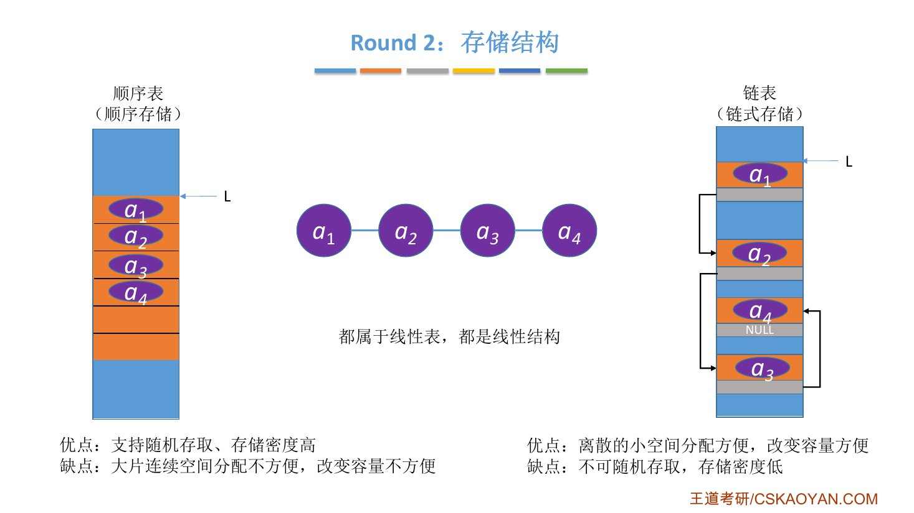
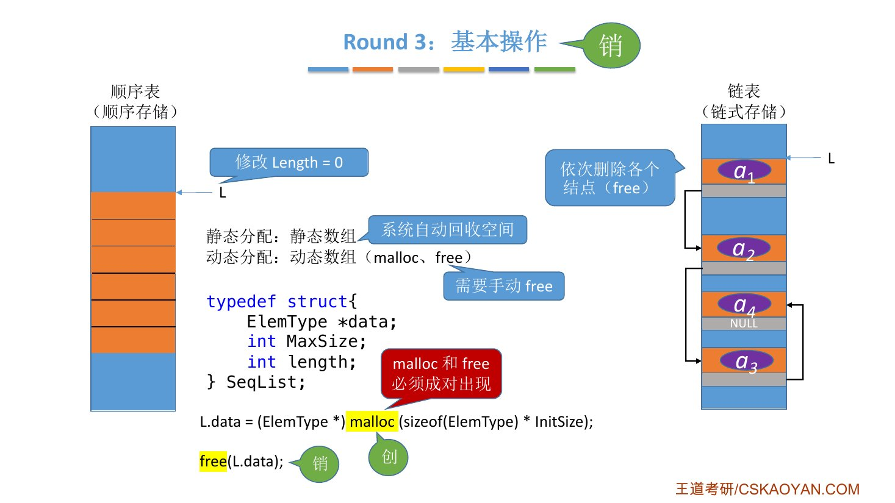
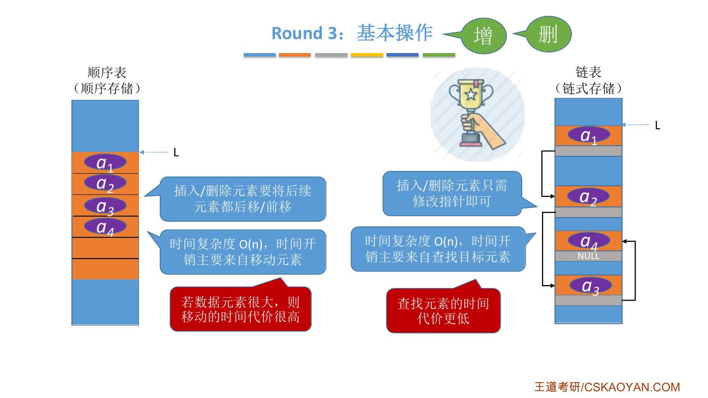
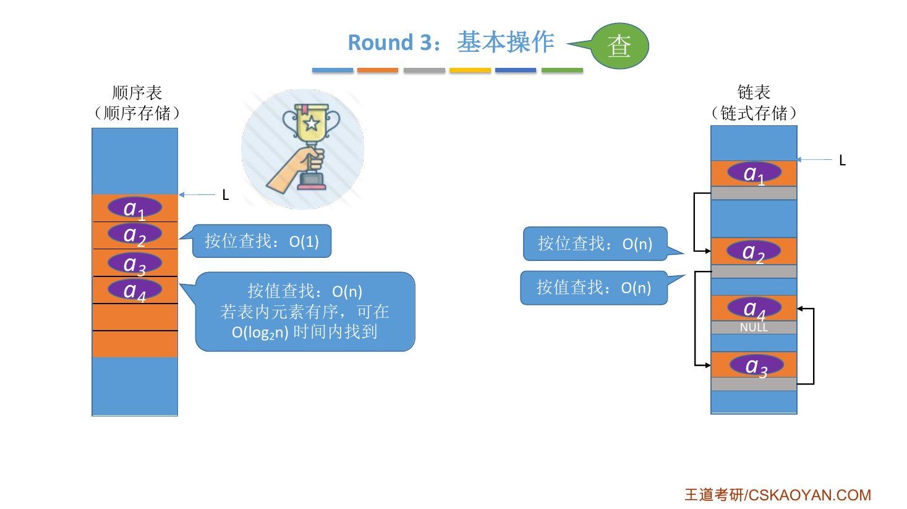
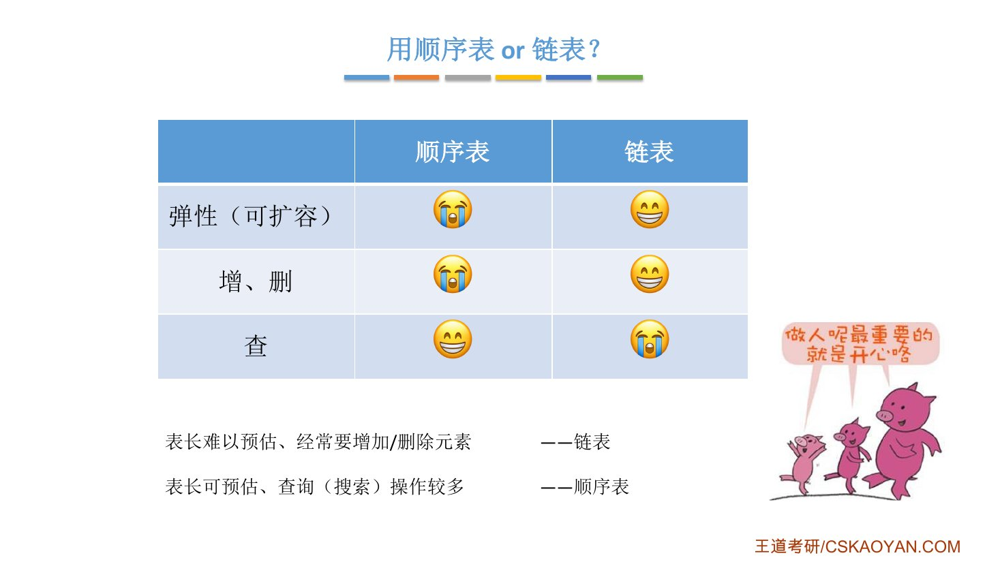

# 这一节在讲什么

::: cue
这一节按什么思路比较顺序表和链表？
:::

对顺序表和链表的特性做一个对比，也算是对第 2 章的总结。思路是**数据结构的三要素**（1.1 讲过），分三轮回忆，最后讨论怎么选：

- **Round 1**：逻辑结构；
- **Round 2**：物理结构 / 存储结构；
- **Round 3**：数据的运算 / 基本操作；
- **如何抉择**：什么时候用顺序表，什么时候用链表。

# 一、Round 1：逻辑结构

顺序表和链表在逻辑上看[都是线性结构]{.u}，都属于线性表，各个数据元素之间是一对一的关系。

# 二、Round 2：存储结构

::: cue
顺序存储和链式存储各有什么优缺点？
:::

::: {.tbl widths="1,2.4,2.4"}
| | 顺序表（顺序存储） | 链表（链式存储） |
|---|---|---|
| 优点 | 支持[随机存取]{.u}（知道起始地址就能立即找到第 $i$ 个元素）；[存储密度高]{.u}（结点只存数据元素，不存冗余信息） | 离散的小空间分配方便（每次用 `malloc` 申请一小片空间）；改变容量方便 |
| 缺点 | 要求大片连续空间，分配不方便；改变容量不方便 | [不可随机存取]{.u}（找第 $i$ 个只能从表头依次往后找）；[存储密度低]{.u}（还要花空间存指针） |
:::

{.slide width=0.6}

::: book
王道书第 38 页"存取（读/写）方式"：顺序表支持随机存取，可通过下标直接访问任意位置元素，$O(1)$，同时也支持顺序存取；链表仅支持顺序存取，必须从头结点开始逐个遍历。例如访问第 $i$ 个元素时，顺序表只需一次操作，链表需要遍历 $i$ 个结点，平均 $O(n)$。

"逻辑结构与物理结构"：顺序存储中，逻辑上相邻的元素在物理内存中也连续存放，邻接关系由地址自然体现；链式存储中，逻辑相邻的元素在物理上未必相邻，逻辑关系通过指针显式维护。
:::

\newpage

# 三、Round 3：基本操作

::: cue
复习一个数据结构的基本操作，按什么顺序回忆？
:::

老师的复习思路：**创、销、增删改查**。

- "改"很简单：只要查到要改的元素，改值就是一次赋值，所以之前一直没单独讲；
- "销毁"考研考得不多，但实际写代码时很重要，这里快速带过。

## 创（初始化）

- **顺序表**：要预分配大片连续空间。分配得太小，之后不方便拓展容量；分配得太大，大量空间长时间空闲，[浪费内存资源]{.u}。
  - 静态分配：静态数组，[容量不可改变]{.u}；
  - 动态分配：动态数组（`malloc`、`free`），容量可以改变，但需要移动大量元素，时间代价高。
- **链表**：只需分配一个头结点（也可以不要头结点，只声明一个头指针），之后需要拓展时再 `malloc` 一小片空间，用指针连进来，很方便。

所以从"创"联想到**存储空间的灵活性（弹性）**，链表更胜一筹。

## 销（销毁）

- **链表**：依次删除各个结点（`free`）。核心就是写一个循环扫描各个结点，把它们一一 `free` 掉。
- **顺序表**：先把 `length` 改为 0，这只是在**逻辑上**把它标记为空表；存储空间怎么回收分两种情况：
  - 静态分配（静态数组）：生命周期结束后，[系统自动回收空间]{.u}，不用管；
  - 动态分配（`malloc` 申请的动态数组）：[需要手动 `free`]{.u}。

```c
L.data = (ElemType *)malloc(sizeof(ElemType) * InitSize);   // 创
free(L.data);                                               // 销
```

::: pitfall
`malloc` 申请的空间属于内存中的**堆区**，系统不会自动回收，所以[`malloc` 和 `free` 必须成对出现]{.red}；链表的每个结点都是 `malloc` 申请的，销毁时也要对每个结点 `free`。声明数组或变量申请的空间由系统自动回收。（堆区、栈区是什么，老师暂不展开。）
:::

{.slide width=0.5}

## 增、删

- **顺序表**：插入、删除要把后续元素都后移 / 前移。时间复杂度 $O(n)$，[时间开销主要来自移动元素]{.u}；若数据元素很大，移动的时间代价很高。
- **链表**：只需修改指针。时间复杂度也是 $O(n)$，但[时间开销主要来自查找目标元素]{.u}，查找元素的时间代价更低。

老师的例子：一个数据元素占 1MB，移动一个可能要 10ms 左右，移动 $n$ 个代价很高；链表往后找一个结点假设只要 1μs，找 $n$ 个也远小于移动元素的开销。所以虽然大 $O$ 表示都是 $O(n)$，结合现实因素，[链表的插入、删除效率要比顺序表高得多]{.u}。

{.slide width=0.5}

## 查

::: {.tbl widths="1.2,2.4,2.4"}
| | 顺序表 | 链表 |
|---|---|---|
| 按位查找 | $O(1)$（随机存取） | $O(n)$ |
| 按值查找 | 无序 $O(n)$；有序时可用折半查找等算法，$O(\log_2 n)$ | 不论有序无序，都只能从头遍历，$O(n)$ |
:::

所以查找相关的操作，顺序表的效率高很多。

{.slide width=0.5}

\newpage

::: book
王道书第 39 页"查找、插入和删除操作"：按值查找，表无序时两者都是 $O(n)$，表有序时顺序表可采用折半查找，$O(\log_2 n)$；按序号查找，顺序表 $O(1)$，链表 $O(n)$。插入 / 删除，顺序表平均需移动约一半的元素，开销较大；链表只需修改指针，无须移动元素，[但前提是已知操作位置]{.u}（否则仍需 $O(n)$ 的时间定位）。

"空间分配"：顺序表在静态分配下需预先设定容量，过大造成内存浪费，过小则易在插入时溢出；动态分配虽支持运行时扩容，但要申请新的连续内存块并复制全部原有数据，不仅耗时，还可能因系统缺乏足够连续空闲空间而失败。链表按需扩展，灵活性高，但每个结点额外存储指针域，导致[存储密度小于 1]{.u}，空间利用率较低。
:::

# 四、用顺序表还是链表？

::: cue
表长难以估计、经常增删时用哪个？表长稳定、查询多时用哪个？
:::

::: {.tbl widths="1.4,1,1"}
| | 顺序表 | 链表 |
|---|---|---|
| 弹性（可扩容） | 差 | 好 |
| 增、删 | 差 | 好 |
| 查 | 好 | 差 |
:::

- **表长难以预估、经常要增加 / 删除元素** → [链表]{.red}。例：奶茶店排队取号小程序，很难估计会有多少顾客来取号；新顾客取号要插入一个元素，顾客取到餐要删除一个元素。
- **表长可预估、查询（搜索）操作较多** → [顺序表]{.red}。例：课堂点名小程序，一个班的学生在一学期内基本固定，点名主要是查询表里的元素。

{.slide width=0.6}

::: book
王道书第 39 页"在实际应用中，该如何选择合适的存储结构"，分三方面：

1. **基于存储的考虑**：线性表的长度或规模难以预估时，顺序表因需预先分配固定容量而不适用；链表无须预设容量，可按需动态扩展，但每个结点需额外存储指针，带来一定的空间开销。
2. **基于运算的考虑**：若频繁按序号访问（随机访问），顺序表有 $O(1)$ 的优势；以插入和删除为主的操作，链表在定位目标位置后仅需调整指针，开销较小。尽管定位过程本身仍需 $O(n)$ 时间，但在增删密集的场景下，链表的整体性能通常更优。
3. **基于环境的考虑**：顺序表基于数组实现，几乎所有高级语言都支持，实现简单；链表依赖指针操作，在部分环境中实现较为复杂。因此开发语言和运行环境也是重要的考量因素。

综上，规模稳定、以随机访问为主的场景，宜采用顺序存储；动态性强、频繁进行插入和删除操作的场景，更适合链式存储。
:::

::: add
书上的第 3 点"基于环境的考虑"课件没有讲。可以和 2.3.5 联系起来：在不支持指针的语言里，可以用静态链表实现链表的功能。
:::

# 五、开放式问题的答题思路

::: cue
遇到"请描述顺序表和链表的……，实现线性表时用顺序表还是链表好？"这类简答题，怎么组织答案？
:::

很多自主命题的学校喜欢考这种简答题，分值还不低（比如一题 6 分），答题逻辑的清晰度很重要。按三要素的框架来答：

> 顺序表和链表的**逻辑结构**都是线性结构，都属于线性表。
>
> 但是二者的**存储结构**不同，顺序表采用顺序存储……（特点，带来的优点缺点）；链表采用链式存储……（特点、导致的优缺点）。
>
> 由于采用不同的存储方式实现，因此**基本操作**的实现效率也不同。当初始化时……；当插入一个数据元素时……；当删除一个数据元素时……；当查找一个数据元素时……

最后再得出结论：用顺序表好还是链表好。

{.slide width=0.6}

::: teacher
老师强调的是这种**框架性思维**：很多理科生怕开放式问题，不知道从哪答起；脑子里有这张"思路导航地图"，答题思路就会清晰很多。不是所有内容都要写上去，但可以按这个思路回忆、分析，再决定答哪些。这种思维也有助于自己回忆复习。

第 2 章到此结束。老师提醒：不要急着进入第 3 章，先把课后习题做一做，把基础打牢。
:::

::: summary
**三要素对比**：

- **逻辑结构**：都是线性表、线性结构；
- **存储结构**：顺序表随机存取、存储密度高，但要大片连续空间、改容量不便；链表离散小空间分配方便、改容量方便，但不可随机存取、存储密度低；
- **基本操作**：创——链表空间更灵活；销——链表逐个 `free`，顺序表 `length=0`，静态数组系统回收、动态数组手动 `free`（`malloc` 和 `free` 成对出现）；增删——都是 $O(n)$，顺序表开销在移动元素，链表开销在查找，链表实际效率更高；查——顺序表按位 $O(1)$、有序时按值 $O(\log_2 n)$，链表都是 $O(n)$。

**怎么选**：表长难以预估、经常增删 → 链表；表长可预估、查询多 → 顺序表。

**自测**：① 顺序表和链表各自的存储结构优缺点？② 静态分配和动态分配的顺序表，销毁时空间分别怎么回收？③ 两者插入删除都是 $O(n)$，为什么说链表实际效率更高？④ 有序顺序表按值查找能做到多少？链表呢？⑤ 按三要素框架，口述"实现线性表时用顺序表还是链表好"。
:::
