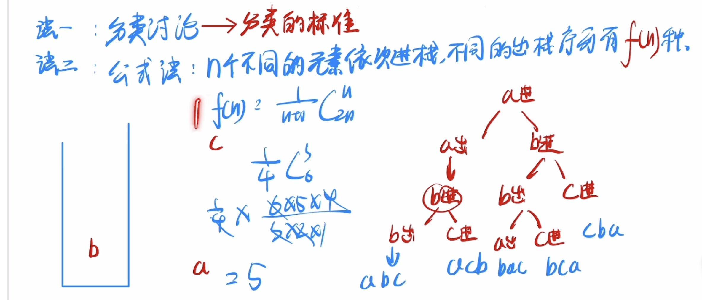
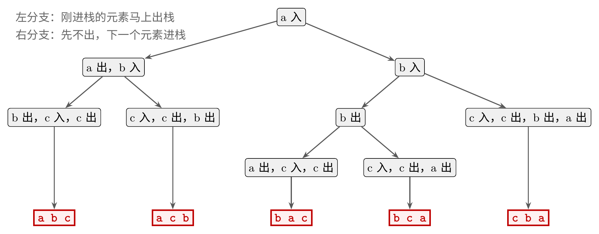
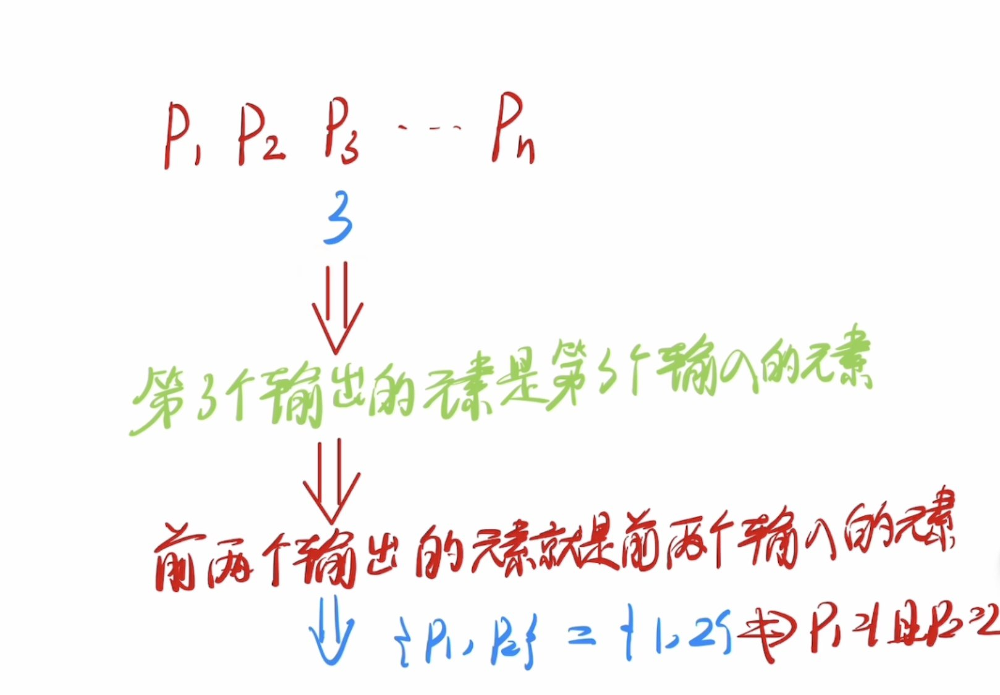
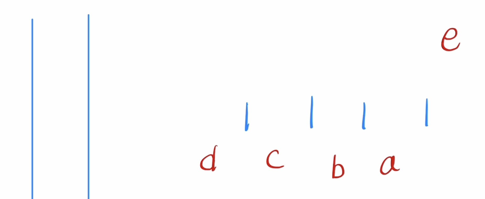
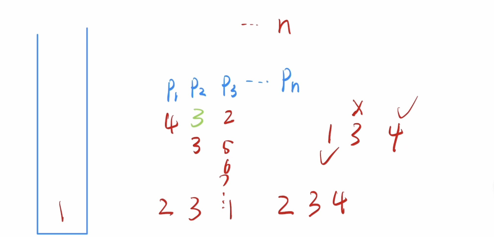

# 这组题在考什么

::: cue
31 道题归结起来考哪几类？哪一类最多？
:::

31 道选择题可以分成三类：

- **概念和基本操作**：栈是什么、哪些是基本操作、`Pop` 和 `GetTop` 的区别；
- **栈顶指针**：顺序栈、共享栈的 `top` 初值决定了进栈语句和栈满条件；链栈的进栈、出栈语句；
- **出栈序列**（最多，13 道，其中 6 道统考真题）：判断合法、数个数、推某个位置的值。第六节整理了不用逐步模拟的原子规律。

::: {.tbl widths="0.6,2.6,0.6"}
| 题号 | 考点 | 答案 |
|---|---|---|
| 01 | 栈和队列相同的是什么 | B |
| 02 | 栈是一种什么结构 | C |
| 03 | 哪个不是栈的基本操作 | B |
| 04 | `a[n]`，`top=-1`，进栈语句 | C |
| 05 | `data[1..n]`，`top=1`，进栈语句 | B |
| 06 | `data[1..n]`，`top=n+1`，进栈语句 | A |
| 07 | 一串 Push、Pop 后栈顶指针的值 | A |
| 08 | 链栈比顺序栈好在哪 | A |
| 09 | 哪种链表最不适合作链栈 | C |
| 10 | 不带头结点的链栈进栈 | C |
| 11 | 不带头结点的链栈出栈 | D |
| 12 | `Pop` 再 `GetTop` 后 `x` 的值 | A |
| 13 | 3 个元素的出栈序列个数 | B |
| 14 | 不可能的出栈序列 | D |
| 15 | 以 cd 开头的出栈序列个数 | A |
| 16 | 得到 1342 的进出栈操作序列 | D |
| 17 | 第一个输出 $n$，第 $i$ 个输出 | D |
| 18 | 第一个输出 $i$，第 $j$ 个输出 | D |
| 19 | 不可能的输出序列 | C |
| 20 | $P_3=1$，$P_1$ 的值 | C |
| 21 | $P_3=3$，$P_1$ 的值 | A |
| 22 | $P_2$、$P_4$ 不可能是 | C |
| 23 | "n1\_"能出几个合法标识符 | C |
| 24 | 共享栈的好处 | B |
| 25 | 共享栈栈满条件 | A |
| 26 | 【2009 统考】栈的最小容量 | C |
| 27 | 【2010 统考】不许连续 3 次出栈 | D |
| 28 | 【2011 统考】以 d 开头的出栈序列个数 | B |
| 29 | 【2013 统考】$P_2=3$，$P_3$ 的取值个数 | C |
| 30 | 【2020 统考】按操作写出栈序列 | D |
| 31 | 【2022 统考】入栈序列与出栈序列 | D |
:::

::: fix
**习题讲解视频大部分不用看**，和书上解析一致，有价值的说法下面都记了。值得看的几段：

- **P20 的 13**：老师用分类讨论画了一棵"树"列出 3 个元素的 5 种出栈序列。老师的板书截图和我按讲解重画的树都放在 13 题下，看图就够；想听分类的思路再看；
- **P21 的 20、P22 的 21**：两道 $P_i$ 推理题，老师讲了"前两个输出的就是前两个输入的"这种逻辑推法（21 题），比逐个代入快；
- **P23 的 28、29**：28 题"固定 c、b、a 的相对顺序，e 插空"的数法，29 题怎样把 1、2、4 逐个试出来，几分钟就看完；
- **P24 的 31**（2022 统考）：判断入栈、出栈序列是否对应的模拟方法，很短。

其余题（01–12、14–19、22–27、30）就是逐个模拟选项，看书上解析即可。
:::

# 一、栈的概念与基本操作（01–03、12）

::: cue
栈和队列哪里一样、哪里不一样？
:::

::: {.q title="01"}
栈和队列具有相同的（　）。

| A. 抽象数据类型　　B. 逻辑结构　　C. 存储结构　　D. 运算
:::

[**答案：B**]{.red}

::: video
抽象数据类型（第 1 章）= 数学模型（就是逻辑结构）+ 定义在上面的一组操作，相当于数据结构三要素去掉存储结构。栈和队列的操作不同（栈一端进出、后进先出；队列先进先出），所以 A、D 错。两者都可以顺序存储，也都可以链式存储，没有规定存储结构，C 错。它们的逻辑结构都是线性表，选 B。
:::

::: jiexi
栈和队列的逻辑结构都是相同的，都属于线性结构，只是它们对数据的运算不同。
:::

::: cue
"限制存取点"指什么？栈能不能说成"顺序存储的线性结构"？
:::

::: {.q title="02"}
栈是一种（　）。

| A. 顺序存储的线性结构　　　　B. 链式存储的非线性结构
| C. 限制存取点的线性结构　　　D. 限制存取点的非线性结构
:::

[**答案：C**]{.red}

::: video
栈是只允许在一端插入或删除的线性表，本质还是线性表，排除 B、D。栈可以用数组实现（顺序栈），也可以用链表实现（链栈），A 错。"限制存取点"指的就是只允许在一端进行插入、删除。
:::

::: jiexi
栈是一种线性表，所以 B、D 错。按存储结构的不同可分为顺序栈和链栈，但不可以把栈局限在某种存储结构上，所以 A 错。栈和队列都是限制存取点的线性结构。
:::

::: recall
正课 3.1.1"一、栈的定义"：栈是一种[操作受限的线性表]{.u}，逻辑结构和普通线性表相同。
:::

::: cue
"将栈置为空栈"算基本操作吗？
:::

::: {.q title="03"}
下列选项中，（　）不是栈的基本操作。

| A. 删除栈顶元素　　　　　　B. 删除栈底元素
| C. 判断栈是否为空　　　　　D. 将栈置为空栈
:::

[**答案：B**]{.red}

::: video
栈只有栈顶指针，没有栈底指针，也规定只能在栈顶一端操作，所以不能直接删除栈底元素。D 对：栈被一个算法用完后可能还留着"脏数据"，下次用于别的算法前通常先把它置为空栈。
:::

::: jiexi
基本操作是指该结构最核心、最基本的运算，其他较复杂的操作可通过基本操作实现。删除栈底元素不属于栈的基本运算，但它可以通过调用栈的基本运算求得。
:::

::: cue
`Pop` 之后再 `GetTop`，栈里还剩什么？
:::

::: {.q title="12"}
经过以下栈的操作后，变量 `x` 的值为（　）。

`InitStack(st); Push(st, a); Push(st, b); Pop(st, x); GetTop(st, x);`

| A. a　　　　B. b　　　　C. NULL　　　　D. false
:::

[**答案：A**]{.red}

::: jiexi
执行前 3 句后，栈 `st` 内的值为 a、b，其中 b 为栈顶元素；执行第 4 句后，栈顶元素 b 出栈，`x` 的值为 b；执行最后一句，读取栈顶元素的值，`x` 的值为 a。
:::

::: video
老师强调 `GetTop` 和出栈的区别：`GetTop` 只读栈顶元素、不出栈，执行完 a 仍是栈顶，但 `x` 拿到了 a 的值。
:::

::: recall
正课 3.1.1"二、栈的基本操作"：`Pop` 和 `GetTop` 都用 `x` 返回栈顶元素，区别是 `Pop` 会删掉，`GetTop` 不删。
:::

# 二、顺序栈与共享栈的栈顶指针（04–07、24–25）

::: cue
看到 `top` 的初值，先问自己什么？
:::

这几题的关键都是老师反复说的一句：[先搞清楚 `top` 在逻辑上指向哪里]{.red}，是指向栈顶元素，还是指向栈顶元素的下一个位置；再看栈往哪个方向长。

::: {.q title="04"}
设用数组 `a[n]` 存储一个栈，初始栈顶指针 `top=-1`，则元素 `x` 入栈的操作是（　）。

| A. `a[--top]=x`　　B. `a[top--]=x`　　C. `a[++top]=x`　　D. `a[top++]=x`
:::

[**答案：C**]{.red}

::: video
C 语言的数组下标从 0 开始，`a[n]` 的下标是 0 到 $n-1$。初值 $-1$ 不在数组范围内，表示 `top` 指向栈顶元素，而空栈还没有元素。进栈要先 `top=top+1`（指到下标 0），再 `a[top]=x`，两句合成一句就是 `a[++top]=x`。D 是先赋值再加 1，初始时 `a[-1]` 越界，不对。`++top` 和 `top++` 的区别是 C 语言知识，不熟的话复习一下。
:::

::: jiexi
数组下标范围为 $0\sim n-1$，初始时 `top` 为 $-1$，第一个元素入栈后，`top` 为 0，即 `top` 指向栈顶元素。栈向高地址方向增长，所以入栈时应先将指针 `top` 加 1，然后存入元素 `x`，选项 C 正确。
:::

::: fix
习题讲解字幕 P18 把这题的初值记成了"top 等于一"，看王道书第 67 页原题是 `top=-1`，应是字幕漏了负号。
:::

::: recall
正课 3.1.2 的顺序栈就是这种设计：`S.top=-1` 表示空栈，进栈 `S.data[++S.top]=x`，出栈 `x=S.data[S.top--]`。
:::

::: {.q title="05"}
设用数组 `data[1..n]` 存储一个栈，初始栈顶指针 `top=1`，则元素 `x` 入栈的操作是（　）。

| A. `data[top--]=x`　　　　B. `data[top++]=x`
| C. `data[--top]=x`　　　　D. `data[++top]=x`
:::

[**答案：B**]{.red}

::: video
这题数组下标从 1 到 $n$。老师提醒：408 考试里数组下标都从 0 开始，但如果考场上题目的表述和平时学的不一样，就按题目给的条件来。初值 `top=1` 指向下标 1，这个位置是空的，说明 `top` 指向栈顶元素的下一个位置：先 `data[top]=x`，再 `top=top+1`，合成 `data[top++]=x`。题干写的是数组 `a`，选项写的是 `data`，指的是同一个数组。
:::

::: jiexi
数组下标范围为 $1\sim n$，初始时 `top` 为 1，表示 `top` 指向栈顶元素的下一个元素。栈向高地址方向增长，所以入栈时应先存入元素 `x`，然后将指针 `top` 加 1，选项 B 正确。
:::

::: recall
正课 3.1.2 的"`top=0` 的设计"：`top` 指向下一个可以插入的位置，进栈 `S.data[S.top++]=x`。本题是同样的设计，只是下标从 1 开始。
:::

::: {.q title="06"}
设用数组 `data[1..n]` 存储一个栈，初始栈顶指针 `top=n+1`，则元素 `x` 入栈的操作是（　）。

| A. `data[--top]=x`　　　　B. `data[top++]=x`
| C. `data[top--]=x`　　　　D. `data[++top]=x`
:::

[**答案：A**]{.red}

::: video
`top=n+1` 在数组范围之外，说明栈是[往下标减小的方向长]{.u}的，`top` 指向栈顶元素。进栈先 `top=top-1`（指到下标 $n$），再 `data[top]=x`，合成 `data[--top]=x`。老师强调：栈的生长方向不是固定的，可以把下标 $n$ 那头当栈底，取决于具体设计。
:::

::: jiexi
数组下标范围为 $1\sim n$，初始时 `top` 为 $n+1$，表示 `top` 指向栈顶元素。栈向低地址方向增长，所以入栈时应先将指针 `top` 减 1，然后存入元素 `x`，A 正确。
:::

::: cue
这题需要知道 `top` 指向栈顶元素还是下一个位置吗？
:::

::: {.q title="07"}
设有一个空栈，栈顶指针为 1000H，栈向高地址方向增长，每个元素占一个存储单元，执行 Push、Push、Pop、Push、Pop、Push、Pop、Push 操作后，栈顶指针为（　）。

| A. 1002H　　　　B. 1003H　　　　C. 1004H　　　　D. 1005H
:::

[**答案：A**]{.red}

::: video
H 表示十六进制，组成原理会学；这里只要知道 1001H 比 1000H 大 1。这题不用管 `top` 指向哪里：不管哪种设计，进栈 `top` 都加 1，出栈都减 1。5 次 Push、3 次 Pop，$1000\text{H}+5-3=1002\text{H}$。
:::

::: jiexi
每个元素需要 1 个存储单元，所以每入栈一次 `top` 加 1，出栈一次 `top` 减 1。指针 `top` 的值依次为 1001H, 1002H, 1001H, 1002H, 1001H, 1002H, 1001H, 1002H。
:::

::: cue
上溢、下溢分别是什么？共享栈能降低哪一个？
:::

::: {.q title="24"}
采用共享栈的好处是（　）。

| A. 减少存取时间，降低发生上溢的可能
| B. 节省存储空间，降低发生上溢的可能
| C. 减少存取时间，降低发生下溢的可能
| D. 节省存储空间，降低发生下溢的可能
:::

[**答案：B**]{.red}

::: video
**上溢**：往已满的数据结构里插入数据；**下溢**：从空的数据结构里取数据。共享栈把两个栈放进同一块连续空间，栈底分别在两头，相向生长。如果栈 1 进栈很频繁、栈 2 还没用多少空间，栈 1 就可以用掉超过原来 $n$ 个的空间：不用另开一个更大的栈，所以**节省空间**；栈 1 满得更晚，所以**降低上溢的可能**。存取都靠栈顶指针，时间减少不了；下溢只能靠算法写得健壮来避免。
:::

::: jiexi
上溢是指存储器满，还往里写；下溢是指存储器空，还往外读。为了解决上溢，可给栈分配很大的存储空间，但这样又会造成存储空间的浪费。共享栈的提出就是为了在解决上溢的基础上节省存储空间，将两个栈放在同一段更大的存储空间内，这样，当一个栈的元素增加时，可使用另一个栈的空闲空间，从而降低发生上溢的可能性。
:::

::: {.q title="25"}
设有一个顺序共享栈 `Share[0:n-1]`，其中第一个栈顶指针 `top1` 的初值为 $-1$，第二个栈顶指针 `top2` 的初值为 $n$，则判断共享栈满的条件是（　）。

| A. `top2-top1==1`　　　　　B. `top1-top2==1`
| C. `top1==top2`　　　　　　D. 都不对
:::

[**答案：A**]{.red}

::: video
由初值看出两个 `top` 都指向各自的栈顶元素：栈 1 进栈先 `top1` 加 1 再存，栈 2 先 `top2` 减 1 再存。两个指针相向移动，相邻时栈满，即 `top2-top1==1`。
:::

::: jiexi
这种情况就是前面我们所描述的，详细内容请参见本节考点精析部分对共享栈的讲解。另外，读者可以思考当 `top1` 的初值为 0，`top2` 的初值为 $n-1$ 时栈满的条件。
:::

::: book
王道书第 72 页"注意"：栈顶、队头与队尾的指针的定义是不唯一的，做题时务必仔细审题和思考。
:::

::: recall
正课 3.1.2 的共享栈：`top0=-1`、`top1=MaxSize`，栈满条件 `top0+1==top1`，和本题 A 是同一个式子。
:::

::: add
**书上留的思考题**（我的答案）：`top1` 初值 0、`top2` 初值 $n-1$，两个指针都指向"下一个可以放的位置"，进栈是 `Share[top1++]=x`、`Share[top2--]=x`。最后一个空位被占掉后 `top1` 越过 `top2`，栈满条件是 `top1-top2==1`（即 `top1==top2+1`）。可以拿 $n=2$ 验证：两个栈各进一个元素后 `top1=1`、`top2=0`。
:::

# 三、链栈（08–11）

::: cue
链栈相对顺序栈的优势，本质上是什么的优势？
:::

::: {.q title="08"}
和顺序栈相比，链栈有一个比较明显的优势，即（　）。

| A. 通常不会出现栈满的情况　　　B. 通常不会出现栈空的情况
| C. 插入操作更容易实现　　　　　D. 删除操作更容易实现
:::

[**答案：A**]{.red}

::: video
链栈相对顺序栈的优势，就是链表相对数组的优势：数组空间一开始就分配好，满了栈就满了；链表离散存储，可以方便地增加空间。B 错：栈空不空取决于应用场景，和存储结构无关。C、D 错：进栈、出栈都通过栈顶指针完成，两种栈在时间上没有本质区别。
:::

::: jiexi
顺序栈采用数组存储，数组的大小是固定的，不能动态地分配大小。和顺序栈相比，链栈的最大优势在于它可以动态地分配存储空间。
:::

::: recall
正课 3.1.3 的王道书框：链栈不存在栈满上溢的情况。
:::

::: cue
判断一种链表能不能当链栈，要看哪两个操作？
:::

::: {.q title="09"}
设链表不带头结点且所有操作均在表头进行，则下列最不适合作为链栈的是（　）。

| A. 只有表头结点指针，没有表尾指针的双向循环链表
| B. 只有表尾结点指针，没有表头指针的双向循环链表
| C. 只有表头结点指针，没有表尾指针的单向循环链表
| D. 只有表尾结点指针，没有表头指针的单向循环链表
:::

[**答案：C**]{.red}

::: video
表头元素当栈顶，看进栈、出栈能不能 $O(1)$ 完成。循环链表在表头插入或删除后，都要改**表尾结点**的指针，让它指向新的表头。

- A、B：双向循环链表有头就能找到尾（头的前驱），有尾就能找到头（尾的后继），都可以；
- C：只有表头指针，找表尾要遍历，进栈、出栈都要 $O(n)$，最不合适；
- D：单向循环链表有表尾指针，表头就是它的后继，进栈、出栈都方便。
:::

::: jiexi
对于双向循环链表，不管是表头指针还是表尾指针，都可以很方便地找到表头结点，方便在表头做插入或删除操作。而循环单链表通过尾指针可以很方便地找到表头结点，但通过头指针找尾结点需要遍历一次链表。对于选项 C，插入和删除结点后，找尾结点所需的时间为 $O(n)$。
:::

::: fix
习题讲解视频 P19 分析"只有表尾结点指针、没有表头指针的单向循环链表"时，老师说成了"B 选项"，对照王道书第 67 页，这是 **D 选项**，口误，不影响答案 C。
:::

::: recall
2.3 课后习题 26 题：不带头结点、只有表头指针的循环单链表，删首元结点要 $O(n)$，原因相同（首元结点的前驱是尾结点）。
:::

::: cue
不带头结点的链栈，进栈两句的顺序能换吗？
:::

::: {.q title="10"}
向一个栈顶指针为 `top` 的链栈（不带头结点）中插入一个 `x` 结点，则执行（　）。

| A. `top->next=x`　　　　　　　B. `x->next=top->next; top->next=x`
| C. `x->next=top; top=x`　　　D. `x->next=top; top=top->next`
:::

[**答案：C**]{.red}

::: video
没说是单链表还是双链表，就默认普通单链表，`top` 指向表头结点（栈顶元素）。初学者可以把进栈后的样子画出来，再把 ABCD 代进去试。熟练的话：新结点 `x` 要指向原栈顶（`x->next=top`），再成为新栈顶（`top=x`）。
:::

::: jiexi
链栈采用不带头结点的单链表表示时，入栈操作在首部插入一个结点 `x`（`x->next=top`），插入完后需将 `top` 指向该插入的结点 `x`。请思考当链栈存在头结点时的情况。
:::

::: recall
正课 3.1.3 我写的不带头结点 `Push`：`p->next=S; S=p;`，就是本题 C。书上的思考题（带头结点）也在正课 3.1.3：`p->next=S->next; S->next=p;`，即 B 的写法（把 `top` 换成头结点）。
:::

::: {.q title="11"}
链栈（不带头结点）执行 Pop 操作，并将出栈的元素存在 `x` 中，应该执行（　）。

| A. `x=top; top=top->next`　　　　B. `x=top->data`
| C. `top=top->next; x=top->data`　D. `x=top->data; top=top->next`
:::

[**答案：D**]{.red}

::: video
`x` 是普通数据变量，先 `x=top->data` 把栈顶的数据取出来，再 `top=top->next` 移动栈顶指针。最好再 `free` 掉出栈的结点；不 `free` 逻辑上也完成了出栈，因为已经找不到它了。A 的 `x=top` 是让指针 `x` 指向栈顶结点，不是取数据。老师的比方：火车到站要的是车上的货，不是把整节火车搬走，出栈一般指把结点的数据部分保存下来。
:::

::: jiexi
这里假设栈顶指针指向的是栈顶元素，所以选择选项 D；而选项 A 中首先将 `top` 指针赋给了 `x`，错误；选项 B 中没有修改 `top` 指针的值；选项 C 为 `top` 指针指向栈顶元素的上一个元素时的答案。
:::

::: recall
正课 3.1.3 我写的不带头结点 `Pop`：`p=S; x=p->data; S=p->next; free(p);`，比本题 D 多了 `free`。
:::

# 四、出栈序列：逐个模拟（14、16、19、22、23、26、27、30）

::: cue
判断一个出栈序列合不合法，最快的规则是什么？
:::

这类题老师的话是"有手就行"：画一个栈，按出栈序列一个一个模拟。书上给了一条更快的规则：

::: book
王道书第 70 页（14 题解析）：对于某个出栈的元素，[在它之前入栈却晚出栈的元素必定是按逆序出栈的]{.red}。第 71 页（19 题另解）：若第一个出栈的是 3，则 1、2 此时必停留在栈中，它们出栈的相对顺序只能是 2、1，所以 12345 入栈时 34152 错误。
:::

::: {.q title="14"}
设 a, b, c, d, e, f 以所给的次序入栈，若在入栈操作时，允许出栈操作，则下面不会出现的出栈序列为（　）。

| A. fedcba　　　　B. bcafed　　　　C. dcefba　　　　D. cabdef
:::

[**答案：D**]{.red}

::: video
逐个模拟：A 是全部进栈再全部出栈；B 是 a、b 进，b 出，c 进 c 出，a 出，d、e、f 进再全出；C 是 a～d 进，d、c 出，e 进 e 出，f 进 f 出，b、a 出。D 第一个出的是 c，说明 a、b、c 已依次进栈，此时栈顶是 b，下一个出栈的不可能是 a。
:::

::: jiexi
根据栈"先进后出"的特点，且在入栈操作的同时允许出栈操作，显然选项 D 中 c 最先出栈，则此时栈内必定为 a 和 b，但因为 a 先于 b 入栈，所以要晚出栈。对于某个出栈的元素，在它之前入栈却晚出栈的元素必定是按逆序出栈的，其余答案均是可能出现的情况。此题也可采用将各序列逐个代入的方法来确定是否有对应的进出栈序列。
:::

::: {.q title="16"}
用 S 表示入栈操作，用 X 表示出栈操作，若元素的入栈顺序是 1234，为了得到 1342 的出栈顺序，相应的 S 和 X 的操作序列为（　）。

| A. SXSXSSXX　　　B. SSSXXSXX　　　C. SXSSXXSX　　　D. SXSSXSXX
:::

[**答案：D**]{.red}

::: jiexi
采用排除法，选项 A, B, C 得到的出栈序列分别为 1243, 3241, 1324。由 1234 得到 1342 的进出栈序列为：1 进，1 出，2 进，3 进，3 出，4 进，4 出，2 出，所以选择选项 D。
:::

::: {.q title="19"}
某栈的输入序列为 a, b, c, d，下面的 4 个序列中，不可能为其输出序列的是（　）。

| A. a, b, c, d　　　B. c, b, d, a　　　C. d, c, a, b　　　D. a, c, b, d
:::

[**答案：C**]{.red}

::: jiexi
对于选项 A，可能的顺序是 a 入，a 出，b 入，b 出，c 入，c 出，d 入，d 出。对于选项 B，可能的顺序是 a 入，b 入，c 入，c 出，b 出，d 入，d 出，a 出。对于选项 D，可能的顺序是 a 入，a 出，b 入，c 入，c 出，b 出，d 入，d 出。选项 C 没有对应的序列。【另解】若出栈序列的第一个元素为 d，则出栈序列只能是 dcba。
:::

::: fix
习题讲解字幕 P21 把题干读成了"可能是其输出序列的是哪一个"，王道书第 68 页原题是"**不可能**"，老师的分析和答案 C 都是按"不可能"做的。
:::

::: cue
选项一个个代入时，怎样让 $P_1$、$P_3$ 先有个值？
:::

::: {.q title="22"}
已知栈的入栈序列是 1, 2, 3, 4，其出栈序列为 $P_1, P_2, P_3, P_4$，则 $P_2, P_4$ 不可能是（　）。

| A. 2, 4　　　　B. 2, 1　　　　C. 4, 3　　　　D. 3, 4
:::

[**答案：C**]{.red}

::: video
这题很难直接推出来，只能逐个模拟。选项只给了 $P_2$、$P_4$，老师的办法是先给 $P_1$、$P_3$ 取个值再验证：B 取 $P_1=3$，得 3241，可以；C 试 $P_1=1$ 得到的只能是 1432，试 $P_1=2$ 只能是 2431，都不是 $P_4=3$，所以 C 不可能；D 取 $P_1=1$ 得 1324，可以。
:::

::: jiexi
逐个判断每个选项可能的入栈出栈顺序。选项 A：1 入，1 出，2 入，2 出，3 入，3 出，4 入，4 出。选项 B：1 入，2 入，3 入，3 出，2 出，4 入，4 出，1 出。选项 D：1 入，1 出，2 入，3 入，3 出，2 出，4 入，4 出。选项 C 没有对应的序列，因为当 4 在栈中时，意味着前面的所有元素（1, 2, 3）都已在栈中或曾经入过栈，此时若 4 第二个出栈，即栈中还有两个元素，且这两个元素是有序的（对应入栈顺序），只能为 (1, 2), (1, 3), (2, 3)，若是序列 (1, 2)，则 3 已在 $p_1$ 位置出栈，不可能再在 $p_4$ 位置出栈，若是 (1, 3) 和 (2, 3) 这种情况中的任意一种，则 3 一定是下一个出栈元素，即 $p_3$ 一定是 3，所以 $p_4$ 不可能是 3。

【另解】对于选项 C，$p_2$ 为最后一个入栈元素 4，则只有 $p_1$ 或 $p_3$ 出栈的元素有可能为 3（请读者分两种情况自行思考），而 $p_4$ 绝不可能为 3。读者在解答此类题时，一定要注意出栈序列中的"最后一个入栈元素"，这样可以节省答题的时间。
:::

::: {.q title="23"}
设栈的初始状态为空，当字符序列"n1\_"作为栈的输入时，输出长度为 3，且可用作 C 语言标识符的序列有（　）个。

| A. 4　　　　B. 5　　　　C. 3　　　　D. 6
:::

[**答案：C**]{.red}

::: video
C 语言标识符只能以字母或下划线开头，后面可以是字母、数字、下划线。由 n、1、\_ 能组成的标识符有 4 种：n1\_、n\_1、\_n1、\_1n。再逐个模拟能不能出栈得到：n1\_、n\_1、\_1n 都可以；\_n1 不行，下划线最先出栈说明 n、1 都还在栈里，1 一定先于 n 出栈。
:::

::: jiexi
标识符只能以英文字母或下划线开头，而不能以数字开头。于是，由 n、1、\_ 三个字符组合成的标识符有 n1\_、n\_1、\_1n 和 \_n1 四种。第一种：n 入栈再出栈，1 入栈再出栈，\_ 入栈再出栈。第二种：n 入栈再出栈，1 入栈，\_ 入栈，\_ 出栈，1 出栈。第三种：n 入栈，1 入栈，\_ 入栈，\_ 出栈，1 出栈，n 出栈。而根据栈的操作特性，\_n1 这种情况不可能出现。
:::

::: cue
栈的最小容量，就是模拟过程中栈里最多有几个元素。
:::

::: {.q title="26"}
【2009 统考真题】设栈 S 和队列 Q 的初始状态均为空，元素 abcdefg 依次入栈 S。若每个元素出栈后立即进入队列 Q，且 7 个元素出队的顺序是 bdcfeag，则栈 S 的容量至少是（　）。

| A. 1　　　　B. 2　　　　C. 3　　　　D. 4
:::

[**答案：C**]{.red}

::: video
队列先进先出，出队顺序就是入队顺序；出栈后立即入队，所以出栈顺序就是 b d c f e a g。模拟时记下栈里最多的元素个数：a、b 进（2 个），b 出；c、d 进（3 个），d、c 出；e、f 进（3 个），f、e、a 出；g 进 g 出。最多 3 个。
:::

::: jiexi
时刻注意栈的特点是先进后出，出入栈的详细过程如下（栈内左为栈底）：
:::

\Needspace{12\baselineskip}

::: {.tbl widths="0.4,0.8,0.6,0.9,0.4,0.8,0.6,0.9"}
| 序号 | 说明 | 栈内 | 栈外 | 序号 | 说明 | 栈内 | 栈外 |
|---|---|---|---|---|---|---|---|
| 1 | a 入栈 | a | | 8 | e 入栈 | ae | bdc |
| 2 | b 入栈 | ab | | 9 | f 入栈 | aef | bdc |
| 3 | b 出栈 | a | b | 10 | f 出栈 | ae | bdcf |
| 4 | c 入栈 | ac | b | 11 | e 出栈 | a | bdcfe |
| 5 | d 入栈 | acd | b | 12 | a 出栈 | | bdcfea |
| 6 | d 出栈 | ac | bd | 13 | g 入栈 | g | bdcfea |
| 7 | c 出栈 | a | bdc | 14 | g 出栈 | | bdcfeag |
:::

::: jiexi
栈内的最大深度为 3，所以栈 S 的容量至少是 3。【另解】因为元素的出队顺序和入队顺序相同，所以元素的出栈顺序就是 b, d, c, f, e, a, g，因此元素的出入栈次序为 Push(S, a), Push(S, b), Pop(S, b), Push(S, c), Push(S, d), Pop(S, d), Pop(S, c), Push(S, e), Push(S, f), Pop(S, f), Pop(S, e), Pop(S, a), Push(S, g), Pop(S, g)。初始所需容量为 0，每做一次 Push 操作，容量加 1；每做一次 Pop 操作，容量减 1，记录的容量最大值为 3。
:::

::: {.q title="27"}
【2010 统考真题】若元素 a, b, c, d, e, f 依次入栈，允许入栈、出栈操作交替进行，但不允许连续 3 次进行出栈操作，不可能得到的出栈序列是（　）。

| A. dcebfa　　　　B. cbdaef　　　　C. bcaefd　　　　D. afedcb
:::

[**答案：D**]{.red}

::: video
逐个模拟，同时数"连续出栈了几次"：A、B、C 最多连续出栈 2 次。D 中 a 进 a 出后，第二个出的是 f，只能 b～f 全部进栈，此后再没有元素可进，f、e、d、c、b 要连续出栈 5 次，不符合要求。
:::

::: jiexi
选项 A 由 a 入，b 入，c 入，d 入，d 出，c 出，e 入，e 出，b 出，f 入，f 出，a 出得到；选项 B 由 a 入，b 入，c 入，c 出，b 出，d 入，d 出，a 出，e 入，e 出，f 入，f 出得到；选项 C 由 a 入，b 入，b 出，c 入，c 出，a 出，d 入，e 入，e 出，f 入，f 出，d 出得到；选项 D 由 a 入，a 出，b 入，c 入，d 入，e 入，f 入，f 出，e 出，d 出，c 出，b 出得到，但题意要求不允许连续 3 次出栈操作，选项 D 不符。

【另解】先入栈的元素后出栈，入栈顺序为 a, b, c, d, e, f，所以连续出栈时的子序列必然是按字母表逆序的，若出栈序列中出现了长度大于或等于 3 的连续逆序子序列，则为所选序列。
:::

::: {.q title="30"}
【2020 统考真题】对空栈 S 进行 Push 和 Pop 操作，入栈序列为 a, b, c, d, e，经过 Push、Push、Pop、Push、Pop、Push、Push、Pop 操作后得到的出栈序列是（　）。

| A. b, a, c　　　B. b, a, e　　　C. b, c, a　　　D. b, c, e
:::

[**答案：D**]{.red}

::: video
老师："这样的题目就不要动脑子了"，照着操作当工具人执行一遍：a、b 进，b 出，c 进 c 出，d、e 进，e 出，得 b、c、e。
:::

::: jiexi
按题意，出入栈操作的过程如下：Push 后栈内 a；Push 后 ab；Pop 后 a，出 b；Push 后 ac；Pop 后 a，出 c；Push 后 ad；Push 后 ade；Pop 后 ad，出 e。因此，出栈序列为 b, c, e。
:::

# 五、出栈序列：推理与计数（13、15、17、18、20、21、28、29、31）

::: cue
3 个元素的出栈序列有几种？不用公式怎么数？
:::

::: {.q title="13"}
3 个不同元素依次入栈，能得到（　）种不同的出栈序列。

| A. 4　　　　B. 5　　　　C. 6　　　　D. 7
:::

[**答案：B**]{.red}

::: video
两种方法。

**法一：分类讨论。** 关键是找分类标准。老师的标准是"一个元素进栈之后，它是马上出栈，还是下一个元素进栈"，每次二选一，画成一棵类似二叉树的图，一直分到底，共 5 种：abc、acb、bac、bca、cba。老师说近几年 408 数据结构越来越多这种分类讨论题，考的是研究问题的能力；学二叉树时还会遇到类似的结论，这里算埋了个伏笔。

**法二：公式。** $n$ 个不同元素依次进栈，不同出栈序列数为卡特兰数 $\frac{1}{n+1}C_{2n}^{n}$。$n=3$ 时：
$$\frac{1}{4}C_6^3=\frac{1}{4}\cdot\frac{6\times5\times4}{3\times2\times1}=5$$
只要记住结论，408 不会考证明。
:::

\Needspace{8\baselineskip}

::: jiexi
当 $n$ 个不同元素入栈时，出栈序列的个数为
$$\frac{1}{n+1}C_{2n}^{n}=\frac{1}{n+1}\cdot\frac{(2n)!}{n!\times n!}=5$$
考题中给出的 $n$ 值不会很大，可以根据栈的特点，若 $X_i$ 已经出栈，则 $X_i$ 前面的尚未出栈的元素一定逆置有序地出栈，因此，可以采用例举方法。如 a, b, c 依次入栈的出栈序列有 abc, acb, bac, bca, cba。另外，在一些考题中可能会问符合某个特定条件的出栈序列有多少种，比如此题中问以 b 开头的出栈序列有几种，这种类型的题目一般都使用穷举法。
:::

::: recall
正课 3.1.1"三、常考题型"的卡特兰数和自测 ③（a、b、c 的全部出栈顺序）就是这题。
:::

{.slide width=0.65}

{.slide width=1}

::: cue
"以 cd 开头"怎么理解？
:::

::: {.q title="15"}
4 个元素依次入栈的次序为 abcd，则以 cd 开头的出栈序列的个数为（　）。

| A. 1　　　　B. 2　　　　C. 3　　　　D. 4
:::

[**答案：A**]{.red}

::: video
"以 cd 开头"是第一个出 c、第二个出 d，不是"以 c 或以 d 开头"。a、b、c 进，c 出，d 进 d 出，剩下只能 b、a 依次出栈，只有 cdba 一种。
:::

::: jiexi
假设出栈序列为 cd…，分析栈的操作序列：a 入栈，b 入栈，c 入栈，c 出栈，d 入栈，d 出栈，此后只能是 b 出栈和 a 出栈一种情况，因此出栈序列只有 cdba。
:::

::: fix
习题讲解视频 P20 最后说"他出战的次序只有可能是 CBDA 这一种"，按前面的模拟（c 出、d 进 d 出、b 出、a 出）应为 **cdba**，与王道书第 71 页一致，是口误或字幕识别错。
:::

::: {.q title="17"}
若栈的输入序列是 $1, 2, 3, \cdots, n$，输出序列的第一个元素是 $n$，则第 $i$ 个输出元素是（　）。

| A. 不确定　　　B. $n-i$　　　C. $n-i-1$　　　D. $n-i+1$
:::

[**答案：D**]{.red}

::: video
1～$n$ 全部进栈后 $n$ 才出，输出只能是 $n, n-1, \cdots, 1$。把序号标上找规律：第 1 个是 $n$，第 2 个是 $n-1$……序号加元素恰好都等于 $n+1$，所以第 $i$ 个是 $n-i+1$。
:::

::: jiexi
第 $n$ 个元素第一个出栈，说明前 $n-1$ 个元素都已经按顺序入栈，由"先进后出"的特点可知，此时的输出序列一定是输入序列的逆序，所以答案选择选项 D。
:::

::: {.q title="18"}
若栈的输入序列是 $1, 2, 3, \cdots, n$，输出序列的第一个元素是 $i$，则第 $j$ 个输出元素是（　）。

| A. $i-j-1$　　　B. $i-j$　　　C. $j-i+1$　　　D. 不确定
:::

[**答案：D**]{.red}

::: video
1～$i$ 进栈后 $i$ 出栈。取个特殊值 $j=2$：第二个出的可以是 $i-1$（紧接着出），也可以是 $i+1$、$i+2$……直到 $n$（让后面的元素先进栈再出），所以不确定。
:::

::: jiexi
当第 $i$ 个元素第一个出栈时，则 $i$ 之前的元素可以依次排在 $i$ 之后出栈，但剩余的元素可以在此时入栈，并且排在 $i$ 之前的元素出栈，所以第 $j$ 个出栈的元素是不确定的。
:::

::: cue
$P_3=1$ 时，$P_1$ 为什么不可能是 2？
:::

::: {.q title="20"}
若栈的输入序列是 $P_1, P_2, \cdots, P_n$，输出序列是 $1, 2, 3, \cdots, n$，若 $P_3=1$，则 $P_1$ 的值（　）。

| A. 可能是 2　　　B. 一定是 2　　　C. 不可能是 2　　　D. 不可能是 3
:::

[**答案：C**]{.red}

::: video
输出是 $n$ 个不同的数，输入也是。$P_3=1$ 第一个出栈，说明 $P_1$、$P_2$、$P_3$ 依次进栈后 $P_3$ 出。$P_1$ 要出栈，至少得等 $P_2$ 先出，所以 1 和 $P_1$ 之间至少隔着 $P_2$；而输出里 1 后面紧跟 2，$P_1$ 不可能是 2。$P_1=3$ 可以：取 $P_2=2$、$P_1=3$，输出 1、2、3 正好。
:::

::: jiexi
入栈序列是 $P_1, P_2, \cdots, P_n$。因为 $P_3=1$，即 $P_1, P_2, P_3$ 连续入栈后，第一个出栈元素是 $P_3$，说明 $P_1, P_2$ 已经按序入栈，根据先进后出的特点可知，$P_2$ 必定在 $P_1$ 之前出栈，而第二个出栈元素是 2，而此时 $P_1$ 不是栈顶元素，所以 $P_1$ 的值不可能是 2。思考：哪些 $P_i$ 可能是 2？
:::

::: add
**书上的思考题**（我的答案）：第二个出栈的 2 要么是此时的栈顶 $P_2$，要么是之后新进栈的元素（$P_4$ 进栈马上出，或 $P_4, P_5, \cdots$ 进栈后最后一个出），所以 $P_2, P_4, P_5, \cdots, P_n$ 都可能是 2，只有 $P_1$（和已经是 1 的 $P_3$）不可能。
:::

::: cue
$P_3=3$ 能推出 $\{P_1, P_2\}$ 是什么？
:::

::: {.q title="21"}
若栈的输入序列是 $P_1, P_2, \cdots, P_n$，输出序列是 $1, 2, 3, \cdots, n$，若 $P_3=3$，则 $P_1$ 的值（　）。

| A. 可能是 2　　　B. 不可能是 1　　　C. 一定是 1　　　D. 一定是 2
:::

[**答案：A**]{.red}

::: video
老师这次不代入，从逻辑上推：$P_3=3$ 翻译过来就是"第三个输出的元素是第三个输入的元素"。那么前两个输出的元素，只能是前两个输入的元素（后面的还没输入），即
$$\{P_1, P_2\}=\{1, 2\}$$
注意这是**集合**相等，不等于"$P_1=1$ 且 $P_2=2$"，也可能 $P_1=2$、$P_2=1$。所以 $P_1$ 可能是 1，也可能是 2，选 A。再验证：$P_1=1$ 时每个进栈马上出栈；$P_1=2$ 时 2、1 都进栈再出栈，3 进 3 出，都能得到 123。
:::

{.slide width=0.6}

::: jiexi
假设 $P_1$ 是 1，入栈后立即出栈，$P_2$ 是 2，入栈后立即出栈，$P_3$ 是 3，入栈后立即出栈，得到的序列符合题意。假设 $P_1$ 是 2，$P_2$ 是 1，$P_1$、$P_2$ 依次入栈后全部出栈，$P_3$ 是 3，入栈后立即出栈，得到的序列符合题意。因此，$P_1$ 既可能是 1，又可能是 2。
:::

::: cue
d 第一个出栈后，栈里的 a、b、c 顺序定了，e 能插在哪？
:::

::: {.q title="28"}
【2011 统考真题】元素 a, b, c, d, e 依次进入初始为空的栈中，若元素入栈后可停留、可出栈，直到所有元素都出栈，则在所有可能的出栈序列中，以元素 d 开头的序列个数是（　）。

| A. 3　　　　B. 4　　　　C. 5　　　　D. 6
:::

[**答案：B**]{.red}

::: video
d 先出，所以 a、b、c、d 已依次进栈，d 出后栈里从底到顶是 a、b、c，它们之间的相对出栈顺序已经固定为 c、b、a。只有 e 不确定：e 可以插在 c 前、c 和 b 之间、b 和 a 之间、a 之后，共 4 个位置，所以 4 种。例如 e 在 c 前：d 出后 e 进 e 出，再 c、b、a 出；e 在 c、b 之间：d 出、c 出，e 进 e 出，再 b、a 出。
:::

{.slide width=0.55}

::: jiexi
d 第一个出栈，则 c, b, a 出栈的相对顺序是确定的，出栈顺序必为 d\_c\_b\_a\_，e 的顺序不定，在任意一个"\_"上都有可能。【另解】d 首先出栈，则 abc 停留在栈中，此时可以有如下 4 种操作：① e 入栈后出栈，则出栈序列为 decba；② c 出栈，e 入栈后出栈，出栈序列为 dceba；③ cb 出栈，e 入栈后出栈，出栈序列为 dcbea；④ cba 出栈，e 入栈后出栈，出栈序列为 dcbae。思路和上面其实一样。
:::

::: cue
$P_2=3$ 时，$P_3$ 为什么能是 1？
:::

::: {.q title="29"}
【2013 统考真题】一个栈的入栈序列为 $1, 2, 3, \cdots, n$，出栈序列是 $P_1, P_2, P_3, \cdots, P_n$。若 $P_2=3$，则 $P_3$ 可能取值的个数是（　）。

| A. $n-3$　　　B. $n-2$　　　C. $n-1$　　　D. 无法确定
:::

[**答案：C**]{.red}

::: video
先想简单的情况：1～4 进栈，4 出、3 出，接着可以 2 出，也可以 5 进 5 出、5 6 进 6 出……所以 2 和 5～$n$ 都可以。剩下 1、3、4 逐个看：3 已经出过，不可能；1 可以（1、2 进，2 出，3 进 3 出，1 出）；4 也可以（1、2 进，2 出，3 进 3 出，4 进 4 出）。除了 3 都可以，共 $n-1$ 个。
:::

{.slide width=0.6}

::: jiexi
显然，3 之后的 4, 5, …, $n$ 都是 $P_3$ 可取的数（一直入栈直到该数入栈后马上出栈）。接下来分析 1 和 2 是否可取：$P_1$ 可以是 3 之前入栈的数（可能是 1 或 2），也可以是 4，当 $P_1=1$ 时，$P_3$ 可取 2；当 $P_1=2$ 时，$P_3$ 可取 1。因此，$P_3$ 可能取除 3 外的所有数，个数为 $n-1$。
:::

::: cue
给定 in 和 out，能不能判断它们对不对应？in 和 out 能相同、能互为倒序吗？
:::

::: {.q title="31"}
【2022 统考真题】给定有限符号集 S，in 和 out 均为 S 中所有元素的任意排列。对于初始为空的栈 ST，下列叙述中，正确的是（　）。

| A. 若 in 是 ST 的入栈序列，则不能判断 out 是否为其可能的出栈序列
| B. 若 out 是 ST 的出栈序列，则不能判断 in 是否为其可能的入栈序列
| C. 若 in 是 ST 的入栈序列，out 是对应 in 的出栈序列，则 in 与 out 一定不同
| D. 若 in 是 ST 的入栈序列，out 是对应 in 的出栈序列，则 in 与 out 可能互为倒序
:::

[**答案：D**]{.red}

::: video
A、B 错，可以判断。方法是模拟：按 in 的顺序依次进栈，每进一个就看栈顶是不是 out 当前要出的元素，是就出栈并看 out 的下一个，不是就继续进栈。out 全部走完，说明合法；in 已经全部进栈，栈顶却不是要出的那个，说明不合法。

C、D 最快的办法是找反例：只有一个元素 a 时，in 和 out 都是 a，既相同又互为倒序，C 错 D 对。一般情况下也是：每个元素进栈后马上出栈，out 与 in 相同；全部进栈后再依次出栈，out 是 in 的倒序。
:::

::: jiexi
通过模拟出入栈操作，可以判断入栈序列 in 和出栈序列 out 是否合法。因此，已知 in 序列可以判断 out 序列是否为可能的出栈序列；已知 out 序列也可以判断 in 序列是否为可能的入栈序列，选项 A 和 B 错误。若每个元素入栈后立即出栈，则 in 序列和 out 序列相同，选项 C 错误。若所有元素都入栈后才依次出栈，则 in 序列和 out 序列互为倒序，选项 D 正确。
:::

# 六、出栈序列的原子规律（不模拟，直接判）

::: cue
出栈序列题能不能不模拟？所有技巧从哪来？
:::

第四、五节都是逐步模拟。本节换一种做法：先立两条最基本的性质，再像数学教材一样一条条推出定理，每条定理都配证明和例题。读完后，出栈序列题大多可以直接判断，不必画栈。

::: add
本节是我做完 3.1 后整理的，不是王道书或习题讲解视频的原话。为保证没有漏洞，我写程序把 $n\le 7$ 的全部排列都模拟了一遍，本节每条定理、每个公式都与模拟结果一致。
:::

## 6.1 约定与记号

::: cue
为什么先把元素换成 $1,2,\cdots,n$？$m_i$ 是什么？
:::

::: {.thm title="定义 6.1（标准形）"}
把元素**按进栈的先后**依次记为 $1,2,\cdots,n$，即 $1$ 最先进栈、$n$ 最后进栈。出栈序列记为
$$p_1,\ p_2,\ \cdots,\ p_n$$
其中 $p_i$ 表示第 $i$ 个出栈的元素。
:::

换成标准形之后，"谁先进栈"就等于"谁更小"，下面所有判断都只比较数的大小。

- 字母题：a→1，b→2，……例如 26 题的出栈序列 bdcfeag 记为 2 4 3 6 5 1 7；
- 23 题按"n1\_"的顺序进栈：n→1，1→2，\_→3；
- 入栈序列写成 $P_1,\cdots,P_n$ 的题放到 6.7 节单独讲。

::: {.thm title="定义 6.2（前缀最大值）"}
记 $m_i=\max(p_1,p_2,\cdots,p_i)$，即前 $i$ 个出栈元素中最大的那个；约定 $m_0=0$。
:::

**例 6.1** 26 题的出栈序列 2 4 3 6 5 1 7：

\Needspace{5\baselineskip}

::: {.tbl widths="0.6,0.5,0.5,0.5,0.5,0.5,0.5,0.5"}
| $i$ | 1 | 2 | 3 | 4 | 5 | 6 | 7 |
|---|---|---|---|---|---|---|---|
| $p_i$ | 2 | 4 | 3 | 6 | 5 | 1 | 7 |
| $m_i$ | 2 | 4 | 4 | 6 | 6 | 6 | 7 |
:::

## 6.2 两条基本性质与状态公式

::: cue
第 $i$ 个元素出栈的那一刻，哪些元素进过栈？栈里有哪些元素？
:::

::: {.thm title="性质 6.1（前缀性）"}
第 $i$ 个元素出栈的那一刻，进过栈的元素恰好是 $1,2,\cdots,m_i$。
:::

**证明** 元素按 $1,2,3,\cdots$ 的顺序进栈，所以此刻进过栈的一定是某个 $1,2,\cdots,k$。

- $p_1,\cdots,p_i$ 都已出栈，当然都进过栈，所以 $k\ge m_i$；
- 若 $k>m_i$，则元素 $k$ 进过栈，又不在 $p_1,\cdots,p_i$ 中，说明它还在栈里；它比 $p_i$ 后进栈，压在 $p_i$ 上面，$p_i$ 就不是栈顶，弹不出来，矛盾。

所以 $k=m_i$。$\square$

::: {.thm title="性质 6.2（有序性）"}
任何时刻，栈中元素自底向上递增；栈顶是栈中最大的元素，出栈只能弹出它。
:::

**证明** 先进栈的在下面，而标准形里先进栈的更小。$\square$

把两条性质合起来，就得到本节最核心的结论。

::: {.thm title="定理 6.1（状态公式）"}
第 $i$ 个元素出栈前一刻，栈中元素恰为
$$S_i=\{1,2,\cdots,m_i\}-\{p_1,\cdots,p_{i-1}\}$$
并且 $p_i=\max S_i$。
:::

**证明** 由性质 6.1，进过栈的是 $1\sim m_i$；去掉已经出栈的 $p_1,\cdots,p_{i-1}$，剩下的就在栈里。由性质 6.2，弹出的是其中最大的。$\square$

**例 6.2** 继续用 2 4 3 6 5 1 7，逐步写出 $S_i$（栈底在左）：

\Needspace{10\baselineskip}

::: {.tbl widths="0.4,0.5,0.5,1.6,1.1,0.6"}
| $i$ | $p_i$ | $m_i$ | $S_i$（出栈前的栈） | $p_i=\max S_i$？ | $\lvert S_i\rvert$ |
|---|---|---|---|---|---|
| 1 | 2 | 2 | 1 2 | ✓ | 2 |
| 2 | 4 | 4 | 1 3 4 | ✓ | 3 |
| 3 | 3 | 4 | 1 3 | ✓ | 2 |
| 4 | 6 | 6 | 1 5 6 | ✓ | 3 |
| 5 | 5 | 6 | 1 5 | ✓ | 2 |
| 6 | 1 | 6 | 1 | ✓ | 1 |
| 7 | 7 | 7 | 7 | ✓ | 1 |
:::

每一行都满足 $p_i=\max S_i$，所以这个序列合法；$\lvert S_i\rvert$ 最大是 3，这就是 26 题的答案（见 6.5 节）。后面的定理都是这张表的不同读法。

## 6.3 合法性的判定

::: cue
读到一个比之前最大值还小的数，它必须是谁？三个数按什么顺序出现就一定非法？
:::

::: {.thm title="定理 6.2（逐步判定法）"}
从左往右读出栈序列。对每个 $p_i$：

(a) 若 $p_i>m_{i-1}$（出现了新的最大值），这一步一定可以；

(b) 若 $p_i<m_{i-1}$，则 $p_i$ 必须是 $1\sim m_{i-1}$ 中**尚未出栈的最大数**，否则序列非法。

每一步都满足时，序列合法。
:::

**证明** (a) 此时 $m_i=p_i$，把 $m_{i-1}+1,\cdots,p_i$ 依次进栈，$p_i$ 就在栈顶，可以弹出。(b) 此时 $m_i=m_{i-1}$，由定理 6.1，$p_i$ 必须是 $S_i$（即 $1\sim m_{i-1}$ 中尚未出栈的数）里最大的。每一步都能照做，就构造出了一种进出栈方式。$\square$

[口诀：往上随便跳，往下只能落到最近一个还没出现的数。]{.red}

**例 6.3**（14 题）进栈 a～f，即 1～6。

- C dcefba = 4 3 5 6 2 1：4 往上 ✓；3 往下，$1\sim4$ 中没出的最大是 3 ✓；5、6 往上 ✓；2 往下，$1\sim6$ 中没出的是 1、2，最大是 2 ✓；1 ✓。合法。
- D cabdef = 3 1 2 4 5 6：3 往上 ✓；1 往下，但 $1\sim3$ 中没出的最大是 2，不是 1 ✗。非法，选 D。

逐步判定法要从头扫到尾。看选项"找茬"时，下面这个判别法更快。

::: {.thm title="定理 6.3（3-1-2 判别法）"}
出栈序列合法 ⇔ 不存在下标 $i<j<k$，使 $p_j<p_k<p_i$。

即：任取三个数，不能按"**最大、最小、中间**"的相对顺序出栈（三个数**不必相邻**）。
:::

**证明（⇒）** 设有 $i<j<k$ 且 $p_j<p_k<p_i$。$p_i$ 出栈时，$p_j$、$p_k$ 都比 $p_i$ 小，由性质 6.1 已进过栈，又都还没出栈，所以都在栈里；$p_j<p_k$，由性质 6.2，$p_k$ 在上面，必须先于 $p_j$ 出栈，与 $j<k$ 矛盾。（⇐）由定理 6.2 可推出，考试只用"⇒"方向：找到 3-1-2 就判非法。$\square$

由定理 6.3 立刻得到几个常用推论：

::: {.thm title="推论 6.3.1 ～ 6.3.4"}
**6.3.1** 每个数 $p_i$ 后面比它小的数，必须按递减顺序出现。

**6.3.2** 第一个出栈的是 $k$ ⇒ $1,2,\cdots,k-1$ 在后面按逆序出现（中间可夹别的数）。

**6.3.3** 第一个出栈的是 $n$ ⇒ 整个序列是 $n,n-1,\cdots,1$，第 $i$ 个是 $n-i+1$。

**6.3.4** $n$（最后进栈的元素）之后的数全部递减。
:::

6.3.1 是定理 6.3 的另一种说法；6.3.2～6.3.4 都是 6.3.1 的特例（取 $p_i=k$ 或 $p_i=n$）。

**例 6.4**

- 19 题 C dcab = 4 3 1 2：4 后面比它小的是 3 1 2，不递减（1 在 2 前），由 6.3.1 非法；
- 17 题：第一个是 $n$，由 6.3.3 第 $i$ 个是 $n-i+1$；
- 22 题 C：$P_2=4$，由 6.3.4，$P_3>P_4$；若 $P_4=3$，则 $P_3=4$，与 $P_2=4$ 矛盾，不可能；
- 23 题：四个标识符换成标准形是 n1\_=123、n\_1=132、\_1n=321、\_n1=312，只有 312 非法，答案 3 个；
- 13 题：3 个元素的 6 种排列中只有 312 是"大、小、中"，合法的有 $6-1=5$ 种。

## 6.4 相邻两次出栈之间发生了什么

::: cue
相邻两个出栈元素一降一升，各说明中间发生了什么？
:::

::: {.thm title="定理 6.4"}
对相邻的 $p_i$、$p_{i+1}$：

(a) $p_{i+1}<p_i$ ⇔ 两次出栈之间**没有**进栈；

(b) $p_{i+1}>p_i$ ⇔ 两次出栈之间进栈了，而且恰好进栈 $p_{i+1}-m_i$ 次。
:::

**证明** 若中间没有进栈，$p_{i+1}$ 是 $p_i$ 下面那个元素，比 $p_i$ 小。若中间进栈了，$p_{i+1}$ 就是新进栈的元素（新进的压在最上面，弹出的一定是新进的），它比之前进过栈的 $1\sim m_i$ 都大，进栈的是 $m_i+1,\cdots,p_{i+1}$，共 $p_{i+1}-m_i$ 个。两种情况恰好对应"降"和"升"。$\square$

::: {.thm title="推论 6.4.1 ～ 6.4.2"}
**6.4.1** 连续出栈的次数 = 出栈序列中**连续下降段**的长度。

**6.4.2**（出栈序列 → 操作序列）用 S 表示进栈、X 表示出栈。依次读 $p_i$：若 $p_i>m_{i-1}$，先写 $p_i-m_{i-1}$ 个 S，再写一个 X；否则只写一个 X。
:::

**例 6.5**（16 题）1342：1 是新最大，$1-0=1$，写 SX；3，$3-1=2$，写 SSX；4，$4-3=1$，写 SX；2 往下，写 X。合起来 SXSSXSXX，选 D。

**例 6.6**（27 题，不许连续 3 次出栈）按 6.4.1 找长度 $\ge3$ 的连续下降段。D afedcb = 1 6 5 4 3 2，其中 6 5 4 3 2 连降 5 个，即连续出栈 5 次，不符合要求，选 D。A、B、C 的下降段都不超过 2。

## 6.5 栈中有几个元素

::: cue
第 $i$ 个元素出栈前，栈里有几个元素？栈什么时候是空的？
:::

::: {.thm title="定理 6.5"}
第 $i$ 个元素出栈前一刻，栈中元素个数为
$$\lvert S_i\rvert=m_i-(i-1)$$
:::

**证明** 由定理 6.1，进过栈 $m_i$ 个，已出栈 $i-1$ 个。$\square$

::: {.thm title="推论 6.5.1 ～ 6.5.2"}
**6.5.1**（最小容量）栈的容量至少为 $\max\limits_{1\le i\le n}\,(m_i-i+1)$。

**6.5.2**（栈空的时刻）第 $i$ 个元素出栈后栈为空 ⇔ $m_i=i$ ⇔ 前 $i$ 个出栈元素恰好是 $1,2,\cdots,i$（顺序不限）。
:::

**例 6.7**（26 题）例 6.2 表中最后一列 $\lvert S_i\rvert$ 依次为 2, 3, 2, 3, 2, 1, 1，最大为 3，选 C。不用画进出栈的过程表。

**例 6.8**（28 题）d 先出栈，$i=1$，$m_1=4$，此时栈中有 $4-0=4$ 个元素（d 本身和下面的 a、b、c）；d 出栈后剩 a、b、c 三个。6.8 节用到这个数。

## 6.6 下一个能出栈的是谁

::: cue
已知前几个出栈元素，下一个出栈的可能是哪些数？
:::

::: {.thm title="定理 6.6"}
已知 $p_1,\cdots,p_i$，下一个出栈的 $p_{i+1}$ 只可能是：

- 当前栈顶，即 $1\sim m_i$ 中尚未出栈的最大数（栈非空时）；
- 或者任何大于 $m_i$ 的数。
:::

**证明** 这就是定理 6.2 的 (a)、(b) 两种情况。$\square$

**例 6.9**（18 题）第一个出栈的是 $i$。由定理 6.6，下一个可以是栈顶 $i-1$，也可以是 $i+1,\cdots,n$ 中任意一个，所以第 $j$ 个不确定，选 D。

**例 6.10**（29 题，$P_2=3$）先确定 $P_1$：$P_1<3$ 时 $m_2=3$；$P_1>3$ 时，3 是往下落的一步，由定理 6.2(b)，3 必须是 $1\sim P_1$ 中没出的最大数，只能 $P_1=4$。对三种情况用定理 6.6：

\Needspace{6\baselineskip}

::: {.tbl widths="0.8,1.5,2.2"}
| $P_1$ | 3 出栈后的栈（栈底在左） | $P_3$ 可取 |
|---|---|---|
| 1 | 2 | 2，或 $4\sim n$ |
| 2 | 1 | 1，或 $4\sim n$ |
| 4 | 1 2 | 2，或 $5\sim n$ |
:::

合起来是除 3 以外的所有数，共 $n-1$ 个，选 C。

## 6.7 入栈序列未知的题

::: cue
"入栈序列 $P_1\cdots P_n$、出栈序列 $1,2,\cdots,n$"这类题怎么判？
:::

20、21 题反过来：出栈序列固定为 $1,2,\cdots,n$，问入栈序列 $P_1,\cdots,P_n$ 的可能取值。这时有一个对称的判别法。

::: {.thm title="定理 6.7（2-3-1 判别法）"}
入栈序列为 $P_1,\cdots,P_n$、出栈序列为 $1,2,\cdots,n$ 可以实现 ⇔ 入栈序列中不存在三个数按"**中间、最大、最小**"的相对顺序出现（不必相邻）。
:::

**证明（⇒）** 设入栈序列中依次出现中、大、小三个数。出栈序列是从小到大，所以"小"在三者中最先出栈；它出栈时，"中"和"大"都在它之前入栈、又都还没出栈，所以都在栈里，且"大"压在"中"上面，"大"必须先于"中"出栈。但出栈序列要求"中"先于"大"，矛盾。（⇐）同样可由换名后的定理 6.2 推出，从略。$\square$

**例 6.11**（20 题，$P_3=1$）若 $P_1=2$：1、2 已经是 $P_3$、$P_1$，所以 $P_2\ge3$，于是 $P_1,P_2,P_3$ 依次是 2、大、1，正是"中、大、小"，不可能。$P_1=3$ 时取 $P_2=2$ 即可，D 错。选 C。

**例 6.12**（21 题，$P_3=3$）$P_1=2$ 可以：取 $P=2,1,3,\cdots$，2、1 进栈后弹出 1、2，3 进栈后弹出 3，其余每个进栈后马上弹出。$P_1=1$ 也可以（每个进栈后马上弹出），所以 B、C、D 都错，选 A。

::: fix
**更正：21 题习题讲解视频的推理有漏洞**。老师（习题讲解视频 P22，本笔记 21 题"视频讲解"框）由"第 3 个输出的元素是第 3 个输入的元素"推出"前两个输出的元素就是前两个输入的元素"，即 $\{P_1,P_2\}=\{1,2\}$。这一步不成立：后面输入的元素可以先进栈、先出栈。反例：入栈序列 4 1 3 2，操作为 4 进、1 进、1 出、3 进、2 进、2 出、3 出、4 出，出栈序列 1 2 3 4，满足 $P_3=3$，而 $P_1=4$。程序穷举 $n=5$ 时，$P_1$ 可取 1、2、4、5，只有 3 不行。本题答案 A 不受影响；王道书第 71 页解析只说明 $P_1$ "既可能是 1，又可能是 2"，没有说只能是 1 或 2，与此不矛盾。

我上一版的第六节也照搬了这个结论，这一版已删去。
:::

## 6.8 计数（了解）

::: cue
指定开头的出栈序列有几种，怎么算？
:::

::: {.thm title="定理 6.8"}
若栈中还有 $j$ 个元素，还有 $r$ 个元素没有进栈，则之后的出栈方式共有
$$N(j,r)=C_{2r+j}^{\,r}-C_{2r+j}^{\,r-1}\qquad(\text{约定 }r=0\text{ 时 }N=1)$$
种。特别地，$N(0,n)=\dfrac{1}{n+1}C_{2n}^{\,n}$，即卡特兰数。
:::

**说明** 之后的每一步要么出栈（$j$ 减 1），要么进栈（$r$ 减 1、$j$ 加 1），而 $j$ 不能变成负数。数这种"不走到负数"的路径数，结果就是上式；卡特兰数也是这样数出来的。证明不要求，会代公式即可。

卡特兰数前几项直接背：$n=1,2,3,4,5,6$ 时依次为 [1, 2, 5, 14, 42, 132]{.u}。

**例 6.13**

- 13 题：$N(0,3)=C_6^3-C_6^2=20-15=5$；
- 28 题：d 出栈后栈中有 a、b、c（例 6.8），$j=3$；还有 e 没进栈，$r=1$。$N(3,1)=C_5^1-C_5^0=5-1=4$，选 B。$r=1$ 时一般有 $N(j,1)=j+1$，就是"e 插进 $j+1$ 个空位"；
- 15 题：c、d 出栈后栈中有 a、b，$j=2$；没有元素待进栈，$r=0$，只有 1 种，选 A；
- 再如 a～e 依次进栈、以 c 开头：c 出栈后栈中有 a、b，$j=2$；还有 d、e，$r=2$。$N(2,2)=C_6^2-C_6^1=15-6=9$ 种。

## 6.9 小结与速查

\Needspace{12\baselineskip}

::: {.tbl widths="2.2,1.6,1.2"}
| 题型 | 用 | 本节例题 |
|---|---|---|
| 判断出栈序列合法 / 不合法 | 定理 6.2 逐步判定，或定理 6.3 找"大、小、中" | 14、19、22、23 |
| 出栈序列 ↔ 操作序列 | 推论 6.4.2 | 16、30 |
| 限制连续出栈次数 | 推论 6.4.1（下降段长度） | 27 |
| 栈的最小容量 | 推论 6.5.1 | 26 |
| 某位置可能取哪些值 | 定理 6.6 | 18、29 |
| 入栈序列是 $P_1\cdots P_n$ | 定理 6.7 找"中、大、小" | 20、21 |
| 数出栈序列个数 | 定理 6.8 | 13、15、28 |
:::

::: pitfall
- "大、小、中"看的是**相对顺序**，三个数可以隔得很远，不是"相邻三个"；
- 定理 6.2 里比较的是 $m_{i-1}$（目前出现过的最大数），不是上一个数；
- 编号必须按**进栈次序**，不是按字母表或数值：23 题、$P_1\cdots P_n$ 型题尤其要先想清楚谁先进栈；
- 题目加了额外条件（23 的标识符、26 的队列、27 的连续出栈），先把条件翻译成本节的量，再判；
- 本节结论只对**单个栈、按固定顺序进栈**成立。26 题的队列只是原样转存出栈顺序，所以能用；两个栈接力之类的题要另外分析。
:::

::: summary
**记号**：元素按进栈顺序记为 $1\sim n$；$m_i$ = 前 $i$ 个出栈元素的最大值。

**两条基本性质**：进过栈的恰是 $1\sim m_i$（前缀性）；栈中自底向上递增，弹出最大的（有序性）。合起来得到**状态公式**：栈 $S_i=\{1\sim m_i\}-\{p_1,\cdots,p_{i-1}\}$，$p_i=\max S_i$。

**由它推出**：

- 定理 6.2：往上随便跳，往下只能落到最近一个没出现的数；
- 定理 6.3：禁止"大、小、中"；$p_i$ 之后比它小的必须递减；第一个是 $k$，则 $1\sim k-1$ 逆序出现；$n$ 之后全递减；
- 定理 6.4：相邻下降 = 中间没有进栈，上升 = 中间进栈 $p_{i+1}-m_i$ 次；连续出栈次数 = 下降段长度；
- 定理 6.5：栈中有 $m_i-i+1$ 个元素，最大值就是最小容量；
- 定理 6.6：下一个只能是栈顶，或任何大于 $m_i$ 的数；
- 定理 6.7：入栈序列未知、出栈为 $1\sim n$ 时，入栈序列禁止"中、大、小"；
- 定理 6.8：$N(j,r)=C_{2r+j}^{\,r}-C_{2r+j}^{\,r-1}$，卡特兰数 1, 2, 5, 14, 42, 132。
:::

\newpage

# 七、总结

::: summary
**栈顶指针题，先问 `top` 指向哪里**（04–07、25）：

- 指向栈顶元素（初值在数组外，如 $-1$、$n+1$）：进栈先移指针再存，`a[++top]=x` 或 `data[--top]=x`；
- 指向栈顶的下一个位置（初值就在数组里，如 0、1）：进栈先存再移，`data[top++]=x`；
- 栈可以往下标增大或减小的方向长，看初值判断；连续 Push、Pop 求指针值时，不管哪种设计都是进栈 $+1$、出栈 $-1$（07）；
- 共享栈：`top1=-1`、`top2=n` 时栈满 `top2-top1==1`（25）；共享栈的好处是节省空间、降低**上溢**（24）。

**链栈**：不带头结点时进栈 `x->next=top; top=x`，出栈 `x=top->data; top=top->next`（10、11）；优势是不会栈满（08）。循环链表当链栈，要能 $O(1)$ 找到表尾，只有表头指针的单向循环链表最不合适（09）。

**出栈序列**（不模拟的做法见第六节）：

- 判断合法：逐个模拟；快速规则是[在某元素之前入栈、却在它之后出栈的元素必按逆序出栈]{.red}（14、19、23）；
- 栈的最小容量 = 模拟中栈里元素最多的时刻（26）；出栈序列里有长度 ≥ 3 的连续逆序子序列，就说明连续出栈了 3 次（27）；
- 计数：$n$ 个元素共 $\frac{1}{n+1}C_{2n}^{n}$ 种（13）；指定开头时，栈里剩下的元素相对顺序固定，后面的元素"插空"（15、28）；
- $P_i$ 推理：$P_3=3$ 时 $P_1$ 可以是 1 或 2（21；但不止这两个值，见 6.7 节的更正）；第一个出栈的是 $P_3$ 时，$P_1$ 至少要等 $P_2$ 出栈（20）；求可能取值时先想简单情况，再逐个试剩下的（18、29）；
- 选项只给部分位置时，先给其余位置取个值再模拟（22）；注意出栈序列中"最后一个入栈元素"的位置。

**自测**：① `data[1..n]`、`top=n+1` 时进栈怎么写？出栈呢？② 共享栈 `top1=0`、`top2=n-1` 时栈满条件是什么？③ 不带头结点的链栈出栈，写出完整的三句（含 `free`）。④ 12345 依次进栈，34152 为什么不合法？⑤ a～e 依次进栈，以 c 开头的出栈序列有哪些？⑥ $P_2=3$ 时为什么 $P_3$ 可以是 1？
:::
