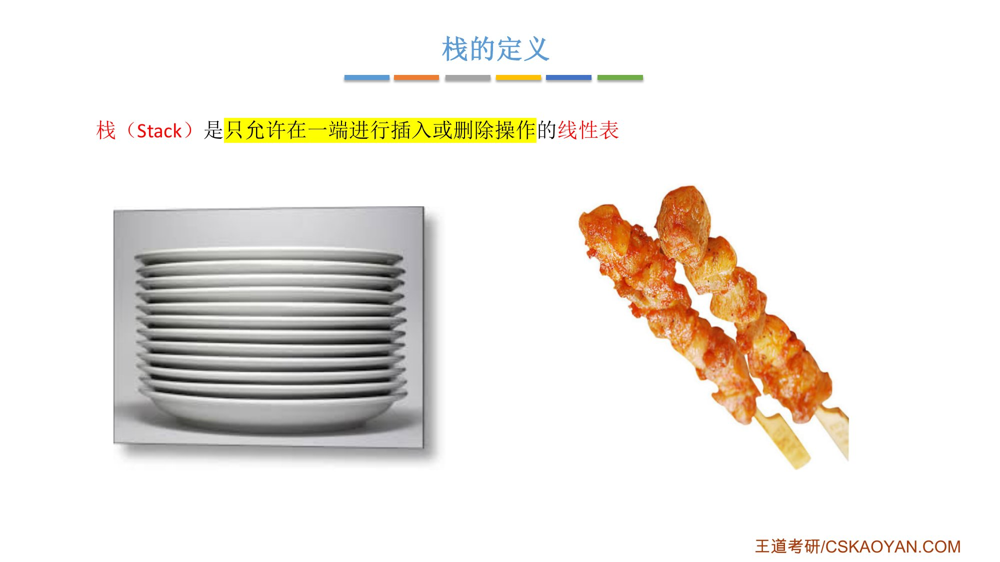
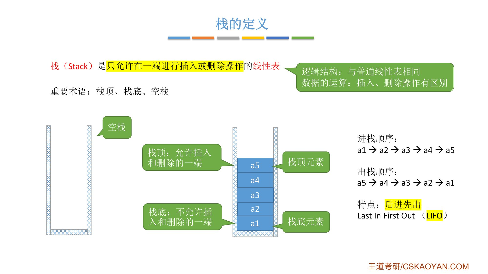
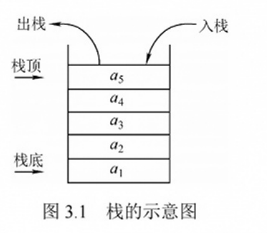
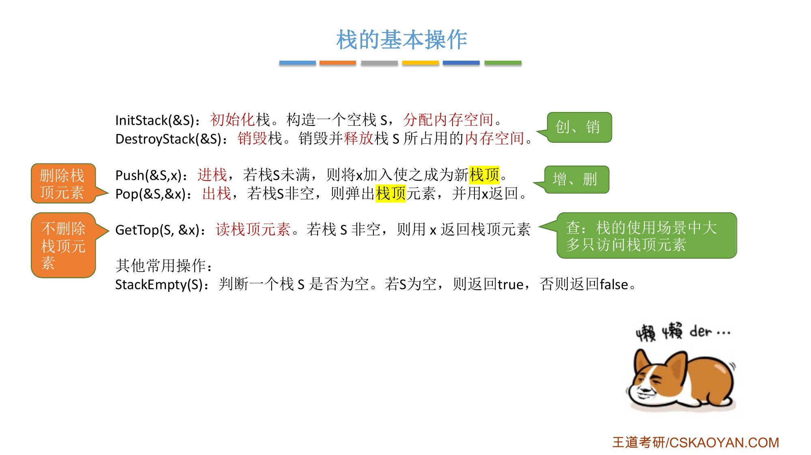
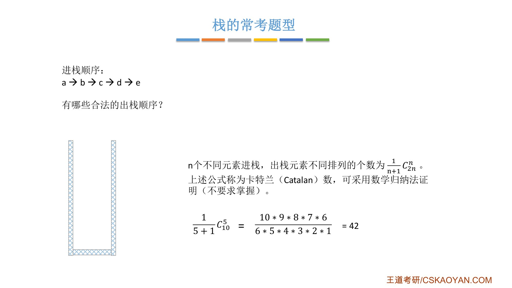
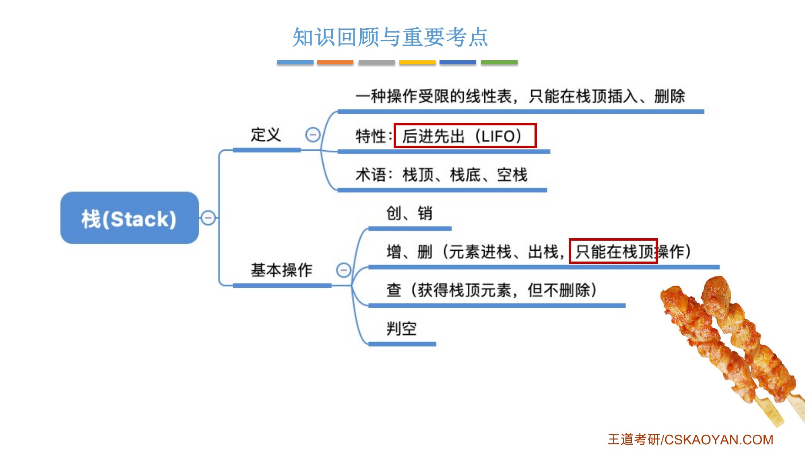

# 这一节在讲什么

::: cue
学一种新的数据结构，从哪三个方面入手？这一节讲哪两个？
:::

第 3 章开始学栈和队列。和学线性表时一样，从**数据结构的三要素**出发：逻辑结构、数据的运算、存储结构。这一节只讲前两个，即栈的**定义**（逻辑结构）和**基本操作**（运算）；用不同的存储结构实现栈，放在后面两节（3.1.2 顺序栈、3.1.3 链栈）。存储结构不同，运算的实现方式也不同。

::: book
王道书第 64 页"注意"：每接触一种新的数据结构，都应从其逻辑结构、存储结构和基本运算三方面进行系统理解。
:::

# 一、栈的定义

::: cue
栈和普通线性表的区别在哪？栈顶、栈底、空栈分别指什么？
:::

先回顾线性表：具有相同数据类型的 $n\,(n\ge 0)$ 个数据元素的有限序列，记作

$$L=(a_1,a_2,\dots,a_i,a_{i+1},\dots,a_n)$$

普通线性表可以在任意位置插入、删除。

**栈（Stack）是[只允许在一端进行插入或删除操作]{.red}的线性表。** 逻辑结构和普通线性表一样（一对一、一前一后），只是插入、删除受限，是一种**操作受限的线性表**。

老师的例子：

- 英文 stack 有"整齐的一堆"的意思，比如一堆石头：新石头只能放在顶上，拿也只能从顶上拿，从中间抽一块整堆就散了；
- 洗好的盘子一个个摞起来：放只能放顶上，拿只能拿最上面那个；
- 烤串：串的时候先串下面的，永远从上面插入；吃的时候也只能从上往下吃。

{.slide width=0.55}

**重要术语**：

- **栈顶**：允许插入和删除的一端；最上面的元素叫**栈顶元素**；
- **栈底**：不允许插入和删除的一端；最下面的元素叫**栈底元素**；
- **空栈**：不含任何元素的栈（对应线性表的空表）。

## 后进先出

$a_1,a_2,a_3,a_4,a_5$ 依次进栈，全部进栈后再依次出栈，出栈顺序是 $a_5,a_4,a_3,a_2,a_1$，刚好是进栈顺序的逆序。所以栈的特点是[后进先出]{.red}：后进入栈的元素先出栈，英文 **Last In First Out**，缩写 **LIFO**。

{.slide width=0.65}

::: book
王道书第 63–64 页：栈是只允许在一端进行插入和删除操作的线性表，插入叫**入栈**，删除叫**出栈**。栈顶（Top）是允许插入和删除的一端；栈底（Bottom）**固定不变**，不允许插入和删除；空栈不含任何元素。设栈 $S=(a_1,a_2,a_3,a_4,a_5)$，$a_1$ 为栈底元素，$a_5$ 为栈顶元素，按 $a_1\sim a_5$ 入栈则出栈序列为 $a_5\sim a_1$，栈的操作特性可概括为后进先出（LIFO）。考点追踪：栈的特点（2017）；出入栈序列的分析（2010、2011、2013、2018、2020、2022）。
:::

{.slide width=0.35}

::: fix
**名词统一**：课件和字幕说"进栈 / 出栈"，王道书说"入栈 / 出栈"，是一回事，本笔记统一用**进栈 / 出栈**。
:::

# 二、栈的基本操作

::: cue
栈要实现哪几个基本操作？`Pop` 和 `GetTop` 有什么区别？
:::

回顾线性表的基本操作：创、销、增、删、查（改的第一步也是查）。栈也一样：

::: {.tbl widths="1.6,1,3"}
| 操作 | 对应 | 说明 |
|---|---|---|
| `InitStack(&S)` | 创 | 初始化栈：构造一个空栈 `S`，[分配内存空间]{.u} |
| `DestroyStack(&S)` | 销 | 销毁栈：销毁并[释放]{.u}栈 `S` 所占用的内存空间 |
| `Push(&S, x)` | 增 | 进栈：若栈未满，把 `x` 加入使之成为新的栈顶 |
| `Pop(&S, &x)` | 删 | 出栈：若栈非空，弹出（删除）栈顶元素，并用 `x` 返回 |
| `GetTop(S, &x)` | 查 | 读栈顶元素：若栈非空，用 `x` 返回栈顶元素，[不删除]{.u} |
| `StackEmpty(S)` | 判空 | 若 `S` 为空栈返回 `true`，否则返回 `false` |
:::

- `Pop` 的 `x` 加了引用符号 `&`：要把删掉的栈顶元素"带回去"给调用者。
- `Pop` 和 `GetTop` 都用 `x` 返回栈顶元素，区别是 [`Pop` 会把栈顶元素删掉，`GetTop` 不删]{.red}。
- "查"只做读栈顶：普通线性表要按位、按值查找，但栈的使用场景里，大多只需要访问栈顶元素。

{.slide width=0.6}

::: book
王道书第 64 页：不同教材对基本操作的命名略有差异，本书采用严蔚敏教材的命名规范，和课件相同。书上的 `Push` 写成"若栈未满，则 `x` 成为新的栈顶元素"，`DestroyStack` 写成"销毁栈 `S`，并释放其所占用的存储空间（`&` 表示引用调用）"。在解答算法题时，若题目未作特殊限制，[可直接使用上述基本操作函数]{.u}。
:::

# 三、常考题型：合法的出栈顺序

::: cue
进栈顺序 a→b→c→d→e，出栈顺序可能有几种？为什么不止一种？
:::

这是栈最喜欢考的题型：告诉你进栈顺序，问哪些出栈顺序合法。关键在于[出栈和进栈可以穿插进行]{.u}。

- 全部进栈后再依次出栈：出栈顺序 e、d、c、b、a；
- 穿插进行：a、b 进栈 → b 出栈（栈里只剩 a）→ c、d、e 进栈 → 全部出栈。出栈顺序是 **b、e、d、c、a**。

逐步看第二种：

::: {.tbl widths="0.5,1.4,1.4,1.4"}
| 步 | 操作 | 栈中（左为栈底） | 已出栈 |
|---|---|---|---|
| 1 | a、b 进栈 | a b | |
| 2 | 出栈 | a | b |
| 3 | c、d、e 进栈 | a c d e | b |
| 4 | 依次出栈 4 次 | （空） | b e d c a |
:::

**结论**：$n$ 个不同元素进栈，出栈元素不同排列的个数为

$$\frac{1}{n+1}C_{2n}^{n}$$

这个公式叫**卡特兰（Catalan）数**，可以用数学归纳法证明，[不要求掌握证明]{.u}，了解即可。$n=5$ 时：

$$\frac{1}{5+1}C_{10}^{5}=\frac{1}{6}\cdot\frac{10\times9\times8\times7\times6}{5\times4\times3\times2\times1}=42$$

42 种太多，考试几乎不会让你写出全部，一般是选择题：给几个选项，判断某种出栈顺序是否合法。课后习题里会有大量这类题。

{.slide width=0.55}

::: book
王道书第 64 页"栈的数学性质"：当 $n$ 个不同元素按固定次序入栈时，可能的出栈序列总数为 $\frac{1}{n+1}C_{2n}^{n}$，该数列称为卡特兰（Catalan）数，可通过数学归纳法证明。考点追踪：Catalan 数的应用（2015）。
:::

# 四、知识回顾

{.slide width=0.6}

::: summary
**栈**：只允许在一端（栈顶）插入、删除的线性表，是一种[操作受限的线性表]{.u}。逻辑结构和普通线性表相同；特性是**后进先出（LIFO）**。术语：栈顶、栈底、空栈。

**基本操作**：创（`InitStack`）、销（`DestroyStack`）；增删只能在栈顶（`Push` 进栈、`Pop` 出栈）；查只读栈顶（`GetTop`，不删除）；判空（`StackEmpty`）。

**常考**：给进栈顺序判断出栈顺序是否合法；出栈和进栈可以穿插。$n$ 个不同元素的合法出栈序列有 $\frac{1}{n+1}C_{2n}^{n}$ 种（卡特兰数），$n=5$ 时 42 种。

**自测**：① 栈和普通线性表，逻辑结构有区别吗？区别在哪？② `Pop` 和 `GetTop` 有什么不同？③ a、b、c 依次进栈，写出所有合法的出栈顺序（应有 $\frac{1}{4}C_6^3=5$ 种）。④ a、b、c 依次进栈，c、a、b 能不能是出栈顺序？
:::
