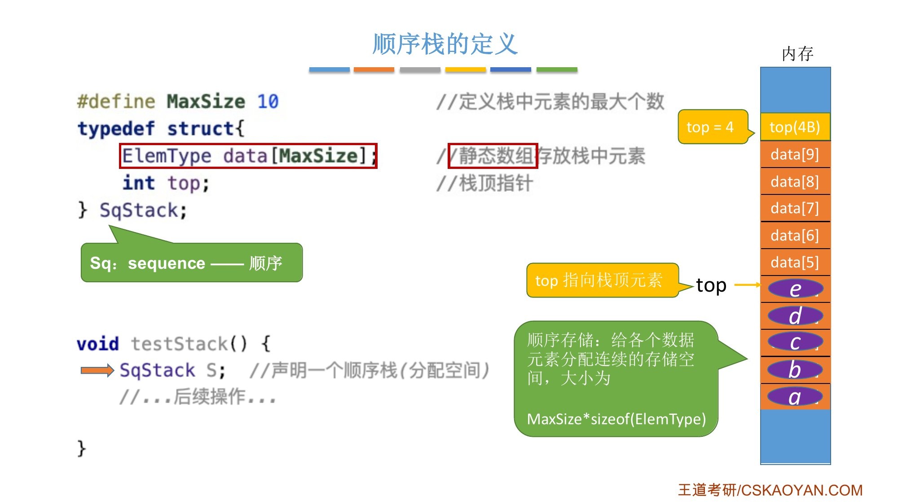
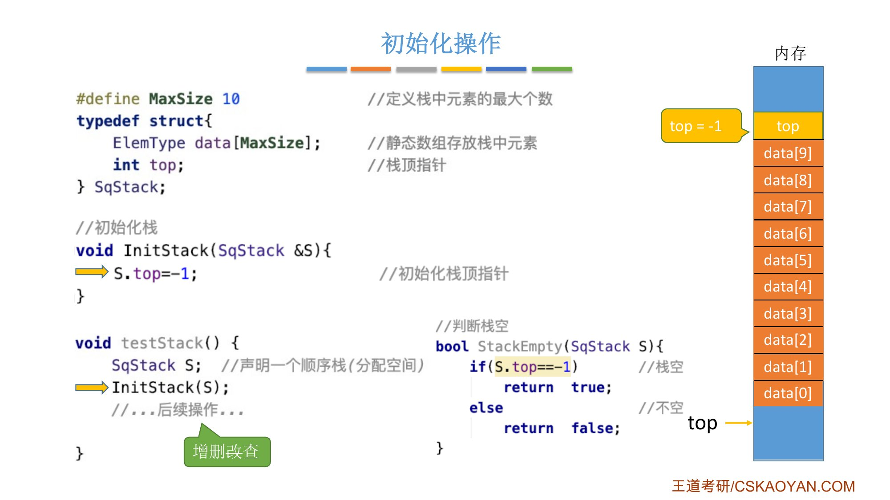
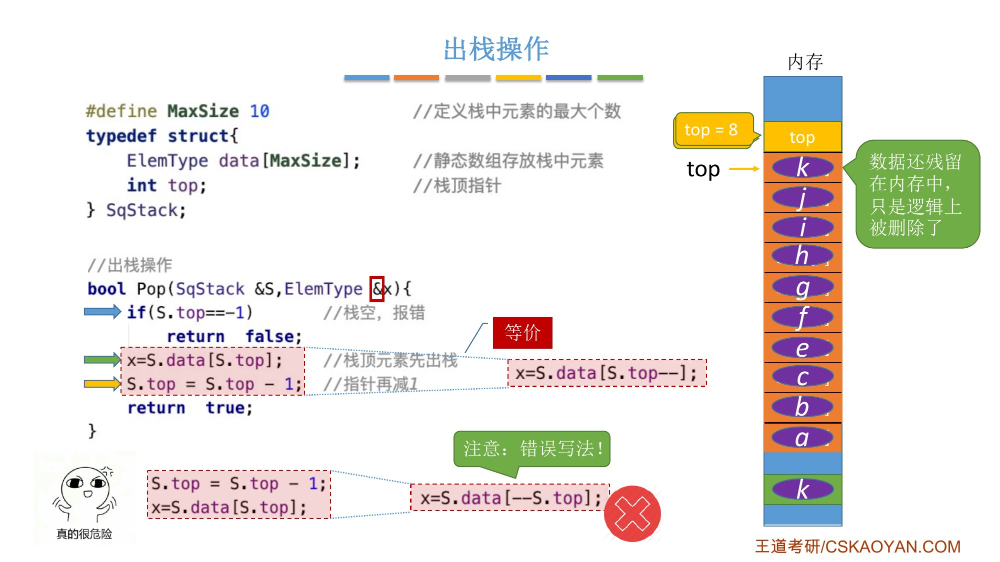
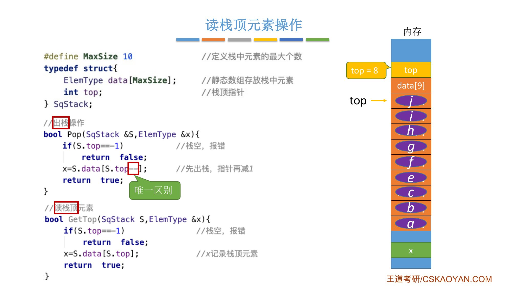
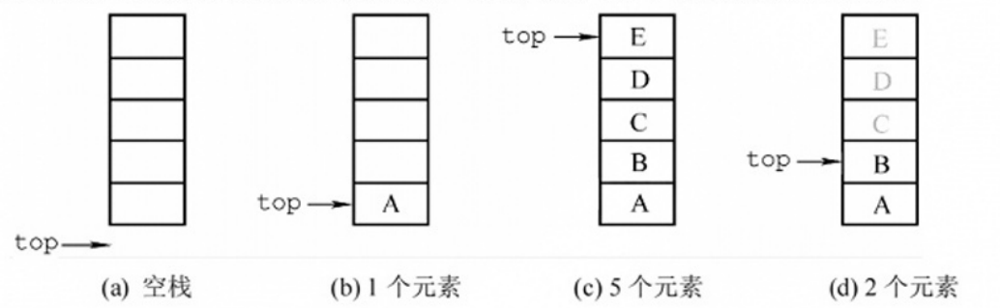
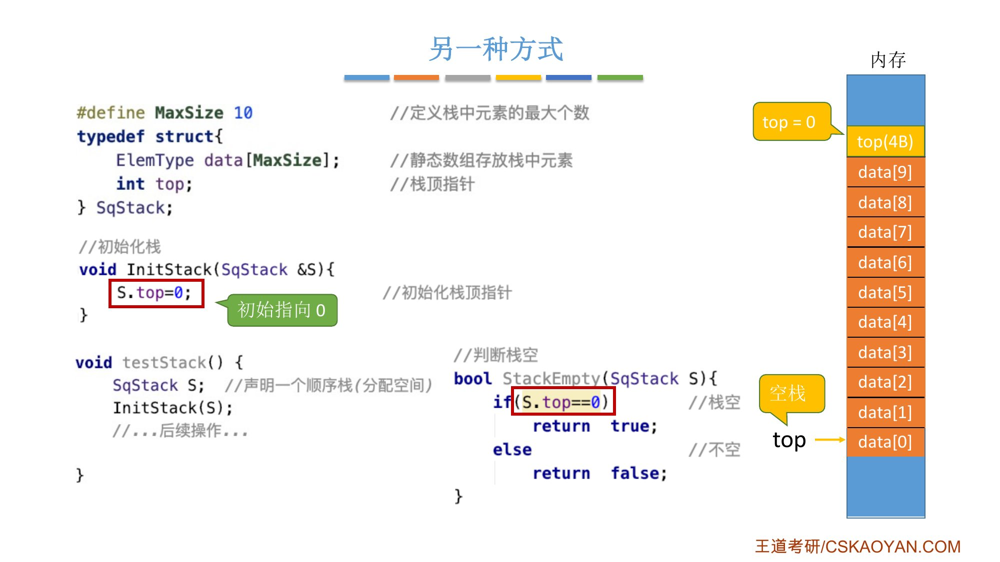
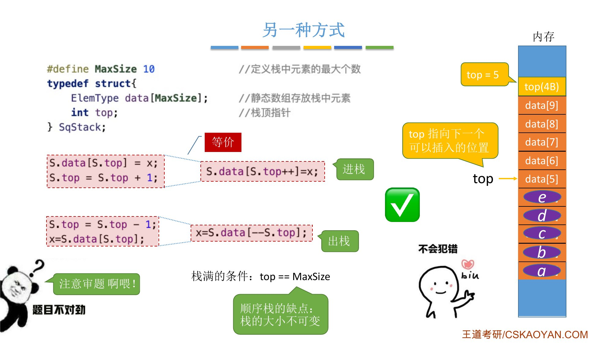
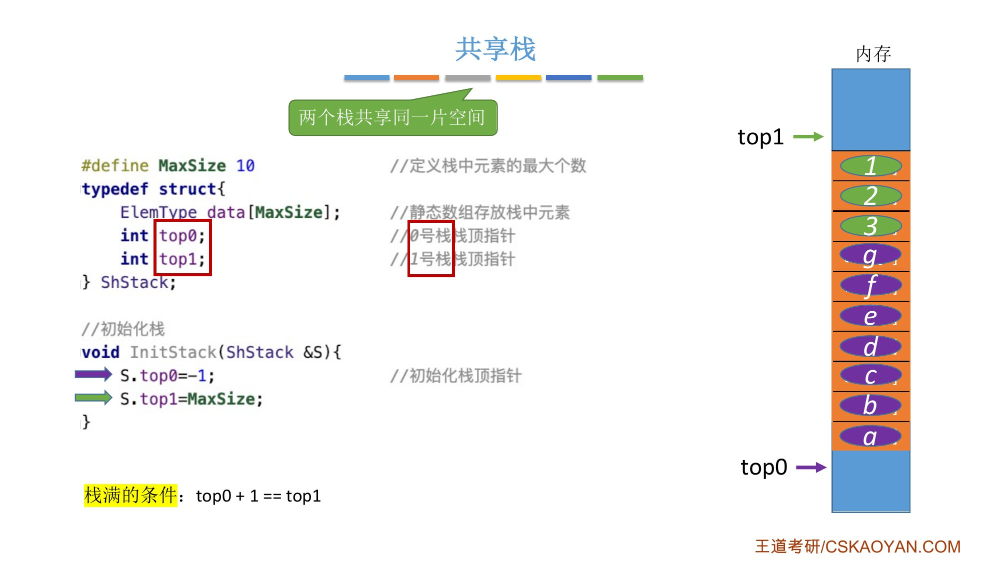
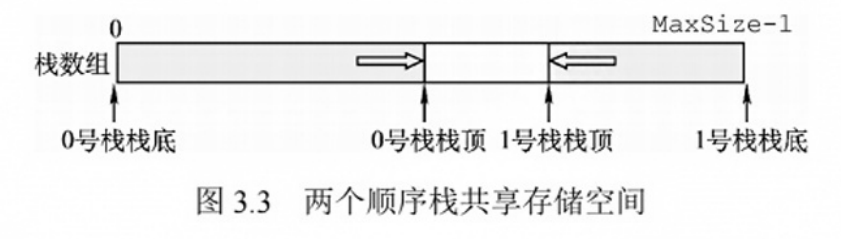
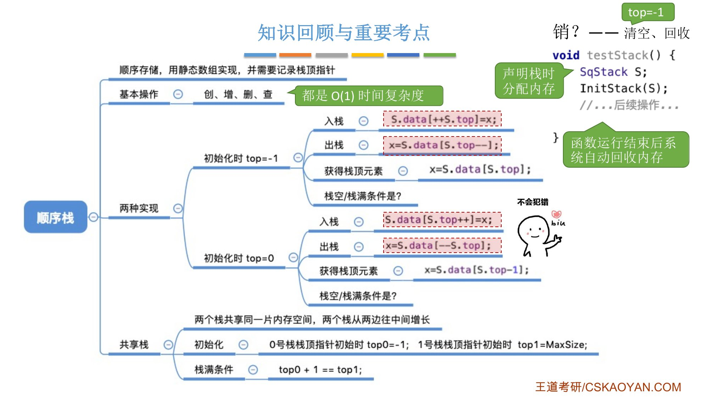

# 这一节在讲什么

::: cue
顺序栈要实现哪几个基本操作？
:::

用**顺序存储**的方式实现栈，叫**顺序栈**。确定存储结构后，再看这些基本操作怎么实现：创（初始化）、增（进栈）、删（出栈）、查（获取栈顶元素）、判空、判满。和顺序表很类似。

# 一、顺序栈的定义

::: cue
顺序栈的结构体里有哪两样东西？`top` 存的是什么？
:::

```c
#define MaxSize 10                  // 定义栈中元素的最大个数
typedef struct {
    ElemType data[MaxSize];         // 静态数组存放栈中元素
    int top;                        // 栈顶指针
} SqStack;                          // Sq：sequence，顺序

void testStack() {
    SqStack S;                      // 声明一个顺序栈（分配空间）
    // ……后续操作
}
```

- 执行 `SqStack S;` 后，内存里分配一整片连续空间存放元素，大小是栈的最大容量 `MaxSize` 乘以每个元素的大小；另外还有 4 字节存 `top`。
- `top` 叫**栈顶指针**，指向此时的栈顶元素，记录的是[数组下标]{.u}（从 0 开始）。例如已经压入 a、b、c、d、e 五个元素，`top` 的值就是 4。

{.slide width=0.6}

# 二、初始化与判空

::: cue
初始化时 `top` 为什么设成 $-1$ 而不是 0？
:::

`top` 要指向栈顶元素。刚开始 `data[0]` 里还没有元素，让 `top` 指向 0 不合理，所以[初始化时 `top = -1`]{.red}；相应地，判空就看 `top` 是否等于 $-1$。

```c
// 初始化栈
void InitStack(SqStack &S) {
    S.top = -1;                     // 初始化栈顶指针
}

// 判断栈空
bool StackEmpty(SqStack S) {
    if (S.top == -1)                // 栈空
        return true;
    else                            // 不空
        return false;
}
```

{.slide width=0.6}

# 三、进栈

::: cue
进栈时先移 `top` 还是先放元素？为什么要写 `++S.top` 而不是 `S.top++`？
:::

```c
// 新元素入栈
bool Push(SqStack &S, ElemType x) {
    if (S.top == MaxSize - 1)       // 栈满，报错
        return false;
    S.top = S.top + 1;              // 指针先加 1
    S.data[S.top] = x;              // 新元素入栈
    return true;
}
```

1. 先判断栈满：顺序栈用静态数组实现，有容量上限。`top` 指向栈顶元素，[栈满时 `top == MaxSize - 1`]{.u}（容量 10 时 `top` 为 9），返回 `false` 给调用者反馈。
2. 栈不满：`top` 先加 1（例如从 $-1$ 变为 0），再把 `x` 放到 `top` 指向的位置，返回 `true`。

因为 `top` 永远指向栈顶元素，新元素进栈时都要[先让 `top` 加 1，再放元素]{.u}。

## 更简洁的写法

课本把中间两句合成一句：

```c
S.data[++S.top] = x;                // 等价于上面两句
```

`++top`：先让 `top` 加 1，再使用 `top` 的值。跨考的同学注意不要写成 `top++`（先用 `top` 的值，再加 1）。

::: pitfall
**写成 `S.data[S.top++] = x;` 会怎样**：设栈中已有 a、b，`top = 1`，要插入 c，期望放在 `data[2]`。`top++` 先用 `top` 的值 1，把 c 放进 `data[1]`，[覆盖了 b]{.red}，然后 `top` 才变成 2，指向一个空位置。结果错误。
:::

![课件：进栈操作；注意错误写法 `S.data[S.top++]=x`](assets/3.1.2-p05.jpg){.slide width=0.6}

# 四、出栈

::: cue
出栈后，被删掉的元素还在内存里吗？为什么要写 `S.top--` 而不是 `--S.top`？
:::

```c
// 出栈操作
bool Pop(SqStack &S, ElemType &x) {
    if (S.top == -1)                // 栈空，报错
        return false;
    x = S.data[S.top];              // 栈顶元素先出栈
    S.top = S.top - 1;              // 指针再减 1
    return true;
}
```

- `x` 加了引用符号：调用者在自己的函数里定义了变量 `x`，`Pop` 里操作的 `x` 和调用者的 `x` 是[同一份数据]{.u}，不是复制品，这样才能把栈顶元素带回去。
- 栈空不能出栈，返回 `false`；否则把栈顶元素赋给 `x`，`top` 减 1（栈顶指针下移），返回 `true`。
- `top` 下移只是[在逻辑上删除]{.u}了栈顶元素，它的数据其实还残留在内存中。

合并成一句：

```c
x = S.data[S.top--];                // 先出栈，指针再减 1
```

::: pitfall
**写成 `x = S.data[--S.top];` 会怎样**：栈顶元素是 j（`top` 指向它），期望 `x` 返回 j。`--top` 先让 `top` 减 1 指向 i，再把 i 赋给 `x`，[返回的是 i 而不是 j]{.red}。

老师强调：这些代码千万不要背，要在理解的基础上，能自己分析用哪种写法。
:::

{.slide width=0.6}

# 五、读栈顶元素

::: cue
`GetTop` 和 `Pop` 的代码只差哪一处？
:::

```c
// 读栈顶元素
bool GetTop(SqStack S, ElemType &x) {
    if (S.top == -1)                // 栈空，报错
        return false;
    x = S.data[S.top];              // x 记录栈顶元素
    return true;
}
```

和出栈几乎一模一样，[唯一区别是 `top` 不减 1]{.u}：只用 `x` 返回栈顶元素，不删除。

{.slide width=0.55}

::: book
王道书第 64–66 页：顺序栈利用一组地址连续的存储单元存放自栈底到栈顶的数据元素，并附设一个指针 `top` 指示当前栈顶元素的位置（书上 `MaxSize` 为 50）。

- 栈顶指针 `S.top`，初始时设为 `S.top=-1`；栈顶元素 `S.data[S.top]`；
- 入栈：栈不满时，先将栈顶指针加 1，再送值到栈顶；出栈：栈非空时，先取栈顶元素，再将栈顶指针减 1；
- 栈空条件 `S.top==-1`；栈满条件 `S.top==MaxSize-1`；[栈长 `S.top+1`]{.u}。

顺序栈的入栈操作受数组上界约束，若对栈的最大使用空间估计不足，可能发生**栈上溢**，此时应向用户报告错误信息。

书上的初始化、判空、入栈、出栈、读栈顶代码和课件相同（入栈、出栈用的是 `++S.top`、`S.top--` 的一句写法）。`GetTop` 后书上补了一句：该操作不改变栈的状态，栈顶元素依然保留在栈中。
:::

{.slide width=0.65}

::: book
图 3.2 的说明（第 65 页）：图 (d) 是在图 (c) 基础上 E、D、C 相继出栈后的结果，此时栈中剩余 2 个元素。尽管 C、D、E 可能仍保留在原存储单元中，但 `top` 指针已指向新的栈顶，因此它们已不属于当前栈的内容。[栈顶指针标识了栈中有效元素的边界]{.u}。考点追踪：出 / 入栈操作的模拟（2009）。
:::

# 六、另一种方式：top 初始化为 0

::: cue
`top` 指向"下一个可以插入的位置"时，进栈、出栈、判空、判满、读栈顶各怎么写？
:::

也可以让 `top` 刚开始指向 0，即 [`top` 指向栈顶元素的**下一个**位置]{.u}（下一个可以插入元素的位置）。判空就看 `top` 是否为 0。

```c
void InitStack(SqStack &S) {
    S.top = 0;                      // 初始指向 0
}

bool StackEmpty(SqStack S) {
    if (S.top == 0)                 // 栈空
        return true;
    else
        return false;
}
```

这时进栈、出栈的顺序和前一种刚好相反：

- **进栈**：先把 `x` 放到 `top` 指向的位置，再让 `top` 加 1：`S.data[S.top++] = x;`
- **出栈**：先让 `top` 减 1，再把 `top` 指向的元素传回去：`x = S.data[--S.top];`
- **栈满**：`top == MaxSize`（容量 10 时 `top` 为 10）。

两种设计对照：

::: {.tbl widths="1.2,2,2"}
| | `top` 初始为 $-1$（指向栈顶元素） | `top` 初始为 0（指向栈顶元素的下一个位置） |
|---|---|---|
| 初始化 | `S.top = -1` | `S.top = 0` |
| 判空 | `S.top == -1` | `S.top == 0` |
| 判满 | `S.top == MaxSize - 1` | `S.top == MaxSize` |
| 进栈 | `S.data[++S.top] = x` | `S.data[S.top++] = x` |
| 出栈 | `x = S.data[S.top--]` | `x = S.data[--S.top]` |
| 读栈顶 | `x = S.data[S.top]` | `x = S.data[S.top - 1]` |
| 栈长 | `S.top + 1` | `S.top` |
:::

{.slide width=0.55}

{.slide width=0.55}

::: pitfall
做题时一定要先看清 `top` 指向**栈顶元素**还是**栈顶元素的下一个位置**，两种方式的代码不一样，这是比较容易错的地方。
:::

::: book
王道书第 64–66 页的两处说明：另一种常见的方式是栈顶指针初始化为 `S.top=0`；入栈时先将元素存入栈顶，再将栈顶指针加 1；出栈时先将栈顶指针减 1，再取出栈顶元素；栈空条件为 `S.top==0`；栈满条件为 `S.top==MaxSize`。"注意"框：栈和队列的判空、判满条件，会因实际给出的条件不同而变化，做题时务必根据题目设定灵活应对。
:::

::: add
上表"读栈顶"和"栈长"两行，课件知识回顾里有 `x=S.data[S.top-1]`（`top` 初始为 0 时），栈长是我按两种设计补的，书上给了 `top` 初始为 $-1$ 时栈长 `S.top+1`。
:::

# 七、共享栈

::: cue
顺序栈满了不能扩容，怎么办？共享栈的两个栈顶指针怎么初始化？什么时候栈满？
:::

顺序栈用静态数组存放元素，[存满后容量不可改变]{.red}，这是顺序栈的缺点。解决办法：

1. 用链式存储实现栈（下一节）；
2. 一开始就分配一大片连续空间。但这会浪费内存资源，可以用**共享栈**提高这片空间的利用率。

**共享栈**：两个栈共享同一片存储空间。设两个栈顶指针：

- 0 号栈的栈顶指针 `top0` 初始为 $-1$，从下往上（下标从小到大）增长；
- 1 号栈的栈顶指针 `top1` 初始为 `MaxSize`，从上往下（下标从大到小）增长。

逻辑上是两个栈，物理上共享同一片存储空间，提高了内存资源的利用率。共享栈也会存满，[栈满条件：`top0 + 1 == top1`]{.red}。

```c
#define MaxSize 10                  // 定义栈中元素的最大个数
typedef struct {
    ElemType data[MaxSize];         // 静态数组存放栈中元素
    int top0;                       // 0 号栈栈顶指针
    int top1;                       // 1 号栈栈顶指针
} ShStack;

// 初始化栈
void InitStack(ShStack &S) {
    S.top0 = -1;                    // 初始化栈顶指针
    S.top1 = MaxSize;
}
```

{.slide width=0.6}

::: book
王道书第 66 页：利用栈底位置相对固定的特性，可让两个顺序栈共享同一段一维数组空间，将两个栈的栈底分别设置于数组两端，栈顶向中间延伸。`top0`、`top1` 均指向各自的栈顶元素；初始时 `top0=-1`（0 号栈空），`top1=MaxSize`（1 号栈空）；栈满条件为 `top1-top0==1`（两栈顶相邻）。0 号栈入栈时 `top0` 先加 1 再赋值，1 号栈入栈时 `top1` 先减 1 再赋值；出栈操作的顺序相反。

共享栈能更高效地利用存储空间，两个栈的空间可相互调节，[仅当整个数组被占满时才发生栈溢出]{.u}。存取数据的时间复杂度均为 $O(1)$。
:::

{.slide width=0.55}

::: add
老师说共享栈的代码有兴趣可以自己实现。我的答案（进栈，`i` 表示往几号栈放，建议先自己写再对照）：

```c
bool Push(ShStack &S, int i, ElemType x) {
    if (S.top0 + 1 == S.top1)           // 栈满（两栈顶相邻）
        return false;
    if (i == 0) S.data[++S.top0] = x;   // 0 号栈：先加 1 再放
    else        S.data[--S.top1] = x;   // 1 号栈：先减 1 再放
    return true;
}
```

出栈相反：0 号栈 `x = S.data[S.top0--];`（判空 `top0 == -1`），1 号栈 `x = S.data[S.top1++];`（判空 `top1 == MaxSize`）。
:::

# 八、知识回顾与销毁

::: cue
顺序栈怎么销毁？为什么这一节的代码不用 `free`？
:::

- 两种 `top` 的设计，初始化不同，进栈、出栈的代码也不同，是比较容易错的地方；
- 所有基本操作都可以在 [$O(1)$]{.red} 的时间复杂度内完成；
- **销毁**：先在逻辑上清空栈，只要让 `top` 回到初始化的位置；再回收内存。这一节用的是[变量声明]{.u}（`SqStack S;`）分配空间，没有用 `malloc`，函数结束后系统会自动回收，所以回收内存不需要管。

{.slide width=0.65}

::: recall
"声明变量的空间系统自动回收，`malloc` 的要手动 `free`"在正课 2.3.6"销（销毁）"讲过：静态分配的数组生命周期结束后系统自动回收；`malloc` 申请的在堆区，必须 `free`。
:::

::: summary
**顺序栈** = 静态数组 `data[MaxSize]` + 栈顶指针 `top`（数组下标）。基本操作都是 $O(1)$。

**两种设计，先审题**：

- `top` 指向栈顶元素：初始 $-1$；判空 `top==-1`；判满 `top==MaxSize-1`；进栈 `data[++top]=x`；出栈 `x=data[top--]`；
- `top` 指向栈顶元素的下一个位置：初始 0；判空 `top==0`；判满 `top==MaxSize`；进栈 `data[top++]=x`；出栈 `x=data[--top]`。

记法：`top` 指着**有元素**的格子，进栈要先挪到空格子再放（`++` 在前）；`top` 指着**空**格子，进栈直接放再挪（`++` 在后）。出栈反过来。

**出栈只是逻辑删除**，数据还残留在内存中。`GetTop` 和 `Pop` 的唯一区别是 `top` 不变。

**缺点**：容量不可改变（静态数组）。**共享栈**：两栈栈底在数组两端、栈顶向中间延伸，`top0=-1`、`top1=MaxSize`，栈满 `top0+1==top1`，提高空间利用率。

**销毁**：`top` 回到初始值（逻辑清空）；变量声明的空间由系统自动回收。

**自测**：① 写出 `top` 初始为 $-1$ 时的 `Push`、`Pop`。② 设 `top` 初始为 0，进栈写成 `data[++top]=x` 会出什么问题？③ 共享栈怎样判满？④ 出栈后，被删除的元素还在内存里吗？
:::
