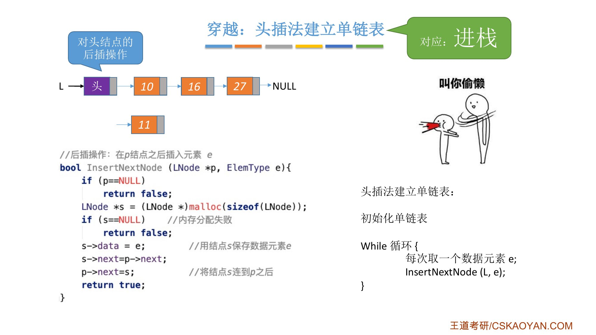
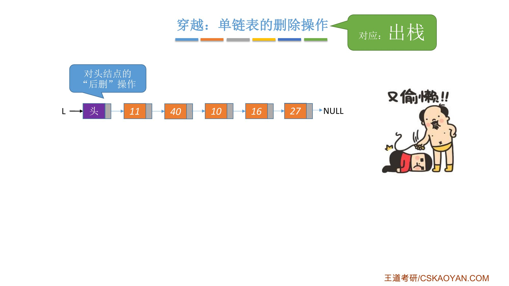
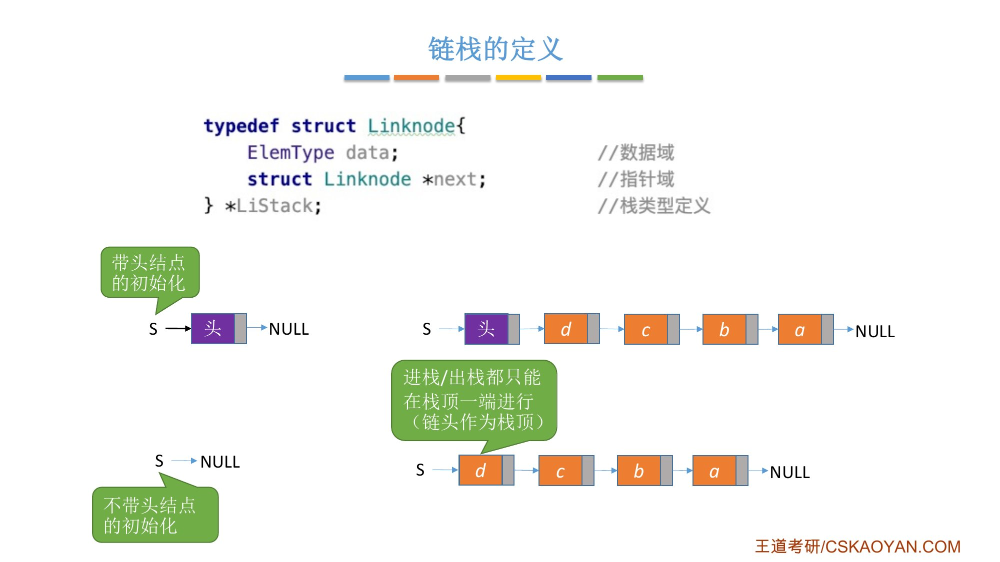
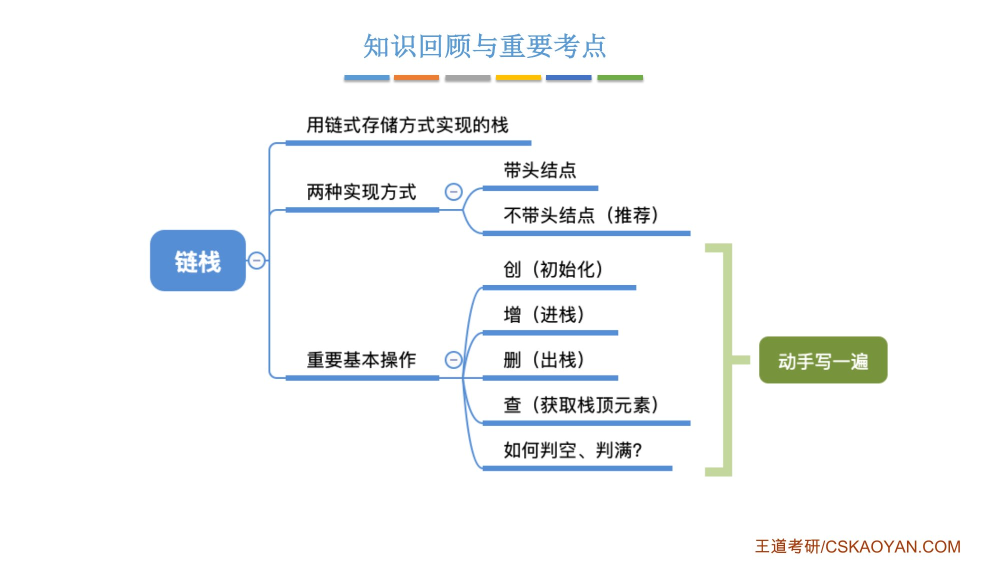

# 这一节在讲什么

::: cue
链栈本质上是什么？进栈、出栈对应单链表的哪两个操作？
:::

用**链式存储**的方式实现栈，叫**链栈**。和顺序栈一样，要实现：创（初始化）、增（进栈）、删（出栈）、查（获取栈顶元素）、判空、判满。

老师先"穿越"回单链表的课件：

- **头插法建立单链表**（正课 2.3.2_3）：每次都插在头结点之后，也就是对头结点做**后插**操作。如果规定只能在这一端插入，这就是[进栈]{.red}；
- **单链表的删除**：如果规定只能删除头结点后面的那个结点（对头结点的"后删"操作），这就是[出栈]{.red}。

{.slide width=0.6}

{.slide width=0.5}

所以链栈[本质上就是一个单链表]{.u}，只是规定只能在单链表的**链头**这一端插入和删除，把链头当作栈顶。

# 一、链栈的定义

::: cue
带头结点和不带头结点的链栈，初始化和判空分别怎么写？课本推荐哪种？
:::

```c
typedef struct Linknode {
    ElemType data;                  // 数据域
    struct Linknode *next;          // 指针域
} *LiStack;                         // 栈类型定义
```

和单链表的定义几乎没有区别，只是名字改了。

和单链表一样，链栈也有两种实现：

- **带头结点**：初始化时 `S` 指向头结点，头结点的 `next` 为 `NULL`；进栈、出栈都在头结点之后进行；
- **不带头结点**：初始化时 `S = NULL`；进栈、出栈都在链头进行，[`S` 直接指向栈顶结点]{.u}。

两种方式判空的条件不一样。进栈、出栈就是单链表在表头位置的插入、删除，单链表那一节已经讲得很详细，老师不再赘述。

{.slide width=0.6}

::: book
王道书第 66 页：链栈的优点是便于多个栈共享存储空间和提高其效率，且[不存在栈满上溢的情况]{.u}，在多栈共存的场景下能更灵活地利用内存。通常采用单链表实现，并规定所有操作都在单链表的表头进行。这里规定链栈**没有头结点**，栈顶指针 `Lhead` 直接指向栈顶元素。

链栈的类型定义和课件相同（书上写作 `LinkNode`、`LiStack`）。由于采用链式存储，结点的插入与删除操作非常高效。注意：对于带头结点的链栈，其初始化、判空及操作细节会有所不同；本节所述实现基于无头结点的设计。
:::

{.slide width=0.6}

::: fix
**名词统一**：课件结构体名 `Linknode`，王道书写作 `LinkNode`，本笔记代码用课件的 `Linknode`。王道书说链栈"不存在栈满上溢的情况"，课件的知识回顾里列了"如何判空、判满？"，所以判满一般不用考虑（只有 `malloc` 失败，即内存不足时才进不了栈）。
:::

# 二、动手写一遍

::: cue
不带头结点时，进栈要改 `S` 吗？出栈时栈空怎么判断？
:::

老师说课本推荐**不带头结点**，但两种都要会写，并留了作业"动手写一遍"：创（初始化）、增（进栈）、删（出栈）、查（获取栈顶元素）、判空。

{.slide width=0.6}

::: teacher
老师说"可能会有同学认为是我想偷懒，所以没讲，但其实我是真的想偷懒"。他想说的是：学习是知识**输入**的过程，考试考的是知识**输出**的能力。看书、听课只增加输入，觉得自己听懂了、看懂了，不代表能输出。要多练输出：自己动手写代码、做题，或者把别人讲明白。把这些基本操作写一遍，相当于把单链表也复习了一遍，"有百利而无一害"。
:::

{.slide width=0.5}

下面是我的答案，[建议先自己写再对照]{.u}。

## 不带头结点（课本推荐）

```c
// 初始化
bool InitStack(LiStack &S) {
    S = NULL;                       // 空栈，没有任何结点
    return true;
}

// 判空
bool StackEmpty(LiStack S) {
    return S == NULL;
}

// 进栈：新结点插在链头，成为新的栈顶
bool Push(LiStack &S, ElemType x) {
    Linknode *p = (Linknode *)malloc(sizeof(Linknode));
    if (p == NULL)                  // 内存不足，分配失败
        return false;
    p->data = x;
    p->next = S;                    // 新结点指向原栈顶
    S = p;                          // S 指向新栈顶
    return true;
}

// 出栈：删除链头结点
bool Pop(LiStack &S, ElemType &x) {
    if (S == NULL)                  // 栈空
        return false;
    Linknode *p = S;                // p 指向栈顶结点
    x = p->data;
    S = p->next;                    // S 指向新栈顶
    free(p);
    return true;
}

// 读栈顶元素
bool GetTop(LiStack S, ElemType &x) {
    if (S == NULL)
        return false;
    x = S->data;
    return true;
}
```

- 不带头结点时，进栈、出栈都要**修改 `S` 本身**，所以 `Push`、`Pop` 里的 `S` 要加引用 `&`；
- 进栈两句的顺序和正课 2.3.2_1"①② 两句不能颠倒"一样：先 `p->next = S` 接上原栈顶，再让 `S = p`。

## 带头结点

```c
bool InitStack(LiStack &S) {
    S = (Linknode *)malloc(sizeof(Linknode));   // 分配头结点
    if (S == NULL) return false;
    S->next = NULL;                 // 头结点之后暂时没有结点
    return true;
}

bool StackEmpty(LiStack S) {
    return S->next == NULL;         // 头结点后面没有结点就是空栈
}

bool Push(LiStack S, ElemType x) {  // 对头结点做后插
    Linknode *p = (Linknode *)malloc(sizeof(Linknode));
    if (p == NULL) return false;
    p->data = x;
    p->next = S->next;
    S->next = p;
    return true;
}

bool Pop(LiStack S, ElemType &x) {  // 删除头结点的后继
    if (S->next == NULL) return false;          // 栈空
    Linknode *p = S->next;          // p 指向栈顶结点
    x = p->data;
    S->next = p->next;
    free(p);
    return true;
}
```

带头结点时 `S` 始终指向头结点，不会被修改，所以 `Push`、`Pop` 的 `S` 不用加 `&`；栈顶元素是 `S->next->data`。

::: recall
正课 2.3.1：带头结点判空 `L->next == NULL`，不带头结点判空 `L == NULL`；2.3.2_1 的后插（`InsertNextNode`）和按位序删除第 1 个结点；2.3.2_3 的头插法。链栈的操作全部来自这几处。
:::

::: summary
**链栈** = 只能在链头插入、删除的单链表，链头一端是栈顶。进栈 = 头插（对头结点的后插），出栈 = 删除链头结点（对头结点的后删）。

**两种实现**：带头结点（初始化建头结点、`next` 为 `NULL`；判空 `S->next==NULL`）；不带头结点（课本推荐；初始化 `S=NULL`；判空 `S==NULL`；进栈、出栈要修改 `S`）。两种都要会写。

**和顺序栈比**：链栈按需 `malloc`，[不会栈满上溢]{.u}，便于多个栈共享存储空间；进栈、出栈都是 $O(1)$。

**老师的建议**：考试比的是"输出"能力，自己动手把这些操作写一遍。

**自测**：① 不带头结点的链栈，写出 `Push`、`Pop`。② 为什么不带头结点时 `Push` 的参数要写 `LiStack &S`？③ 带头结点和不带头结点的链栈分别怎么判空？④ 链栈要判满吗？
:::
