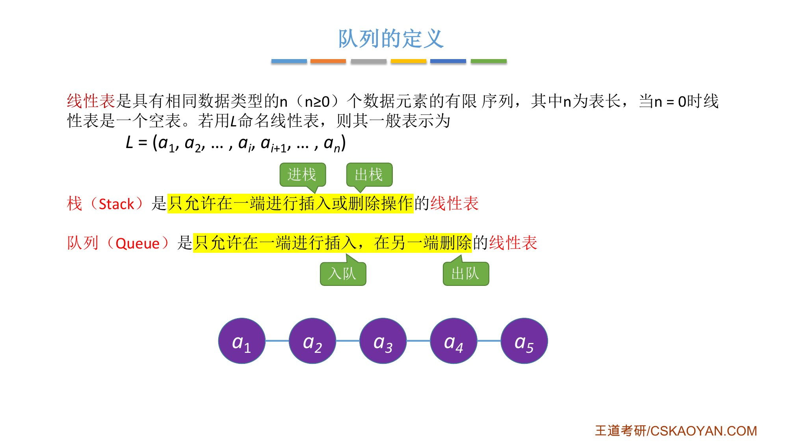
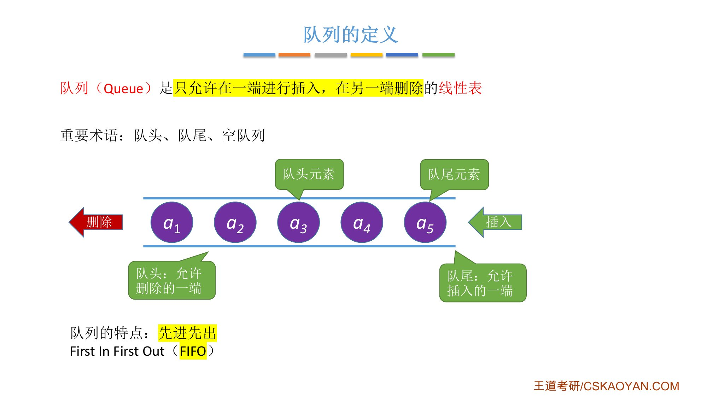
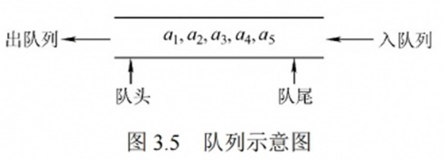
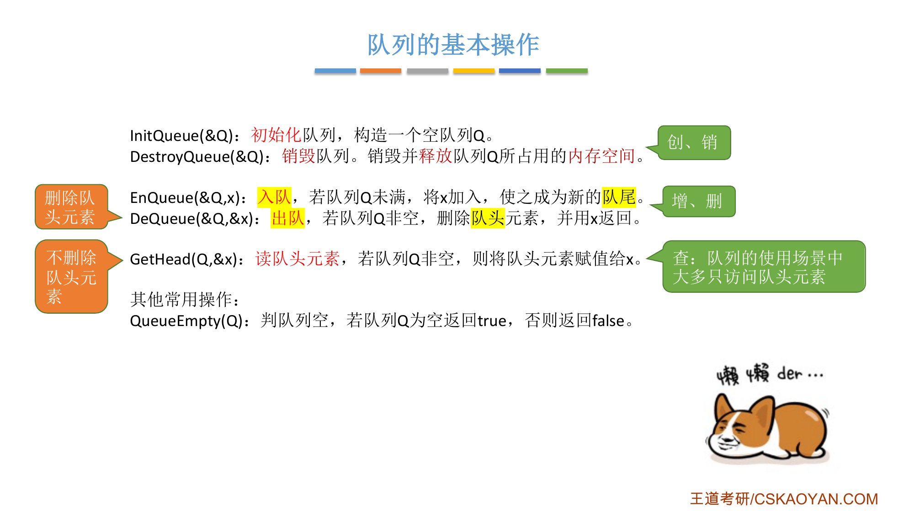
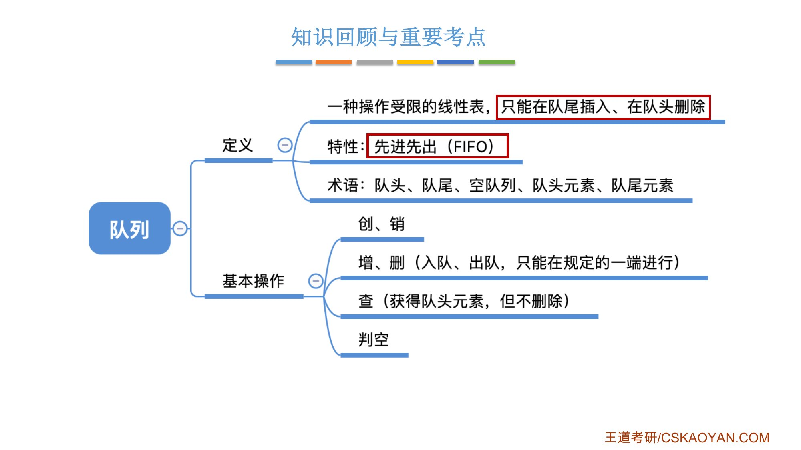

# 这一节在讲什么

::: cue
队列和栈都是"操作受限的线性表"，受限的方式有什么不同？
:::

从这一节开始学一种新的数据结构：**队列**。和之前一样，先讲它的[逻辑结构]{.u}和要实现的基本操作，之后再用不同的存储结构来实现它。

# 一、队列的定义

::: cue
队列允许在哪一端插入、哪一端删除？插入、删除各叫什么？
:::

::: def
**队列（Queue）**：只允许在一端进行插入，在另一端删除的[线性表]{.red}。
:::

- 对队列的插入操作叫**入队**，删除操作叫**出队**；
- 栈只允许在线性表的**某一端**插入和删除；队列是[一端插入、另一端删除]{.u}。

生活里的例子：食堂排队打饭。新来的人只能排到队尾（插入只在队尾进行）；打饭的师傅每次只给队头的人打，打完的人离开（删除只在队头进行）。过收费站的汽车队列也一样。

{.slide width=0.6}

# 二、重要术语与特点

::: cue
队头、队尾、队头元素、队尾元素、空队列分别指什么？队列的特点用英文缩写怎么写？
:::

- **空队列**：队列里没有任何数据元素；
- **队尾**：允许[插入]{.u}的一端；最靠近队尾的元素是**队尾元素**；
- **队头**：允许[删除]{.u}的一端；最靠近队头的元素是**队头元素**。

队列的特点：**先进先出**，[FIFO]{.red}（First In First Out）。考试喜欢用英文缩写。对照栈：后进先出，LIFO（Last In First Out）。

{.slide width=0.6}

::: book
王道书第 76 页：队列简称**队**，也是一种操作受限的线性表，仅允许在表的一端进行插入，而在另一端进行删除。向队列中插入元素称为**入队（或进队）**，删除元素称为**出队（或离队）**。这一规则符合日常排队"先到先服务"的原则，因此队列的操作特性为先进先出（First In First Out，FIFO）。

- 队头（Front）：允许删除的一端，也称**队首**；
- 队尾（Rear）：允许插入的一端；
- 空队列：不含任何元素的队列。
:::

{.slide width=0.45}

::: add
**名词统一**：队头 = 队首（front），队尾 = rear。下一节的 `front`、`rear` 两个指针就是这两个英文词。王道书写"队首元素""队首指针"，课件写"队头元素""队头指针"，是同一个东西。
:::

# 三、队列的基本操作

::: cue
`DeQueue` 和 `GetHead` 有什么区别？它们分别对应栈的哪个操作？
:::

本质上队列也是线性表，要实现的基本操作和线性表一样，就是"创销增删改查"：

```c
InitQueue(&Q);      // 初始化队列，构造一个空队列 Q                     （创）
DestroyQueue(&Q);   // 销毁队列。销毁并释放队列 Q 所占用的内存空间     （销）
EnQueue(&Q, x);     // 入队，若队列 Q 未满，将 x 加入，使之成为新的队尾 （增）
DeQueue(&Q, &x);    // 出队，若队列 Q 非空，删除队头元素，并用 x 返回   （删）
GetHead(Q, &x);     // 读队头元素，若队列 Q 非空，则将队头元素赋值给 x  （查）
QueueEmpty(Q);      // 判队列空，若队列 Q 为空返回 true，否则返回 false
```

- 创建、销毁：给队列分配、回收内存空间，和之前学的几乎一样；
- 新元素 `x` [只能从队尾入队]{.u}；出队删除的一定是队头元素，同时用 `x` 返回；
- `GetHead` 只用 `x` 返回队头元素的值，[不删除]{.u}队头元素。查：队列的使用场景中大多只访问队头元素；
- `DeQueue`、`GetHead` 分别对应栈的出栈 `Pop` 和读栈顶 `GetTop`；
- 判空很常用，也是[选择题比较喜欢考]{.red}的考点。

{.slide width=0.6}

::: book
王道书第 76 页列出的基本操作是 `InitQueue`、`QueueEmpty`、`EnQueue`、`DeQueue`、`GetHead` 五个（书上把 `GetHead` 写作"读队首元素但不出队"）。

需要注意：栈和队列均为操作受限的线性表，因此并非所有线性表的操作都适用于它们。例如，[不允许直接访问或修改栈或队列中间的元素]{.u}，这是由其逻辑特性所决定的。
:::

# 四、知识回顾

{.slide width=0.6}

::: summary
**队列** = 操作受限的线性表：[只能在队尾插入（入队）、在队头删除（出队）]{.red}。

**特点**：先进先出 FIFO。对照栈：后进先出 LIFO。

**术语**：队头（队首，允许删除）、队尾（允许插入）、队头元素、队尾元素、空队列。

**基本操作**：创 `InitQueue`、销 `DestroyQueue`、增 `EnQueue`、删 `DeQueue`、查 `GetHead`（只读不删）、判空 `QueueEmpty`。不允许直接访问或修改队列中间的元素。

**自测**：① 队列和栈的插入、删除限制分别是什么？② `DeQueue` 和 `GetHead` 的区别？③ 队头是允许插入还是删除的一端？④ FIFO、LIFO 各指什么？
:::
