# 这一节在讲什么

::: cue
用顺序存储实现队列，最难的是哪几件事？
:::

用**静态数组**存放队列元素，再设两个变量标记队头和队尾。确定存储结构后，讨论这些基本操作怎么实现：创（初始化）、增（入队）、删（出队）、查（获取队头元素），以及进行增、删、查之前必要的**判空、判满**。

这一节[很容易在选择题中考察]{.red}，难点集中在三件事：怎么让空间"循环"起来、怎么区分队空和队满、怎么算队列长度。

# 一、顺序队列的定义

::: cue
`front`、`rear` 各指向哪里？`SqQueue Q;` 分配了多大的空间？
:::

```c
#define MaxSize 10                  // 定义队列中元素的最大个数
typedef struct {
    ElemType data[MaxSize];         // 用静态数组存放队列元素
    int front, rear;                // 队头指针和队尾指针
} SqQueue;                          // Sq：sequence，顺序

void testQueue() {
    SqQueue Q;                      // 声明一个队列（顺序存储）
    // ……后续操作
}
```

- 执行 `SqQueue Q;` 后，系统分配一整片连续空间，大小 `MaxSize*sizeof(ElemType)`，能存 10 个数据元素；
- 规定：[`front` 指向队头元素；`rear` 指向队尾元素的**后一个**位置]{.u}，也就是下一个应该插入数据元素的位置。课件例子里 a、b、c、d、e 在队中（下面是队头，上面是队尾），`front` 是 0，`rear` 是 5。

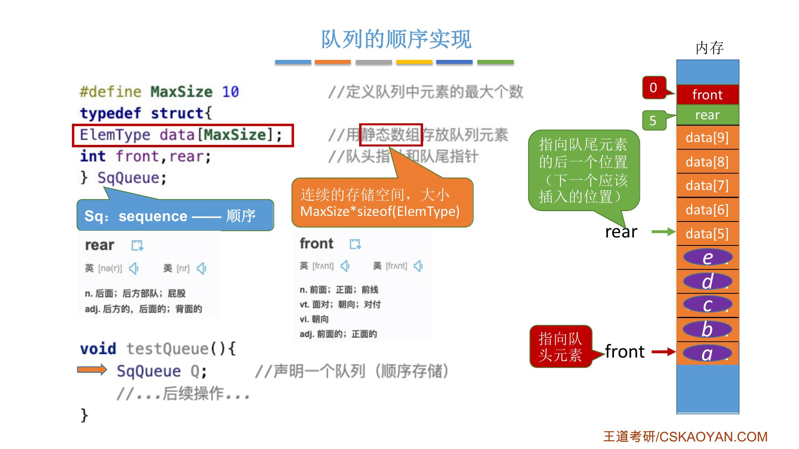{.slide width=0.6}

# 二、初始化与判空

::: cue
初始化时 `front`、`rear` 为什么都设成 0？判空的条件是什么？
:::

`rear` 指向接下来应该插入元素的位置，所以初始化时让队头、队尾指针[都指向 0]{.u}。于是可以用两个指针是否相等来判断队列是否为空。

```c
// 初始化队列
void InitQueue(SqQueue &Q) {
    Q.rear = Q.front = 0;           // 初始时 队头、队尾指针指向 0
}

// 判断队列是否为空
bool QueueEmpty(SqQueue Q) {
    if (Q.rear == Q.front)          // 队空条件
        return true;
    else
        return false;
}
```

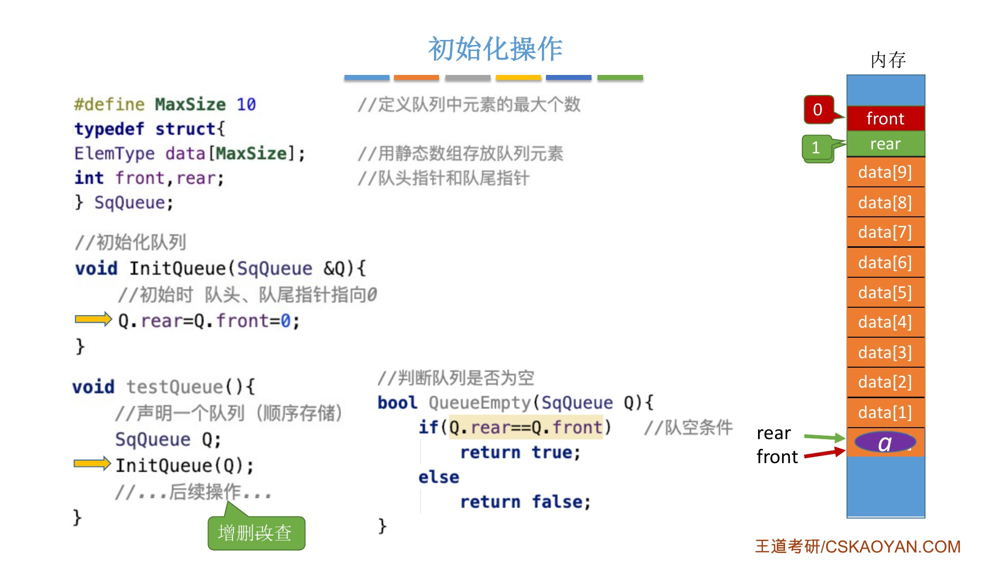{.slide width=0.6}

# 三、入队与循环队列

::: cue
`rear == MaxSize` 能不能作为队满条件？`(Q.rear+1)%MaxSize` 的作用是什么？
:::

只能从**队尾**入队。静态数组容量有限，插入前要先判断队列是否已满（怎么判断，第五节再讨论）：

```c
bool EnQueue(SqQueue &Q, ElemType x) {
    if (队列已满)
        return false;               // 队满则报错
    Q.data[Q.rear] = x;             // 将 x 插入队尾
    Q.rear = Q.rear + 1;            // 队尾指针后移
    return true;
}
```

照这个逻辑一直入队，存满后 `rear` 等于 10。那能不能认为 `rear == MaxSize` 时队列就满了？[不能]{.red}：如果之后有几个队头元素出队，`front` 会往后移，数组前面这些位置就空出来了，还可以继续插入。所以 `rear == MaxSize` 时队列并不一定满。

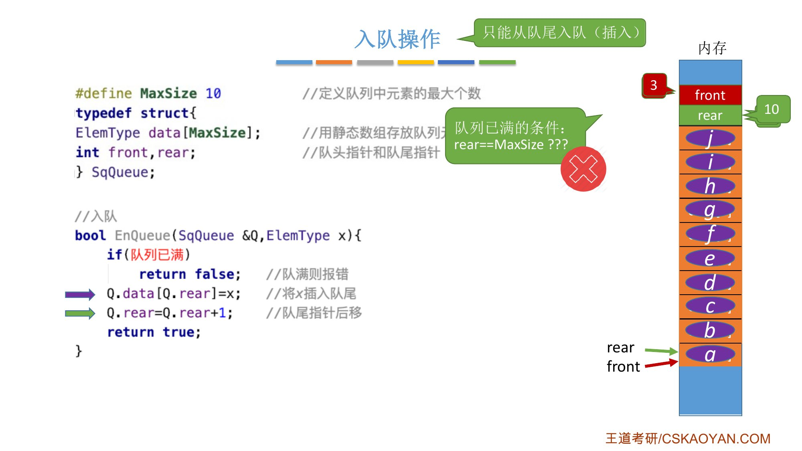{.slide width=0.6}

::: book
王道书第 77 页给这个现象起了名字：队列中仅剩一个元素，但 `rear` 已达 `MaxSize`，若此时继续入队，则会出现"**上溢**"；但这种溢出并非真正溢出，实际上数组中仍有空闲单元，因此称此现象为[**假溢出**]{.red}。
:::

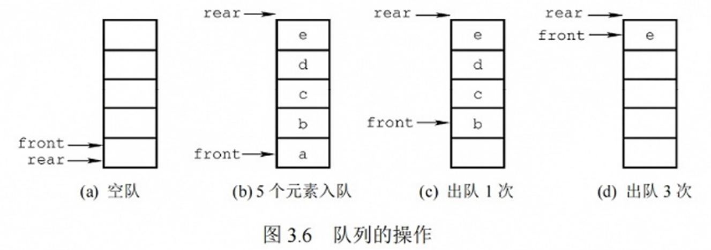{.slide width=0.6}

## 用取模让 rear 回到开头

把第二句改成取余运算：

```c
Q.data[Q.rear] = x;                 // 新元素插入队尾
Q.rear = (Q.rear + 1) % MaxSize;    // 队尾指针加 1 取模
```

设 `rear` 是 9（数组最后一个位置），新元素放进 `data[9]` 后，`rear = (9+1)%10 = 0`，又指回了数组开头。

::: add
**跨考 Tips：取模运算即取余运算**。`a % b` 等于 a 除以 b 的余数，在《数论》中通常写作 `a MOD b`。例：`23 % 7`，23÷7 = 3 余 2，所以结果是 2。任何整数除以 7，余数只可能是 0～6，不可能大于等于 7。所以模运算把[无限的整数域映射到了有限的整数集合]{.u} $\{0, 1, 2, \dots, b-1\}$ 上。
:::

这样 `rear` 从下到上、再回到最下面、再往上，循环往复。相当于把线状的存储空间，[在逻辑上变成了"环状"]{.red}。用这种方式实现的队列叫**循环队列**，这个术语可能在选择题中出现。

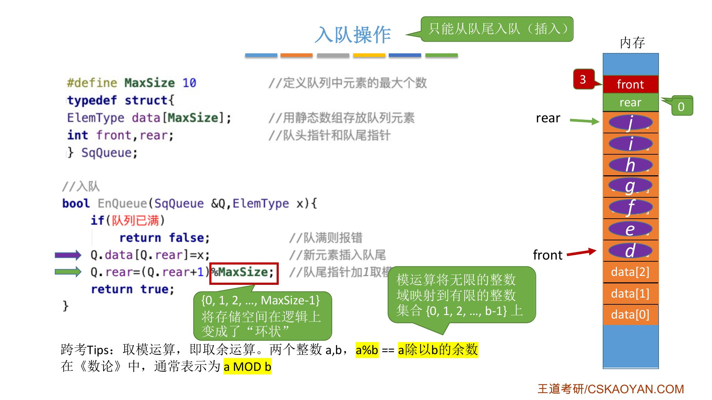{.slide width=0.6}

## 为什么要牺牲一个存储单元

当队列只剩最后一个空闲空间时，就认为[队列已经满了]{.red}。为什么不把最后这个位置也用上？因为初始化时让 `front` 和 `rear` 指向同一个位置，并且用"两个指针是否指向同一位置"来判断队空。如果把最后一个空位也填上，`rear` 后移后会和 `front` 重合，按刚才的逻辑这就成了"队空"，显然不对。

所以必须[牺牲一个存储单元]{.u}：入队前检查队尾指针的**再下一个位置**是不是队头。

::: def
**队满条件**（rear 指向队尾元素后一个位置，牺牲一个存储单元）：`(Q.rear + 1) % MaxSize == Q.front`。
:::

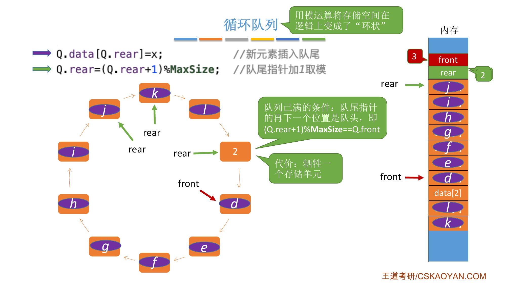{.slide width=0.6}

```c
// 入队
bool EnQueue(SqQueue &Q, ElemType x) {
    if ((Q.rear + 1) % MaxSize == Q.front)   // 判断队满
        return false;                        // 队满则报错
    Q.data[Q.rear] = x;                      // 新元素插入队尾
    Q.rear = (Q.rear + 1) % MaxSize;         // 队尾指针加 1 取模
    return true;
}
```

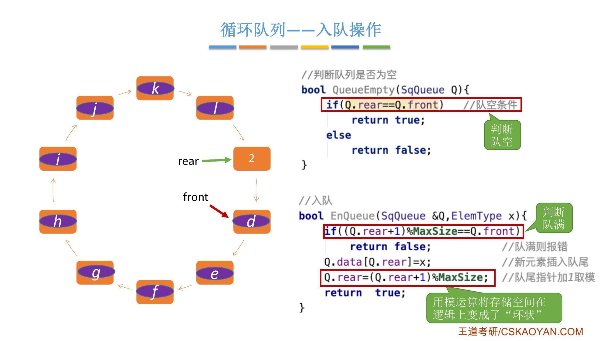{.slide width=0.6}

# 四、出队与读队头

::: cue
出队时 `front` 怎么移动？`GetHead` 比 `DeQueue` 少了哪一句？
:::

只能让队头元素出队。先判空，空则返回 `false`；否则把 `front` 指向的元素赋给 `x`，再让 `front` 后移一位，[同样要对 `MaxSize` 取模]{.u}，`front` 才能转着圈移动。一直出队，直到 `front` 和 `rear` 再次指向同一位置，队列被取空。

```c
// 出队（删除一个队头元素，并用 x 返回）
bool DeQueue(SqQueue &Q, ElemType &x) {
    if (Q.rear == Q.front)                   // 判断队空
        return false;                        // 队空则报错
    x = Q.data[Q.front];
    Q.front = (Q.front + 1) % MaxSize;       // 队头指针后移
    return true;
}

// 获得队头元素的值，用 x 返回
bool GetHead(SqQueue Q, ElemType &x) {
    if (Q.rear == Q.front)
        return false;                        // 队空则报错
    x = Q.data[Q.front];
    return true;
}
```

队列里通常只需要读队头元素。`GetHead` 就是把出队里"`front` 后移"那一句删掉。

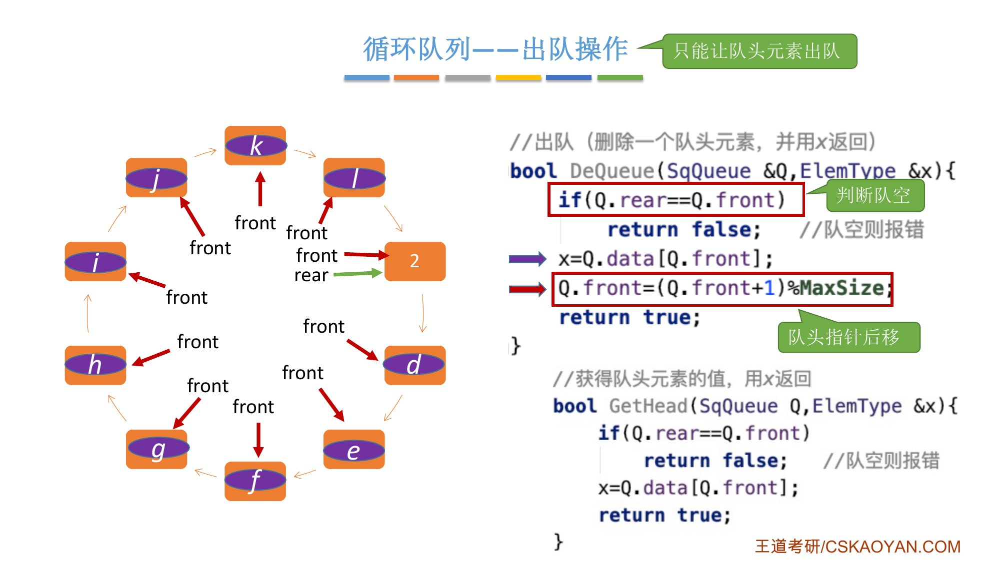{.slide width=0.6}

# 五、判空判满的三种方案

::: cue
三种方案各增加了什么、各自的队空、队满条件是什么？队列元素个数怎么算？
:::

## 方案一：牺牲一个存储单元

初始化 `rear = front = 0`。

- 队空：`Q.rear == Q.front`；
- 队满：`(Q.rear + 1) % MaxSize == Q.front`；
- **队列元素个数**：[`(rear + MaxSize - front) % MaxSize`]{.red}。

课件例子：`rear = 2`，`front = 3`，`MaxSize = 10`，元素个数 $= (2+10-3)\%10 = 9$。老师说：学过数论的同学可以用模运算的性质证明这个式子；不会证明的也要记住，[这个挺常考]{.red}，可以多找例子验证。

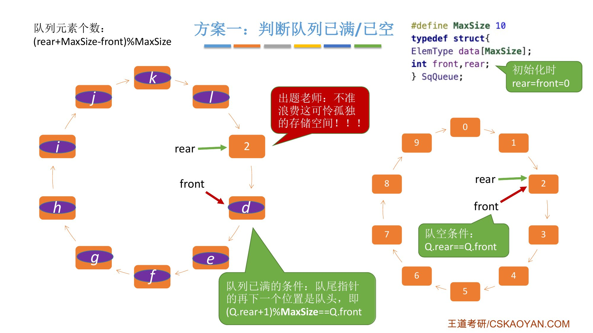{.slide width=0.6}

::: add
**元素个数公式为什么对**（我的说明）：不绕圈时 `rear ≥ front`，个数就是 `rear - front`，加 `MaxSize` 再取模不改变结果；绕了圈时 `rear < front`，`rear - front` 是负数，真实个数是 `rear - front + MaxSize`（把绕过去的一圈补回来），它在 0～`MaxSize`−1 之间，取模也不改变它。加 `MaxSize` 是为了让结果不为负，取模是为了不绕圈时把多加的 `MaxSize` 去掉。
:::

方案一以牺牲一片存储空间为代价，自己写项目已经完全够用。但有的题目会要求[不能浪费这片存储空间]{.u}，而把它也存满后，队满和队空的状态一样（都是 `front == rear`），代码区分不了。下面两种方案解决这个问题。

## 方案二：增加 size 变量

在结构体里定义 `int size;` 记录队列当前长度。

- 初始化：`rear = front = 0; size = 0;`
- 插入成功 `size++`，删除成功 `size--`；
- 队空：`size == 0`；队满：`size == MaxSize`；元素个数就是 `size`。

虽然队空和队满时 `front`、`rear` 都指向同一位置，但可以用 `size` 区分。

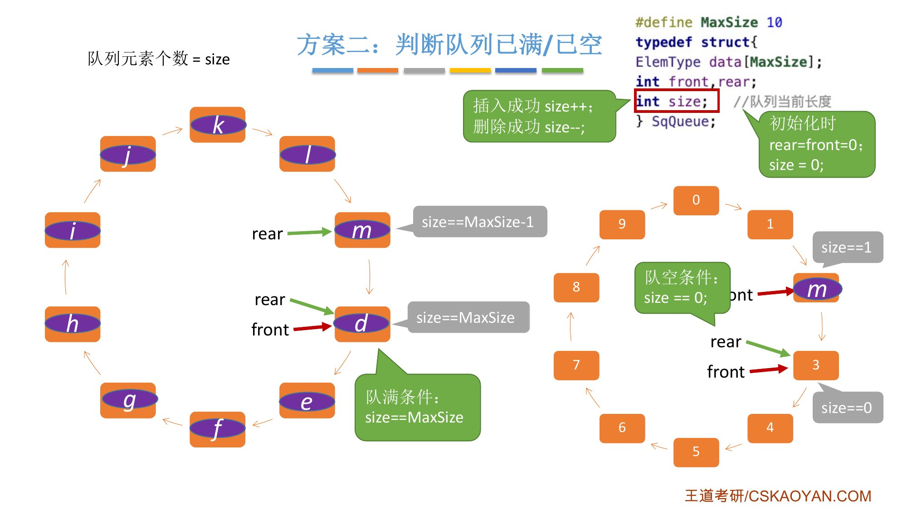{.slide width=0.6}

::: fix
正课字幕 P24 这里是"每一个新元素入队成功，我们都需要让 size 的值减减，每一个对头元素出对成功"，漏了半句。课件写的是[插入成功 `size++`；删除成功 `size--`]{.u}，以课件为准。
:::

## 方案三：增加 tag 变量

在结构体里定义 `int tag;` 记录最近进行的是删除还是插入：

- 每次删除操作成功时，都令 `tag = 0`；每次插入操作成功时，都令 `tag = 1`；
- 初始化：`rear = front = 0; tag = 0;`
- [只有删除操作才可能导致队空，只有插入操作才可能导致队满]{.u}；
- 队空：`front == rear && tag == 0`；
- 队满：`front == rear && tag == 1`。

例：只剩最后一个空位，不管此时 `tag` 是多少，插入成功后 `tag` 都置 1，`rear` 后移和 `front` 重合，这次重合是插入导致的，所以是队满。只剩最后一个元素，删除后 `tag` 置 0，`front` 后移和 `rear` 重合，是删除导致的，所以是队空。

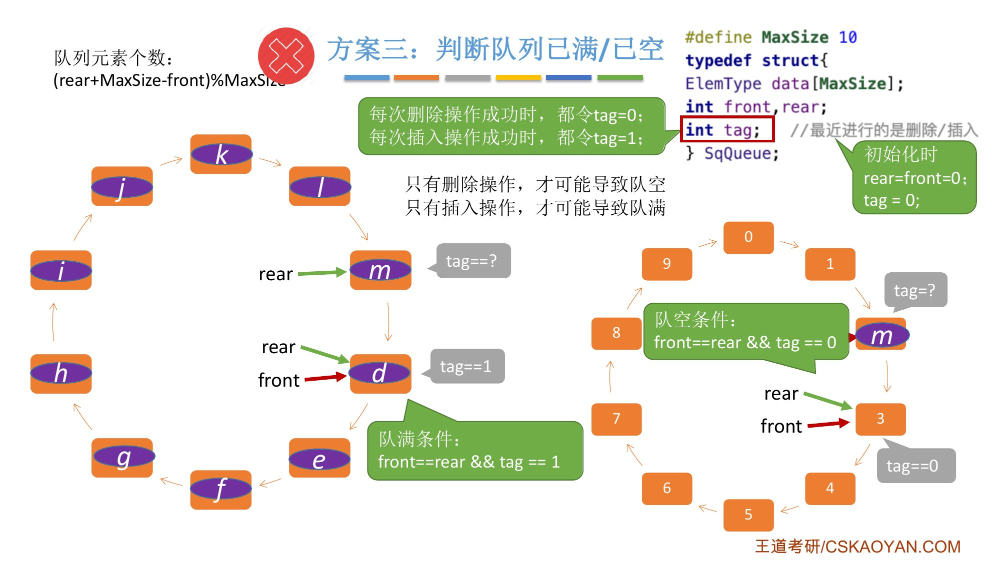{.slide width=0.6}

::: add
课件这一页在左上角的元素个数公式 `(rear+MaxSize-front)%MaxSize` 旁画了一个红叉，老师没有口头解释。我的理解（推断）：方案三队满时 `front == rear`，公式算出来是 0 而不是 `MaxSize`，所以[方案三算长度要先看 `tag`]{.u}：队满时长度是 `MaxSize`，其他情况才用公式。
:::

::: book
王道书第 77–78 页"循环队列"：

- 初始状态 `Q.front=Q.rear=0`；队首指针进 1：`Q.front=(Q.front+1)%MaxSize`；队尾指针进 1：`Q.rear=(Q.rear+1)%MaxSize`；
- 队列长度：`(Q.rear+MaxSize-Q.front)%MaxSize`；
- 出入队时：指针都按[顺时针方向]{.u}移动（见图 3.7）。

队空条件显然是 `Q.front==Q.rear`。但当入队速度远快于出队时，`rear` 会追上 `front`，此时同样满足 `Q.front==Q.rear`，却表示队满。因此仅凭 `front==rear` 无法区分队空与队满。常用以下三种方法：

1. **牺牲一个存储单元**（较为普遍的做法）：约定以"队尾指针的下一位置为队首"作为队满标志。队满 `(Q.rear+1)%MaxSize==Q.front`；队空 `Q.front==Q.rear`；队列中元素个数 `(Q.rear-Q.front+MaxSize)%MaxSize`。
2. **增设 size 成员**：入队成功 `size++`，出队成功 `size--`。队空 `Q.size==0`，队满 `Q.size==MaxSize`。两种情形均有 `Q.front==Q.rear`，由 `size` 区分。
3. **增设 tag 标志位**：出队后置 `tag=0`，若此时 `Q.front==Q.rear`，则为队空；入队后置 `tag=1`，若此时 `Q.front==Q.rear`，则为队满。

书上第 78–79 页"循环队列的操作（基于牺牲一个单元法）"的初始化、判队空、入队、出队代码和课件相同（书上 `MaxSize` 是 50）。考点追踪：特定条件下循环队列队头/队尾指针的初值（2011）；循环队列判空/满的条件（2014）。
:::

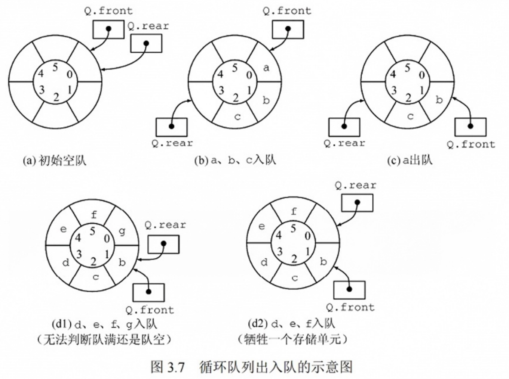{.slide width=0.6}

::: add
**名词统一**：书上队列长度写作 `(Q.rear-Q.front+MaxSize)%MaxSize`，课件写作 `(rear+MaxSize-front)%MaxSize`，只是加法交换了顺序，同一个式子。
:::

# 六、其他出题方法：rear 指向队尾元素

::: cue
`rear` 指向队尾元素时，入队的两句顺序怎么变？初始化时 `rear` 应该指向哪里？判空、判满各是什么？
:::

前面所有方法都基于"队尾指针指向队尾元素的**下一个**位置"。考试中也可能遇到[队尾指针**指向队尾元素**]{.red}的情况，代码会有不同。考试时一定要注意审题。

**入队**：要先让 `rear` 后移一位，再往这个位置写入 `x`：

```c
Q.rear = (Q.rear + 1) % MaxSize;    // rear 指向队尾元素：先后移
Q.data[Q.rear] = x;                 // 再写入
```

出队不变：`x = Q.data[Q.front]; Q.front = (Q.front + 1) % MaxSize;`

**初始化**：因为每次入队都是先让 `rear` 后移再放元素，比较合理的方式是[`front` 指向 0，`rear` 指向 `n-1`]{.u}（`MaxSize - 1`）。这样插入第一个元素时 `rear` 先后移到 0，再把 `x` 放进 0 号位置。老师说这种初始化方式可能不太符合直觉。

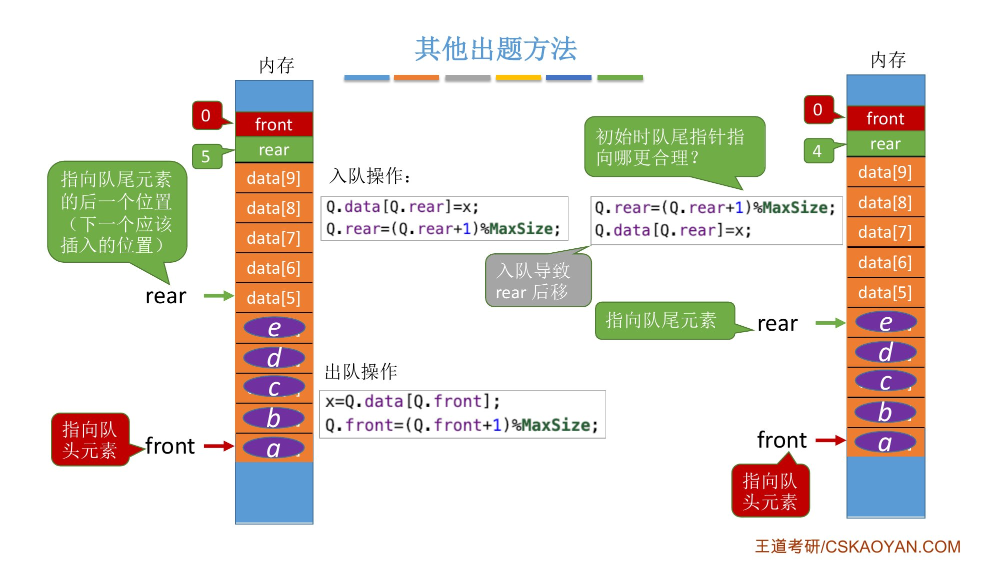{.slide width=0.6}

**判空**：队尾指针的下一个位置是队头：`(Q.rear + 1) % MaxSize == Q.front`。

**判满**：如果所有位置都填满，`rear` 的下一个位置也是 `front`，和队空一样，区分不了。处理方法和之前一样：

- 方案一：规定队头指针前面的这个存储单元不能存数据（牺牲一个存储单元），`rear` 最多只能走到它前面。于是[头指针在尾指针后一个位置是队空，在尾指针后两个位置是队满]{.u}；
- 方案二：增加辅助变量 `size` 或 `tag`，这里不再展开。

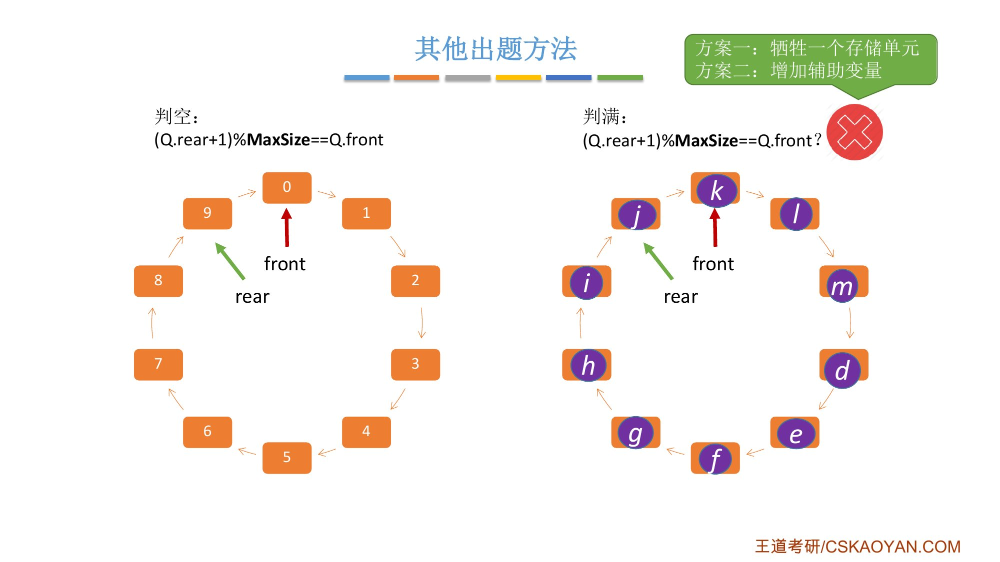{.slide width=0.6}

::: book
王道书第 76 页：队首指针 `front` 指向队首元素，队尾指针 `rear` 指向队尾元素的下一个位置。[不同教材对 `front` 和 `rear` 指针含义的约定可能不同]{.u}（例如，`rear` 可能指向队尾元素或其下一位置），这会导致入队和出队操作的具体实现不同。
:::

::::: add
**老师留的思考题**："如果让队尾指针指向队尾元素，同时采用增加 `size` 变量记录队列长度的策略，这些基本操作怎么实现？"课件知识回顾里把它扩展成 ①a、①b、①c、②a、②b、②c 六种组合（① `rear` 指向队尾元素后一个位置；② `rear` 指向队尾元素；a 牺牲一个存储单元；b 增加 `size`；c 增加 `tag`）。建议先自己想，再对照我的答案。记 $M$ = `MaxSize`：

- **初始化**：① 类 `front = rear = 0`；② 类 `front = 0; rear = M-1`。b 方案再加 `size = 0`，c 方案再加 `tag = 0`。

::: {.tbl widths="0.6,2.1,2.1,2.3"}
| 方案 | 判空 | 判满 | 队列长度 |
|---|---|---|---|
| ①a | `rear == front` | `(rear+1)%M == front` | `(rear-front+M)%M` |
| ①b | `size == 0` | `size == M` | `size` |
| ①c | `rear == front && tag == 0` | `rear == front && tag == 1` | 队满时 $M$，否则同 ①a |
| ②a | `(rear+1)%M == front` | `(rear+2)%M == front` | `(rear-front+1+M)%M` |
| ②b | `size == 0` | `size == M` | `size` |
| ②c | `(rear+1)%M == front && tag == 0` | `(rear+1)%M == front && tag == 1` | 队满时 $M$，否则同 ②a |
:::


- 入队：① 先放再移（`data[rear]=x; rear=(rear+1)%M;`）；② 先移再放（`rear=(rear+1)%M; data[rear]=x;`）。出队六种都一样：`x=data[front]; front=(front+1)%M;`
- b 方案入队成功 `size++`、出队成功 `size--`；c 方案入队成功 `tag=1`、出队成功 `tag=0`；
- a 方案最多存 $M-1$ 个元素，b、c 方案能存满 $M$ 个。

这张表我用程序模拟验证过：$M=6$，六种方案各随机做 3000 轮、每轮 40 次入队/出队，每一步的判空、判满、长度都和真实队列一致。
:::::

# 七、知识回顾

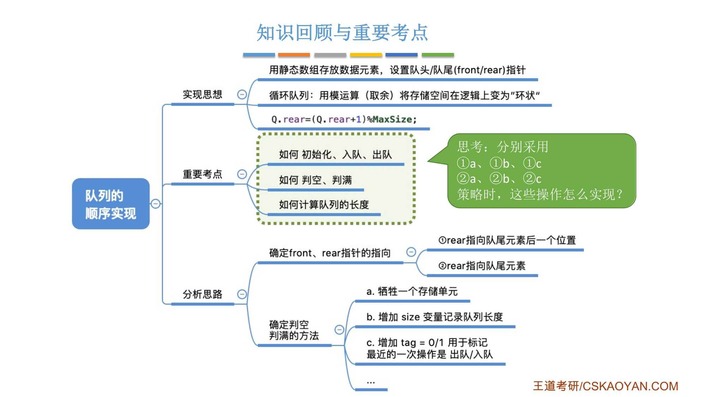{.slide width=0.65}

老师的总结：这一节很容易在选择题中考察，要注意两个方面：

1. 队尾指针到底指向[队尾元素的后一个位置]{.u}，还是[指向队尾元素]{.u}；
2. 题目给的判空、判满方法是什么：牺牲一个存储单元，还是增加辅助变量（`size`、`tag`）。

把这几种情况想明白，这一节的考题基本没有什么难得住的。

::: recall
正课 3.1.2 讲顺序栈时也有同样的"先审题"：`top` 指向栈顶元素还是栈顶元素的下一个位置，两种设计的进栈、出栈顺序相反。这里的 `rear` 是同一个道理：[指向空位就先放再移，指向元素就先移再放]{.u}。
:::

::: summary
**顺序队列** = 静态数组 `data[MaxSize]` + `front`（指向队头元素）+ `rear`（默认指向队尾元素的后一个位置）。

**循环队列**：指针后移都写成 `(指针+1)%MaxSize`，用模运算把存储空间在逻辑上变成"环状"，解决 `rear==MaxSize` 时数组前面还有空位的问题（书上叫**假溢出**）。

**rear 指向队尾元素后一个位置时**：

- 初始化 `front=rear=0`；入队 `data[rear]=x; rear=(rear+1)%MaxSize`；出队 `x=data[front]; front=(front+1)%MaxSize`；
- 方案一（牺牲一个单元）：队空 `rear==front`，队满 [`(rear+1)%MaxSize==front`]{.red}；
- 方案二（`size`）：队空 `size==0`，队满 `size==MaxSize`；
- 方案三（`tag`，删除置 0、插入置 1）：队空 `front==rear && tag==0`，队满 `front==rear && tag==1`；
- 元素个数 [`(rear+MaxSize-front)%MaxSize`]{.red}（常考）。

**rear 指向队尾元素时**：初始化 `front=0, rear=MaxSize-1`；入队先移再放；判空 `(rear+1)%MaxSize==front`；牺牲一个单元时判满 `(rear+2)%MaxSize==front`。

**自测**：① 为什么 `rear==MaxSize` 不能作为队满条件？② 牺牲一个单元时队满条件是什么，为什么要牺牲？③ `MaxSize=10`，`front=7`，`rear=3`（rear 指向队尾元素后一个位置），队中有几个元素？④ `tag` 方案中，为什么 `front==rear && tag==1` 一定是队满？⑤ `rear` 指向队尾元素时，初始化 `rear` 设成多少，入队两句怎么写？
:::
