# 这一节在讲什么

::: cue
链队列和单链表是什么关系？要实现哪两个版本？
:::

用**链式存储**实现队列。学过单链表后这一节很轻松：单链表可以在任何位置插入、删除，队列只能在队尾插入、在队头删除，所以老师说[队列其实是单链表的一个"阉割版"]{.u}。和单链表一样，可以实现**带头结点**和**不带头结点**两个版本。

# 一、链队列的定义

::: cue
链队列为什么既要保存队头指针、又要保存队尾指针？
:::

```c
typedef struct LinkNode {           // 链式队列结点
    ElemType data;
    struct LinkNode *next;
} LinkNode;

typedef struct {                    // 链式队列
    LinkNode *front, *rear;         // 队列的队头和队尾指针
} LinkQueue;
```

- 上面的 `struct` 定义队列中一个一个的结点；下面的 `LinkQueue` 只包含两个指针：队头指针和队尾指针。
- 学单链表时，只需保存头指针 `L`，后续结点都能顺着找到。但如果只保存头指针，要在表尾插入，就得从头往后找到最后一个结点，时间复杂度 $O(n)$。队列每次都在表尾插入，所以[专门用一个尾指针 `rear` 指向最后一个结点]{.u}，插入时不用从头找。
- 出队只需从队头找到第一个数据结点删除。所以声明队列时，[既要保存队头指针，也要保存队尾指针]{.u}。
- 带头结点和不带头结点两种实现，队头指针的指向不一样：带头结点时 `front` 指向头结点；不带头结点时 `front` 指向第一个数据结点。

用链式存储实现的队列叫**链队列**。

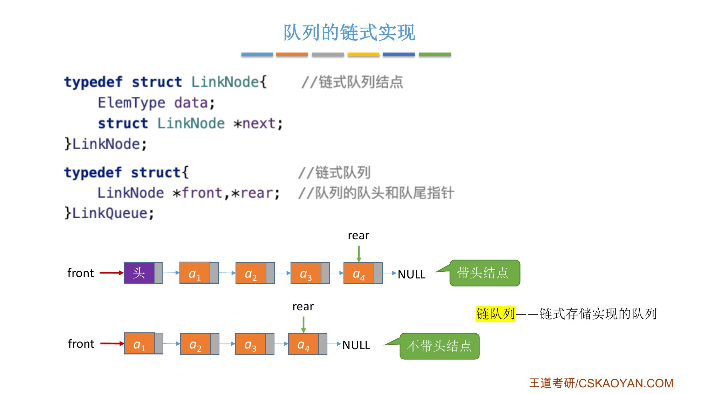{.slide width=0.6}

::: book
王道书第 79 页：队列的链式表示称为**链式队列**，本质上是一个同时带有队首指针和队尾指针的单链表。队首指针指向队头结点，队尾指针指向队尾结点，即单链表的最后一个结点。类型定义和课件相同。考点追踪：链式队列的应用场景（2019）。
:::

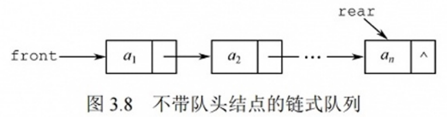{.slide width=0.5}

::: add
**名词统一**：课件叫"链队列"，王道书叫"链式队列"，是同一个东西。书上图 3.8、3.9 的图题写的是"不带**队头结点**""带**队头结点**"，就是课件说的"不带头结点""带头结点"。
:::

# 二、初始化与判空

::: cue
带头结点和不带头结点，初始化时 `front`、`rear` 分别指向哪里？判空条件各是什么？
:::

## 带头结点

`malloc` 申请一个头结点，让 `front` 和 `rear` 同时指向它，再让头结点的 `next` 指向 `NULL`。

```c
// 初始化队列（带头结点）
void InitQueue(LinkQueue &Q) {
    // 初始时 front、rear 都指向头结点
    Q.front = Q.rear = (LinkNode *)malloc(sizeof(LinkNode));
    Q.front->next = NULL;
}

// 判断队列是否为空
bool IsEmpty(LinkQueue Q) {
    if (Q.front == Q.rear)
        return true;
    else
        return false;
}

void testLinkQueue() {
    LinkQueue Q;                    // 声明一个队列
    InitQueue(Q);                   // 初始化队列
    // ……后续操作
}
```

判空：看 `front` 和 `rear` 是否指向同一个结点；也可以看[头结点的 `next` 是否为 `NULL`]{.u}。

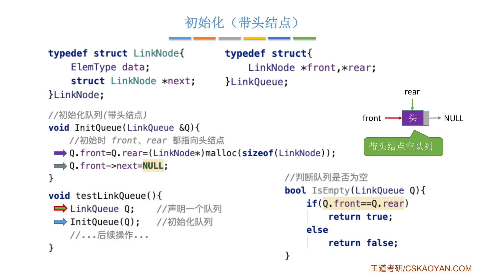{.slide width=0.6}

## 不带头结点

初始化时让 `front` 和 `rear` 都指向 `NULL`。判空只需看 `front` 是否等于 `NULL`（也可以看 `rear` 是否等于 `NULL`）。

```c
// 初始化队列（不带头结点）
void InitQueue(LinkQueue &Q) {
    // 初始时 front、rear 都指向 NULL
    Q.front = NULL;
    Q.rear = NULL;
}

// 判断队列是否为空（不带头结点）
bool IsEmpty(LinkQueue Q) {
    if (Q.front == NULL)
        return true;
    else
        return false;
}
```

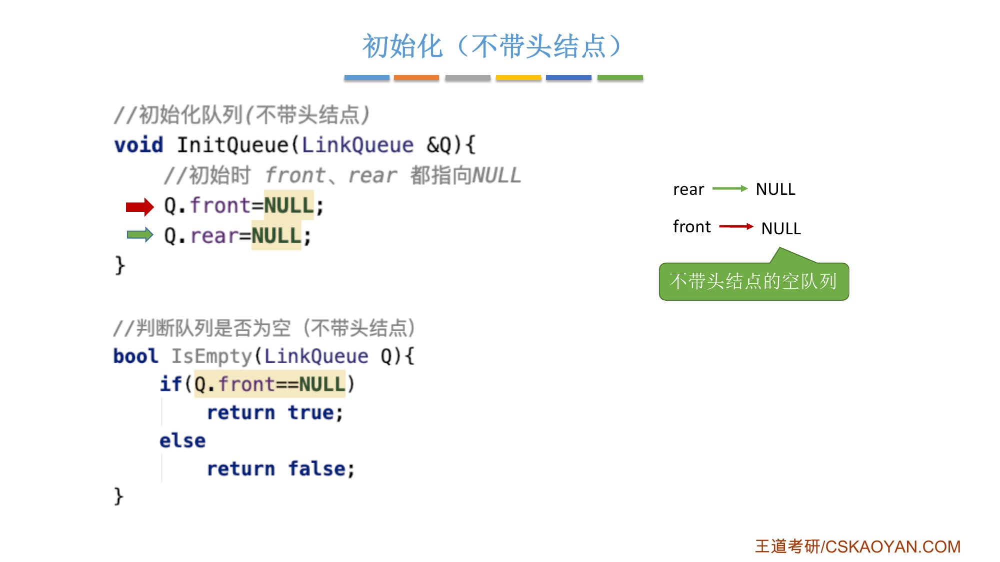{.slide width=0.6}

::: book
王道书第 79 页：当不带头结点时，若 [`Q.front==NULL` 且 `Q.rear==NULL`]{.u}，则链式队列为空队列。考点追踪：链式队列判空的条件（2019）。
:::

# 三、入队

::: cue
不带头结点的队列，第一个元素入队时为什么要特殊处理？
:::

## 带头结点

1. `malloc` 申请新结点 `s`，把 `x` 放进去；
2. 新结点一定是队列的最后一个结点，所以 `s->next = NULL`；
3. 把新结点连到当前表尾结点之后：`Q.rear->next = s`；
4. 让表尾指针指向这个新的表尾结点：`Q.rear = s`。

```c
// 新元素入队（带头结点）
void EnQueue(LinkQueue &Q, ElemType x) {
    LinkNode *s = (LinkNode *)malloc(sizeof(LinkNode));
    s->data = x;
    s->next = NULL;
    Q.rear->next = s;               // 新结点插入到 rear 之后
    Q.rear = s;                     // 修改表尾指针
}
```

带头结点时，插入[第一个元素和后续元素用的代码逻辑都一样]{.u}。

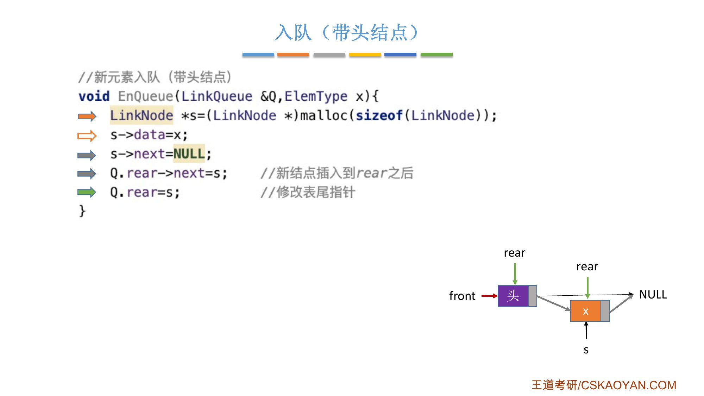{.slide width=0.6}

## 不带头结点

刚开始 `front`、`rear` 都指向 `NULL`，插入第一个元素时[两个指针都要修改]{.red}：

```c
// 新元素入队（不带头结点）
void EnQueue(LinkQueue &Q, ElemType x) {
    LinkNode *s = (LinkNode *)malloc(sizeof(LinkNode));
    s->data = x;
    s->next = NULL;
    if (Q.front == NULL) {          // 在空队列中插入第一个元素
        Q.front = s;                // 修改队头队尾指针
        Q.rear = s;
    } else {
        Q.rear->next = s;           // 新结点插入到 rear 结点之后
        Q.rear = s;                 // 修改 rear 指针
    }
}
```

之后再入队，就是对 `rear` 指向的结点做后插操作，并且每次都别忘了让 `rear` 指向新的表尾结点。

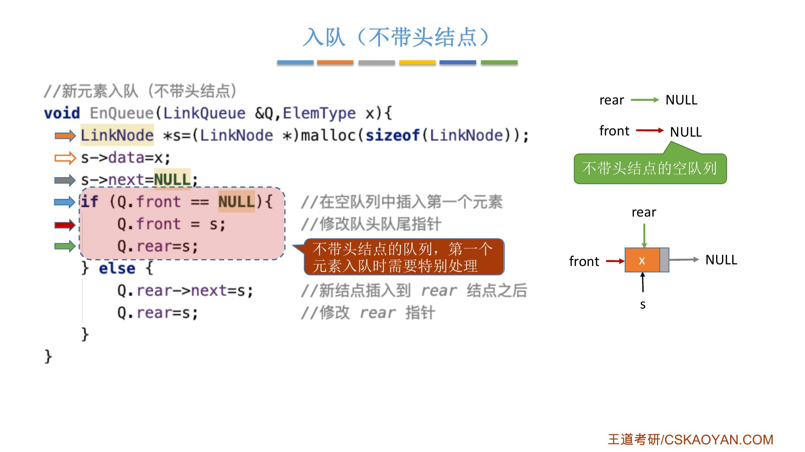{.slide width=0.6}

# 四、出队

::: cue
最后一个结点出队时，带头结点和不带头结点各要额外改什么？
:::

## 带头结点

1. 判空，空则返回 `false`；
2. 让 `p` 指向这次要删除的结点，即[头结点后面的那个结点]{.u}；
3. 用 `x` 把要删除的数据元素带回去（`x` 加了引用符号）；
4. 修改头结点的 `next` 指针；
5. 如果这次删除的 `p` 恰好是表尾结点（队列中最后一个结点），还要修改表尾指针，让 `rear` 指向头结点，`rear` 和 `front` 指向同一位置，队列又变回空队列；
6. 释放 `p`。

```c
// 队头元素出队（带头结点）
bool DeQueue(LinkQueue &Q, ElemType &x) {
    if (Q.front == Q.rear)
        return false;               // 空队
    LinkNode *p = Q.front->next;
    x = p->data;                    // 用变量 x 返回队头元素
    Q.front->next = p->next;        // 修改头结点的 next 指针
    if (Q.rear == p)                // 此次是最后一个结点出队
        Q.rear = Q.front;           // 修改 rear 指针
    free(p);                        // 释放结点空间
    return true;
}
```

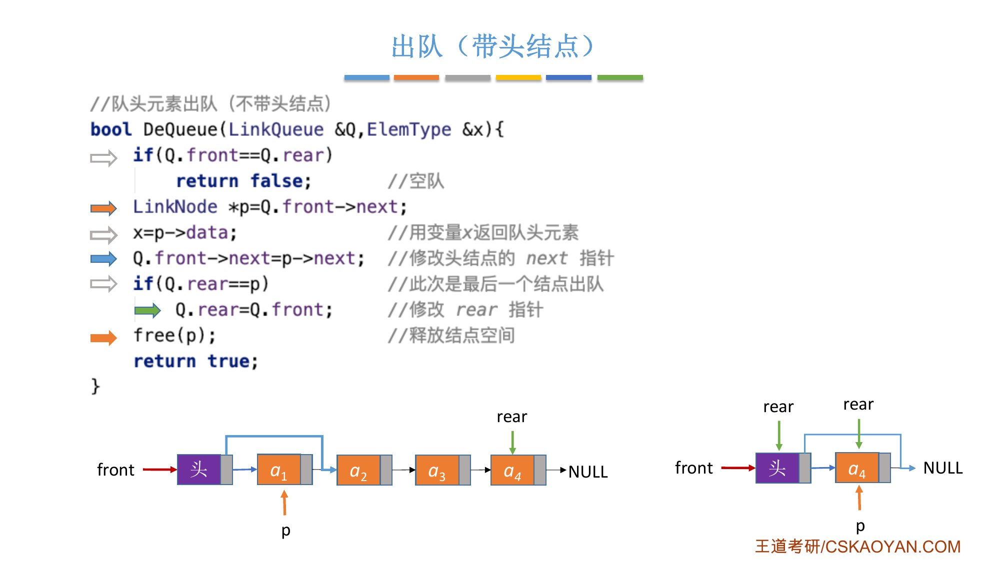{.slide width=0.6}

::: fix
课件这一页标题是"出队（带头结点）"，但代码第一行注释写成了 `//队头元素出队（不带头结点）`。看代码（`p=Q.front->next`、最后 `Q.rear=Q.front`）是带头结点的版本，注释写错了。
:::

## 不带头结点

每次出队的是 `front` 指向的结点。没有头结点，所以[每个队头元素出队后都要修改 `front`]{.u}；最后一个结点出队后，还要把 `front` 和 `rear` 都置为 `NULL`，恢复成空队列的状态。

```c
// 队头元素出队（不带头结点）
bool DeQueue(LinkQueue &Q, ElemType &x) {
    if (Q.front == NULL)
        return false;               // 空队
    LinkNode *p = Q.front;          // p 指向此次出队的结点
    x = p->data;                    // 用变量 x 返回队头元素
    Q.front = p->next;              // 修改 front 指针
    if (Q.rear == p) {              // 此次是最后一个结点出队
        Q.front = NULL;             // front 指向 NULL
        Q.rear = NULL;              // rear 指向 NULL
    }
    free(p);                        // 释放结点空间
    return true;
}
```

老师说这些不难理解，只要细心一点，写代码肯定没问题。

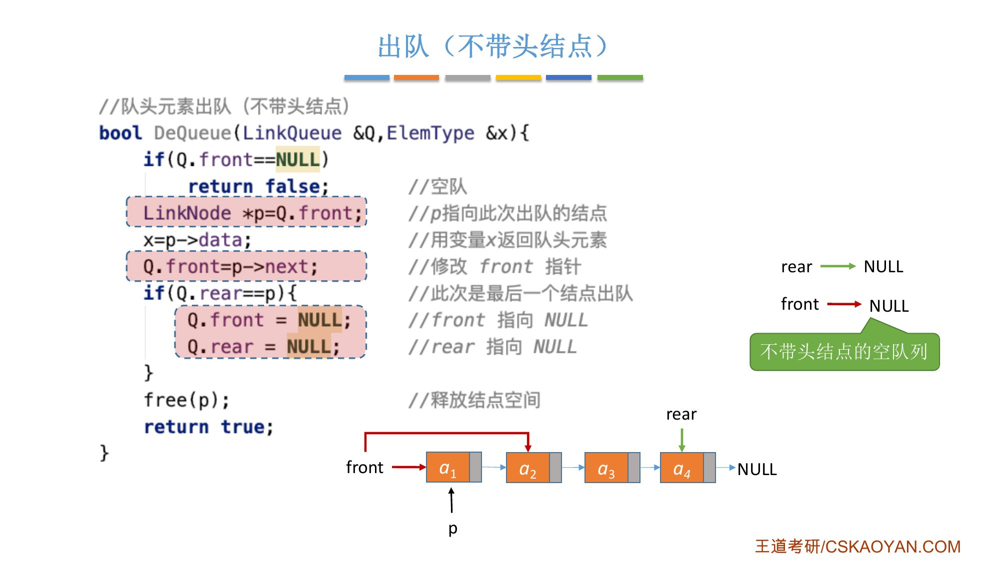{.slide width=0.6}

::: book
王道书第 79–80 页：

- **入队操作**：创建一个新结点，将其插入链表尾部，并令 `Q.rear` 指向该结点；若原队列为空，则同时令 `Q.front` 也指向该结点；
- **出队操作**：先判断队列是否为空；若非空，则取出队首元素，删除对应结点，并令 `Q.front` 指向下一个结点；若被删结点是最后一个元素，则将 `Q.front` 和 `Q.rear` 均置为 `NULL`。

不难发现，不带头结点的链式队列在边界处理上较为烦琐。因此，[通常将链式队列设计为带头结点的单链表]{.u}，从而使插入与删除操作逻辑统一（图 3.9）。

书上"链式队列的基本操作"给的是带头结点版本，初始化、判队空、入队、出队代码和课件的带头结点版本相同（书上判空函数名是 `QueueEmpty`）。考点追踪：链式队列出队/入队操作的基本过程（2019）。
:::

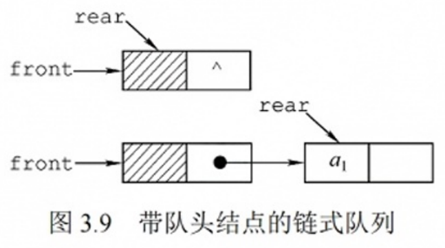{.slide width=0.4}

# 五、队列满的条件

::: cue
为什么顺序队列要花大篇幅判满，链队列却一般不用？
:::

- **顺序存储**：循环队列的空间是用静态数组提前预分配的，容量有限、不可拓展，[预分配的空间耗尽时队满]{.u}，所以上一节花了很大篇幅判断队满；
- **链式存储**：只要内存资源还足够，就可以继续扩容，[一般不会队满]{.red}，除非内存不足，所以可以不用关心这个问题。

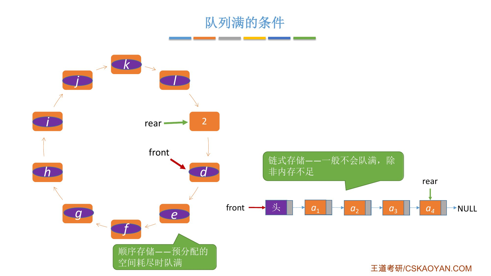{.slide width=0.6}

::: book
王道书第 79 页：链式队列特别适用于[元素数量频繁变化]{.u}的场景，且不存在队满或溢出问题。此外，若程序中需使用多个队列（如同多个栈的情形），优先选用链式队列可避免存储分配不合理或溢出等问题。
:::

# 六、知识回顾

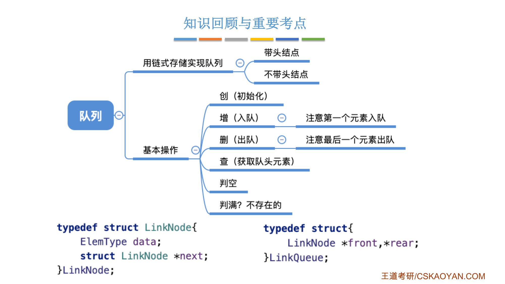{.slide width=0.6}

老师的总结：如果题目要求实现一个队列，先看它要求[带头结点还是不带头结点]{.u}；第一个元素入队、最后一个元素出队时可能需要特殊处理，特别注意修改 `rear` 指针。其他方面和单链表没有太大区别，复习时可以和单链表对比学习。

**思考：队列长度怎么算？** 只能从队头结点开始依次往后遍历，统计结点个数，需要 $O(n)$ 的时间。如果队列长度需要频繁访问，可以在 `LinkQueue` 里加一个 `int` 型变量 `length`，记录当前队列有多少个元素。

老师强调：数据结构不是用来考试的东西，是解决问题的工具，不要教条化。问题需要什么，就可以因地制宜、灵活地往数据结构里添加需要的东西；课程里学的只是比较容易错、比较核心的基本操作。

::: recall
正课 2.3.2 单链表的插入删除：带头结点时，在第一个位置插入和在其他位置插入的代码一样；不带头结点时，插入、删除第 1 个结点要单独处理，因为头指针 `L` 要改。这里"不带头结点时第一个元素入队、最后一个元素出队要特殊处理"是同一个原因。
:::

::: summary
**链队列** = 同时带队头指针 `front` 和队尾指针 `rear` 的单链表；只能在队尾插入、队头删除（单链表的"阉割版"）。有 `rear` 指针，入队不用从头找表尾，$O(1)$。

**带头结点**：初始化 `front = rear = 头结点`，`头结点->next = NULL`；判空 [`front == rear`]{.red}；入队 `rear->next = s; rear = s;`；出队删 `front->next`，[若删的是最后一个结点，`rear = front`]{.red}。

**不带头结点**：初始化 `front = rear = NULL`；判空 [`front == NULL`]{.red}（书上写 `front==NULL` 且 `rear==NULL`）；第一个元素入队时 `front`、`rear` 都指向 `s`；出队后改 `front`，最后一个结点出队后 `front`、`rear` 都置 `NULL`。

**队满**：顺序存储预分配空间耗尽时队满；链式存储一般不会队满（除非内存不足）。书上：通常设计为带头结点，使插入与删除逻辑统一。

**队列长度**：遍历 $O(n)$；常用时可加 `length` 变量。

**自测**：① 带头结点链队列的判空条件有哪两种写法？② 带头结点时，最后一个结点出队要额外做什么？③ 不带头结点时，第一个元素入队要改哪两个指针？④ 为什么链队列一般不用判满？
:::
