# 这一节在讲什么

::: cue
双端队列这个考点，真题喜欢怎么考？
:::

**双端队列**是真题考过的一个概念，也是一种操作受限的线性表。它还有两个变种：输入受限的双端队列、输出受限的双端队列。考试喜欢考的是[判断一个输出序列是否合法]{.red}。

# 一、栈、队列、双端队列

::: cue
栈、队列、双端队列对插入和删除的限制各是什么？双端队列只用一端会变成什么？
:::

本质上这几种数据结构都是[插入和删除操作受限的线性表]{.u}，只是限制不一样：

- **栈**：只允许从一端插入和删除的线性表；
- **队列**：只允许从一端插入、另一端删除的线性表；
- **双端队列**：允许从两端插入、两端删除的线性表。

如果只使用双端队列其中一端的插入、删除操作，它就[退化成了栈]{.u}。所以栈能实现的功能，双端队列肯定都能实现。

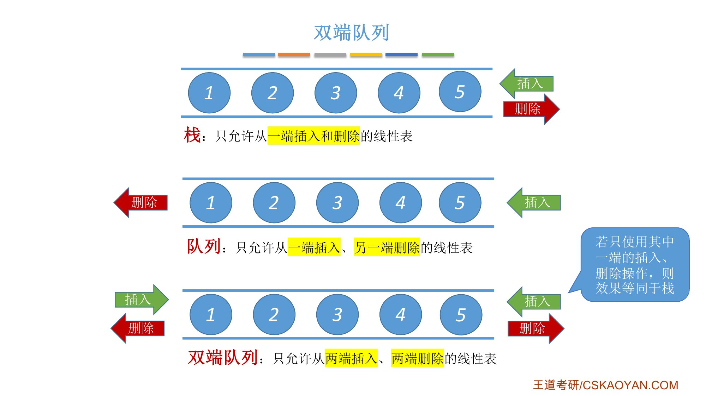{.slide width=0.6}

# 二、两种受限的双端队列

::: cue
"输入受限"和"输出受限"分别限制了什么？
:::

::: def
**输入受限的双端队列**：只允许从一端插入、两端删除的线性表。
:::

::: def
**输出受限的双端队列**：只允许从两端插入、一端删除的线性表。
:::

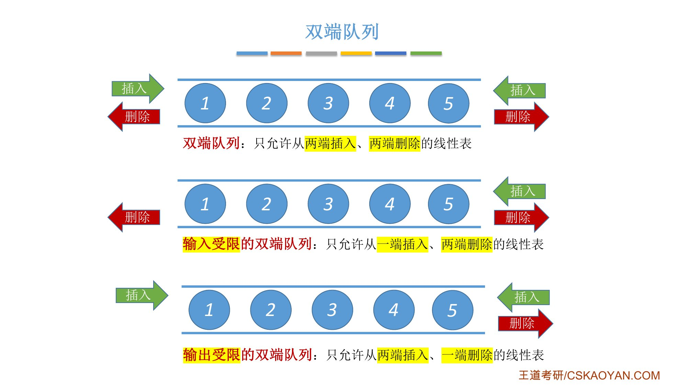{.slide width=0.6}

::: book
王道书第 80–81 页：双端队列是一种允许在两端进行插入和删除操作的线性表（图 3.10）。双端队列两端的地位是平等的，为便于理解，可将左端视为**前端**，右端视为**后端**。

- 在双端队列**入队**时：前端插入的元素排列在队列中后端插入的元素之前；后端插入的元素排列在队列中前端插入的元素之后；
- 在双端队列**出队**时：无论是从前端还是后端出队，先出的元素总是排列在后出的元素之前。

**输出受限**的双端队列：允许在一端进行插入和删除，但在另一端仅允许插入（图 3.11）。**输入受限**的双端队列：允许在一端进行插入和删除，但在另一端仅允许删除（图 3.12）。若限定双端队列从某个端点插入的元素只能从该端点删除，则该双端队列就[蜕变为两个栈底相邻接的栈]{.u}。考点追踪：双端队列出入队操作的分析（2010、2021）。
:::

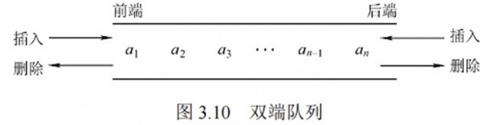{.slide width=0.5}

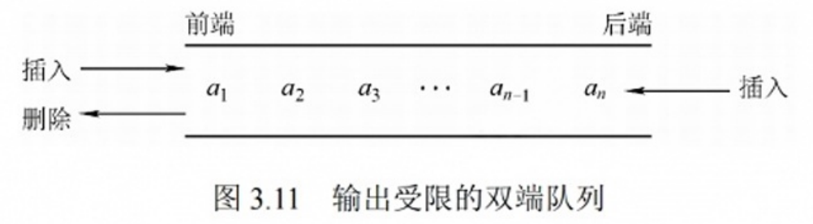{.slide width=0.5}

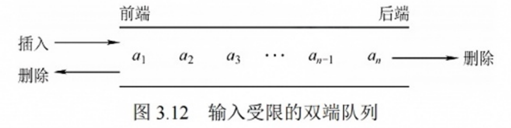{.slide width=0.5}

::: add
**名词统一**：课件说"只允许从一端插入、两端删除"，书上说"一端可插可删、另一端只能删"，两种说法是同一个结构（输入受限）；输出受限同理。王道书第 80 页留了一道思考："如何由入队序列 a, b, c, d 得到出队序列 d, c, a, b？"我的答案：a、b、c、d 依次从后端入队，队中为 a b c d；d、c 从后端出队，a、b 从前端出队。只用到一端入队，所以输入受限的双端队列也能做到。
:::

# 三、考点：判断输出序列合法性

::: cue
输入序列 1, 2, 3, 4，用栈能得到哪 14 个输出序列？为什么先讨论栈？
:::

题目：若数据元素输入序列为 1, 2, 3, 4，哪些输出序列合法、哪些非法？四个元素全排列共 $A_4^4 = 4! = 24$ 种。

## 先看栈

先讨论栈，因为双端队列只用一端就退化成栈，[栈里合法的输出序列，在双端队列里一定也合法]{.u}。老师举的四个例子：

- **1234**：1 入栈、出栈，2 入栈、出栈，3、4 同理。合法；
- **2413**：第一个输出 2，说明 1 已经在 2 之前入栈。2 出栈后要输出 4，必须先把 3 压入栈，3、4 都入栈后 4 出栈。接下来出栈的一定是 3，[不可能是 1]{.red}。非法；
- **3241**：3 输出前 1、2 已入栈；3 出栈，2 出栈，4 入栈再出栈，最后 1 出栈。合法；
- **4321**：4 最先出栈，说明 1、2、3 都已入栈，顺序不能改变，只能按 3、2、1 出栈。合法。由此，4 开头的其他序列都不可能。

再如 **3412**：3 最先出栈，栈里一定已经有 1、2。之后无论怎么操作，[一定是 2 先出、1 在 2 之后出]{.u}。所以 3 开头、且 1 在 2 之前的序列（3124、3142、3412）都非法。

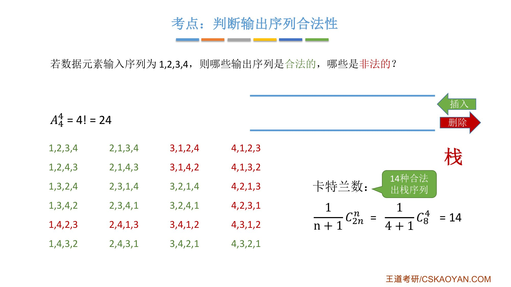{.slide width=0.6}

用栈得到的 14 个合法序列（课件绿色）：

1234、1243、1324、1342、1432、2134、2143、2314、2341、2431、3214、3241、3421、4321。

10 个非法序列（课件红色）：1423、2413、3124、3142、3412、4123、4132、4213、4231、4312。

卡特兰数：$\dfrac{1}{n+1}C_{2n}^{n} = \dfrac{1}{4+1}C_8^4 = 14$，和上面吻合。老师说：考试基本不可能让你列出所有合法出栈序列，验证的情况太多，而且难度不大，区分不出水平差距。但[卡特兰数的计算公式可以记一下]{.u}，不需要证明，要会用。

::: recall
正课 3.1.1"常考题型"讲过卡特兰数，$n=5$ 时 42 种。3.1 课后习题第六节定理 6.3 的 3-1-2 判别：栈的输出序列非法，当且仅当其中有三个元素按"最大、最小、中间"的相对次序出现（不必相邻）。上面 10 个非法序列每个都含这样的三元组，例如 2413 中的 4、1、3。
:::

## 输入受限的双端队列

::: cue
输入受限时，4 第一个输出后，为什么下一个不能是 2？
:::

栈中合法的序列在这里一定合法（按课件图，输入受限只能从右端插入；只用右端插入、删除就和栈一样），所以[只需验证栈中不合法的那 10 个]{.u}。

- **1423**：只能从一端插入。先插入 1，1 可以从右边或左边输出。接着要输出 4，就要先输入 2、3、4，因为只能从一端输入，队中排列是 2 3 4。4 从右边删除，2 从左边删除，最后 3。合法；
- **3142**：3 先输出，说明 1、2、3 已输入。3 从右边输出，1 从左边输出；4 还没输入，从右边放进去再从右边输出；最后 2 从左边输出。合法；
- **4 开头**：1、2、3、4 都已输入，队中为 1 2 3 4。4 从右边出去后，接下来可以先输出 1 或者 3，[不可能先输出 2]{.red}，因为 2 被夹在 1 和 3 中间，只能从两边删除。所以 **4213**、**4231** 非法。

输入受限的双端队列只有这两个序列不可能得到，其余都合法。

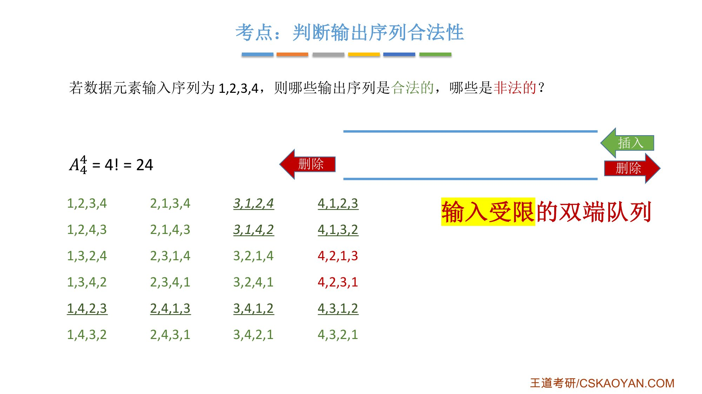{.slide width=0.6}

## 输出受限的双端队列

::: cue
输出受限时，为什么 4132 不可能？
:::

同样只需验证栈中不合法的序列。按课件图，输出受限只能从右端删除，所以要按某个顺序输出，这些元素（两者都在队中时）在队中[从右到左]{.u}就必须按这个顺序排好。分析方法：看能不能从两边交替插入，拼出期望的排列。

- **1423**：1 先输入、紧接着输出。要输出 4 2 3，队中必须从右到左是 4 2 3：先插入 2，3 从左边插入（3 在 2 左边），4 从右边插入。合法；
- **3142**：3 出队前 1、2、3 都已入队，且相对位置已经确定。3 之后是 1 先输出、2 再输出，所以 2 要在 1 的左边：先插入 1，再从左边插入 2；3 从右边插入、右边删除；1 出队；4 从右边插入、删除；最后 2 出队。合法；
- **4132**：4 先输出，1、2、3 已经入队，并且要求队中从右到左是 4 1 3 2。先插入 1，接下来插入 2，无论从左边还是右边插入，[2 一定和 1 相邻]{.red}，"2 和 1 之间还有一个 3"的排列插不出来。非法。**4231** 同理，非法。

输出受限的双端队列有这两个非法序列，其余都合法。

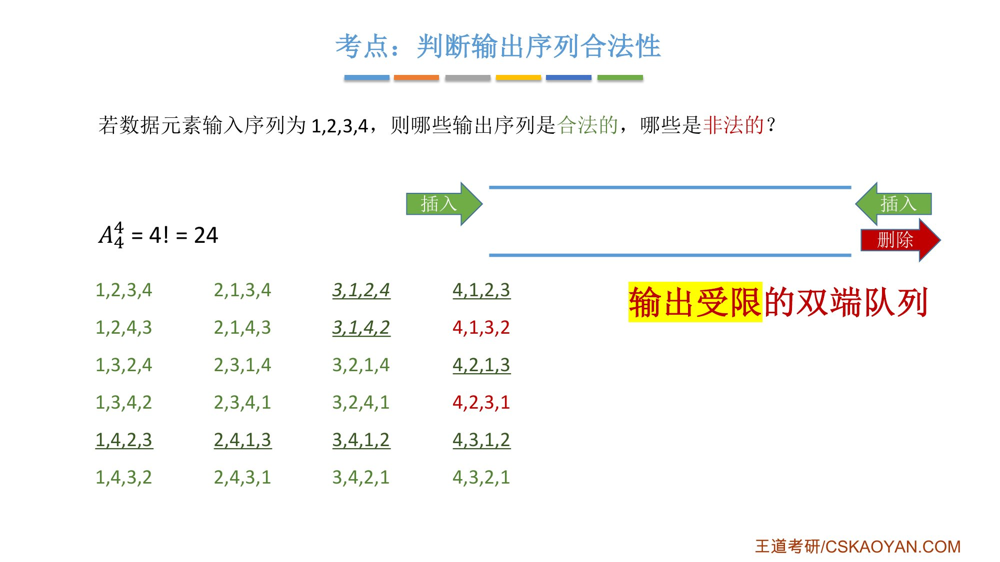{.slide width=0.6}

## 老师总结的分析方法

验证序列时最重要的一点：输出序列里看到某个序号的元素，就意味着[在它输出之前，比它序号小的元素一定都已经输入了]{.u}。

- **输出受限**：序号较大的元素出队之前，较小元素在队中的相对次序已经确定。只能从右边出，所以序列里 1 在 2 之前，就要 1 在右、2 在左；2 在 1 之前，就要 2 在右、1 在左（两者都在队中时）。接下来验证能不能用两边的插入拼出这个顺序；
- **输入受限**：只能从一端输入，序号较大的元素出队之前，较小元素在队中的相对位置也已确定。接下来只需验证能不能用左右两边的删除拼出后续的输出序列。

老师说：栈的合法性判断一般不容易出错，双端队列要细心一些，需要自己练习找到感觉。可以自己试 1, 2, 3, 4, 5 依次输入，打乱顺序看能不能产生相应的输出序列，训练分析逻辑。

::: add
上面 24 个序列在栈、输入受限、输出受限、不受限的双端队列中是否合法，我用程序穷举所有入队/出队操作验证过：栈恰好 14 个合法；输入受限只有 4213、4231 非法；输出受限只有 4132、4231 非法；两端都不受限的双端队列 24 个全部合法。

注意"全部合法"只对 $n=4$ 成立：$n=5$ 时 120 个排列里，不受限的双端队列只能得到 116 个（栈 42 个，输入受限、输出受限各 90 个）。
:::

# 四、王道书的例题

::: book
王道书第 81 页 **例**：设有一个双端队列，输入序列为 1, 2, 3, 4，试分别求出以下条件的输出序列。(1) 能由输入受限的双端队列得到，但不能由输出受限的双端队列得到的输出序列。(2) 能由输出受限的双端队列得到，但不能由输入受限的双端队列得到的输出序列。(3) 既不能由输入受限的双端队列得到，又不能由输出受限的双端队列得到的输出序列。

**解**：先看**输入受限**的双端队列（图 3.13）。假设 end1 端输入 1, 2, 3, 4，则 end2 端的输出相当于普通队列的输出，即 1, 2, 3, 4；而 end1 端的输出相当于栈的输出，$n=4$ 时仅通过 end1 端有 14 种输出序列（由 Catalan 公式得出），仅通过 end1 端不能得到的输出序列有 $4!-14=10$ 种。通过 end1 和 end2 端混合输出，可以输出这 10 种中的 8 种（下表，$S_L$、$X_L$ 分别代表 end1 端的入队和出队，$X_R$ 代表 end2 端的出队）。剩下的两种 4, 2, 3, 1 和 4, 2, 1, 3 不能通过输入受限的双端队列输出。

再看**输出受限**的双端队列（图 3.14）。假设 end1 和 end2 端都能输入，仅 end2 端可以输出。若都从 end2 端输入，就是一个栈，输出序列有 14 种。对于其余 10 种，通过交替从 end1 和 end2 端输入，还可以输出其中 8 种（下表，$S_L$ 代表 end1 端的输入，$S_R$、$X_R$ 分别代表 end2 端的输入和输出）。不能得到的两种是 4, 1, 3, 2 和 4, 2, 3, 1。

综上所述：(1) 4, 1, 3, 2；(2) 4, 2, 1, 3；(3) 4, 2, 3, 1。
:::

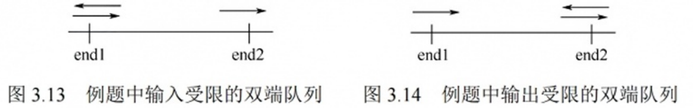{.slide width=0.6}

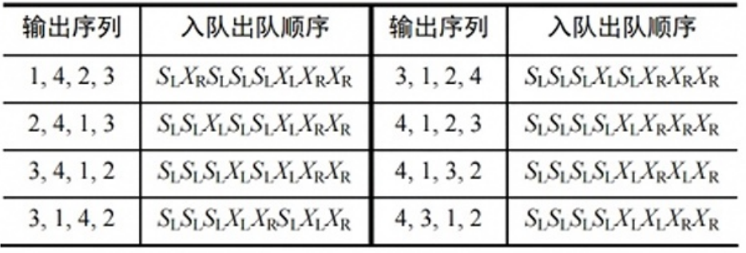{.slide width=0.6}

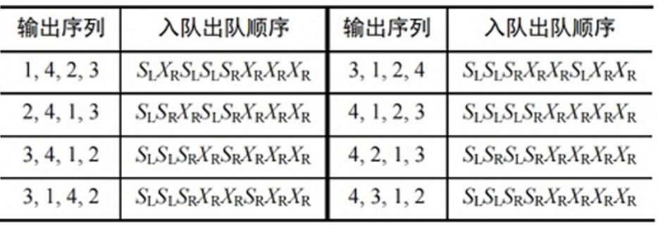{.slide width=0.6}

::: book
王道书第 82 页"提示"：实际双端队列的考题不会如此复杂，通常[只需判断序列是否满足题设条件，代入验证即可]{.u}。
:::

# 五、知识回顾

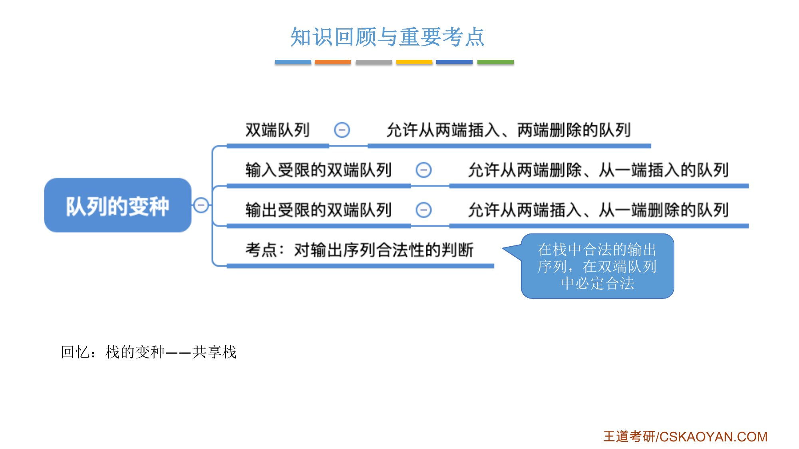{.slide width=0.6}

老师最后提醒：双端队列是队列的一个变种。之前还学过一个栈的变种，[共享栈]{.u}，也是比较容易遗忘的点，回忆一下。

::: recall
正课 3.1.2"七、共享栈"：两个栈共享同一片存储空间，`top0` 初始为 $-1$、`top1` 初始为 `MaxSize`，栈满条件 `top0 + 1 == top1`。
:::

::: summary
**三种受限线性表**：栈（一端插删）、队列（一端插、另一端删）、双端队列（两端插删）。双端队列只用一端就退化成栈。

**两个变种**：[输入受限]{.red} = 一端插入、两端删除；[输出受限]{.red} = 两端插入、一端删除。

**考点**：判断输出序列合法性。栈中合法的序列在双端队列中一定合法，所以只需验证栈中非法的那些。

**输入 1, 2, 3, 4 的结论**：栈合法 14 种（卡特兰数 $\frac{1}{n+1}C_{2n}^{n}$）；输入受限非法 [4213、4231]{.red}；输出受限非法 [4132、4231]{.red}。4231 两种都不行。

**包含关系**：栈 ⊂ 输入受限，栈 ⊂ 输出受限，两者都 ⊂ 不受限；输入受限和输出受限[互不包含]{.u}（4132 只有输入受限能得到，4213 只有输出受限能得到）。

**分析方法**：某元素输出前，比它小的元素都已输入；输出受限看能否用两边插入拼出队中排列；输入受限看能否用两边删除拼出后续序列。书上提示：实际考题代入验证即可。

**自测**：① 输入受限、输出受限分别限制什么？② 为什么只需验证栈中非法的序列？③ 输入受限时为什么 4213 不行？④ 输出受限时为什么 4132 不行？⑤ 哪个序列两种受限双端队列都得不到？
:::
