# 这组题在考什么

::: cue
20 道题分成哪几类？哪几类要手动模拟，模拟出来的结果为什么算数？
:::

20 道选择题可以分成五类：

- **用栈还是用队列**（01、03、09、10、12）：哪些应用用栈，哪些用队列；
- **表达式**（02、19、04、13、14、18）：中缀转后缀、两个栈求中缀表达式的值、转换过程中栈里有什么、栈最深多少；
- **递归**（05–08、15）：递归函数的值、调用次数、调用次序、效率、递归工作栈里的内容；
- **关于栈的判断**（11、17）：两道"下列说法哪个对/错"的综合题；
- **括号匹配和火车轨道**（20、16）：栈的容量够不够，队列至少要几个。

这一节的题大多要[手动模拟]{.red}。模拟为什么能当证明用，下面会反复用到两条道理：

1. 转换、求值这些算法每一步怎么做是规则定死的（确定性的）。对一个具体的式子从头到尾按规则走一遍，这张表就是算法的全部执行过程，[不是举例，而是算法本身]{.u}，表里的结果就是答案；
2. 判断"一定、必须、只要……就"这种全称说法时，[一个反例就足以证明它错]{.u}；要证明"不一定"，找到一个成立的例子也就够了。但要证明一个全称说法对，例子再多也不够，要讲出道理（11、16、17、20 都会用到）。

::: {.tbl widths="0.6,2.6,0.6"}
| 题号 | 考点 | 答案 |
|---|---|---|
| 01 | 栈的应用不包括 | D |
| 02 | `a*(b+c)-d` 的后缀表达式 | B |
| 03 | 用到了队列的 | D |
| 04 | 运算数栈只有两个单元，不会溢出的表达式 | B |
| 05 | `f(f(1))` 的值 | B |
| 06 | 计算 `F(8)` 调用递归函数的次数 | C |
| 07 | `func(func(5))` 中第 4 个被执行的 | C |
| 08 | 递归算法和非递归算法的效率 | B |
| 09 | 局部变量采用什么结构存储 | C |
| 10 | 需要队列作辅助存储空间的操作 | B |
| 11 | 关于栈和队列，正确的是 | A |
| 12 | 【2009 统考】打印数据缓冲区的逻辑结构 | B |
| 13 | 【2012 统考】中缀转后缀时栈中操作符最多几个 | A |
| 14 | 【2014 统考】扫描到 `f` 时栈中的元素 | B |
| 15 | 【2015 统考】递归调用时栈底到栈顶的信息 | A |
| 16 | 【2016 统考】火车轨道至少几条 | C |
| 17 | 【2017 统考】关于栈，错误的是 | C |
| 18 | 【2018 统考】两个栈，调用 3 次 `F()` 后的栈顶 | B |
| 19 | 【2024 统考】`x+y*(z-u)/v` 的后缀表达式 | A |
| 20 | 【2025 统考】容量为 3 的栈做括号匹配，处理不了的 | D |
:::

::: fix
**习题讲解视频的观看建议**：

- **P33 的 19 最值得看**：一休老师讲中缀转后缀的第二种方法"搭积木"（画表达式树再后序遍历），还讲了判断优先级不用死记、用小学数学想"先算谁"。正课没有这个方法；
- **P31 的 08 值得看**：老师把斐波那契的递归和循环写法放在一起比较时间、空间复杂度，重点讲了[递归的空间复杂度是 $O(n)$ 不是 $O(2^n)$]{.u}，画了 F(3) 的栈。下面 08 题我补了证明；
- **P30 的 02、04**：02 的"从选项倒推"很省时间；04 老师在板书上用两个栈完整模拟了选项 A、B；
- **P33 的 20**：只看括号、用计数器算栈深的技巧，比较短；
- **P32 的 13、14**：两道统考题的完整模拟，下面都有完整的表，可以不看；
- **P30 的 01、03、05，P31 的 06、07、09、10，P32 的 11、12、15，P33 的 16、17、18**：看书上解析和下面的笔记即可。16 题老师说"没有什么严格上的理论证明"，下面我补了证明。

下面每题的视频框都记了老师的做法。
:::

# 一、用栈还是用队列（01、03、09、10、12）

::: cue
怎样一眼判断一个应用用栈还是用队列？
:::

判断的依据只有一条：这个应用要求[后来的先处理（后进先出）还是先来的先处理（先进先出）]{.u}。

- 后进先出 → 栈：括号匹配（最后出现的左括号最先被匹配）、表达式求值（暂时不能确定运算次序的运算符/操作数）、递归和函数调用（最后被调用的函数最先结束）；
- 先进先出 → 队列：缓冲区、FIFO 页面替换、树的层次遍历、图的广度优先遍历、操作系统的先来先服务。

::: {.q title="01"}
栈的应用不包括（　）。

| A. 递归　　　B. 表达式求值　　　C. 括号匹配　　　D. 缓冲区
:::

[**答案：D**]{.red}

::: video
习题讲解字幕 P30：A，递归要用到函数栈，递归的过程不断把函数信息压栈，如果忘了写递归出口，栈会被压满溢出；B、C 都是正课讲过的栈的应用。D，缓冲区是操作系统里的概念，打印机等资源有限，要用的任务排队，先来的先用，所以缓冲区是队列。
:::

::: jiexi
王道书第 96 页：缓冲区是用队列实现的，选项 A、B、C 都是栈的典型应用。
:::

::: recall
正课 3.3.1、3.3.2、3.3.3 分别是栈在括号匹配、表达式求值、递归中的应用；缓冲区在正课 3.3.4+3.3.5"三、队列在操作系统中的应用"。
:::

::: {.q title="03"}
下面（　）用到了队列。

| A. 括号匹配　　　B. 表达式求值　　　C. 递归　　　D. FIFO 页面替换算法
:::

[**答案：D**]{.red}

::: video
习题讲解字幕 P30：FIFO 是 First In First Out，先进先出，从名字就能看出用的是队列。FIFO 页面替换算法在操作系统里会学；考自命题的同学一般不会考和操作系统强相关的概念。
:::

::: jiexi
王道书第 97 页：FIFO 页面替换算法用到了队列。其余的都只用到了栈。
:::

::: {.q title="09"}
执行函数时，其局部变量一般采用（　）进行存储。

| A. 树形结构　　　B. 静态链表　　　C. 栈结构　　　D. 队列结构
:::

[**答案：C**]{.red}

::: video
习题讲解字幕 P31：严格来说这是操作系统的知识。程序运行时内存里有一块区域专门为它服务，分成堆区、栈区等，局部变量一般存在栈区，所以是栈结构。
:::

::: jiexi
王道书第 97 页：调用函数时，系统会为调用者构造一个由参数表和返回地址组成的活动记录，并将记录压入系统提供的栈中，若被调用函数有局部变量，也要压入栈中。
:::

::: {.def title="名词统一"}
书上"活动记录（参数表和返回地址）"＋"局部变量"＝正课 3.3.3 函数调用栈保存的三样东西：①调用返回地址 ②实参 ③局部变量。书上"系统提供的栈"＝正课"函数调用栈"＝老师说的"函数栈""栈区"。
:::

::: {.q title="10"}
执行（　）操作时，需要使用队列作为辅助存储空间。

| A. 查找散列（哈希）表　　　　B. 广度优先搜索图
| C. 前序（根）遍历二叉树　　　D. 深度优先搜索图
:::

[**答案：B**]{.red}

::: video
习题讲解字幕 P31：这题涉及后面的知识，学完再回来看。A，散列表用到的是数组，或者邻接表那样的结构；B，图的广度优先搜索确实要用队列；C，408 只考虑递归遍历二叉树，不考虑非递归写法，递归用的是栈；D，深度优先搜索也用栈。
:::

::: jiexi
王道书第 97 页：本题涉及第 5 章和第 6 章的内容，图的广度优先搜索类似于树的层序遍历，都要借助于队列。
:::

::: {.def title="名词统一"}
书上"树的层序遍历"＝正课 3.3.4+3.3.5"树的层次遍历"；书上"图的广度优先搜索"＝正课"图的广度优先遍历"。
:::

::: recall
正课 3.3.4+3.3.5 第一、二节：层次遍历和广度优先遍历都是"处理队头、把它的孩子（或相邻且未访问的结点）加入队尾"。
:::

::: {.q title="12"}
【2009 统考真题】为解决计算机主机与打印机之间速度不匹配的问题，通常设置一个打印数据缓冲区，主机将要输出的数据依次写入该缓冲区，而打印机则依次从该缓冲区中取出数据。该缓冲区的逻辑结构应该是（　）。

| A. 栈　　　B. 队列　　　C. 树　　　D. 图
:::

[**答案：B**]{.red}

::: video
习题讲解字幕 P32：老师举例，主机要打印 W、D、N、B 四个字，先交给缓冲区的是 W；打印机打出来也必须先是 W，不然顺序就乱了。先进来的先出去，所以是队列。
:::

::: jiexi
王道书第 98 页：在提取数据时必须保持原来数据的顺序，所以缓冲区的特性是先进先出。
:::

::: recall
正课 3.3.4+3.3.5 第三节的书框：王道书第 94 页考点追踪"缓冲区的逻辑结构（2009）"，就是这道题，[打印数据缓冲区实际上就是一个队列]{.u}。
:::

# 二、表达式（02、19、04、13、14、18）

::: cue
求后缀表达式有哪几种方法？每种方法凭什么是对的？
:::

这组题用到正课 3.3.2 的全部内容。先把几个方法和它们的道理放在一起：

1. **按运算次序组合**（正课 3.3.2_1 第二节，手算）：确定各运算符的运算次序，每次按"左操作数 右操作数 运算符"组合成一个新的操作数。把这条规则写成递归形式就是：

   - 单个操作数的后缀就是它自己；
   - 表达式 $L \text{ op } R$（op 是[最后一个执行的运算符]{.u}）的后缀 $=$ $L$ 的后缀，接 $R$ 的后缀，再接 op。

   最后执行的运算符怎么找：去掉所有括号里面的部分，在括号外面的运算符里找[优先级最低的]{.u}；同一优先级有好几个时，因为同级从左往右算，[最右边的那个最后算]{.u}。

2. **用栈转换**（正课 3.3.2_2，机算）：规则见正课 3.3.2_2 第一节。
3. **表达式树**（习题讲解视频 P33 的 19，一休老师）：画出表达式树，后序遍历。其实和方法 1 是同一件事：方法 1 每次拆出来的"最后执行的运算符"就是树根，$L$、$R$ 就是左右子树，"$L$ 后缀、$R$ 后缀、op"正是后序遍历"左、右、根"的顺序。
4. **从选项倒推**（习题讲解视频 P30 的 02）：把选项的后缀表达式转回中缀（正课 3.3.2_1 我补的"后缀转中缀"），看和题目是不是同一个式子。

因为运算次序由优先级、括号、左结合唯一确定，方法 1 每一步的拆法都是唯一的，所以[一个中缀表达式的后缀表达式是唯一的]{.u}（按左优先原则）。这一点保证了排除法是可靠的：只要选项里有一处和正确答案不符，它就错了。

::: {.q title="02"}
表达式 `a*(b+c)-d` 的后缀表达式是（　）。

| A. `abcd*+-`　　　B. `abc+*d-`　　　C. `abc*+d-`　　　D. `-+*abcd`
:::

[**答案：B**]{.red}

::: video
习题讲解字幕 P30：两种方法。第一种，用栈模拟中缀转后缀，老师在板书上从头到尾模拟了一遍；第二种，做选择题更快：从选项倒推，把后缀转回中缀。A 里有 `cd*`，即 `c*d`，原式中没有，排除；B：`bc+` 得 `b+c`，再和 `a` 做 `*` 得 `a*(b+c)`，再和 `d` 做 `-`，正好是原式；C 里有 `bc*`，原式中没有；D 是前缀的样子，不是后缀。
:::

::: jiexi
王道书第 97 页：后缀表达式中，每个运算符均直接位于其两个操作数的后面，按照这样的方式逐步根据计算的优先级将每个计算式进行变换，即可得到后缀表达式。

【另解】将两个直接操作数用括号括起来，再将操作符提到括号后，最后去掉括号。例如，对于 `((a*(b+c))-d)`，提出操作符并去掉括号后，可得后缀表达式为 `abc+*d-`。

学完第 5 章后，可将表达式画成二叉树的形式，再用后序遍历即可求得后缀表达式。
:::

::: add
**用上面方法 1 严格推一遍**：

1. `a*(b+c)-d`：括号外的运算符是 `*`、`-`，`-` 优先级最低，最后执行。拆成 $L=$ `a*(b+c)`，$R=$ `d`，后缀 $=$ ($L$ 的后缀) `d` `-`；
2. `a*(b+c)`：括号外只有 `*`。拆成 $L=$ `a`，$R=$ `b+c`，后缀 $=$ `a` ($R$ 的后缀) `*`；
3. `b+c` 的后缀是 `bc+`。

逐层代回：`a` `bc+` `*` → `abc+*`；再接 `d-` → `abc+*d-`，就是 B。由上面"后缀唯一"，A、C、D 都不可能对。

老师的倒推法为什么也算证明：B 转回中缀得到的是 `(a*(b+c))-d`，和原式的运算次序完全相同，所以 B 就是原式的后缀表达式；这一步本身就证明了 B 对，不只是排除了别的选项。
:::

::: recall
正课 3.3.2_1 第二节中缀转后缀（手算）的"左优先原则"，以及我补的"后缀转中缀"。
:::

::: {.q title="19"}
【2024 统考真题】与表达式 `x+y*(z-u)/v` 等价的后缀表达式是（　）。

| A. `xyzu-*v/+`　　　B. `xyzu-v/*+`　　　C. `-+x/*y-zuv`　　　D. `+x*y/-zuv`
:::

[**答案：A**]{.red}

::: video
习题讲解字幕 P33（一休老师）：两种方法。

**方法一，模拟**，大家都要掌握：从左到右扫描，操作数直接加入后缀表达式；遇到运算符和栈顶比较优先级，栈顶优先级大于等于当前运算符就出栈，括号不写入后缀表达式；扫描完把栈里剩下的依次出栈。比较优先级时[不用背]{.u}，用小学数学想"先算谁"：`x+y*…` 中应该先算后面的乘法，所以 `*` 入栈；括号里的要先算，所以 `(` 入栈；`-` 前面是括号，要先算括号里的 `z-u`，所以 `-` 入栈；遇到 `)`，括号里的算完，依次出栈到 `(`；遇到 `/`，`y*(z-u)` 和后面的 `/v` 应该先算左边的乘，所以 `*` 出栈、`/` 入栈；最后依次出栈 `/`、`+`。结果 `xyzu-*v/+`。

**方法二，搭积木**（求表达式树）：中缀表达式是表达式树的中序遍历，后缀表达式是后序遍历。把整个表达式 $F$ 看成大积木，拆成左边的小积木 $F_1$、中间的运算符、右边的小积木 $F_2$，再分别递归地拆。拆的时候[必须遵守四则运算规则]{.red}，比如把 `x+y` 当成 $F_1$ 就错了，会先算 `x+y`，"你的小学老师可能就会来找你了"。有时有多种合法拆法：`y*(z-u)/v` 可以拆成 `y` 和 `(z-u)/v`，也可以拆成 `y*(z-u)` 和 `v`。为了让表达式树唯一，规定[在合法的前提下选最长的 $F_1$]{.u}，即 $F_1=$ `y*(z-u)`、$F_2=$ `v`。拆完后序遍历（左右根），答案也是 A。

老师总结：方法一最实用，一定要掌握；方法二可以加入自己的武器库。
:::

\Needspace{12\baselineskip}
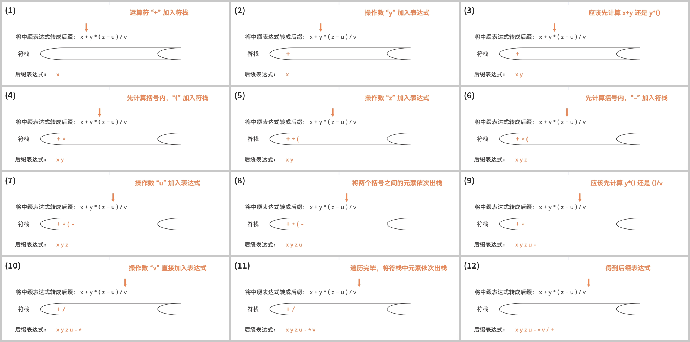{width=1.0}

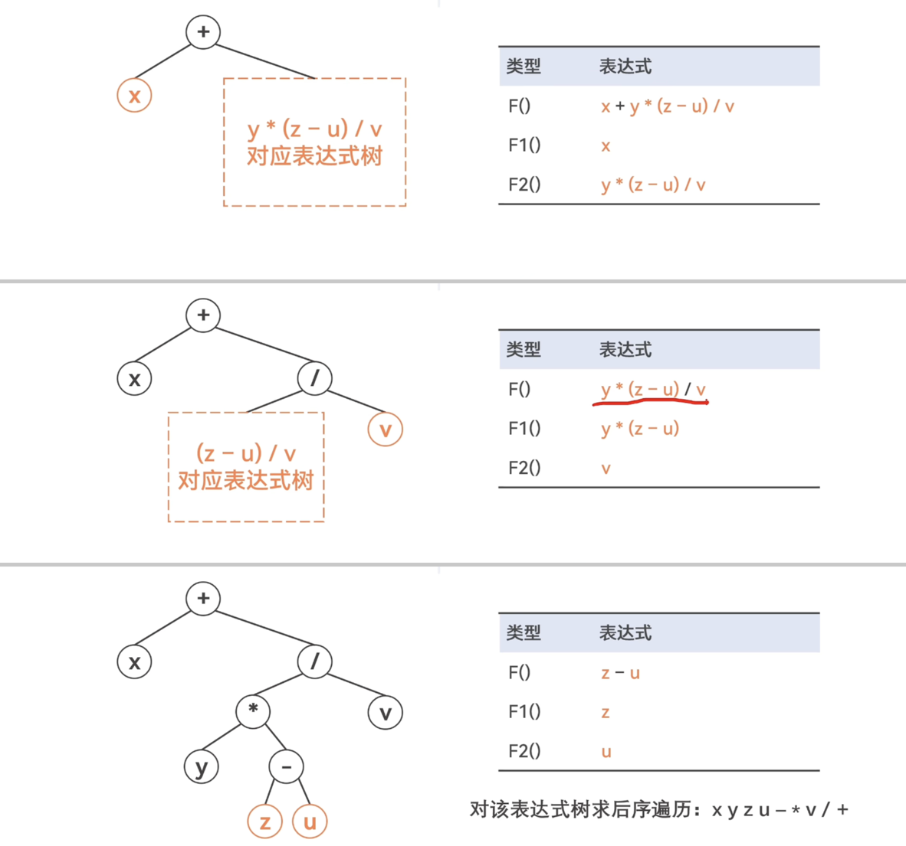{width=0.8}

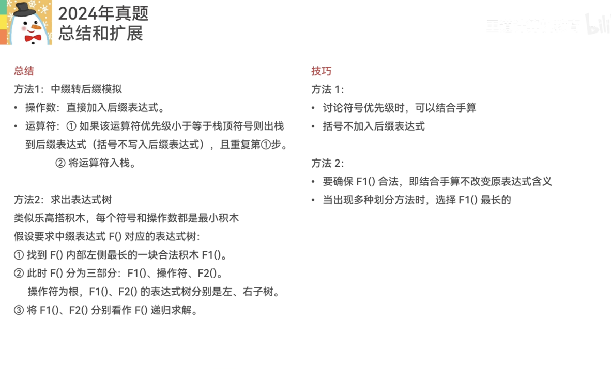{.slide width=0.55}

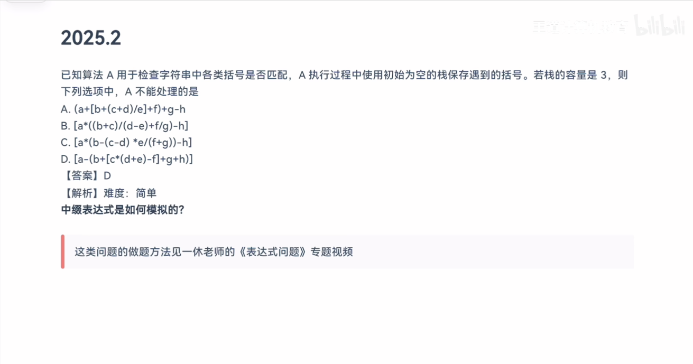{.slide width=0.5}


::: jiexi
王道书第 99 页：根据中缀表达式画出对应的二叉树如下图所示，对该二叉树进行后序遍历即可得到后缀表达式为 `xyzu-*v/+`。本题也可采用本书前面描述的手算方法。
:::

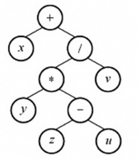{.slide width=0.22}

::: add
**用方法 1 严格推一遍，并说明"$F_1$ 最长"的道理**：

1. `x+y*(z-u)/v`：括号外的运算符是 `+`、`*`、`/`，`+` 最低，最后执行。$L=$ `x`，$R=$ `y*(z-u)/v`；
2. `y*(z-u)/v`：括号外是 `*`、`/`，同一优先级，同级从左往右算，[最右边的 `/` 最后执行]{.u}。$L=$ `y*(z-u)`，$R=$ `v`；
3. `y*(z-u)`：$L=$ `y`，$R=$ `z-u`，后缀 `yzu-*`；
4. 代回：`yzu-*` 接 `v` 再接 `/` → `yzu-*v/`；前面接 `x`、最后接 `+` → `xyzu-*v/+`，就是 A。

第 2 步取最右边的 `/` 作为拆分点，左边那块自然就最长。所以老师的"在合法的前提下选最长的 $F_1$"不是人为加的规定，它就是"同级运算从左往右算"（左结合）这条四则运算规则。

**B 为什么不算"等价"**：B 转回中缀是 `x+y*((z-u)/v)`，先除后乘，[运算次序和原式不同]{.u}。在实数运算里两者数值相等，但题目说的等价指的是同一个运算过程；而且在 C 语言的整数除法下数值也可能不同，例如 $y=2$，$z-u=1$，$v=2$：原式 $(2\times1)/2=1$，B 是 $2\times(1/2)=2\times0=0$。C、D 是前缀的样子。
:::

::: recall
正课 3.3.2_1 第二节"左优先原则"：只要左边的运算符能先计算，就优先算左边的，保证手算结果和机算一致。本题第 2 步就是这条原则。
:::

::: cue
两个栈求中缀表达式的值时，运算数栈最深有多深？怎样不模拟也能算出来？
:::

::: {.q title="04"}
利用栈求表达式的值时，设立运算数栈 OPEN。假设 OPEN 只有两个存储单元，则在下列表达式中，不会发生溢出的是（　）。

| A. `A-B*(C-D)`　　B. `(A-B)*C-D`　　C. `(A-B*C)-D`　　D. `(A-B)*(C-D)`
:::

[**答案：B**]{.red}

::: video
习题讲解字幕 P30：这是中缀表达式求值。理论上可以分两步：先中缀转后缀，再后缀求值；咸鱼老师的基础课讲过这两步可以合二为一，用一个运算符栈、一个运算数栈。

- **A**：`A` 入运算数栈；`-` 入运算符栈；`B` 入栈；`*` 比 `-` 高，入栈；`(` 入栈；扫描到 `C` 时运算数栈已经有 `A`、`B` 两个，满了，`C` 无法入栈，溢出；
- **B**：`(` 入栈；`A` 入栈；`-` 入栈；`B` 入栈；遇到 `)`，`-` 出栈，同时运算数栈弹出两个算 `A-B`，结果压回；`(` 和 `)` 抵消；`*` 入栈；`C` 入栈；遇到 `-`，比 `*` 低，`*` 出栈，算 `(A-B)*C` 压回；`-` 入栈；`D` 入栈；最后 `-` 出栈，算完。整个过程没有溢出；
- **C、D**：老师让同学按 A、B 的过程自己模拟，都会溢出。他又用另一种方法做了 C：先转后缀 `ABC*-D-`，后缀求值时 `A`、`B`、`C` 都要先入栈，两个单元不够，也会溢出。老师强调：中缀求值只是把两个过程合二为一，[没有本质上的改变]{.u}，所以后缀求值时运算数栈不够，用哪种方法算都会溢出。D 让同学自己验证。
:::

::: jiexi
王道书第 97 页：利用栈求表达式的值时，可以分别设立运算符栈和运算数栈，其原理不变。选项 B 中 A 入栈，B 入栈，计算得 R1，C 入栈，计算得 R2，D 入栈，计算得 R3，由此得栈深为 2。选项 A、C、D 依次计算得栈深为 4、3、3。因此选择选项 B。

**技巧**：根据运算符优先级，统计已依次入栈但还未参与运算的运算符数。以选项 C 为例，当"("、"A"、"-"入栈时，"("和"-"还未参与运算，此时运算符栈大小为 2，"B"和"\*"入栈时运算符栈大小为 3，"C"入栈时"B\*C"运算，运算符栈大小为 2，以此类推。
:::

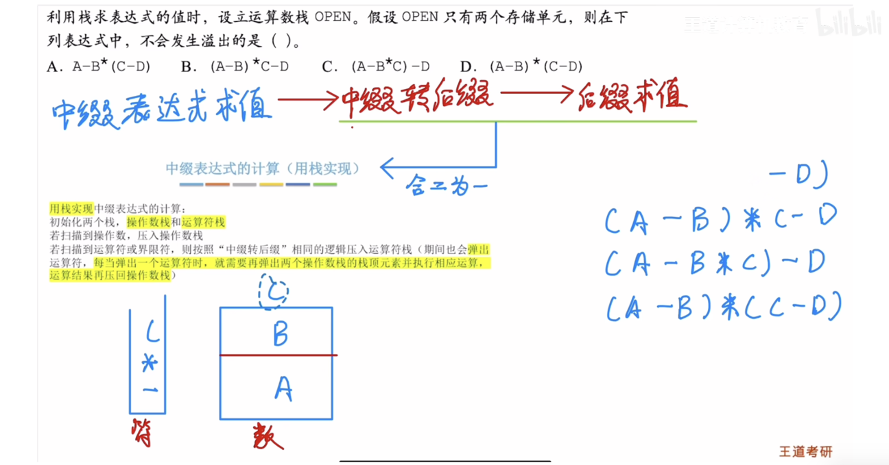{.slide width=0.55}


\Needspace{16\baselineskip}

::: add
**补全老师留给同学的 C、D 模拟**（双栈，左边是栈底）：

::: {.tbl widths="0.10,0.22,0.30,0.38"}
| 扫描 | 运算符栈 | 运算数栈 | 动作 |
|---|---|---|---|
| **C** | | | `(A-B*C)-D` |
| ( A | ( | A | |
| - B | (- | A, B | 栈顶是 `(`，`-` 入栈 |
| \* | (-\* | A, B | `*` 比 `-` 高，入栈 |
| C | (-\* | A, B, [C]{.red} | [第 3 个，溢出]{.red} |
| **D** | | | `(A-B)*(C-D)` |
| ( A - B | (- | A, B | |
| ) | 空 | R1 | `-` 出栈，算 R1＝A−B；丢弃 `(` |
| \* ( | \*( | R1 | |
| C | \*( | R1, C | |
| - | \*(- | R1, C | 栈顶是 `(`，入栈 |
| D | \*(- | R1, C, [D]{.red} | [第 3 个，溢出]{.red} |
:::

**不模拟，直接算出栈深（证明）**：

1. *双栈算法的运算数栈和后缀求值的栈是同一个栈。* 正课 3.3.2_2 第五节说双栈算法是"一边生成后缀表达式，一边计算"：转换算法每输出一个操作数，双栈算法就把它压入运算数栈；转换算法每弹出（输出）一个运算符，双栈算法就弹出两个操作数、算完压回。这正好是后缀求值对同一个记号做的动作。所以每输出一个记号后，两边的栈内容完全相同，[最大深度也相同]{.u}。这就是书上"其原理不变"、老师"没有本质上的改变"的意思。
2. *后缀求值的栈深公式。* 后缀求值时，读到操作数压入 1 个，栈深 $+1$；读到（双目）运算符弹出 2 个、压回 1 个，栈深 $-1$。所以读完前 $k$ 个记号后，

   $$\text{栈深} = (\text{前 } k \text{ 个记号中的操作数个数}) - (\text{其中的运算符个数}).$$

   对所有 $k$ 取最大值，就是运算数栈的最大深度。
3. *代入四个选项*（先按方法 1 写出后缀，再逐个记号写出栈深）：

::: {.tbl widths="0.22,0.22,0.36,0.20"}
| 选项 | 后缀表达式 | 每读一个记号后的栈深 | 最大 |
|---|---|---|---|
| A `A-B*(C-D)` | `ABCD-*-` | 1, 2, 3, 4, 3, 2, 1 | 4 |
| B `(A-B)*C-D` | `AB-C*D-` | 1, 2, 1, 2, 1, 2, 1 | [2]{.red} |
| C `(A-B*C)-D` | `ABC*-D-` | 1, 2, 3, 2, 1, 2, 1 | 3 |
| D `(A-B)*(C-D)` | `AB-CD-*` | 1, 2, 1, 2, 3, 2, 1 | 3 |
:::

只有 B 的最大深度不超过 2，和书上"栈深 4、3、3"一致。
:::

::: fix
**书上的"技巧"要小心括号**。书上说统计"已入栈但还未参与运算的运算符数"，可它的例子把 `(` 也数进了"运算符栈大小"。准确的说法是：[每读入一个操作数之后，运算数栈中的个数＝运算符栈中（不算括号的）运算符个数＋1]{.u}。

*证明*：记 $D=$ 运算数个数 $-$ 运算符栈中非括号运算符个数。读入操作数，$D+1$；运算符入栈，$D-1$；弹出一个运算符并计算，运算数 $-1$（弹 2 压 1）、运算符 $-1$，$D$ 不变；括号入栈、出栈都不影响 $D$。合法的中缀表达式去掉括号后是"操作数、运算符、操作数、……、操作数"交替出现，开始时 $D=0$，所以每读完一个操作数 $D=1$，每压入一个运算符后 $D=0$。又因为运算数栈只在读入操作数时变多，所以最大深度一定出现在刚读完某个操作数时，等于那时[未参与运算的运算符数＋1]{.u}。

*例子*：选项 C 读入 `C` 时，运算符栈是 `( - *`，不算括号有 2 个运算符，运算数栈有 $2+1=3$ 个。书上数成"运算符栈大小为 3"是因为恰好只有一个 `(`，碰巧相等。换成 `((A-B))`：读入 `B` 时运算符栈是 `( ( -`，大小为 3，可运算数栈只有 $1+1=2$ 个。
:::

::: recall
正课 3.3.2_2 第五节"中缀表达式的计算（用栈实现）"：每弹出一个运算符，就弹出两个操作数运算，[先弹出的是右操作数]{.u}。正课 3.3.2_1 第四节"后缀表达式的计算（机算）"。
:::

::: cue
中缀转后缀时栈里存什么？问"栈中最多几个""扫描到某处时栈里有什么"怎么做？
:::

::: {.q title="13"}
【2012 统考真题】已知操作符包括"+""-""\*""/""("和")"。将中缀表达式 `a+b-a*((c+d)/e-f)+g` 转换为等价的后缀表达式 `ab+acd+e/f-*-g+` 时，用栈来存放暂时还不能确定运算次序的操作符。栈初始时为空，转换过程中同时保存在栈中的操作符的最大个数是（　）。

| A. 5　　　B. 7　　　C. 8　　　D. 11
:::

[**答案：A**]{.red}

::: video
习题讲解字幕 P32：按中缀转后缀的规则完整模拟一遍，边模拟边记栈里的个数。扫描到 `d` 前后，栈里是 `- * ( ( +`，共 5 个，这是最多的时候；遇到后面的 `)` 才开始弹出。答案 A。
:::

::: jiexi
王道书第 98 页：在中缀表达式转后缀表达式的过程中，扫描到操作数时直接输出，扫描到操作符时根据其优先级进行相应的出入栈操作。有几点需要注意：① 若遇到界限符"("，则直接入栈；② 若遇到界限符")"，则不入栈，且依次弹出栈顶运算符，直到遇到"("为止，并删除"("；③ 若当前运算符的优先级高于栈顶运算符或遇到栈顶为"("，则直接入栈；④ 若当前运算符的优先级低于或等于栈顶运算符，则依次弹出栈中的运算符并加入后缀表达式，直到遇到一个优先级低于它的运算符或遇到"("或栈空为止，之后将当前运算符入栈。

求栈中操作符的最大个数时，为简单起见，可省略对操作数的处理。（书上列了 12 步的表）由上述过程可知，栈中操作符的最大个数为 5。
:::

::: {.def title="名词统一"}
书上这四条规则＝正课 3.3.2_2 第一节的规则：书 ③④ 合起来就是正课"依次弹出栈中优先级高于或等于当前运算符的所有运算符，碰到 `(` 或栈空则停止，再把当前运算符入栈"。本题的"操作符"包括括号，所以 `(` 也算个数，和正课"`(` 也占位置"一致。
:::

::: add
**完整的表**（书上省略了操作数，这里把后缀表达式也写出来，最后一行可以和题目给的后缀对照）：

::: {.tbl widths="0.07,0.16,0.07,0.30,0.40"}
| 扫描 | 栈（左边是栈底） | 个数 | 后缀表达式 | 动作 |
|---|---|---|---|---|
| a | | 0 | a | |
| + | + | 1 | a | 栈空，入栈 |
| b | + | 1 | ab | |
| - | - | 1 | ab+ | `+` 和 `-` 同级，弹出 `+`；`-` 入栈 |
| a | - | 1 | ab+a | |
| \* | -\* | 2 | ab+a | `*` 比 `-` 高，入栈 |
| ( | -\*( | 3 | ab+a | |
| ( | -\*(( | 4 | ab+a | |
| c | -\*(( | 4 | ab+ac | |
| + | **-\*((+** | [5]{.red} | ab+ac | 栈顶是 `(`，入栈 |
| d | -\*((+ | 5 | ab+acd | |
| ) | -\*( | 3 | ab+acd+ | 弹出 `+`，删除 `(` |
| / | -\*(/ | 4 | ab+acd+ | 栈顶是 `(`，入栈 |
| e | -\*(/ | 4 | ab+acd+e | |
| - | -\*(- | 4 | ab+acd+e/ | 弹出 `/`；遇 `(` 停；`-` 入栈 |
| f | -\*(- | 4 | ab+acd+e/f | |
| ) | -\* | 2 | ab+acd+e/f- | 弹出 `-`，删除 `(` |
| + | + | 1 | ab+acd+e/f-\*- | 依次弹出 `*`、`-`（都不低于 `+`）；`+` 入栈 |
| g | + | 1 | ab+acd+e/f-\*-g | |
| 结束 | | 0 | ab+acd+e/f-\*-g+ | 弹出 `+` |
:::

这张表是转换算法对这个式子的全部执行过程（每一步怎么做由规则唯一决定），所以"最多 5 个"是精确答案。最后一行和题目给的后缀表达式一致，说明每一步都没有用错规则。
:::

::: recall
正课 3.3.2_2 第四节"练习：栈是否会溢出？"：老师说考试可能考[转换到某一步时栈里的情况]{.u}，频率还不低；那道练习栈中最多 7 个。书上考点追踪"栈的深度分析"正好列了 2012（本题）。
:::

::: {.q title="14"}
【2014 统考真题】假设栈初始为空，将中缀表达式 `a/b+(c*d-e*f)/g` 转换为等价的后缀表达式的过程中，当扫描到 `f` 时，栈中的元素依次是（　）。

| A. `+(*-`　　　B. `+(-*`　　　C. `/+(*-*`　　　D. `/+-*`
:::

[**答案：B**]{.red}

::: video
习题讲解字幕 P32：按规则模拟，扫描到 `f` 时栈里从栈底到栈顶是 `+ ( - *`，选 B；老师接着把转换做完，得到 `ab/cd*ef*-g/+`。
:::

::: jiexi
王道书第 98–99 页：中缀表达式 `a/b+(c*d-e*f)/g` 转换为后缀表达式的过程如下（书上列了 17 步的表）。由此可知，当扫描到 `f` 时，栈中的元素依次是 `+(-*`。

【另解】采用手算方法，得出中缀式 `a/b+(c*d-e*f)/g` 对应的后缀式为 `ab/cd*ef*-g/+`。中缀表达式转后缀表达式时，操作数都直接输出，因此操作数的顺序是固定的。扫描到 `f` 时，在后缀表达式 `f` 后面的运算符要么还未入栈，要么还在栈中，需要结合中缀式来判断，`f` 后面依次出栈的运算符为 `*-/+`，`/` 在中缀表达式 `f` 之后，此时还未入栈，因此栈中的运算符（从栈底到栈顶）为 `+-*`；此外，已入栈的界限符 `(`（此时还未消解，因此 `(` 也还在栈中），栈中的元素依次是 `+(-*`。
:::

::: add
**完整的表**：

::: {.tbl widths="0.08,0.18,0.30,0.44"}
| 扫描 | 栈（左边是栈底） | 后缀表达式 | 动作 |
|---|---|---|---|
| a | | a | |
| / | / | a | 栈空，入栈 |
| b | / | ab | |
| + | + | ab/ | `/` 比 `+` 高，弹出；`+` 入栈 |
| ( | +( | ab/ | |
| c | +( | ab/c | |
| \* | +(\* | ab/c | 栈顶是 `(`，入栈 |
| d | +(\* | ab/cd | |
| - | +(- | ab/cd\* | 弹出 `*`；遇 `(` 停；`-` 入栈 |
| e | +(- | ab/cd\*e | |
| \* | +(-\* | ab/cd\*e | `*` 比 `-` 高，入栈 |
| f | **[+(-\*]{.red}** | ab/cd\*ef | ← 题目问的时刻 |
| ) | + | ab/cd\*ef\*- | 依次弹出 `*`、`-`，删除 `(` |
| / | +/ | ab/cd\*ef\*- | `/` 比 `+` 高，入栈 |
| g | +/ | ab/cd\*ef\*-g | |
| 结束 | | ab/cd\*ef\*-g/+ | 依次弹出 `/`、`+` |
:::

**书上另解的道理**（为什么不模拟也能定出栈里的运算符）：设扫描到操作数 `f`，它立即被输出。看中缀式里 `f` 之前的任意一个运算符 $x$：

- 如果 $x$ 在扫描到 `f` 之前已经出栈，它就在 `f` 之前被输出，在后缀式里排在 `f` 前面；
- 如果 $x$ 此时还在栈里，它以后才输出，在后缀式里排在 `f` 后面。

中缀式里 `f` 之后的运算符此时还没扫描到，不在栈里。所以：[此时栈里的运算符＝中缀式中在 `f` 之前、后缀式中在 `f` 之后的运算符]{.u}；而栈只在栈顶进出，留在栈里的元素保持入栈的先后次序，所以从栈底到栈顶就是它们在中缀式里的次序。

代入本题：中缀式中 `f` 之前的运算符依次是 `/`、`+`、`*`（第一个）、`-`、`*`（第二个）；后缀式 `ab/cd*ef*-g/+` 中 `f` 之后是 `*`（第二个）、`-`、`/`（第二个，中缀中在 `f` 之后）、`+`。两边都有的是 `+`、`-`、`*`，按中缀次序是 `+ - *`。再加上还没遇到 `)` 的 `(`（它在 `+` 之后、`-` 之前入栈），得到 `+(-*`。
:::

::: {.q title="18"}
【2018 统考真题】若栈 S1 中保存整数，栈 S2 中保存运算符，函数 `F()` 依次执行下述各步操作：

1）从 S1 中依次弹出两个操作数 a 和 b。
2）从 S2 中弹出一个运算符 op。
3）执行相应的运算 b op a。
4）将运算结果压入 S1 中。

假定 S1 中的操作数依次是 5, 8, 3, 2（2 在栈顶），S2 中的运算符依次是 \*、-、+（+ 在栈顶）。调用 3 次 `F()` 后，S1 栈顶保存的值是（　）。

| A. −15　　　B. 15　　　C. −20　　　D. 20
:::

[**答案：B**]{.red}

::: video
习题讲解字幕 P33：老师说这种题是他最喜欢的，"不用动脑子，只要把自己当做一个做题的机器"，题目说什么就照着做，调用三次就做三次。结果 15，而且这时 S1 里只剩 15 一个值。
:::

::: jiexi
王道书第 99 页：第一次调用：① 从 S1 中弹出 2 和 3；② 从 S2 中弹出 +；③ 执行 3+2=5；④ 将 5 压入 S1 中，第一次调用结束后 S1 中剩余 5、8、5（5 在栈顶），S2 中剩余 \*、-（- 在栈顶）。第二次调用：① 从 S1 中弹出 5 和 8；② 从 S2 中弹出 -；③ 执行 8−5=3；④ 将 3 压入 S1 中，第二次调用结束后 S1 中剩余 5、3（3 在栈顶），S2 中剩余 \*。第三次调用：① 从 S1 中弹出 3 和 5；② 从 S2 中弹出 \*；③ 执行 5\*3=15；④ 将 15 压入 S1 中，第三次调用结束后 S1 中仅剩余 15，S2 为空。
:::

::: add
**逐次的表**（栈都是左边为栈底）：

::: {.tbl widths="0.10,0.16,0.10,0.16,0.26,0.22"}
| 调用 | 弹出 a, b | op | b op a | 之后的 S1 | 之后的 S2 |
|---|---|---|---|---|---|
| 开始 | | | | 5, 8, 3, 2 | \*, -, + |
| 第 1 次 | a＝2, b＝3 | + | 3+2＝5 | 5, 8, 5 | \*, - |
| 第 2 次 | a＝5, b＝8 | - | 8−5＝3 | 5, 3 | \* |
| 第 3 次 | a＝3, b＝5 | \* | 5×3＝[15]{.red} | 15 | 空 |
:::

最容易错的是第 2 次：先弹出的 a 是右操作数，算的是 $8-5$ 不是 $5-8$，否则会得到 $-3$，最后得 $-15$（选项 A 就是这个陷阱）。
:::

::: recall
`F()` 就是正课 3.3.2_2 第五节双栈求值里"弹出一个运算符，再弹出两个操作数运算，结果压回"的一步；"b op a"就是正课 3.3.2_1 第四节说的[先出栈的是右操作数]{.u}。
:::

# 三、递归（05–08、15）

::: cue
递归函数的调用次数、调用次序、空间复杂度，各用什么工具求？
:::

这组题的共同工具是**递归调用树**：每一次函数调用画一个结点，它直接调用的函数画成它的孩子。

- 调用次数＝树的结点数；
- 调用（开始执行）的次序＝树的先序遍历次序（07 证明）；
- 任一时刻递归工作栈里的内容＝从树根到当前结点的路径，所以栈的最大深度＝树的高度（08、15）。

::: {.q title="05"}
执行下列语句段后，i 的值为（　）。

```c
int f(int x){
    return ((x>0)? x*f(x-1):2);
}
int i;
i=f(f(1));
```

| A. 2　　　B. 4　　　C. 8　　　D. 无限递归
:::

[**答案：B**]{.red}

::: video
习题讲解字幕 P30：先把三元表达式翻译成 if-else：如果 `x>0` 成立，返回冒号前面的 `x*f(x-1)`；否则返回冒号后面的 2。先算里层 `f(1)`：$1>0$，返回 $1\times f(0)$；$f(0)$ 中 $0>0$ 不成立，返回 2，所以 $f(1)=2$。再算 $f(2)=2\times f(1)=2\times2=4$。
:::

::: jiexi
王道书第 97 页：栈与递归有着紧密的联系。递归模型包括递归出口和递归体两个方面。递归出口是递归算法的出口，即终止递归的条件。递归体是一个递推的关系式。根据题意有

`f(0)=2;` `f(1)=1*f(0)=2;` `f(f(1))=f(2)=2*f(1)=4`。
:::

::: add
**为什么不是"无限递归"**：递归出口是 `x<=0`（返回 2）。每次递归调用的参数都比当前小 1，参数是整数，从非负数出发一定会在有限步后到达 0，所以对任意 $x\ge0$ 都会终止。本题 `f(f(1))` 的执行顺序是先算出实参 `f(1)`，再调用外层：

1. 调用 `f(1)` → 调用 `f(0)` → 返回 2 → `f(1)` 返回 $1\times2=2$；
2. 调用 `f(2)` → 调用 `f(1)` → 调用 `f(0)` → 返回 2 → `f(1)` 返回 2 → `f(2)` 返回 $2\times2=4$。
:::

::: recall
正课 3.3.3 第二节：实现递归需要[递归表达式（递归体）和边界条件（递归出口）]{.u}。书上"递归模型包括递归出口和递归体"是同一件事。
:::

::: {.q title="06"}
设有如下递归函数，则计算 `F(8)` 需要调用该递归函数的次数为（　）。

```c
int F(int n){
    if(n<=3) return 1;
    else return F(n-2)+F(n-4)+1;
}
```

| A. 7　　　B. 8　　　C. 9　　　D. 10
:::

[**答案：C**]{.red}

::: video
习题讲解字幕 P31：把递归一层层画出来：计算 `F(8)` 要算 `F(6)`、`F(4)`；`F(6)` 要算 `F(4)`、`F(2)`；每个 `F(4)` 要算 `F(2)`、`F(0)`；`F(2)`、`F(0)` 直接返回。老师提醒：[第一次传进来的 `F(8)` 也算一次调用]{.red}，题目问的是调用该递归函数 F 的次数。一共数出 9 次。
:::

::: jiexi
王道书第 97 页：计算 `F(8)` 的递归调用树如下图所示。由图可知，递归函数 `F()` 调用的次数为 9。
:::

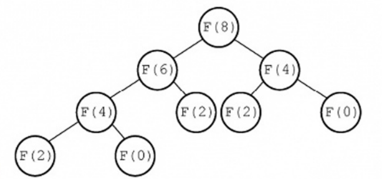{.slide width=0.45}

::: add
**用递推式严格算出次数**：记 $C(n)$ 为计算 `F(n)` 时调用 F 的总次数（包括 `F(n)` 自己）。由函数的写法：

- $n\le3$ 时，直接返回，$C(n)=1$；
- $n>3$ 时，自己一次，加上两个子调用各自的全部次数，$C(n)=1+C(n-2)+C(n-4)$。

于是 $C(0)=C(2)=1$，$C(4)=1+C(2)+C(0)=3$，$C(6)=1+C(4)+C(2)=5$，$C(8)=1+C(6)+C(4)=1+5+3=9$。

这和数调用树的结点数是一回事：$C(n)$ 就是以 `F(n)` 为根的子树的结点数。用递推式的好处是重复出现的子树（这里 `F(4)` 出现两次）只算一次。
:::

::: {.q title="07"}
设有如下递归函数，在 `func(func(5))` 的执行过程中，第 4 个被执行的 func 函数是（　）。

```c
int func(int x){
    if(x<=3) return 2;
    else return func(x-2)+func(x-4);
}
```

| A. `func(2)`　　B. `func(3)`　　C. `func(4)`　　D. `func(5)`
:::

[**答案：C**]{.red}

::: video
习题讲解字幕 P31：先算里层 `func(5)`：5 大于 3，要先算 `func(3)` 再算 `func(1)`，两个都小于等于 3，各返回 2，所以 `func(5)=4`。再把 4 作为参数传进去，计算 `func(4)`。`func(5)` 是第 1 个，`func(3)` 第 2 个，`func(1)` 第 3 个，第 4 个就是 `func(4)`。
:::

::: jiexi
王道书第 97 页：首先，执行内层参数 `func(5)=func(3)+func(1)=4`，共执行 3 次 func 函数。然后，执行 `func(func(5))=func(4)=func(2)+func(0)=4`，因此第 4 个被执行的 func 函数是 `func(4)`。也可以采用画出递归调用树的方式，即某函数的执行次序等于其在递归调用树的先序遍历中的次序。
:::

\Needspace{14\baselineskip}
07 题的两棵递归调用树（我画的，圈号是开始执行的次序）：

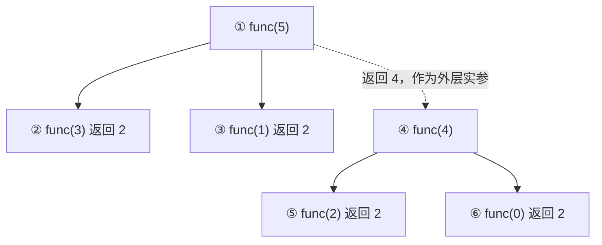

::: add
**为什么执行次序就是先序遍历**（对树的高度归纳）：调用一个结点 $v$ 时，$v$ 先开始执行；接着它调用第一个孩子，这个孩子以及它引起的所有调用（即第一棵子树）全部执行完、返回以后，$v$ 才调用第二个孩子。由归纳假设，每棵子树内部的次序是该子树的先序；于是整体次序是"根，第一棵子树的先序，第二棵子树的先序"，这正是先序遍历的定义。

**一个前提**：上面默认 `func(x-2)+func(x-4)` 先算左边。C 语言标准其实没有规定 `+` 两边谁先求值，考试题都按从左到右理解，书和老师也是这样做的。
:::

::: {.q title="08"}
对于一个问题的递归算法求解和其对应的非递归算法求解，（　）。

| A. 递归算法通常效率高一些　　　B. 非递归算法通常效率高一些
| C. 两者相同　　　　　　　　　　D. 无法比较
:::

[**答案：B**]{.red}

::: video
习题讲解字幕 P31：以斐波那契数列为例，$F_0=0$，$F_1=1$，$F_n=F_{n-1}+F_{n-2}$。递归写法三行：两个递归出口，再返回 `F(n-1)+F(n-2)`。非递归写法：$F_2$ 要一轮加法，$F_3$ 两轮，$F_n$ 就是 $n-1$ 轮，用 `pre1`、`pre2`、`current` 三个临时变量循环。

- 时间：非递归 $O(n)$；递归像二叉树一样展开，第一层 1 次，第二层 $2^1$，第三层 $2^2$……是指数级的 $O(2^n)$，老师说可以当结论记；
- 空间：非递归只用几个临时变量，$O(1)$；递归要用函数栈，空间取决于[函数栈最大会使用多少空间，而不是一共使用了多少空间]{.red}。很多同学误以为也是 $O(2^n)$，这是错的：画 F(3) 的栈，F(3) 入栈，F(2) 入栈，F(1) 入栈、出栈，F(0) 入栈、出栈，F(2) 出栈……栈不是一直进，也有出，最深是 $O(n)$。

老师说本题不需要了解这么深，知道非递归通常效率高就行。
:::

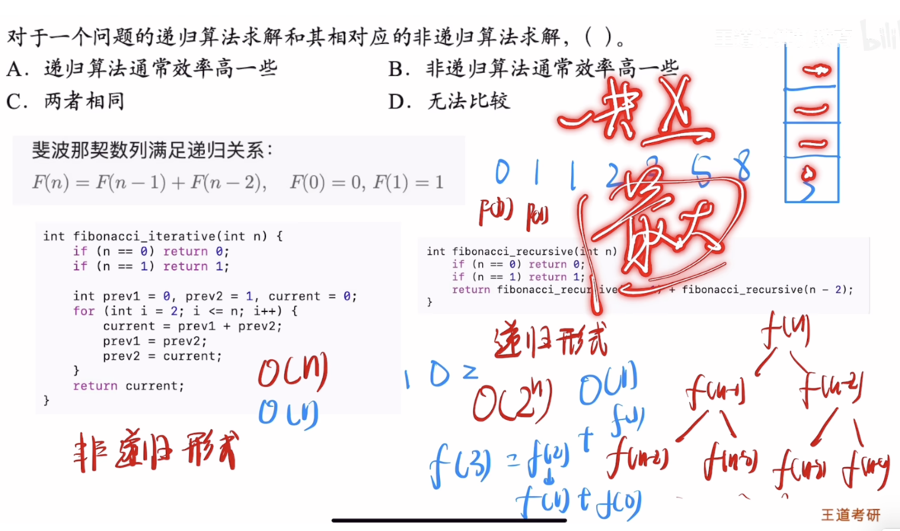{.slide width=0.55}


::: jiexi
王道书第 97 页：通常情况下，递归算法在计算机实际执行的过程中包含很多的重复计算，所以效率会低。
:::

::: add
**老师说"可以当结论"的两个复杂度，补上证明**。用正课 3.3.3 例 2 的 `Fib`（`Fib(0)=0`，`Fib(1)=1`，否则返回 `Fib(n-1)+Fib(n-2)`）。

**时间：调用次数是指数级的。** 记 $C(n)$ 为计算 `Fib(n)` 的调用次数。和 06 题一样，$C(0)=C(1)=1$，$C(n)=1+C(n-1)+C(n-2)$。

*断言* $C(n)=2F_{n+1}-1$（$F$ 是斐波那契数）。*归纳*：$n=0$ 时 $2F_1-1=1$，$n=1$ 时 $2F_2-1=1$，成立；若对 $n-1$、$n-2$ 成立，则 $C(n)=1+(2F_n-1)+(2F_{n-1}-1)=2(F_n+F_{n-1})-1=2F_{n+1}-1$。

再估计 $F_{n+1}$ 的大小。因为 $F$ 单调不减，$F_{n+1}=F_n+F_{n-1}\le2F_n$，所以 $F_{n+1}\le2^n$；又 $F_{n+1}=F_n+F_{n-1}\ge2F_{n-1}$，所以 $F_{n+1}\ge2^{\lfloor n/2\rfloor}$。于是

$$2^{\lfloor n/2\rfloor+1}-1\ \le\ C(n)\ \le\ 2^{n+1}-1 .$$

右边说明老师的 $O(2^n)$ 是对的（它是上界）；左边说明调用次数确实随 $n$ 指数增长，不只是"不超过"指数。慢的原因就是书上说的重复计算：`Fib(n-2)` 在 `Fib(n)` 和 `Fib(n-1)` 下面各算一次，越往下重复越多。

**空间：$O(n)$。** 任一时刻递归工作栈里的，是从 `Fib(n)` 一路调用到当前函数的那一串"还没返回"的调用，也就是调用树上从根到当前结点的一条路径（已经返回的调用早已出栈）。路径上每往下一层，参数至少减 1，参数又在 $0\sim n$ 之间，所以最多 $n+1$ 层；再细一点，`Fib(1)` 不再调用别的函数，`Fib(0)` 只由 `Fib(2)` 调用，路径不会同时含参数 1 和 0，所以最多 $n$ 层（$n\ge1$ 时）；而 `Fib(n)`→`Fib(n-1)`→…→`Fib(1)` 这条路径正好 $n$ 层，能达到。所以栈的最大深度是 $n$，空间复杂度 $O(n)$。"一共入栈多少次"是 $C(n)$，指数级；"最多同时在栈里多少个"是 $n$。空间复杂度看的是后者。

**贯穿的例子 `Fib(4)`**：$C(4)=2F_5-1=2\times5-1=9$；正课 3.3.3 里我补的 `Fib(4)` 13 步追踪中，依次调用了 `Fib(4)`、`Fib(3)`、`Fib(2)`、`Fib(1)`、`Fib(0)`、`Fib(1)`、`Fib(2)`、`Fib(1)`、`Fib(0)`，正好 9 次；栈最深时是 `Fib(4)`、`Fib(3)`、`Fib(2)`、`Fib(1)` 四层（不算 `main`），等于 $n=4$。
:::

::: recall
正课 3.3.3 知识回顾：递归的缺点是[效率低]{.u}，太多层可能栈溢出（[空间复杂度＝递归深度]{.u}），可能包含很多重复计算（如斐波那契）；可以自定义栈把递归算法改造成非递归算法。
:::

::: {.q title="15"}
【2015 统考真题】已知程序如下：

```c
int S(int n)
{   return (n<=0)?0:S(n-1)+n;}
void main()
{   cout<<S(1);}
```

程序运行时使用栈来保存调用过程的信息，自栈底到栈顶保存的信息依次对应的是（　）。

| A. `main()`→`S(1)`→`S(0)`　　　B. `S(0)`→`S(1)`→`main()`
| C. `main()`→`S(0)`→`S(1)`　　　D. `S(1)`→`S(0)`→`main()`
:::

[**答案：A**]{.red}

::: video
习题讲解字幕 P32：程序从 `main` 开始，`main` 先入栈；`main` 调用 `S(1)`，`S(1)` 入栈；`S(1)` 中 $1>0$，调用 `S(0)`，`S(0)` 入栈。栈底到栈顶是 `main`、`S(1)`、`S(0)`，选 A。
:::

::: jiexi
王道书第 99 页：递归调用函数时，在系统栈中保存的函数信息需满足先进后出的特点，依次调用了 `main()`、`S(1)`、`S(0)`，所以栈底到栈顶的信息依次是 `main()`、`S(1)`、`S(0)`。

**注意**：在递归中，系统为每一层的返回点、局部变量、传入实参等开辟了递归工作栈来存储。
:::

::: add
**栈的变化过程**（左边是栈底）：`main` → `main, S(1)` → `main, S(1), S(0)`（最深，本题问的就是此时）→ `S(0)` 返回 0，出栈：`main, S(1)` → `S(1)` 返回 $0+1=1$，出栈：`main` → 输出 1。

栈底一定是最先被调用、最后结束的 `main`，所以 B、D 一眼可排除；C 把调用次序弄反了，`S(0)` 是 `S(1)` 调用的，只能在它上面。
:::

::: recall
正课 3.3.3 第一节：函数调用的特点是[最后被调用的函数最先执行结束]{.u}；栈底在 `main` 下面还有编译器加的一些信息，题目里不考虑。书上"返回点、局部变量、传入实参"＝正课函数调用栈的三样东西。
:::

# 四、关于栈的判断（11、17）

::: cue
判断"一定""必须""只要……就"时，用什么证明它错？
:::

::: {.q title="11"}
下列说法中，正确的是（　）。

| A. 消除递归不一定需要使用栈
| B. 对同一输入序列进行两组不同的合法入栈和出栈组合操作，所得的输出序列也一定相同
| C. 通常使用队列来处理函数或过程调用
| D. 队列和栈都是运算受限的线性表，只允许在表的两端进行运算
:::

[**答案：A**]{.red}

::: video
习题讲解字幕 P32：A 对，斐波那契数列用循环就能算，不用栈。B 错，入栈 1、2、3，可以得到 2、1、3，也可以得到 3、2、1。C 错，函数调用用栈。D 错，栈只在一端（栈顶）操作。
:::

::: jiexi
王道书第 97–98 页：使用栈可以模拟递归的过程，以此来消除递归，但对于单向递归和尾递归而言，可以用迭代的方式来消除递归，选项 A 正确。不同的入栈和出栈组合操作，会产生许多不同的输出序列，B 错误。通常使用栈来处理函数或过程调用，选项 C 错误。队列和栈都是操作受限的线性表，但只有队列允许在表的两端进行运算，而栈只允许在栈顶方向进行操作，选项 D 错误。
:::

::: add
**每个选项的证明各需要什么**：

- A 说"不一定需要"，否定的是"消除递归一定要用栈"。要证明 A，[找到一个不用栈就能消除的递归]{.u}就够了：08 题老师写的斐波那契循环，只用 `pre1`、`pre2`、`current` 三个变量，没有栈；
- B 说"一定相同"，是全称说法，[一个反例就证明它错]{.u}：入栈序列 1, 2, 3，操作"入 入 出 入 出 出"输出 2, 1, 3，"入 入 入 出 出 出"输出 3, 2, 1；
- C 与正课 3.3.3 矛盾（函数调用用栈）；
- D 中"栈允许在两端运算"与栈的定义矛盾。
:::

::: {.def title="名词统一"}
书上"单向递归""尾递归"正课没有讲。尾递归指递归调用是函数的最后一步（调用返回后不再做别的事），比如正课 3.3.3 的阶乘可以改写成这种形式；这种递归每层都不用保留信息，用一个循环就能代替。
:::

::: {.q title="17"}
【2017 统考真题】下列关于栈的叙述中，错误的是（　）。

| Ⅰ. 采用非递归方式重写递归程序时必须使用栈
| Ⅱ. 函数调用时，系统要用栈保存必要的信息
| Ⅲ. 只要确定了入栈次序，即可确定出栈次序
| Ⅳ. 栈是一种受限的线性表，允许在其两端进行操作

| A. 仅 Ⅰ　　B. 仅 Ⅰ、Ⅱ、Ⅲ　　C. 仅 Ⅰ、Ⅲ、Ⅳ　　D. 仅 Ⅱ、Ⅲ、Ⅳ
:::

[**答案：C**]{.red}

::: video
习题讲解字幕 P33：Ⅰ 错，还是斐波那契的例子，用循环就能打破递归形式，不一定要用栈。Ⅱ 对，函数调用时系统把相关信息压进函数栈。Ⅲ 错，入栈次序 1, 2, 3，全部进栈再全部出栈得 3, 2, 1；进一个出一个得 1, 2, 3。老师特别提醒：[如果把 Ⅲ 里的栈换成队列，那就对了]{.u}，确定了入队次序就确定了出队次序，下次改成队列要注意。Ⅳ 错，栈只允许在一端操作，进栈出栈都靠栈顶指针。错误的是 Ⅰ、Ⅲ、Ⅳ，选 C。
:::

::: jiexi
王道书第 99 页：说法 Ⅰ 的反例：计算斐波那契数列迭代实现只需要一个循环即可实现。说法 Ⅲ 的反例：入栈序列为 1, 2，进行 Push, Push, Pop, Pop 操作，出栈次序为 2、1；进行 Push, Pop, Push, Pop 操作，出栈次序为 1, 2。说法 Ⅳ，栈是一种受限的线性表，只允许在一端进行操作。说法 Ⅱ 正确。
:::

::: add
**老师说"换成队列就对了"，证明一下**：队列只在队尾插入、队头删除，任何两个元素 $x$ 先于 $y$ 入队，$y$ 排在 $x$ 后面；$y$ 要出队必须先到队头，而 $x$ 在它前面，所以 $x$ 一定先出队。对任意两个元素都成立，所以出队次序和入队次序完全相同，只有一种。栈没有这个性质：$x$ 先入栈后，$y$ 入栈时 $x$ 可能已经出栈了（$x$ 先出），也可能还在（$y$ 先出），两种都合法，这就是 Ⅲ 的反例。

这和 3.2 课后习题 04 的结论一样：一个入队序列只有一种出队序列。
:::

::: recall
3.1 课后习题的出栈序列题：同一入栈序列有多种出栈序列，个数是卡特兰数。11 的 B、17 的 Ⅲ 都是这个事实。
:::

# 五、括号匹配和火车轨道（20、16）

::: cue
括号匹配时栈最深多少，和括号的什么有关？火车轨道为什么至少 4 条，凭什么 4 条就够？
:::

::: {.q title="20"}
【2025 统考真题】已知算法 A 用于检查字符串中各类括号是否匹配，A 执行过程中使用初始为空的栈保存遇到的括号。若栈的容量是 3，则下列选项中，A 不能处理的是（　）。

| A. `(a+[b+(c+d)/e]+f)+g-h`　　　B. `[a*((b+c)/(d-e)+f/g)-h]`
| C. `[a*(b-(c-d)*e/(f+g))-h]`　　　D. `[a-(b+[c*(d+e)-f]+g+h)]`
:::

[**答案：D**]{.red}

::: video
习题讲解字幕 P33（一休老师）：这道题比较仁慈，只需要处理括号，括号以外的东西可以视而不见。先把每个选项只保留括号，再模拟 D：`[` 入栈，`(` 入栈，`[` 入栈，`(` 还要入栈，这时栈里要放 4 个，超过容量 3，处理不了。

更简单的做法：遇到左括号入栈、右括号出栈，所以设一个计数器记栈里的元素个数，[左括号加一，右括号减一]{.u}，看最大值。A、B、C 最大是 3，D 是 4，选 D。

老师顺便说：中缀表达式的考法主要有两种，中缀转后缀（模拟，更重要）和用有向图描述表达式。
:::

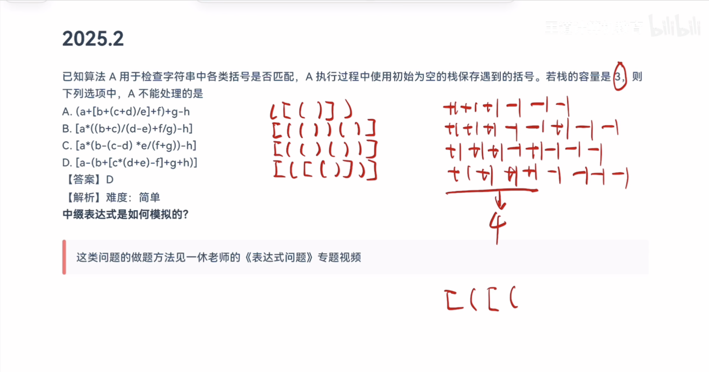{.slide width=0.55}


::: jiexi
王道书第 99–100 页：该算法利用栈来检查括号匹配：遇到左括号时入栈，遇到右括号时出栈并与之匹配。由于栈的容量为 3，因此最多只能容纳 3 个未匹配的左括号，即最多支持 3 层嵌套的括号结构。逐项分析各选项的括号嵌套深度：对于选项 A，括号序列为 `([()])`，最大嵌套深度为 3，依次入栈 `([(`，未超过栈容量。对于选项 B，括号序列为 `[(())]`，最大深度为 3，依次入栈 `[((`，栈容量足够。对于选项 C，括号序列为 `[(())]`，同样最大深度为 3，栈容量足够。对于选项 D，括号序列为 `[([()])]`，最大嵌套深度达到 4。扫描至 `*` 后的 `(` 时，栈中已存有 `[([` 三个左括号，此时，需要将第四个左括号 `(` 入栈，但栈容量仅为 3，无法继续入栈，因此该表达式无法被正确处理。
:::

::: add
**计数器为什么就等于栈里的个数（证明）**：正课 3.3.1 的算法，栈里只放左括号；遇到左括号压入一个，遇到右括号弹出一个（匹配成功时）。所以在括号一直匹配成功的前提下，扫描完某个前缀时，

$$\text{栈中元素个数} = (\text{这个前缀里的左括号数}) - (\text{右括号数}),$$

也就是此处的括号嵌套层数。容量为 3 的栈能处理整个串，[当且仅当所有前缀的这个差都不超过 3]{.u}。

**逐个选项写出计数**（只看括号）：

::: {.tbl widths="0.10,0.22,0.48,0.20"}
| 选项 | 括号序列 | 每个括号之后的计数 | 最大 |
|---|---|---|---|
| A | `( [ ( ) ] )` | 1, 2, 3, 2, 1, 0 | 3 |
| B | `[ ( ( ) ( ) ) ]` | 1, 2, 3, 2, 3, 2, 1, 0 | 3 |
| C | `[ ( ( ) ( ) ) ]` | 1, 2, 3, 2, 3, 2, 1, 0 | 3 |
| D | `[ ( [ ( ) ] ) ]` | 1, 2, 3, [4]{.red}, 3, 2, 1, 0 | [4]{.red} |
:::

书上把 B、C 写成 `[(())]`，少写了一对：B 的 `((b+c)/(d-e)+f/g)` 里有 `(b+c)`、`(d-e)` 两对，C 的 `(b-(c-d)*e/(f+g))` 里有 `(c-d)`、`(f+g)` 两对，都是 `[(()())]`。最大深度仍是 3，不影响答案。
:::

::: recall
正课 3.3.1：[最后出现的左括号最先被匹配]{.u}，所以用栈；顺序栈容量固定，括号串很长时可能栈溢出。
:::

::: {.q title="16"}
【2016 统考真题】设有如下图所示的火车车轨，入口和出口之间有 n 条轨道，列车的行进方向均为从左至右，列车可驶入任意一条轨道。现有编号为 1～9 的 9 列列车，驶入的次序依次是 8, 4, 2, 5, 3, 9, 1, 6, 7。若期望驶出的次序依次为 1～9，则 n 至少是（　）。

| A. 2　　　B. 3　　　C. 4　　　D. 5
:::

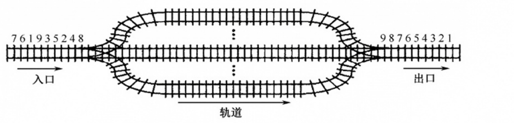{.slide width=0.75}

[**答案：C**]{.red}

::: video
习题讲解字幕 P33：题目特意标出了入口和出口，一边进一边出，每条轨道就是一个队列，问的是至少要几个队列。逐个安排：8 先随便进一条；4 要比 8 先出，不能排在 8 后面，只能另开一条；2 要比 4、8 都先出，再开一条；5 可以排在 4 后面；3 排在 2 后面；9 排在 8 后面；1 要第一个出，只能单独再开一条；6、7 要在 4、5 之后出，也在 2、3 之后，放在哪条都行。共 4 条，选 C。

老师说："这种题目都是要求我们手动去模拟，并没有什么严格上的一个理论证明的东西。"
:::

::: jiexi
王道书第 99 页：根据题意：入队顺序为 8, 4, 2, 5, 3, 9, 1, 6, 7，出队顺序为 1～9。入口和出口之间有多个队列（n 条轨道），且每个队列（轨道）可容纳多个元素（多列列车），为便于区分，队列用字母编号。分析如下：显然先入队的元素必须小于后入队的元素（否则，若 8 和 4 入同一个队列，8 在 4 前面，则出队时也只能 8 在 4 前面），这样 8 入队列 A，4 入队列 B，2 入队列 C，5 入队列 B（按照前述原则"大的元素在小的元素后面"也可将 5 入队列 C，但这时剩下的元素 3 就必须放入一个新的队列中，无法确保"至少"），3 入队列 C，9 入队列 A，这时共占了 3 个队列，后面还有元素 1，直接再用一个新的队列 D，1 从队列 D 出队后，剩下的元素 6 和 7 或入队列 B，或入队列 C。综上，共占用了 4 个队列。当然还有其他的入队、出队情况，请读者自己推演，但要确保满足：① 队列中后面的元素大于前面的元素；② 确保占用最少（满足题意中"至少"）的队列。
:::

::: add
**这道题其实有严格证明**：老师和书都只给出了一种 4 条轨道的安排。但"至少是 4"包含两句话，要分别证明：[3 条不够]{.u}（下界），[4 条够]{.u}（构造）。

**引理（同一条轨道上的车必须按编号从小到大驶入）**：轨道是队列，同一条轨道上 $x$ 先于 $y$ 驶入，$x$ 就先于 $y$ 驶出（17 题我补的证明）。出口要求编号小的先出，所以同一条轨道上先驶入的车编号必须更小。

**下界，3 条不够**：在驶入次序 8, 4, 2, 5, 3, 9, 1, 6, 7 里，8、4、2、1 依次出现、编号依次变小。由引理，其中任意两列都不能在同一条轨道上（先进来的编号大，违反引理）。4 列车两两不同轨，至少要 4 条轨道。

**构造，4 条够**：按书上的安排（6、7 都放 B）：

:::

下面是驶入、驶出全过程的分解图（我画的）。每一小格是一步：每条轨道右端靠出口，是最前面的车；[绿色是这一步驶入的车]{.u}；右边是已驶出的车，[红色是这一步驶出的]{.red}。

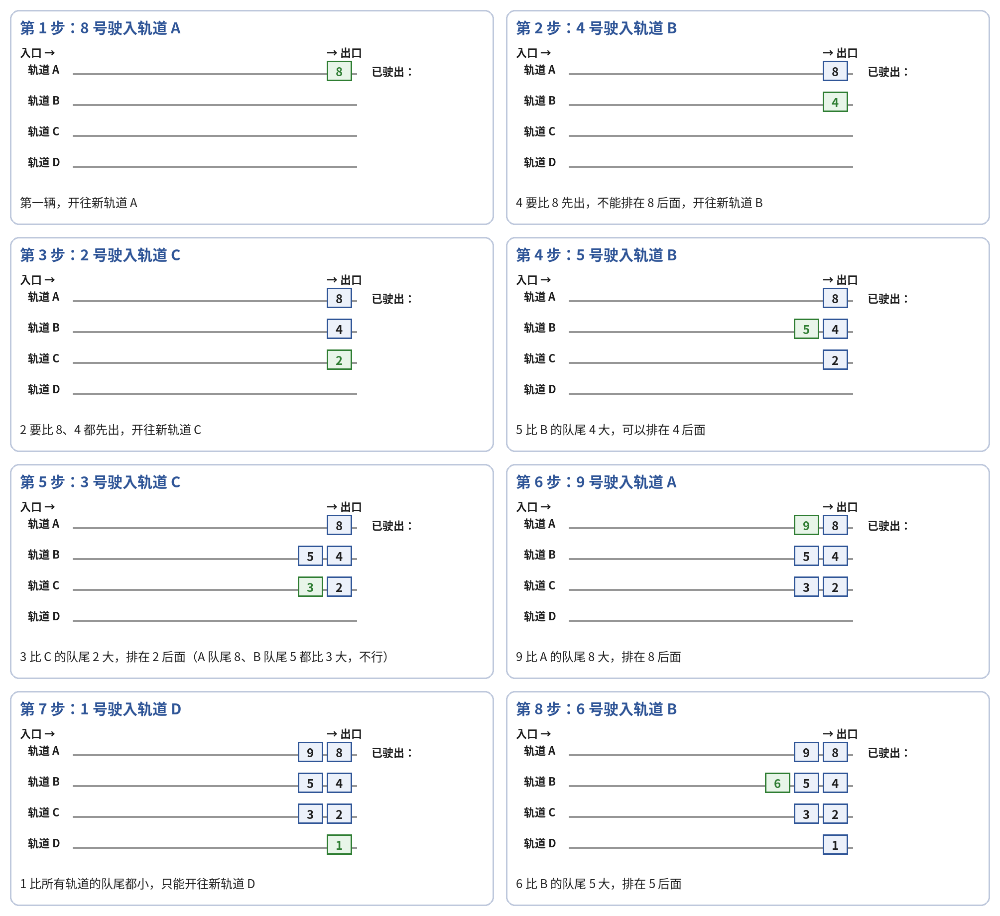{width=1.0}

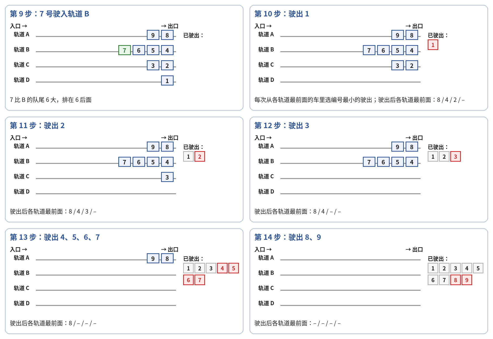{width=1.0}

::: add
**速查**（接上）：上面的过程合成一张表。

::: {.tbl widths="0.20,0.40,0.40"}
| 轨道 | 车（按驶入先后） | 是否从小到大 |
|---|---|---|
| A | 8, 9 | 是 |
| B | 4, 5, 6, 7 | 是 |
| C | 2, 3 | 是 |
| D | 1 | 是 |
:::

驶出：让所有车先驶入，然后每次从 4 条轨道的最前面（队头）里选编号最小的驶出。因为每条轨道都是从小到大排的，每条轨道的队头就是这条轨道上最小的车，所以所有队头中最小的，就是全体剩下的车中最小的。于是第 1 次驶出的是 1，第 2 次是 2……依次正好驶出 1～9。

**贯穿这个例子看驶出过程**（每行是驶出前各轨道的队头）：

::: {.tbl widths="0.16,0.42,0.42"}
| 第几次 | 队头 A / B / C / D | 驶出 |
|---|---|---|
| 1 | 8 / 4 / 2 / 1 | 1（D 空） |
| 2 | 8 / 4 / 2 / – | 2 |
| 3 | 8 / 4 / 3 / – | 3（C 空） |
| 4–7 | 8 / 4,5,6,7 依次 / – / – | 4, 5, 6, 7（B 空） |
| 8–9 | 8, 9 / – / – / – | 8, 9 |
:::

两部分合起来，$n$ 的最小值就是 4。

**推广**：同样的道理说明，所需轨道数至少是驶入序列中"编号依次变小的最长子序列"的长度。本题这个长度是 4（8, 4, 2, 1），所以下界是 4；而上面又构造出了 4 条的方案，两者相等。考场上找出这条最长下降子序列，就知道答案的下界；再像老师那样贪心地安排一遍，安排出来的条数等于下界时，答案就定了。
:::

::: recall
3.2 课后习题 04：队列先进先出，[一个入队序列只有一种出队序列]{.u}；本题把这个性质用在每一条轨道上。正课 3.3.4+3.3.5 书框中的考点追踪"多队列出队/入队操作的应用（2016）"就是这道题。
:::

\newpage

# 六、总结

::: summary
**用栈还是用队列**（01、03、09、10、12）：后来的先处理用栈（括号匹配、表达式求值、递归和函数调用、局部变量、树的递归遍历、DFS）；先来的先处理用队列（缓冲区、FIFO 页面替换、层次遍历、BFS、先来先服务）。

**表达式**（02、19、04、13、14、18）：

- 求后缀：找最后执行的运算符（括号外、优先级最低、同级取最右）拆成 $L$ op $R$，后缀＝$L$ 的后缀 $R$ 的后缀 op；它等于表达式树的后序遍历，"$F_1$ 最长"就是同级从左往右算（02、19）。后缀唯一，所以排除法可靠；
- 运算数栈深度：转成后缀，从左往右数"操作数个数 − 运算符个数"的最大值；或者在每个操作数处数"未运算的运算符（不算括号）＋1"（04）；
- 中缀转后缀栈中的情况：完整模拟一遍，括号也占位置（13）；扫描到某个操作数时，栈中运算符＝中缀式中在它之前、后缀式中在它之后的运算符，再补上未消解的 `(`（14）；
- 先弹出的是右操作数，b op a（18）。

**递归**（05–08、15）：画递归调用树。调用次数＝结点数，可以用递推式 $C(n)=1+\ldots$ 算，不要漏了最外层那次（06）；执行次序＝先序遍历（07）；栈里是根到当前结点的路径，最大深度＝树高（15）。斐波那契递归调用 $2F_{n+1}-1$ 次，指数级；空间 $O(n)$，看的是"最多同时在栈里多少"，不是"一共入栈多少次"（08）。

**判断题**（11、17）：否定"一定""必须""只要……就"，一个反例就够（斐波那契循环、入栈 1,2 的两种出栈次序）。"入队次序确定出队次序"对队列成立，对栈不成立。

**括号匹配栈深**（20）：栈中个数＝前缀里左括号数 − 右括号数＝嵌套层数；容量够当且仅当最大嵌套层数不超过容量。

**多队列**（16）：同一队列里必须从小到大。驶入序列中最长的下降子序列每个元素都要单独一条，给出下界；再构造一个方案达到它。

**自测**：

1. 写出 `a-(b+c*d)/e` 的后缀表达式，并说出每一步拆分时最后执行的是哪个运算符。
2. 用两个栈计算 `a-(b+c*d)/e` 时，运算数栈最深几个？用"操作数 − 运算符"的方法算。
3. 13 题中如果把栈容量限制为 4，转换会在扫描到哪个字符时溢出？
4. 06 题的 F 改成 `if(n<=3) return 1; else return F(n-1)+F(n-3)+1;`，计算 F(6) 调用几次？
5. 为什么 08 题递归求斐波那契的空间复杂度是 $O(n)$ 而不是 $O(2^n)$？
6. 16 题如果驶入次序是 9, 8, 7, 6, 5, 4, 3, 2, 1，至少要几条轨道？为什么？
:::
