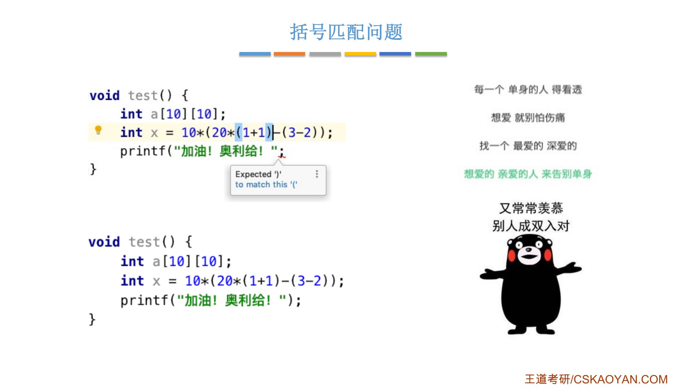
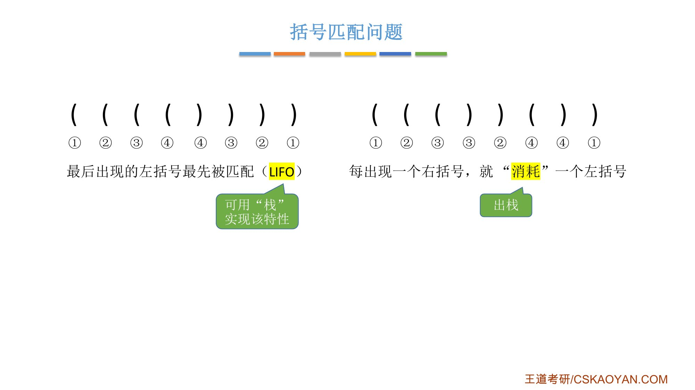
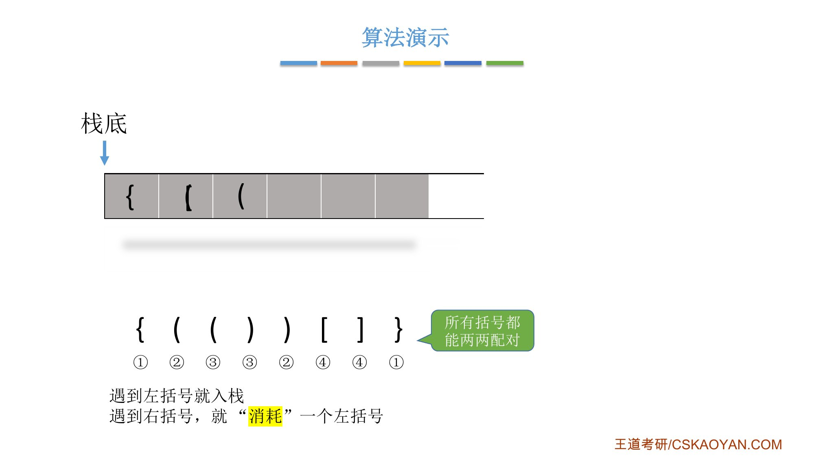
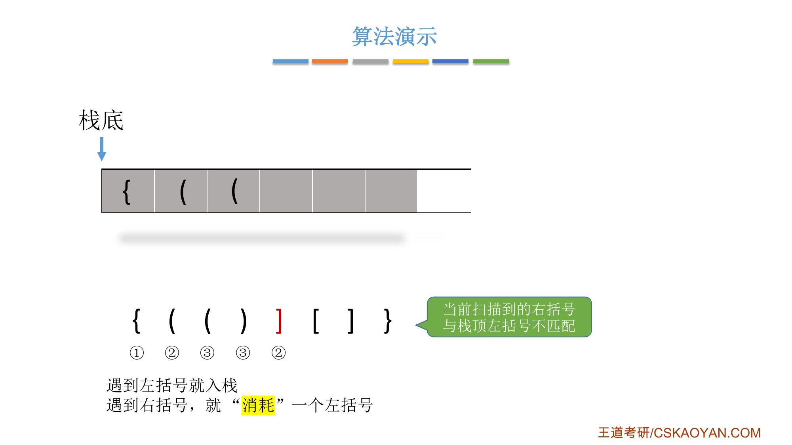
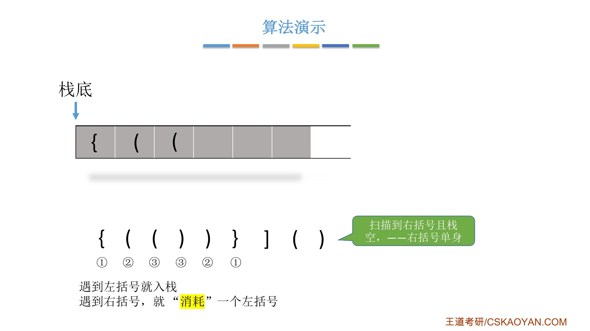
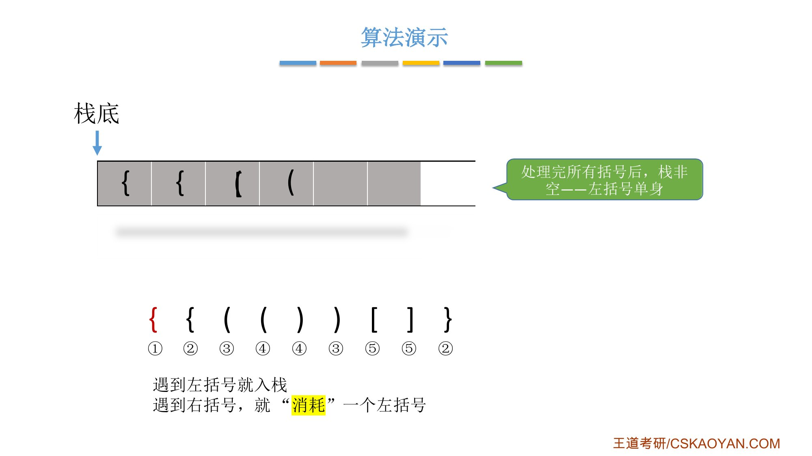
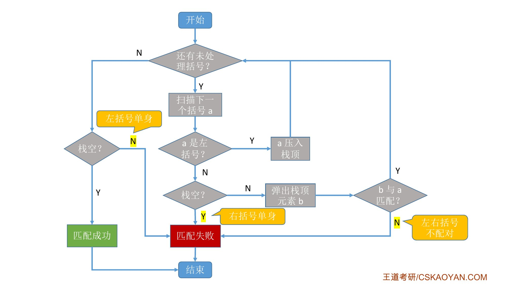
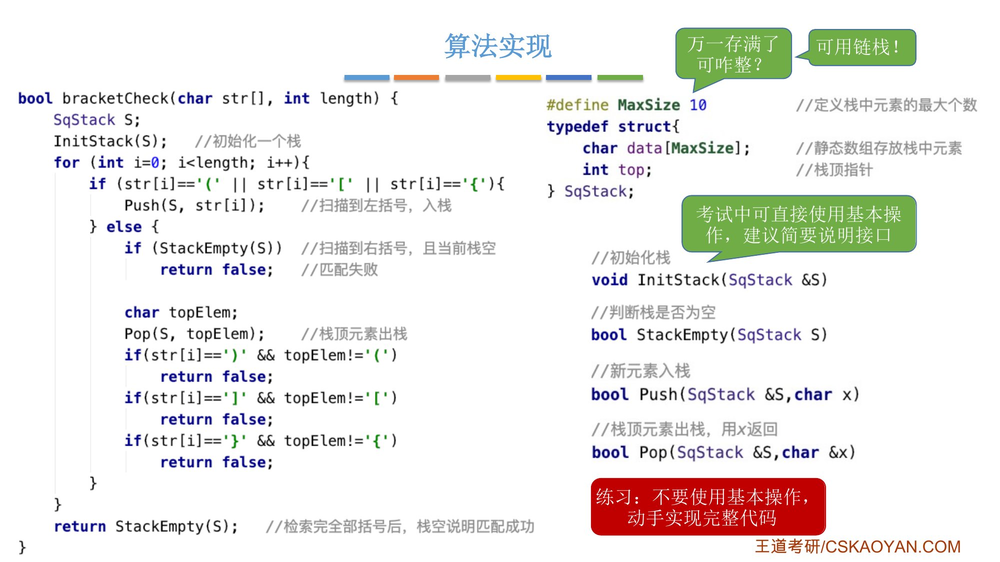
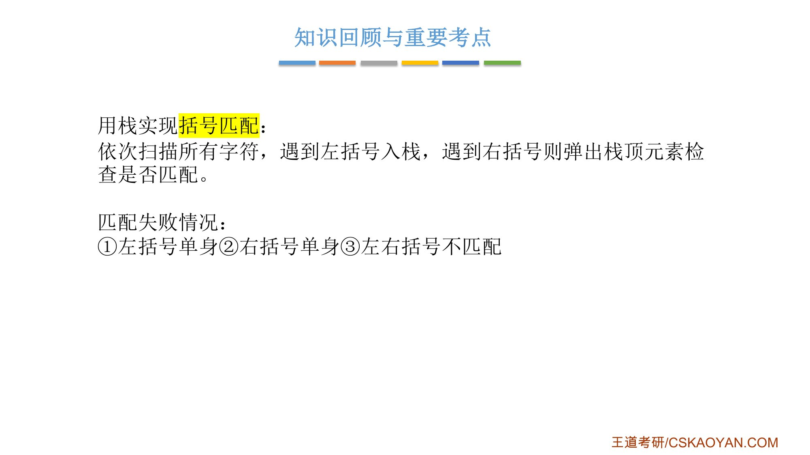

# 这一节在讲什么

::: cue
括号匹配要检查哪两件事？为什么能用栈？
:::

**括号匹配**是栈的经典应用。写代码时，小括号、中括号、大括号都要成双成对地出现：只写了左括号没写右括号，IDE（写代码用的可视化编程环境）会报错，编译器也会做这样的检查。匹配要满足两点：左右括号[数量]{.u}要对上，[形状]{.u}也要对上，比如左小括号配右中括号就是错的。

{.slide width=0.55}

# 一、为什么用栈

::: cue
"越往后出现的左括号越先被匹配"，对应栈的哪个特性？
:::

人一眼就能看出哪两个括号是一对，计算机只能[从左往右依次扫描]{.u}。扫描时会发现：

- 扫描到一个右括号，要找的是[最近出现、还没被匹配]{.u}的那个左括号。也就是**最后出现的左括号最先被匹配**，这和栈的后进先出（LIFO）一样；
- **每出现一个右括号，就"消耗"一个左括号**，"消耗"对应出栈。

所以：把左括号依次压入栈中，遇到右括号就弹出栈顶的左括号，检查两者是否匹配。

{.slide width=0.6}

::: fix
正课字幕 P27 这里有一句"当我们遇到右括号的时候，就把它压入栈中，就把栈顶的那个左括号给弹出"，前半句是口误。按课件和后面的讲解：[遇到左括号入栈]{.u}，遇到右括号弹出栈顶的左括号。
:::

# 二、算法演示：一种成功、三种失败

::: cue
匹配失败有哪三种情况？分别在什么时候发现？
:::

规则只有两条：**遇到左括号就入栈；遇到右括号，就"消耗"一个左括号**（弹出栈顶，检查是否配对）。

**① 全部配对成功**：`{(())[]}`。每次弹出的左括号都和右括号同形状，扫描结束时栈空。

{.slide width=0.55}

**② 左右括号不匹配**：`{(()][]}`。扫描到 `]` 时弹出的是 `(`，形状不同，[后面的括号不用再扫描]{.u}，直接判定失败。

{.slide width=0.55}

**③ 右括号单身**：`{(())}]()`。扫描到 `]` 时要消耗一个左括号，但[栈已经空了]{.u}，说明没有和它配对的左括号，失败。

{.slide width=0.55}

**④ 左括号单身**：`{{(())[]}`。每个右括号都配对成功了，但[扫描完所有括号后，栈里还剩一个 `{`]{.u}，说明它没有右括号和它配对，也是失败。所以写代码时，扫描完还要检查栈是否为空。

{.slide width=0.55}

# 三、算法流程

::: cue
流程图里有两次"栈空？"判断，分别在什么时候？
:::

从左往右扫描，当前扫描到的括号记作 `a`：

1. 如果 `a` 是左括号：压入栈顶，接着扫描下一个；
2. 如果 `a` 是右括号：先判断[栈空吗]{.u}。栈空说明右括号单身，匹配失败，算法结束。栈不空就弹出栈顶元素记作 `b`，检查 `b` 和 `a` 是否匹配（小配小、中配中、大配大）：匹配就继续扫描下一个；不匹配，算法结束，匹配失败；
3. 所有括号处理完后，再判断一次[栈空吗]{.u}：栈非空说明左括号单身，匹配失败；栈空说明所有括号两两配对，匹配成功。

{.slide width=0.55}

# 四、算法实现

::: cue
考试时能直接调用 `Push`、`Pop` 吗？要注意什么？
:::

```c
#define MaxSize 10                  // 定义栈中元素的最大个数
typedef struct {
    char data[MaxSize];             // 静态数组存放栈中元素
    int top;                        // 栈顶指针
} SqStack;

// 初始化栈
void InitStack(SqStack &S)
// 判断栈是否为空
bool StackEmpty(SqStack S)
// 新元素入栈
bool Push(SqStack &S, char x)
// 栈顶元素出栈，用 x 返回
bool Pop(SqStack &S, char &x)

bool bracketCheck(char str[], int length) {
    SqStack S;
    InitStack(S);                   // 初始化一个栈
    for (int i = 0; i < length; i++) {
        if (str[i] == '(' || str[i] == '[' || str[i] == '{') {
            Push(S, str[i]);        // 扫描到左括号，入栈
        } else {
            if (StackEmpty(S))      // 扫描到右括号，且当前栈空
                return false;       // 匹配失败

            char topElem;
            Pop(S, topElem);        // 栈顶元素出栈
            if (str[i] == ')' && topElem != '(')
                return false;
            if (str[i] == ']' && topElem != '[')
                return false;
            if (str[i] == '}' && topElem != '{')
                return false;
        }
    }
    return StackEmpty(S);           // 检索完全部括号后，栈空说明匹配成功
}
```

- 参数 `str` 是存放括号串的字符数组，`length` 是它的长度；栈里的数据元素是 `char` 类型；
- 考试时[可以直接使用基本操作]{.u}，但老师建议用注释简要说明每个接口是干什么的。这样即使接口命名不太规范，只要中文注释讲明白了，改卷老师也不会算错；
- 顺序栈用静态数组，容量固定，括号串很长时可能栈溢出。实际开发可以用[链栈]{.u}；考试中用顺序栈更简单，也没问题；
- 老师留的练习：如果题目里没有现成的栈，只有一个数组和 `top` 指针，就把基本操作换成对数组和 `top` 的直接操作，自己写出完整代码。基础不太好的同学尤其要练。

{.slide width=0.6}

::: add
**练习参考答案**（先自己写再看）：不调用基本操作，直接用数组和 `top`。`top=-1` 表示空栈，和正课 3.1.2 的顺序栈相同。课件代码没有处理 `Push` 失败（栈满），这里补上了：栈满时括号串已经无法检查，直接返回 `false`。

```c
bool bracketCheck(char str[], int length) {
    char data[MaxSize];             // 静态数组存放栈中元素
    int top = -1;                   // 栈顶指针，-1 表示空栈
    for (int i = 0; i < length; i++) {
        if (str[i] == '(' || str[i] == '[' || str[i] == '{') {
            if (top == MaxSize - 1) // 栈满，无法再入栈
                return false;
            data[++top] = str[i];   // 扫描到左括号，入栈
        } else {
            if (top == -1)          // 扫描到右括号，且当前栈空
                return false;       // 右括号单身
            char topElem = data[top--];     // 栈顶元素出栈
            if (str[i] == ')' && topElem != '(') return false;
            if (str[i] == ']' && topElem != '[') return false;
            if (str[i] == '}' && topElem != '{') return false;
        }
    }
    return top == -1;               // 栈空说明匹配成功；非空说明左括号单身
}
```

我用 C 编译运行过：课件四个例子 `{(())[]}`、`{(()][]}`、`{(())}]()`、`{{(())[]}` 依次返回成功、失败、失败、失败，和演示一致。
:::

::: book
王道书第 90 页的例子只有圆括号 `()` 和方括号 `[]` 两种，嵌套顺序任意：`([]())`、`[([][])]` 合法，`[(])`、`([())`、`(()]` 非法。

书上的分析是用"期待"来说的：读入第 1 个括号 `[` 后，系统期待与之匹配的 `]` 出现；读入第 2 个括号 `(` 后，第 1 个括号的期待暂时搁置，转而优先期待与 `(` 匹配的 `)`……整个处理过程完全符合[后进先出]{.u}的栈行为。

算法思想：

1. 初始化一个空栈，顺序扫描输入的括号序列；
2. 若遇到左括号，将其压入栈中，表示新增一个待匹配的期待，且其优先级最高；
3. 若遇到右括号，则检查栈是否为空：若栈非空且栈顶左括号与当前右括号匹配，则弹出栈顶，完成一次匹配；否则，括号序列非法，算法终止；
4. 扫描结束后，若栈为空，则括号序列合法；否则，存在未匹配的左括号，序列非法。
:::

# 五、知识回顾

{.slide width=0.55}

::: summary
**思路**：从左到右依次扫描所有字符，[遇到左括号入栈，遇到右括号则弹出栈顶元素，检查是否匹配]{.red}。最后出现的左括号最先被匹配，所以用栈（LIFO）。

**匹配失败的三种情况**：

1. **左括号单身**：所有括号扫描完，栈非空；
2. **右括号单身**：扫描到右括号时栈已空；
3. **左右括号不匹配**：弹出的栈顶左括号和当前右括号形状不同。

后两种一出现就可以结束算法，不用再往后扫描。

**写代码**：考试可以直接用基本操作，用注释说明接口；顺序栈可能存满，实际开发可用链栈。

**自测**：① 为什么扫描完还要判断栈空？② `([)]` 在哪一步失败、属于哪种情况？③ 不用基本操作，入栈、出栈、判空分别怎么写？
:::
