# 这一节在讲什么

::: cue
三种算术表达式各是什么样？这一节的重点是哪一种？
:::

这一节讲三种算术表达式（中缀、后缀、前缀），以及两类考点：**后缀表达式**的转换与计算（重点，课件标了红色感叹号），**前缀表达式**的转换与计算。本节只讲[手算]{.u}转换和用栈计算；"用栈把中缀转后缀"（机算）放在下一节 3.3.2_2。

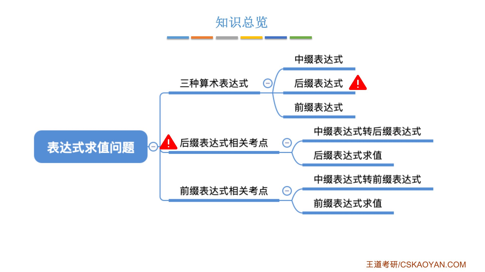{.slide width=0.55}

::: add
**路线图（3.3.2 上、下两节）**：同一件事按"后缀 / 前缀"各走一遍，用栈的转换放在下一节。

::: {.tbl widths="0.24,0.38,0.38"}
| 步骤 | 后缀（重点） | 前缀 |
|---|---|---|
| ① 中缀转换（手算） | 本节第二节 | 本节第五节 |
| ② 求值（手算） | 本节第三节 | 本节第五节（我的补充） |
| ③ 求值（用栈） | 本节第四节 | 本节第五节 |
| ④ 转回中缀 | 本节第三节（我的补充） | 本节第五节（我的补充） |
| ⑤ 中缀转换（用栈） | 下一节 3.3.2_2 | 3.3.2_2（我的补充） |
:::

最后，3.3.2_2 把后缀那一列的 ⑤ 和 ③ 合起来，用两个栈直接计算中缀表达式。本节末尾还有一张更详细的对照表。
:::

# 一、中缀、后缀、前缀表达式

::: cue
界限符起什么作用？后缀、前缀表达式为什么可以不要括号？
:::

我们熟悉的算术表达式，比如 `((15÷(7-(1+1)))×3)-(2+(1+1))`，由三个部分组成：**操作数、运算符、界限符**。界限符就是括号，它[反映了计算的先后顺序]{.u}，在中缀表达式里必不可少：同样的数和运算符，去掉括号写成 `15÷7-1+1×3-2+1+1`，运算顺序就完全变了。

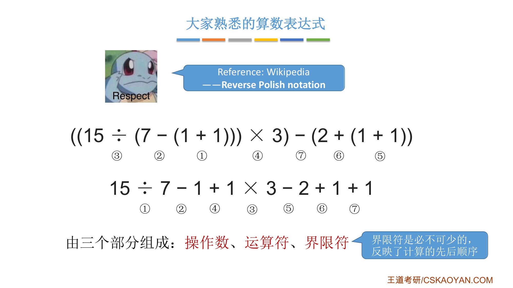{.slide width=0.55}

1924 年一位波兰数学家想到：[可以不用界限符，也能无歧义地表达运算顺序]{.u}。由此得到两种表达式：

::: {.tbl widths="0.36,0.19,0.13,0.15,0.17"}
| 名称 | 运算符的位置 | 例 1 | 例 2 | 例 3 |
|---|---|---|---|---|
| **中缀表达式** | 两个操作数中间 | `a+b` | `a+b-c` | `a+b-c*d` |
| **后缀表达式**（逆波兰表达式，Reverse Polish notation） | 两个操作数后面 | `ab+` | `ab+c-` | `ab+cd*-` |
| **前缀表达式**（波兰表达式，Polish notation） | 两个操作数前面 | `+ab` | `-+abc` | `-+ab*cd` |
:::

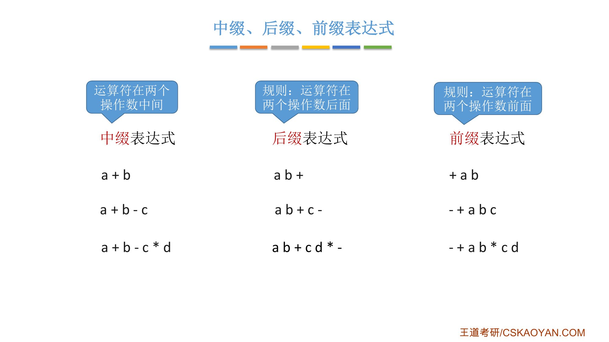{.slide width=0.55}

- 操作数的[左右顺序不能交换]{.u}：`a/b` 的后缀是 `ab/`，写成 `ba/` 就成了 `b/a`；
- 考试中后缀表达式考得更多，所以课件把它标为重点。

::: book
王道书第 90 页"1. 算术表达式"：中缀表达式（如 `3+4`）运算符位于两个操作数之间；前缀表达式（如 `+34`）、后缀表达式（如 `34+`）。中缀表达式虽然符合人类阅读习惯，但[不便于计算机直接求值]{.u}，因此许多编程语言在内部需要将其转换为后缀或前缀形式进行求值。中缀表达式必须依赖括号来明确运算次序；后缀表达式的运算符置于操作数之后，其结构已隐含了运算顺序，因此无须括号，仅由操作数和运算符构成。
:::

# 二、中缀转后缀（手算）

::: cue
手算中缀转后缀的三步是什么？什么是"左优先"原则，为什么要用它？
:::

**手算方法**（课件原文）：

1. 确定中缀表达式中[各个运算符的运算顺序]{.u}；
2. 选择下一个运算符，按照 **「左操作数 右操作数 运算符」** 的方式组合成一个新的操作数；
3. 如果还有运算符没被处理，就继续 ②。

以 `((15÷(7-(1+1)))×3)-(2+(1+1))` 为例，运算顺序依次是 `+ - ÷ × + + -`（括号里的先算），得到后缀表达式 `15 7 1 1 + - ÷ 3 × 2 1 1 + + -`。可以看到：[后缀表达式中运算符从左到右出现的顺序，就是运算的顺序]{.u}。

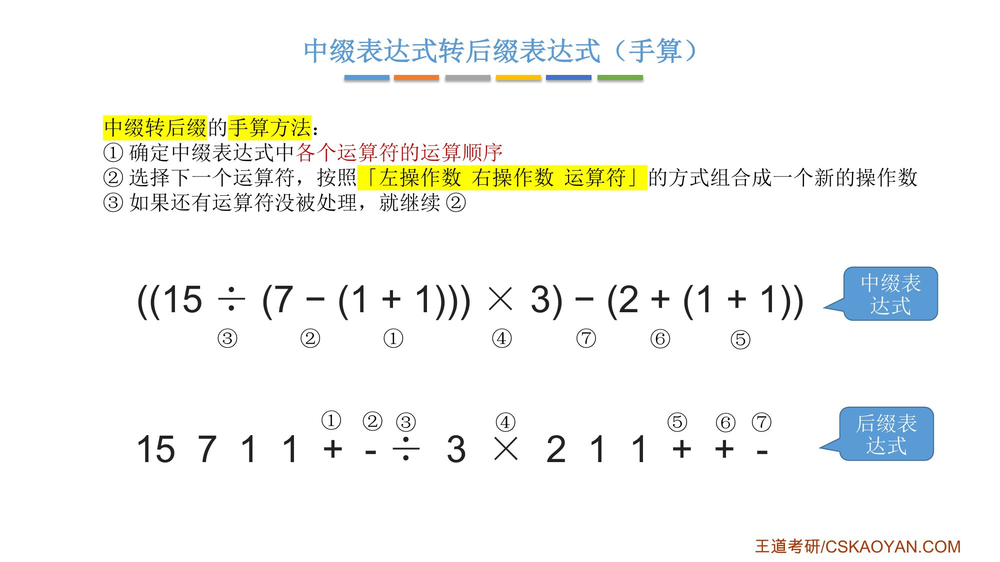{.slide width=0.55}

**运算顺序不唯一，后缀表达式也不唯一。** 例如 `A+B*(C-D)-E/F`：

- 按 `- * + / -` 的顺序算，得到 `ABCD-*+EF/-`；
- 也可以先算 `/`、最后才算 `+`（顺序 `- * / - +`），得到 `ABCD-*EF/-+`。

客观来看两种都正确，但[只有前者是"机算"（下一节的栈算法）得到的结果]{.u}。为了让手算和机算的结果相同，老师定了一个**"左优先"原则**：[只要左边的运算符能先计算，就优先算左边的]{.red}。这样运算顺序就唯一了，后缀表达式也唯一（算法的"确定性"）。

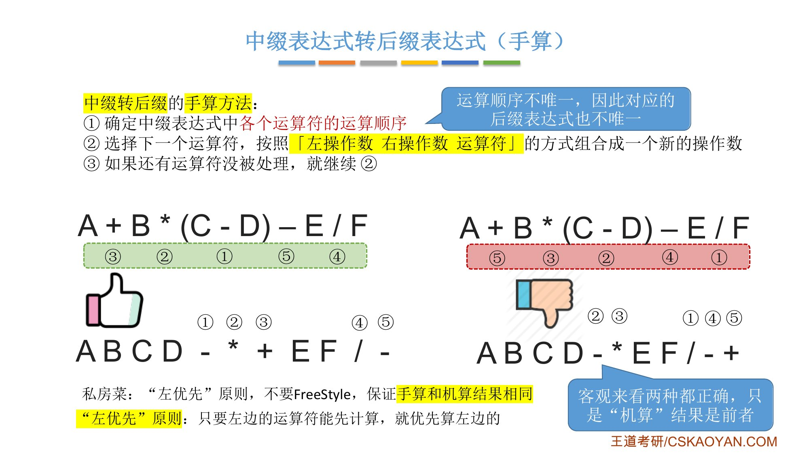{.slide width=0.55}

再练一个：`A+B-C*D/E+F`。按左优先，`+` 能先算就先算 `+`；之后 `-` 要等右边的 `C*D/E`，所以先算 `*`、再算 `/`、再算 `-`、最后 `+`，得到 `AB+CD*E/-F+`。

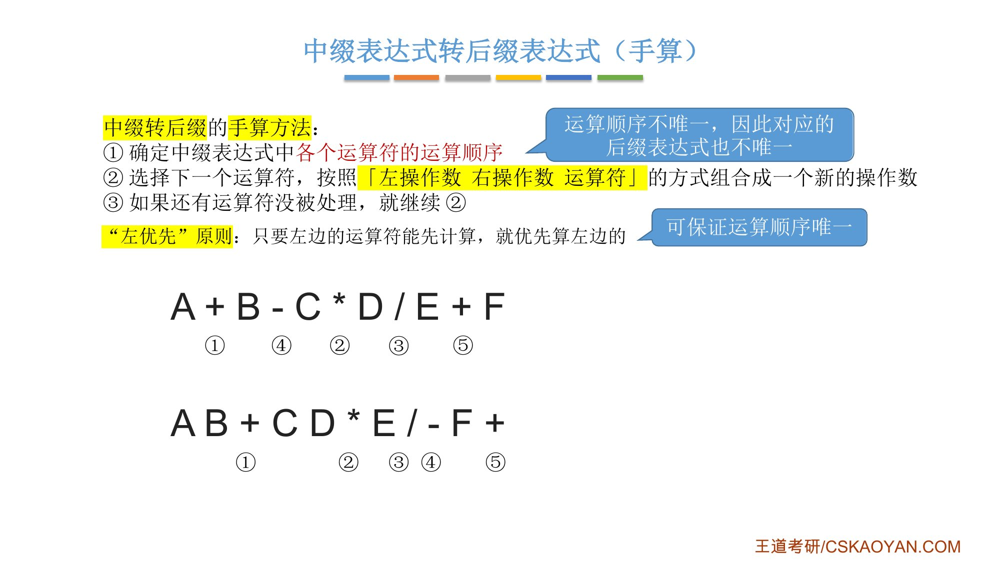{.slide width=0.55}

::: fix
老师提醒：「左操作数/右操作数」「左优先/右优先」是他自己"杜撰"的说法（课件上写"私房菜"），方便理解；[答简答题时不建议用这些说法]{.u}，要跟着业内的标准表达。另外，考试时要验证自己的算法执行是否正确，应该用左优先得到的那种后缀表达式去验证。
:::

::: book
王道书第 91 页"2. 中缀表达式转后缀表达式"（考点追踪：中缀表达式转后缀表达式的方法，2024）给的手算方法和课件不同，是**加括号法**：

1. 按运算优先级对整个表达式逐层加括号；
2. 把每个运算符移到其所在括号的右括号之后，形成"左操作数 右操作数 运算符"的结构；
3. 删除所有括号，即得后缀表达式。

以 `A+B*(C-D)-E/F` 为例（下标表示运算顺序）：

1. 加括号：`((A+₃(B*₂(C-₁D)))-₅(E/₄F))`；
2. 运算符后移：`((A(B(CD)-₁)*₂)+₃(EF)/₄)-₅`；
3. 去括号后得到后缀表达式：`ABCD-₁*₂+₃EF/₄-₅`。

书上脚注：中缀转前缀的方法类似，但统考真题[仅考查过中缀转后缀]{.u}，所以书上只介绍中缀转后缀。
:::

::: add
两种手算方法结果一样。书上"逐层加括号"时，同级运算符从左往右加括号，下标的顺序 `- * + / -` 正好就是老师的左优先顺序。我用程序核对过：`A+B*(C-D)-E/F` 按左优先得 `ABCD-*+EF/-`，`A+B-C*D/E+F` 得 `AB+CD*E/-F+`，15 那个式子得 `15 7 1 1 + - ÷ 3 × 2 1 1 + + -`，与课件一致。
:::

# 三、后缀表达式的计算（手算）

::: cue
手算后缀表达式时，每遇到一个运算符做什么？
:::

**手算方法**：[从左往右扫描，每遇到一个运算符，就让运算符前面最近的两个操作数执行对应运算，合体为一个操作数]{.u}。注意两个操作数的左右顺序。

例如 `AB+CD*E/-F+`：遇到 `+`，算 `A+B`；遇到 `*`，算 `C*D`；遇到 `/`，前面最近的两个操作数是 `C*D` 和 `E`，算 `(C*D)/E`；遇到 `-`，算 `(A+B)-((C*D)/E)`；最后遇到 `+`，再加上 `F`。

手算时会发现一个特点：[最后出现的操作数先被运算]{.u}。这正是后进先出（LIFO），所以可以用栈来实现。

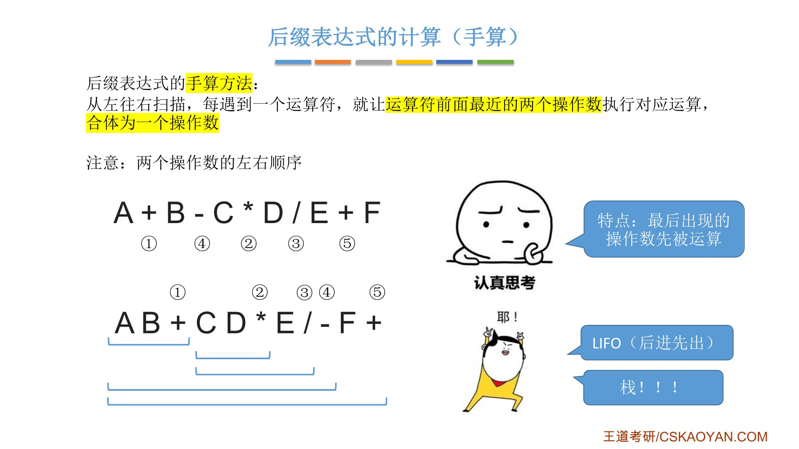{.slide width=0.55}

::: add
**后缀转中缀**（课件留的思考题，知识回顾里给了方法）：从左往右扫描，每遇到一个运算符，就把「左操作数 右操作数 运算符」变为「(左操作数 运算符 右操作数)」的形式。例如 `AB+CD*E/-F+` → `((A+B)-((C*D)/E))+F`，和手算求值是同一个过程，只是不算出结果，而是加上括号。

**补全老师跳过的部分**：正课字幕 P28 里，老师讲完后缀求值后，用 15 那个式子演示后缀转中缀，只做了前 3 步（`1+1`、`7-(1+1)`、`15÷(7-(1+1))`），说"用这样的方式就可以把后缀表达式一步一步……"就转去讲前缀了。完整过程如下（每一步把「左 右 运算符」变成「(左 运算符 右)」，变完的整块看作一个操作数）：

`15 7 1 1 + - ÷ 3 × 2 1 1 + + -`

::: {.tbl widths="0.08,0.20,0.72"}
| 步 | 扫描到 | 合体后的式子 |
|---|---|---|
| ① | 第 1 个 `+` | `15 7 (1+1) - ÷ 3 × 2 1 1 + + -` |
| ② | `-` | `15 (7-(1+1)) ÷ 3 × 2 1 1 + + -` |
| ③ | `÷` | `(15÷(7-(1+1))) 3 × 2 1 1 + + -` |
| ④ | `×` | `((15÷(7-(1+1)))×3) 2 1 1 + + -` |
| ⑤ | 第 2 个 `+` | `((15÷(7-(1+1)))×3) 2 (1+1) + -` |
| ⑥ | 第 3 个 `+` | `((15÷(7-(1+1)))×3) (2+(1+1)) -` |
| ⑦ | `-` | `(((15÷(7-(1+1)))×3)-(2+(1+1)))` |
:::

去掉最外层括号，就是原来的中缀式 `((15÷(7-(1+1)))×3)-(2+(1+1))`。

**用栈做**（课件没讲，和下面第四节"后缀表达式的计算（机算）"是同一套流程）：从左往右扫描，遇到操作数入栈；遇到运算符，弹出两个栈顶元素，[先弹出的是右操作数]{.u}，拼成「(左 运算符 右)」后压回栈顶。上面 ①～⑦ 每一步的栈内容就是表中"合体后的式子"里运算符前面的部分，例如 ⑤ 之后栈里是 `((15÷(7-(1+1)))×3)`、`2`、`(1+1)` 三个元素。最后栈中只剩一个元素，就是中缀表达式。我用程序跑过，结果和原式一致。
:::

# 四、后缀表达式的计算（机算）

::: cue
用栈计算后缀表达式时，先出栈的是左操作数还是右操作数？最后栈里剩什么？
:::

**用栈实现后缀表达式的计算**（课件原文）：

1. 从左往右扫描下一个元素，直到处理完所有元素；
2. 若扫描到操作数，则压入栈，并回到 ①；否则执行 ③；
3. 若扫描到运算符，则弹出两个栈顶元素，执行相应运算，运算结果压回栈顶，回到 ①。

注意：[先出栈的是"右操作数"]{.red}。若表达式合法，最后栈中只会留下一个元素，就是最终结果。

以 `AB+CD*E/-F+` 为例：

::: {.tbl widths="0.10,0.32,0.58"}
| 扫描 | 动作 | 栈（左边是栈底） |
|---|---|---|
| A | 入栈 | A |
| B | 入栈 | A B |
| + | 弹出 B（右）、A（左），算 A+B，压回 | (A+B) |
| C | 入栈 | (A+B) C |
| D | 入栈 | (A+B) C D |
| * | 弹出 D、C，算 C\*D，压回 | (A+B) (C\*D) |
| E | 入栈 | (A+B) (C\*D) E |
| / | 弹出 E、C\*D，算 (C\*D)/E，压回 | (A+B) ((C\*D)/E) |
| - | 弹出 (C\*D)/E、A+B，算 (A+B)-((C\*D)/E)，压回 | ((A+B)-((C\*D)/E)) |
| F | 入栈 | ((A+B)-((C\*D)/E)) F |
| + | 弹出 F 和左边那项，相加，压回 | (((A+B)-((C\*D)/E))+F) |
:::

\Needspace{16\baselineskip}

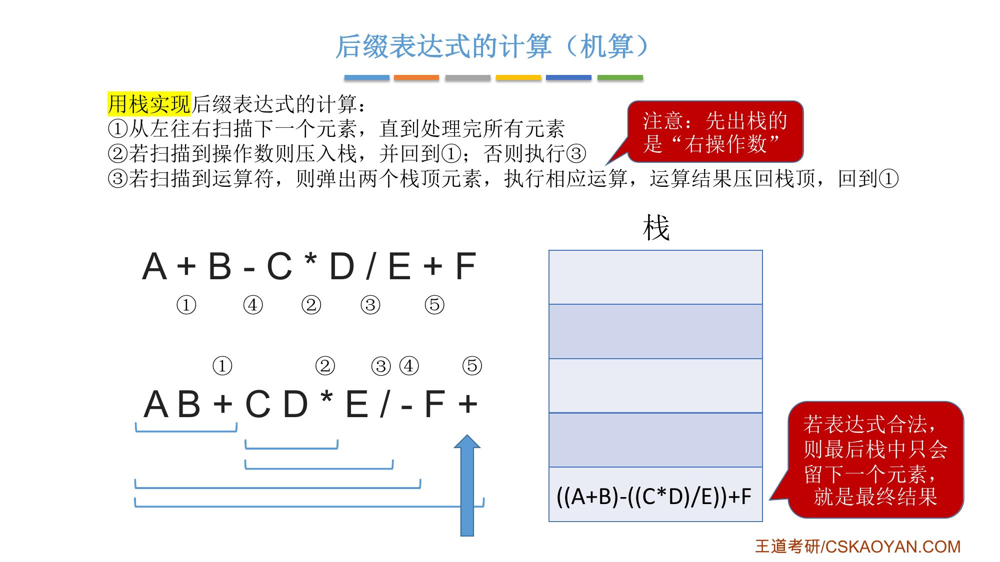{.slide width=0.55}

- 老师强调：先出栈的是右操作数，[这是比较容易错的地方]{.u}；遇到减法、除法时左右搞反，结果就错了；
- 老师建议把这个例子截个图，自己动手模拟怎么入栈、怎么出栈，因为[这个过程选择题甚至大题都会考]{.u}；
- 后缀表达式适用于[基于栈的编程语言]{.u}（stack-oriented programming language），如 Forth、PostScript，它们做算术运算时都用后缀表达式；
- 课件还给了 15 那个式子作练习，用栈算出的结果应该和中缀式一样，是 5。

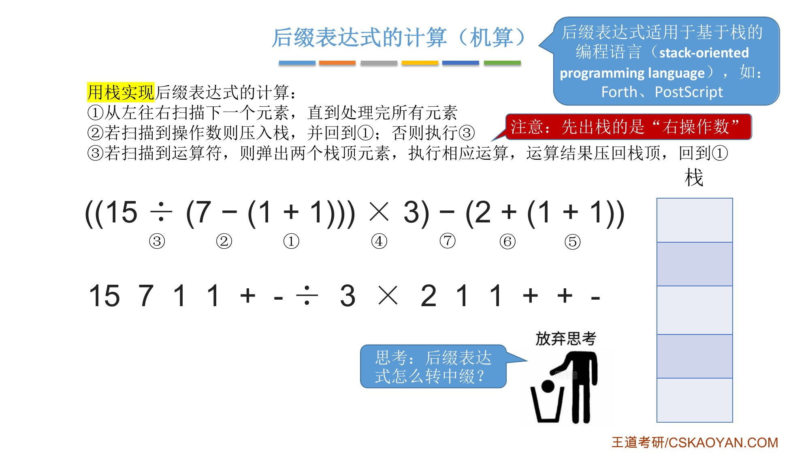{.slide width=0.55}

::: add
为什么先出栈的是右操作数（我的理解）：右操作数在后缀表达式里比左操作数靠右，后入栈，所以先出栈。

**练习参考答案**（先自己算再看）：`15 7 1 1 + - ÷ 3 × 2 1 1 + + -`

::: {.tbl widths="0.12,0.40,0.48"}
| 扫描 | 动作 | 栈（左边是栈底） |
|---|---|---|
| 15, 7, 1, 1 | 依次入栈 | 15 7 1 1 |
| + | 弹出 1、1，算 1+1=2 | 15 7 2 |
| - | 弹出 2、7，算 7-2=5 | 15 5 |
| ÷ | 弹出 5、15，算 15÷5=3 | 3 |
| 3 | 入栈 | 3 3 |
| × | 算 3×3=9 | 9 |
| 2, 1, 1 | 依次入栈 | 9 2 1 1 |
| + | 算 1+1=2 | 9 2 2 |
| + | 算 2+2=4 | 9 4 |
| - | 弹出 4、9，算 9-4=5 | 5 |
:::

最后栈中只剩 5，就是结果，和中缀式直接算的结果相同。这个过程中栈里最多同时有 4 个元素。
:::

::: book
王道书第 92 页"3. 后缀表达式求值"（考点追踪：用栈实现表达式求值的分析，2018）：从左至右依次扫描表达式，若当前项为操作数，则将其压入栈中；若为操作符 `<op>`，则从栈中弹出两个操作数，[先弹出的是右操作数 Y，后弹出的是左操作数 X]{.u}，执行运算 `X<op>Y`，并将结果压回栈中。所有项处理完毕后，栈顶元素即为最终计算结果。

书上表 3.2 给出 `ABCD-*+EF/-` 的求值过程，共 12 步（第 1 步是"置空栈"）：A、B、C、D 依次入栈；`-` 算 C-D 得 R₁；`*` 算 B×R₁ 得 R₂；`+` 算 A+R₂ 得 R₃；E、F 入栈；`/` 算 E/F 得 R₄；`-` 算 R₃-R₄ 得 R₅。
:::

::: book
王道书第 90 页（考点追踪：表达式树的定义，2025）：中缀表达式 `A+B*(C-D)-E/F` 对应的后缀表达式为 `ABCD-*+EF/-`，与该表达式对应的**表达式树**（图 3.15）的[后序遍历序列]{.u}一致，体现了后缀表达式与树结构的内在联系。
:::

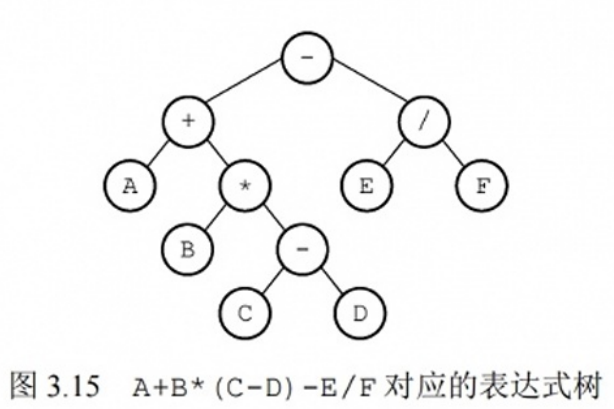{.slide width=0.32}

::: add
表达式树和后序遍历要到第 5 章"树"才学，这里先记住结论：叶子是操作数，内部结点是运算符，[后序遍历得到后缀表达式]{.u}。
:::

# 五、中缀转前缀（手算）与前缀表达式的计算

::: cue
中缀转前缀用什么原则？前缀表达式从哪边开始扫描？先出栈的是哪个操作数？
:::

**中缀转前缀的手算方法**：

1. 确定中缀表达式中各个运算符的运算顺序；
2. 选择下一个运算符，按照 **「运算符 左操作数 右操作数」** 的方式组合成一个新的操作数；
3. 如果还有运算符没被处理，就继续 ②。

这里用**"右优先"原则**：[只要右边的运算符能先计算，就优先计算右边的]{.u}。例如 `A+B*(C-D)-E/F`，右优先的顺序是 `/ - * + -`（从右往左编号），得到 `-+A*B-CD/EF`；如果不按右优先，也可能得到 `+A-*B-CD/EF`。

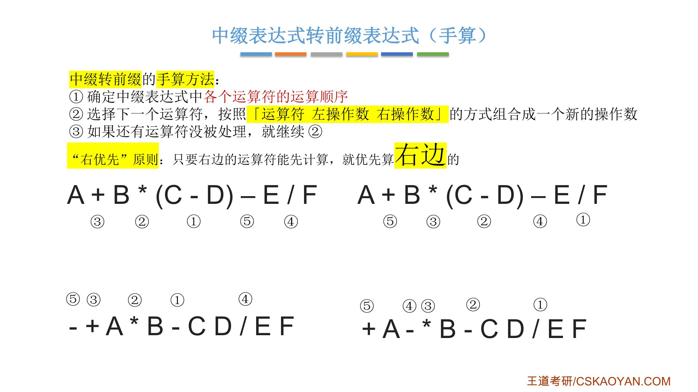{.slide width=0.55}

对比 15 那个式子：转后缀用左优先，得 `15 7 1 1 + - ÷ 3 × 2 1 1 + + -`，运算符[从左往右]{.u}出现的顺序就是运算顺序；转前缀用右优先，得 `- × ÷ 15 - 7 + 1 1 3 + 2 + 1 1`，运算符[从右往左]{.u}出现的顺序就是运算顺序。

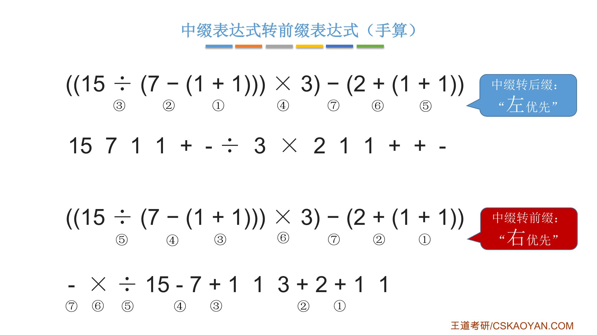{.slide width=0.55}

::: add
**前缀表达式的计算（手算）**（课件没讲，和后缀对称）：[从右往左]{.u}扫描，每遇到一个运算符，就让运算符[后面最近的两个操作数]{.u}执行对应运算，合体为一个操作数。注意左右顺序：运算符后面紧挨着的是左操作数，再往后是右操作数。

例如 `-+A*B-CD/EF`：从右往左，先遇到 `/`，算 `E/F`；遇到 `-`，算 `C-D`；遇到 `*`，算 `B*(C-D)`；遇到 `+`，算 `A+(B*(C-D))`；最后遇到 `-`，算 `(A+(B*(C-D)))-(E/F)`。运算顺序正好是右优先的 `/ - * + -`。
:::

**用栈实现前缀表达式的计算**：

1. [从右往左]{.u}扫描下一个元素，直到处理完所有元素；
2. 若扫描到操作数，则压入栈，并回到 ①；否则执行 ③；
3. 若扫描到运算符，则弹出两个栈顶元素，执行相应运算，运算结果压回栈顶，回到 ①。

注意：[先出栈的是"左操作数"]{.red}（从右往左扫，左操作数后入栈，所以先出栈），和后缀正好相反。

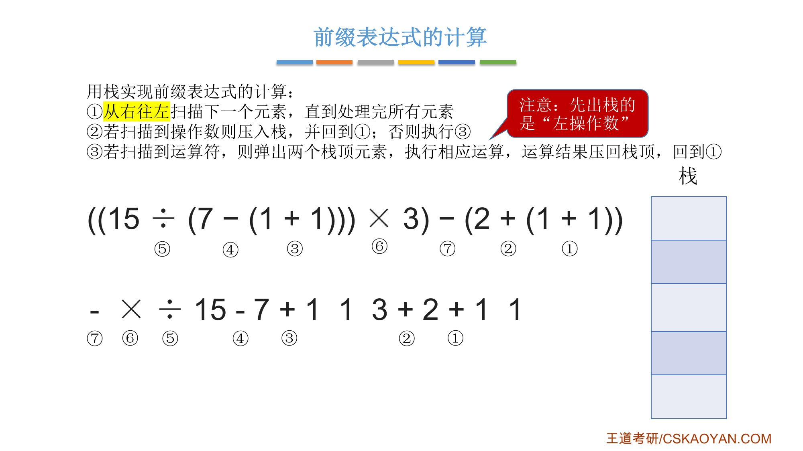{.slide width=0.55}

::: add
**补全老师跳过的部分**：正课字幕 P28 里，老师用栈计算 `- × ÷ 15 - 7 + 1 1 3 + 2 + 1 1`，只演示了前几步（`1`、`1` 入栈，`+` 得 `1+1`，`2` 入栈，`+` 时先弹出的 `2` 是左操作数），然后说"后续的过程我们就不再展开，留给同学们自己练手，结果同样应该是 5"。完整过程（从右往左扫描）：

::: {.tbl widths="0.12,0.46,0.42"}
| 扫描 | 动作 | 栈（左边是栈底） |
|---|---|---|
| 1, 1 | 依次入栈 | 1 1 |
| + | 弹出 1（左）、1（右），算 1+1=2 | 2 |
| 2 | 入栈 | 2 2 |
| + | 弹出 2（左）、2（右），算 2+2=4 | 4 |
| 3, 1, 1 | 依次入栈 | 4 3 1 1 |
| + | 算 1+1=2 | 4 3 2 |
| 7 | 入栈 | 4 3 2 7 |
| - | 弹出 7（左）、2（右），算 7-2=5 | 4 3 5 |
| 15 | 入栈 | 4 3 5 15 |
| ÷ | 弹出 15（左）、5（右），算 15÷5=3 | 4 3 3 |
| × | 弹出 3（左）、3（右），算 3×3=9 | 4 9 |
| - | 弹出 9（左）、4（右），算 9-4=5 | 5 |
:::

最后栈中只剩 5，和后缀的结果相同。注意 `-` 和 `÷` 这两步：先弹出的是左操作数，写反了就会算成 2-7、5÷15。
:::

::: add
**前缀转中缀**（课件没讲，和后缀转中缀对称）：从右往左扫描，每遇到一个运算符，就把「运算符 左 右」变为「(左 运算符 右)」，合体为一个操作数。用栈做时，先弹出的是左操作数。

`- × ÷ 15 - 7 + 1 1 3 + 2 + 1 1` 依次得到：`(1+1)` → `(2+(1+1))` → `(1+1)` → `(7-(1+1))` → `(15÷(7-(1+1)))` → `((15÷(7-(1+1)))×3)` → `(((15÷(7-(1+1)))×3)-(2+(1+1)))`，去掉最外层括号就是原式。我用程序核对过。
:::

::: add
**两条链条对照**（3.3.2 讲到的和我补的）：

::: {.tbl widths="0.20,0.40,0.40"}
| 步骤 | 后缀 | 前缀 |
|---|---|---|
| 中缀转换（手算） | 左优先，「左 右 运算符」（第二节，课件讲全） | 右优先，「运算符 左 右」（本节，课件讲全） |
| 求值（手算） | 从左往右，运算符前面最近的两个操作数（第三节，课件讲全） | 从右往左，运算符后面最近的两个操作数（本节，我补的） |
| 求值（用栈） | 从左往右，先出栈的是右操作数（第四节，课件讲全；15 的练习答案是我补的） | 从右往左，先出栈的是左操作数（本节，课件只演示了前几步，我补全了） |
| 转回中缀 | 「左 右 运算符」→「(左 运算符 右)」（第三节，老师只做了 3 步，我补全了） | 「运算符 左 右」→「(左 运算符 右)」（本节，我补的） |
| 中缀转换（用栈） | 3.3.2_2 讲 | 课件和书都没讲，见 3.3.2_2 的"我的补充" |
:::
:::

# 六、知识回顾

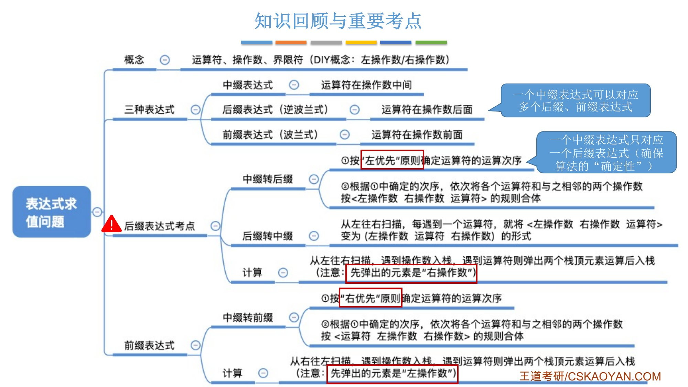{.slide width=0.6}

::: summary
**三种表达式**：中缀（运算符在两个操作数中间，需要界限符）；后缀 = 逆波兰（运算符在两个操作数后面）；前缀 = 波兰（运算符在两个操作数前面）。一个中缀表达式可以对应多个后缀、前缀表达式。

::: {.tbl widths="0.18,0.41,0.41"}
| | 后缀（重点） | 前缀 |
|---|---|---|
| 手算转换 | **左优先**确定顺序，按「左 右 运算符」合体 | **右优先**确定顺序，按「运算符 左 右」合体 |
| 用栈计算 | 从**左**往右扫；操作数入栈，运算符弹两个算完压回 | 从**右**往左扫；同样操作 |
| 先出栈的是 | [右操作数]{.red} | [左操作数]{.red} |
:::

**后缀转中缀**：从左往右扫，把「左 右 运算符」变成「(左 运算符 右)」。

**王道书**：手算转后缀用加括号法（加括号 → 运算符移到右括号后 → 去括号），结果相同；后缀表达式 = 表达式树的后序遍历（2025）；后缀求值（2018）。

**自测**：① `A+B*(C-D)-E/F` 的后缀、前缀各是什么？② 后缀表达式求值时，栈里弹出 Y 再弹出 X，算的是 X op Y 还是 Y op X？③ 为什么要用左优先原则？
:::
