# 这一节在讲什么

::: cue
这一节讲哪两个"用栈实现"的算法？
:::

上一节（3.3.2_1）学了手算中缀转后缀、用栈计算后缀表达式。这一节（课件叫"第二季"）讲两个机算算法：

1. **用栈实现中缀表达式转后缀表达式**（考试重点）；
2. **用栈实现中缀表达式的计算**：就是上面这个算法和"后缀表达式求值"两个算法的结合。

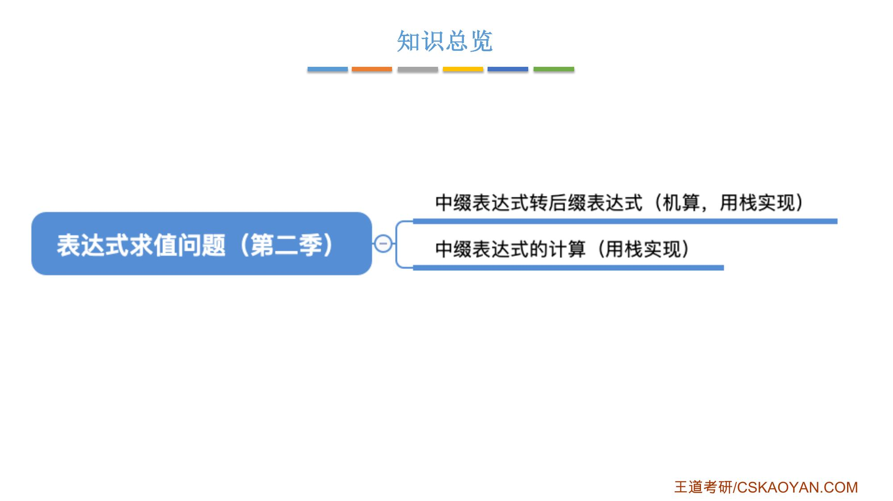{.slide width=0.55}

# 一、中缀转后缀（机算）：规则

::: cue
栈里存放的是什么？遇到操作数、界限符、运算符分别怎么处理？
:::

老师先让我们观察：中缀 `A+B-C*D/E+F` 和后缀 `AB+CD*E/-F+` 里，操作数的相对顺序都是 A B C D E F，[操作数的相对顺序不变]{.u}，变的只是运算符的先后顺序。所以初始化一个栈，[用于保存暂时还不能确定运算顺序的运算符]{.red}。

从左到右处理各个元素，直到末尾。可能遇到三种情况（课件原文）：

1. **遇到操作数**。直接加入后缀表达式。
2. **遇到界限符**。遇到 `(` 直接入栈；遇到 `)` 则依次弹出栈内运算符并加入后缀表达式，直到弹出 `(` 为止。注意：`(` 不加入后缀表达式。
3. **遇到运算符**。依次弹出栈中[优先级高于或等于当前运算符]{.u}的所有运算符，并加入后缀表达式，若碰到 `(` 或栈空则停止。之后再把当前运算符入栈。

按上述方法处理完所有字符后，将栈中剩余运算符依次弹出，并加入后缀表达式。

运算符的优先级：`*`、`/` 高于 `+`、`-`；`*` 和 `/` 相等，`+` 和 `-` 相等。老师说数学表达式里还有别的运算符，这里只讨论加减乘除这种最简单的情况。

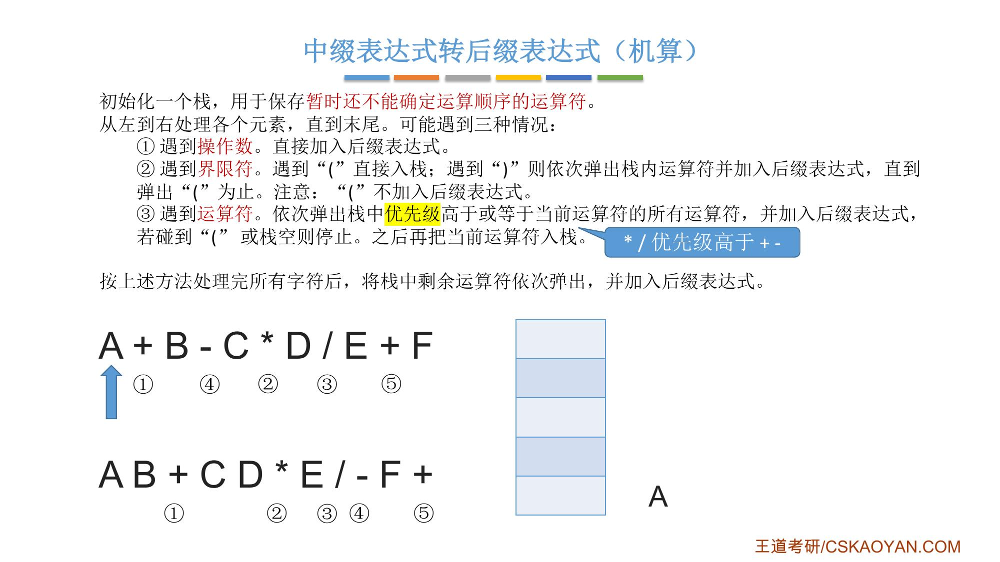{.slide width=0.6}

# 二、例 1：A+B-C\*D/E+F（不带括号）

::: cue
扫描到 `-` 时为什么可以弹出 `+`？扫描到 `*` 时为什么 `-` 和 `*` 都不能先弹？
:::

下面是这个过程的分解图（我画的）。每一小格是一步：上面一行是表达式，[红框是当前扫描的字符]{.red}，灰色是已扫描过的；左边是栈，[绿色是这一步新入栈的]{.u}；右边是输出的表达式，橙色是这一步新加入的；有弹出时单独标出弹出了什么；最下面一行是这一步用的规则。图中 `*`、`/`、`-` 写成 ×、÷、−。

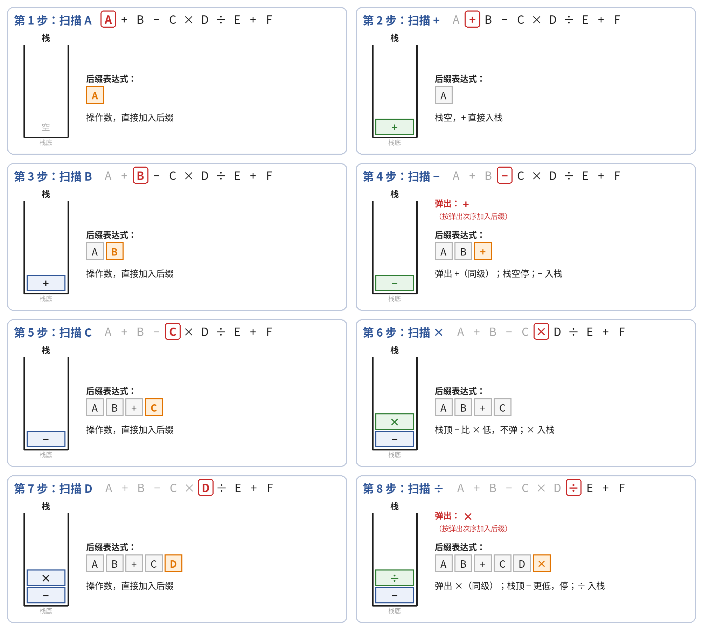{width=1.0}

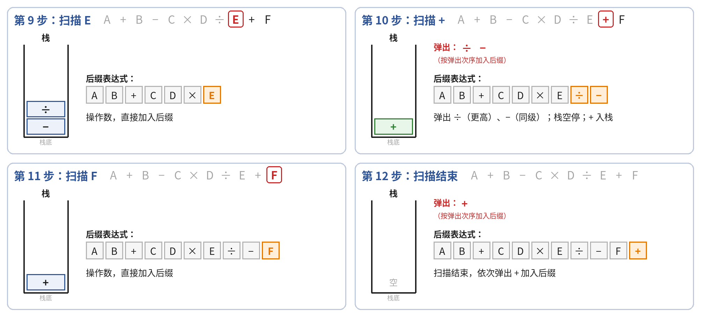{width=1.0}

**速查**：上面的过程合成一张表。

::: {.tbl widths="0.10,0.14,0.30,0.46"}
| 扫描 | 栈（左边是栈底） | 后缀表达式 | 动作 |
|---|---|---|---|
| A | 空 | A | 操作数，直接输出 |
| + | + | A | 栈空，直接入栈 |
| B | + | AB | |
| - | - | AB+ | `+` 与 `-` 同级，弹出 `+`；`-` 入栈 |
| C | - | AB+C | |
| * | -\* | AB+C | `-` 优先级更低，不弹；`*` 入栈 |
| D | -\* | AB+CD | |
| / | -/ | AB+CD\* | `*` 与 `/` 同级，弹出 `*`；`-` 更低，停；`/` 入栈 |
| E | -/ | AB+CD\*E | |
| + | + | AB+CD\*E/- | 依次弹出 `/`、`-`，栈空停；`+` 入栈 |
| F | + | AB+CD\*E/-F | |
| 结束 | 空 | AB+CD\*E/-F+ | 弹出剩余的 `+` |
:::

结果和上一节手算（左优先）的结果一样。

\Needspace{16\baselineskip}

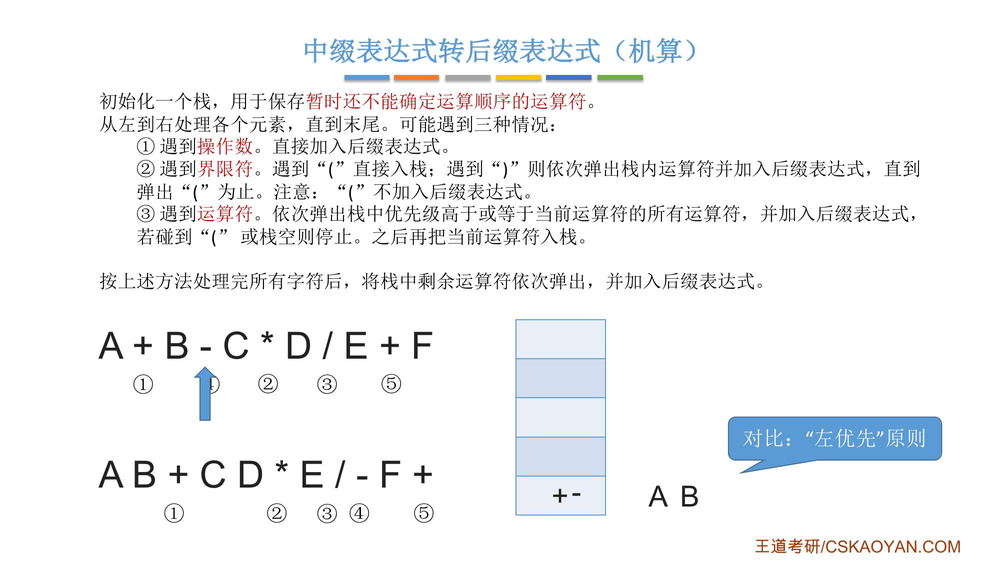{.slide width=0.55}

**老师解释规则背后的逻辑**：

- 中缀表达式里，除了第一个和最后一个，[每个操作数的左右两边都有运算符]{.u}。栈顶是 `+`、刚扫到 `-`，说明两者中间夹着一个操作数 B，它既要做加法又要做减法；两者优先级相等，按左优先原则，可以放心先让左边的 `+` 生效，所以弹出 `+`（后缀表达式中运算符出现的顺序就是生效的顺序）。之后把 `A+B` 看作一个整体；
- 扫到 `*` 时栈顶是 `-`：先乘除后加减，`-` 不能先生效，不能弹；但 `*` 也不能马上生效，因为[它后面可能不偏不倚地跟着一个括号]{.u}，运算顺序还得往后靠，所以也先压入栈中；
- 扫到 `/` 时栈顶是 `*`：同级，左边的 `*` 先生效，弹出；再看栈顶 `-`，`/` 更高但后面可能有括号，所以 `/` 也入栈；
- 扫到 `+` 时栈顶是 `/`：中间的数既要除又要加，显然除法先生效，弹出 `/`；再看栈顶 `-`，同级，左优先，也弹出。

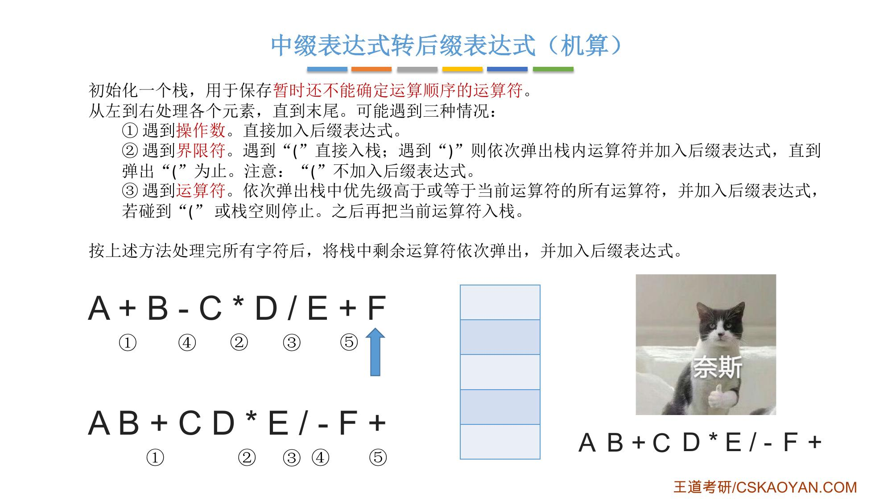{.slide width=0.55}

# 三、例 2：A+B\*(C-D)-E/F（带括号）

::: cue
栈顶是 `(` 时遇到运算符怎么办？遇到 `)` 为什么可以把括号里的运算符全部弹出？
:::

下面两张图是转换过程的 14 步分解（我画的）。每一小格是一步：上面一行是中缀表达式，[红框是当前扫描的字符]{.red}，灰色是已扫描过的；左边是栈，[绿色是这一步新入栈的]{.u}；右边是后缀表达式，橙色是这一步新加入的；有弹出时单独标出弹出了什么；最下面一行是这一步用的规则。图中 `*`、`/`、`-` 写成 ×、÷、−。

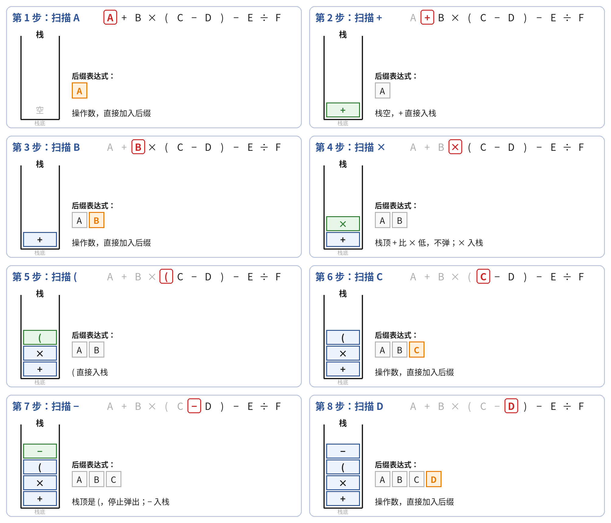{width=1.0}

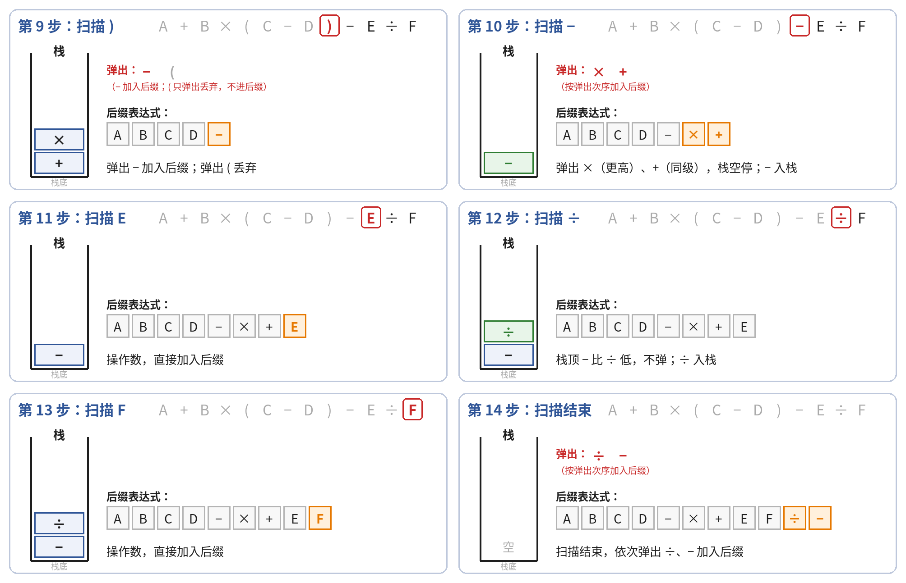{width=1.0}

**速查**：上面 14 步合成一张表。

::: {.tbl widths="0.10,0.14,0.30,0.46"}
| 扫描 | 栈（左边是栈底） | 后缀表达式 | 动作 |
|---|---|---|---|
| A | 空 | A | |
| + | + | A | 栈空，直接入栈 |
| B | + | AB | |
| * | +\* | AB | `+` 更低，不弹；`*` 入栈 |
| ( | +\*( | AB | `(` 直接入栈 |
| C | +\*( | ABC | |
| - | +\*(- | ABC | 栈顶是 `(`，停，不弹；`-` 入栈 |
| D | +\*(- | ABCD | |
| ) | +\* | ABCD- | 弹出 `-`；弹出 `(` 并丢弃 |
| - | - | ABCD-\*+ | 弹出 `*`（更高）、`+`（同级），栈空停；`-` 入栈 |
| E | - | ABCD-\*+E | |
| / | -/ | ABCD-\*+E | `/` 更高，直接入栈 |
| F | -/ | ABCD-\*+EF | |
| 结束 | 空 | ABCD-\*+EF/- | 依次弹出 `/`、`-` |
:::

这个过程中栈里最多同时有 4 个元素（扫描到 `-`、`D` 时：`+ * ( -`）。

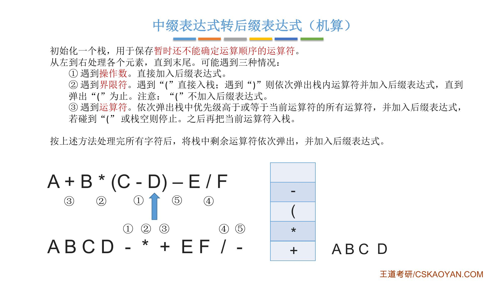{.slide width=0.55}

**老师解释**：

- 扫到 `-` 时栈顶是 `(`：说明 `-` 左边的操作数旁边有个左括号。虽然要优先算括号里面的，但此时还不能确定后面的操作数旁边会不会跟一个乘法，[这个减法能不能立即生效还确定不了]{.u}，所以不弹任何元素，直接入栈；
- 扫到 `)` 时：[整个括号的范围已经确定了]{.u}，括号里的运算要优先计算，所以可以把括号里的运算符全部弹出，让它们先生效。`(` 不加入后缀表达式，因为后缀表达式没有界限符。

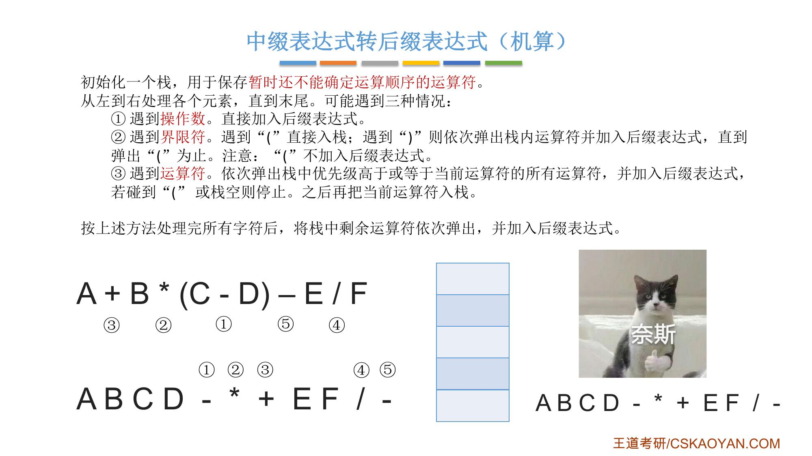{.slide width=0.55}

::: book
王道书第 91 页的机算规则和课件意思相同，措辞不同。书上说"该转换过程借助一个[运算符栈]{.u}，用于暂存尚未确定输出时机的运算符"，规则 3）遇到运算符分两种情况写：

① 若其优先级**高于**栈顶运算符，或栈顶为 `(`，则直接入栈；

② 若其优先级**低于或等于**栈顶运算符，则依次弹出栈中运算符并加入后缀表达式，直到栈空，或栈顶为 `(`，或遇到优先级更低的运算符为止，再将当前运算符入栈。

书上表 3.1 正是例 2 `A+B*(C-D)-E/F` 的转换过程，共 15 步（第 14 步"扫描结束，弹出剩余运算符"，第 15 步"结束"），每一步的栈内内容和上表相同。
:::

::: {.def title="名词统一"}
课件"栈"＝书上"运算符栈"；课件"暂时还不能确定运算顺序的运算符"＝书上"尚未确定输出时机的运算符"；课件"界限符"＝书上"界限符"（都指括号）。
:::

::: add
**中缀转前缀（机算）**（课件和书都没讲。书第 91 页脚注只说"中缀转前缀的方法类似，但统考真题仅考查过中缀转后缀"。这里补全，和上面的规则对称）：

[从右往左]{.u}处理各个元素，用一个栈存放暂时还不能确定运算顺序的运算符：

1. **遇到操作数**：直接加到前缀表达式的[最前面]{.u}；
2. **遇到界限符**：遇到 `)` 直接入栈；遇到 `(` 则依次弹出栈内运算符并加到前缀表达式最前面，直到弹出 `)` 为止，`)` 不加入；
3. **遇到运算符**：依次弹出栈中优先级[严格高于]{.u}当前运算符的运算符，加到前缀表达式最前面，碰到 `)` 或栈空则停止，再把当前运算符入栈。和转后缀的唯一区别是同级的不弹：从右往左扫，同级时右边的先生效，这就是右优先原则。
4. 处理完所有字符后，把栈中剩余运算符依次弹出，加到最前面。

以 `A+B*(C-D)-E/F` 为例（从右往左）：

:::

下面是这个过程的分解图（我画的）。每一小格是一步：上面一行是表达式，[红框是当前扫描的字符]{.red}，灰色是已扫描过的；左边是栈，[绿色是这一步新入栈的]{.u}；右边是输出的表达式，橙色是这一步新加入的；有弹出时单独标出弹出了什么；最下面一行是这一步用的规则。图中 `*`、`/`、`-` 写成 ×、÷、−。

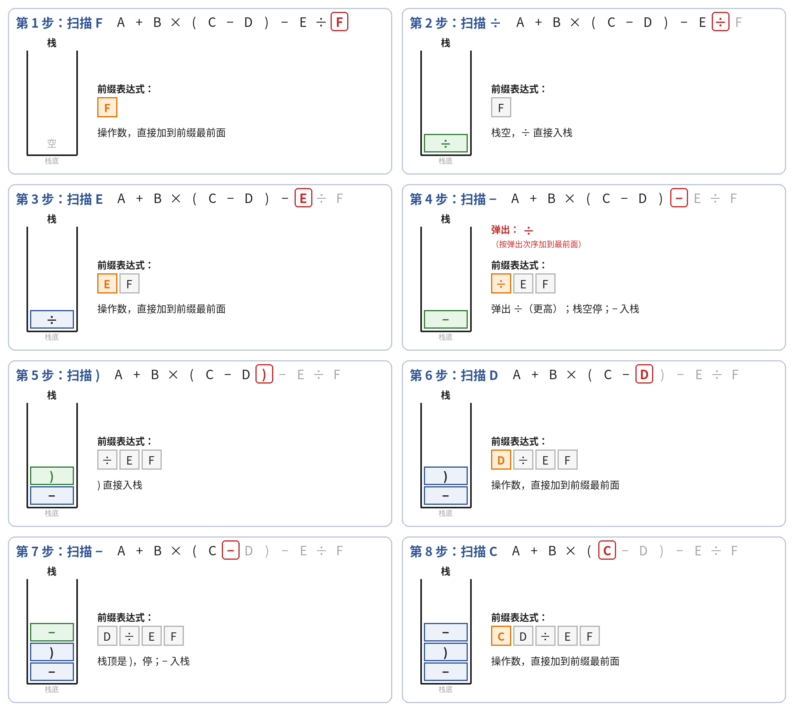{width=1.0}

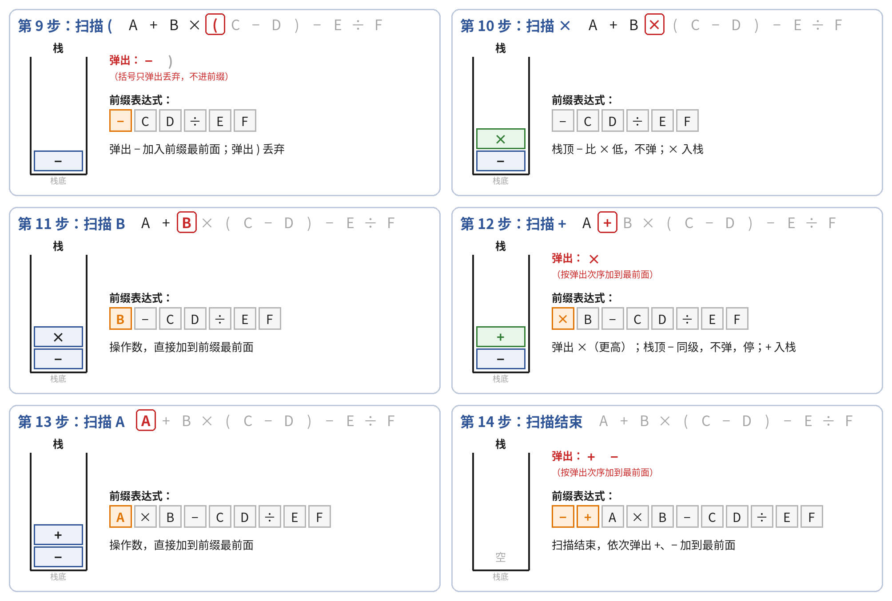{width=1.0}

::: add
**速查**（接上）：上面的过程合成一张表。

::: {.tbl widths="0.10,0.14,0.30,0.46"}
| 扫描 | 栈（左边是栈底） | 前缀表达式 | 动作 |
|---|---|---|---|
| F | 空 | F | |
| / | / | F | 栈空，入栈 |
| E | / | EF | |
| - | - | /EF | 弹出 `/`（更高）；`-` 入栈 |
| ) | -) | /EF | 直接入栈 |
| D | -) | D/EF | |
| - | -)- | D/EF | 栈顶是 `)`，停；入栈 |
| C | -)- | CD/EF | |
| ( | - | -CD/EF | 弹出 `-`；弹出 `)` 并丢弃 |
| * | -\* | -CD/EF | `*` 更高，入栈 |
| B | -\* | B-CD/EF | |
| + | -+ | \*B-CD/EF | 弹出 `*`（更高）；`-` 同级，不弹；`+` 入栈 |
| A | -+ | A\*B-CD/EF | |
| 结束 | 空 | -+A\*B-CD/EF | 依次弹出 `+`、`-` |
:::

结果和 3.3.2_1 中右优先手算的结果 `-+A*B-CD/EF` 相同。我用程序验证过三个式子：`A+B*(C-D)-E/F`、`A+B-C*D/E+F`（得 `+-+AB/*CDEF`）、15 那个式子（得 `- × ÷ 15 - 7 + 1 1 3 + 2 + 1 1`），全部和右优先手算的结果一致。
:::

# 四、练习：栈是否会溢出？

::: cue
考试怎么考这个算法？15 那个式子转后缀，栈至少要多大？
:::

老师说这是考试的重点：[可能考转换到某一步时栈里的情况是什么样的，有这样的选择题，考察的频率还不低]{.u}。他让我们用上一节 15 那个式子练手，并提醒：课件上的栈只有 5 的容量，是不够的，会出现栈溢出的情况。

感兴趣、有能力的同学可以尝试用伪代码实现这个算法；考试中能用笔算模拟栈的变化过程也就可以了。

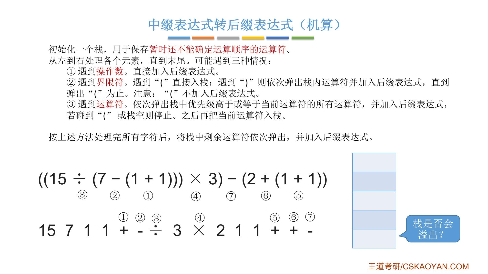{.slide width=0.55}

::: add
**练习参考答案**（先自己做再看）：`((15÷(7-(1+1)))×3)-(2+(1+1))`

:::

下面是这个过程的分解图（我画的）。每一小格是一步：上面一行是表达式，[红框是当前扫描的字符]{.red}，灰色是已扫描过的；左边是栈，[绿色是这一步新入栈的]{.u}；右边是输出的表达式，橙色是这一步新加入的；有弹出时单独标出弹出了什么；最下面一行是这一步用的规则。图中 `*`、`/`、`-` 写成 ×、÷、−。

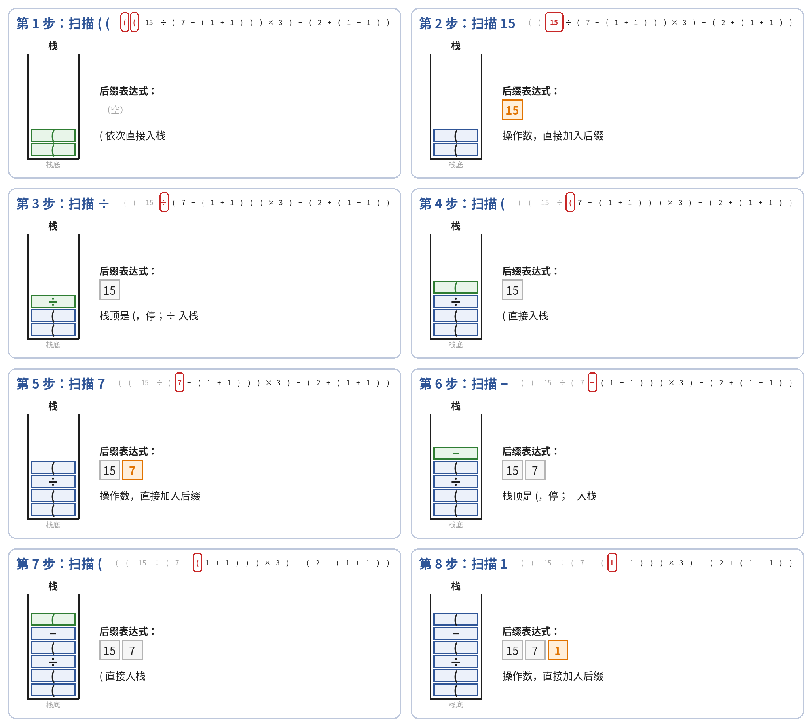{width=1.0}

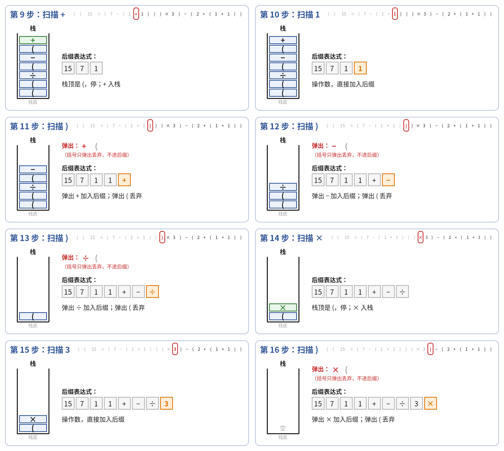{width=1.0}

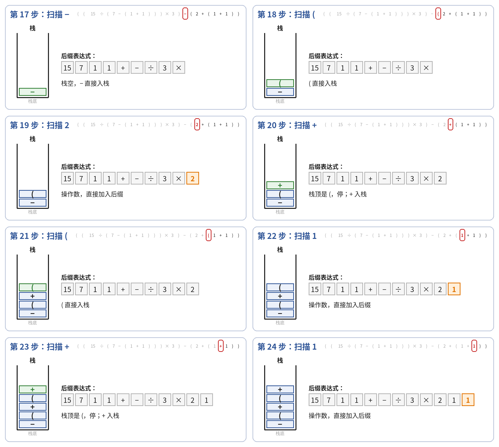{width=1.0}

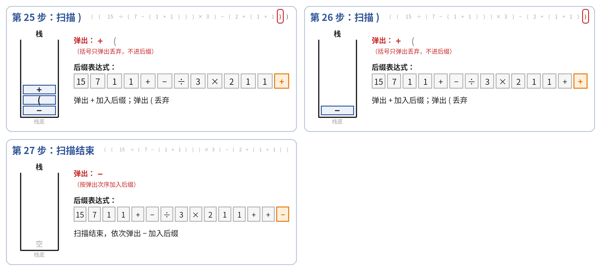{width=1.0}

::: add
**速查**（接上）：上面的过程合成一张表。

::: {.tbl widths="0.12,0.20,0.40,0.28"}
| 扫描 | 栈（左边是栈底） | 后缀表达式 | 动作 |
|---|---|---|---|
| ( ( | (( | | 依次入栈 |
| 15 | (( | 15 | |
| ÷ | ((÷ | 15 | 栈顶是 `(`，直接入栈 |
| ( | ((÷( | 15 | |
| 7 | ((÷( | 15 7 | |
| - | ((÷(- | 15 7 | 栈顶是 `(`，直接入栈 |
| ( | ((÷(-( | 15 7 | |
| 1 | ((÷(-( | 15 7 1 | |
| + | **((÷(-(+** | 15 7 1 | 入栈，此时栈中 [7 个元素]{.red} |
| 1 | ((÷(-(+ | 15 7 1 1 | |
| ) | ((÷(- | 15 7 1 1 + | 弹出 `+`，丢弃 `(` |
| ) | ((÷ | 15 7 1 1 + - | 弹出 `-`，丢弃 `(` |
| ) | ( | 15 7 1 1 + - ÷ | 弹出 `÷`，丢弃 `(` |
| × | (× | 15 7 1 1 + - ÷ | |
| 3 | (× | 15 7 1 1 + - ÷ 3 | |
| ) | 空 | 15 7 1 1 + - ÷ 3 × | 弹出 `×`，丢弃 `(` |
| - | - | 同上 | 栈空，直接入栈 |
| ( 2 | -( | … 3 × 2 | |
| + | -(+ | … 3 × 2 | |
| ( 1 | -(+( | … 3 × 2 1 | |
| + | -(+(+ | … 3 × 2 1 | 栈中 5 个元素 |
| 1 | -(+(+ | … 3 × 2 1 1 | |
| ) | -(+ | … 3 × 2 1 1 + | 弹出 `+`，丢弃 `(` |
| ) | - | … 3 × 2 1 1 + + | 弹出 `+`，丢弃 `(` |
| 结束 | 空 | 15 7 1 1 + - ÷ 3 × 2 1 1 + + - | 弹出 `-` |
:::

[栈中最多同时有 7 个元素]{.u}（`(` 也占位置），所以容量为 5 的栈会溢出。我用程序跑过这个过程，结果和上一节手算的后缀表达式一致。
:::

::: book
王道书第 91–92 页（考点追踪：栈的深度分析，2009、2012、2025）：所谓栈的深度，是指[栈中元素最大个数]{.u}。通常题目会给出入栈和出栈序列，要求计算栈所需的最大容量（最大深度）。有时该信息以中缀与后缀表达式的形式间接提供。掌握栈"后进先出"的特性，并通过手工模拟转换或求值过程，是解决此类问题的有效方法。
:::

# 五、中缀表达式的计算（用栈实现）

::: cue
为什么要两个栈？什么时候要弹出两个操作数做运算？
:::

老师说[王道书上没有讲这个算法的实现]{.u}，但涉及到相关内容，所以简单提一下。

先回忆上一节的后缀表达式求值：那里的栈是[用于存放当前暂时还不能确定运算次序的操作数]{.u}；而中缀转后缀的栈是[用于存放当前暂时还不能确定运算次序的运算符]{.u}。

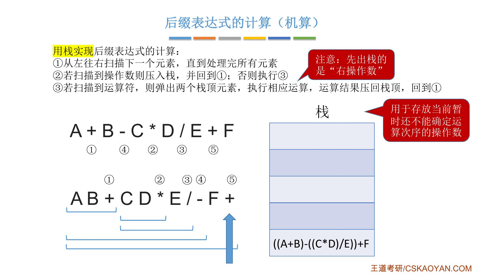{.slide width=0.45}

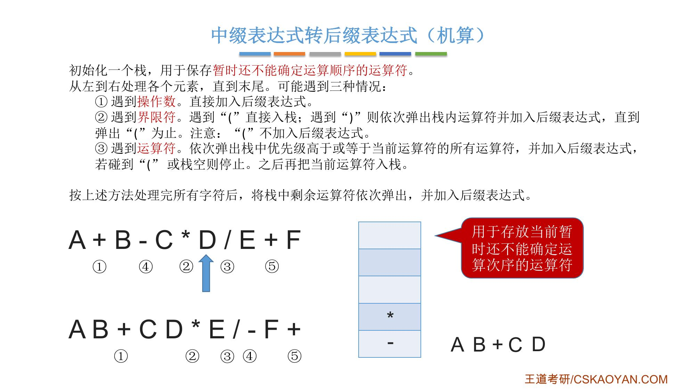{.slide width=0.45}

中缀转后缀是从左往右、挨个输出后缀表达式的各个部分，后缀求值也是从左往右扫描后缀表达式，所以可以[一边生成后缀表达式，一边计算]{.u}。两个栈和两个算法一一对应。

**用栈实现中缀表达式的计算**（课件原文）：

- 初始化两个栈，**操作数栈**和**运算符栈**；
- 若扫描到操作数，压入操作数栈；
- 若扫描到运算符或界限符，则按照"中缀转后缀"相同的逻辑压入运算符栈（期间也会弹出运算符，[每当弹出一个运算符时，就需要再弹出两个操作数栈的栈顶元素并执行相应运算，运算结果再压回操作数栈]{.red}）。

弹出一个运算符，就意味着这个运算符可以生效了。和后缀求值一样，[先弹出的是右操作数]{.u}。

以 `A+B-C*D/E+F` 为例：

下面是这个过程的分解图（我画的）。每一小格是一步：左边是运算符栈，中间是运算数栈，绿色是新入栈的；右边是这一步弹出的运算符，以及它弹出的两个操作数（[红色是右操作数]{.red}，紫色是左操作数），绿色是压回的结果。

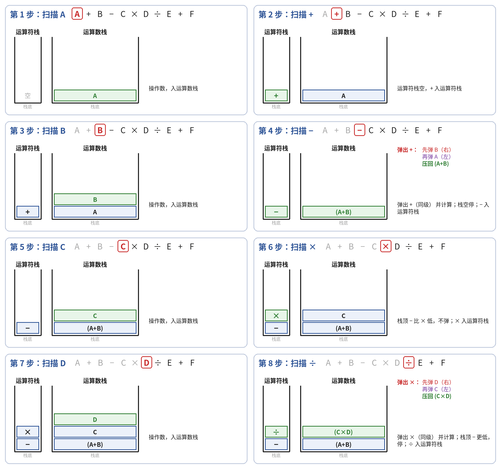{width=1.0}

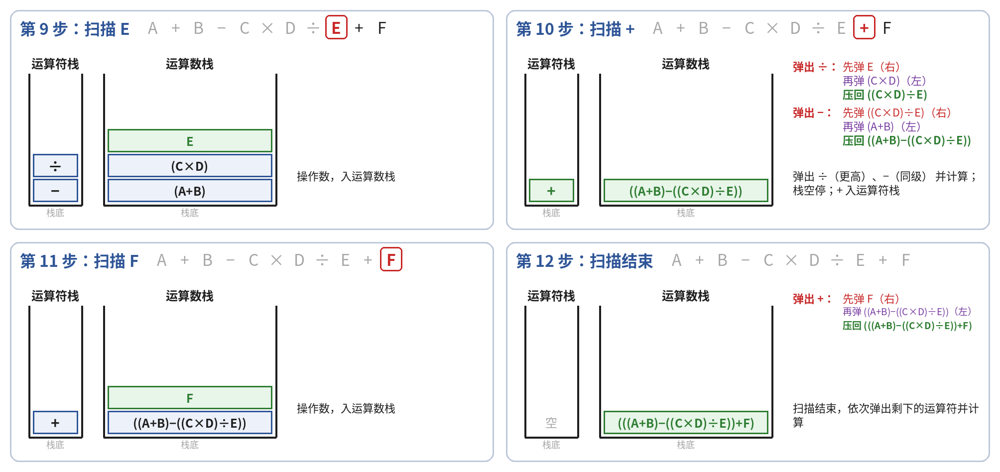{width=1.0}

**速查**：上面的过程合成一张表。

::: {.tbl widths="0.10,0.14,0.34,0.42"}
| 扫描 | 运算符栈 | 操作数栈（左边是栈底） | 动作 |
|---|---|---|---|
| A | 空 | A | 入操作数栈 |
| + | + | A | 运算符栈空，入栈 |
| B | + | A, B | |
| - | - | (A+B) | 弹出 `+`；弹出 B（右）、A（左），算 A+B 压回；`-` 入栈 |
| C | - | (A+B), C | |
| * | -\* | (A+B), C | `*` 更高，入栈 |
| D | -\* | (A+B), C, D | |
| / | -/ | (A+B), (C\*D) | 弹出 `*`，算 C\*D 压回；`/` 入栈 |
| E | -/ | (A+B), (C\*D), E | |
| + | + | ((A+B)-((C\*D)/E)) | 弹出 `/`，算 (C\*D)/E；弹出 `-`，算 (A+B)-…；`+` 入栈 |
| F | + | ((A+B)-((C\*D)/E)), F | |
| 结束 | 空 | (((A+B)-((C\*D)/E))+F) | 弹出 `+`，算最后一次加法 |
:::

若表达式合法，最后操作数栈中留下的就是表达式的值。

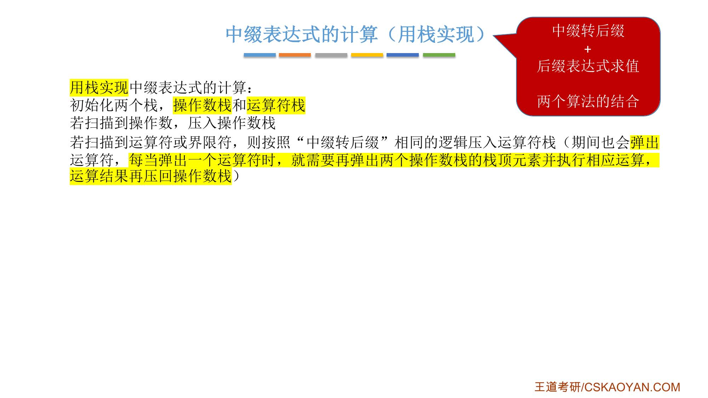{.slide width=0.55}

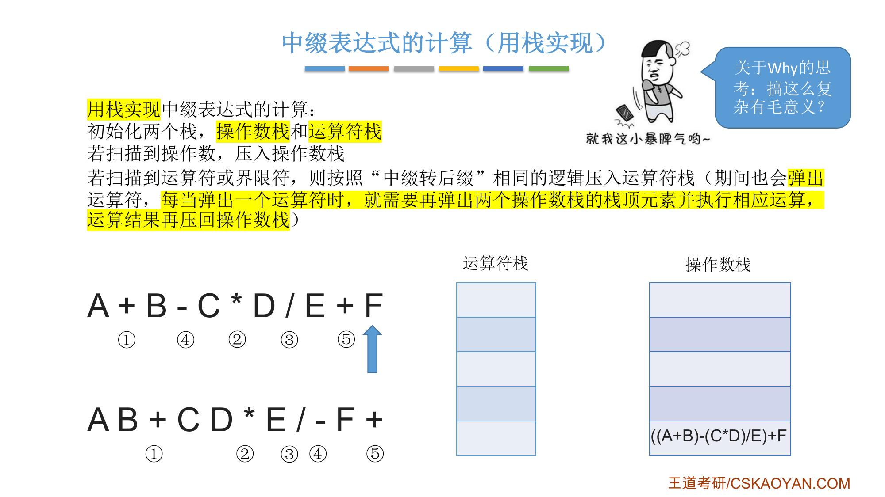{.slide width=0.55}

**为什么要搞这么复杂？** 老师的结论：这个算法的思想在计算机世界里十分重要。它把复杂的数学运算拆成[每次只执行一个基本运算]{.u}（加减乘除）。CPU 每次只能执行一个最简单的运算，程序经过编译，要把算术表达式翻译成一条一条 CPU 能执行的基本指令，编译程序翻译时就要用到中缀表达式计算的思想和方法。老师认为，除了搞明白 how（怎么做），对 why（为什么这么做、有何意义）的思考甚至更重要。

::: add
"计组"指计算机组成原理（408 的另一门课），老师说"等学了计组之后就会知道"，指的就是 CPU 每次只能执行一条基本指令这件事。
:::

# 六、知识回顾

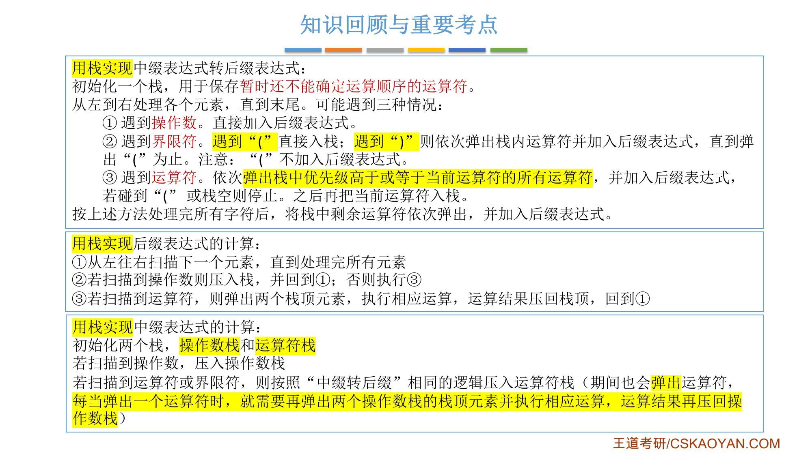{.slide width=0.6}

::: summary
**中缀转后缀（机算）**：栈存放[暂时还不能确定运算顺序的运算符]{.red}。① 操作数：直接输出；② `(` 入栈，`)` 依次弹出直到弹出 `(`（`(` 不输出）；③ 运算符：依次弹出优先级[高于或等于]{.u}它的运算符，碰到 `(` 或栈空停止，再入栈；④ 最后弹出剩余运算符。结果与手算的左优先结果相同。

**考法**：选择题问转换到某一步时栈里的内容，考察频率不低；栈的深度（2009、2012、2025）：手工模拟，数栈中最多同时有几个元素（`(` 也算）。

**中缀表达式的计算**：两个栈（操作数栈、运算符栈），＝中缀转后缀＋后缀求值。每弹出一个运算符，就弹出两个操作数运算（先出栈的是右操作数），结果压回操作数栈。王道书上没有讲这个算法的实现。

**自测**：① `A+B*(C-D)-E/F` 扫描到 `D` 时栈里是什么？② 为什么扫描到 `*` 不能马上弹出？③ `((15÷(7-(1+1)))×3)-(2+(1+1))` 转后缀，栈至少要多大？
:::
