# 这一节在讲什么

::: cue
递归和栈有什么关系？
:::

递归算法就是递归函数调用它自身的过程，所以[递归的背后就是函数调用]{.u}。这一节先看普通的函数调用背后发生了什么（要用一个栈），再看递归调用时这个栈怎么变化，以及递归的缺点。老师说：这一节不是讲怎么设计递归算法，而是理解[递归算法和栈有什么本质联系]{.u}，大致了解函数调用栈的原理就可以。

# 一、函数调用背后的过程

::: cue
函数调用有什么特点？函数调用栈里存哪三样东西？
:::

`main` 调用 `func1`，`func1` 又调用 `func2`；`func2` 执行结束后返回 `func1` 接着往后执行，`func1` 结束后再返回 `main`。函数调用的特点：[最后被调用的函数最先执行结束]{.red}（LIFO），和栈的后进先出异曲同工。

事实上，任何程序运行之前，系统都会开辟一个**函数调用栈**，保存各个函数在调用过程中必须保存的信息：

1. **调用返回地址**：被调函数执行结束后应该接着执行哪一句代码，把那句代码的存储地址压入栈中（图中的 `#1`、`#2`）；
2. **实参**：如 `func1` 的参数 `a`、`b`；
3. **局部变量**：如 `func1` 里定义的 `x`。

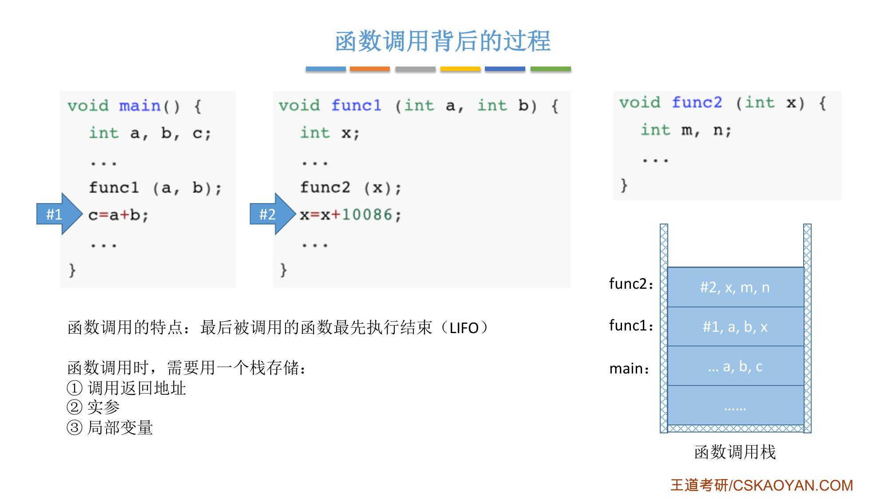{.slide width=0.6}

老师补充的几点：

- 这个栈其实就是[内存里的某一片存储空间]{.u}。被调函数执行结束，就把和它相关的信息弹出栈，也就是释放这片空间，再根据栈顶记录的返回地址，接着执行下一句；
- 实参在栈里是另一份数据，所以在 `func1` 里修改 `a`、`b` 的值，影响不到 `main` 里的 `a`、`b`；
- 编译器会在 `main` 之前加一些别的代码，所以栈底在 `main` 下面还有一些信息（图中的"……"），普通程序员不用关心；
- 用 IDE（老师用的是 CLion，VS 等都可以）在某句代码下断点调试，可以看到此时的函数调用栈：栈顶是 `func2`，里面有参数 `x` 和局部变量 `m`、`n`；点栈里的 `func1`，能看到 `a`、`b`、`x`。IDE 里不显示返回地址。

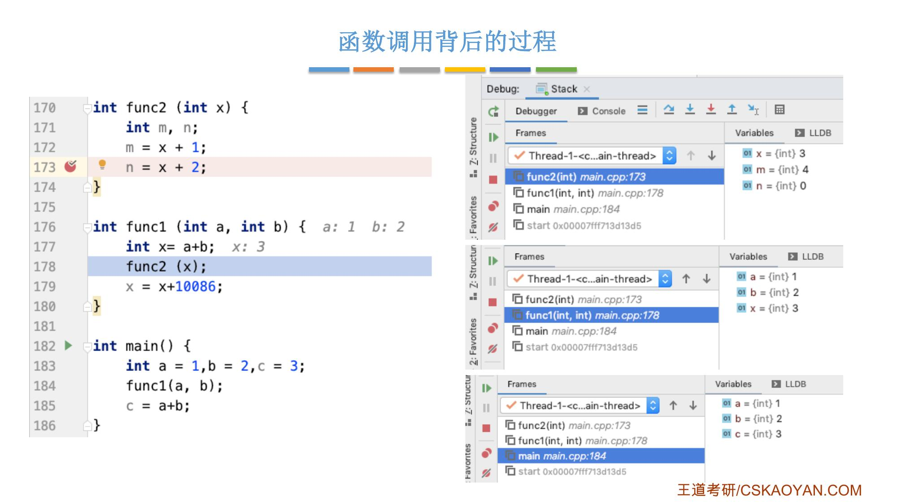{.slide width=0.6}

# 二、栈在递归中的应用

::: cue
什么问题适合用递归？实现递归需要哪两样东西？
:::

适合用"递归"算法解决的问题：[可以把原始问题转换为属性相同，但规模较小的问题]{.red}。

- **例 1**：计算正整数的阶乘 `n!`，`n! = n × (n-1)!`，问题规模从 n 变成 n-1，属性相同，都是求阶乘；
- **例 2**：求斐波那契数列，把规模 n 拆成规模 n-1 和 n-2 两部分。

实现一个递归算法需要两个比较重要的东西：**递归表达式**（递归体）和**边界条件**（递归出口）。

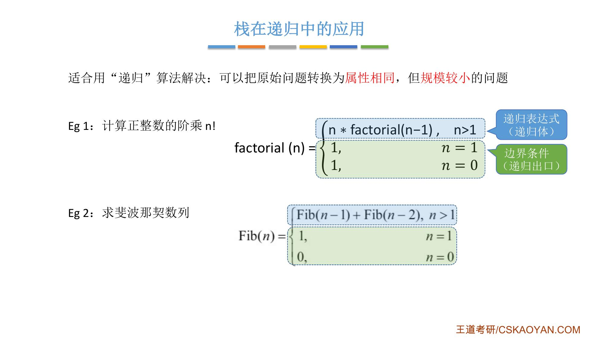{.slide width=0.55}

## 例 1：递归算法求阶乘

```c
// 计算正整数 n!
int factorial(int n) {
    if (n == 0 || n == 1)
        return 1;
    else
        return n * factorial(n - 1);    // 第 187 行
}

int main() {
    // ... 其他代码
    int x = factorial(10);              // 第 192 行
    printf("奥利给！");
}
```

递归调用时，函数调用栈可称为[**递归工作栈**]{.red}，本质上和函数调用栈是同一个东西。

1. `main` 调用 `factorial(10)`：压入返回地址 `#192`（结束后要把结果赋给 `x`）和实参 `n=10`，这是第 1 层；
2. `n=10` 不等于 0 也不等于 1，执行第 187 行，递归调用 `factorial(9)`：压入返回地址 `#187`（回来后要把返回值和 n 相乘）和 `n=9`，第 2 层；
3. 依此类推，问题规模逐渐收敛，直到第 10 层 `n=1`，满足边界条件，直接 `return 1`；
4. 最深一层返回后，弹出它的信息，回到上一层（`n=2`）继续执行第 187 行，返回 `2×1`；再逐层返回，直到第 1 层算出 `10×9!`，返回给 `main`，赋给 `x`。

所以：[每进入一层递归，就将递归调用所需信息压入栈顶；每退出一层递归，就从栈顶弹出相应信息]{.u}。

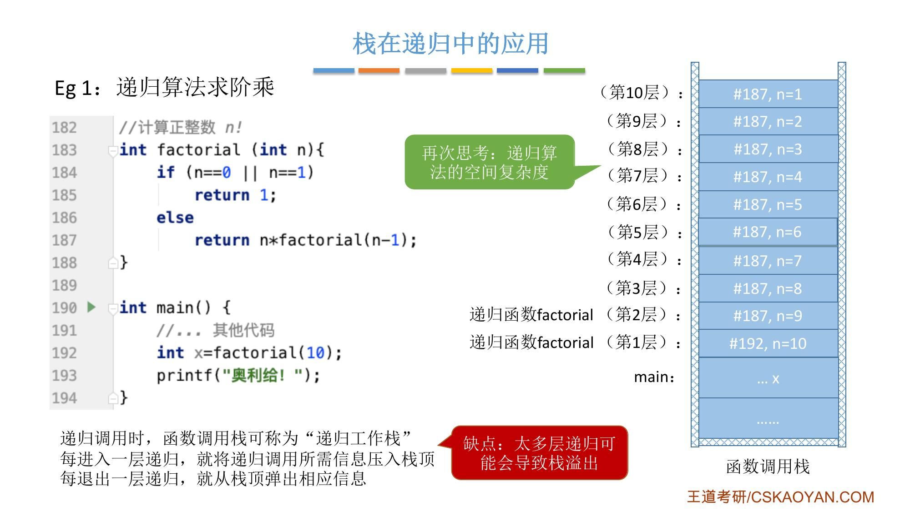{.slide width=0.6}

**缺点：太多层递归可能会导致栈溢出。** 如果传入 10 万，栈里就要压入 10 万条信息，而内存资源有限，系统开辟的函数调用栈也有存储上限。课件上"再次思考：递归算法的空间复杂度"：这也就是绪论里讲的[递归带来空间复杂度升高]{.u}，递归层数越多，空间复杂度越高。

::: recall
正课 1.2.3 讲空间复杂度时用 `loveYou(n)` 讲过：每层调用单独开一块空间存本层的参数、局部变量和返回地址，空间复杂度＝递归调用的深度（每层所需空间为常量时）。这里的递归工作栈就是这部分内存开销的来源。
:::

由于递归算法背后就是用一个栈实现的，[可以自定义栈将递归算法改造成非递归算法]{.u}，类似的题目会在课后习题中遇到。

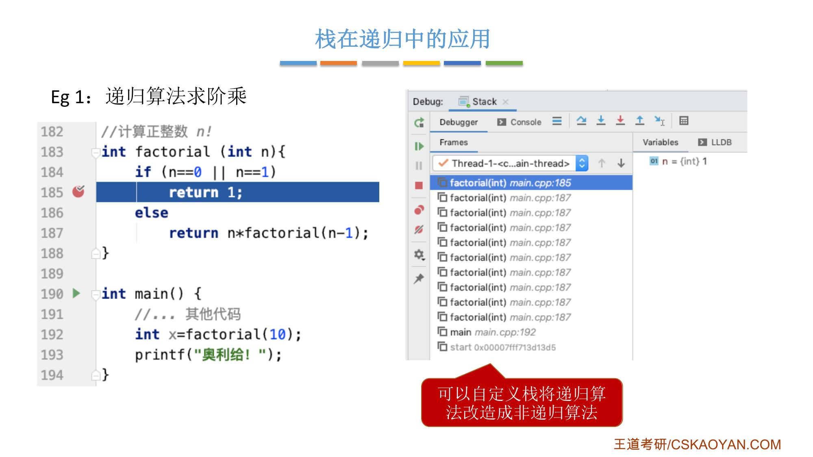{.slide width=0.55}

::: add
**factorial(3) 的栈变化**（我自己写的简化版，栈从左往右是栈底到栈顶，省略 `main` 下面的信息）：

:::

下面是这个过程的分解图（我画的）。每一小格是一步：左边是递归调用树，[红色是这一步正在执行的调用]{.red}，蓝色是还在栈里、没返回的调用，灰色是已经返回的（下面写着返回值），浅色是还没调用的；右边是递归工作栈，[绿色是新压入的]{.u}。

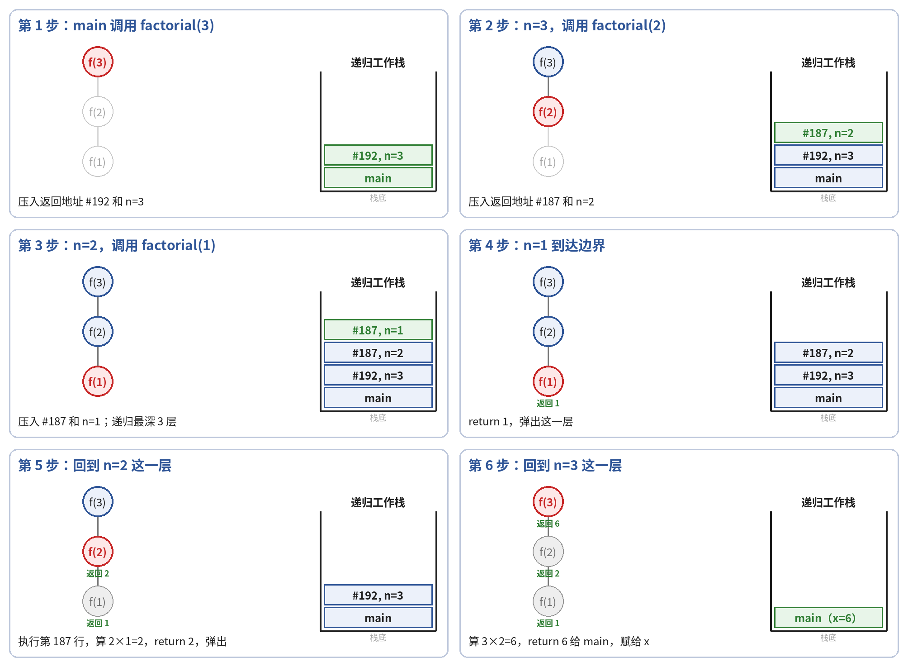{width=1.0}

::: add
**速查**（接上）：上面的过程合成一张表。

::: {.tbl widths="0.36,0.64"}
| 执行到 | 递归工作栈 |
|---|---|
| main 调用 factorial(3) | main; \#192, n=3 |
| n=3，调用 factorial(2) | main; \#192, n=3; \#187, n=2 |
| n=2，调用 factorial(1) | main; \#192, n=3; \#187, n=2; \#187, n=1 |
| n=1 满足边界条件，return 1，弹出 | main; \#192, n=3; \#187, n=2 |
| n=2 层算 2×1=2，return 2，弹出 | main; \#192, n=3 |
| n=3 层算 3×2=6，return 6，弹出 | main（x=6） |
:::

递归层数 3，栈里最多同时有 3 层递归的信息；`factorial(n)` 就是 n 层，空间复杂度 O(n)。
:::

## 例 2：递归算法求斐波那契数列

```c
int Fib(int n) {
    if (n == 0)
        return 0;
    else if (n == 1)
        return 1;
    else
        return Fib(n - 1) + Fib(n - 2);
}

int main() {
    // ... 其他代码
    int x = Fib(4);
    printf("奥利给！");
}
```

`Fib(4)` 先调用 `Fib(3)`，进入更深一层；`Fib(3)` 还没到边界，先调用 `Fib(2)`；`Fib(2)` 调用 `Fib(1)`，n=1 满足边界条件，返回，弹出栈顶；`Fib(2)` 再调用 `Fib(0)`，返回；`Fib(2)` 两个调用都有返回值了，返回 `Fib(3)`；`Fib(3)` 再调用 `Fib(1)`，返回后 `Fib(3)` 返回 `Fib(4)`……就这样逐层完成递归调用。

**缺点：可能包含很多重复计算。** 在这个过程中，[`Fib(2)` 被计算了两次]{.u}，`Fib(1)`、`Fib(0)` 也被重复了多次。这也是递归算法不太高效的原因之一。

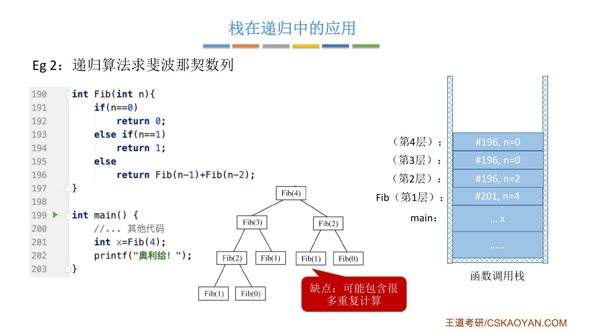{.slide width=0.6}

::: add
**补全老师跳过的部分**：正课字幕 P30 里，老师讲到"三再返回四"就停了，没讲 `Fib(4)` 接着还要调用 `Fib(2)`。完整过程如下（栈从左往右是栈底到栈顶，只写每层的 n，省略 `main` 和返回地址）：

:::

下面是这个过程的分解图（我画的）。每一小格是一步：左边是递归调用树，[红色是这一步正在执行的调用]{.red}，蓝色是还在栈里、没返回的调用，灰色是已经返回的（下面写着返回值），浅色是还没调用的；右边是递归工作栈，[绿色是新压入的]{.u}。

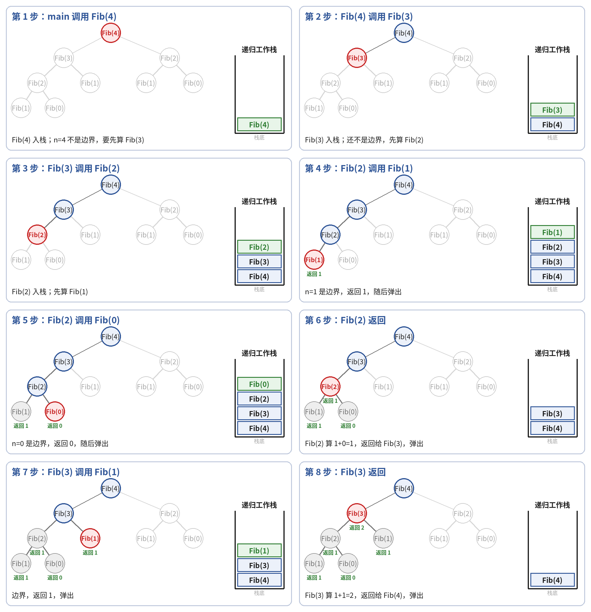{width=1.0}

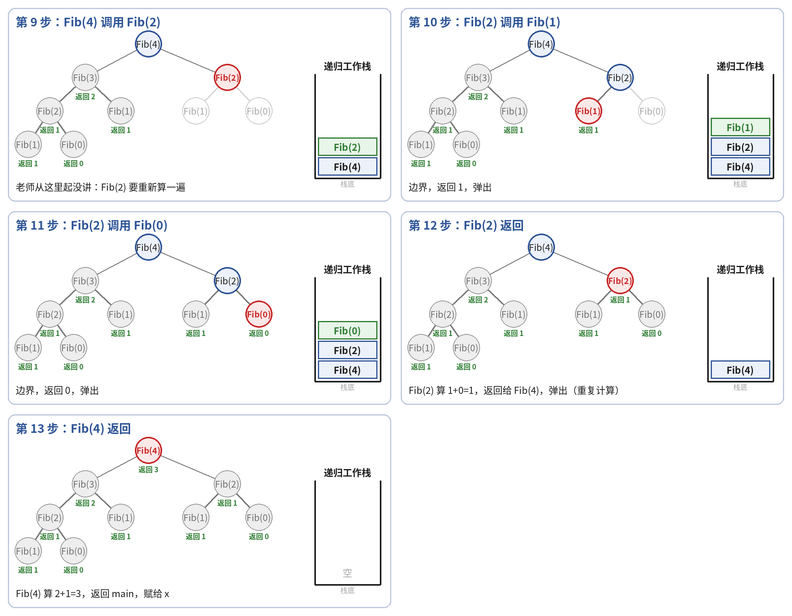{width=1.0}

::: add
**速查**（接上）：上面的过程合成一张表。

::: {.tbl widths="0.07,0.45,0.20,0.28"}
| 步 | 执行到 | 递归工作栈 | 返回值 |
|---|---|---|---|
| 1 | main 调用 Fib(4) | 4 | |
| 2 | Fib(4) 调用 Fib(3) | 4, 3 | |
| 3 | Fib(3) 调用 Fib(2) | 4, 3, 2 | |
| 4 | Fib(2) 调用 Fib(1)，到达边界，返回后弹出 | 4, 3, 2, 1 | Fib(1)=1 |
| 5 | Fib(2) 调用 Fib(0)，到达边界，返回后弹出 | 4, 3, 2, 0 | Fib(0)=0 |
| 6 | Fib(2) 算 1+0，返回后弹出 | 4, 3 | Fib(2)=1 |
| 7 | Fib(3) 调用 Fib(1)，返回后弹出 | 4, 3, 1 | Fib(1)=1 |
| 8 | Fib(3) 算 1+1，返回后弹出 | 4 | Fib(3)=2 |
| 9 | Fib(4) 调用 Fib(2)（[老师从这里开始没讲]{.u}） | 4, 2 | |
| 10 | Fib(2) 调用 Fib(1)，返回后弹出 | 4, 2, 1 | Fib(1)=1 |
| 11 | Fib(2) 调用 Fib(0)，返回后弹出 | 4, 2, 0 | Fib(0)=0 |
| 12 | Fib(2) 算 1+0，返回后弹出 | 4 | Fib(2)=1 |
| 13 | Fib(4) 算 2+1，返回 main，赋给 x | 空 | Fib(4)=3 |
:::

第 9～12 步把第 3～6 步的 `Fib(2)` 又完整算了一遍，这就是"重复计算"。

数一下 `Fib(4)` 的递归调用树：`Fib(2)` 2 次，`Fib(1)` 3 次，`Fib(0)` 2 次，一共调用 9 次。栈里最多同时有 4 层（n=4、3、2、1 或 0），即递归深度。
:::

::: book
王道书第 92–93 页 §3.3.3：若一个函数、过程或数据结构在其定义中直接或间接地引用了自身，则称其为递归定义，简称递归。递归通过将原问题逐层分解为规模更小但结构相同的子问题来求解；仅需少量代码即可简洁地表达解题过程中反复出现的相同计算模式，显著减少程序代码量。然而，在一般情况下，递归的执行效率并不高。

书上以斐波那契数列为例（代码与课件例 2 相同，书上函数名为 `F`，注释标出两个 `return 0/1` 是"边界条件"，`return F(n-1)+F(n-2)` 是"递归表达式"）。递归定义不能是循环或无终止的，必须满足两个条件：

- **递归体**（递归表达式）：描述问题如何分解为更小规模的同类子问题；
- **边界条件**（递归出口）：确保递归在有限步内终止。

递归的精髓在于能否将原问题转化为[属性相同但规模更小]{.u}的问题。

考点追踪（栈在函数调用中的作用和工作原理，2015、2017）：在递归调用过程中，系统为每一层调用的[返回地址、局部变量及形参]{.u}等信息分配存储空间，这些信息被保存在递归工作栈中。因此，递归深度过大时容易导致**栈溢出**。此外，递归效率低下的主要原因是**存在大量重复计算**。以 n=5 为例，见图 3.16：`F(3)` 被计算 2 次，`F(2)` 被计算 3 次，`F(1)` 被调用 5 次，`F(0)` 被调用 3 次。

递归虽然代码简洁、易于理解，但存在明显的性能缺陷。第 5 章讨论树的遍历时，采用递归可使代码极为简洁。[任何递归算法均可转换为非递归算法]{.u}，通常需借助显式栈来模拟递归调用过程。
:::

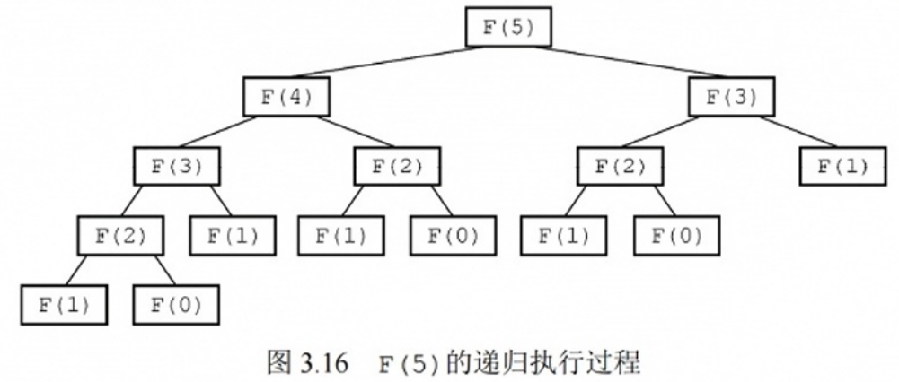{.slide width=0.6}

::: add
我按图 3.16 核对过次数：`F(5)` 的调用树中 `F(3)` 2 次、`F(2)` 3 次、`F(1)` 5 次、`F(0)` 3 次，和书上一致（也可以这样记：`F(1)` 被调用的次数恰好等于 F(5)=5，`F(0)` 的次数等于 F(4)=3）。
:::

::: {.def title="名词统一"}
课件"函数调用栈 / 递归工作栈"，书上"递归工作栈"；课件"递归表达式（递归体）"＝书上"递归体（递归表达式）"；课件"边界条件（递归出口）"＝书上相同。课件说栈里存"实参"，书上说存"形参"：指的都是这一层函数调用时参数的值（如 `n=10`）。课件函数名 `Fib(n)`，书上 `F(n)`。
:::

# 三、知识回顾

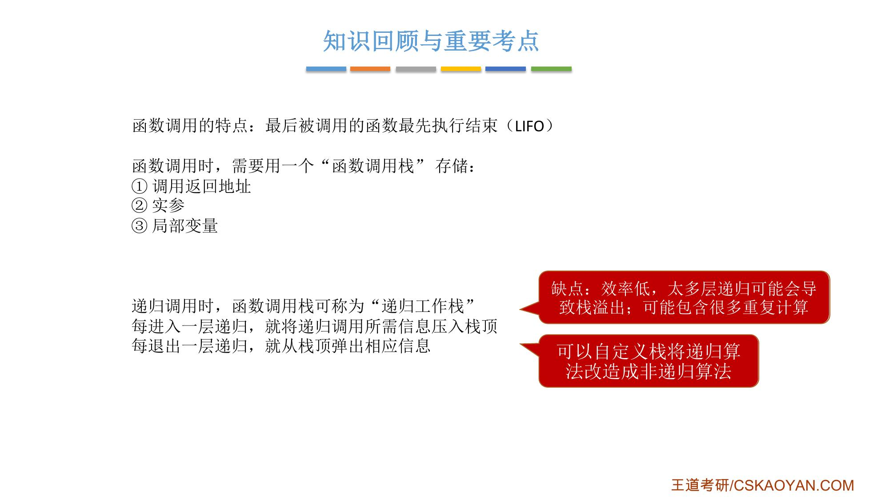{.slide width=0.55}

::: summary
**函数调用的特点**：最后被调用的函数最先执行结束（LIFO）。

**函数调用栈存储**：① 调用返回地址 ② 实参 ③ 局部变量。

**递归**：把原问题转换为属性相同、规模较小的问题；需要递归表达式（递归体）和边界条件（递归出口）。递归调用时，函数调用栈可称为**递归工作栈**：每进入一层递归，就将所需信息压入栈顶；每退出一层，就从栈顶弹出。

**缺点**：[效率低]{.red}；太多层递归可能导致[栈溢出]{.red}（空间复杂度＝递归深度）；可能包含[很多重复计算]{.red}（如斐波那契）。

**改造**：可以自定义栈将递归算法改造成非递归算法。

**自测**：① 函数调用栈里存哪三样东西？② `factorial(10)` 递归工作栈最多有几层？③ 递归求 F(5)，F(2) 被计算几次？
:::
