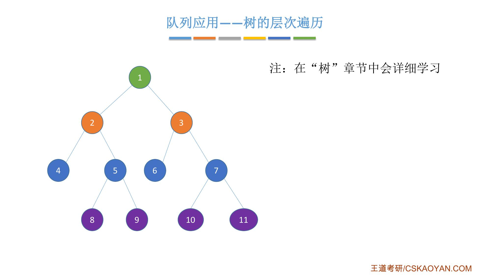
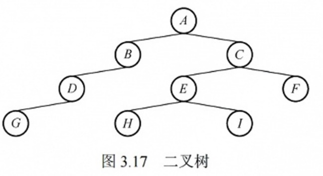
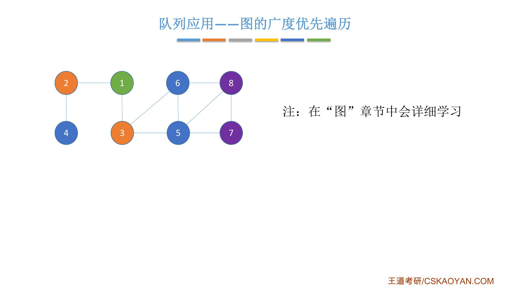
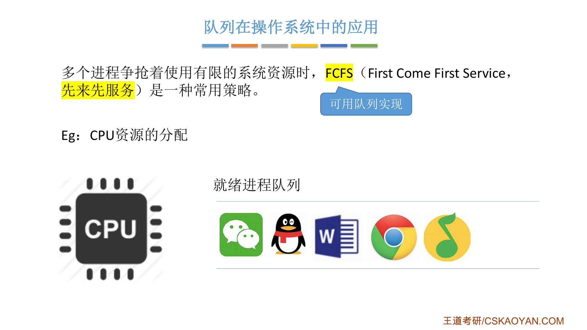
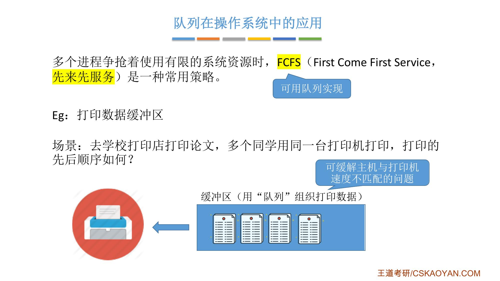

# 这一节在讲什么

::: cue
这一节介绍了队列的哪几个应用？
:::

这一节简单介绍几个队列的应用：**树的层次遍历**、**图的广度优先遍历**、**队列在操作系统中的应用**（CPU 资源分配、打印数据缓冲区）。老师说树和图的部分[听不懂没有关系]{.u}，在"树"和"图"的章节还会结合代码详细学习，这里有个大致印象就可以。

# 一、树的层次遍历

::: cue
层次遍历时，每处理一个结点要做什么？
:::

树这种数据结构是分层的，**层次遍历**就是一层一层地遍历树里的各个结点。要实现层次遍历，需要一个队列辅助：

1. 新建一个队列，从根结点出发，先把根结点放入队列；
2. 每次处理[队头]{.u}的结点：把它的左右两个孩子加入队尾，然后让它出队；没有孩子就直接出队；
3. 直到队列为空。

{.slide width=0.55}

以课件这棵树为例（老师的讲解过程）：

::: {.tbl widths="0.32,0.30,0.38"}
| 操作 | 队列（左边是队头） | 已遍历 |
|---|---|---|
| 1 入队 | 1 | |
| 处理 1：2、3 入队，1 出队 | 2 3 | 1 |
| 处理 2：4、5 入队，2 出队 | 3 4 5 | 1 2 |
| 处理 3：6、7 入队，3 出队 | 4 5 6 7 | 1 2 3 |
| 处理 4：没有孩子，直接出队 | 5 6 7 | 1 2 3 4 |
| 处理 5：8、9 入队，5 出队 | 6 7 8 9 | 1 … 5 |
| 处理 6：没有孩子，直接出队 | 7 8 9 | 1 … 6 |
| 处理 7：10、11 入队，7 出队 | 8 9 10 11 | 1 … 7 |
| 8、9、10、11 都没有孩子，依次出队 | 空 | 1 2 3 … 11 |
:::

遍历顺序正好是一层一层的：1；2 3；4 5 6 7；8 9 10 11。

::: book
王道书第 93–94 页 §3.3.4"队列在层次遍历中的应用"：在信息处理中，有一类典型问题需要逐层或逐行处理。解决这类问题的常用策略是：在处理当前层的同时，将下一层的元素按序加入待处理队列。队列正适用于此类场景，因其[先进先出]{.u}的特性，能够自然地保存后续待处理元素的顺序。

书上以图 3.17 的二叉树为例，表 3.3 给出层次遍历过程（"队内"是队列中的结点，"队外"是已出队的结点）：A 入；A 出，BC 入；B 出，D 入；C 出，EF 入；D 出，G 入；E 出，HI 入；F 出；GHI 出，最后队外是 ABCDEFGHI。

该过程可简要描述如下：

① 将根结点入队。

② 若队列为空（表示所有结点均已处理），则遍历结束；否则执行 ③。

③ 取出队首结点并访问；若其存在左孩子，则将左孩子入队；若其存在右孩子，则将右孩子入队；返回 ② 继续执行。
:::

{.slide width=0.32}

\Needspace{12\baselineskip}

# 二、图的广度优先遍历

::: cue
图的广度优先遍历和树的层次遍历有什么不同？
:::

图的广度优先遍历也需要队列的支持，思想和树的层次遍历很类似。不同的是：遍历一个结点时，要检查和它[相邻的结点有没有被遍历过]{.u}，只把还没处理过的放到队尾。

{.slide width=0.55}

从 1 号结点出发（老师的讲解过程）：

::: {.tbl widths="0.46,0.24,0.30"}
| 操作 | 队列（左边是队头） | 已遍历 |
|---|---|---|
| 1 入队 | 1 | |
| 处理 1：相邻的 2、3 都没处理过，入队；1 出队 | 2 3 | 1 |
| 处理 2：1 已处理过，4 没有，4 入队；2 出队 | 3 4 | 1 2 |
| 处理 3：1 已处理过，5、6 入队；3 出队 | 4 5 6 | 1 2 3 |
| 处理 4：相邻的都处理过，直接出队 | 5 6 | 1 … 4 |
| 处理 5：7、8 入队；5 出队 | 6 7 8 | 1 … 5 |
| 6、7、8：不再加入新结点，依次出队 | 空 | 1 2 … 8 |
:::

直到整个队列为空，就完成了对这个图的广度优先遍历。

# 三、队列在操作系统中的应用

::: cue
FCFS 是什么？为什么可以用队列实现？打印数据缓冲区解决什么问题？
:::

操作系统要管理 CPU、I/O 设备等硬件资源，这些资源往往有限，而系统中同时有多个进程并发运行、争抢使用。多个进程争抢着使用有限的系统资源时，**FCFS**（First Come First Service，[先来先服务]{.u}）是一种常用策略：哪个进程先申请资源，就先分配给哪个进程。先来先服务的思想和队列的先进先出一样，所以[可用队列实现]{.red}。

**例：CPU 资源的分配。** 操作系统让多个进程排成一个**就绪进程队列**，每次选择队头的进程，让它上 CPU 执行一个比较短的时间片，然后下 CPU，再让下一个进程上 CPU 运行……循环往复，所有进程都能轮流得到 CPU 的服务。这就是为什么电脑只有一个 CPU，却能让那么多程序同时运行。

{.slide width=0.55}

**例：打印数据缓冲区。** 学校打印店常常是多台电脑连同一台打印机。打印机还在工作时，你就已经可以按下打印按钮，因为系统开辟了一片**缓冲区**，存放打印机暂时还不能处理的数据，并按先来后到的原则把这些打印数据组织成一个队列，再按先进先出的原则依次取出，让打印机打印输出。打印机是慢速设备，主机是快速设备，短时间内能发出大量打印任务，所以缓冲区[可缓解主机与打印机速度不匹配的问题]{.u}。

{.slide width=0.55}

::: book
王道书第 94 页 §3.3.5"队列在计算机系统中的应用"：从两个方面阐述，第一个方面是解决[主机与外部设备之间速度不匹配]{.u}的问题，第二个方面是解决由[多用户引起的资源竞争]{.u}问题。

考点追踪（缓冲区的逻辑结构，2009）：以主机和打印机之间的速度不匹配为例。主机输出数据的速度远快于打印机处理数据的速度，若直接将数据发送给打印机，会导致数据丢失或打印错误。为此，通常设置一个打印数据缓冲区。具体实现：主机将待打印的数据依次写入缓冲区，当缓冲区满时，主机暂停输出并转向其他任务；打印机则从缓冲区中按先进先出原则逐个取出数据进行打印；打印完成后，打印机向主机发出请求，主机再次向缓冲区写入新的打印数据。这种方法不仅保证了数据的正确性，还提高了主机的整体效率。因此，[打印数据缓冲区实际上就是一个队列]{.u}。

考点追踪（多队列出队/入队操作的应用，2016）：在多用户环境下，CPU 资源的竞争是一个典型场景。在一个多终端系统中，用户通过各自的终端向操作系统提出对 CPU 的请求。为公平分配 CPU 时间，操作系统通常按照请求的时间顺序，将这些请求排成一个队列。具体步骤：每次将 CPU 分配给队首用户的程序运行；当该程序运行结束或用完规定的时间片后，操作系统使其出队；然后将 CPU 分配给新的队首用户。这种方式既保证了请求的公平处理，又提升了 CPU 利用率。此外，在某些复杂系统中，可能还会引入多队列机制，以便根据不同的优先级或调度策略动态调整资源分配。
:::

::: {.def title="名词统一"}
课件"FCFS（先来先服务）"＝书上"按照请求的时间顺序排成一个队列"；课件"就绪进程队列"，书上说"用户的程序 / 请求排成一个队列"；课件"打印数据缓冲区"＝书上相同。课件把这两个例子都叫"队列在操作系统中的应用"，书上叫"队列在计算机系统中的应用"。课件"树的层次遍历"＝书上"层次遍历"。
:::

::: summary
**树的层次遍历**：根结点入队；每次处理队头结点，把它的左右孩子加入队尾，然后出队；队列空时结束。

**图的广度优先遍历**：思路类似，但只把[相邻且还没被遍历过]{.u}的结点加入队尾。

**操作系统中的应用**：多个进程争抢有限资源时，FCFS（先来先服务）是常用策略，可用队列实现。① CPU 资源分配：就绪进程队列，队头进程上 CPU 运行一个时间片；② 打印数据缓冲区：用队列组织打印数据，缓解主机与打印机速度不匹配的问题。

**王道书考点**：缓冲区的逻辑结构是队列（2009）；多队列出队/入队操作的应用（2016）。

**自测**：① 用表格模拟书上图 3.17 的层次遍历。② 打印数据缓冲区为什么是队列而不是栈？③ 树和图分别在第几章详细学习？
:::
