# 这一节在讲什么

::: cue
这一节讲哪几种矩阵？所有压缩存储题的共同做法是什么？
:::

矩阵可以很方便地用数组存储，所以老师先讲一维、二维数组背后的实现细节，再讲四种特殊矩阵：**对称矩阵**、**三角矩阵**、**三对角矩阵**、**稀疏矩阵**。它们都可以用简单的策略节省大量存储空间。

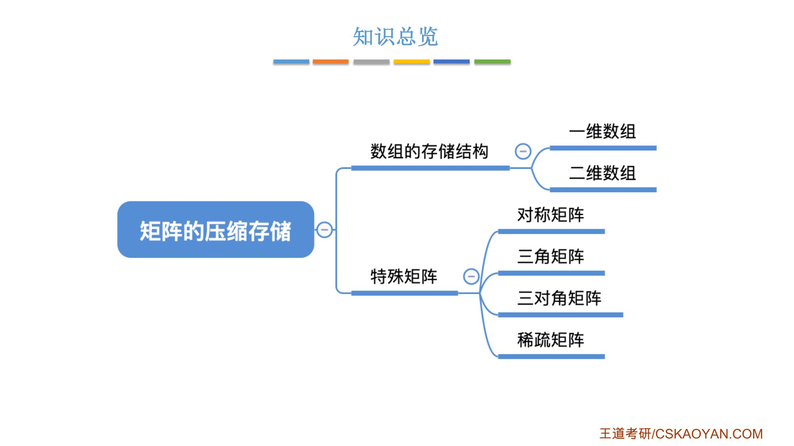{.slide width=0.5}

王道书第 100 页开头说：在数据结构中，关注的重点并非矩阵本身的数学性质及其运算，而是[如何以最小的内存空间高效存储矩阵，并支持对元素的便捷访问]{.u}。

这一节所有的下标计算题，老师用的都是同一个办法：[数出这个元素前面存了多少个元素]{.red}，再看数组下标从 0 还是从 1 开始。老师反复说这些公式[不要记]{.u}，考试一定会改条件，要能在考场上临时推出来。下面每种矩阵都画了一张"数个数"的图：橙色格子就是要数的那些。

# 一、一维数组和二维数组的存储结构

::: cue
一维数组 a[i] 的地址怎么算？二维数组行优先、列优先的地址各怎么算？
:::

**一维数组**。C 语言里 `ElemType a[10];` 定义一个一维数组。各数据元素类型相同，所以[大小相同]{.u}，并且在内存中[连续存放]{.u}。只要知道起始地址 LOC，就能算出任何一个下标对应的地址：

$$a[i] \text{ 的存放地址} = \text{LOC} + i \times \text{sizeof(ElemType)} \quad (0 \le i < 10)$$

[除非题目特别说明，数组下标默认从 0 开始]{.red}。如果从 1 开始，这里的 $i$ 要变成 $i-1$，做题时一定要看清楚。

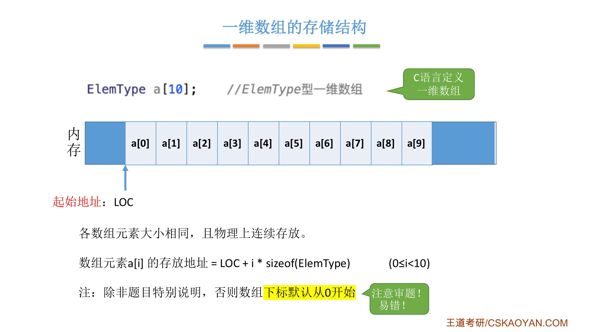{.slide width=0.5}

**二维数组**。`ElemType b[2][4];` 定义一个 2 行 4 列的二维数组。逻辑视角上它有行有列，但内存空间是线性的，所以要把它"拉成"一条线，有两种存法：

- **行优先**：一行一行地存，先存第一行，紧接着存第二行……
- **列优先**：一列一列地存。

规定行优先或列优先，本质目的是把非线性的二维数组拉成线性的形状。这样有规律地存放之后，二维数组也能[随机存取]{.u}：给出行号、列号，计算机就能直接算出地址。算法很简单，[算出它前面有多少个元素]{.u}，乘以每个元素的大小，再加起始地址：

- M 行 N 列的 `b[M][N]`，**行优先**：前面有 $i$ 整行，每行 $N$ 个，本行前面还有 $j$ 个，
  $$b[i][j] \text{ 的存放地址} = \text{LOC} + (i \times N + j) \times \text{sizeof(ElemType)}$$
- **列优先**：前面有 $j$ 整列，每列 $M$ 个，本列前面还有 $i$ 个，
  $$b[i][j] \text{ 的存放地址} = \text{LOC} + (j \times M + i) \times \text{sizeof(ElemType)}$$

老师说这只是一个很简单的数学问题，这里主要理解什么叫行优先、什么叫列优先。

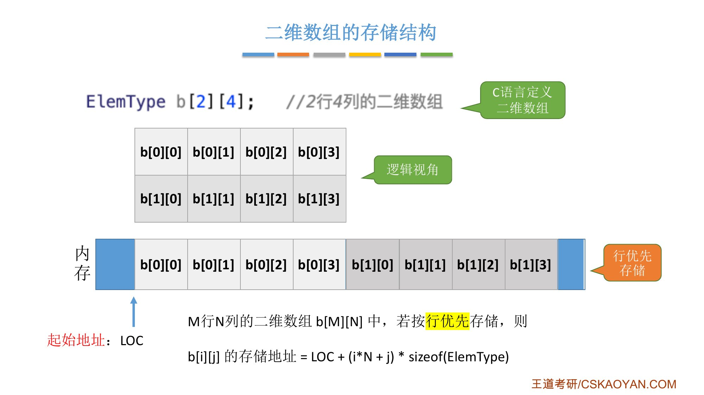{.slide width=0.5}

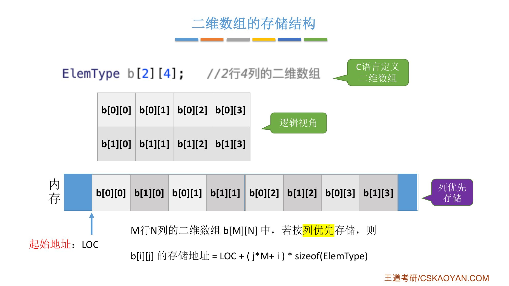{.slide width=0.5}

下面用课件的 `b[2][4]` 找 `b[1][2]`，把"数前面有几个"画出来（我画的）：

![二维数组 b[2][4] 中 b[1][2] 的位置：行优先前面 6 个，列优先前面 5 个](assets/3.4-2d.png){width=0.85}

::: book
王道书第 100–101 页 §3.4.1 数组的定义：数组是由 $n$（$n \ge 1$）个相同类型的数据元素组成的有限序列。每个元素称为**数组元素**，其在线性序列中的位置由下标标识，下标的取值范围称为**维界**。

**数组与线性表的关系**：[数组是线性表的推广]{.u}。一维数组可视为一个线性表；二维数组可视为其元素是定长一维数组的线性表；更高维数组以此类推。数组一旦定义，其维数与维界即固定不变。因此，除初始化和销毁外，[数组仅支持存取元素和修改元素两种基本操作]{.u}。

§3.4.2 数组的存储结构：逻辑上的数组通常[映射为内存中一段连续的存储空间]{.u}。一维数组 $A[0\ldots n-1]$，设每个元素占 $L$ 个存储单元，则 $\text{LOC}(a_i) = \text{LOC}(a_0) + iL \ (0 \le i < n)$。

考点追踪（二维数组按行优先存储的下标对应关系，2021）：多维数组在内存中需按某种顺序展开为一维，常见方式有按行优先和按列优先。**按行优先**：先行后列，先存储行号较小的元素；同一行内，先存储列号较小的元素。设二维数组行下标与列下标范围分别为 $[0,h_1]$ 与 $[0,h_2]$，则

$$\text{LOC}(a_{i,j}) = \text{LOC}(a_{0,0}) + [i(h_2+1) + j]L$$

**按列优先**：先列后行，先存储列号较小的元素；同一列内，先存储行号较小的元素。

$$\text{LOC}(a_{i,j}) = \text{LOC}(a_{0,0}) + [j(h_1+1) + i]L$$
:::

::: {.def title="名词统一"}
课件 `b[M][N]`（M 行 N 列）和书上的维界 $[0,h_1]$、$[0,h_2]$：$M = h_1+1$，$N = h_2+1$，所以课件的 $i \times N + j$ 就是书上的 $i(h_2+1)+j$。课件的 sizeof(ElemType) ＝ 书上的 $L$；课件的起始地址 LOC ＝ 书上的 $\text{LOC}(a_0)$ 或 $\text{LOC}(a_{0,0})$。
:::

# 二、普通矩阵的存储

::: cue
矩阵的行号列号和数组下标，默认各从几开始？
:::

普通矩阵最容易想到用二维数组存储。要注意：[描述矩阵元素时，行号、列号通常从 1 开始；描述数组时，下标通常从 0 开始]{.red}。这是默认情况，做题时要仔细看题目给的条件，也有可能矩阵的行号、列号从 0 开始，这些都是比较容易错的地方。

普通矩阵可以用二维数组很方便地存储；而某些特殊矩阵，可以用一些巧妙的方法来压缩，节省存储空间。

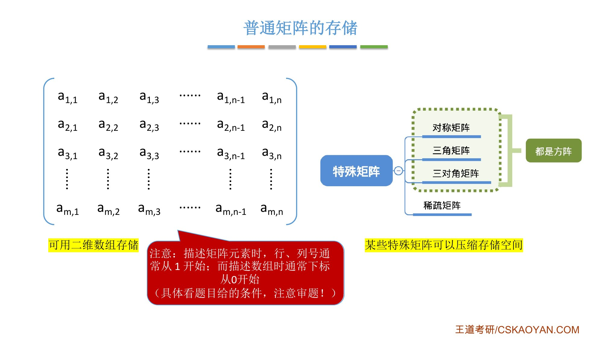{.slide width=0.5}

::: book
王道书第 102 页"注意"：二维数组 $A[n][n]$ 与 $A[0\ldots n-1][0\ldots n-1]$ 写法等价，表示下标从 0 开始。若写作 $A[1\ldots n][1\ldots n]$，则表示下标从 1 开始。矩阵元素通常记为 $a_{i,j}$，其行号 $i$ 和列号 $j$ 通常从 1 开始。

王道书第 101 页 §3.4.3：**压缩存储**：为多个值相同的元素只分配一个存储空间，对零元素不分配存储空间。**特殊矩阵**：指具有大量相同元素或零元素，且这些元素分布具有规律性的矩阵。常见的特殊矩阵有对称矩阵、上（下）三角矩阵、对角矩阵等。**特殊矩阵的压缩存储方法**：通过分析矩阵中相同元素的分布规律，仅存储一份实际数据，其余的可通过下标映射访问，从而将原本冗余的数据压缩到一个共享的空间中，显著节省内存。
:::

# 三、对称矩阵

::: cue
对称矩阵只存哪一部分？一维数组要多大？$a_{i,j}$ 映射到哪个 $k$？$i<j$ 怎么办？
:::

**定义**。首先它是一个**方阵**（$n$ 行 $n$ 列），并且对任意元素都有 $a_{i,j} = a_{j,i}$，例如 $a_{1,2}=a_{2,1}$、$a_{1,3}=a_{3,1}$。元素的值关于主对角线对称（$i=j$ 时式子显然也成立）。三个区域：

- $i = j$：**主对角线**；
- $i < j$：**上三角区**；
- $i > j$：**下三角区**。

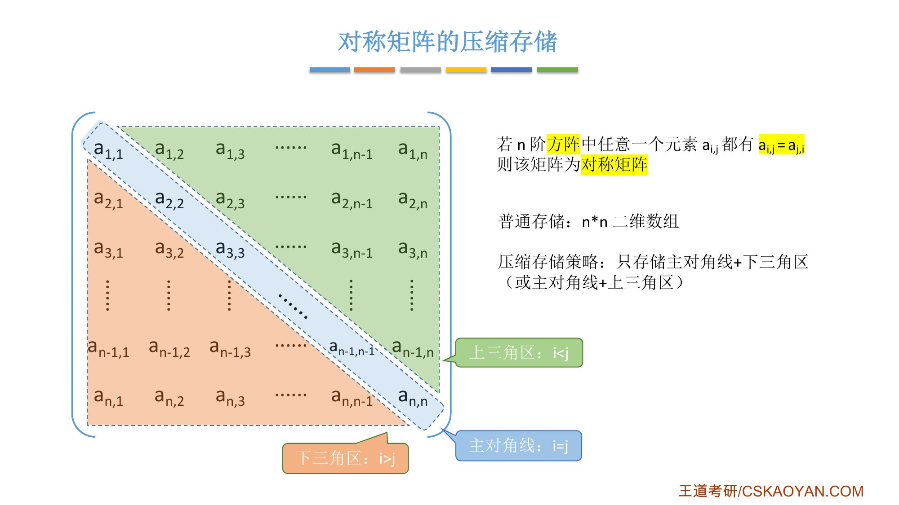{.slide width=0.5}

**压缩策略**。两个三角区的数据完全相同，所以[只存主对角线＋下三角区]{.u}（也可以只存主对角线＋上三角区）。下面以前者为例，按**行优先**把这些元素依次存入一维数组 B。

**问题 1：数组要多大？** 第 1 行存 1 个，第 2 行 2 个……第 $n$ 行 $n$ 个，共

$$1 + 2 + \cdots + n = \frac{n(n+1)}{2}$$

个，所以 B 的最后一个元素下标是 $\dfrac{n(n+1)}{2} - 1$（减 1 是因为下标从 0 开始）。

**问题 2：怎么用矩阵下标访问？** 站在程序员的角度，存起来是为了用，用的时候肯定希望看到的是矩阵，而不是一维数组。所以要自己实现一个**映射函数**：矩阵下标 $\to$ 一维数组下标。这是压缩存储之后要实现的很重要的东西，也是[考研最喜欢考的点]{.red}。

- $i \ge j$（下三角区和主对角线）：按行优先，$a_{i,j}$ 前面有 $i-1$ 行，共 $1+2+\cdots+(i-1)$ 个；列号 $j$ 反映它是本行第 $j$ 个。所以它是第 $[1+2+\cdots+(i-1)] + j = \dfrac{i(i-1)}{2} + j$ 个元素，数组下标从 0 开始，还要减 1：
  $$k = \frac{i(i-1)}{2} + j - 1$$
- $i < j$（上三角区）：这部分没有实际存进数组，但对称矩阵有 $a_{i,j} = a_{j,i}$ 这个美好的特性，所以[访问 $a_{i,j}$ 就转换成访问 $a_{j,i}$]{.u}，又回到了行号大于列号的情况：
  $$k = \frac{j(j-1)}{2} + i - 1$$

老师强调：有的题目数组下标从 1 开始，那样就[不需要再减这个 1]{.red}。

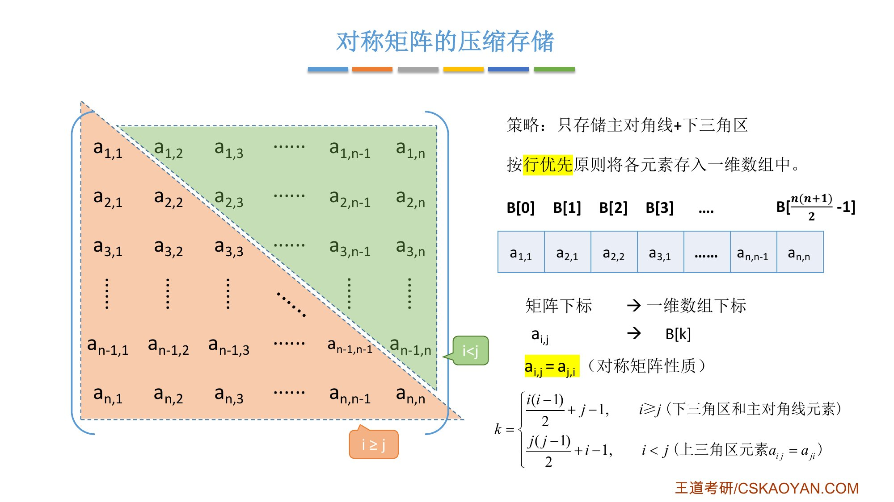{.slide width=0.5}

**出题方法**。实际考试肯定不会考原题，会改一些细微的条件：存上三角还是下三角？行优先还是列优先？矩阵元素下标从 0 还是 1 开始？数组下标从 0 还是 1 开始？老师举了**列优先**存主对角线＋下三角区的例子，思路一样，算 $a_{i,j}$ 是第几个：

- 第 $j$ 列之前有第 1 到第 $j-1$ 列：第 1 列 $n$ 个，第 2 列 $n-1$ 个……第 $j-1$ 列 $n-j+2$ 个，等差数列求和得 $\dfrac{(j-1)(2n-j+2)}{2}$ 个；
- 同一列中它前面还有 $i - j$ 个（行号减列号，例如 $a_{n,3}$ 前面有 $n-3$ 个）；
- 所以它是第 $\dfrac{(j-1)(2n-j+2)}{2} + (i-j) + 1$ 个，再根据数组下标从 0 还是 1 开始转换成 $k$。

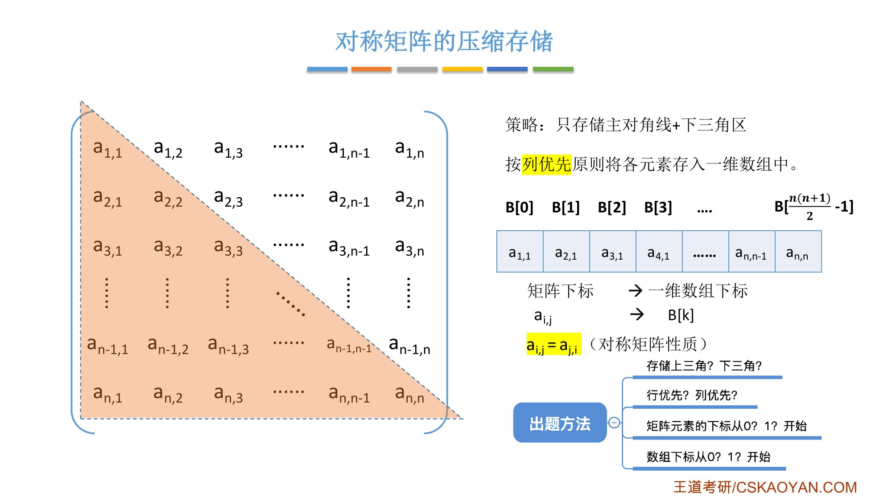{.slide width=0.5}

老师说除此之外还可以存主对角线＋上三角区，做题方法都很简单。课件只推了 ①②，③④ 没推。下面把四种情况放在一张图里（我画的），$n=4$：

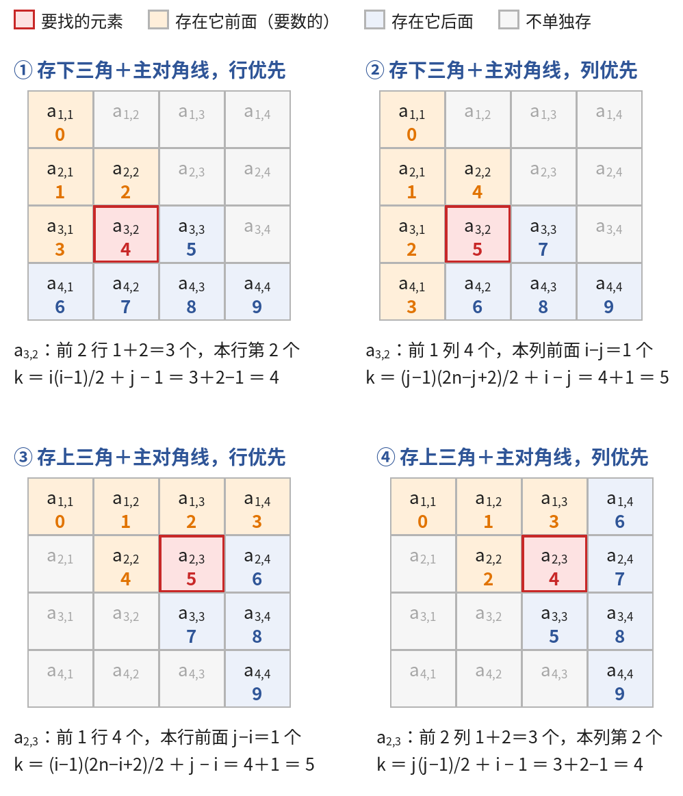{width=0.95}

::: add
**补全课件没推的 ③④，并说明为什么只要会 ①② 就够了**。

*③ 上三角＋主对角线，行优先*（$i \le j$）：第 $i$ 行之前，第 1 行 $n$ 个，第 2 行 $n-1$ 个……第 $i-1$ 行 $n-i+2$ 个，共 $\dfrac{(i-1)(2n-i+2)}{2}$ 个；本行从 $a_{i,i}$ 开始存，它前面还有 $j-i$ 个。所以 $k = \dfrac{(i-1)(2n-i+2)}{2} + j - i$。$i > j$ 时访问 $a_{j,i}$。

*④ 上三角＋主对角线，列优先*（$i \le j$）：第 $j$ 列之前有 $1+2+\cdots+(j-1)$ 个，本列从 $a_{1,j}$ 开始存，它是第 $i$ 个。所以 $k = \dfrac{j(j-1)}{2} + i - 1$。

*为什么 ③ 和 ② 是同一个公式（$i$、$j$ 互换）*：③ 第 $r$ 行存的是 $a_{r,r}, a_{r,r+1}, \ldots, a_{r,n}$，② 第 $r$ 列存的是 $a_{r,r}, a_{r+1,r}, \ldots, a_{n,r}$。把 ② 的每个元素 $a_{p,q}$ 换成 $a_{q,p}$，正好得到 ③ 的同一位置的元素，次序也一样。所以 ③ 中 $a_{i,j}$ 的位置 ＝ ② 中 $a_{j,i}$ 的位置，把 ② 的公式里 $i$、$j$ 互换就是 ③ 的公式。同理，④ 中 $a_{i,j}$ 的位置 ＝ ① 中 $a_{j,i}$ 的位置。图里能直接看出来：① 中 $a_{3,2}$ 是 4，④ 中 $a_{2,3}$ 也是 4；② 中 $a_{3,2}$ 是 5，③ 中 $a_{2,3}$ 也是 5。

所以四种情况只有两种本质不同的数法：[每段从 1 个开始变多]{.u}（①④，前面共 $\frac{m(m-1)}{2}$ 个），[每段从 $n$ 个开始变少]{.u}（②③，前面共 $\frac{m(2n-m+1)}{2}$ 个，$m$ 是前面的段数）。

*数组下标从 1 开始*：上面每个 $k$ 都加 1。*矩阵下标从 0 开始*：先把 $i$、$j$ 各加 1，再代入公式。
:::

::: book
王道书第 101–102 页：考点追踪（对称矩阵压缩存储的下标对应关系，2018、2020）。若 $n$ 阶矩阵 $A$ 中任意元素 $a_{i,j}$ 均满足 $a_{i,j} = a_{j,i}$（$1 \le i, j \le n$），则称其为对称矩阵。其元素可分为三部分：上三角区、主对角线和下三角区。由于上三角区与下三角区完全对称，若仍用二维数组存储，将近一半空间被浪费。为此可将 $n$ 阶对称矩阵 $A$ 压缩存储于一维数组 $B[n(n+1)/2]$ 中，通常仅存放下三角部分（含主对角线）。

对于元素 $a_{i,j}$（$i \ge j$），其在数组 B 中的位置由其前方的元素个数决定：第 1 行 1 个，第 2 行 2 个……第 $i-1$ 行 $i-1$ 个，第 $i$ 行 $j-1$ 个（$a_{i,1}, \ldots, a_{i,j-1}$）。因此 $k = 1+2+\cdots+(i-1)+j-1 = i(i-1)/2 + j - 1$（数组下标从 0 开始），

$$k = \begin{cases} \dfrac{i(i-1)}{2} + j - 1, & i \ge j \text{（下三角区和主对角线元素）} \\[2mm] \dfrac{j(j-1)}{2} + i - 1, & i < j \text{（上三角区元素 } a_{i,j} = a_{j,i}\text{）} \end{cases}$$

若数组下标从 1 开始，则可采用类似的推导方法，请读者自行思考。
:::

# 四、三角矩阵

::: cue
三角矩阵比同阶对称矩阵多存什么？常量区映射到哪里？上三角矩阵行优先的 $k$ 怎么推？
:::

**定义**。**下三角矩阵**：除了主对角线和下三角区，其余元素（上三角区）都相同；**上三角矩阵**：除了主对角线和上三角区，其余元素（下三角区）都相同。

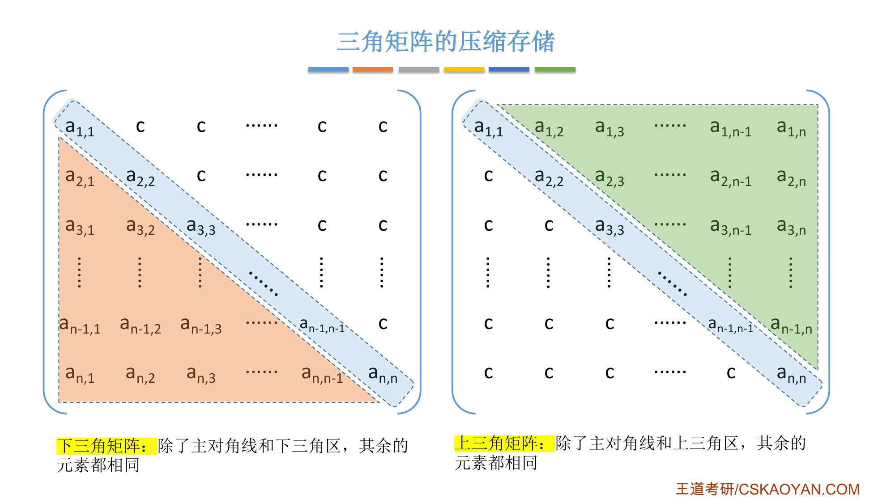{.slide width=0.5}

**压缩策略**。常量区那一整块的值都相同，不需要重复存放那么多份，只需要重点存储不是常量的部分，方法和对称矩阵一样（行优先或列优先存入一维数组）；[在最后再加一个位置存放这个常量 $c$]{.u}。所以一维数组长度是 $\dfrac{n(n+1)}{2} + 1$，比存储同阶对称矩阵[多一个存储单元]{.red}。

**下三角矩阵（行优先）**：$i \ge j$ 时和对称矩阵的式子一模一样；唯一不同的是 $i < j$（上三角区）的元素都是常量 $c$，[全部映射到一维数组的最后一个位置]{.u}：

$$k = \begin{cases} \dfrac{i(i-1)}{2} + j - 1, & i \ge j \\[2mm] \dfrac{n(n+1)}{2}, & i < j \end{cases}$$

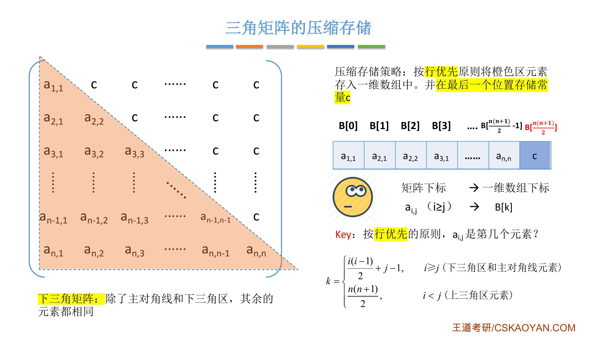{.slide width=0.5}

**上三角矩阵（行优先）**：同样考虑 $a_{i,j}$ 前面有几个元素。第 $i$ 行之前，第 1 行 $n$ 个，第 2 行 $n-1$ 个……第 $i-1$ 行 $n-i+2$ 个，等差数列求和；第 $i$ 行中 $a_{i,j}$ 前面还有 $j - i$ 个。所以

$$k = \begin{cases} \dfrac{(i-1)(2n-i+2)}{2} + (j-i), & i \le j \\[2mm] \dfrac{n(n+1)}{2}, & i > j \text{（下三角区，映射到常量的位置）} \end{cases}$$

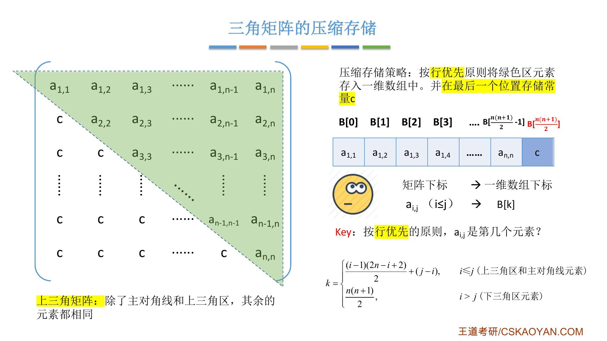{.slide width=0.5}

两种三角矩阵的数法画在一起（我画的），$n=4$，常量 $c$ 存在 $B[10]$：

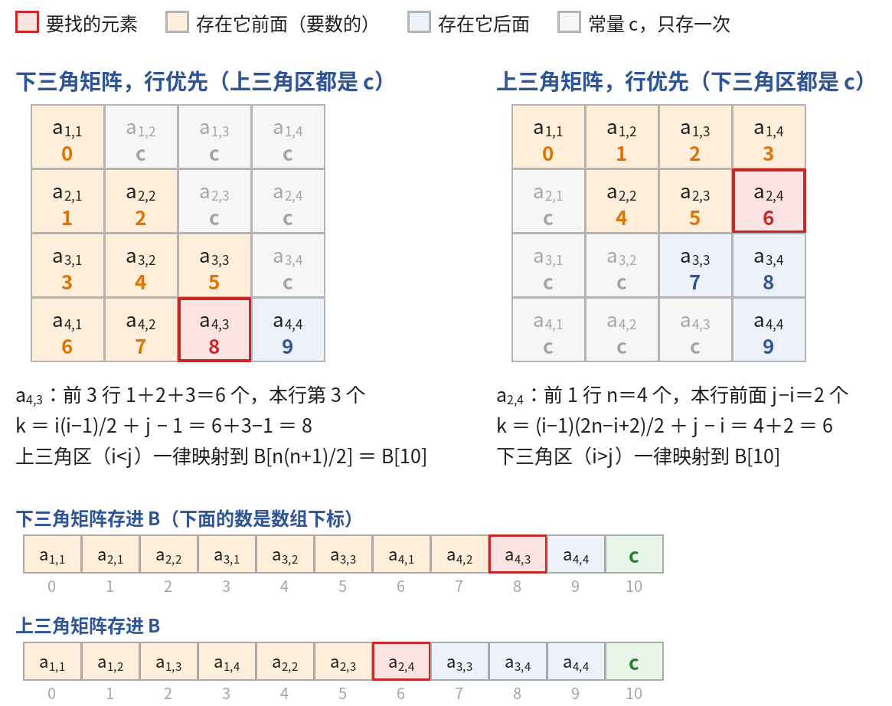{width=0.9}

课件第 20 页在下三角矩阵旁边留了一个思考题："如何由 $k$ 推出 $i$、$j$？"，正课视频里老师没有讲，下面补上。

::: add
**补：下三角矩阵（行优先），已知 $k$ 求 $i$、$j$**（思路和第五节三对角矩阵老师讲的"刚好"一样）。

$k = \frac{n(n+1)}{2}$ 时是常量 $c$。否则 $B[k]$ 前面有 $k$ 个元素。前 $i-1$ 行共 $\frac{i(i-1)}{2}$ 个，前 $i$ 行共 $\frac{i(i+1)}{2}$ 个。$B[k]$ 在第 $i$ 行，当且仅当

$$\frac{i(i-1)}{2} \le k < \frac{i(i+1)}{2}.$$

左边：$i^2 - i - 2k \le 0$，即 $i \le \frac{1+\sqrt{8k+1}}{2}$；右边：$i^2 + i - 2k > 0$，即 $i > \frac{-1+\sqrt{8k+1}}{2} = \frac{1+\sqrt{8k+1}}{2} - 1$。记 $x = \frac{1+\sqrt{8k+1}}{2}$，$i$ 是区间 $(x-1, x]$ 里的整数，这个区间长度为 1，里面恰好有一个整数，就是 $\lfloor x \rfloor$：

$$i = \left\lfloor \frac{1+\sqrt{8k+1}}{2} \right\rfloor, \qquad j = k - \frac{i(i-1)}{2} + 1.$$

*例子*（对照上图）：$k=8$，$\sqrt{65} \approx 8.06$，$x \approx 4.53$，$i = 4$；$j = 8 - 6 + 1 = 3$，是 $a_{4,3}$。$k=6$，$\sqrt{49} = 7$，$x = 4$，$i = 4$，$j = 1$，是 $a_{4,1}$，正好是第 4 行的第一个。
:::

::: book
王道书第 102–103 页：下三角矩阵中，上三角区的所有元素均为同一常量。其存储思想与对称矩阵的类似，但是需要额外存储该常量一次。因此，可以将 $n$ 阶下三角矩阵 $A$ 压缩存储在 $B[n(n+1)/2+1]$ 中，$k$ 的式子和上面相同（图 3.21：$B[0]$ 起依次是第 1 行、第 2 行……第 $n$ 行，$B[n(n+1)/2]$ 是常数项）。

考点追踪（上三角矩阵采用行优先存储的应用，2011）：上三角矩阵中，下三角区所有元素均为同一常量。只需存储主对角线、上三角区上元素及该常量一次，同样将其压缩存储在 $B[n(n+1)/2+1]$ 中。对于元素 $a_{i,j}$（$i \le j$），其在数组 B 中前方的元素个数为：第 1 行 $n$ 个，第 2 行 $n-1$ 个……第 $i-1$ 行 $n-i+2$ 个，第 $i$ 行 $j-i$ 个。故 $k = n+(n-1)+\cdots+(n-i+2)+(j-i+1)-1 = (i-1)(2n-i+2)/2+(j-i)$。

以上推导均假设数组下标从 0 开始。若下标指定从 1 开始，则要相应地调整映射关系。
:::

# 五、三对角矩阵

::: cue
三对角矩阵哪些元素可以非零？要存几个？$k = 2i+j-3$ 怎么来？已知 $k$ 怎么求 $i$、$j$？
:::

**定义**。**三对角矩阵**又称**带状矩阵**：当 $|i - j| > 1$ 时，$a_{i,j} = 0$（$1 \le i, j \le n$）。形象地理解：主对角线上 $|i-j| = 0$；往右（或左、上、下）走一格，差值变为 1，可以不为零；再走一格差值变为 2，肯定是零。所以[主对角线上的元素，以及和它们上下左右相邻的元素可以非零]{.u}，再往外都是零。

**压缩策略**。只存带状部分，按行优先（或列优先）依次存入一维数组。除了第一行和最后一行只有 2 个元素，其他每行都有 3 个，所以共

$$3n - 2$$

个元素，最后一个的数组下标是 $3n - 3$。

**正向：$a_{i,j} \to k$**（只讨论 $|i - j| \le 1$，差值大于 1 的元素肯定是 0，不用来数组里找）。每行 3 个，第一行少一个，所以前 $i-1$ 行共 $3(i-1) - 1$ 个；$a_{i,j}$ 是第 $i$ 行的第 $j - i + 2$ 个。加起来，$a_{i,j}$ 是第 $2i + j - 2$ 个元素，下标从 0 开始：

$$k = 2i + j - 3$$

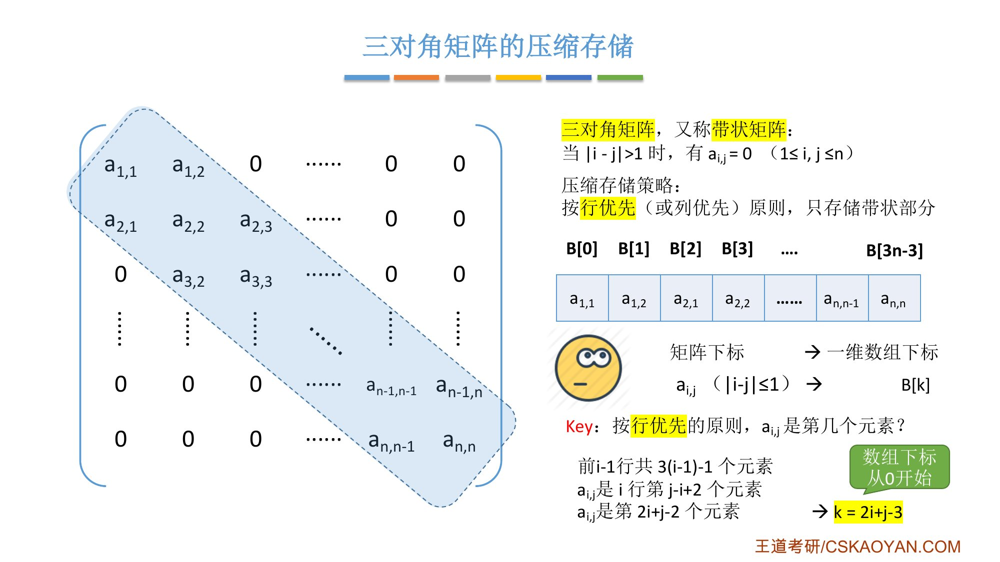{.slide width=0.5}

**反向：$k \to i, j$**。$B[k]$ 是第 $k+1$ 个元素。前 $i-1$ 行共 $3(i-1)-1$ 个，前 $i$ 行共 $3i - 1$ 个，它在第 $i$ 行就要满足

$$3(i-1) - 1 < k + 1 \le 3i - 1.$$

从右边解出 $i \ge \dfrac{k+2}{3}$。$i$ 是行号，一定是整数，要让 $i$ [刚好]{.u}大于等于右边这个值，[向上取整]{.red}即可：

$$i = \left\lceil \frac{k+2}{3} \right\rceil, \qquad j = k - 2i + 3 \ \text{（由 } k = 2i+j-3\text{）}.$$

**王道书的算法**：把 $k$ 理解为它前面共有 $k$ 个元素，那么 $3(i-1) - 1 \le k < 3i - 1$。从左边解出 $i \le \dfrac{k+1}{3} + 1$，要 $i$ 刚好小于等于这个值，[向下取整]{.red}：$i = \left\lfloor \dfrac{k+1}{3} + 1 \right\rfloor$。老师说书上的式子看起来不一样，计算结果完全一样，"大家可以自己带进去验证"，"背后的逻辑留给大家自己去琢磨"，要注意体会不等式里"刚好大于等于""刚好小于等于"怎么处理。

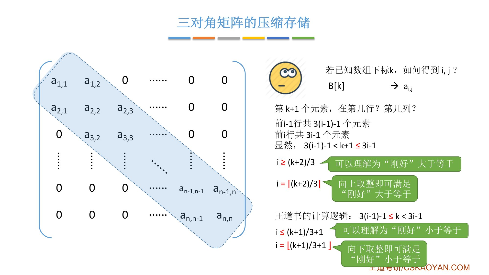{.slide width=0.5}

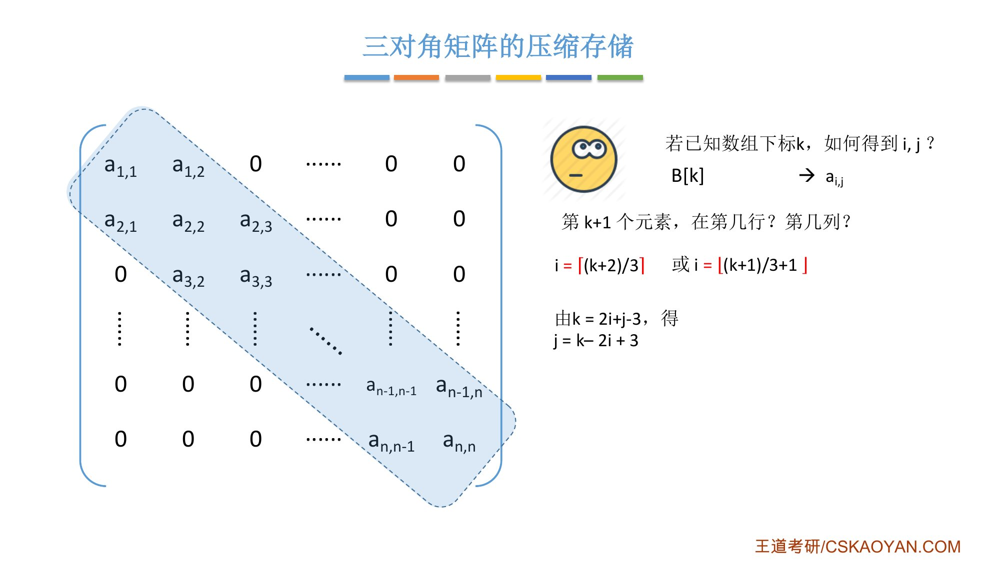{.slide width=0.5}

下面把 $n=5$ 的三对角矩阵按下标编好号（我画的）。下面一条是一维数组，每行占一段：

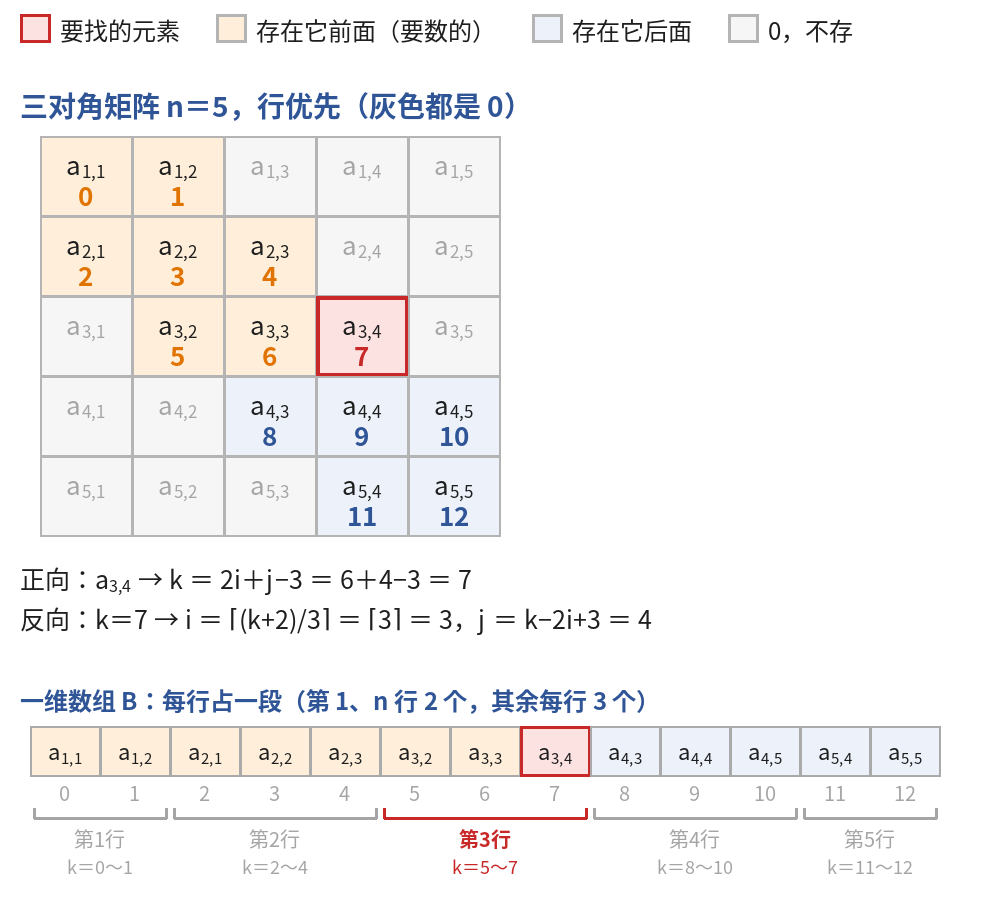{width=0.9}

::: add
**证明老师留的两件事**。

*1. $i = \lceil \frac{k+2}{3} \rceil$ 和 $i = \lfloor \frac{k+1}{3} \rfloor + 1$ 是同一个数。* 两种算法都是在找满足一对不等式的整数 $i$，只要证明对整数 $i$ 这两对不等式等价。对整数 $i$、$k$：

- $i \ge \frac{k+2}{3} \iff 3i \ge k+2 \iff 3i > k+1 \iff i > \frac{k+1}{3}$；
- 老师的另一半 $3(i-1)-1 < k+1$，即 $3i < k+5 \iff 3i \le k+4 \iff i \le \frac{k+1}{3}+1$，正是书上的条件。

所以两种算法找的是同一个整数：它在区间 $\left(\frac{k+1}{3}, \frac{k+1}{3}+1\right]$ 里，区间长度为 1，恰好有一个整数，就是 $\lfloor \frac{k+1}{3} \rfloor + 1$，也等于 $\lceil \frac{k+2}{3} \rceil$。（"$>$"能换成"$\ge$ 再加 1"，靠的就是 $i$、$k$ 都是整数，这也是老师说的"刚好"。）

*2. 书上为什么"$\le$""$<$"的位置和老师的相反。* 老师数的是"它是第 $k+1$ 个"，书上数的是"它前面有 $k$ 个"，差 1。前 $i-1$ 行的个数 $3(i-1)-1$：老师要求严格小于 $k+1$，书上要求 $\le k$，对整数是同一个条件；前 $i$ 行的个数 $3i-1$：老师要求 $\ge k+1$，书上要求 $> k$，也是同一个条件。

*3. 第一行的公式也对，但有两处"差 1"正好抵消。* 第 1 行只有 $a_{1,1}$、$a_{1,2}$，$a_{1,j}$ 实际是本行第 $j$ 个（不是 $j - i + 2 = j+1$ 个），而"前 0 行共 $3\times0-1 = -1$ 个"也少算了 1。两处相加，$2i+j-2 = j$ 仍是正确的序号，所以 $k = 2i+j-3$ 对第 1 行也成立：$a_{1,1}$ 得 0，$a_{1,2}$ 得 1。

*例子*（对照上图）：$k = 7$，老师的算法 $\lceil 9/3 \rceil = 3$，书上的算法 $\lfloor 8/3 \rfloor + 1 = 2 + 1 = 3$，同一行；$j = 7 - 6 + 3 = 4$，是 $a_{3,4}$。图里第 3 行占 $k = 5\sim7$，前 2 行共 $3\times2-1 = 5$ 个，正好是 $k=0\sim4$。
:::

::: book
王道书第 103 页：若 $n$ 阶矩阵 $A$ 中的任意元素 $a_{i,j}$，当 $|i-j| > 1$ 时均有 $a_{i,j} = 0$（$1 \le i, j \le n$），则称为三对角矩阵。非零元素仅集中在以主对角线为中心的 3 条对角线的区域。可将三对角上的元素按行优先顺序存入一维数组 B，且 $a_{1,1}$ 存于 $B[0]$。

考点追踪（三对角矩阵压缩存储的下标对应关系，2016）：三对角上的元素 $a_{i,j}$（$1 \le i, j \le n$，$|i-j| \le 1$）在一维数组 B 中的下标 $k = 2i+j-3$。反之，已知元素存于 $B[k]$ 中时，$i = \lfloor (k+1)/3 + 1 \rfloor$，$j = k - 2i + 3$。例如，当 $k = 0$ 时，$i = \lfloor (0+1)/3 + 1 \rfloor = 1$，$j = 0 - 2 + 3 = 1$，存放的是 $a_{1,1}$；当 $k = 2$ 时，$i = 2$，$j = 1$，存放的是 $a_{2,1}$；当 $k = 4$ 时，$i = 2$，$j = 3$，存放的是 $a_{2,3}$。
:::

# 六、稀疏矩阵

::: cue
稀疏矩阵的两种压缩存储方法是什么？三元组存储后失去了什么？十字链表的结点有哪几个域？
:::

**定义**。**稀疏矩阵**：[非零元素的个数远远少于矩阵元素的个数]{.u}。什么叫"远远少于"并没有固定的界限，老师说作为程序员大家应该对"稀疏"这个词都有很深刻的理解，"摸摸自己的头顶就知道了"。如果定义一个和它尺寸相当的二维数组，很多空间都存的是 0，没有必要。

**方法一：顺序存储三元组 ⟨行，列，值⟩**。每个非零元素用一个三元组表示，例如课件中 4 在第 1 行第 3 列，三元组是 ⟨1, 3, 4⟩；5 在第 1 行第 6 列，是 ⟨1, 6, 5⟩。顺序存储的做法：定义一个 struct，里面有 `i`、`j`、`value` 三个字段（一个 struct 对应表中的一行），再定义一个这种 struct 的一维数组。用这种方式存储，要访问某个元素，只能[顺序依次扫描这些三元组]{.u}，也就是[失去了随机存取的特性]{.red}。

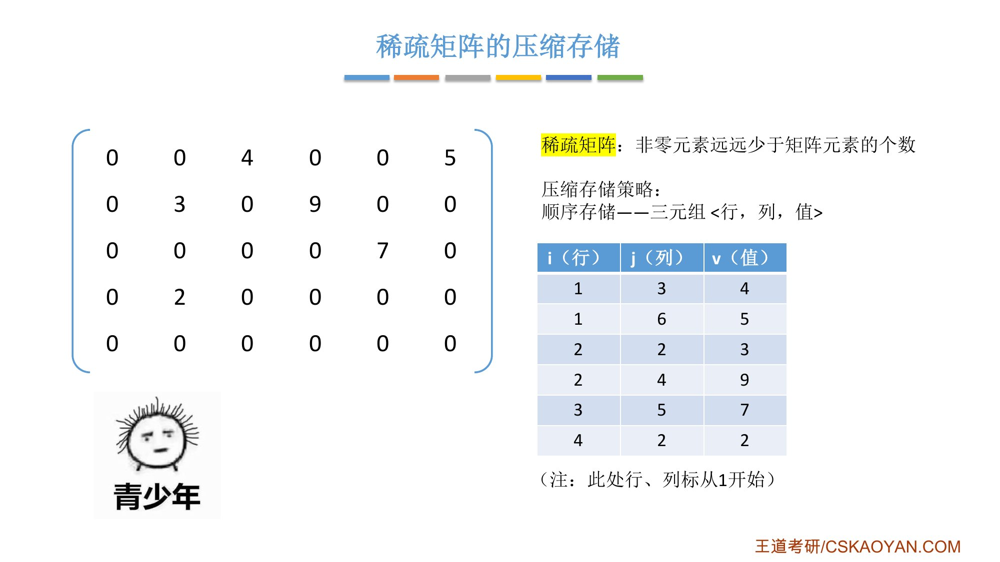{.slide width=0.5}

**方法二：十字链表法**（老师说课本当中没有详细讲）。"一图胜千言"：

- 一个指针数组 **向下域**（down），每个指针对应稀疏矩阵的一列，[指向第 $j$ 列的第一个元素]{.u}；
- 一个指针数组 **向右域**（right），每个指针对应一行，[指向第 $i$ 行的第一个元素]{.u}；
- 每个非零元素对应一个结点：行、列、值，以及两个指针，[一个指向同列的下一个元素，一个指向同行的下一个元素]{.u}。

例如第 1 行的第一个非零元素是 4，第 1 个向右域指针指向结点 ⟨1, 3, 4⟩，这个结点的指针再指向同一行的下一个非零元素 ⟨1, 6, 5⟩。第 2 列从上往下第一个非零元素是 3，第 2 个向下域指针指向结点 ⟨2, 2, 3⟩，它再指向同一列的下一个非零元素 ⟨4, 2, 2⟩。

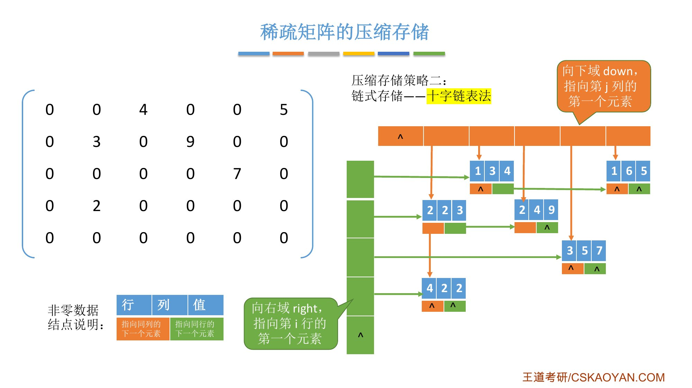{.slide width=0.6}

::: book
王道书第 103–104 页 §3.4.4：若矩阵中非零元素的个数 $t$ 相对于总元素个数 $s$ 来说非常少，即 $t \ll s$，则称该矩阵为稀疏矩阵。例如，一个 $100\times100$ 的矩阵中只有不到 100 个非零元素。

考点追踪（存储稀疏矩阵需要保存的信息，2023）：为避免空间浪费，稀疏矩阵通常仅存储非零元素。然而，由于非零元素的分布通常是无规律的，仅存储其值是不够的，还需记录它们所在的行和列。为此，将每个非零元素及其对应的行列位置组合成一个**三元组**（行标 $i$，列标 $j$，值 $a_{i,j}$）。这些三元组可以按某种顺序排列成线性表进行存储。[稀疏矩阵压缩存储后便失去了随机存取特性]{.u}。

考点追踪（稀疏矩阵压缩存储的方式，2017）：稀疏矩阵的三元组表可通过多种方式存储，常见的有：**数组存储**将所有三元组按某种顺序存储在一维数组中，这种方式简单直接，但插入和删除操作的效率较低；**十字链表存储**（见 6.2 节）通过链表的方式组织三元组，适用于频繁插入和删除操作的场景。无论采用哪种方式，都需要[额外保存稀疏矩阵的行数、列数和非零元素的个数]{.red}，以便支持后续的各种操作。
:::

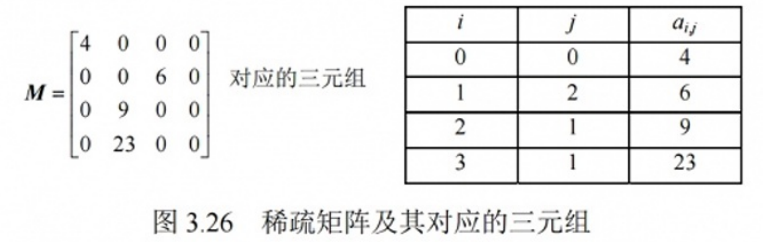{.slide width=0.5}

::: {.def title="名词统一"}
课件"三对角矩阵，又称带状矩阵"＝书上"三对角矩阵"。课件"顺序存储三元组"＝书上"数组存储"；课件"链式存储：十字链表法"＝书上"十字链表存储"。课件稀疏矩阵的三元组[行、列从 1 开始]{.u}（课件注明），书上图 3.26 的三元组行、列[从 0 开始]{.u}，做题看清题目。课件"向下域 down / 向右域 right"，书上这里没有讲，到第 6 章 6.2 节图的十字链表再学。
:::

# 七、知识回顾

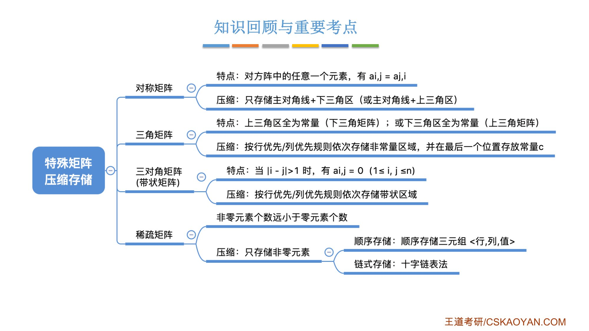{.slide width=0.5}

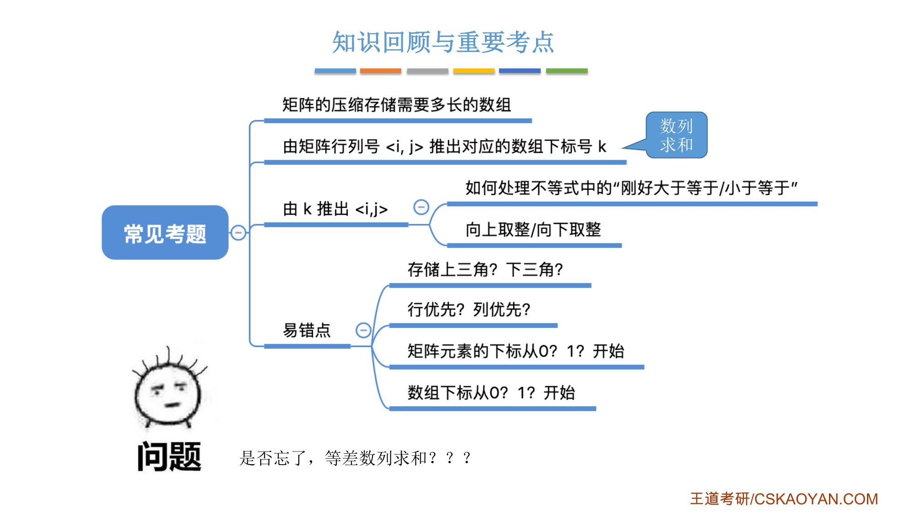{.slide width=0.5}

老师说这部分内容有点多，但难度不大，考题相对固定。[题目中可能会有坑]{.red}：存上三角还是下三角？行优先还是列优先？矩阵元素下标从 0 还是 1 开始？数组下标从 0 还是 1 开始？课件最后还问了一句："是否忘了，等差数列求和？"

::: summary
**数组**：元素大小相同、连续存放，可随机存取。一维 $a[i]$：$\text{LOC} + i \times \text{sizeof}$；二维 $b[M][N]$ 行优先 $\text{LOC} + (iN + j) \times \text{sizeof}$，列优先 $\text{LOC} + (jM + i) \times \text{sizeof}$。数组下标默认从 0 开始，矩阵行列号默认从 1 开始。

**统一做法**：[数出前面有几个元素]{.u}（等差数列求和），再看数组下标从 0 还是 1 开始。

**对称矩阵**：$a_{i,j} = a_{j,i}$；只存主对角线＋下（上）三角区，$\frac{n(n+1)}{2}$ 个。下三角行优先：$i \ge j$ 时 $k = \frac{i(i-1)}{2} + j - 1$，$i<j$ 时访问 $a_{j,i}$。

**三角矩阵**：常量区只存一次，放在最后，共 $\frac{n(n+1)}{2} + 1$ 个；常量区元素映射到 $k = \frac{n(n+1)}{2}$。上三角行优先：$k = \frac{(i-1)(2n-i+2)}{2} + (j-i)$。

**三对角矩阵（带状矩阵）**：$|i-j|>1$ 时为 0，共 $3n-2$ 个；$k = 2i + j - 3$；反向 $i = \lceil \frac{k+2}{3} \rceil$（＝书上 $\lfloor \frac{k+1}{3} \rfloor + 1$），$j = k - 2i + 3$。

**稀疏矩阵**：非零元素远少于总数。① 顺序存储三元组 ⟨行，列，值⟩，[失去随机存取特性]{.red}；② 十字链表法。都要额外保存行数、列数和非零元素个数。

**王道书考点**：二维数组按行优先存储的下标（2021）；对称矩阵下标对应关系（2018、2020）；上三角矩阵行优先（2011）；三对角矩阵下标（2016）；存储稀疏矩阵要保存的信息（2023）；稀疏矩阵压缩存储的方式（2017）。

**自测**：① $n$ 阶对称矩阵按列优先存下三角，$a_{i,j}$（$i \ge j$）的 $k$？② 上三角矩阵行优先，$a_{2,4}$（$n=4$）存在哪？常量 $c$ 呢？③ 三对角矩阵 $k=10$（$n=5$）是哪个元素？④ 稀疏矩阵三元组存储后失去了什么特性？
:::
