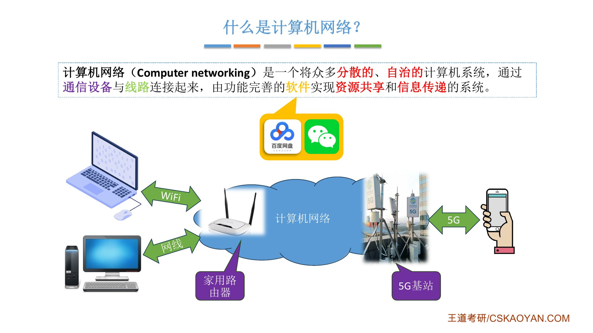
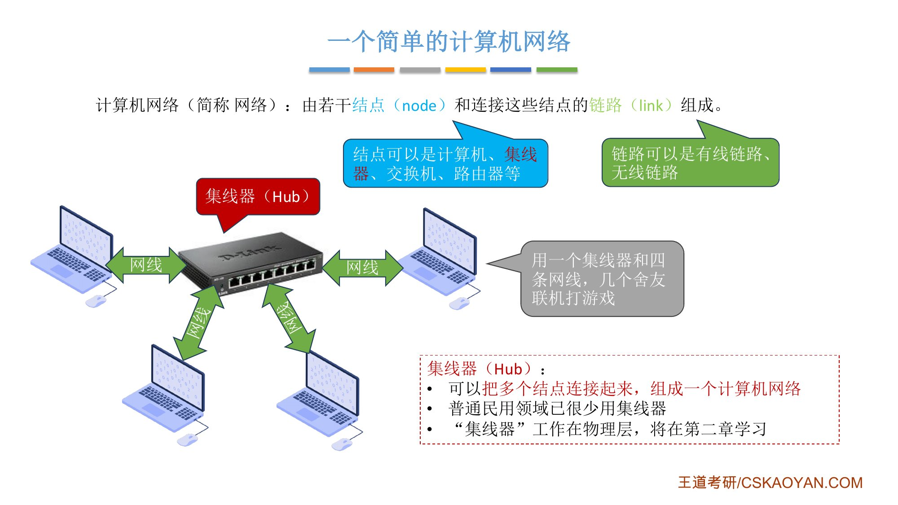
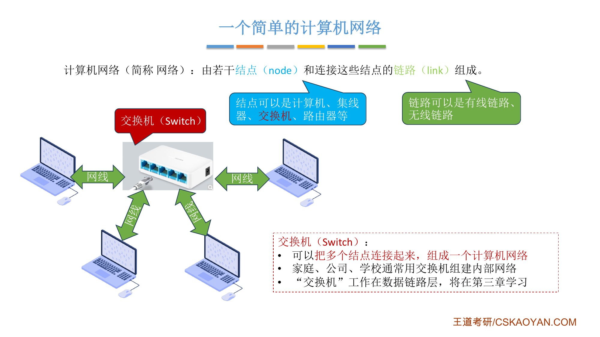
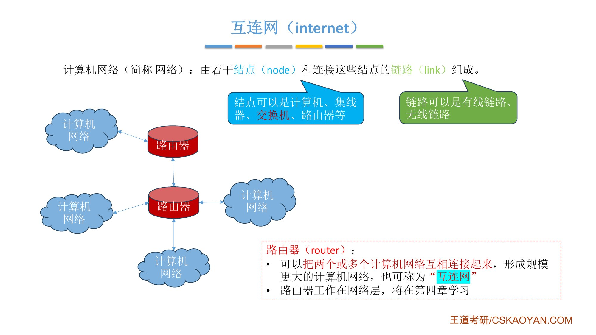
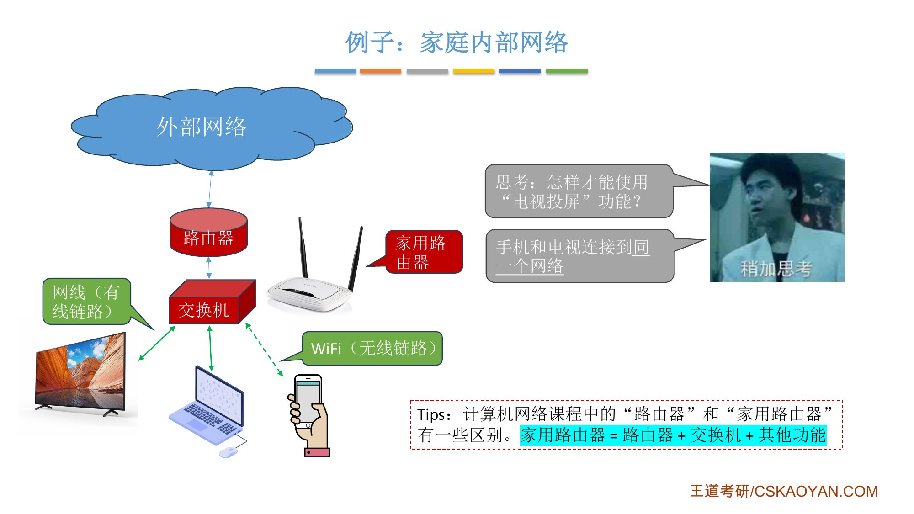
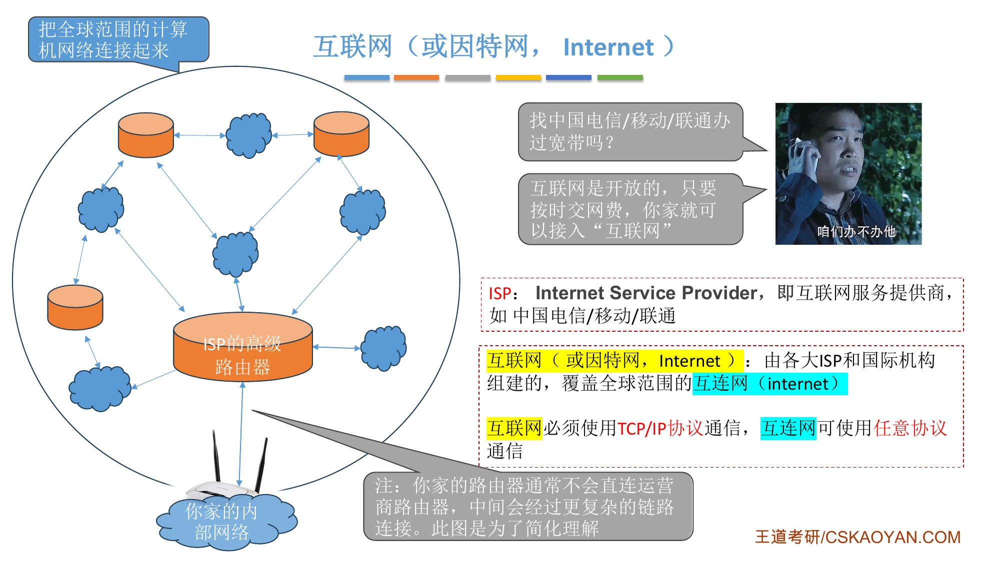
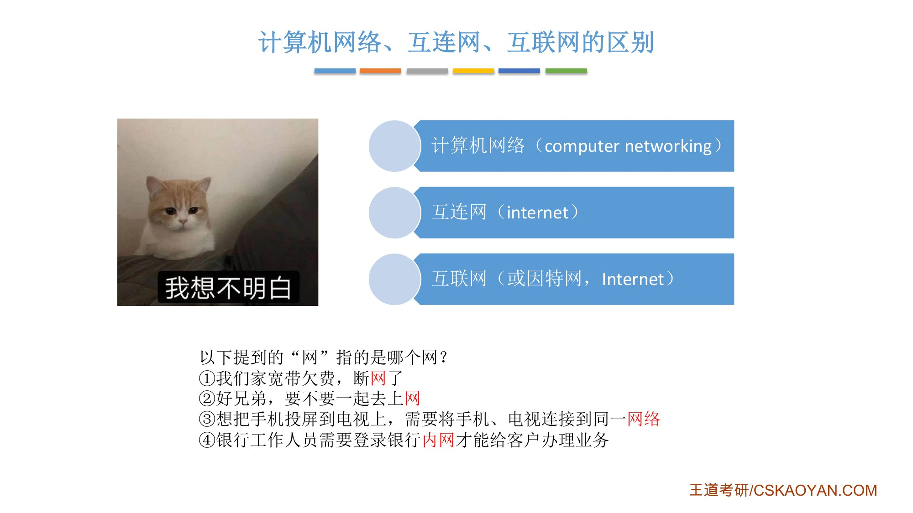
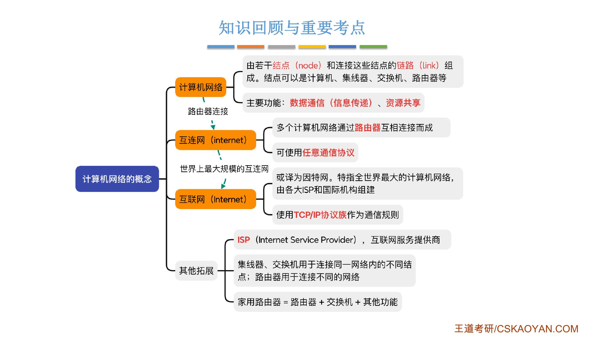

# 这一章在学什么

::: cue
第 1 章在考试里考什么？第一次学觉得模糊怎么办？
:::

第 1 章「计算机网络体系结构」会认识很多和这门课相关的概念，并[建立整门课程的知识框架]{.u}。考试中这一章主要考[选择题和简单的计算题]{.red}。

很多概念第一次学会觉得难理解，这很正常：它们基本都会在后续章节深入学习。学完整门课再回来看这一章，会觉得很简单。

这一个视频解决两个问题：**什么是计算机网络**；**计算机网络、互连网、互联网**三个术语的区别（后两个读音相同，"连"和"联"不一样）。

# 一、什么是计算机网络

::: cue
计算机网络的定义里有哪几个关键词？"自治"是什么意思？
:::

::: def
**计算机网络**（computer networking）：一个将众多[分散的]{.red}、[自治的]{.red}计算机系统，通过[通信设备与线路]{.u}连接起来，由功能完善的[软件]{.u}实现[资源共享和信息传递]{.red}的系统。
:::

对照生活经验逐个拆开：

- **计算机系统**：手机、笔记本电脑、台式机、智能手表、智能电视都算；
- **分散、自治**：这些设备彼此独立，[其中一台坏掉不影响另一台的运行]{.u}；
- **通信设备与线路**：家用路由器、5G 基站是通信设备；线路可以是无线（WiFi、5G），也可以是有线（网线）；
- **软件**：百度网盘、微信等，用它们共享资源、聊天、传文件，也就是**资源共享和信息传递**。

{.slide width=0.6}

::: book
王道书第 1 页给出的就是这条定义，并说明"一般认为"：计算机网络的定义没有统一标准，不同教材说法不同。
:::

# 二、计算机网络：节点 + 链路

::: cue
最简单的计算机网络长什么样？集线器、交换机各起什么作用？
:::

::: def
**计算机网络**（简称**网络**）：由若干**节点**（node）和连接这些节点的**链路**（link）组成。节点可以是计算机、集线器、交换机、路由器等；链路可以是有线链路、无线链路。
:::

::: add
**名词统一**：课件 1.1_1 写"结点"，王道书写"节点（Node，或译为结点）"，课件 1.1_5 也写"节点"。本笔记统一用**节点**。
:::

老师用宿舍联机打《帝国时代》的经历，把网络从小搭到大：

1. **两台电脑 + 一根网线**：2 个节点、1 条链路，就是一个最简单的计算机网络；
2. **集线器**（Hub）：每台笔记本只有一个网口，多台电脑要联机，就用网线把 4 台电脑都接到一个集线器上。这个网络有 [5 个节点]{.u}（4 台电脑 + 1 个集线器）、4 条有线链路。缺点是集线器[不能避免数据冲突]{.red}：两台电脑同时发数据会"打架"，结果谁都发不出去，所以现在已很少用；
3. **交换机**（Switch）：长得和集线器很像，也能把多个节点连成一个网络，但[不会发生数据冲突]{.red}。现在家庭、公司、学校组建内部网络通常用交换机；交换机还能连交换机，组成校园网这样较大的内部网络。

一个计算机网络通常画成一朵**云**。

{.slide width=0.48}

{.slide width=0.48}

::: teacher
集线器的原理在第 2 章学（课件标注：工作在物理层），交换机在第 3 章学（工作在数据链路层），路由器在第 4 章学（工作在网络层）。现在只需要知道它们**能干什么**。
:::

# 三、互连网（internet）：路由器把多个网络连起来

::: cue
不同的计算机网络之间怎么互联互通？银行内网为什么在家里访问不了？
:::

::: def
**路由器**（router）：可以把两个或多个计算机网络互相连接起来，形成规模更大的计算机网络，也可以称为[**互连网**（internet，"连接"的连）]{.red}。路由器还能连接别的路由器，让互连网的规模不断扩大。
:::

{.slide width=0.55}

**例子：某银行的内部网络**。银行有总行和 A、B、C、D 四个分行，每个分行是一个独立的计算机网络，分行通过路由器和总行的数据中心互联互通。客户在 A 分行存 1000 元，存款信息经路由器逐层传到总行数据中心，下次在 D 分行取钱也能查到余额。这就是一个典型的互连网。

银行数据和钱直接挂钩，所以银行会建一个[专属于自己的内部网络]{.u}；你家连的网络和银行内网没有互联互通，所以在家里访问不了。

# 四、家用路由器 ≠ 课程里的路由器

::: cue
家用路由器可以看作哪两种设备的结合？手机投屏到电视，为什么要连同一个网络？
:::

::: pitfall
这门课里的"路由器"和你家的"家用路由器"有区别：[家用路由器 = 路由器 + 交换机 + 其他功能]{.red}。路由器这个词之后会频繁出现，不要把两者等同。
:::

- **交换机部分**：电视、电脑用网线接家用路由器，手机用 WiFi 连上，逻辑上都相当于连在[同一个交换机]{.u}上，组成你家内部的计算机网络。手机和电视处于同一个网络之下，所以可以**投屏**；
- **路由器部分**：把家庭内部网络和外面的网络连接起来，于是家里的设备就能上网。路由器后面是一个网络，路由器外面是另一个网络。

{.slide width=0.55}

一句话对照：[交换机把多个**节点**连成一个网络；路由器把多个**网络**连在一起]{.red}。

# 五、互联网（Internet，因特网）

::: cue
ISP 是什么？互连网和互联网在通信协议上有什么区别？
:::

既然路由器能把多个网络连起来，就可以把全世界的计算机网络都连起来。做这件事的是[**互联网服务提供商 ISP**（Internet Service Provider）]{.red}，如中国电信、中国移动、中国联通。全球很多这样的企业和国际机构，共同构建了覆盖全球的互联网，也就是**因特网**。中文里一般用"互联网"（联合的联）特指因特网。

- 互联网对每个公众开放：[只要交钱、交网费，就可以接入]{.u}。开通宽带那天，师傅把一根网线接到你家路由器上，另一头最终连到运营商的某个商用路由器上（中间其实还有更复杂的连接，课件做了简化），你家的网络就和整个互联网连起来了；
- 所以平时说的"**上网**"，这个"网"指的是互联网（Internet）。

{.slide width=0.6}

::: def
**通信协议的要求**：

- [互联网（Internet）必须使用 **TCP/IP 协议族**作为通信规则]{.red}；
- 互连网（internet）可以使用[任意通信协议]{.u}。
:::

为什么？老师用秦始皇"书同文"作比：统一六国前各国文字不同，秦国人只能给秦国人写信，相当于各国的"通信协议"各不相同；统一文字后，咸阳的人和邯郸的人就能按同一规则互相通信。覆盖全世界的互联网要让所有节点畅通无阻地通信，就必须规定一个[所有节点都遵守的协议]{.u}，也就是 TCP/IP。而银行内部的互连网不需要和外面互联互通，内部用什么协议由它自己决定。

::: book
王道书第 1 页补充：

- 一句话区分：[网络将多台计算机连接在一起，而互连网则将多个网络通过路由器连接在一起]{.u}；
- **internet**（互连网）是**通用名词**，泛指由多个计算机网络互连而成的网络，可以用任意通信协议，并不要求必须采用 TCP/IP；**Internet**（互联网或因特网）是**专用名词**，特指当前全球最大的、开放的、由众多网络和路由器互连而成的特定计算机网络，必须采用 TCP/IP 协议族；
- **ISP 的作用**：网络的最终用户通过 ISP 接入互联网。所谓上网，是指通过某 ISP 分配的 IP 地址接入互联网。ISP 从互联网管理机构申请大量 IP 地址（互联网上的主机都必须拥有 IP 地址才能接入互联网，第 4 章讨论），并拥有通信线路及路由器等联网设备。任何机构或个人只要向 ISP 缴纳费用，就可获得所需 IP 地址的使用权，并通过该 ISP 接入互联网。
:::

# 六、回到开头的四个问题

::: cue
宽带断网、上网、投屏、银行内网，各指哪个"网"？
:::

{.slide width=0.5}

::: {.tbl widths="2.4,1.4,2.6"}
| 说法 | 指的是 | 依据 |
|---|---|---|
| ① 宽带欠费，断网了 | 互联网 Internet | 欠费后 ISP 停止服务，家里接不上互联网（老师没有逐一给出这题的答案，这是按前面的讲解推出来的） |
| ② 一起去上网 | 互联网 Internet | 老师原话：上网的"网"指互联网，也就是因特网 |
| ③ 投屏要连同一个网络 | 计算机网络 | 手机和电视连在同一个（逻辑上的）交换机上 |
| ④ 银行内网 | 互连网 internet | 各分行网络经路由器连接，不与外面互联互通 |
:::

# 七、知识回顾

{.slide width=0.6}

::: summary
**计算机网络**：由若干**节点**和连接这些节点的**链路**组成；节点可以是计算机、集线器、交换机、路由器等。主要功能：数据通信（信息传递）、资源共享。

**互连网（internet）**：多个计算机网络通过[路由器]{.red}互相连接而成；[可使用任意通信协议]{.red}。

**互联网（Internet，因特网）**：世界上最大的互连网，由各大 ISP 和国际机构组建，覆盖全球；[必须使用 TCP/IP 协议族]{.red}。

**其他**：ISP = 互联网服务提供商；集线器、交换机把多个节点连成同一个网络，路由器连接不同的网络；家用路由器 = 路由器 + 交换机 + 其他功能。

**自测**：① 定义里"自治"指什么？② internet 和 Internet 在协议上有什么区别？③ 交换机和路由器分别连接什么？④ 为什么投屏要求手机和电视连同一个网络？
:::
