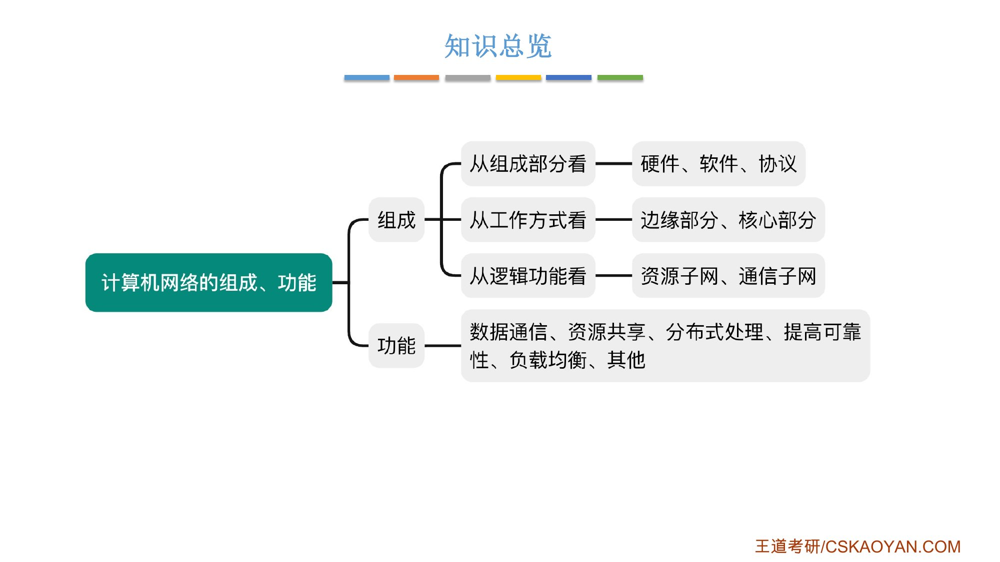
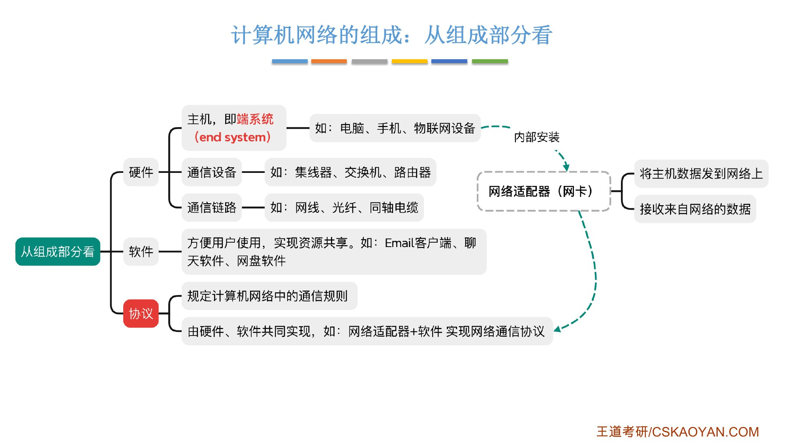
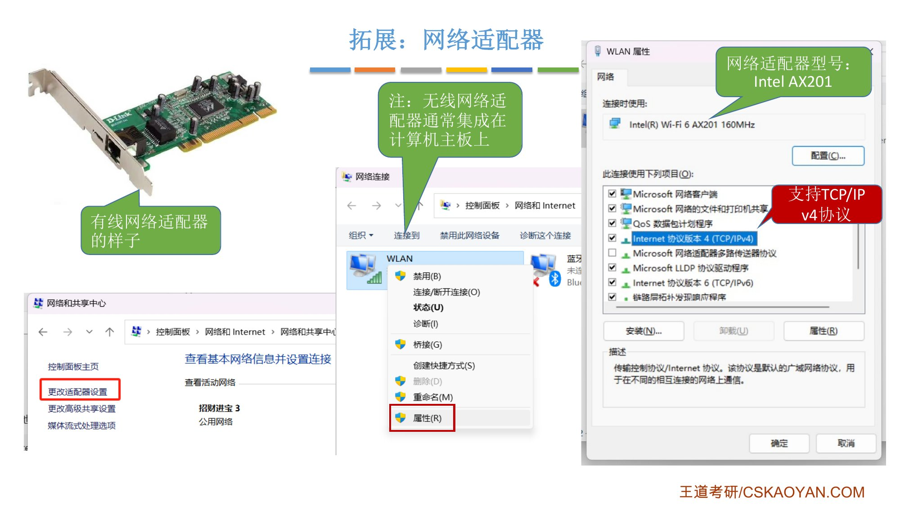
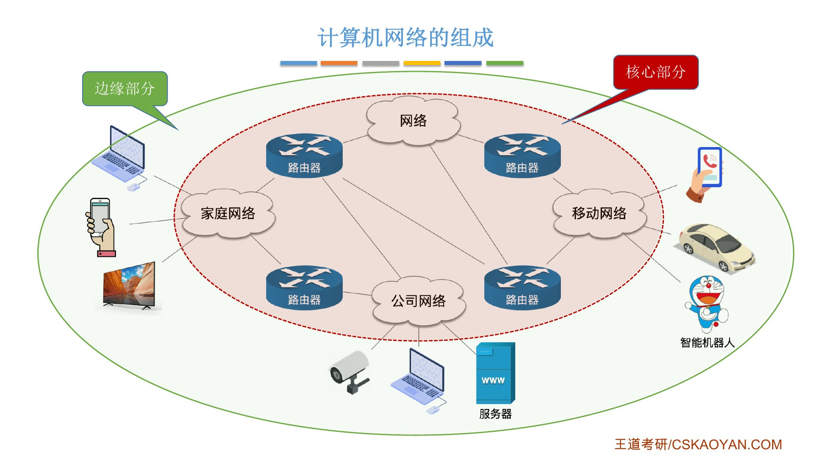
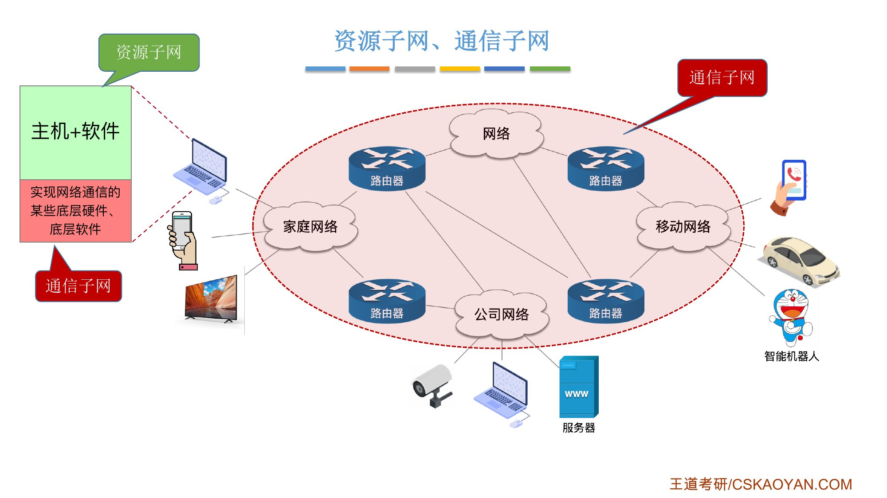
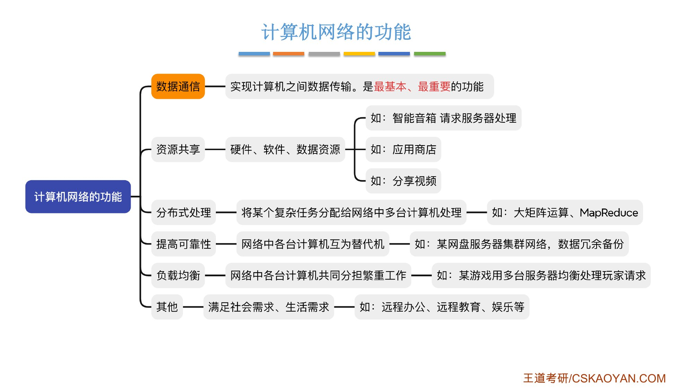
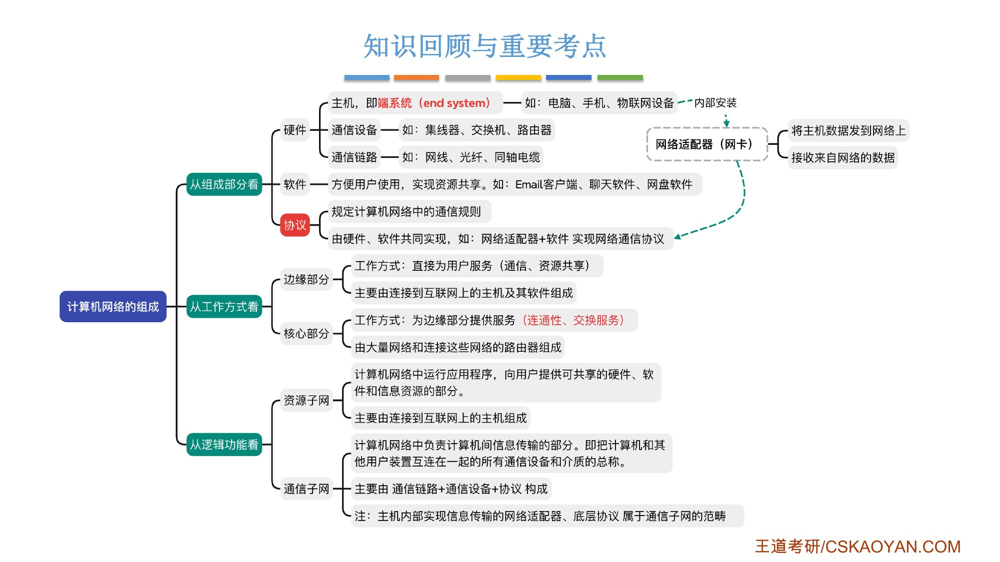

# 这一节在讲什么

::: cue
计算机网络的组成可以从哪三个角度看？
:::

先从三个角度看计算机网络[由哪些部分组成]{.u}，再了解计算机网络的[功能]{.u}。老师的定位：这两部分都[简单了解即可]{.red}，知道每个术语描述的是什么范畴就行。

{.slide width=0.55}

# 一、从组成部分看：硬件、软件、协议

::: cue
主机又叫什么？协议由谁来实现？网卡和"固件"是什么关系？
:::

计算机网络是由**硬件、软件和协议**共同组成的庞大复杂的系统。

- **硬件**：网络中看得见摸得着的东西。
    - **主机**，即[**端系统**（end system）]{.red}：电脑、手机、电视、监控摄像头、服务器、智能汽车、物联网设备等。end 是"末端"的意思，它们连接在网络的末端；
    - **通信设备**：集线器、交换机、路由器（还有调制解调器等）；
    - **通信链路**：网线、光纤、同轴电缆等。
- **软件**：方便用户使用，实现资源共享。如 Email 客户端、聊天软件、网盘软件。路由器也是一台微型计算机，也装软件，只不过装的软件通常是为了实现网络通信；
- **协议**：规定计算机网络中的通信规则；[由硬件、软件共同实现]{.red}。

{.slide width=0.6}

**例子：网络适配器（网卡）**。手机、电脑等联网设备内部都有一块叫**网络适配器**的小芯片，民间叫**网卡**，作用是[把主机数据发到网络上、接收来自网络的数据]{.u}。网卡出厂时，厂家把一种特殊软件——**固件**——装进网卡的 ROM 芯片里；固件结合网卡这块硬件，就能实现某一类网络协议（例如 TCP/IP）。这就是"协议由硬件和软件共同实现"的意思。老师的电脑网卡是 Intel AX201，属性里能看到它支持 TCP/IPv4 协议。

{.slide width=0.55}

::: book
王道书第 2 页：硬件包括主机（如台式机、笔记本电脑、平板电脑、智能手机等）、通信链路（如双绞线、光纤）以及交换设备（如路由器、交换机等）。软件主要包括实现资源共享的系统软件和便于用户使用的应用工具（如 E-mail 程序、FTP 程序、聊天程序等）。[协议是计算机网络的核心]{.red}，如同交通规则规范车辆行驶一样，它规定了数据在网络中传输时必须遵循的规则。
:::

# 二、从工作方式看：边缘部分、核心部分

::: cue
边缘部分和核心部分分别为谁服务？"交换服务"是什么意思？
:::

{.slide width=0.55}

::: {.tbl widths="1,2.6,2.4"}
| | 工作方式 | 组成 |
|---|---|---|
| **边缘部分** | 直接为**用户**（人）服务：通信、资源共享 | 连接到互联网上的主机及其软件 |
| **核心部分** | 为**边缘部分的主机**提供服务：[连通性、交换服务]{.red} | 大量网络和连接这些网络的路由器 |
:::

- **连通性**：边缘部分的主机之间相互连通，A 可以给 B 发数据；
- **交换服务**：一个数据包要从 A 点传到 B 点时，核心部分会[自动为它选择一条合适的路径]{.u}。比如 A 电脑给 B 手机发数据包，既可以走下面的路由器，也可以走上面的；如果下面的路由器负载很高，就走上面。所以交换服务本质上是对网络内部资源的[动态配置、动态调整]{.u}，保证各条线路都不会负载太重。实现交换服务的核心设备是**路由器**。交换的细节在 1.1_3 讲。

::: book
王道书第 2 页：从工作方式看，计算机网络（[此处主要指 Internet，即互联网]{.u}）可分为边缘部分和核心部分。边缘部分由所有连接到互联网、供用户直接使用的主机组成，用于通信（如数据传输）和资源共享；核心部分由大量网络及互连这些网络的路由器组成，为边缘部分提供连通性与交换服务。
:::

# 三、从逻辑功能看：资源子网、通信子网

::: cue
主机内部的网卡和底层协议属于资源子网还是通信子网？
:::

::: def
- **资源子网**：计算机网络中运行应用程序、向用户提供可共享的硬件、软件和信息资源的部分。主要由连接到互联网上的[主机]{.u}组成；
- **通信子网**：计算机网络中负责计算机间[信息传输]{.u}的部分，即把计算机和其他用户装置互连在一起的所有通信设备和介质的总称。主要由[通信链路 + 通信设备 + 协议]{.u}构成。
:::

这种分法和上一种很像：核心部分属于通信子网的范畴。区别在主机内部：

::: pitfall
[主机内部实现信息传输的网络适配器、底层协议，属于**通信子网**]{.red}。主机里和网络通信无关的其他硬件、软件，才属于资源子网。所以不能简单地说"主机 = 资源子网"。
:::

{.slide width=0.55}

::: book
王道书第 2 页：通信子网由传输介质、通信设备及相关网络协议组成，负责数据的[传输、交换、控制与存储]{.u}，实现联网计算机之间的通信。资源子网是实现资源共享功能的设备及其软件的集合，向用户提供共享其他计算机上的硬件资源、软件资源和数据资源的服务。
:::

# 四、计算机网络的功能

::: cue
最基本、最重要的功能是哪个？分布式处理和负载均衡怎么区分？
:::

{.slide width=0.6}

::: {.tbl widths="1,2.4,2.6"}
| 功能 | 含义 | 课件的例子 |
|---|---|---|
| **数据通信** | 实现计算机之间的数据传输。[最基本、最重要]{.red}：不支持数据通信，后面所有功能都无法实现 | — |
| **资源共享** | 共享**硬件、软件、数据**资源 | 硬件：智能音箱把语音指令发给云端算力很强的服务器处理；软件：应用商店；数据：分享视频 |
| **分布式处理** | 把某个复杂任务分配给网络中的多台计算机处理 | 大矩阵乘法；MapReduce |
| **提高可靠性** | 网络中各台计算机[互为替代机]{.u} | 网盘服务器 A 把文件备份到服务器 B，A 坏了还能从 B 下载 |
| **负载均衡** | 网络中多台计算机[共同分担繁重的工作]{.u} | 网络游戏：A 服务器只做玩家对战匹配，匹配好的玩家分到较空闲的服务器 |
| **其他** | 满足社会需求、生活需求 | 远程办公、远程教育、娱乐等 |
:::

**分布式处理的例子**（给跨考同学）：$A$、$B$ 都是 $n$ 行 $n$ 列矩阵，$C=AB$。$C$ 的第 $i$ 行第 $j$ 列元素 = $A$ 的第 $i$ 行与 $B$ 的第 $j$ 列对应元素相乘再相加。所以可以让计算机 A 用 $A$ 的第 1–5 行乘 $B$，算出 $C$ 的第 1–5 行；计算机 B 算第 6–10 行……把一个计算量很大的任务拆成多个子任务分派出去，减少处理时间。

::: book
王道书第 2–3 页列的是**五大功能**：数据通信、资源共享、分布式处理、提高可靠性、负载均衡，另外还支持电子化办公与服务、远程教育、娱乐等。书上的说法：

- 资源共享使网络中的资源能够互通有无、分工协作，从而显著提高硬件、软件和数据资源的利用率；
- 分布式处理：[当某个计算机系统负荷过重时]{.u}，可将其处理的某个复杂任务分配给网络中的其他计算机系统，利用空闲资源来提高整个系统的利用率；
- 提高可靠性：各台计算机可以通过网络[互为备份]{.u}；
- 负载均衡：将工作任务均衡地分配给网络中的各台计算机，避免某些计算机过载而其他计算机闲置。
:::

# 五、知识回顾

{.slide width=0.6}

::: summary
**组成**（三个角度）：

- 组成部分：**硬件**（主机 = 端系统、通信设备、通信链路）、**软件**、**协议**（由硬件和软件共同实现，如网卡 + 固件）；
- 工作方式：**边缘部分**（主机及其软件，直接为用户服务）、**核心部分**（网络和路由器，为边缘部分提供连通性和交换服务）；
- 逻辑功能：**资源子网**（主机）、**通信子网**（通信链路 + 通信设备 + 协议；[主机内部的网络适配器、底层协议也属于通信子网]{.red}）。

**功能**：[数据通信（最基本、最重要）]{.red}、资源共享（硬件、软件、数据）、分布式处理、提高可靠性、负载均衡、其他。

**自测**：① 主机为什么叫端系统？② 网卡里的固件说明了什么？③ 核心部分的"交换服务"在做什么？④ 网卡属于资源子网还是通信子网？
:::
