# 这一节在讲什么

::: cue
三种交换技术分别用于什么网络？计算机网络为什么不能直接"抄"电话网络？
:::

本节课件对应两个正课视频：P4 讲三种数据交换技术的原理和优缺点，P5 用时序图分析三者的传输性能。

::: {.tbl widths="1.2,2"}
| 交换技术 | 用于 |
|---|---|
| 电路交换 | 电话网络 |
| 报文交换 | 电报网络 |
| 分组交换 | 现代计算机网络 |
:::

**故事线**：现代计算机网络诞生于 20 世纪 60 年代，前身是阿帕网（ARPANET）。当时的科学家要解决"怎样让分散在各地的计算机互联互通"，自然想到：能不能"抄作业"？人类历史上已有的通信网络有邮政网络（公元前 5 世纪起）、电报网络（1830s–1960s）、电话网络（1870s–1960s）。邮政太原始，能抄的只剩电话网络和电报网络。下面依次看这两份作业能不能抄，再看最终的方案——分组交换。

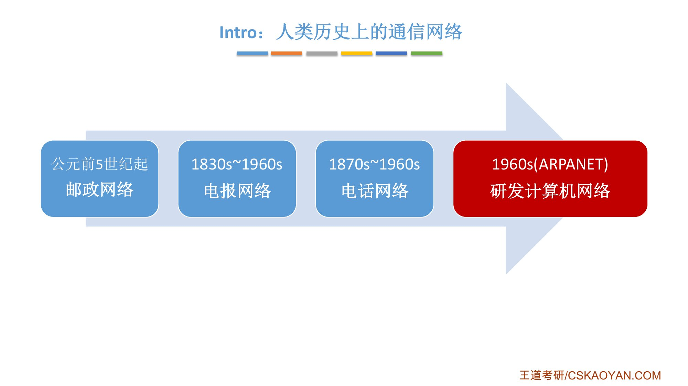{.slide width=0.55}

# 一、电路交换（电话网络）

::: cue
电路交换分哪三步？为什么打长途电话更贵？什么叫"占线"？
:::

::: def
**电路交换**（Circuit Switching）：通过物理线路的连接，[动态地分配传输线路资源]{.red}。
:::

早期的电话交换机是一块有很多插线孔的面板，每个孔背后连着一部电话或另一台电话交换机；要让两部电话通话，接线员用一根线把两个孔连起来。后来实现了电气化、自动化，不再需要人工接线。

**电路交换的过程**：

1. **建立连接**（尝试占用通信资源）：小帅用 H1 拨小丑的 H2，中间的交换机收到请求后接通一条物理线路，H2 响铃，小丑接起回应，连接建立；
2. **通信**（[一直占用通信资源]{.u}）：通话期间，两人一直占用中间这些线路资源；
3. **释放连接**（归还通信资源）：挂断电话。

- 小红打给小美要经过三台交换机，占用的线路资源比小帅打给小丑多。这就是早年长途电话比本地电话贵的原因；
- 小红和小美通话时，小扁也打给小美：第一台交换机能给小扁分配线路，但下一台交换机到 H5 的线路正被占用，资源不够，小扁听到"您呼叫的用户正在通话中"——俗称[**电话占线**]{.u}。

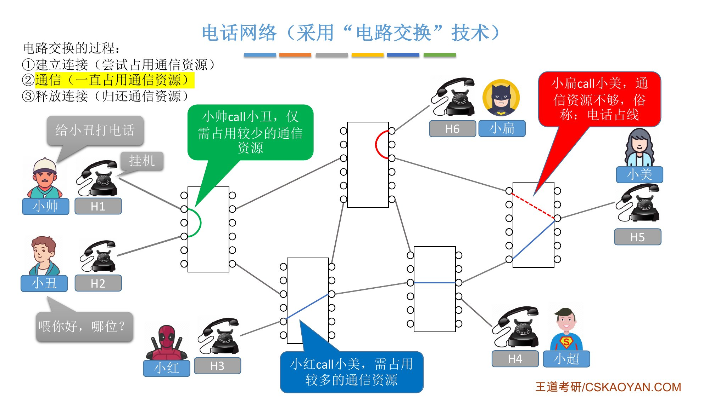{.slide width=0.6}

**如果计算机网络也用电路交换？** H1↔H2、H3↔H5 通信时，各自独占一条专用物理线路，直到通信结束。此时 H6 想给 H5 发数据，线路资源不够，无法建立通信。相当于小红和小美的微信聊天没结束，小扁发给小美的任何消息都传不过去。这显然不行。

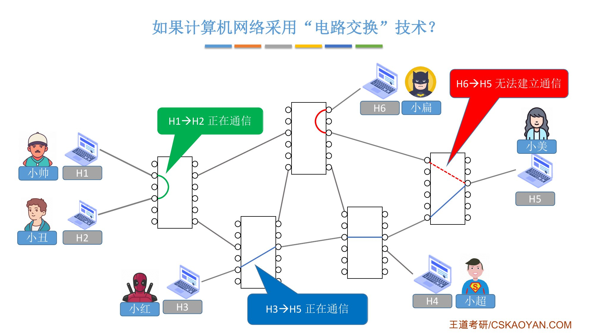{.slide width=0.55}

## 电路交换的优缺点

::: {.tbl widths="1,4"}
| | 内容 |
|---|---|
| **优点** | 通信前从主叫端到被叫端建立一条[专用的物理通路]{.u}，通信全部时间内两个用户[始终占用]{.u}端到端的线路资源。数据直送，[传输速率高]{.red} |
| **缺点** | ① 建立/释放连接需要[额外的时间开销]{.red}；② 线路被通信双方独占，[利用率低]{.red}；③ 线路分配的[灵活性差]{.red}；④ 交换节点[不支持差错控制]{.red}（无法发现传输过程中发生的数据错误） |
:::

逐条理解缺点：

- **建立/释放连接的开销**：等电话 2 分钟、只讲 5 秒，体验很差；等 2 分钟、讲 1 小时，就觉得值。所以电路交换[适用于低频次、大量地传输数据]{.u}。但计算机之间的数据往往是[**突发式**传输：高频次、少量]{.red}（微信聊天打字很久，发出去只要一瞬间），所以电路交换不适合计算机网络；
- **利用率低**：一条线路一段时间内只能被两个人用，不能共享，网络使用成本大幅提升；
- **灵活性差**：线路上某个节点或某段线路出故障，不能动态重新分配，只能重新建立连接、重新通信；
- **不支持差错控制**：数据 0100 在传输中受电磁干扰可能变成 0101，经过的线路越多越容易出错。"每经过一段链路就检查、有错就修正"叫**差错控制**；但电路交换的中间节点结构简单，数据只是从分配好的线路原模原样地通过，没有检查的过程，所以长距离传输容易出错。

::: book
王道书第 3 页补充：

- 从通信资源分配的角度看，[交换就是按照某种方式动态分配传输线路资源]{.u}；
- 电路交换的优点还包括：**有序传输**（数据按发送顺序传送，不存在失序问题）、**没有冲突**（不同通信对使用独立信道，不会争用物理信道）、**实时性强**（物理通路一旦建立，双方即可随时通信）；
- 由于计算机之间的通信通常是突发式（高频、少量）的，若采用电路交换，已被占用的通信线路在大部分时间内处于空闲状态，[利用率往往不足 10%，甚至低于 1%]{.u}。
:::

# 二、报文交换（电报网络）

::: cue
报文由哪两部分组成？什么是"存储转发"？报文交换的缺点几乎都来自哪一点？
:::

一封电报至少包含两部分：**控制信息**（从哪里发出、被谁接收）和**用户数据**（要说的话）。二者合起来是一个 message，计算机网络里翻译为[**报文**]{.red}。

::: def
**存储转发**：把传送的数据单元先**存储**进中间节点，再根据目的地址**转发**至下一节点。
:::

报文交换机收到报文后，先存进自己的内存；再检查报文的控制信息，查内存里的**存储转发表**，决定转发到哪个节点。可选的路径往往有多条，按当时的网络负载选比较空闲的一条，逐跳存储转发，直到目的地。

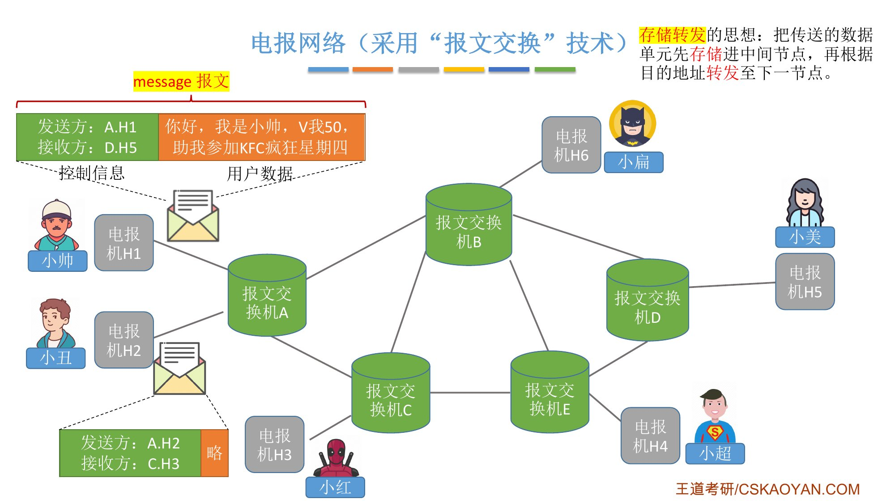{.slide width=0.55}

**如果计算机网络用报文交换？** 小帅给小美发一段文字（报文可能只有几个字节），小丑给小扁分享一部电影（报文可能有好几 GB）。两个报文都先到交换机 A 存储，分析后都转发给交换机 B。可以看到，中间这条线路[同时服务两对用户]{.u}，不被某一对独占，可以被整个网络的用户共享。

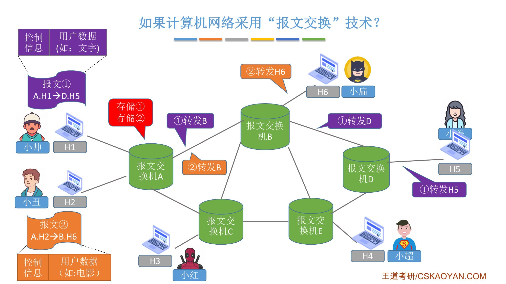{.slide width=0.55}

## 报文交换的优缺点

::: {.tbl widths="1,4"}
| | 内容 |
|---|---|
| **优点** | ① 通信前[无需建立连接]{.u}；② 数据以"报文"为单位在交换节点间"存储转发"，[线路可以灵活分配]{.u}（某条线路或节点坏了，可以另规划路径）；③ 通信期间两个用户无需独占一整条物理线路，[线路利用率高]{.u}；④ 交换节点[支持差错控制]{.u}（存下报文后可用奇偶校验等校验技术检查并尽可能修正错误） |
| **缺点** | ① [报文不定长]{.red}，不方便存储转发管理；② 长报文的存储转发[时间开销大、缓存开销大]{.red}；③ 长报文[容易出错，重传代价高]{.red} |
:::

缺点都源于"报文不定长、可能很长"：

- **缓存开销**：一部 8 GB 的电影，交换机至少要有 8 GB 内存；报文越大内存越要跟着扩，没完没了。大小不一的报文也让内存管理变复杂（学过操作系统就知道：分区大小固定，管理简单得多）；
- **时间开销**：每个报文都要做差错检验，报文越长检验越耗时；
- **出错与重传**：数据越多，某个比特出错的概率越大，只要有一个比特错，整个报文就错了。校验技术能修正少数几个比特的错误；修不了就只能让发送方[重传整个报文]{.u}，长报文的代价很高。

::: book
王道书第 3–4 页的说法：报文交换"整个报文先传送到相邻节点，被完整接收并存储后，节点根据转发表将其转发至下一跳，如此**逐跳转发**，直至到达目的端。每个报文可**独立选择**通往目的端的路径"。书上的优点第 1 条写作"[无建立和释放连接的时延]{.u}"；缺点第 1 条写作"**存储转发时延高**：节点必须完整接收整个报文后，才能开始转发"（课件的这一条写在"长报文存储转发时间开销大"里）。
:::

# 三、分组交换（现代计算机网络）

::: cue
分组的首部包含哪些信息？为什么需要分组号？分组交换相比报文交换改进了什么、又付出了什么代价？
:::

电话网络不适合抄；电报网络有很好的参考价值，只要解决[报文不定长]{.u}的问题。于是在报文交换的基础上提出了**分组交换**：把一个长报文切分成[定长]{.red}的若干部分，每部分前面加上控制信息。

::: def
- **分组**（Packet）：一块定长数据 + 它的控制信息；
- **首部**（Header，也译作"头信息"）：分组中的控制信息，用于控制这个分组在网络中如何传播。包含[源地址、目的地址、**分组号**]{.red}等；
- 报文——Message，分组——Packet，首部——Header。
:::

为什么需要**分组号**：把一张图片拆成多个分组发给你，你收到后要知道按什么顺序拼回原样。

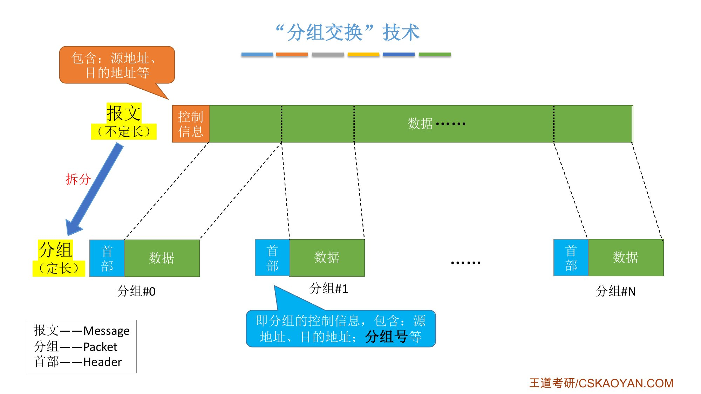{.slide width=0.6}

**例子**：小帅的数据拆成分组 0、1、2 发往 H5。分组 0、1 走上面的路线；转发分组 2 时，中间节点发现上面已经很拥堵，就把它规划到下面更空闲的路线上。分组 2 "遥遥领先"，H5 收到的顺序是 2、0、1。H5 按首部中的分组号重新排成 0、1、2，拆掉首部，合并成用户数据。

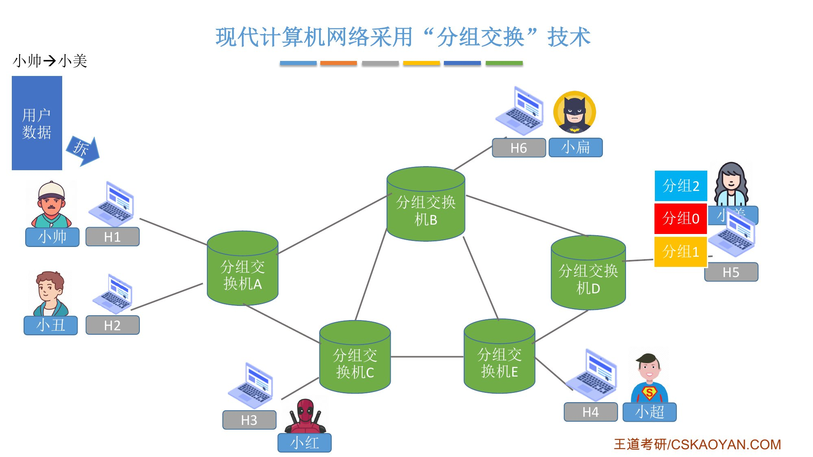{.slide width=0.55}

现代计算机网络中，[路由器就是一种典型的分组交换机]{.u}：数据以固定长度的分组为单位在路由器之间交换，路由器通过 **IP 地址**判断分组从哪里来、该发到哪里（第 4 章学）。

## 分组交换的优缺点

::: {.tbl widths="1.3,4"}
| | 内容 |
|---|---|
| **优点** | 几乎继承了报文交换的所有优点（只把存储转发单位从"报文"换成"分组"）：通信前无需建立连接；以"分组"为单位存储转发，线路可灵活分配；无需独占线路，利用率高；支持差错控制 |
| **相比报文交换的改进** | ① [分组定长]{.red}，方便存储转发管理；② 分组的存储转发[时间开销小、缓存开销小]{.red}；③ 分组[不易出错，重传代价低]{.red} |
| **缺点** | ① 相比报文交换，[控制信息占比增加]{.red}（每个分组都有首部，要消耗更多网络资源传送用户不关心的控制信息；不过增加得不多，换来的好处更多）；② 相比电路交换，[依然存在存储转发时延]{.red}（每个中间节点都要存储、分析再转发，所以比电路交换慢）；③ 报文被拆成多个分组，传输中可能出现[失序、丢失]{.red}等问题，增加处理的复杂度 |
:::

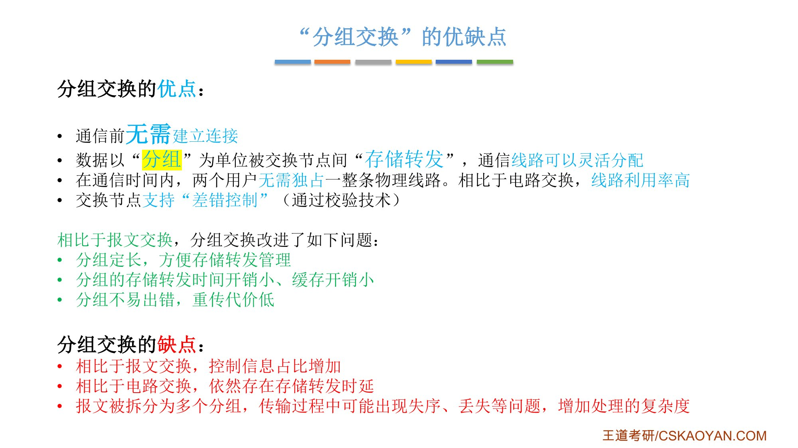{.slide width=0.6}

::: book
王道书第 4–5 页补充：

- 分组交换的优势还有"**传输效率高**：分组可逐个发送，实现[流水线]{.u}操作，即后一个分组的接收可与前一个分组的转发并行，从而减少整体传输时间"——这正是第五节性能分析里分组交换比报文交换快的原因；
- 需要传输额外的信息量：每个数据段都需附加控制信息以构成分组，[使传送的信息量增大约 5%～10%]{.u}，增加了控制复杂度，降低了通信效率；
- 分组可能**失序、丢失或重复**。采用**数据报**服务时，分组可能经不同路径到达，需在目的主机按编号重排，处理较为复杂；若采用**虚电路**服务，虽可避免失序，但需经历建立连接、数据传输和释放连接三个阶段（数据报与虚电路的完整讨论见第 4 章）。
:::

# 四、虚电路交换（了解）

::: cue
虚电路交换和电路交换有什么相同、有什么不同？现代计算机网络为什么没有采用它？
:::

分组交换有失序、丢失的问题，于是有人提出**虚电路交换**。它[本质上也是分组交换]{.u}，只是借鉴了电路交换的思想：

1. **建立连接**（虚拟电路）：小帅的 H1 先给小美的 H5 发建立连接的请求，建立一条**虚拟**的电路，例如上面那条路径；
2. **通信**：分组[按序、按已建立好的既定线路发送]{.u}，H5 按序收到再合并；但[通信双方不独占线路]{.red}，其他用户也可以共享这些链路；
3. **释放连接**。

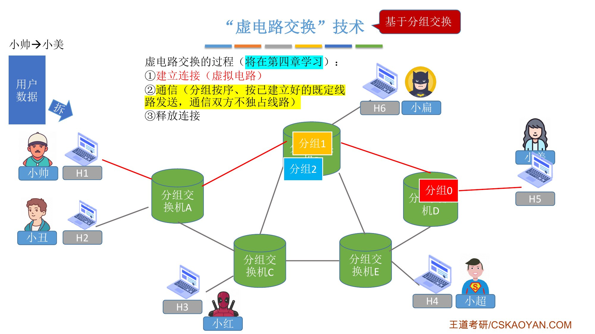{.slide width=0.55}

**现代计算机网络最终采用分组交换，而没有采用虚电路交换**。原因：连在网络上的计算机处理能力都很强。用分组交换，相当于把分组失序、丢失这些问题交给**网络边缘的终端**处理；用虚电路交换，就要把"保证不乱序、不丢失"交给**网络核心部分**处理，反而降低核心部分的数据传输能力。发挥边缘终端的算力就能解决这些问题。

::: teacher
虚电路交换在第 4 章学习，[不是本章重点]{.u}。本章重点是电路交换、报文交换、分组交换。
:::

# 五、三种交换方式的性能分析

::: cue
时序图的纵轴、横轴、斜线各表示什么？三种方式各用了多少时间？
:::

这种时序图在计算机网络课里很常见，[必须能看懂]{.red}，也能帮助解决真题。王道书上也有这三个图（图 1.4），课件给它加了背景小格子：

- **纵轴**：时间 $t$ 增加的方向，[每个小格子 = 1 ms]{.u}；
- **横轴**：A、B、C、D 四根竖线，对应四个节点（A、D 是主机，B、C 是中间交换节点）；
- **斜线 / 斜边**：信号或数据从一个节点传到下一个节点需要时间，所以是斜着往下走的。斜的高度差就是传播一跳的时间。

三种方式共同的假设：每一跳传播时延 = 1 ms，数据传输速率 = 0.5 kb/ms，报文大小 = 4 kb。所以[把 4 kb 的报文全部发到线路上需要 $4 \div 0.5 = 8$ ms]{.u}。

::: add
**单位**：课件的假设写的是 kb 和 kb/ms（小写 b），字幕里老师说的是 KB 和"每毫秒 0.5 KB"。两者只差一个 8 倍，**只要两处单位一致，算出的时间都一样**，不影响结论。大 B 和小 b 的区别在 1.1_5 速率里专门讲。
:::

## 1. 电路交换

额外假设：电路交换机建立、释放下一跳连接耗时 1 ms；接收方处理连接请求需要 2 ms。

1. **连接建立**：A 向 B 发请求（传播 1 ms）→ B 在内部建立连接（1 ms）→ 向 C 发请求（1 ms）→ C 建立连接（1 ms）→ 向 D 发请求（1 ms）→ D 处理请求（2 ms）→ D 发应答。此时物理线路已连好，应答顺着电路经 C、B 回到 A（每跳 1 ms）；
2. **数据传送**：A 收到应答后开始发报文，用 8 ms 发完；第一个比特经三跳 3 ms 到达 D，最后一个比特在第 8 ms 发出，再经 3 ms 到达 D；
3. **连接释放**：A 发完最后一个比特后就可以通知 B、C、D 释放连接（图里为了不和报文重合，箭头画得离报文底部远了一点，其实可以无限靠近）。

[从报文开始传输到被 D 全部接收：$8 + 3 = 11$ ms]{.red}（不含建立、释放连接的时间）。数据从 A 直送 D，中间不存储。

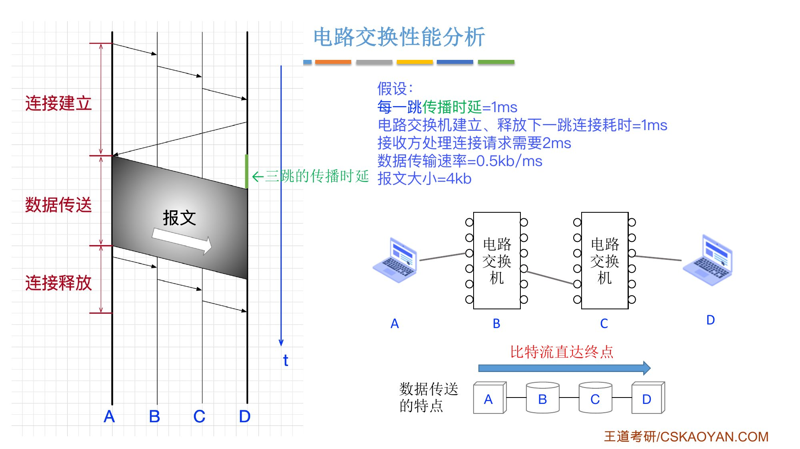{.slide width=0.6}

## 2. 报文交换

额外假设：报文存储转发时延 = 2 ms。[中间节点一定要接收完整个报文后，才能解析并转发]{.red}。

逐步推进（时刻从 A 开始发送算起）：

::: {.tbl widths="1.6,3.2"}
| 时刻（ms） | 发生了什么 |
|---|---|
| 0 → 8 | A 把报文发到线路 A–B 上（发送 8 ms） |
| 9 | B 收完整个报文（最后一个比特在第 8 ms 发出，再传播 1 ms） |
| 9 → 11 | B 存储转发处理 2 ms |
| 11 → 19 | B 把报文发到线路 B–C 上 |
| 20 | C 收完整个报文 |
| 20 → 22 | C 存储转发处理 2 ms |
| 22 → 30 | C 把报文发到线路 C–D 上 |
| **31** | D 收完整个报文 |
:::

即 $3\times(8+1) + 2\times 2 = 31$ ms。

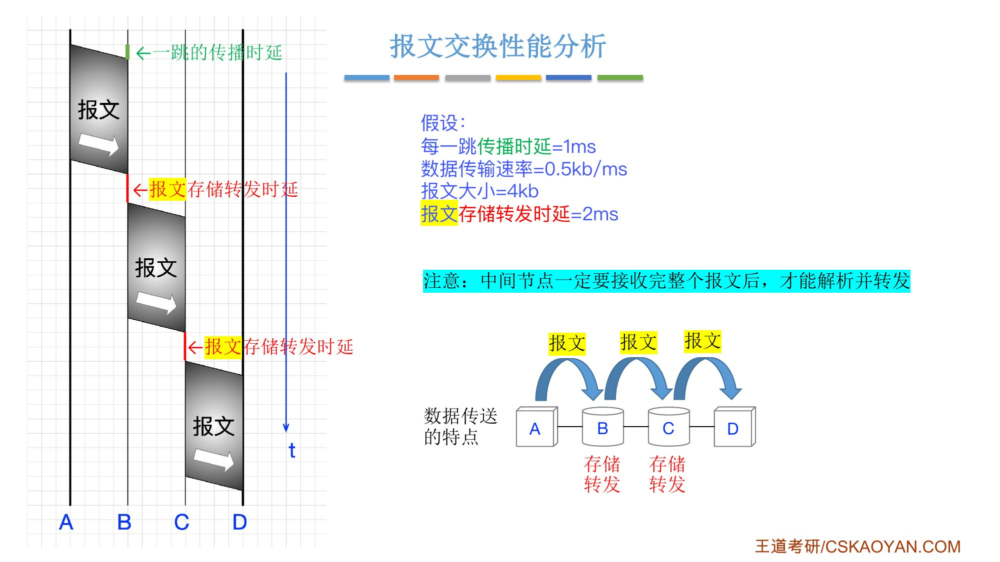{.slide width=0.6}

::: fix
**更正**：正课视频 P5 里老师说报文交换"总共经过了 29 个小格子，也就是 29 ms"。按课件给的假设（发送 8 ms × 3 段、传播 1 ms × 3 段、存储转发 2 ms × 2 个节点）算是 **31 ms**；按课件图的格子量，报文从 A 开始发送到 D 收完也是 31 格。29 应是口误。结论不变：报文交换耗时最多。
:::

## 3. 分组交换

把 4 kb 的报文拆成 4 个 1 kb 的分组：每个分组发送只需 $1 \div 0.5 = 2$ ms。分组小，存储转发处理也更快，假设**分组存储转发时延 = 0.5 ms**。同样，[中间节点一定要接收完整个分组后，才能解析并转发]{.red}。

老师图里的画法：A 发完一个分组后，[间隔 0.5 ms]{.u}（保证 B 已处理完上一个分组）再发下一个；B、C 转发时也遵循同样的规则。于是每个节点每 2.5 ms 送出一个分组。逐个分组推进：

::: {.tbl widths="0.7,1.2,1.6,1.6,0.9"}
| 分组 | A 发送 | B 收完 → 转发 | C 收完 → 转发 | D 收完 |
|---|---|---|---|---|
| 1 | 0 → 2 | 3 → 3.5～5.5 | 6.5 → 7～9 | 10 |
| 2 | 2.5 → 4.5 | 5.5 → 6～8 | 9 → 9.5～11.5 | 12.5 |
| 3 | 5 → 7 | 8 → 8.5～10.5 | 11.5 → 12～14 | 15 |
| 4 | 7.5 → 9.5 | 10.5 → 11～13 | 14 → 14.5～16.5 | **17.5** |
:::

（"3 → 3.5～5.5"读作：第 3 ms 收完，处理 0.5 ms，第 3.5～5.5 ms 发到下一段线路上。）

第一个分组 10 ms 到达 D，之后每 2.5 ms 到一个，[$10 + 3\times 2.5 = 17.5$ ms]{.red}。

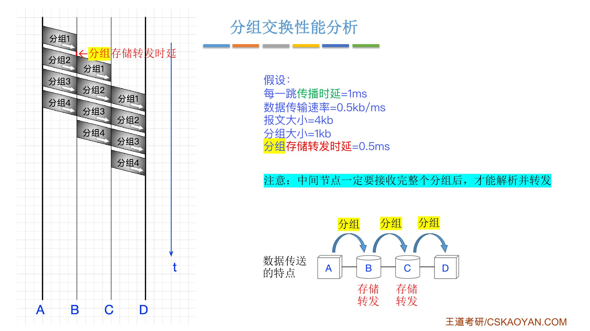{.slide width=0.6}

为什么比报文交换快：B 在转发分组 1 的同时，A 已经在发分组 2，几条线路同时在工作（王道书说的"流水线"）；而报文交换中，B 必须等 8 ms 收完整个报文才能开始转发，同一时刻只有一条线路在用。

## 4. 对比

[电路交换 11 ms（不含建立、释放连接）< 分组交换 17.5 ms < 报文交换 31 ms]{.red}。电路交换没有存储转发时延；报文信息量大，存储转发一个报文耗时高；分组的存储转发时延更低。

课件最后一页把三种方式按各个维度做了对比（王道书表 1.1 内容相同）：

::: {.tbl widths="2,1.6,1,1.4"}
| 特性 | 电路交换 | 报文交换 | 分组交换 |
|---|---|---|---|
| 完成传输所需时间 | [最少]{.red}（排除建立、释放连接耗时） | 最多 | 较少 |
| 存储转发时延 | 无 | 较高 | 较低 |
| 通信前是否需要建立连接？ | 是 | 否 | 否 |
| 缓存开销 | 无 | 高 | 低 |
| 是否支持差错控制？ | 不支持 | 支持 | 支持 |
| 报文数据是否有序到达？ | 是 | 是 | [否]{.red} |
| 是否需要额外的控制信息？ | 否 | 是 | 是（控制信息占比最大） |
| 线路分配的灵活性 | 不灵活 | 灵活 | 非常灵活 |
| 线路利用率 | 低 | 高 | 非常高 |
:::

::: book
王道书第 5 页（表 1.1 与课件这张表一致）：当需连续传输大量数据，并且[传输时间远大于连接建立时间]{.u}时，采用电路交换更为合适。但从提升网络整体信道利用率角度看，报文交换和分组交换优于电路交换。其中，[分组交换时延更小、更灵活，尤其适合突发式数据通信]{.red}。

书上标注了考点追踪：电路交换的时延分析（2025）、报文交换的时延分析（2013、2025）、分组交换的时延分析（2010、2013、2023、2025），并说明"分组交换网的性能分析是统考高频考点，强烈建议结合视频学习"。
:::

# 六、知识回顾

::: summary
**电路交换**（电话网络）：建立连接 → 通信（一直占用） → 释放连接；专用物理通路，数据直送，速率高。缺点：建立/释放连接有额外开销、独占利用率低、灵活性差、不支持差错控制。适用于[低频次、大量]{.red}的数据传输；计算机通信是[突发式（高频次、少量）]{.red}，不适合。

**报文交换**（电报网络）：报文 = 控制信息 + 用户数据；以报文为单位**存储转发**。无需建立连接、灵活、利用率高、支持差错控制。缺点都来自[报文不定长]{.red}：不便管理、时间和缓存开销大、长报文易出错且重传代价高。

**分组交换**（现代计算机网络）：报文切成[定长]{.red}分组，首部含源地址、目的地址、分组号。继承报文交换的优点，并解决不定长的问题。代价：控制信息占比增加、仍有存储转发时延、可能失序和丢失。路由器是典型的分组交换机。

**虚电路交换**：基于分组交换，先建立虚拟电路，按序沿既定线路发送，但不独占线路（第 4 章）。

**性能**：中间节点必须收完整个报文 / 分组才能转发。课件例子：电路 11 ms < 分组 17.5 ms < 报文 31 ms。

**自测**：① 为什么电路交换不支持差错控制？② 报文交换的三个缺点分别是什么，根源是什么？③ 分组交换比报文交换快在哪里？④ 三种方式中哪种"数据可能无序到达"？
:::
