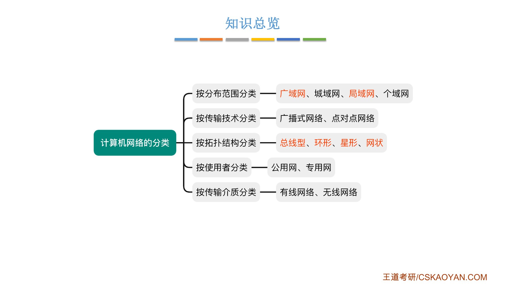
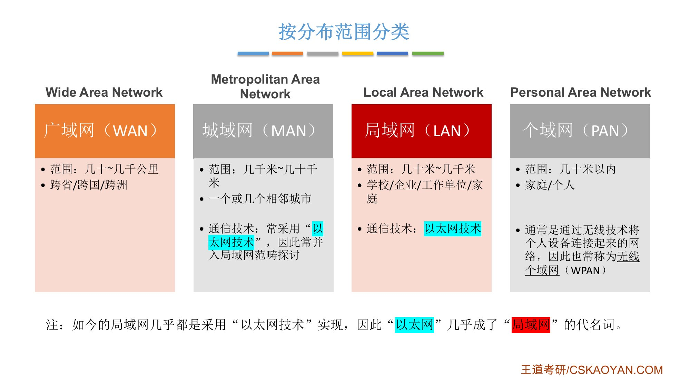
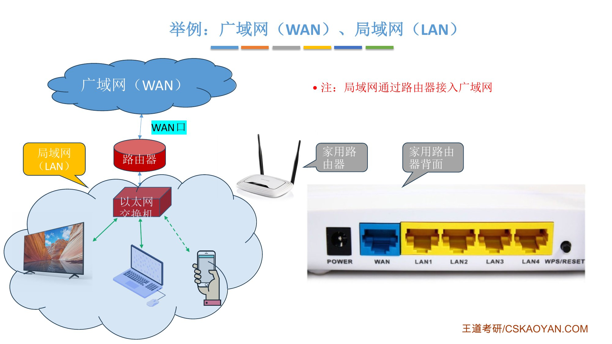
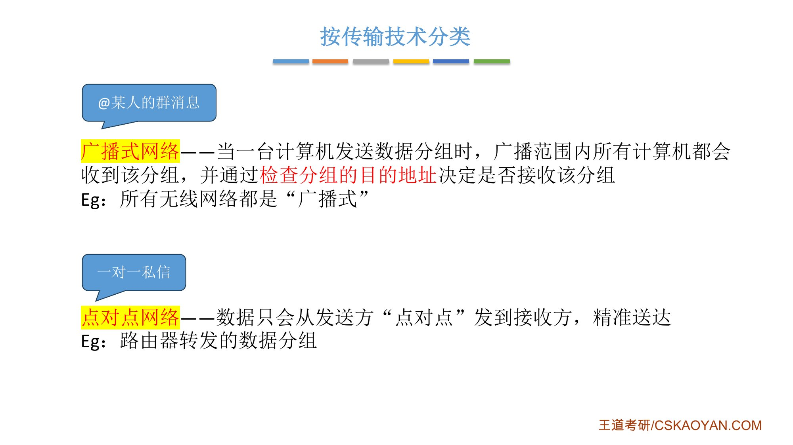
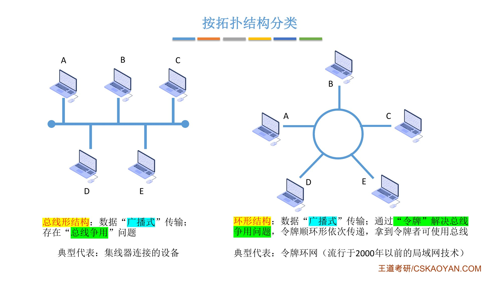
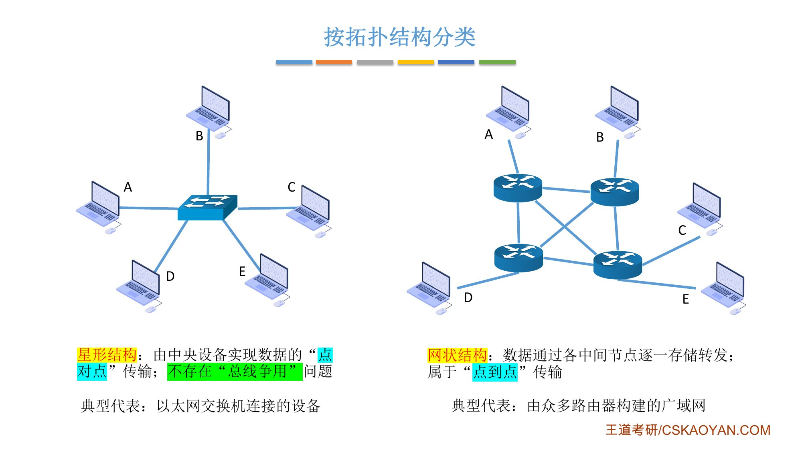
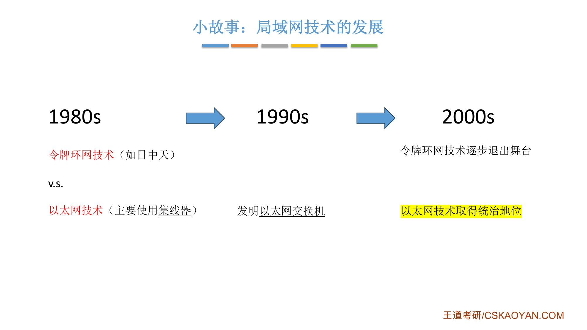
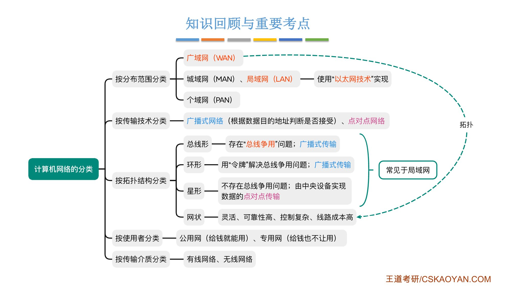

# 这一节在讲什么

::: cue
计算机网络可以按哪五个维度分类？哪些是重点？
:::

按**分布范围、传输技术、拓扑结构、使用者、传输介质**五个维度分类。[课件里标红的是重点]{.red}：广域网、局域网；广播式网络、点对点网络；总线形、环形、星形、网状。这些概念后续章节还会深入；其他类别简单了解即可。

{.slide width=0.55}

# 一、按分布范围分类

::: cue
WAN、MAN、LAN、PAN 各是什么？覆盖范围多大？为什么"以太网"几乎成了"局域网"的代名词？
:::

::: {.tbl widths="1.6,1.7,2.6"}
| 类别 | 范围 | 说明 |
|---|---|---|
| [**广域网 WAN**]{.red}（Wide Area Network） | 几十～几千公里；跨省、跨国、跨洲 | 节点距离远，通信技术和局域网有区别（后续章节讨论） |
| **城域网 MAN**（Metropolitan Area Network） | 几千米～几十千米；一个或几个相邻城市 | 常采用"以太网技术"，因此常并入局域网范畴探讨 |
| [**局域网 LAN**]{.red}（Local Area Network） | 几十米～几千米；学校、企业、工作单位、家庭 | 通信技术：以太网技术 |
| **个域网 PAN**（Personal Area Network） | 几十米以内；家庭、个人 | 通常用无线技术把个人设备连起来，也称**无线个域网 WPAN** |
:::

老师记四个缩写的口诀：用泰国口音念 WAN、MAN、LAN、PAN——"完、美、pain"。

{.slide width=0.6}

- [如今的局域网几乎都采用"以太网技术"实现]{.u}，所以"以太网"几乎成了"局域网"的代名词。局域网内连接各节点的交换机，全称是**以太网交换机**；
- 城域网现在通常也用以太网技术，原理和局域网类似，所以这门课不单独讨论城域网，[重点讨论局域网和广域网]{.u}的通信技术和协议。

**例子：家用路由器背面的接口**。家用路由器 = 路由器 + 交换机。家里的设备逻辑上连在这台（以太网）交换机上，组成家庭内部的局域网。路由器背面：蓝色的 **WAN 口**接网络运营商拉到你家的那条网线，也就是连接广域网；黄色的 **LAN1～LAN4** 口接电视、电脑等局域网设备。[局域网通过路由器接入广域网]{.red}。

{.slide width=0.6}

**例子：个域网**。小米、华为的智能家居要装一个**智能网关**（个域网的主设备），智能门锁、开关、温度计、烟雾探测器是从设备，它们用**蓝牙、ZigBee** 和网关直接通信。这类无线技术比 WiFi 更省电，设备可以长时间不换电池。网关再用网线连家用路由器，个域网就接入了互联网，可以用手机远程控制。个域网的通信技术考研不深入探讨，有印象即可。

::: book
王道书第 5–6 页：

- 广域网用于长距离通信，覆盖范围通常为几十至数千千米，常用于构建互联网的骨干部分，其节点交换机间通过高速链路互联，通信容量大；
- 城域网的覆盖范围可跨越几个街区乃至整个城市，[直径约为 5～50 km]{.u}；
- 局域网用户个人计算机或工作站通过高速线路互连，覆盖范围较小，一般为几十米到几千米。[传统上，局域网采用**广播技术**，而广域网则采用**交换技术**]{.red}；
- 个人区域网指在个人工作或活动区域内，利用无线技术将消费电子设备（如平板电脑、智能手机等）互联而成的网络。
:::

# 二、按传输技术分类

::: cue
广播式网络里，节点怎么判断一个分组是不是发给自己的？WiFi 属于哪一类？
:::

::: def
- [**广播式网络**]{.red}：当一台计算机发送数据分组时，广播范围内所有计算机都会收到该分组，并通过[检查分组的目的地址]{.u}决定是否接收该分组（是发给自己的就接收，不是就丢弃）；
- [**点对点网络**]{.red}：数据只会从发送方"点对点"发到接收方，[精准送达]{.u}。
:::

- 广播式像在群里 @某人：群里所有人都能看到消息，但只有被 @ 的人处理；点对点像一对一私信；
- [所有无线网络都是"广播式"]{.u}：你家 WiFi 发给你手机的信号，家人的手机也能收到，只有你的手机检查后发现是发给自己的才接收；
- 路由器转发数据分组是点对点：A 路由器和 B、C、D 都相连，发给 D 的分组只发给 D。

{.slide width=0.55}

::: book
王道书第 6 页：广播式网络中所有联网计算机[共享一个公共通信信道]{.u}，局域网普遍采用广播式通信；此外，广域网中的无线和卫星通信网络也属于广播式网络。点对点网络中每条物理线路连接一对计算机；若两台主机之间无直接连接，则分组需通过中间节点进行存储转发，直至到达目的主机。
:::

# 三、按拓扑结构分类

::: cue
四种拓扑各是广播还是点对点？哪种有"总线争用"？集线器连成的网络物理上和逻辑上各是什么形状？
:::

::: {.tbl widths="0.9,1,2.6,1.9"}
| 拓扑 | 传输方式 | 特点 | 典型代表 |
|---|---|---|---|
| **总线形** | 广播 | [存在"总线争用"问题]{.red} | 集线器连接的设备 |
| **环形** | 广播 | 用"令牌"解决总线争用问题，令牌顺环依次传递，拿到令牌者可使用总线 | 令牌环网（流行于 2000 年以前的局域网技术） |
| **星形** | 点对点 | 由中央设备实现数据的点对点传输；[不存在总线争用]{.u} | 以太网交换机连接的设备 |
| **网状** | 点对点 | 数据通过各中间节点逐一存储转发；灵活、可靠性高，但控制复杂、线路成本高 | 由众多路由器构建的广域网 |
:::

[前三种常见于局域网，网状结构常见于广域网]{.red}。

{.slide width=0.55}

- **总线形**：A 给 C 发的分组打到总线上后，B、D 也会收到（广播）。A 正在发时，总线上充满 A 的数据，B 此时发数据就会和 A 的冲突、导致错误，这就是**总线争用**；
- **环形**：数据同样会被所有设备收到。整个环只有一个**数字令牌**（token），只有持有令牌的设备能发数据，用完传给下一个，像击鼓传花。同一时间只有一台设备持有令牌，于是解决了总线争用。令牌环网后续章节还会讨论；
- **星形**：中央设备检查数据的目的地址，只转发给对应的设备；每台计算机和中央设备之间都有一条独占的链路，所以不存在总线争用；
- **网状**：数据通信采用分组交换技术。线路灵活，某些中间节点坏了其他节点也能完成传输，可靠性高；代价是控制复杂、线路成本高。

{.slide width=0.55}

::: pitfall
[讨论拓扑结构时要区分**物理拓扑**和**逻辑拓扑**]{.red}，本节讲的主要是逻辑上的拓扑结构。

- **集线器**连接多台设备：物理上看是星形；但 A 发给 C 的数据会被广播给所有节点，所以[逻辑上是总线形]{.u}，有总线争用问题；
- **以太网交换机**连接的设备：物理上、逻辑上都是星形。
:::

::: book
王道书第 6 页：

- 网络拓扑结构是指网络中节点（如路由器、主机等）与通信线路之间的几何排列关系，[主要描述**通信子网**的结构]{.u}；
- 总线形：使用单根传输线连接所有计算机。优点是建网容易、增减节点方便、节省线路；缺点是重负载下通信效率低，并且总线任意一处故障都会影响全网；
- 星形：各终端或计算机通过独立线路连接到中央设备（通常为交换机或路由器）。优点是便于集中控制与管理；缺点是成本较高，且中央设备对故障敏感；
- 环形：所有计算机接口设备连接成一个闭合环路，信号沿环单向传输，典型的例子是令牌环局域网。环可以是单环或双环，以提高可靠性；
- 网状：一般情况下每个节点至少有两条路径与其他节点相连，广泛应用于广域网。优点是可靠性高、容错能力强；缺点是控制复杂、线路成本高；
- 上述四种基本拓扑结构可相互组合，构成更复杂的混合网络。
:::

# 四、按使用者、按传输介质分类

::: cue
公用网和专用网怎么区分？
:::

- **公用网**：向公众开放的网络，如办宽带、交手机话费即可使用的互联网。[给钱就能用]{.u}；
- **专用网**：仅供某个组织内部使用的网络，如政府、军队、电力、银行的内部网络。[给钱也不让用]{.u}；
- **有线网络**（网线、光纤）、**无线网络**（5G、WiFi、卫星）。

::: book
王道书第 6 页：公用网由电信运营商出资建设，面向公众开放，任何愿意遵守规定并缴纳费用的用户均可接入使用；专用网由特定单位为满足自身业务需求而建设，仅限内部使用，不对外提供服务，例如铁路、电力、军队等部门的专用网络。有线网络包括双绞线网络、同轴电缆网络、光纤网络等；无线网络包括蓝牙、Wi-Fi、微波、无线电等类型。
:::

# 五、小故事：局域网技术的发展（与考试无关）

20 世纪 80 年代，局域网有两种技术：IBM 研发的**令牌环网**（如日中天）和**以太网**（主要使用集线器）。集线器逻辑上是总线形，所有设备争抢总线；令牌环网用令牌解决了争用，设备多时效率更高。90 年代有人发明了**以太网交换机**，彻底解决了总线争用，而且各设备可以同时发送，由交换机决定每个数据转发到哪里，以太网开始比令牌环网更优秀。2000 年以后令牌环网逐步退出舞台，现在的局域网几乎都用以太网技术。

{.slide width=0.5}

# 六、知识回顾

{.slide width=0.6}

::: summary
**按分布范围**：[广域网 WAN]{.red}、城域网 MAN、[局域网 LAN]{.red}、个域网 PAN，覆盖范围从大到小；MAN、LAN 使用"以太网技术"实现；局域网通过路由器接入广域网。

**按传输技术**：[广播式网络]{.red}（根据数据的目的地址判断是否接收）、[点对点网络]{.red}（精准送达）。所有无线网络都是广播式。

**按拓扑结构**（逻辑上）：总线形（广播，有总线争用）、环形（广播，用令牌解决争用）、星形（点对点，无争用）——常见于局域网；网状（点对点，灵活、可靠性高、控制复杂、成本高）——常见于广域网。集线器：物理星形、逻辑总线形。

**按使用者**：公用网（给钱就能用）、专用网（给钱也不让用）。**按传输介质**：有线网络、无线网络。

**自测**：① 为什么以太网几乎成了局域网的代名词？② 家用路由器的 WAN 口接什么？③ 哪两种拓扑是广播式的，各自怎么处理争用？④ 集线器组成的网络，逻辑拓扑是什么？
:::
