# 这一节在讲什么

::: cue
考研要掌握哪七个性能指标？哪些最常考？
:::

考研主要掌握七个性能指标，老师把相关的放在一起讲：正课视频 P7 讲**速率、带宽、吞吐量**；P8 讲**时延、时延带宽积、往返时延、信道利用率**。这部分是[考研重点]{.red}，老师对书上的内容做了拓展。最常考的是[速率、带宽、时延]{.red}的计算。

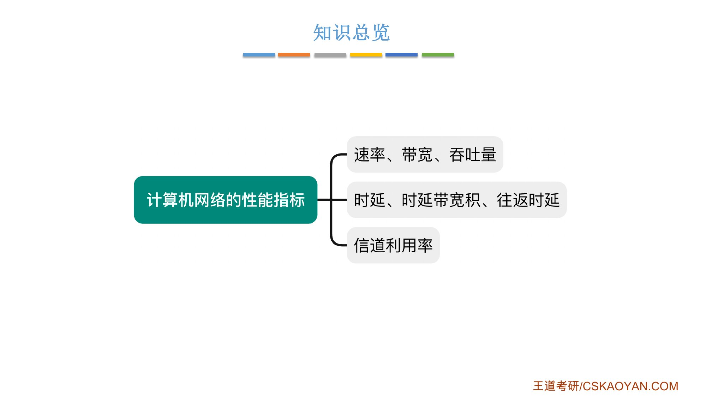{.slide width=0.5}

# 一、速率

::: cue
信道和通信线路是一回事吗？bps 里的 b 是什么？计网里的 M 和计组里的 M 一样大吗？
:::

**先引入"信道"**：在 Mac 的"活动监视器 → 网络"或 Windows 的"任务管理器 → 性能"里能看到实时网速。老师的台式机用网线连路由器，此刻发送 1.8 MB/s、接收 93.3 MB/s，两个方向的速率不一样。

::: def
**信道**（Channel）：表示向某一方向传送信息的通道。[信道 ≠ 通信线路]{.red}：一条通信线路在逻辑上往往对应[一条发送信道和一条接收信道]{.u}。
:::

一根网线、一条 WiFi 无线链路，都对应两条信道。

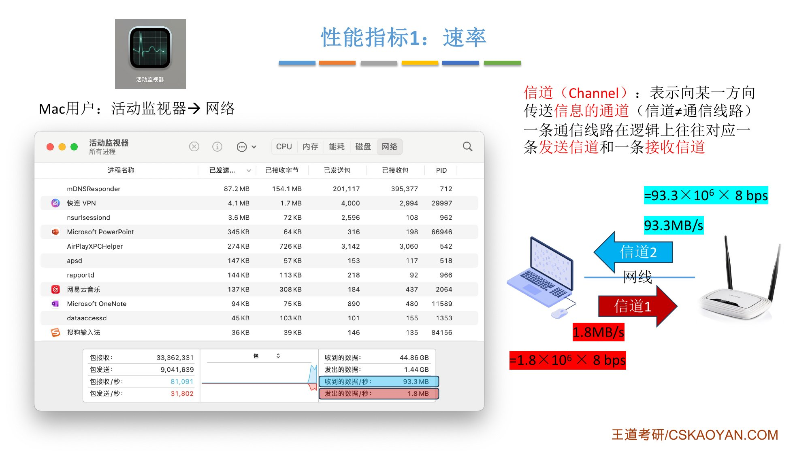{.slide width=0.55}

::: def
**速率**（Speed）：连接到网络上的节点在信道上传输数据的速率。也称**数据率**、**比特率**、[**数据传输速率**]{.red}（真题最常用的说法）。

**单位**：bit/s，或 b/s，或 [bps]{.red}（bit per second，真题最常用），三种写法完全等价。
:::

::: pitfall
**大 B 和小 b**：[B = Byte（字节），b = bit（比特），1 B = 8 b]{.red}。有时速率会用 B/s 表示，1 MB/s 和 1 Mb/s 差 8 倍。

例：活动监视器上的 1.8 MB/s $= 1.8\times10^6\times8$ bps；Windows 上的 120 kbps $=120\times10^3$ bps，1.3 Mbps $=1.3\times10^6$ bps。
:::

**数量前缀**：

::: {.tbl widths="1.6,1,1,1,1,1.6"}
| 科目 | k / K | M | G | T | 说明 |
|---|---|---|---|---|---|
| **计算机网络** | $10^3$ | $10^6$ | $10^9$ | $10^{12}$ | 每级 ×$10^3$；计网题目默认如此（除非特别说明） |
| **计组、操作系统** | $2^{10}$ | $2^{20}$ | $2^{30}$ | $2^{40}$ | 每级 ×$2^{10}$；计组、操作系统题目默认如此 |
:::

例：计组题说某总线速率 8 MB/s，要算作 $8\times2^{20}$ B/s；计网题看到 8 Mbps，算作 $8\times10^6$ bps。算题时[先统一单位：看清是 B 还是 b，再看有没有数量前缀]{.u}。

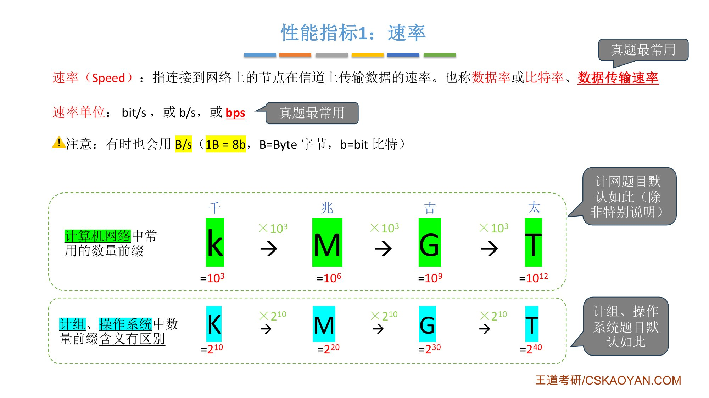{.slide width=0.6}

::: book
王道书第 7 页：速率是连接到网络上的节点在**数字信道**上传送数据的速率，也称数据传输速率、数据率或比特率，单位为 b/s（比特/秒）或 bit/s（有时也写为 bps）。数据率较高时，常用 kb/s（$k=10^3$）、Mb/s（$M=10^6$）或 Gb/s（$G=10^9$）表示。

书上的"注意"：[在描述**数据量**时，K、M、G 常用 2 的幂次表示，如 $1\,\text{KB}=2^{10}\,\text{B}$；在描述**速率**时，k、M、G 常用 10 的幂次表示，如 $1\,\text{kb/s}=10^3\,\text{b/s}$]{.u}。通常，前者使用大写 K，后者使用小写 k，但其他前缀均为大写。
:::

::: add
**补充（课件和书的说法对照）**：课件按**科目**分（计网用 $10^3$、计组和操作系统用 $2^{10}$）；王道书按**描述对象**分（速率用 $10$ 的幂、数据量用 $2$ 的幂）。两者对**速率**一致：计网里的速率一律按 $10^3$。对计网题里的**数据量**（如文件"1 MB"），题目常会注明，例如本节第五部分的 2023 年真题就写了"注：$M=10^6$"；有注明就按注明算。
:::

# 二、带宽

::: cue
带宽有哪两种含义、单位各是什么？两台主机之间实际能达到的最高速率由什么决定？
:::

::: def
**带宽**（bandwidth）：某信道所能传送的[最高数据率]{.red}。单位 bps（或 b/s、bit/s），可加数量前缀 k、M、G、T。
:::

**例子：宽带套餐**。中国电信 999 元一年的 1000 兆宽带：ISP 路由器到你家的**下行信道**最高数据传输速率 = 1000 Mbps，即下行带宽 1000 Mbps，下载速度最高 $1000\div8=125$ MB/s（很多下载软件用大 B 作单位）；**上行**带宽只有 30 Mbps，你家往外传数据最快不超过 30 Mbps。

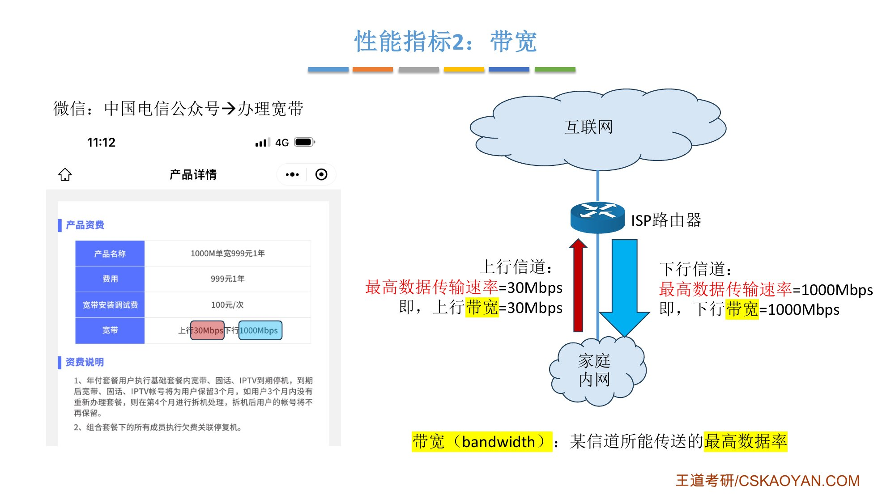{.slide width=0.55}

**例题 1**：主机 A 和 B 之间的链路带宽为 100 Mbps，A 的网卡速率为 1 Gbps，B 的网卡速率为 10 Mbps，A 给 B 发送数据的最高理论速率为？[答案 B：10 Mbps]{.red}。B 的网卡收发都不可能超过 10 Mbps，A 和链路再快也没用；A 强行发得更快，B 来不及接收，数据会丢失，传输失败。

::: def
**结论**：[节点间通信实际能达到的最高速率，由**带宽**、**节点性能**共同限制]{.red}。
:::

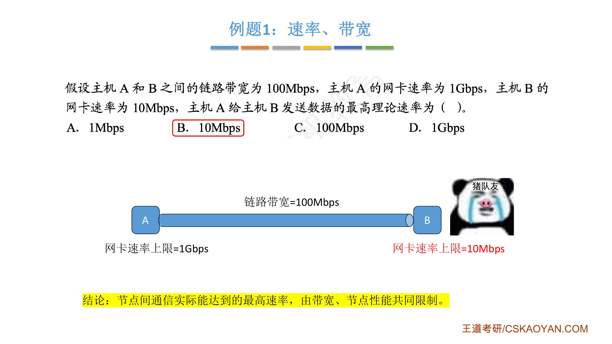{.slide width=0.55}

**学以致用**：开通了千兆宽带却达不到，先查瓶颈。运营商的光纤接到光猫（调制解调器，把光信号转成网线上传输的电信号），光猫再用网线连家用路由器。如果这根是**五类网线**（带宽 100 Mbps），家里能用的带宽就不会超过 100 Mbps；**六类网线**可达 1000 Mbps，千兆宽带够用；八类网线可达 40 Gbps，但贵很多、没必要。老路由器的 **WAN 口**也可能是瓶颈：老师舅舅家开通 300 兆宽带，路由器 WAN 口最高只有 100 Mbps，家里总带宽就小于 100 Mbps。

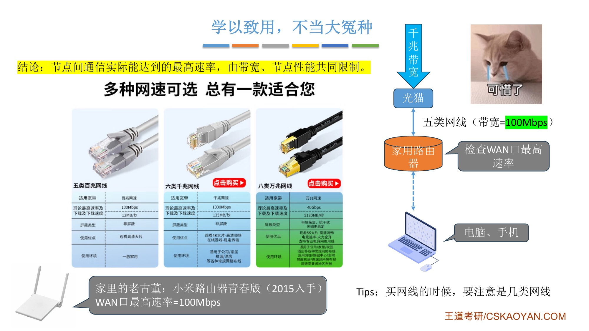{.slide width=0.55}

**带宽的另一种含义**（通信原理）：

::: def
在《通信原理》（通信领域的一门基础学科）中，**带宽**表示某信道[允许通过的信号频带范围]{.u}，单位 [Hz（赫兹）]{.red}，可加数量前缀 k、M、G、T。
:::

信道传播的是**电磁波**信号（光纤里的光、无线通信用的电磁波都是），电磁波有**波长**和**频率**两个基本性质，频率是一秒钟振动多少次，单位 Hz。

**不严谨的类比：人眼的"带宽"**。人眼能看到频率在 400 THz（深红光）到 750 THz（深紫光）之间的光，低于 400 THz 是红外线，高于 750 THz 是紫外线。把人眼看作一条"视觉信道"，它允许通过的频带范围是 $750-400=350$ THz，就是人眼的带宽。假如你是奥特曼，能看到红外线、紫外线，眼睛的带宽更大，能捕捉的信息更丰富，传输数据的能力更强。

再如：光纤的带宽约 500 MHz，电话线约 3 kHz，所以光纤网络通常能达到更高的数据率。

::: def
**两种含义本质一样**：[都反映信道传输数据的能力，带宽越大，传输数据的能力越强]{.red}。计算机网络中[大多数情况下"带宽"指第一种含义（最高数据率，bps）]{.u}；只有**香农定理、奈氏准则**相关的考题中指第二种（Hz）。两者的内在联系就是这两个定理，第 2 章学。
:::

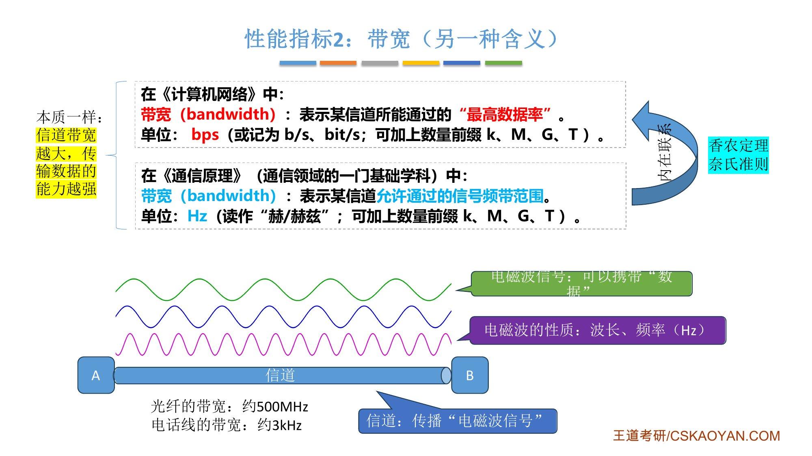{.slide width=0.6}

::: book
王道书第 7 页：在通信领域，带宽是指通信线路允许通过的信号频率范围，单位是赫兹（Hz）；但在计算机网络中，带宽表示网络通信线路所能传送数据的能力，指[数字信道所能支持的最高数据传输速率]{.u}，单位为 b/s。注意，[节点间的实际可用带宽由双方网卡的性能、各段链路的带宽以及交换设备速率中的**最小值**决定]{.red}。
:::

# 三、吞吐量

::: cue
吞吐量和带宽有什么区别？一根网线的吞吐量怎么算？
:::

::: def
**吞吐量**（Throughput）：指[单位时间内]{.u}通过某个网络（或信道、接口）的[实际数据量]{.red}。吞吐量受带宽限制，也受实际的网络负载情况影响。
:::

还是老师那台台式机（发送信道 1.8 MB/s，接收信道 93.3 MB/s）：

- 信道 1 的吞吐量 = 1.8 MB/s，信道 2 的吞吐量 = 93.3 MB/s；
- **这根网线**的吞吐量 = 两个方向加起来 = $1.8+93.3=95.1$ MB/s；
- 这台**电脑网卡**（网络接口卡）的吞吐量也是 $1.8+93.3=95.1$ MB/s；
- 再加上手机和路由器之间 10 MB/s、iPad 和路由器之间 8 MB/s，**整个家庭内网**的吞吐量 $=93.3+1.8+10+8$ MB/s。

吞吐量反映某个信道、接口或网络此刻的数据传输总量，即[实际的综合数据率]{.u}，可以理解为它的综合负载。网络工程师常用它判断负载；老师说考研中吞吐量很少涉及，有大致了解即可。

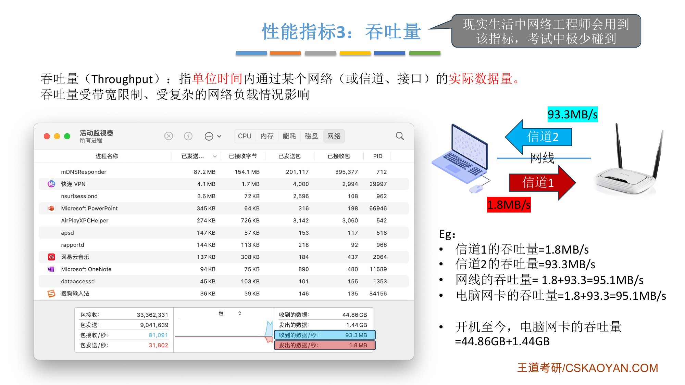{.slide width=0.6}

::: fix
课件这页右下角写"开机至今，电脑网卡的吞吐量 = 44.86 GB + 1.44 GB"。按定义，吞吐量是[单位时间内]{.u}的数据量（单位 bps 或 B/s），"开机至今"累计收发的 44.86 GB、1.44 GB 是**数据总量**，不是吞吐量。老师在视频里没有讲这一行。
:::

::: book
王道书第 7 页：吞吐量常用于对实际网络进行测量，以评估[真实可达到的数据传输能力]{.u}。书上在这里标了考点追踪"**分组交换的吞吐量分析（2024）**"，所以吞吐量并非完全不考。
:::

# 四、时延

::: cue
总时延由哪四部分组成？发送时延和传播时延各由什么决定？考试一般考虑哪几项？
:::

::: def
**时延**（Delay）：指数据（一个报文或分组，甚至比特）从网络（或链路）的一端传送到另一端所需的时间。有时也称为**延迟**或**迟延**。

$$\text{总时延} = \text{发送时延} + \text{传播时延} + \text{处理时延} + \text{排队时延}$$
:::

::: {.tbl widths="1.1,2.6,2.3"}
| 时延 | 含义 | 计算 / 影响因素 |
|---|---|---|
| **发送时延** | 又名**传输时延**。节点将数据推向信道所花的时间 | [数据长度（bit）÷ 发送速率（bit/s）]{.red} |
| **传播时延** | 电磁波在信道中传播一定的距离所花的时间 | [信道长度（m）÷ 电磁波在信道中的传播速率（m/s）]{.red} |
| **处理时延** | 被路由器处理所花的时间（如：分析首部、查找存储转发表） | 受网络负载、路由器性能等多因素影响，[考试中一般不用考虑]{.u} |
| **排队时延** | 数据排队进入、排队发出路由器所花的时间 | 同上 |
:::

::: pitfall
**发送时延又名"传输时延"，和"传播时延"极易混淆**，读题、做题时要分清：前者看[数据长度和发送速率]{.u}，后者看[信道长度和传播速率]{.u}。
:::

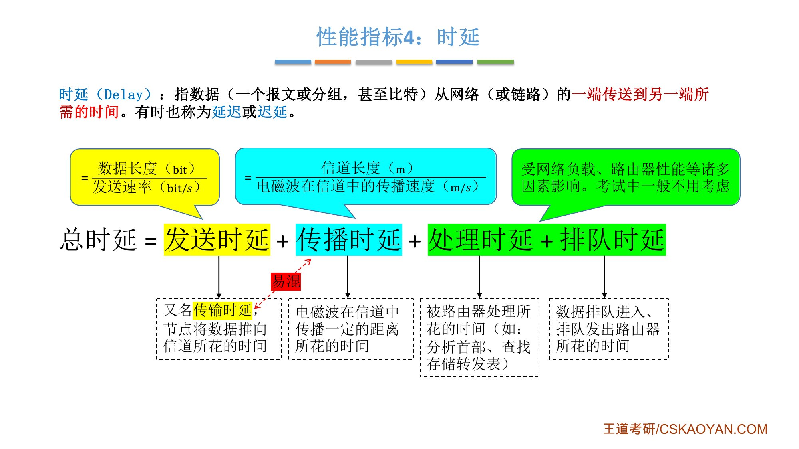{.slide width=0.6}

**模型：主机 A → 信道 1 → 路由器 → 信道 2 → 主机 B**。A 给 B 发 80 Mb 数据，发送速率 100 Mbps：

- **发送时延**：把 80 Mb 推上信道 1 需要 $80\text{ Mb}\div100\text{ Mbps}=0.8$ s；
- **传播时延**：数据以电磁波的形式在信道上传播，不同材质速度不同（课件：铜线电缆 1000 km，电磁波速 $2.3\times10^5$ km/s；光纤 2000 km，$2.0\times10^5$ km/s），用长度除以速度；
- **处理时延**：路由器每收到一个完整分组，要判断有没有错、该转发到哪里；
- **排队时延**：路由器要处理的分组太多时，分组在输入队列（缓冲区）里排队等待处理，在输出队列里排队等待发出。路由器性能越好处理时延越低，负载越高排队时延越高。

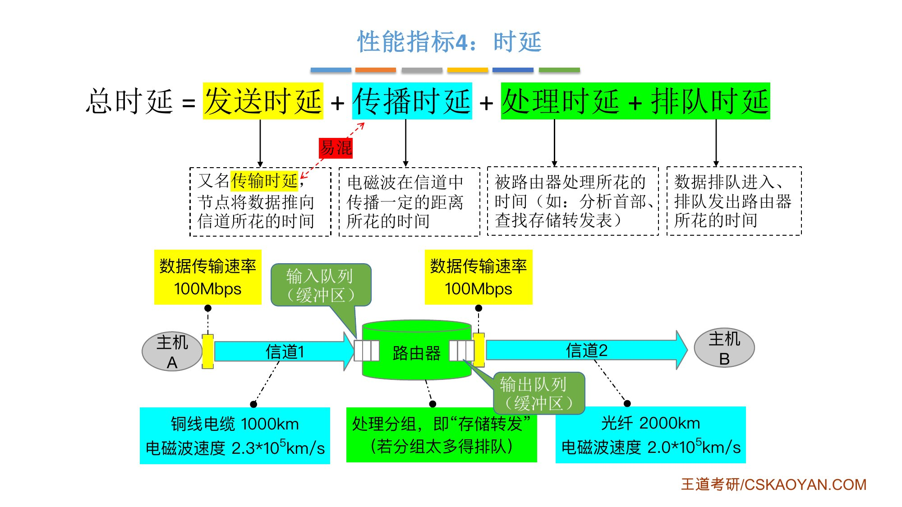{.slide width=0.6}

**高速公路类比**：城市 A 和 B 之间有两段高速路，中间一个加油站。

- A 市收费站每分钟只放 10 辆车上高速，100 辆车要 10 分钟——这是**发送（传输）时延** $=$ 车辆总数 ÷ 发车速率；
- 每辆车上了高速以限速飙车，路段 1 长 400 km、限速 100 km/h，跑完要 4 小时——这是**传播时延** $=$ 路程 ÷ 车速；
- 加油站给每辆车加油的时间——**处理时延**；车多时排队进站、排队出站的时间——**排队时延**。

计算机网络中，[一个比特就是一辆车]{.u}：节点按一定速率把比特逐一发到信道上，比特一上信道就以固定速率传播。

::: def
[每经过一条信道，就产生一次发送时延和一次传播时延；每经过一个中间节点，就产生一次处理时延和排队时延]{.red}。考试中如果题目不特别说明，通常[只考虑发送时延和传播时延]{.red}。
:::

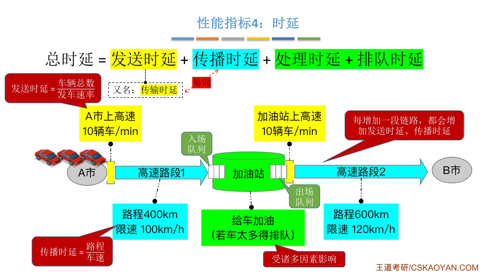{.slide width=0.6}

**例题 2**：H1 给 H2 发送一个数据分组，分组大小 1000 B。H1 往链路 A 发送数据的速率为 100 Mbps，路由器往链路 B 发送数据的速率为 80 Mbps。链路 A 传播时延 0.01 ms，链路 B 传播时延 0.05 ms。不考虑路由器的处理时延、排队时延，求传输整个分组的总时延。

1. H1 → 链路 A 的发送时延 $=\dfrac{1000\text{ B}}{100\text{ Mbps}}=\dfrac{8000\text{ b}}{10^8\text{ b/s}}=8\times10^{-5}\text{ s}=0.08$ ms；
2. 链路 A 传播 0.01 ms：第 0.01 ms 第一个比特到达路由器，[第 0.09 ms 路由器收完整个分组]{.u}，之后才能处理、转发；
3. 路由器 → 链路 B 的发送时延 $=\dfrac{8000\text{ b}}{80\times10^6\text{ b/s}}=10^{-4}\text{ s}=0.1$ ms；
4. 链路 B 传播 0.05 ms。

[总时延 $=0.01+0.08+0.05+0.1=0.24$ ms]{.red}，其中 0.01、0.05 是传播时延，0.08、0.1 是发送时延。

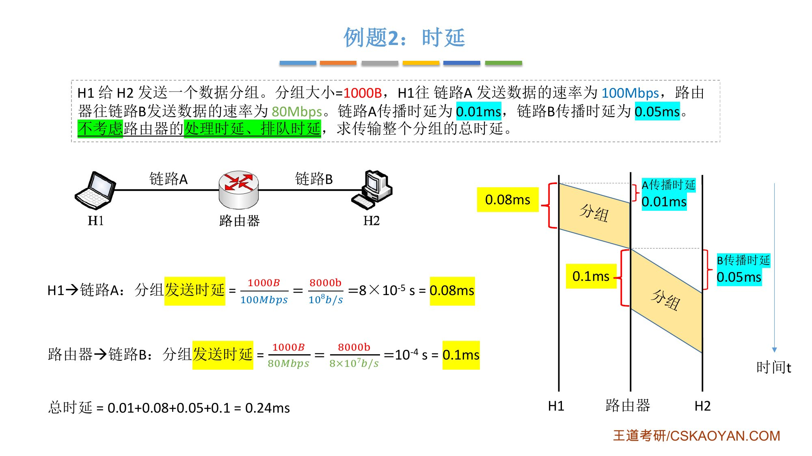{.slide width=0.6}

**例题 3**：条件同上，但路由器对分组的处理时延、排队时延 = 0.04 ms。路由器收完整个分组后要再花 0.04 ms 排队和处理，[总时延 $=0.01+0.08+0.04+0.05+0.1=0.28$ ms]{.red}。

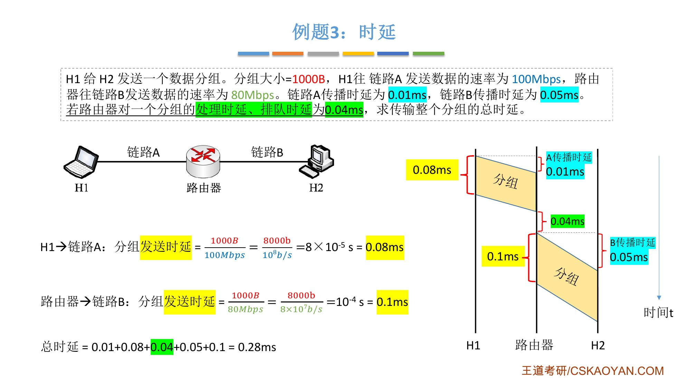{.slide width=0.6}

::: book
王道书第 7–8 页用的是同一个例子（图 1.6：链路 1 100 Mb/s，链路 2 80 Mb/s，1000 B 的分组），分三种场景：

- ① 忽略传播时延、处理时延和排队时延：总时延 $=0.08+0.1=0.18$ ms；
- ② 考虑传播时延（0.01 ms 和 0.05 ms）：$0.24$ ms；
- ③ 再考虑处理时延和排队时延（合计 0.04 ms）：$0.28$ ms。

书上的定义：**发送时延**是节点将分组的所有比特推入链路所需的时间，即[从发送分组的第一个比特开始，到最后一个比特发送完毕为止]{.u}的时间；**传播时延**是电磁波在信道中传播一定距离所需的时间，即一个比特从链路一端传播到另一端所需的时间。注意区分：[前者取决于分组长度和发送速率，后者取决于链路距离和传输介质]{.red}。处理时延：分组在交换节点为存储转发而进行必要处理所花费的时间，例如解析分组的首部、进行差错检验或查找路由等。排队时延：分组在路由器的输入队列或输出队列中等待处理或转发所花费的时间。书上标注的考点追踪：网络时延的分析（2010、2013、2023、2025）。
:::

# 五、时延带宽积

::: cue
时延带宽积的单位是什么？它的物理含义是什么？
:::

::: def
$$\text{时延带宽积} = \text{传播时延} \times \text{带宽}$$

含义：[一条链路中，已从发送端发出但尚未到达接收端的最大比特数]{.red}。单位：bit。
:::

第一个比特要经过一个传播时延才到达接收端；在这段时间里，发送方一直以最高数据率（带宽）往链路上打新的数据。例：带宽 100 Mbps、传播时延 1 s，时延带宽积 $=100\text{ Mbps}\times1\text{ s}=100$ Mb。

**水管类比**：带宽是水管的横截面，传播时延是水管的长度，时延带宽积就是水管里能装的水量。

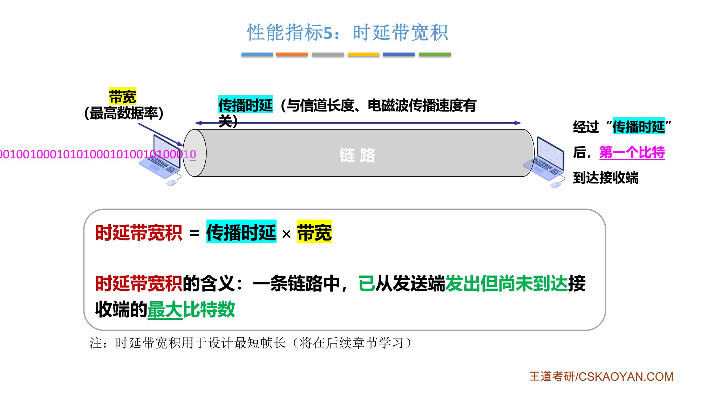{.slide width=0.6}

老师说时延带宽积考试中很少涉及，主要用于设计最短帧长（后续章节学），有初步印象、记住怎么算即可。

**例题 4（2023 年 408 第 33 题）**：主机 H1、H2 通过路由器互连，2 段链路的带宽均为 100 Mbps、时延带宽积（即单向传播时延 × 带宽）均为 1000 bit。H1 向 H2 发送 1 个大小为 1 MB 的文件，分组长度为 1000 B，则从 H1 开始发送时刻起到 H2 收到文件全部数据时刻止，所需的时间至少是？（注：$M=10^6$）A. 80.02 ms　B. 80.08 ms　C. 80.09 ms　D. 80.10 ms

1. 分组个数 $=1\text{ MB}\div1000\text{ B}=10^6\div10^3=1000$ 个；
2. 每个分组的发送时延 $=\dfrac{1000\text{ B}}{100\text{ Mbps}}=\dfrac{8000\text{ b}}{10^8\text{ b/s}}=0.08$ ms（[注意大 B 换成小 b]{.u}）；
3. 题目没给链路长度和电磁波速度，但给了时延带宽积：单向传播时延 $=1000\text{ b}\div(100\times10^6\text{ b/s})=10^{-5}\text{ s}=0.01$ ms；
4. 不考虑路由器的处理、排队时延，路由器每收完一个分组就立即转发。第 1 个分组：H1 发送 0.08 ms + 传播 0.01 ms，第 0.09 ms 路由器收完；路由器再发送 0.08 ms + 传播 0.01 ms，第 0.18 ms H2 收完。此后 H2 [每隔 0.08 ms 收完下一个分组]{.u}（路由器转发第 $k$ 个的同时，H1 在发第 $k+1$ 个）；
5. 总时间 $=0.01+0.08+0.01+0.08\times1000=80.10$ ms，[选 D]{.red}。

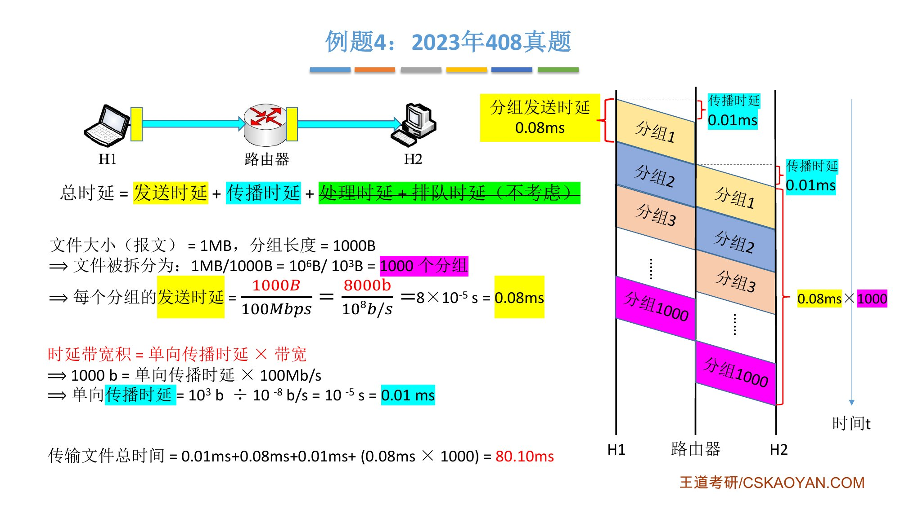{.slide width=0.6}

::: teacher
老师强调：这是 2009～2024 年唯一一道涉及时延带宽积的题，时延带宽积只是用来求单向传播时延，[本质上考的还是时延]{.u}。
:::

::: add
**补充：把第 4 步写成通式**（自己整理，便于以后套用；前提是不计处理、排队时延，各段链路发送速率相同）。设分组个数 $n$，每个分组的发送时延 $T_s$，经过 $k$ 段链路，每段传播时延 $T_p$：

$$T = k\,(T_s + T_p) + (n-1)\,T_s$$

前一项是**第一个分组**走完全程的时间，后一项是**剩下 $n-1$ 个分组**陆续到达的时间。代入例题 4：$k=2$，$T_s=0.08$，$T_p=0.01$，$n=1000$，$T=2\times0.09+999\times0.08=0.18+79.92=80.10$ ms，与老师的算法一致。若各段链路速率不同（如例题 2），就要像例题 2 那样逐段画图，不能直接套。
:::

::: book
王道书第 8 页：时延带宽积指发送端发送的第一个比特即将到达接收端时，发送端已发出的比特总数，即已发出但尚未到达接收端的最大比特数，[也称以比特为单位的链路长度]{.u}。可将链路想象为一条圆柱形管道：长度表示传播时延，横截面积表示链路带宽，时延带宽积表示[该管道可容纳的比特数量]{.u}。
:::

# 六、往返时延 RTT

::: cue
RTT 从什么时候开始算？数据的发送时延算不算在 RTT 里？
:::

::: def
**往返时延 RTT**（Round-Trip Time）：表示从发送方[**发送完数据**]{.red}，到发送方**收到来自接收方的确认**总共经历的时间。
:::

很多情况下，接收方收到数据后要回一个确认（像回复"好的，收到""已读"），保证传输可靠。课件的图（为简化，发送方和接收方直连，不分析中间的其他节点）：

- $t_1$：发送方发送数据的发送时延（[不计入 RTT]{.red}）；
- $t_2$："数据"的单向传播时延；
- $t_3$：接收方收到数据后的处理时延；
- $t_4$："确认"的发送时延；
- $t_5$："确认"的传播时延（通常 $t_5$ 与 $t_2$ 相等）。

$$\text{RTT} = t_2 + t_3 + t_4 + t_5$$

中间如果还有路由器，无非是多了这些节点的存储转发，原理类似。

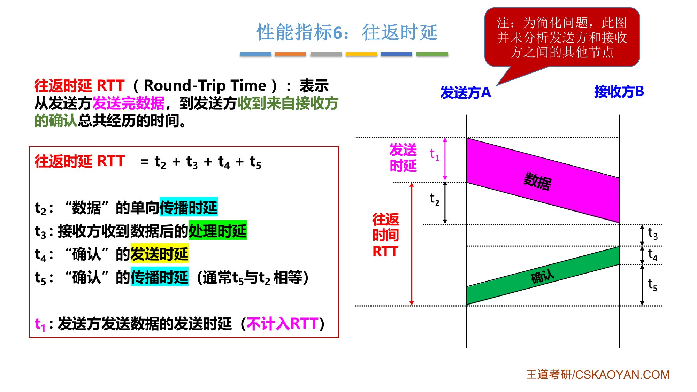{.slide width=0.6}

**生活中的 RTT**：游戏界面上显示的"延迟"，反映的就是手机到游戏服务器之间的 RTT。你按下按键，动作被封装成数据发给服务器，服务器响应后返回结果，手机收到才渲染画面。延迟越高，按键后画面反应越卡。

::: teacher
老师说明了为什么从"发送完数据"开始计时：谢希仁《计算机网络》第 8 版的定义特别强调了这一点；有的教材把 RTT 定义为从发送方**开始发送**数据到收到确认为止。大部分学校的计算机考研和 408 统考主要参考谢希仁教材，所以[以谢希仁的定义为准]{.u}。
:::

::: book
王道书第 8 页：往返时延指从发送端**发出一个短分组**，到收到接收端返回的确认信号所经历的总时间。往返时延包括：发送端与接收端之间的往返传播时延、接收端的处理时延；在互联网环境中，还包括各中间节点的处理时延和排队时延。注意，[往返时延不包括数据分组本身的发送时延]{.red}。
:::

::: add
**课件和王道书的图有一处不同**：两者都不计数据本身的发送时延。课件的 RTT 计入了确认的发送时延（$t_4$）；王道书图 1.9 标注"[忽略确认分组的发送时延]{.u}"，写成 $\text{RTT}=t_2+t_3+t_4$，其中书上的 $t_2$、$t_4$ 是两个方向的单向传播时延，$t_3$ 是接收端处理时延。确认分组通常很短，它的发送时延计不计入，做题时以题目条件为准。
:::

# 七、信道利用率

::: cue
信道利用率怎么算？为什么不能太低也不能太高？
:::

::: def
**信道利用率**：某个信道有百分之多少的时间是有数据通过的。

$$\text{信道利用率} = \frac{\text{有数据通过的时间}}{\text{有数据通过的时间} + \text{没有数据通过的时间}}$$
:::

**例题 5**：手机 H1 和 H2 通过蓝牙连接，连接时长 1 分钟。期间 H1 给 H2 以 80 Mbps 的速率传输了 20 张大小为 10 MB 的照片，求蓝牙连接期间的信道利用率。

$$\text{信道利用率}=\frac{(20\times10\text{ MB})/80\text{ Mbps}}{1\text{ min}}=\frac{(20\times10\times8\text{ Mb})/80\text{ Mbps}}{60\text{ s}}=\frac{20\text{ s}}{60\text{ s}}\approx33.3\%$$

（[大 B 换成小 b 要乘 8]{.u}。）

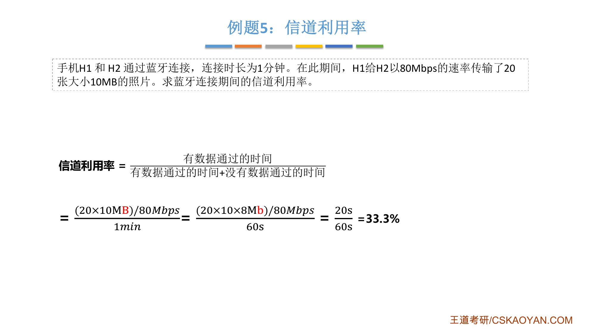{.slide width=0.55}

- 信道利用率[不能太低]{.red}：浪费信道的带宽资源（规划不合理的高速路，车很少，浪费资源）；
- 也[不能太高]{.red}：容易导致**网络拥塞**（节假日高速路车道利用率极高，反而堵车），网络整体性能大幅下降。

**网络利用率**：把网络中所有信道的利用率求加权平均。计算较复杂，考试很少涉及，网络工程中会用。

::: book
王道书第 9 页：信道利用率并非越高越好：过低会浪费网络资源；[过高则会导致排队时延显著增加]{.u}，引发网络拥塞。这就好比当公路上的车流量很大时，容易出现拥堵。
:::

# 八、知识回顾

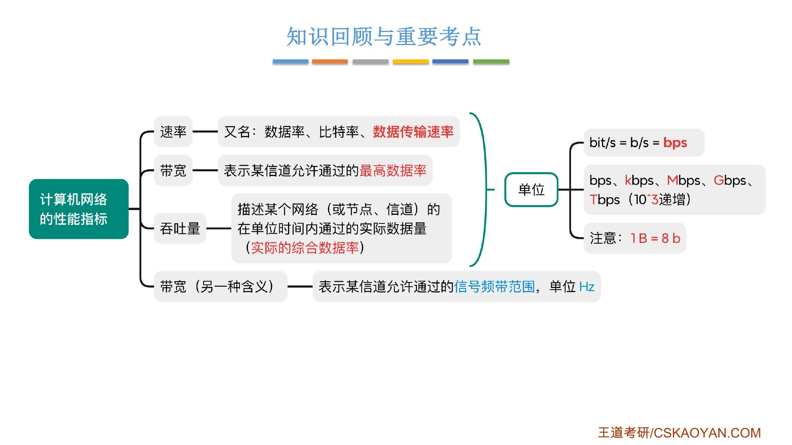{.slide width=0.6}

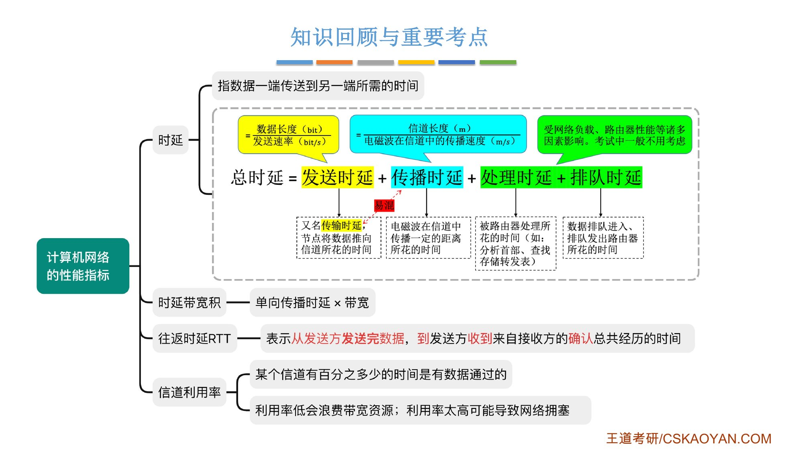{.slide width=0.6}

::: summary
**速率**：又名数据率、比特率、[数据传输速率]{.red}；单位 bit/s = b/s = bps。计网中 k、M、G、T 依次 ×$10^3$（计组、操作系统 ×$2^{10}$）；[1 B = 8 b]{.red}。

**带宽**：某信道允许通过的[最高数据率]{.red}（bps）；另一种含义：信道允许通过的信号频带范围（Hz），只在香农定理、奈氏准则题里用。节点间实际最高速率由带宽和节点性能（取最小）共同限制。

**吞吐量**：单位时间内通过某个网络（信道、接口）的实际数据量，即实际的综合数据率。

**时延** = 发送时延（数据长度 ÷ 发送速率，又名传输时延）+ 传播时延（信道长度 ÷ 传播速率）+ 处理时延 + 排队时延。每段信道一次发送 + 一次传播；考试一般只算前两项。

**时延带宽积** = 单向传播时延 × 带宽（bit），链路中已发出未到达的最大比特数。

**往返时延 RTT**：从发送方[发送完数据]{.red}到收到确认为止，不含数据本身的发送时延。

**信道利用率** = 有数据通过的时间 ÷ 总时间；不能太低（浪费），也不能太高（拥塞）。

**自测**：① 1.8 MB/s 是多少 bps？② A 网卡 1 Gbps、链路 100 Mbps、B 网卡 10 Mbps，最高速率是多少？③ 发送时延和传播时延分别取决于什么？④ 2023 年第 33 题的 80.10 ms 由哪几段组成？⑤ RTT 为什么不含 $t_1$？
:::
